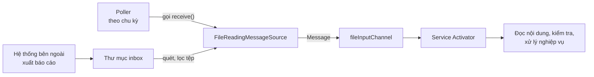

# File inbound channel adapter đọc thư mục

## 1. Mục tiêu bài học

Trong phạm vi **SPRING_INTEGRATION_ADAPTERS**, Spring Integration kết nối hệ thống bên ngoài bằng inbound/outbound adapter, gateway, poller và `MessageChannel`. Bài này tập trung vào tình huống thực tế: **một hệ thống khác xuất tệp vào thư mục và ứng dụng Spring chủ động lấy tệp để xử lý**.

Sau bài học, bạn có thể:

- Giải thích vì sao File inbound channel adapter là điểm **nhận dữ liệu một chiều** từ hệ thống tệp vào luồng Spring Integration.
- Cấu hình `FileReadingMessageSource`, `Poller`, `MessageChannel` và bộ lọc tệp.
- Phân biệt việc **phát hiện tệp**, **đọc nội dung** và **xử lý nghiệp vụ thành công**.
- Nhận diện rủi ro tệp đang được ghi, xử lý lặp, khởi động lại ứng dụng và lỗi trong consumer.
- Kiểm tra được luồng đọc tệp bằng một ví dụ Spring Boot nhỏ.

## 2. File inbound channel adapter hoạt động như thế nào?

Giả sử một hệ thống kế toán không gọi HTTP API mà xuất tệp `*.csv` vào thư mục dùng chung. Ứng dụng của chúng ta cần lấy những tệp này, kiểm tra dữ liệu và chuyển chúng đến tầng nghiệp vụ.

**File inbound channel adapter** tạo đầu vào cho luồng message bằng cách **quét thư mục theo lịch poll**. Thành phần nguồn thường dùng là `FileReadingMessageSource`. Mỗi lần poll, nguồn tìm một tệp phù hợp và đưa nó vào Spring Integration dưới dạng message mà **payload là đối tượng `java.io.File`**.

> Điều quan trọng: adapter thông báo *tệp nào cần xử lý*. Nó không mặc nhiên đọc toàn bộ nội dung tệp, parse CSV, xóa tệp hay chuyển tệp sang thư mục lưu trữ. Các thao tác đó thuộc những bước xử lý phía sau.



Luồng trên có bốn trách nhiệm tách biệt:

| Thành phần | Vai trò | Điều không tự thực hiện |
| --- | --- | --- |
| `FileReadingMessageSource` | Quét thư mục, chọn tệp và phát ra `Message<File>` | Không tự parse nội dung hoặc xác nhận nghiệp vụ thành công |
| `Poller` | Chủ động gọi nguồn theo lịch, điều tiết lượng message mỗi đợt | Không biến thư mục thành cơ chế push theo thời gian thực |
| `MessageChannel` | Chuyển message đến bước kế tiếp | Không tự xác định tệp đã xử lý an toàn |
| `Service Activator` hoặc transformer | Đọc, biến đổi hoặc xử lý payload | Không tự quyết định chính sách lưu trữ/làm lại khi thất bại |

Đây là kiểu **inbound adapter**, vì dữ liệu đi *từ hệ thống tệp vào* luồng tích hợp. **File outbound adapter** dùng để ghi tệp ra ngoài. Gateway thích hợp khi cần mô hình yêu cầu–phản hồi; luồng nhận tệp định kỳ trong ví dụ này là một chiều.

## 3. Chuẩn bị dự án

Ví dụ bên dưới sử dụng Spring Boot, Java 17+ và cấu hình Spring Integration bằng annotation. Nếu ứng dụng dùng Spring Boot quản lý phiên bản dependency, có thể khai báo:

```xml
<dependencies>
    <dependency>
        <groupId>org.springframework.boot</groupId>
        <artifactId>spring-boot-starter-integration</artifactId>
    </dependency>
    <dependency>
        <groupId>org.springframework.integration</groupId>
        <artifactId>spring-integration-file</artifactId>
    </dependency>
</dependencies>
```

Chuẩn bị thư mục `data/inbox` tính từ **working directory của tiến trình ứng dụng**. Hệ thống bên ngoài sẽ đặt tệp vào thư mục này, chẳng hạn:

```text
data/
└── inbox/
    ├── orders-001.csv
    ├── orders-002.csv
    └── uploading.tmp
```

Yêu cầu ví dụ: nhận tệp có tên kết thúc bằng `.csv`, mỗi hai giây kiểm tra thư mục, tối đa năm message trong một lần poll, rồi đọc nội dung UTF-8 để quan sát kết quả. Tệp `uploading.tmp` chưa được nhận.

## 4. Cấu hình luồng nhận tệp hoàn chỉnh

```java
import java.io.File;
import java.io.IOException;
import java.nio.charset.StandardCharsets;
import java.nio.file.Files;
import java.nio.file.Path;

import org.springframework.context.annotation.Bean;
import org.springframework.context.annotation.Configuration;
import org.springframework.integration.annotation.InboundChannelAdapter;
import org.springframework.integration.annotation.Poller;
import org.springframework.integration.annotation.ServiceActivator;
import org.springframework.integration.channel.DirectChannel;
import org.springframework.integration.config.EnableIntegration;
import org.springframework.integration.core.MessageSource;
import org.springframework.integration.file.FileReadingMessageSource;
import org.springframework.integration.file.filters.AcceptOnceFileListFilter;
import org.springframework.integration.file.filters.CompositeFileListFilter;
import org.springframework.integration.file.filters.SimplePatternFileListFilter;
import org.springframework.messaging.MessageChannel;

@Configuration
@EnableIntegration
public class FileInboundConfig {

    private static final Path INBOX = Path.of("data", "inbox");

    @Bean
    public MessageChannel fileInputChannel() {
        return new DirectChannel();
    }

    @Bean
    @InboundChannelAdapter(
        channel = "fileInputChannel",
        poller = @Poller(fixedDelay = "2000", maxMessagesPerPoll = "5")
    )
    public MessageSource<File> fileMessageSource() {
        FileReadingMessageSource source = new FileReadingMessageSource();
        source.setDirectory(INBOX.toFile());

        CompositeFileListFilter<File> filters = new CompositeFileListFilter<>();
        filters.addFilter(new SimplePatternFileListFilter("*.csv"));
        filters.addFilter(new AcceptOnceFileListFilter<>());
        source.setFilter(filters);

        return source;
    }

    @ServiceActivator(inputChannel = "fileInputChannel")
    public void processCsv(File file) throws IOException {
        String contents = Files.readString(
            file.toPath(), StandardCharsets.UTF_8
        );
        System.out.printf(
            "Da doc %s: %d ky tu%n",
            file.getName(),
            contents.length()
        );
    }
}
```

Trong một ứng dụng Spring Boot thông thường, `@SpringBootApplication` cung cấp cấu hình khởi động ứng dụng; lớp `FileInboundConfig` cần nằm trong phạm vi component scan hoặc được import vào context. Thư mục phải tồn tại và tiến trình cần có quyền đọc.

### Đọc từng phần cấu hình

**`FileReadingMessageSource`** nhận một thư mục qua `setDirectory(...)`. Khi được poll, nó tìm tệp thích hợp. Payload phát ra là `File`, vì vậy consumer nhận đường dẫn/tham chiếu đến tệp rồi mới tự mở và đọc nội dung. Không nên hiểu payload ở bước này là chuỗi CSV hay mảng byte.

**`@InboundChannelAdapter`** kết nối nguồn với `fileInputChannel`. Cấu hình `@Poller(fixedDelay = "2000", maxMessagesPerPoll = "5")` có nghĩa là lịch poll sử dụng khoảng trễ cố định 2.000 ms và mỗi đợt lấy tối đa năm message nếu nguồn còn tệp. Độ trễ từ lúc đặt tệp đến lúc xử lý phụ thuộc thời điểm poll, tải hệ thống và thời gian consumer chạy; đây không phải cam kết xử lý chính xác sau hai giây.

**`DirectChannel`** chuyển message trực tiếp tới subscriber trong luồng gọi gửi message. Với cấu hình ví dụ, thời gian chạy `processCsv` có thể ảnh hưởng tốc độ poll. Khi cần tách tốc độ nhận và xử lý, phải thiết kế thêm queue/executor và chính sách giới hạn tải thay vì chỉ tăng tần suất quét.

**`@ServiceActivator`** nối một phương thức Java vào channel. Spring Integration chuyển payload `File` tới tham số `processCsv(File file)`. Nếu cần truy cập headers, phương thức có thể nhận `Message<File>` và dùng `message.getPayload()`. Ở ví dụ này, phương thức chỉ **đọc và in số ký tự** để dễ kiểm chứng; nó chưa xác thực CSV, lưu database hay chuyển tệp sang archive.

**`CompositeFileListFilter`** kết hợp hai quy tắc:

1. `SimplePatternFileListFilter("*.csv")` giới hạn tệp có tên phù hợp.
2. `AcceptOnceFileListFilter<File>` tránh phát lại cùng tệp trong vòng đời bộ lọc **đang lưu trạng thái trong bộ nhớ**.

Khi gọi `source.setFilter(...)`, ta chủ động cung cấp toàn bộ bộ lọc cần thiết. Chỉ dùng bộ lọc tên tệp mà bỏ điều kiện *accept once* có thể làm cùng tệp được phát lại qua các chu kỳ poll. Bộ lọc trong ví dụ **không giữ lịch sử bền vững khi ứng dụng khởi động lại**.

## 5. Chạy thử và quan sát

1. Tạo `data/inbox` tại working directory của ứng dụng, rồi khởi động Spring Boot.
2. Thêm tệp `orders-001.csv` với nội dung:

   ```csv
   order_id,total
   OD-001,120000
   OD-002,95000
   ```

3. Quan sát log tương tự `Da doc orders-001.csv: ... ky tu` sau khi poller phát hiện tệp.
4. Thêm `notes.txt` và `orders-002.csv`; chỉ tệp CSV phù hợp được nhận.
5. Để nguyên `orders-001.csv` và quan sát các lần poll sau: với bộ lọc `AcceptOnceFileListFilter` còn trong bộ nhớ, tệp đó không bị phát lại chỉ vì nó vẫn nằm trong thư mục.

Hai hiện tượng cần ghi nhận: **tệp gốc vẫn còn trong `inbox`** sau khi đọc thành công, và nếu khởi động lại ứng dụng với bộ lọc trong ví dụ, tệp cũ có thể được nhận lại vì trạng thái accept-once trong bộ nhớ đã mất. Điều này dẫn trực tiếp tới thiết kế xử lý lặp và lưu trạng thái ở phần sau.

## 6. Tệp đang ghi dở: đừng đọc quá sớm

Một poller có thể nhìn thấy `orders-003.csv` ngay khi bên gửi vừa tạo tệp, trước khi bên gửi ghi xong. Nếu consumer mở tệp lúc đó, nội dung có thể thiếu dòng hoặc chưa hoàn chỉnh. Bộ lọc `*.csv` **không chứng minh được tệp đã ghi xong**.

Một hợp đồng trao đổi file dễ kiểm soát là:

1. Bên gửi ghi dữ liệu vào `orders-003.csv.tmp`.
2. Bên gửi đóng file, bảo đảm dữ liệu cần thiết đã được ghi, rồi đổi tên thành `orders-003.csv` khi hoàn tất.
3. Adapter chỉ lọc `*.csv`, nên bỏ qua tệp tạm và nhận tệp sau bước đổi tên.

Nếu có thể, thực hiện đổi tên trong **cùng hệ thống tệp** để tận dụng tính nguyên tử của thao tác rename; cần kiểm tra cách hoạt động thực tế của thư mục chia sẻ và hệ điều hành đang sử dụng. Nếu không thể phối hợp cách đặt tên với bên gửi, có thể cân nhắc `LastModifiedFileListFilter` để chỉ nhận tệp có thời gian sửa cuối đã đủ cũ, hoặc một cơ chế khóa/ready marker phù hợp. Chờ một khoảng thời gian chỉ là biện pháp giảm rủi ro, không bảo đảm tuyệt đối rằng dữ liệu đã hoàn tất.

## 7. Tránh trùng lặp và xử lý lỗi đúng nghĩa

**Phát hiện một tệp chỉ một lần không tương đương xử lý nghiệp vụ chính xác một lần.** Bộ lọc accept-once quản lý việc *chọn và phát tệp*; nó không xác nhận transaction nghiệp vụ đã commit.

Xét tình huống:

1. Adapter chọn `orders-001.csv` và bộ lọc ghi nhận tệp đã được chấp nhận.
2. Consumer bắt đầu đọc và ghi dữ liệu vào cơ sở dữ liệu.
3. Consumer phát sinh exception giữa chừng.
4. Tệp vẫn còn trên đĩa, nhưng bộ lọc trong bộ nhớ có thể không tự phát lại tệp đó.

Vì vậy, không thể xem việc thêm `AcceptOnceFileListFilter` là chính sách retry. Với luồng nghiệp vụ quan trọng, thiết kế thêm các lớp bảo vệ:

| Rủi ro | Biện pháp phù hợp |
| --- | --- |
| Khởi động lại khiến tệp được đọc lại | Dùng bộ lọc chấp nhận một lần có trạng thái bền vững, chẳng hạn `FileSystemPersistentAcceptOnceFileListFilter` kết hợp `MetadataStore` phù hợp; hoặc dời tệp đã hoàn tất khỏi `inbox` |
| Dữ liệu bị ghi trùng vào DB | Gán khóa nghiệp vụ cho bản ghi/tệp và xử lý idempotent, ví dụ unique constraint hoặc bảng lịch sử import |
| Consumer thất bại giữa chừng | Có chính sách retry hữu hạn, ghi log theo tệp, xử lý bù hoặc đưa tệp sang `failed/` để vận hành kiểm tra |
| File được nhận nhưng chưa thực sự xử lý xong | Chỉ đánh dấu nghiệp vụ hoàn tất hoặc chuyển `archive/` sau khi công việc thành công |
| Nhiều instance cùng quét một thư mục | Thiết kế cơ chế sở hữu/khóa hoặc bộ lưu trạng thái chia sẻ có tính nguyên tử; không phụ thuộc vào bộ lọc riêng trong từng JVM |

`FileSystemPersistentAcceptOnceFileListFilter` giúp nhớ thông tin tệp giữa các lần khởi động **khi `MetadataStore` thực sự được lưu bền vững**. Dùng một `MetadataStore` chỉ tồn tại trong bộ nhớ thì chưa đạt mục tiêu đó. Khi nội dung một tệp thay đổi, cách bộ lọc nhận diện sự thay đổi cũng cần được xem xét theo yêu cầu nghiệp vụ.

Ngoại lệ từ consumer cần được quan sát bằng cơ chế xử lý lỗi của luồng/poller, ví dụ xử lý `ErrorMessage` qua `errorChannel` khi được cấu hình phù hợp. Không nên mặc định rằng lỗi sẽ tự được retry an toàn. Đặc biệt, lỗi phát sinh sau khi bộ lọc đánh dấu tệp đã nhận có thể cần một đường phục hồi riêng.

Một quy trình vận hành thường dùng là:

```text
inbox/     -> adapter nhận file -> xác thực/parse -> ghi nghiệp vụ
                                                |-> thành công: archive/
                                                |-> thất bại: failed/ + thông tin lỗi
```

Lưu ý: di chuyển tệp, ghi trạng thái và commit dữ liệu không tự tạo thành một giao dịch nguyên tử xuyên qua hệ thống tệp và DB. Khi độ tin cậy là yêu cầu bắt buộc, cần quy định rõ cách phục hồi sau crash ở từng bước và bảo đảm việc import lặp không làm sai dữ liệu.

## 8. Điều chỉnh poller và hiệu năng

Hai tham số dễ quan sát nhất trong ví dụ:

- `fixedDelay`: khoảng chờ giữa các lần thực hiện poll theo cấu hình lịch; giảm quá thấp gây quét thường xuyên, tăng quá cao khiến dữ liệu được nhận chậm hơn.
- `maxMessagesPerPoll`: giới hạn lượng message nguồn được lấy trong một đợt; giá trị lớn có thể xử lý backlog nhanh hơn nhưng cũng làm consumer chiếm tài nguyên lâu hơn.

Không nên suy luận rằng năm message mỗi lần poll đồng nghĩa năm file được xử lý **song song**. Với `DirectChannel` và consumer đồng bộ, công việc vẫn diễn ra theo luồng gọi hiện tại. Muốn song song cần thiết kế executor, cách giới hạn concurrency và tính an toàn của xử lý nhiều tệp.

Khi có hàng chục nghìn tệp, việc quét toàn bộ thư mục thường xuyên và giữ mọi tệp đã xử lý trong `inbox` có thể gây áp lực I/O và bộ nhớ. Nên giới hạn lượng file tồn đọng, chuyển file đã hoàn thành sang khu vực lưu trữ riêng, theo dõi backlog và thời gian xử lý. Nếu yêu cầu gần thời gian thực, có thể nghiên cứu lựa chọn scanner dựa trên sự kiện của hệ thống tệp nhưng vẫn phải xử lý race condition và cơ chế phục hồi.

## 9. Các tình huống thường gặp

| Hiện tượng | Cần kiểm tra |
| --- | --- |
| Không thấy message nào | Đường dẫn `data/inbox` đang được tính từ working directory nào? Thư mục tồn tại và ứng dụng có quyền đọc không? Tên tệp có khớp `*.csv` không? Poller đã khởi động chưa? |
| Một tệp xuất hiện nhiều lần | Có vô tình thay thế bộ lọc mặc định chỉ bằng bộ lọc pattern không? Ứng dụng có vừa restart không? Có nhiều instance cùng quét không? |
| Tệp đọc thiếu dữ liệu | Bên gửi có đang ghi tệp không? Có quy ước tên tệp tạm và rename khi hoàn tất không? |
| File đã báo lỗi nhưng không được xử lý lại | Bộ lọc đã chấp nhận tệp trước khi consumer lỗi chưa? Đường retry và quy trình đưa vào `failed/` đã được thiết kế chưa? |
| File vẫn nằm trong inbox sau khi xử lý | Đây là hành vi bình thường của cấu hình mẫu; cần thêm bước archive/delete theo chính sách vận hành |
| Nhiều file mới nhưng xử lý chậm | Kiểm tra `maxMessagesPerPoll`, thời gian xử lý đồng bộ, kích thước tệp, tốc độ I/O và tần suất poll |

Ngoài ra, với dữ liệu do hệ thống ngoài cung cấp, cần kiểm tra kích thước file, encoding, cấu trúc CSV và giới hạn tài nguyên trước khi đưa vào nghiệp vụ. Không nên coi một tệp được lọc đúng tên là dữ liệu đáng tin cậy.

## 10. Bài tập thực hành

1. **Thay đổi tốc độ nhận:** đặt `maxMessagesPerPoll = "1"`, thêm ba tệp CSV và quan sát chúng được lấy dần qua các lần poll. Ghi lại ảnh hưởng của thời gian xử lý trong consumer.
2. **Kiểm tra lọc định dạng:** thêm `a.csv`, `b.txt` và `c.csv.tmp`. Giải thích vì sao chỉ một tệp được chấp nhận.
3. **Tái hiện lỗi ghi dở:** thử để bên gửi ghi chậm vào `partial.csv`; sau đó đổi sang quy ước `partial.csv.tmp` → `partial.csv`. So sánh kết quả.
4. **Khởi động lại:** để nguyên một tệp đã xử lý trong `inbox`, restart ứng dụng và quan sát hiện tượng nhận lại. Đề xuất cách tránh import trùng qua restart.
5. **Thiết kế đường lỗi:** mô tả cách ghi lại tên tệp, nguyên nhân thất bại và cách cho phép xử lý lại có kiểm soát mà không nhân đôi dữ liệu trong DB.

### Câu hỏi tự kiểm tra

**Q1.** Message từ `FileReadingMessageSource` chứa gì?  
**Đáp:** Payload thường là `java.io.File` trỏ tới tệp được chọn, không tự động là toàn bộ nội dung của tệp.

**Q2.** Vì sao chỉ dùng `SimplePatternFileListFilter` chưa đủ?  
**Đáp:** Nó lọc theo tên; muốn hạn chế phát lại một tệp qua nhiều lần poll còn cần chiến lược accept-once hoặc quản lý trạng thái tương đương.

**Q3.** Accept-once có bảo đảm file đã được xử lý thành công không?  
**Đáp:** Không. Nó liên quan tới chọn tệp ở nguồn; thành công nghiệp vụ, retry và tính idempotent phải được thiết kế riêng.

**Q4.** Khi nào nên đổi tên từ `*.tmp` sang `*.csv`?  
**Đáp:** Sau khi bên gửi hoàn tất ghi và đóng tệp; đây là tín hiệu giúp adapter tránh nhận tệp đang được tạo dở.

## 11. Ghi nhớ

File inbound channel adapter là điểm nối **filesystem → Spring Integration**. `Poller` kích hoạt `FileReadingMessageSource`; nguồn tạo `Message<File>`; `MessageChannel` chuyển message tới consumer; consumer chịu trách nhiệm đọc và xử lý dữ liệu. Thiết kế dùng thực tế phải bổ sung hợp đồng file hoàn tất, chính sách lọc/trùng lặp, xử lý lỗi, lưu trữ và khả năng phục hồi khi restart hoặc crash. Đây cũng là tư duy cần áp dụng khi làm việc với các inbound adapter khác trong Spring Integration như SFTP, JMS, AMQP hay Kafka, dù cơ chế đọc và xác nhận của từng hệ thống có khác nhau.
