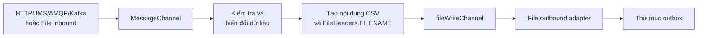

# File outbound channel adapter ghi tệp

## 1. Mục tiêu bài học

Trong module **SPRING_INTEGRATION_ADAPTERS**, Spring Integration cung cấp inbound/outbound adapter, gateway, poller và `MessageChannel` để kết nối các hệ thống ngoài. Ở chương **Adapter file**, ta xét chiều ngược với việc đọc tệp: **ứng dụng tạo message và ghi payload ra một tệp trong hệ thống tệp**, để hệ thống khác tiếp nhận.

Sau bài học, bạn có thể:

- Giải thích đường đi của `Message<?>` từ `MessageChannel` tới **File outbound channel adapter**.
- Cấu hình `FileWritingMessageHandler` bằng Java và ghi được tệp CSV từ payload `byte[]`.
- Chỉ rõ vai trò của payload, header tên tệp, thư mục đích và chính sách `FileExistsMode`.
- Phân biệt **outbound channel adapter** (ghi một chiều), **outbound gateway** (có phản hồi) và poller.
- Thiết kế quy ước ghi tệp an toàn: tên tệp, tệp tạm, xử lý lỗi, tránh ghi trùng và quan sát vận hành.

## 2. Bài toán: xuất dữ liệu từ Spring Integration ra thư mục

Giả sử ứng dụng bán hàng đã tổng hợp các đơn hàng trong ngày. Một hệ thống kế toán bên ngoài chỉ nhận báo cáo qua thư mục `data/outbox`. Mỗi báo cáo cần có tên rõ ràng và chứa nội dung CSV mã hóa UTF-8.

Ứng dụng sẽ tạo message với:

- **Payload:** dữ liệu báo cáo, ví dụ các byte CSV.
- **Header:** tên tệp đích, chẳng hạn `orders-2026-11-23.csv`.
- **Channel:** kênh `fileWriteChannel` chuyển message đến handler.

**File outbound channel adapter** là đầu ra một chiều của luồng tích hợp. Thành phần `FileWritingMessageHandler` nhận message, xác định tên tệp và ghi payload vào thư mục được cấu hình.


Thành phần ghi tệp không tự truy vấn cơ sở dữ liệu, không quyết định nội dung báo cáo và cũng không tự xác nhận rằng bên nhận đã tiêu thụ tệp. Nó chỉ thực hiện trách nhiệm **chuyển message thành dữ liệu trên filesystem** theo cấu hình.

### Inbound, outbound adapter và gateway khác nhau thế nào?

| Thành phần | Hướng dữ liệu | Cơ chế điển hình | Có phản hồi kết quả qua message? |
| --- | --- | --- | --- |
| File inbound channel adapter | Filesystem → `MessageChannel` | `FileReadingMessageSource` được poller gọi để quét thư mục | Không phải hợp đồng yêu cầu–phản hồi |
| File outbound channel adapter | `MessageChannel` → filesystem | `FileWritingMessageHandler` nhận message, ghi tệp | Không; đầu ra một chiều |
| File outbound gateway | `MessageChannel` → filesystem → luồng tiếp theo | Handler ghi tệp và tạo message phản hồi khi cấu hình ở chế độ gateway | Có; thường chuyển thông tin về tệp đã ghi |

Một **outbound adapter không cần poller nếu đầu vào là `DirectChannel` có subscriber**: nó được gọi khi có message gửi vào channel. Poller thuộc phần cấp message từ nguồn theo lịch hoặc phần endpoint đọc `PollableChannel`; không phải cứ ghi tệp là cần tự cấu hình poller.

## 3. Hợp đồng message trước khi ghi file

Spring Integration gửi dữ liệu dưới dạng `Message<T>` gồm `payload` và `headers`. Với file outbound, cần quy định ít nhất ba yếu tố:

| Yếu tố | Ví dụ | Ý nghĩa |
| --- | --- | --- |
| `payload` | `byte[]` mã hóa UTF-8 | Nội dung thực tế cần ghi vào tệp |
| `FileHeaders.FILENAME` | `orders-2026-11-23.csv` | Tên tệp mà file name generator sử dụng |
| Thư mục đích của handler | `data/outbox` | Nơi xuất tệp trên filesystem |

Payload có thể là `String`, `byte[]` hoặc `File` tùy luồng và khả năng handler. Chọn `byte[]` trong ví dụ để **kiểm soát chính xác encoding** mà không phụ thuộc charset mặc định của máy chạy. Khi payload là `File`, cần hiểu rằng handler có thể dùng tệp nguồn để ghi/copy tới tệp đích; điều đó không có nghĩa tệp nguồn sẽ tự bị xóa.

Header tên tệp chỉ là **dữ liệu đi kèm message**. Handler cần một `FileNameGenerator` (có thể do bạn cấu hình) để xác định tên thực tế. Khi tên tới từ hệ thống ngoài, phải xác thực hoặc chuẩn hóa nó trước khi sử dụng; không lấy một chuỗi bất kỳ làm đường dẫn ghi tệp.

## 4. Chuẩn bị Spring Boot

Ví dụ dùng Java 17+, Spring Boot quản lý dependency và Spring Integration File. Trong `pom.xml`:

```xml
<dependencies>
    <dependency>
        <groupId>org.springframework.boot</groupId>
        <artifactId>spring-boot-starter-integration</artifactId>
    </dependency>
    <dependency>
        <groupId>org.springframework.integration</groupId>
        <artifactId>spring-integration-file</artifactId>
    </dependency>
</dependencies>
```

Ứng dụng cần quyền tạo thư mục và ghi tệp tại `data/outbox`. Đường dẫn tương đối được tính từ **working directory của tiến trình JVM**, không nhất thiết là thư mục chứa source code.

Giả định một báo cáo có tên dạng `orders-2026-11-23.csv` và dữ liệu:

```csv
order_id,total
OD-001,120000
OD-002,95000
```

## 5. Cấu hình File outbound channel adapter

Đoạn mã sau cung cấp **một luồng hoàn chỉnh**: một `MessageChannel`, một handler ghi tệp và một `ApplicationRunner` gửi message mẫu để kiểm tra.

```java
import java.io.File;
import java.nio.charset.StandardCharsets;

import org.springframework.beans.factory.annotation.Qualifier;
import org.springframework.boot.ApplicationRunner;
import org.springframework.context.annotation.Bean;
import org.springframework.context.annotation.Configuration;
import org.springframework.integration.annotation.ServiceActivator;
import org.springframework.integration.channel.DirectChannel;
import org.springframework.integration.config.EnableIntegration;
import org.springframework.integration.file.FileHeaders;
import org.springframework.integration.file.FileWritingMessageHandler;
import org.springframework.integration.file.support.FileExistsMode;
import org.springframework.messaging.Message;
import org.springframework.messaging.MessageChannel;
import org.springframework.messaging.MessageHandler;
import org.springframework.messaging.support.MessageBuilder;

@Configuration
@EnableIntegration
public class FileOutboundConfig {

    @Bean
    public MessageChannel fileWriteChannel() {
        return new DirectChannel();
    }

    @Bean
    @ServiceActivator(inputChannel = "fileWriteChannel")
    public MessageHandler fileOutboundHandler() {
        FileWritingMessageHandler handler =
                new FileWritingMessageHandler(new File("data/outbox"));

        handler.setAutoCreateDirectory(true);
        handler.setFileExistsMode(FileExistsMode.FAIL);
        handler.setTemporaryFileSuffix(".writing");
        handler.setExpectReply(false);

        handler.setFileNameGenerator(message -> {
            Object raw = message.getHeaders().get(FileHeaders.FILENAME);

            if (raw instanceof String fileName
                    && fileName.matches(
                            "[A-Za-z0-9][A-Za-z0-9._-]{0,99}\\.csv"
                    )
                    && !fileName.contains("..")) {
                return fileName;
            }

            throw new IllegalArgumentException(
                    "Ten file CSV khong hop le"
            );
        });

        return handler;
    }

    // Chỉ dùng để chạy thử; ứng dụng thực sẽ phát message từ nghiệp vụ.
    @Bean
    public ApplicationRunner sendSampleReport(
            @Qualifier("fileWriteChannel") MessageChannel outputChannel) {
        return args -> {
            String csv = "order_id,total\n"
                    + "OD-001,120000\n"
                    + "OD-002,95000\n";

            Message<byte[]> message = MessageBuilder
                    .withPayload(csv.getBytes(StandardCharsets.UTF_8))
                    .setHeader(
                            FileHeaders.FILENAME,
                            "orders-2026-11-23.csv"
                    )
                    .build();

            boolean accepted = outputChannel.send(message);
            if (!accepted) {
                throw new IllegalStateException(
                        "Channel khong tiep nhan message"
                );
            }
        };
    }
}
```

Lớp cấu hình phải nằm trong vùng component scan của ứng dụng `@SpringBootApplication` hoặc được import vào Spring context. Trước khi chạy lại ví dụ, hãy xóa hoặc đổi tên **tệp đầu ra do lần chạy trước tạo**; `FileExistsMode.FAIL` cố ý báo lỗi khi tệp đích đã tồn tại.

### Vì sao cấu hình này hoạt động?

**1. `MessageChannel` và endpoint.** `DirectChannel` đẩy message tới subscriber trong luồng gọi của bên gửi. Annotation `@ServiceActivator(inputChannel = "fileWriteChannel")` đăng ký handler làm subscriber của channel. Khi `send(message)` diễn ra, handler xử lý message; nếu ghi file thất bại, exception có thể truyền ngược về lệnh gửi đồng bộ.

**2. `FileWritingMessageHandler`.** Constructor chỉ định thư mục đích. `setAutoCreateDirectory(true)` cho phép tạo thư mục nếu cần và nếu quyền filesystem cho phép. Điều này không cấp thêm quyền ở cấp hệ điều hành và không bảo đảm mọi đường dẫn được cung cấp đều hợp lệ.

**3. `setFileNameGenerator(...)`.** Generator đọc `FileHeaders.FILENAME` và chỉ nhận tên theo mẫu CSV đơn giản. Nó từ chối tên rỗng, dấu phân tách thư mục, đường dẫn tuyệt đối và thành phần `..`. Ví dụ cố ý giới hạn tên ASCII để làm rõ hợp đồng; ứng dụng hỗ trợ tên Unicode cần một chính sách kiểm tra tên tương ứng.

**4. `setFileExistsMode(FileExistsMode.FAIL)`.** Tên tệp trùng khiến việc ghi thất bại thay vì âm thầm ghi đè dữ liệu. Phù hợp với báo cáo xuất theo phiên bản hoặc theo ngày khi mỗi lần xuất cần một tệp duy nhất.

**5. `setTemporaryFileSuffix(".writing")`.** Với chế độ ghi hỗ trợ tệp tạm, handler ghi vào tên tạm rồi đổi tên thành tên cuối sau khi hoàn tất. Cách làm này giúp bên nhận chỉ theo dõi `*.csv` và tránh đọc tệp đang ghi. Cần kiểm tra hành vi rename trên filesystem/thư mục chia sẻ đang dùng; file tạm và file cuối không mặc nhiên tạo thành một giao dịch phân tán.

**6. `setExpectReply(false)`.** Handler được dùng như **outbound channel adapter một chiều**, không tạo reply message cho bước tiếp theo. Giá trị trả về `boolean` của `MessageChannel.send(...)` chỉ phản ánh thao tác gửi message vào channel; không phải biên nhận rằng hệ thống ngoài đã đọc báo cáo.

## 6. Quan sát kết quả và kiểm thử thủ công

Ở lần chạy thành công đầu tiên, cấu trúc tệp dự kiến là:

```text
data/
└── outbox/
    └── orders-2026-11-23.csv
```

Mở `data/outbox/orders-2026-11-23.csv` và xác minh nội dung CSV khớp với payload. Nếu bên nhận chỉ tìm `*.csv`, nó không nên lấy các file `*.writing` còn tồn tại khi một lần ghi bị gián đoạn.

Tiếp tục thử:

1. **Gửi tệp mới:** đổi header thành `orders-2026-11-24.csv`, chạy lại và kiểm tra có thêm tệp mới.
2. **Kiểm tra file trùng:** giữ `orders-2026-11-23.csv` trong outbox rồi gửi lại đúng tên. Với `FAIL`, quan sát lỗi ghi file. Đây là hành vi đã được cấu hình, không phải lỗi ngẫu nhiên.
3. **Kiểm tra tên không hợp lệ:** thử `../secret.csv` hoặc `folder/report.csv`; generator phải từ chối trước khi handler dùng tên đó để ghi.
4. **Kiểm tra quyền ghi:** trỏ output đến thư mục mà ứng dụng không được phép ghi trong môi trường thử nghiệm; quan sát exception và cách ứng dụng báo lỗi.
5. **Kiểm tra encoding:** gửi ký tự tiếng Việt bằng `StandardCharsets.UTF_8` rồi đọc lại bằng UTF-8 để xác minh dữ liệu đầu ra.

Đối với một bài thực hành riêng, có thể thay `ApplicationRunner` bằng một controller, scheduler hoặc một bước transformer đưa dữ liệu từ cơ sở dữ liệu thành byte CSV; **adapter ghi tệp không cần thay đổi** nếu hợp đồng payload và header vẫn giữ nguyên.

## 7. Chọn FileExistsMode theo hợp đồng trao đổi

Khi phát sinh trùng tên, chính sách ghi tệp quyết định ứng dụng phải làm gì. Không nên dựa vào giá trị mặc định nếu dữ liệu là quan trọng.

| Chế độ | Ý nghĩa khi tệp đích đã tồn tại | Trường hợp cân nhắc |
| --- | --- | --- |
| `FAIL` | Báo lỗi thay vì ghi vào tệp đã tồn tại | Xuất báo cáo một lần với tên duy nhất; cần phát hiện sự kiện gửi trùng |
| `REPLACE` | Thay thế nội dung tệp cũ | Báo cáo snapshot mà bên nhận có thỏa thuận cho phép cập nhật |
| `APPEND` | Ghi thêm vào cuối tệp hiện có | Nhật ký hoặc dữ liệu tích lũy mà định dạng cho phép nối tiếp |
| `IGNORE` | Bỏ qua thao tác ghi nếu tệp đã tồn tại | Bên gửi chủ động chấp nhận chính sách giữ bản đầu tiên |

Ví dụ CSV có **dòng header**. Nếu dùng `APPEND` để nối từng báo cáo hoàn chỉnh, file sẽ có thể chứa nhiều dòng header ở giữa nội dung. Khi cần append CSV, phải thiết kế riêng bước ghi header lần đầu, khóa ghi đồng thời và cách khôi phục khi append mới hoàn thành một phần.

`REPLACE` và `IGNORE` cũng có rủi ro: lần ghi sau có thể xóa nội dung trước, hoặc dữ liệu mới bị bỏ qua. Với một ứng dụng có yêu cầu kiểm toán, lưu khóa báo cáo và trạng thái xuất trong cơ sở dữ liệu thường hữu ích hơn việc chỉ dựa vào tên file.

## 8. Ghi an toàn: file tạm, tên file và quyền truy cập

### 8.1. File tạm và hợp đồng với bên nhận

Một giao thức xuất tệp phổ biến:

```text
Spring Integration            Thư mục chia sẻ          Hệ thống nhận
       |                             |                       |
       |--- ghi report.csv.writing ->|                       |
       |--- đóng/hoàn tất ghi ------>|                       |
       |--- đổi tên report.csv ----->|                       |
       |                             |--- quét *.csv ------->|
       |                             |                       |--- đọc file
```

Bên nhận chỉ xử lý file có tên cuối. Không nên thiết kế consumer đọc cả `*.writing`; file tạm có thể chưa đủ byte hoặc bị bỏ lại sau lỗi. Với filesystem hỗ trợ rename nguyên tử **trong cùng filesystem**, việc đổi tên giúp thu hẹp cửa sổ consumer thấy file chưa hoàn tất. Tuy nhiên, độ bền dữ liệu sau mất điện và tính nguyên tử trên network share vẫn tùy môi trường, nên cần kiểm tra bằng bài thử thực tế.

### 8.2. Không tin tên file đầu vào

Nếu tên tệp lấy từ HTTP request, hàng đợi hay một hệ thống bên ngoài, các chuỗi như `../../config.yml`, `C:\temp\secret.txt` hoặc tên chứa ký tự điều khiển có thể làm thay đổi vị trí ghi hoặc gây sự cố. Luồng ghi file nên:

- Tạo tên từ mã định danh nghiệp vụ đã kiểm tra thay vì dùng nguyên văn tên từ request.
- Chỉ chấp nhận ký tự, độ dài và phần mở rộng hợp lệ.
- Giới hạn việc ghi vào thư mục đích được cấp quyền, tránh các tên tệp đặc biệt hoặc đường dẫn thoát khỏi thư mục.
- Dùng tài khoản hệ điều hành có **quyền ghi vừa đủ**; kiểm soát symlink/đường dẫn chia sẻ nếu có đầu vào không tin cậy.

Ví dụ generator chỉ dùng tên file đơn giản; trong ứng dụng thực tế, còn cần xem xét sự va chạm tên do hoa/thường trên từng filesystem và sự thay đổi đường dẫn qua symlink.

### 8.3. Payload lớn

Ví dụ mã hóa toàn bộ CSV vào `byte[]` phù hợp với báo cáo nhỏ. Với tệp rất lớn, giữ toàn bộ dữ liệu trong một `String` rồi chuyển sang `byte[]` làm tăng áp lực bộ nhớ. Có thể cân nhắc luồng streaming hoặc xuất dữ liệu ra tệp tạm có quản lý trước khi gửi `File` vào handler. Dù dùng cách nào, vẫn phải quy định giới hạn kích thước, dung lượng ổ đĩa, cleanup sau lỗi và khả năng backpressure.

## 9. Lỗi khi ghi file và chiến lược phục hồi

Việc gọi handler có thể thất bại vì không đủ quyền ghi, hết dung lượng đĩa, sai tên file, file đích đã tồn tại, lỗi I/O hoặc xung đột ghi đồng thời. Một lần gửi message thành công vào luồng xử lý **không có nghĩa** hệ thống nhận bên ngoài đã tiếp nhận dữ liệu.

Trong ví dụ với `DirectChannel`, consumer được gọi đồng bộ. Nếu handler ném exception, caller có thể nhận được exception tại `send(...)`. Với luồng chạy qua executor, poller, queue hoặc broker, việc chuyển lỗi và retry phải thiết kế theo đặc điểm của endpoint đó; có thể dùng cơ chế error channel/`ErrorMessage` khi phù hợp.

Để vận hành tin cậy, nên lưu ít nhất:

| Trạng thái nghiệp vụ | Ý nghĩa | Hành động kế tiếp |
| --- | --- | --- |
| `READY` | Payload đã sẵn sàng để xuất | Tạo tên file/ID xuất duy nhất rồi gửi |
| `WRITING` | Đang thực hiện ghi | Theo dõi thời gian, lỗi và file tạm |
| `EXPORTED` | Ghi xong tệp đích theo hợp đồng filesystem | Ghi nhận đường dẫn, kích thước hoặc checksum nếu cần |
| `FAILED` | Ghi lỗi hoặc trạng thái đầu ra chưa xác định | Điều tra tệp còn lại, kiểm tra trùng và thử lại có kiểm soát |
| `CONSUMED` | Hệ thống ngoài đã báo nhận/xử lý | Chỉ đặt trạng thái này nếu có cơ chế xác nhận riêng từ bên nhận |

**Không nên suy `CONSUMED` từ `EXPORTED`**. File đã xuất thành công có thể chưa bao giờ được bên ngoài quét, hoặc bên ngoài có thể đọc rồi thất bại. Nếu cần xác nhận kết quả, cần hợp đồng bổ sung như tệp ACK, callback, message phản hồi hoặc một kênh trạng thái riêng.

### Retry và tính idempotent

Giả sử handler đã ghi đủ tệp nhưng tiến trình mất kết nối hoặc bị dừng ngay trước khi ứng dụng lưu trạng thái `EXPORTED`. Lần chạy lại không biết chắc tệp đã xuất chưa. Nếu lặp lại cùng tên trong chế độ `FAIL` sẽ có lỗi trùng tệp; nếu đổi sang tên mới tùy tiện có thể khiến bên nhận xử lý **hai báo cáo giống nhau**.

Thiết kế ổn định cần một **export ID** hoặc khóa nghiệp vụ, tên tệp xác định từ khóa đó, và quy trình đối chiếu kết quả sau lỗi. Có thể:

1. Lưu một bản ghi export ID và hash/kích thước dự kiến trước khi xuất.
2. Ghi tệp và kiểm tra nội dung, đồng thời xác định trạng thái thao tác ghi.
3. Khi retry, kiểm tra tệp đích có tồn tại và khớp export ID/checksum hay không.
4. Nếu khớp, phục hồi trạng thái mà không tạo báo cáo mới; nếu không khớp, chuyển xử lý lỗi có kiểm soát.

Việc ghi file và commit database thông thường **không nằm trong cùng một giao dịch nguyên tử**. Cần thiết kế phục hồi cho những thời điểm chỉ một bên hoàn thành.

## 10. Kết hợp inbound và outbound trong một luồng

Một ứng dụng tích hợp thường nhận dữ liệu bằng inbound adapter hoặc gateway, chuẩn hóa dữ liệu qua transformer rồi đẩy ra outbound adapter:



Điểm nối quan trọng là **hợp đồng message**. Bước biến đổi phải xuất payload đúng định dạng và header tên tệp hợp lệ; outbound adapter chỉ cần thực hiện trách nhiệm ghi. Khi thay nguồn từ HTTP sang JMS, hoặc đổi đích từ file sang SFTP, tầng nghiệp vụ nên ít bị ảnh hưởng nếu hợp đồng message được giữ ổn định.

Nếu kết nối qua SFTP, JMS, AMQP, Kafka hoặc database, các adapter sẽ có cơ chế đồng bộ, xác nhận và lỗi khác nhau. Không áp đặt giả định “tệp đã tồn tại nghĩa là bên nhận đã xử lý” lên các hệ thống khác, hoặc dùng ACK của broker để suy ra nghiệp vụ đã hoàn tất.

## 11. Sự cố thường gặp

| Hiện tượng | Nguyên nhân cần kiểm tra | Hướng xử lý |
| --- | --- | --- |
| Không thấy tệp đầu ra | Message chưa đến channel; sai tên channel; ứng dụng ghi ở working directory khác | Kiểm tra wiring endpoint, đường dẫn tuyệt đối thực tế và log |
| Báo lỗi ngay khi chạy ứng dụng lần hai | `FileExistsMode.FAIL` từ chối tên tệp đã tồn tại | Dùng export ID/tên mới hoặc xử lý khôi phục tệp cũ |
| Có file `*.writing` còn sót | Ghi file hoặc đổi tên bị gián đoạn | Kiểm tra log/I/O; đối chiếu trước khi cleanup |
| File ghi sai nội dung tiếng Việt | Nguồn tạo bytes và bên nhận dùng encoding khác nhau | Thống nhất UTF-8, kiểm tra BOM/định dạng theo hợp đồng |
| Bên nhận đọc tệp chưa hoàn tất | Bên nhận quét cả file tạm, hoặc filesystem không có quy ước công bố tệp an toàn | Chỉ quét tên cuối, kiểm tra rename/hợp đồng sẵn sàng |
| File bị ghi đè ngoài dự kiến | Dùng `REPLACE` hoặc nhiều producer cùng tên | Chuyển sang `FAIL` khi thích hợp, khóa tên/ID theo nghiệp vụ |
| Ghi chậm hoặc hết dung lượng | Payload quá lớn, đĩa gần đầy, network share chậm | Giới hạn kích thước, giám sát đĩa, tính backlog và cleanup |
| Một báo cáo xuất hai lần | Retry tạo tên mới thay vì đối chiếu export ID | Dùng ID ổn định và quy trình idempotent |

Trong môi trường production, nên theo dõi số lần xuất thành công/thất bại, thời gian ghi, số lượng tệp tồn trong outbox, dung lượng ổ đĩa và thời gian chờ xác nhận từ hệ thống nhận. Dữ liệu nhạy cảm trong báo cáo cần chính sách phân quyền, lưu giữ và xóa theo yêu cầu nghiệp vụ.

## 12. Bài tập thực hành

**Bài 1 — Thay đổi chính sách trùng tên.** Gửi cùng một tệp hai lần với `FAIL`, sau đó thử `REPLACE`. Ghi lại nội dung file và giải thích vì sao việc đổi mode không thể thay thế khóa nghiệp vụ.

**Bài 2 — Kiểm tra hợp đồng header.** Bỏ `FileHeaders.FILENAME` hoặc dùng `../report.csv`. Quan sát lỗi từ generator. Đề xuất quy tắc tên file hỗ trợ ngày, ID giao dịch và mã đối tác.

**Bài 3 — Xuất dữ liệu Unicode.** Tạo file CSV chứa `Sản phẩm,Đơn giá`. Ghi bằng `StandardCharsets.UTF_8` và đọc lại bằng đúng encoding để xác minh không bị lỗi dấu.

**Bài 4 — Tiếp nhận sau khi ghi xong.** Viết một consumer thử nghiệm chỉ lấy `*.csv` từ outbox. Quan sát tệp tạm nếu tiến trình ghi bị gián đoạn và giải thích tại sao consumer không nên đọc `*.writing`.

**Bài 5 — Phục hồi sau crash.** Mô tả ba trường hợp: (a) chưa tạo tệp, (b) còn tệp tạm, (c) đã có tệp cuối nhưng DB chưa ghi `EXPORTED`. Đề xuất cách đối chiếu từng trạng thái mà không phát sinh báo cáo trùng.

### Câu hỏi tự kiểm tra

**Q1. Payload và header nào được dùng trong ví dụ?**  
Payload `byte[]` là nội dung CSV; header `FileHeaders.FILENAME` cung cấp tên file được generator kiểm tra.

**Q2. Vì sao không cần poller cho outbound adapter nối với DirectChannel?**  
Vì subscriber được gọi khi một bên khác gửi message vào `DirectChannel`; nguồn định kỳ hoặc `PollableChannel` mới có nhu cầu poller theo thiết kế.

**Q3. `FAIL` và `APPEND` khác nhau thế nào?**  
`FAIL` từ chối ghi khi file đích đã tồn tại; `APPEND` nối thêm nội dung, nên phải kiểm soát đồng thời và định dạng file.

**Q4. Một tệp có mặt trong outbox có nghĩa bên ngoài đã xử lý chưa?**  
Chưa. Nó chỉ cho biết kết quả tồn tại ở filesystem; xác nhận bên nhận cần một cơ chế độc lập.

**Q5. Tệp tạm giải quyết được toàn bộ vấn đề retry không?**  
Không. Tệp tạm giúp tránh công bố nội dung đang ghi; trạng thái nghiệp vụ, file đích có sẵn, retry và idempotency vẫn cần quản lý riêng.

## 13. Ghi nhớ

**File outbound channel adapter** đưa message từ Spring Integration ra filesystem thông qua `FileWritingMessageHandler`. `MessageChannel` vận chuyển message, `FileNameGenerator` quyết định tên đích, `FileExistsMode` điều khiển xung đột tên, còn tệp tạm hỗ trợ quy ước chỉ công bố file sau khi hoàn tất ghi. Khi tích hợp file với HTTP, SFTP, JMS, AMQP, Kafka hoặc database, nên giữ hợp đồng message rõ ràng và thiết kế riêng việc theo dõi lỗi, xử lý trùng, vòng đời kết nối và xác nhận của hệ thống nhận.
