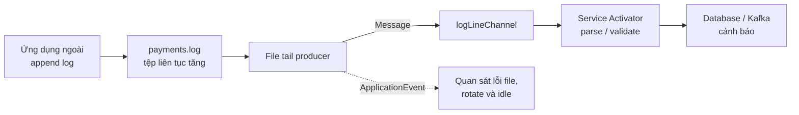
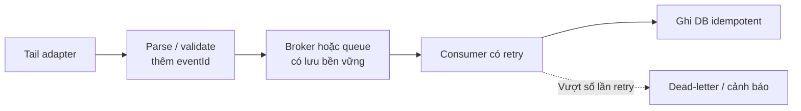

# File tail adapter đọc tệp đang tăng trưởng

## 1. Mục tiêu và bài toán thực tế

Module **SPRING_INTEGRATION_ADAPTERS** hướng dẫn kết nối các hệ thống bên ngoài vào Spring Integration bằng inbound/outbound adapter, gateway, poller và `MessageChannel`, đồng thời xử lý hợp đồng message, lỗi và vòng đời kết nối. Trong chương **Adapter file**, bài này xét tình huống một tệp **liên tục được ghi thêm nội dung**, chẳng hạn log thanh toán.

Hệ thống thanh toán append các dòng mới vào `data/logs/payments.log`:

```text
2026-11-23T08:30:00 INFO payment=PM-001 status=CREATED
2026-11-23T08:30:01 INFO payment=PM-001 status=PAID
2026-11-23T08:30:02 WARN payment=PM-002 status=RETRY
```

Yêu cầu là **nhận từng dòng mới** mà không phải tải lại toàn bộ tệp mỗi lần, sau đó phân tích, phát cảnh báo hoặc gửi tiếp vào database, JMS, AMQP hay Kafka.

Sau bài học, bạn có thể:

- Giải thích cách File tail adapter theo dõi một tệp đang tăng trưởng và phát `Message<String>`.
- Phân biệt tail adapter với File inbound channel adapter quét thư mục.
- Cấu hình `ApacheCommonsFileTailingMessageProducer` bằng Java và phân biệt nó với `OSDelegatingFileTailingMessageProducer`.
- Hiểu các lựa chọn bắt đầu từ đầu/cuối file, độ trễ kiểm tra và việc mở lại file.
- Xử lý các tình huống restart, rotate, truncate, dòng dở, lỗi downstream và vấn đề dữ liệu bị đọc lại.

## 2. Cơ chế của File tail inbound adapter

**Tailing** là tiếp tục đọc từ vị trí đã theo dõi trong tệp, lấy những dòng được **append** sau đó. Đây là kiểu **inbound adapter**, vì dữ liệu đi **từ filesystem vào luồng Spring Integration**. Nó tương tự lệnh `tail -f` trên hệ điều hành Unix/Linux.



Mỗi dòng hoàn chỉnh thông thường trở thành một message có payload `String`. Tệp nguồn được ghi nhận qua headers:

```text
payload = "2026-11-23T08:30:02 WARN payment=PM-002 status=RETRY"
headers[FileHeaders.FILENAME] = "payments.log"
headers[FileHeaders.ORIGINAL_FILE] = File(".../payments.log")
```

`FileHeaders.FILENAME` là **tên tệp** (`File.getName()`); muốn lấy đường dẫn tuyệt đối, có thể lấy `File` từ `FileHeaders.ORIGINAL_FILE` rồi gọi `getAbsolutePath()`. Đừng hiểu payload ở đây là toàn bộ nội dung tệp hoặc đối tượng `java.io.File`.

### Tail khác gì so với quét thư mục?

| Đặc điểm | File inbound channel adapter | File tail adapter |
| --- | --- | --- |
| Nguồn nhận | Nhiều tệp trong thư mục | Nội dung tăng thêm của một tệp |
| Thành phần phổ biến | `FileReadingMessageSource` | `FileTailingMessageProducerSupport` và các lớp con |
| Payload thường gặp | `File` | `String` của một dòng |
| Cách chạy | Endpoint poll `MessageSource` theo lịch | Producer theo dõi tệp và chủ động phát message |
| Trường hợp dùng | CSV/JSON đã ghi xong, import theo đợt | Log, audit trail hoặc event text append-only |
| Rủi ro trọng tâm | Đọc tệp chưa hoàn tất, xử lý lặp | Rotate, truncate, restart, dòng thiếu newline |

File tail là một **message producer có vòng đời riêng**. Nếu tạo bean producer trực tiếp như ví dụ bên dưới, **không gắn `@InboundChannelAdapter(poller=...)`** vào nó. Tham số thời gian quét nội bộ của Apache Commons Tailer không phải `@Poller` của một `MessageSource` thông thường.

## 3. Hai cách triển khai tail trong Spring Integration

Spring Integration File cung cấp hai producer chính:

| Producer | Nguyên lý | Khi nào cân nhắc |
| --- | --- | --- |
| `ApacheCommonsFileTailingMessageProducer` | Dùng `Tailer` của thư viện Apache Commons IO, định kỳ kiểm tra tệp | Dùng Java trên Windows hoặc không muốn phụ thuộc lệnh hệ điều hành |
| `OSDelegatingFileTailingMessageProducer` | Chạy tiện ích `tail` của hệ điều hành, nhận các dòng xuất ra stdout | Unix/Linux có lệnh `tail` tương thích; thường có hiệu quả tốt |

Ở loại native, tùy chọn thường dùng `-F -n 0` có ý nghĩa theo dõi **theo tên file** và chỉ đọc nội dung mới từ thời điểm bắt đầu. `tail -f` và `tail -F` có thể khác nhau khi tên file bị đổi lúc log rotation; hành vi chi tiết tùy phiên bản lệnh trên máy.

Bài này dùng **Apache Commons IO** vì có thể kiểm chứng trên Windows. Các tùy chọn `end`, `reopen` và `pollingDelay` áp dụng rõ ràng cho implementation này.

## 4. Chuẩn bị dự án Spring Boot

Ví dụ sử dụng Java 17+ và Spring Boot quản lý phiên bản dependency:

```xml
<dependencies>
    <dependency>
        <groupId>org.springframework.boot</groupId>
        <artifactId>spring-boot-starter-integration</artifactId>
    </dependency>
    <dependency>
        <groupId>org.springframework.integration</groupId>
        <artifactId>spring-integration-file</artifactId>
    </dependency>
</dependencies>
```

`ApacheCommonsFileTailingMessageProducer` dựa vào `commons-io`. Hãy bảo đảm dependency `commons-io:commons-io` có mặt trong classpath thông qua dependency graph hoặc khai báo với phiên bản được quản lý phù hợp nếu dự án chưa có.

Tạo file thử nghiệm:

```text
data/
└── logs/
    └── payments.log
```

`data/logs` được hiểu tương đối với **working directory của JVM**, có thể khác nhau khi chạy bằng IDE, Docker hoặc service manager. Ứng dụng cần quyền đọc file; trong ví dụ ta chuyển nó thành đường dẫn tuyệt đối trước khi cung cấp cho tailer.

## 5. Ví dụ Java hoàn chỉnh

Lớp cấu hình dưới đây tạo một channel, một executor cho công việc theo dõi dài hạn, một Apache Commons tail producer và một consumer:

```java
import java.io.File;

import org.springframework.beans.factory.annotation.Qualifier;
import org.springframework.context.annotation.Bean;
import org.springframework.context.annotation.Configuration;
import org.springframework.context.event.EventListener;
import org.springframework.integration.annotation.ServiceActivator;
import org.springframework.integration.channel.DirectChannel;
import org.springframework.integration.config.EnableIntegration;
import org.springframework.integration.file.FileHeaders;
import org.springframework.integration.file.tail.ApacheCommonsFileTailingMessageProducer;
import org.springframework.integration.file.tail.FileTailingMessageProducerSupport.FileTailingEvent;
import org.springframework.messaging.Message;
import org.springframework.messaging.MessageChannel;
import org.springframework.scheduling.concurrent.ThreadPoolTaskExecutor;

@Configuration
@EnableIntegration
public class TailFileConfig {

    @Bean
    public MessageChannel logLineChannel() {
        return new DirectChannel();
    }

    @Bean
    public ThreadPoolTaskExecutor fileTailExecutor() {
        ThreadPoolTaskExecutor executor = new ThreadPoolTaskExecutor();
        executor.setCorePoolSize(1);
        executor.setMaxPoolSize(1);
        executor.setQueueCapacity(0);
        executor.setThreadNamePrefix("file-tail-");
        return executor;
    }

    @Bean
    public ApacheCommonsFileTailingMessageProducer paymentsLogTailer(
            @Qualifier("logLineChannel") MessageChannel output,
            @Qualifier("fileTailExecutor") ThreadPoolTaskExecutor executor) {

        ApacheCommonsFileTailingMessageProducer producer =
                new ApacheCommonsFileTailingMessageProducer();

        producer.setFile(
                new File("data/logs/payments.log").getAbsoluteFile()
        );
        producer.setOutputChannel(output);
        producer.setTaskExecutor(executor);
        producer.setPollingDelay(1000);       // Kiem tra moi 1 giay
        producer.setEnd(true);                // Chi nhan dong moi
        producer.setReopen(true);             // Mo lai file giua cac lan doc
        producer.setTailAttemptsDelay(3000);  // Thu lai khi nguon khong san sang

        return producer;
    }

    @ServiceActivator(inputChannel = "logLineChannel")
    public void consumeLine(Message<String> message) {
        String line = message.getPayload();
        String fileName =
                (String) message.getHeaders().get(FileHeaders.FILENAME);

        System.out.printf("[%s] %s%n", fileName, line);
        // Thuc te: parse, validate, gui tiep den buoc nghiep vu.
    }

    @EventListener
    public void onTailingEvent(FileTailingEvent event) {
        System.out.println("Tail status: " + event);
    }
}
```

Class `TailFileConfig` phải nằm trong phạm vi component scan của ứng dụng `@SpringBootApplication` hoặc được import vào context. Producer là bean được Spring quản lý lifecycle, nên không cần tự tạo thread và gọi `start()` thủ công.

### Giải thích các thành phần

**`ApacheCommonsFileTailingMessageProducer`** đọc dòng từ tệp đã chỉ định và phát `Message<String>` vào `logLineChannel`. Nếu file chưa tồn tại hoặc tạm không thể đọc, producer có cơ chế thử lại; sự kiện trạng thái giúp quan sát sự cố này.

**`ThreadPoolTaskExecutor`** dành một worker thread cho việc tail. Tác vụ theo dõi có thể chạy dài hạn; không nên chia sẻ một executor chỉ có một thread với các tác vụ khác phải chạy song song.

**`DirectChannel`** đưa message đến `consumeLine` theo cách đồng bộ trong luồng gửi. Nếu consumer xử lý rất chậm, tiến trình đọc và phân phối các dòng mới có thể bị chậm theo. Nếu cần giảm tải hoặc xử lý song song, cần thiết kế hàng đợi, executor và khả năng giới hạn tốc độ.

**`@ServiceActivator`** chuyển payload/header đến phương thức Java. Ví dụ chỉ in dòng log; parse, xác thực dữ liệu và ghi database là công việc riêng của consumer.

**`@EventListener`** nhận một số `FileTailingEvent` do producer phát qua Spring application event, ví dụ file không truy cập được rồi xuất hiện lại. Các event này **khác** với message chứa dòng log gửi tới `logLineChannel`.

### Hiểu chính xác các tùy chọn

| Cấu hình | Tác dụng |
| --- | --- |
| `setFile(File)` | Chỉ định một tệp cần tail |
| `setOutputChannel(...)` | Nơi nhận message chứa dòng |
| `setPollingDelay(1000)` | Apache Tailer kiểm tra dữ liệu mới khoảng mỗi 1.000 ms; không bảo đảm độ trễ chính xác |
| `setEnd(true)` | Bắt đầu tại cuối file; các dòng đã có khi bắt đầu không được phát lại |
| `setEnd(false)` | Bắt đầu từ đầu file, phát lịch sử rồi tiếp tục nhận dòng mới |
| `setReopen(true)` | Đóng/mở lại file giữa các lần đọc; không bảo đảm tránh trùng hoặc mất dòng khi rotate |
| `setTailAttemptsDelay(3000)` | Khoảng chờ giữa các nỗ lực tail khi file không sẵn sàng hoặc nguồn gặp lỗi |
| `setTaskExecutor(...)` | Executor thực hiện việc theo dõi file |

Các tham số trên chỉ điều chỉnh hành vi đọc trong **một phiên chạy**. Không có cấu hình nào tự động biến file tail thành nguồn dữ liệu có **checkpoint offset bền vững** và bảo đảm xử lý chính xác một lần.

## 6. Thực hành: ghi thêm dòng và quan sát

Trong PowerShell ở đúng working directory, tạo thư mục và file nếu chưa có:

```powershell
New-Item -ItemType Directory -Force -Path .\data\logs
New-Item -ItemType File -Path .\data\logs\payments.log
```

Nếu `payments.log` đã tồn tại, **bỏ qua lệnh tạo file** để tránh vô tình thay đổi dữ liệu hiện có.

Khởi động Spring Boot rồi mở một cửa sổ terminal khác và append hai dòng:

```powershell
Add-Content -Path .\data\logs\payments.log -Encoding UTF8 -Value '2026-11-23T08:31:00 INFO payment=PM-003 status=PAID'
Add-Content -Path .\data\logs\payments.log -Encoding UTF8 -Value '2026-11-23T08:31:02 WARN payment=PM-004 status=RETRY'
```

Ứng dụng sẽ in kết quả tương tự:

```text
[payments.log] 2026-11-23T08:31:00 INFO payment=PM-003 status=PAID
[payments.log] 2026-11-23T08:31:02 WARN payment=PM-004 status=RETRY
```

Đây là kết quả minh họa, không phải log được tạo từ lần chạy kiểm thử. Thời điểm nhận thực tế phụ thuộc khoảng kiểm tra, tốc độ I/O và thời gian consumer chạy.

Tiếp tục thử thay đổi:

1. Append một dòng **trước khi khởi động** ứng dụng với `end=true`. Dòng đó không được phát lại.
2. Append một dòng **sau khi khởi động**. Dòng mới được gửi qua channel sau khi tailer phát hiện.
3. Dừng ứng dụng, append dòng mới rồi khởi động lại với `end=true`. Dòng viết trong thời gian ứng dụng tắt có thể bị bỏ qua.
4. Chuyển sang `end=false` và khởi động lại. Các dòng hiện có trong file được phát lại, có thể tạo duplicate downstream.

Với Bash, có thể append bằng lệnh `printf '%s\n' 'new log line' >> data/logs/payments.log`. Hãy bảo đảm dữ liệu có ký tự kết thúc dòng. Tailer xử lý **dòng** nên một đoạn byte chưa có newline không nhất thiết tạo message ngay.

## 7. Bắt đầu từ đầu hay cuối tệp?

| Lựa chọn | Hành vi khi bắt đầu | Phù hợp | Rủi ro |
| --- | --- | --- | --- |
| `end=true` | Bỏ qua dữ liệu cũ; chờ các dòng mới | Giám sát live, không cần lịch sử | Mất khả năng thu lại các dòng được ghi lúc ứng dụng tắt |
| `end=false` | Đọc từ đầu file rồi theo dõi dữ liệu mới | Demo, import lại hoặc replay toàn bộ | Có thể đọc trùng sau restart; file lớn tạo backlog |

Giá trị `end` quyết định **vị trí ban đầu khi Tailer được khởi tạo**, không phải nơi lưu offset sau mỗi dòng thành công. Nếu cần không bỏ sót event khi restart, cần cơ chế lưu vị trí xử lý, idempotency và hợp đồng replay, hoặc sử dụng broker có quản lý offset/ack (như Kafka, JMS, AMQP tùy thiết kế). Cách đọc lại từ đầu với `end=false` không giải quyết hết vấn đề nếu file cũ đã bị rotate, xóa hay cắt ngắn.

## 8. Log rotation, truncate và file bị mất

Để tránh log tăng không giới hạn, phần mềm ghi log thường:

- **Rename + create:** đổi `payments.log` thành `payments.log.1` rồi tạo `payments.log` mới.
- **Copytruncate:** sao chép nội dung sang file lưu trữ rồi cắt ngắn file gốc.
- **Delete/recreate:** xóa hoặc thay file dưới cùng tên.

```text
Truoc rotation                Sau rotation
payments.log          ->      payments.log.1 (cu)
                               payments.log   (moi)
```

| Tình huống | Điều có thể xảy ra | Cần làm gì |
| --- | --- | --- |
| Đổi tên file cũ rồi tạo file mới | Handle cũ có thể vẫn trỏ vào file cũ hoặc phải theo dõi lại theo tên | Kiểm tra behavior trên filesystem và thư viện thực tế |
| File bị truncate | Vị trí đọc cũ có thể vượt kích thước mới | Kiểm thử detection truncate và xử lý những dòng quanh thời điểm chuyển |
| File bị xóa/tạm mất quyền | Producer không thể nhận dữ liệu mới trong khoảng gián đoạn | Theo dõi `FileTailingEvent`, kiểm tra thời gian retry và quyền truy cập |
| Restart ngay lúc rotate | Trạng thái đọc trong bộ nhớ mất, file mới có thể đã tăng | Cần phương án replay/đối chiếu event ID |

`setReopen(true)` giúp mở lại file giữa những lần đọc, **không phải cam kết mọi log rotation đều không mất hay trùng dòng**. Khi dùng native, `tail -F` thường theo dõi tên file qua rotate tốt hơn `tail -f` trên các hệ hỗ trợ, nhưng vẫn phải xác minh bằng thử nghiệm với đúng công cụ ghi log và phiên bản OS.

Với file được dùng làm nguồn sự kiện nghiệp vụ quan trọng, cần **định danh từng record** và có phương án khôi phục từ một nguồn bền vững. Tailing bản thân không thay thế được event store.

## 9. Dòng chưa hoàn chỉnh, charset và bản ghi nhiều dòng

### Dòng chưa có newline

Bên ghi có thể viết `status=` trước rồi vài giây mới append `PAID\n`. Adapter thường xem **kết thúc dòng** là ranh giới record; không giả định mỗi lần append một vài byte là lập tức có message. Nếu rotate đúng lúc dòng mới ghi một phần, cần xem xét nguy cơ nội dung thiếu phần cuối.

### Encoding

Thống nhất mã hóa (thường UTF-8), line ending (`\n` hoặc `\r\n`) và cách xử lý BOM giữa bên ghi và bên đọc. Nếu log chứa tiếng Việt, ký tự đọc sai charset có thể làm hỏng parser. Phải kiểm chứng charset của triển khai tail trên phiên bản thư viện đang sử dụng.

### Một sự kiện có thể chiếm nhiều dòng

```text
ERROR payment=PM-005 request failed
java.lang.IllegalStateException: timeout
    at example.PaymentClient.call(PaymentClient.java:42)
```

Đây có thể là **ba message** riêng. Nếu muốn nhóm chúng thành một event, consumer cần quy tắc bắt đầu/kết thúc, timeout và giới hạn độ dài. File tail adapter không tự hiểu cấu trúc stack trace, JSON Lines hay hợp đồng riêng của ứng dụng.

## 10. Giám sát và xử lý lỗi

Producer có vòng đời start/stop theo Spring context. File còn tồn tại không có nghĩa endpoint đang chạy tốt. Nên quan sát trạng thái endpoint, các sự kiện file không truy cập được, thời gian không có dòng mới, tốc độ nhận và số lỗi consumer.

Spring Integration có `FileTailingEvent` cho các thông tin trạng thái. Ngoài ra, `FileTailingIdleEvent` có thể được phát khi cấu hình `idleEventInterval` và không có dữ liệu mới trong khoảng thời gian đó. **Idle chưa chắc là lỗi**: hệ thống có thể đơn giản chưa tạo log. Khi dùng native `tail`, không phải mọi nền tảng đều phát đủ thông báo trạng thái giống nhau.

### Lỗi downstream không tự hoàn tác vị trí đọc

Nếu `consumeLine` ném exception hoặc database tạm lỗi, không được suy rằng tailer sẽ **đọc lại đúng dòng lỗi một cách an toàn**. Tailing không cung cấp giao dịch nguyên tử giữa đọc file và commit nghiệp vụ. Với `DirectChannel`, một consumer chậm hoặc lỗi còn có thể ảnh hưởng tới thread phát message.

Một phương án cho hệ thống cần phục hồi:



Ngay cả khi dùng broker, vẫn tồn tại khoảng hở giữa việc tailer đọc dòng và broker xác nhận đã lưu. Nếu yêu cầu không mất event tuyệt đối, bên tạo sự kiện nên ghi trực tiếp vào nguồn có durability/replay theo hợp đồng, thay vì chỉ phụ thuộc tệp log.

### Nhiều instance

Nếu hai instance cùng tail một file, **cả hai đều có thể nhận cùng dòng** và cập nhật nghiệp vụ trùng. Tail adapter không tự phân phối mỗi dòng cho duy nhất một instance. Cần cơ chế ownership/leader hoặc thiết kế consumer group/queue bên ngoài.

### Hợp đồng message

Downstream nên biết dòng đến từ file nào, có ID sự kiện hay không, format/charset nào, cách xử lý dòng sai cú pháp và chính sách retry. Khi chuyển sang HTTP, JMS, AMQP, Kafka hay database, không lấy “đã đọc khỏi file” làm bằng chứng “đã commit thành công” ở hệ thống đích.

## 11. Chọn công cụ theo yêu cầu

| Nhu cầu | Thành phần phù hợp |
| --- | --- |
| Nhận một CSV đã ghi xong trong thư mục | File inbound channel adapter + poller + filter |
| Đọc các dòng log đang được append | File tail inbound adapter |
| Ghi báo cáo ra tệp | File outbound channel adapter |
| Yêu cầu–phản hồi qua HTTP | HTTP outbound gateway |
| Cần replay/offset và nhiều consumer phối hợp | Broker phù hợp như Kafka/JMS/AMQP, với hợp đồng tương ứng |
| Đọc file trên máy chủ khác | SFTP/FTP/SMB adapter thích hợp |

## 12. Sự cố thường gặp

| Hiện tượng | Nguyên nhân cần kiểm tra |
| --- | --- |
| Không thấy dòng mới | Sai đường dẫn/working directory; file không có quyền đọc; `end=true` và chỉ có dòng cũ; dòng chưa kết thúc |
| Restart không nhận dòng ghi lúc ứng dụng tắt | Tailer bắt đầu ở cuối file với `end=true` |
| Restart đọc lại toàn bộ lịch sử | `end=false`; không có checkpoint bền vững |
| Dòng trễ | `pollingDelay`, I/O chậm hoặc consumer đồng bộ chạy lâu |
| Trùng/bỏ sót khi rotate | Rename, truncate, reopen và thời điểm restart |
| Tiếng Việt bị lỗi dấu | Charset bên ghi và bên đọc không thống nhất |
| Stack trace bị chia nhỏ | Một dòng là một message; cần logic gom nhóm |
| File vẫn có dữ liệu nhưng business không cập nhật | Lỗi consumer, queue đầy, thread chết hoặc endpoint dừng |
| Hai pod xử lý một sự kiện hai lần | Cả hai tail cùng file; chưa điều phối ownership |

## 13. Bài tập thực hành

1. **Quan sát trực tiếp:** cấu hình `end=true`, append ba dòng cách nhau một giây, ghi lại thứ tự và độ trễ.
2. **So sánh vị trí đọc:** đặt trước mười dòng, chạy với `end=true` rồi `end=false`. Giải thích khác biệt khi khởi động lại.
3. **Thử dòng dở:** ghi một dòng chưa có newline, sau đó append newline. Quan sát thời điểm message xuất hiện.
4. **Kiểm thử rotation:** đổi `payments.log` thành `payments.log.1`, tạo file mới cùng tên rồi append; tiếp tục thử truncate. Ghi lại message và event nhận được.
5. **Tiêm lỗi consumer:** ném exception khi gặp `status=RETRY`, quan sát hậu quả và thiết kế cách phục hồi phù hợp.
6. **Tránh xử lý trùng:** trích `paymentId` và `status` từ dòng log, tạo khóa nghiệp vụ để các bản ghi được phát lại không làm cập nhật DB nhiều lần.

### Câu hỏi tự kiểm tra

**Q1. Tail adapter phát payload gì?**  
Thường là một dòng `String`; `FileHeaders.ORIGINAL_FILE` chứa tham chiếu đến file nguồn.

**Q2. Tại sao ví dụ không thêm `@Poller`?**  
Vì `ApacheCommonsFileTailingMessageProducer` tự theo dõi file và chủ động phát message; `pollingDelay` là thiết lập nội bộ của Tailer.

**Q3. `end=true` có bảo đảm không mất dòng qua restart không?**  
Không. Nó bắt đầu từ cuối file, có thể bỏ qua dòng mới ghi khi ứng dụng tắt.

**Q4. `reopen=true` có bảo đảm an toàn mọi trường hợp rotation không?**  
Không. Rename/truncate cần được kiểm chứng với đúng thư viện, hệ điều hành và filesystem.

**Q5. Tail log có thể thay thế broker giao dịch không?**  
Không thể mặc định như vậy. Nếu cần durability, retry/replay và phân phối nhiều consumer, phải thiết kế nguồn message với semantics tương ứng.

## 14. Ghi nhớ

**File tail inbound adapter** phục vụ các tệp **đang tăng trưởng**, đưa từng dòng mới từ filesystem vào `MessageChannel` dưới dạng `Message<String>`. Hai lựa chọn quan trọng là `ApacheCommonsFileTailingMessageProducer` và `OSDelegatingFileTailingMessageProducer`. Khi dùng trong thực tế, cần xác định chế độ bắt đầu đọc, charset, newline, xử lý rotate/truncate, vòng đời producer, lỗi downstream và cách khôi phục sau restart. Nếu dữ liệu mang ý nghĩa giao dịch, hãy bổ sung định danh và cơ chế phát lại phù hợp.

### Tài liệu tham khảo

- [Spring Integration Reference — Reading Files (Tailing Files)](https://docs.spring.io/spring-integration/reference/file/reading.html)
- [Spring Integration API — ApacheCommonsFileTailingMessageProducer](https://docs.spring.io/spring-integration/api/org/springframework/integration/file/tail/ApacheCommonsFileTailingMessageProducer.html)
- [Spring Integration API — FileTailingMessageProducerSupport](https://docs.spring.io/spring-integration/api/org/springframework/integration/file/tail/FileTailingMessageProducerSupport.html)
