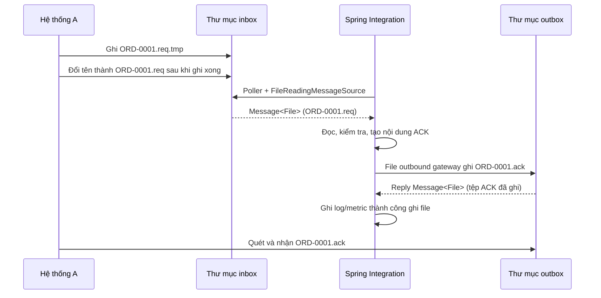
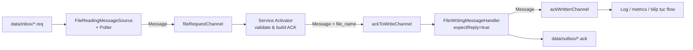

# File inbound gateway kết hợp đọc và phản hồi

## 1. Mục tiêu và bài toán

Trong module **SPRING_INTEGRATION_ADAPTERS**, Spring Integration đưa dữ liệu từ các hệ thống bên ngoài vào ứng dụng bằng inbound/outbound adapter, gateway, poller và `MessageChannel`. Các luồng còn cần quản lý **hợp đồng message, xử lý lỗi và vòng đời kết nối**. Ở chương **Adapter file**, bài này xây dựng một mô hình đặc biệt: **nhận một tệp yêu cầu, xử lý nội dung, rồi phát hành tệp phản hồi tương ứng**.

Giả sử hệ thống A xuất yêu cầu kiểm tra đơn hàng vào thư mục `data/inbox`:

```text
data/inbox/ORD-0001.req
```

Nội dung tệp:

```text
ORD-0001
```

Ứng dụng Spring Integration nhận yêu cầu, kiểm tra định dạng, rồi ghi kết quả vào `data/outbox/ORD-0001.ack`:

```text
requestId=ORD-0001
status=ACCEPTED
```

Hệ thống A quét `data/outbox` để lấy kết quả. Đây là **request–reply ở tầng hợp đồng trao đổi tệp**: mỗi tệp `*.req` có một phản hồi `*.ack` mang cùng mã yêu cầu.

Sau bài học, bạn có thể:

- Phân biệt **File inbound channel adapter**, **file outbound gateway** và **messaging gateway**.
- Thiết kế luồng đọc tệp → kiểm tra/biến đổi → ghi tệp phản hồi → tiếp tục xử lý kết quả ghi.
- Hiểu cách `FileReadingMessageSource`, `Poller`, `MessageChannel` và `FileWritingMessageHandler` phối hợp.
- Cấu hình đầu ra request–reply bằng `setExpectReply(true)`, nhận lại đối tượng `File` đã ghi.
- Nhận diện sự khác biệt giữa **phản hồi trong Spring Integration** và **ACK nghiệp vụ của hệ thống bên ngoài**.
- Xử lý các trường hợp lỗi đọc, lỗi ghi, tệp trùng tên, timeout, khởi động lại và xử lý trùng.

## 2. Làm rõ thuật ngữ: có “File inbound gateway” riêng không?

Trong **Spring Integration File** dành cho hệ thống tệp cục bộ, các endpoint chủ yếu là:

| Thành phần | Đầu vào / đầu ra | Vai trò |
| --- | --- | --- |
| `FileReadingMessageSource` / File inbound channel adapter | Thư mục → `Message<File>` | Quét thư mục, tìm tệp và phát message qua poller |
| `FileWritingMessageHandler` ở chế độ outbound adapter | `Message<?>` → file | Ghi tệp một chiều, không gửi reply message |
| `FileWritingMessageHandler` ở chế độ **outbound gateway** | `Message<?>` → file → `Message<File>` | Ghi tệp rồi trả **đối tượng tệp đích** cho một bước nội bộ tiếp theo |
| `@MessagingGateway` | Lời gọi phương thức Java ↔ luồng message | Cho phép code Java gọi một luồng Spring Integration và nhận giá trị trả về |

**Không có endpoint chuẩn chuyên biệt mang tên “file inbound gateway” cho hệ thống tệp cục bộ tương ứng với một HTTP inbound gateway.** Cách hiểu chính xác của tiêu đề bài là **kết hợp file inbound adapter với các bước xử lý và cơ chế phản hồi**. Spring Integration không tự gửi phản hồi trở lại cho một tệp đã được đọc: file chỉ là dữ liệu thụ động, không có kết nối request–reply đang mở.

Đối với kết nối HTTP, JMS hoặc AMQP, một inbound gateway có thể có kênh/địa chỉ reply gắn với yêu cầu. Đối với file, muốn bên gửi nhận kết quả thì hai bên phải thỏa thuận **thư mục phản hồi, cách đặt tên, định dạng kết quả và thời hạn chờ**.

## 3. Kiến trúc trao đổi request–reply qua thư mục



Luồng logic bên trong Spring Integration:



Có **hai lớp phản hồi** cần phân biệt:

1. **Reply message nội bộ**: `FileWritingMessageHandler` ở chế độ gateway phát ra payload `File` đại diện cho tệp đã ghi. Bước phía sau có thể theo dõi, ghi metric, di chuyển tệp hoặc tiếp tục một flow.
2. **Phản hồi cho hệ thống gửi bên ngoài**: tệp `*.ack` xuất hiện trong `outbox`. Việc đối tác thực sự đọc, chấp nhận hoặc xử lý ACK đòi hỏi một cơ chế xác nhận khác nếu nghiệp vụ cần.

Chỉ vì handler đã tạo một `Message<File>` phản hồi **không có nghĩa** đối tác đã nhận hoặc đồng ý với kết quả.

## 4. Hợp đồng tệp và message

Trước khi viết code, hai hệ thống nên thống nhất hợp đồng:

| Thuộc tính | Request | Response |
| --- | --- | --- |
| Thư mục | `data/inbox` | `data/outbox` |
| Tên | `ORD-0001.req` | `ORD-0001.ack` |
| Nội dung | ID đơn hàng dạng UTF-8, một dòng | `requestId=...` và `status=...`, UTF-8 |
| Thời điểm có thể đọc | Sau khi rename từ `*.tmp` thành `*.req` | Sau khi handler hoàn tất ghi và công bố `*.ack` |
| Khóa đối chiếu | `ORD-0001` | Cùng mã `ORD-0001` |
| Khi lỗi | Có chính sách xử lý/retry đã thống nhất | Tùy hợp đồng: ACK từ chối hoặc cơ chế báo lỗi riêng |

File inbound adapter phát payload **`java.io.File`**, cùng các header hữu ích như `FileHeaders.FILENAME` và `FileHeaders.ORIGINAL_FILE`. Nó **không tự đọc CSV hoặc parse nội dung**.

Sau bước xử lý, ví dụ tạo một `Message<byte[]>`:

```text
payload = bytes("requestId=ORD-0001\nstatus=ACCEPTED\n", UTF-8)
headers[FileHeaders.FILENAME] = "ORD-0001.ack"
```

File outbound gateway đọc header tên tệp để xác định tên đích (qua file-name generator) và ghi bytes. Khi `expectReply=true`, nó phát reply với payload là `File` của kết quả ghi.

Đừng nhầm `FileHeaders.FILENAME` với `replyChannel`: header thứ nhất nói về **tên tệp**; header thứ hai phục vụ **định tuyến message phản hồi** của Spring Integration.

## 5. Thiết lập Spring Boot

Ví dụ sử dụng Java 17+, Spring Boot và Spring Integration File. Với Maven, khi Spring Boot quản lý phiên bản dependency:

```xml
<dependencies>
    <dependency>
        <groupId>org.springframework.boot</groupId>
        <artifactId>spring-boot-starter-integration</artifactId>
    </dependency>
    <dependency>
        <groupId>org.springframework.integration</groupId>
        <artifactId>spring-integration-file</artifactId>
    </dependency>
</dependencies>
```

Chuẩn bị hai thư mục `data/inbox` và `data/outbox`. Cả hai được hiểu **tương đối với working directory của JVM**. Trong production, nên dùng đường dẫn tuyệt đối hoặc cấu hình hóa qua properties và cấp quyền đọc/ghi phù hợp.

## 6. Cấu hình luồng đọc và phản hồi bằng Java

Đây là một ví dụ tự chứa cho flow file-based request–reply. Nó gồm bốn channel/endpoint chức năng: nhận file, xử lý yêu cầu, ghi ACK ở chế độ outbound gateway, sau đó ghi nhận kết quả ghi.

```java
import java.io.File;
import java.io.IOException;
import java.nio.charset.StandardCharsets;
import java.nio.file.Files;

import org.springframework.context.annotation.Bean;
import org.springframework.context.annotation.Configuration;
import org.springframework.integration.annotation.InboundChannelAdapter;
import org.springframework.integration.annotation.Poller;
import org.springframework.integration.annotation.ServiceActivator;
import org.springframework.integration.channel.DirectChannel;
import org.springframework.integration.config.EnableIntegration;
import org.springframework.integration.core.MessageSource;
import org.springframework.integration.file.FileHeaders;
import org.springframework.integration.file.FileReadingMessageSource;
import org.springframework.integration.file.FileWritingMessageHandler;
import org.springframework.integration.file.filters.AcceptOnceFileListFilter;
import org.springframework.integration.file.filters.CompositeFileListFilter;
import org.springframework.integration.file.filters.SimplePatternFileListFilter;
import org.springframework.integration.file.support.FileExistsMode;
import org.springframework.messaging.Message;
import org.springframework.messaging.MessageChannel;
import org.springframework.messaging.support.MessageBuilder;

@Configuration
@EnableIntegration
public class FileRequestReplyFlow {

    @Bean
    public MessageChannel fileRequestChannel() {
        return new DirectChannel();
    }

    @Bean
    public MessageChannel ackToWriteChannel() {
        return new DirectChannel();
    }

    @Bean
    public MessageChannel ackWrittenChannel() {
        return new DirectChannel();
    }

    @Bean
    @InboundChannelAdapter(
        channel = "fileRequestChannel",
        poller = @Poller(fixedDelay = "2000", maxMessagesPerPoll = "5")
    )
    public MessageSource<File> fileRequestSource() {
        FileReadingMessageSource source = new FileReadingMessageSource();
        source.setDirectory(new File("data/inbox"));

        CompositeFileListFilter<File> filter =
                new CompositeFileListFilter<>();
        filter.addFilter(new SimplePatternFileListFilter("*.req"));
        filter.addFilter(new AcceptOnceFileListFilter<>());
        source.setFilter(filter);

        return source;
    }

    @ServiceActivator(
        inputChannel = "fileRequestChannel",
        outputChannel = "ackToWriteChannel"
    )
    public Message<byte[]> buildAck(File requestFile) throws IOException {
        String requestId = Files.readString(
                requestFile.toPath(),
                StandardCharsets.UTF_8
        ).trim();

        // Minh hoa hop dong mot ma don hang / mot file.
        String status = requestId.matches("ORD-[0-9]{4}")
                ? "ACCEPTED" : "REJECTED";

        String fileName = requestFile.getName();
        String ackName = fileName.substring(
                0, fileName.length() - ".req".length()
        ) + ".ack";

        String ack = "requestId=" + requestId + "\n"
                + "status=" + status + "\n";

        return MessageBuilder
                .withPayload(ack.getBytes(StandardCharsets.UTF_8))
                .setHeader(FileHeaders.FILENAME, ackName)
                .build();
    }

    @Bean
    @ServiceActivator(
        inputChannel = "ackToWriteChannel",
        outputChannel = "ackWrittenChannel"
    )
    public FileWritingMessageHandler writeAckGateway() {
        FileWritingMessageHandler handler =
                new FileWritingMessageHandler(new File("data/outbox"));

        handler.setAutoCreateDirectory(true);
        handler.setFileExistsMode(FileExistsMode.FAIL);
        handler.setTemporaryFileSuffix(".writing");
        handler.setExpectReply(true);
        return handler;
    }

    @ServiceActivator(inputChannel = "ackWrittenChannel")
    public void onAckWritten(File writtenFile) {
        System.out.println(
                "Da ghi file ACK: " + writtenFile.getAbsolutePath()
        );
    }
}
```

Class `FileRequestReplyFlow` cần nằm trong phạm vi component scan của ứng dụng `@SpringBootApplication` hoặc được import vào context. Thư mục `data/inbox` cần tồn tại và tiến trình có quyền đọc. Handler đầu ra có thể tạo `outbox` nếu chưa tồn tại.

### Phân tích từng chặng

**1. File inbound + poller.** `FileReadingMessageSource` được poller gọi theo khoảng trễ 2 giây. Nó lọc `*.req` và sử dụng `AcceptOnceFileListFilter` để hạn chế phát cùng tệp nhiều lần trong thời gian filter tồn tại trong bộ nhớ. `maxMessagesPerPoll = 5` giới hạn số message được lấy mỗi lần poll, không có nghĩa 5 file xử lý song song.

**2. Xử lý yêu cầu.** `buildAck` đọc nội dung UTF-8 và tạo `Message<byte[]>` cho bước ghi. Ở ví dụ này, kết quả `ACCEPTED` chỉ là **kiểm tra định dạng mã**, chưa phải xác nhận rằng đơn hàng thực sự tồn tại trong database. Khi phát triển nghiệp vụ thật, phải thay quy tắc minh họa bằng kiểm tra và transaction thích hợp.

**3. Outbound gateway.** `FileWritingMessageHandler` nhận payload bytes, lấy `FileHeaders.FILENAME` rồi ghi vào `data/outbox`. Với `setExpectReply(true)`, sau khi ghi thành công, handler tạo **reply message** có payload `File` đại diện cho tệp đã ghi. Vì endpoint có `outputChannel = "ackWrittenChannel"`, reply đi tới consumer tiếp theo.

**4. Quan sát kết quả.** `onAckWritten(File)` in đường dẫn file vừa được ghi. Đây là bước nội bộ sau file outbound gateway, **không phải phản hồi trực tiếp tới bên gửi**. Đối tác nhận phản hồi qua file `*.ack` trong `outbox`.

**5. Trùng tên file.** `FileExistsMode.FAIL` khiến việc ghi thất bại nếu tên ACK đã tồn tại. Ví dụ cố ý chọn chế độ này để tránh silently overwrite một phản hồi đã phát hành. Trong production, cần lưu trạng thái yêu cầu/ACK và đối chiếu trước khi retry.

**6. File tạm.** `setTemporaryFileSuffix(".writing")` hỗ trợ quy ước ghi file tạm rồi công bố tên cuối khi hoàn tất, giúp bên nhận chỉ quét `*.ack`. Tính nguyên tử của rename phụ thuộc filesystem và thao tác thực tế; bên nhận cần có hợp đồng nhận file đầy đủ.

## 7. Thực hành end-to-end

Tạo thư mục và tệp test. Ví dụ trên PowerShell, chạy từ working directory ứng dụng:

```powershell
New-Item -ItemType Directory -Force -Path .\data\inbox
New-Item -ItemType Directory -Force -Path .\data\outbox
$utf8NoBom = [System.Text.UTF8Encoding]::new($false)
[System.IO.File]::WriteAllText(
    (Join-Path (Get-Location).Path 'data\inbox\ORD-0001.req'),
    'ORD-0001', $utf8NoBom
)
```

`WriteAllText` ở đây chủ động ghi UTF-8 **không có BOM**, giúp đoạn kiểm tra `requestId.matches(...)` nhận chính xác chuỗi mong đợi trên cả Windows PowerShell 5.1 lẫn PowerShell mới. Bài thực hành giả định đầu vào được thống nhất UTF-8 không BOM; nếu dữ liệu ngoài có BOM, cần quy định và xử lý nó ở bước parse.

Sau khi khởi động ứng dụng, poller có thể nhận `ORD-0001.req`. Kết quả mong đợi:

```text
data/
├── inbox/
│   └── ORD-0001.req
└── outbox/
    └── ORD-0001.ack
```

Nội dung trong `ORD-0001.ack`:

```text
requestId=ORD-0001
status=ACCEPTED
```

Trong console, consumer cuối có thể ghi:

```text
Da ghi file ACK: .../data/outbox/ORD-0001.ack
```

Thử thêm một file `ORD-0002.req` chứa `UNKNOWN`: ví dụ sẽ trả `status=REJECTED` vì nội dung không khớp quy tắc `ORD-[0-9]{4}`. Đây vẫn là **phản hồi nghiệp vụ hợp lệ** của flow, không phải lỗi kỹ thuật.

Để thử lại cùng file từ đầu, cần có kế hoạch dọn các file thử nghiệm theo ý muốn. Vì cả request và ACK vẫn còn trên đĩa, việc restart ứng dụng hoặc gửi lại cùng tên có thể tạo xung đột với `FileExistsMode.FAIL`. Đừng xóa file production chỉ để làm cho lần thử lại “thành công”.

### Khi bên gửi đang ghi dở

Không nên tạo trực tiếp tên `ORD-0003.req` trước khi viết xong dữ liệu. Một cách xuất an toàn hơn:

1. Bên gửi ghi toàn bộ nội dung vào `ORD-0003.req.tmp`.
2. Bên gửi đóng file và rename thành `ORD-0003.req` sau khi ghi hoàn tất.
3. Inbound filter chỉ nhận tên `*.req`, nên không chọn file tạm.

Nếu không thể dùng rename, cân nhắc một file “ready”/“done” hoặc bộ lọc thời gian sửa cuối thích hợp. Bộ lọc tên tệp và `AcceptOnceFileListFilter` **không chứng minh** file đã được ghi trọn vẹn.

## 8. Phân biệt reply channel và ACK file

Trong kiến trúc request–reply qua message, **gateway reply** thường đi theo `replyChannel` trong headers hoặc theo `outputChannel` của endpoint. Nhưng một tệp trên filesystem **không mang theo một đường kết nối trả lời** như socket/HTTP request.

| Hành động | Ai nhận? | Ý nghĩa |
| --- | --- | --- |
| Inbound source phát `Message<File>` | Channel trong Spring Integration | Hệ thống đã phát hiện request file |
| Service Activator trả `Message<byte[]>` | `ackToWriteChannel` | Ứng dụng đã tạo nội dung phản hồi |
| Outbound gateway trả `Message<File>` | `ackWrittenChannel` | Handler đã ghi file đích thành công |
| Hệ thống A đọc `*.ack` | Đối tác bên ngoài | Đối tác đã nhận được phản hồi theo cơ chế của mình |
| Đối tác gửi xác nhận tiếp theo | Ứng dụng, nếu có cơ chế riêng | Mới có bằng chứng rằng đối tác đã tiêu thụ/xử lý kết quả |

Giả sử outbound gateway ghi thành công nhưng hệ thống A đang dừng: ACK vẫn tồn tại trong `outbox`. Ngược lại, nếu handler báo lỗi ghi, Spring Integration không thể xem `ackWrittenChannel` là một reply đã thành công.

Hợp đồng thực tế nên có **correlation ID**, tức một mã yêu cầu duy nhất để ghép file request với file response. Trong ví dụ, `ORD-0001` đóng vai trò correlation ID. Với nhiều yêu cầu trong cùng một file hoặc nhiều phiên xử lý, cần một trường ID rõ ràng trong từng record.

## 9. Messaging gateway: một kiểu “đọc và phản hồi” khác

Nếu bên gọi là **một thành phần Java trong ứng dụng**, ta có thể cung cấp API dạng phương thức bằng `@MessagingGateway`. Phương thức nhận `File`, luồng Spring Integration đọc nội dung, rồi **trả chuỗi phản hồi trực tiếp cho code gọi**. Đây là messaging gateway, không phải bộ quét thư mục.

Ví dụ bổ sung sau có thể đặt trong cùng ứng dụng:

```java
import java.io.File;
import java.io.IOException;
import java.nio.charset.StandardCharsets;
import java.nio.file.Files;

import org.springframework.context.annotation.Bean;
import org.springframework.context.annotation.Configuration;
import org.springframework.integration.annotation.Gateway;
import org.springframework.integration.annotation.IntegrationComponentScan;
import org.springframework.integration.annotation.MessagingGateway;
import org.springframework.integration.annotation.ServiceActivator;
import org.springframework.integration.channel.DirectChannel;
import org.springframework.integration.config.EnableIntegration;
import org.springframework.messaging.MessageChannel;

@MessagingGateway(defaultRequestChannel = "manualReadChannel")
public interface ManualFileReadGateway {

    @Gateway(replyTimeout = 5000)
    String read(File file);
}

@Configuration
@EnableIntegration
@IntegrationComponentScan
class ManualReadFlow {

    @Bean
    public MessageChannel manualReadChannel() {
        return new DirectChannel();
    }

    @ServiceActivator(inputChannel = "manualReadChannel")
    public String readFile(File file) throws IOException {
        return Files.readString(
                file.toPath(), StandardCharsets.UTF_8
        );
    }
}
```

> Đây là **minh họa riêng** cho lời gọi Java, không phải phần bắt buộc để chạy luồng đọc `*.req` và ghi `*.ack` ở trên. Khi đưa vào Java, interface `public` phải nằm trong file riêng theo quy tắc Java; lớp cấu hình có thể ở file khác. Giới hạn đường dẫn `File` được phép đọc và xác thực nguồn yêu cầu trước khi gọi, tránh để ứng dụng mở tùy ý tệp nhạy cảm.

Một bean Java có thể inject `ManualFileReadGateway` rồi gọi:

```java
String contents = manualFileReadGateway.read(
        new File("data/inbox/ORD-0001.req")
);
```

Khi đó, **giá trị trả về phương thức** chính là reply của messaging gateway. Nó không tạo `*.ack` và không có poller vì chính lời gọi Java đã cung cấp request. Để kết hợp với file poller, ta vẫn phải có một flow khởi phát bằng `FileReadingMessageSource`.

## 10. Lỗi, timeout và phục hồi

Một hệ thống request–reply qua file không có transaction end-to-end tự động giữa filesystem, ứng dụng, database và đối tác. Cần tách lỗi theo từng chặng:

| Điểm lỗi | Hậu quả | Cách xử lý cần thiết |
| --- | --- | --- |
| File đang ghi dở | Consumer đọc thiếu nội dung | Quy ước tệp tạm rồi rename hoặc ready marker |
| File không đọc được | Không thể tạo ACK dựa trên nội dung | Log nguyên nhân; đưa vào `failed/` hoặc quy trình vận hành |
| Đầu vào sai định dạng | Kiểm tra nghiệp vụ từ chối | Trả ACK với `REJECTED` nếu đó là kết quả hợp lệ |
| Ghi ACK thất bại | Bên gửi chưa có phản hồi | Theo dõi exception, dung lượng đĩa, quyền ghi và retry |
| ACK đã có trước đó | `FileExistsMode.FAIL` báo xung đột | Đối chiếu request ID và nội dung ACK để tránh xử lý lặp |
| Ứng dụng restart | `AcceptOnceFileListFilter` trong bộ nhớ quên các file đã nhận | Lưu trạng thái bền vững hoặc archive có kiểm soát |
| Đối tác không nhận ACK đúng hạn | Bên gửi có thể timeout/retry | Hợp đồng timeout, ID cố định, reconciliation và tránh trả hai kết quả mâu thuẫn |
| Hai instance cùng đọc inbox | Một file có thể được xử lý hai lần | Điều phối ownership, shared metadata store/lock hoặc cơ chế phân phối phù hợp |

### Vì sao accept-once không đủ?

`AcceptOnceFileListFilter` đánh dấu việc **chọn file**, không đánh dấu transaction nghiệp vụ đã thành công. Ví dụ:

1. Poller chọn `ORD-0001.req`.
2. Consumer đã đọc file và tính toán phản hồi.
3. Ổ đĩa `outbox` đầy, nên outbound gateway không ghi được `ORD-0001.ack`.
4. File request vẫn tồn tại nhưng có thể không được filter phát lại trong phiên chạy này.

Vì vậy, cần một phương án khôi phục riêng. Có thể dùng `FileSystemPersistentAcceptOnceFileListFilter` với `ConcurrentMetadataStore` phù hợp để lưu trạng thái chọn file qua restart, nhưng **bền vững khi chọn không đồng nghĩa đã xử lý thành công**. Với file nghiệp vụ quan trọng, nên có bảng trạng thái theo `requestId`, ví dụ `RECEIVED → PROCESSING → RESPONDED`, hoặc chuyển file vào các thư mục `processing/`, `archive/`, `failed/` theo hợp đồng vận hành.

### Retry phải idempotent

Nếu ACK đã ghi xong nhưng ứng dụng crash trước khi cập nhật trạng thái database, lần retry có thể thấy tệp ACK sẵn có. Đừng tạo một ACK khác với kết quả khác chỉ vì retry. Có thể kiểm tra:

1. Request ID có từng được xử lý chưa?
2. Trạng thái xử lý cuối cùng trong database là gì?
3. File ACK hiện có có tương ứng cùng request ID, trạng thái và checksum mong đợi không?
4. Nếu khớp, ghi nhận lại thành công theo chính sách; nếu không, đưa vào đường xử lý xung đột.

Một cơ chế file ACK chỉ cung cấp **kết quả được công bố**, không tạo bảo đảm “exactly once” cho toàn bộ hệ thống.

### Timeout nằm ở đâu?

File inbound adapter được poll theo lịch, vì vậy **không có một caller HTTP đồng bộ đang giữ socket chờ reply**. Timeout request–reply qua file phải được định nghĩa ở **bên gửi**: nếu quá một khoảng thời gian không thấy `*.ack` phù hợp, bên gửi có thể truy vấn trạng thái, thử lại cùng ID hoặc báo vận hành.

Riêng ví dụ `@MessagingGateway` có `replyTimeout = 5000` cho lời gọi Java. Timeout đó áp dụng cho việc chờ **message reply trong Spring Integration**, không thay cho timeout nhận ACK file của một hệ thống bên ngoài. Với `DirectChannel` đồng bộ, thời gian xử lý có thể nằm ngay trên thread của caller; cần cân nhắc ảnh hưởng của việc xử lý dài.

## 11. Giám sát và vòng đời kết nối

Dù file cục bộ không có phiên mạng như SFTP hoặc JMS, vẫn có vòng đời cần quản lý: tạo thư mục, quyền truy cập, poller chạy/dừng, backlog, file tạm, số lần xử lý lỗi và quá trình shutdown.

Nên thu thập tối thiểu:

- Số file `*.req` mới nhận, số ACK đã ghi và số request ở trạng thái lỗi.
- Thời gian từ lúc request hoàn tất ghi đến lúc tạo ACK.
- Số file còn trong `inbox`, `outbox` và `failed`, cùng dung lượng ổ đĩa.
- Số lần retry, xung đột tên ACK và những request ID chưa có phản hồi.
- Lỗi nội dung, quyền đọc/ghi, disk-full và thời gian chờ của đối tác.

Nếu cần xác nhận đối tác đã **tiêu thụ** ACK, nên có bước riêng: đối tác tạo file `*.received`, gửi message qua broker, gọi HTTP callback hoặc cập nhật một bảng trạng thái chung. **“Đã ghi ACK file” và “đối tác đã đọc ACK” là hai sự kiện khác nhau.**

Khi kết nối với SFTP, HTTP, JMS, AMQP, Kafka hoặc database, chọn adapter/gateway theo **semantics của giao thức**: file cung cấp sự hiện diện của tệp, còn broker hoặc HTTP có các cơ chế phản hồi, timeout hoặc xác nhận riêng.

## 12. Những lỗi hiểu sai thường gặp

**“File inbound gateway là một tag XML có sẵn.”** Với local file, các tài liệu Spring Integration mô tả `inbound-channel-adapter` để đọc tệp và `outbound-gateway` để ghi và phát reply. Ta ghép chúng để có mô hình file-based request–reply.

**“File outbound gateway trả response về trực tiếp cho máy đã gửi file.”** Nó trả **message nội bộ** có payload là file đích. Đối tác cần quy ước riêng để quét hoặc nhận file ACK.

**“Reply nhận được có nghĩa bên ngoài đã xử lý ACK.”** Reply trong flow chỉ xác nhận handler đã thực hiện thao tác ghi tệp theo hợp đồng, không chứng minh tiến trình đối tác đã đọc hay commit dữ liệu.

**“Một request file luôn chỉ được xử lý một lần.”** Bộ lọc chỉ chống phát lại ở mức nguồn trong phạm vi trạng thái của nó. Restart, nhiều instance, retry và crash vẫn có thể tạo xử lý trùng.

**“Poller luôn tạo reply sau đúng hai giây.”** Fixed delay là một cấu hình lập lịch, không phải SLA. Độ trễ còn phụ thuộc thời gian xử lý, backlog, I/O và trạng thái ứng dụng.

## 13. Bài tập thực hành

1. **Luồng thành công:** ghi `ORD-0001.req`, chạy ứng dụng và kiểm tra `ORD-0001.ack` có nội dung `ACCEPTED`. Giải thích ý nghĩa của từng channel.
2. **Request bị từ chối:** tạo `ORD-0002.req` có nội dung sai định dạng, quan sát ACK `REJECTED`. Phân biệt kết quả nghiệp vụ bị từ chối với exception kỹ thuật.
3. **Ghi file trùng:** chạy lại với request ID cũ trong khi ACK vẫn tồn tại. Giải thích `FileExistsMode.FAIL` và đề xuất cách xử lý idempotent.
4. **Thử file chưa hoàn tất:** ghi tệp tạm rồi đổi tên khi đóng file. So sánh với việc ghi trực tiếp tệp `*.req`.
5. **Lỗi ghi:** thử cấu hình `outbox` không có quyền ghi. Quan sát ngoại lệ và thiết kế phương án chuyển sang `failed/` để xử lý lại.
6. **Tái khởi động:** giữ nguyên `inbox` rồi restart ứng dụng. Tìm cách phân biệt file đã xử lý thành công và file còn nợ ACK.
7. **Gateway Java:** gọi `ManualFileReadGateway.read(...)` và nhận `String`. Giải thích vì sao đây là request–reply trong JVM, không phải request–reply qua thư mục.

### Câu hỏi tự kiểm tra

**Q1. File inbound adapter phát payload gì?**  
Thông thường là đối tượng `java.io.File` đại diện cho file tìm thấy.

**Q2. File outbound gateway trả payload gì sau khi ghi thành công?**  
Thông thường là `File` đại diện cho tệp đã ghi; reply được đưa vào channel tiếp theo trong luồng.

**Q3. Vì sao phải có correlation ID?**  
Để ghép mỗi request với ACK tương ứng, đặc biệt khi có nhiều file, retry hoặc kết quả đến không theo thứ tự.

**Q4. `@MessagingGateway` khác với file inbound adapter như thế nào?**  
`@MessagingGateway` biến lời gọi phương thức Java thành request message và nhận reply; file inbound adapter là nguồn quét thư mục theo poller.

**Q5. Vì sao không thể suy ra “đối tác đã xử lý thành công” từ `ackWrittenChannel`?**  
Vì channel đó chỉ nhận thông tin đã ghi file thành công trong Spring Integration; đối tác phải tự đọc và xử lý tệp.

## 14. Ghi nhớ

“File inbound gateway kết hợp đọc và phản hồi” nên được hiểu là **một mô hình tích hợp qua file**: `FileReadingMessageSource` + poller nhận request, `MessageChannel` truyền dữ liệu, service activator tạo kết quả, và **file outbound gateway** ghi ACK rồi phát `Message<File>` nội bộ. Khi cần API Java request–reply, dùng `@MessagingGateway` như một lớp gọi riêng. Tính đúng đắn của toàn luồng phụ thuộc hợp đồng file, correlation ID, xử lý file ghi dở, retry/idempotency, lỗi, timeout và khả năng phục hồi sau restart.

### Tài liệu tham khảo

- [Spring Integration Reference — Reading Files](https://docs.spring.io/spring-integration/reference/file/reading.html)
- [Spring Integration Reference — Writing Files / Outbound Gateway](https://docs.spring.io/spring-integration/reference/file/writing.html)
- [Spring Integration Reference — Messaging Gateways](https://docs.spring.io/spring-integration/reference/gateway.html)
