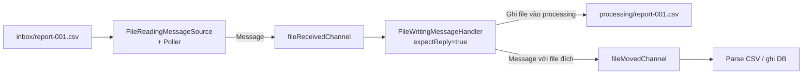

# File outbound gateway thao tác hệ thống tệp

## 1. Bài toán và mục tiêu

Module **SPRING_INTEGRATION_ADAPTERS** hướng dẫn kết nối các hệ thống bên ngoài vào Spring Integration thông qua inbound/outbound adapter, gateway, poller và `MessageChannel`, đồng thời xử lý hợp đồng message, lỗi và vòng đời kết nối. Trong chương **Adapter file**, bài này tập trung vào **File outbound gateway**: ghi tệp ra filesystem và trả một message chứa tệp kết quả để luồng xử lý tiếp tục.

Giả sử đối tác chuyển `report-001.csv` vào `data/inbox`. Ứng dụng muốn nhận file, **đưa nó sang `data/processing`**, rồi parse nội dung từ tệp ở vị trí mới. Nếu file đích đã tồn tại, ứng dụng phải báo xung đột. Nếu ghi thất bại, không được coi là đã xử lý thành công.

Sau bài học, bạn có thể:

- Phân biệt **file outbound channel adapter** và **file outbound gateway**.
- Cấu hình `FileWritingMessageHandler` và bật reply bằng `setExpectReply(true)`.
- Xây dựng luồng **file inbound adapter → outbound gateway → consumer**.
- Phân biệt copy, thao tác giống move, đổi tên, thay thế và append tệp.
- Sử dụng `FileExistsMode`, `FileNameGenerator`, file tạm, directory expression và metadata.
- Thiết kế retry/idempotency, quản lý file nguồn/đích, lỗi I/O và vòng đời ứng dụng.

## 2. Gateway ghi file và trả về kết quả

File outbound gateway trong Spring Integration File sử dụng lớp `org.springframework.integration.file.FileWritingMessageHandler`. Handler có thể ghi nội dung từ các payload `java.io.File`, `String`, `byte[]` hoặc `InputStream`. Sau khi xử lý, **gateway phát reply message có payload là file đích**, để những bước sau tiếp tục đọc/biến đổi.

| Thành phần | Cách hoạt động | Có message phản hồi? |
| --- | --- | --- |
| File outbound channel adapter | Nhận message và ghi file ra filesystem | Không, điểm kết thúc luồng một chiều |
| File outbound gateway | Nhận message, ghi file và phát file kết quả | Có, thường là `Message<File>` |
| File inbound channel adapter | Dùng `FileReadingMessageSource` quét thư mục | Là nguồn phát message vào luồng |
| Messaging gateway | Biến lời gọi phương thức Java thành request/reply message | Có kết quả trả về cho phương thức Java |

Đối với cấu hình Java, hai thao tác quan trọng là `setExpectReply(true)` và nối `outputChannel` cho endpoint. **Không cần poller riêng cho File outbound gateway** nếu đầu vào của nó là `DirectChannel`; nó được gọi khi có message. Poller có thể dùng ở bước nhận file từ thư mục.



Reply từ gateway **không phải ACK của đối tác bên ngoài**. Nó cho biết kết quả thao tác file trong Spring Integration và cho phép consumer nội bộ dùng tệp đích. Nếu cần biết một hệ thống khác đã đọc thành công file, phải có cơ chế xác nhận riêng.

### Payload và file headers

Một message đầu vào có thể chứa:

```text
payload = File("data/inbox/report-001.csv")
headers[FileHeaders.FILENAME] = "report-001.csv" (neu co)
```

Gateway xác định tên đích bằng `FileNameGenerator`. Generator mặc định ưu tiên tên đã được chỉ định bằng header `FileHeaders.FILENAME`; với payload `File`, nó có thể lấy tên từ chính `File.getName()`. Nếu payload không có tên cụ thể, handler có thể tạo tên dựa trên message ID. Với tài liệu xuất cho đối tác, nên đặt tên theo hợp đồng bằng header hoặc generator riêng.

Reply sau khi ghi có thể hình dung:

```text
reply.payload = File("data/processing/report-001.csv")
```

Khi cần nội dung file, downstream tự gọi parser/reader. Gateway không tự chuyển CSV thành đối tượng nghiệp vụ.

## 3. Các thao tác file mà gateway hỗ trợ

**File outbound gateway cục bộ chủ yếu ghi tệp.** Các hành vi sao chép/chuyển tệp được xây dựng từ việc ghi và tùy chọn xử lý file nguồn:

| Nhu cầu | Cách cấu hình | Ý nghĩa |
| --- | --- | --- |
| Ghi nội dung text/bytes | Payload `String` hoặc `byte[]` | Tạo file và trả file đích |
| Sao chép file | Payload `File`, `deleteSourceFiles=false` | Giữ file nguồn, tạo bản đích |
| Chuyển file | Payload `File`, `deleteSourceFiles=true` | Ghi bản đích rồi xóa nguồn theo chính sách |
| Đổi tên khi chuyển | `FileNameGenerator` chọn tên đích mới | Không phụ thuộc tên gốc |
| Chọn thư mục theo message | Directory expression | Thư mục đích được tính cho từng message |
| Tiếp tục xử lý sau ghi | `expectReply=true` và reply/output channel | Bước kế tiếp nhận payload `File` |
| Xóa/đổi tên bất kỳ file theo lệnh | API filesystem trong bước Java riêng | Cần xác thực đường dẫn và chính sách truy cập |

Không nên nhầm File outbound gateway **cục bộ** với FTP/SFTP/SMB outbound gateway: các gateway remote có tập lệnh `ls`, `get`, `rm`, `mv`, `put`... riêng theo giao thức. `setDeleteSourceFiles(true)` ở FileWritingMessageHandler không phải một lệnh xóa file tùy ý, và thao tác kiểu move này **không được mặc định là rename nguyên tử**.

## 4. Chuẩn bị dự án

Ví dụ sử dụng Java 17+, Spring Boot và Spring Integration File. Khai báo dependencies trong `pom.xml` (phiên bản được Spring Boot quản lý):

```xml
<dependencies>
    <dependency>
        <groupId>org.springframework.boot</groupId>
        <artifactId>spring-boot-starter-integration</artifactId>
    </dependency>
    <dependency>
        <groupId>org.springframework.integration</groupId>
        <artifactId>spring-integration-file</artifactId>
    </dependency>
</dependencies>
```

Tạo thư mục như sau:

```text
data/
├── inbox/
│   └── report-001.csv
└── processing/
```

Nội dung `report-001.csv`:

```csv
id,amount
P-001,125000
P-002,98000
```

Lưu ý đường dẫn tương đối tính từ **working directory của JVM**, không nhất thiết là thư mục chứa mã nguồn. Để chạy ví dụ theo chế độ chuyển file, tiến trình cần có quyền **đọc file nguồn, ghi file đích và xóa file nguồn**.

## 5. Ví dụ Java đầy đủ: nhận, chuyển và xử lý file

Ví dụ dùng `FileReadingMessageSource` để nhận các file CSV, `FileWritingMessageHandler` để ghi vào `processing` và xóa nguồn, rồi gửi reply tới consumer đọc file ở vị trí mới.

```java
import java.io.File;
import java.io.IOException;
import java.nio.charset.StandardCharsets;
import java.nio.file.Files;

import org.springframework.context.annotation.Bean;
import org.springframework.context.annotation.Configuration;
import org.springframework.integration.annotation.InboundChannelAdapter;
import org.springframework.integration.annotation.Poller;
import org.springframework.integration.annotation.ServiceActivator;
import org.springframework.integration.channel.DirectChannel;
import org.springframework.integration.config.EnableIntegration;
import org.springframework.integration.core.MessageSource;
import org.springframework.integration.file.FileReadingMessageSource;
import org.springframework.integration.file.FileWritingMessageHandler;
import org.springframework.integration.file.filters.AcceptOnceFileListFilter;
import org.springframework.integration.file.filters.CompositeFileListFilter;
import org.springframework.integration.file.filters.SimplePatternFileListFilter;
import org.springframework.integration.file.support.FileExistsMode;
import org.springframework.messaging.MessageChannel;

@Configuration
@EnableIntegration
public class FileMoveGatewayConfig {

    @Bean
    public MessageChannel fileReceivedChannel() {
        return new DirectChannel();
    }

    @Bean
    public MessageChannel fileMovedChannel() {
        return new DirectChannel();
    }

    @Bean
    @InboundChannelAdapter(
        channel = "fileReceivedChannel",
        poller = @Poller(
            fixedDelay = "2000",
            maxMessagesPerPoll = "2"
        )
    )
    public MessageSource<File> csvSource() {
        FileReadingMessageSource source = new FileReadingMessageSource();
        source.setDirectory(new File("data/inbox"));

        CompositeFileListFilter<File> filters =
                new CompositeFileListFilter<>();
        filters.addFilter(new SimplePatternFileListFilter("*.csv"));
        filters.addFilter(new AcceptOnceFileListFilter<>());
        source.setFilter(filters);

        return source;
    }

    @Bean
    @ServiceActivator(
        inputChannel = "fileReceivedChannel",
        outputChannel = "fileMovedChannel"
    )
    public FileWritingMessageHandler moveFileGateway() {
        FileWritingMessageHandler handler =
                new FileWritingMessageHandler(new File("data/processing"));

        handler.setAutoCreateDirectory(true);
        handler.setExpectReply(true);
        handler.setDeleteSourceFiles(true);
        handler.setFileExistsMode(FileExistsMode.FAIL);
        handler.setTemporaryFileSuffix(".writing");
        handler.setPreserveTimestamp(true);
        return handler;
    }

    @ServiceActivator(inputChannel = "fileMovedChannel")
    public void importProcessedFile(File movedFile) throws IOException {
        String csv = Files.readString(
                movedFile.toPath(), StandardCharsets.UTF_8
        );

        System.out.printf(
                "Nhan file dich %s, %d ky tu%n",
                movedFile.getAbsolutePath(),
                csv.length()
        );
        // Thuc te: parse, validate, ghi DB va luu trang thai import.
    }
}
```

Lớp cấu hình cần thuộc vùng component scan của `@SpringBootApplication` hoặc được import vào context. Thư mục `data/inbox` phải có sẵn khi nguồn bắt đầu quét. `setAutoCreateDirectory(true)` cho phép handler tạo `processing` nếu thiếu và nếu có quyền.

### Các bước diễn ra

1. Poller gọi `FileReadingMessageSource` theo chu kỳ, chọn file `*.csv`; mỗi đợt lấy tối đa hai message.
2. `fileReceivedChannel` chuyển `Message<File>` tới outbound gateway.
3. Handler ghi bản đích. Với `FileExistsMode.FAIL`, nếu đích đã tồn tại thì ném exception.
4. `setDeleteSourceFiles(true)` yêu cầu xóa file nguồn sau bước ghi theo cơ chế của handler.
5. `setExpectReply(true)` tạo reply `Message<File>` mang tệp kết quả và gửi đến `fileMovedChannel`.
6. `importProcessedFile` đọc file **ở vị trí mới**, sau đó có thể parse, validate và ghi DB.

`DirectChannel` gọi consumer đồng bộ. `maxMessagesPerPoll = 2` giới hạn số message mỗi lần poll, **không có nghĩa hai file chạy song song**. Xử lý lâu ở downstream có thể làm chậm việc phát hiện các file tiếp theo.

### Tại sao cần bật reply?

```java
handler.setExpectReply(true);
```

File outbound **adapter** đặt kỳ vọng reply là `false` và kết thúc luồng ở bước ghi. File outbound **gateway** cần reply để downstream biết đang thao tác với file đích nào. Lời gọi nhận reply không đồng nghĩa consumer phía sau đã commit thành công một giao dịch nghiệp vụ.

### Tại sao nói thao tác giống move nhưng không nguyên tử?

Với payload `File`, handler thực hiện thao tác ghi/copy file sang đích; `setDeleteSourceFiles(true)` cho phép xóa nguồn sau đó. Nếu có lỗi I/O ở giữa, hệ thống có thể còn file nguồn, file tạm hoặc file đích. Vì thế, không nên coi **copy + delete** là một lệnh rename nguyên tử hoặc một transaction bao phủ cả database.

## 6. Thử nghiệm và quan sát

Chuẩn bị file thử trong PowerShell. Để tránh BOM không mong muốn, ví dụ ghi UTF-8 không BOM:

```powershell
New-Item -ItemType Directory -Force -Path .\data\inbox
New-Item -ItemType Directory -Force -Path .\data\processing
$csv = @('id,amount', 'P-001,125000', 'P-002,98000') -join [Environment]::NewLine
$utf8 = [System.Text.UTF8Encoding]::new($false)
[System.IO.File]::WriteAllText(
    (Join-Path (Get-Location).Path 'data\inbox\report-001.csv'),
    $csv,
    $utf8
)
```

Lệnh `WriteAllText` sẽ ghi đè `report-001.csv` nếu tệp này đã có; chỉ thực hiện trong thư mục thực hành. Khởi động ứng dụng và quan sát:

```text
TRUOC:
  data/inbox/report-001.csv
SAU:
  data/inbox/                  (khong con report-001.csv)
  data/processing/report-001.csv
```

Sau đó kiểm tra rằng consumer đọc được nội dung của file ở `processing`. Nếu tệp đích đã tồn tại từ một lần chạy trước, `FAIL` sẽ báo lỗi thay vì ghi đè. Đừng xóa dữ liệu của môi trường thật chỉ để khiến ví dụ chạy lại.

### Thử sao chép thay vì chuyển

Thay:

```java
handler.setDeleteSourceFiles(false);
```

Khi đó, file đích được ghi nhưng file nguồn vẫn ở `inbox`. `AcceptOnceFileListFilter` tránh phát lại cùng tệp trong thời gian lưu trạng thái bộ nhớ; sau restart, trạng thái này có thể mất và file nguồn được nhận lại. Đây là lý do quy trình thật cần một cách đánh dấu đã xử lý bền vững.

### Thử đổi tên tệp khi chuyển

`FileNameGenerator` có thể tạo tên file đích từ payload hoặc headers:

```java
handler.setFileNameGenerator(message -> {
    Object payload = message.getPayload();
    if (!(payload instanceof File source)) {
        throw new IllegalArgumentException("Can File payload");
    }

    String original = source.getName();
    if (!original.matches("[A-Za-z0-9_-]+\\.csv")) {
        throw new IllegalArgumentException("Ten file khong hop le");
    }
    return "processed-" + original;
});
```

Với `report-001.csv`, file đích trở thành `processed-report-001.csv`. Thay đổi này cũng phải phù hợp logic downstream nếu consumer dựa vào tên file. Generator mẫu chỉ chấp nhận tên ASCII đơn giản, từ chối các chuỗi có dấu phân tách đường dẫn hoặc `..`. Trong production, cần bổ sung quy tắc tên Unicode (nếu cần) và tránh va chạm ID.

## 7. Chính sách khi file đích đã tồn tại

Giá trị `FileExistsMode` quyết định hành vi trước file đã có:

| Mode | Cách xử lý | Lưu ý |
| --- | --- | --- |
| `REPLACE` | Thay nội dung file đích, là giá trị mặc định | Có nguy cơ ghi đè dữ liệu cũ |
| `REPLACE_IF_MODIFIED` | Thay nếu timestamp nguồn và đích khác theo quy tắc handler | Dựa trên thời gian sửa, không phải so sánh checksum |
| `APPEND` | Ghi thêm vào file hiện có | Không dùng cơ chế file tạm như ghi file mới |
| `APPEND_NO_FLUSH` | Append và giữ buffer/file mở | Hiệu năng tốt hơn nhưng tăng nguy cơ mất dữ liệu khi crash |
| `FAIL` | Ném exception khi tệp đích đã có | Phù hợp khi cần phát hiện trùng tên |
| `IGNORE` | Không ghi payload mới nếu đích đã có | Gateway vẫn có thể trả lại file đích cũ |

`REPLACE_IF_MODIFIED` so sánh `lastModified` của payload `File` với file đích. Với payload khác, handler có thể dựa vào `FileHeaders.SET_MODIFIED` nếu giá trị là một số; thiếu giá trị hợp lệ thì có thể vẫn ghi đè. Khi chọn mode này, `setPreserveTimestamp(true)` thường có ý nghĩa hơn, nhưng timestamp vẫn không chứng minh hai file có cùng nội dung.

`APPEND` và `APPEND_NO_FLUSH` cần hiểu rõ ranh giới bản ghi. Nếu append CSV đầy đủ nhiều lần, file có thể chứa nhiều dòng header giữa các đợt. `APPEND_NO_FLUSH` cần chính sách flush và shutdown vì dữ liệu chưa flush có thể mất nếu tiến trình dừng đột ngột.

Với `IGNORE`, reply có thể chứa **file đích đã tồn tại**. Vì vậy, chỉ thấy reply `Message<File>` không đủ kết luận message mới đã thực sự được ghi. Nếu nghiệp vụ yêu cầu “lần gửi mới cập nhật dữ liệu mới”, `IGNORE` có thể là lựa chọn sai.

## 8. File tạm, timestamp và thư mục động

### Ghi vào tên tạm

Thông thường handler dùng hậu tố `.writing` trong khi file đang được ghi. Sau khi ghi hoàn tất, file được công bố dưới tên chính thức. Hệ thống bên ngoài chỉ nên quét tên chính thức, ví dụ `*.csv`, để tránh nhận file chưa đủ dữ liệu.

```text
data/processing/report-001.csv.writing  <- trong luc ghi
data/processing/report-001.csv          <- ten cuoi
```

Đối với `APPEND`, việc ghi diễn ra trực tiếp vào file hiện có nên không dựa vào tệp tạm theo cách trên. Tính nguyên tử của rename, tính bền vững khi mất điện và hành vi trên network share đều tùy môi trường; cần kiểm thử hệ thống tệp thật.

### Giữ timestamp và phân quyền

`setPreserveTimestamp(true)` giúp giữ timestamp sửa cuối của file nguồn với payload `File`. Với payload khác có thể dùng header `FileHeaders.SET_MODIFIED`. Trên hệ tệp POSIX, có thể cấu hình quyền file đích theo octal; trên Windows dùng ACL tương ứng. Chỉ cấp quyền vừa đủ cho tài khoản ứng dụng, nhất là khi dùng `deleteSourceFiles=true`.

### Chọn thư mục theo message

Để ghi vào nhiều thư mục, có thể dùng directory expression thay vì một đường dẫn cố định:

```java
import org.springframework.expression.Expression;
import org.springframework.expression.spel.standard.SpelExpressionParser;

Expression destination = new SpelExpressionParser()
        .parseExpression("headers['targetDirectory']");

FileWritingMessageHandler handler =
        new FileWritingMessageHandler(destination);
handler.setExpectReply(true);
handler.setFileExistsMode(FileExistsMode.FAIL);
```

Đây là đoạn cấu hình **thay thế** constructor dùng thư mục cố định; không khai báo thêm một handler thứ hai vào cùng channel của ví dụ nếu chưa có chủ đích. Header `targetDirectory` phải cho ra `String`, `File` hoặc `Resource` trỏ tới thư mục. Trước khi đặt header, hãy ánh xạ mã đối tác sang một danh sách thư mục cho phép; không dùng trực tiếp đường dẫn người dùng nhập, tránh ghi vượt khỏi vùng dữ liệu được cấp quyền.

## 9. Lỗi, retry và idempotency

Gateway có thể thất bại vì file nguồn đã bị xóa, đích không có quyền ghi, hết dung lượng đĩa, file đích trùng tên, I/O của network share lỗi hoặc file đang bị tiến trình khác sử dụng. Cần phân biệt **thao tác file thành công** với **nghiệp vụ import thành công**.

| Tình huống | Hậu quả có thể | Cách xử lý |
| --- | --- | --- |
| File đích đã có và mode `FAIL` | Handler ném exception, không có reply thành công | Đối chiếu ID/nội dung, xử lý xung đột có kiểm soát |
| Ghi dở hoặc rename bị gián đoạn | Có thể còn file `.writing` | Kiểm tra checksum, kích thước và cleanup theo chính sách |
| File đích đã xong nhưng nguồn còn | Tồn tại hai bản | So sánh nguồn và đích trước khi retry |
| Nguồn đã xóa nhưng downstream chưa commit DB | File chỉ còn ở `processing` | Retry từ file đích, không chờ file quay về inbox |
| Restart ứng dụng | Trạng thái bộ lọc trong bộ nhớ mất | Persistent filter hoặc quản lý trạng thái import bền vững |
| Nhiều instance cùng đọc một thư mục | Có nguy cơ xử lý trùng | Ownership/locking hoặc một cơ chế phân phối có điều phối |

### Vì sao accept-once không tương đương xử lý thành công?

`AcceptOnceFileListFilter` đánh dấu việc chọn file ở nguồn, không biết bước ghi file và nhập DB phía sau có thành công không. Ví dụ: một file đã được poller chọn nhưng outbound gateway báo lỗi do trùng tên; filter trong bộ nhớ có thể không phát lại file đó ở các lượt poll tiếp theo. Vì vậy, retry phải nằm trong một quy trình nghiệp vụ rõ ràng.

`FileSystemPersistentAcceptOnceFileListFilter` kết hợp với `MetadataStore` lưu bền vững giúp theo dõi tệp đã được chọn qua restart, nhưng **không tự xác nhận transaction DB đã commit**. Với dữ liệu quan trọng, nên quản lý import ID, checksum, file nguồn/đích và trạng thái:

```text
RECEIVED -> MOVED_TO_PROCESSING -> IMPORTED -> ARCHIVED
                                    |
                                    +----> FAILED / QUARANTINED
```

Để retry an toàn, consumer cần idempotent (khóa nghiệp vụ/unique constraint hoặc bảng log import). Khi lỗi xảy ra sau khi file đã di chuyển, hệ thống khôi phục từ `processing` và tránh đọc lại file từ đầu như thể yêu cầu hoàn toàn mới.

### Lỗi đồng bộ và error channel

Với `DirectChannel`, lỗi từ gateway hoặc consumer có thể truyền ngược qua luồng gọi đồng bộ. Khi luồng dùng poller, executor hoặc queue, lỗi có thể được đưa vào cơ chế `ErrorMessage`/`errorChannel` tùy endpoint. Thiết kế retry hữu hạn theo loại lỗi; lỗi không hợp lệ về tên file hoặc định dạng CSV sẽ không tự hết chỉ vì thử lại nhiều lần.

### Vòng đời và giám sát

Ngoài log exception, cần theo dõi số file đang ở `inbox`, `processing` và `failed`, thời gian chờ, số file ghi lỗi, tốc độ xử lý, dung lượng ổ đĩa và số lần retry. Khi ứng dụng dừng giữa bước ghi và nhập DB, chính các tệp tồn lại cùng bản ghi trạng thái sẽ giúp khôi phục.

## 10. Khi nào dùng File outbound gateway?

| Mục tiêu | Thành phần phù hợp |
| --- | --- |
| Chỉ ghi báo cáo ra file rồi dừng | File outbound channel adapter |
| Ghi file và chuyển file kết quả tới bước xử lý khác | **File outbound gateway** |
| Nhận file rồi chuyển qua thư mục processing | File inbound adapter + File outbound gateway |
| Thao tác file từ xa, cần các lệnh giao thức | SFTP/FTP/SMB adapter hoặc outbound gateway tương ứng |
| Xóa hoặc đổi tên file cục bộ tùy ý | Bước Java dùng API filesystem có kiểm soát |
| Muốn transaction bao trùm filesystem và database | Thiết kế phục hồi/idempotency riêng |

## 11. Bài tập thực hành

1. **Nhận file đích:** tạo `report-001.csv` và xem reply `Message<File>` có đường dẫn `processing/report-001.csv` hay không.
2. **Copy và move:** đổi `deleteSourceFiles` từ `true` sang `false`, so sánh sự tồn tại của file nguồn và file đích.
3. **Chế độ FAIL:** để sẵn file đích, tạo lại file nguồn cùng tên, quan sát exception và cách xử lý xung đột.
4. **Đổi tên:** dùng `FileNameGenerator` tạo tiền tố `processed-`; thử tên file chứa `../` hoặc dấu phân cách đường dẫn để kiểm tra validation.
5. **Chế độ IGNORE:** thay `FAIL` thành `IGNORE` khi đích đã tồn tại, kiểm tra reply và xác nhận nội dung cũ không bị thay.
6. **Lỗi sau move:** cho consumer downstream ném exception, xác định file đang ở đâu và cách retry không nhân đôi dữ liệu DB.
7. **Thư mục động:** chọn đường dẫn từ whitelist theo mã đối tác; thử một giá trị header nằm ngoài thư mục được phép.
8. **Kịch bản crash:** thiết kế phương án phục hồi khi chỉ còn file nguồn, khi còn file tạm, khi có cả nguồn và đích, và khi chỉ còn file đích nhưng DB chưa commit.

### Câu hỏi tự kiểm tra

**Q1. Gateway trả payload gì sau khi ghi?**  
Thông thường là đối tượng `java.io.File` đại diện cho file đích.

**Q2. `setDeleteSourceFiles(true)` có tạo một rename nguyên tử không?**  
Không. Đó là chính sách xóa nguồn sau khi ghi đích; cần xử lý lỗi giữa các bước.

**Q3. Vì sao reply với `FileExistsMode.IGNORE` không chứng minh file mới đã được ghi?**  
Vì gateway có thể trả lại file đích đang tồn tại mà không ghi payload mới.

**Q4. Khi nào cần `FileNameGenerator`?**  
Khi muốn xác định hoặc thay đổi tên file theo message và kiểm soát quy tắc đặt tên.

**Q5. File gateway cục bộ có sẵn các lệnh `ls`/`rm` như SFTP gateway không?**  
Không. Cần dùng API filesystem phù hợp hoặc endpoint remote theo đúng giao thức.

**Q6. File được chuyển sang processing có bảo đảm nghiệp vụ import thành công không?**  
Không. Cần trạng thái import, xử lý lỗi, retry và cơ chế idempotent cho DB.

## 12. Ghi nhớ

**File outbound gateway** sử dụng `FileWritingMessageHandler` để ghi dữ liệu ra hệ thống tệp, sau đó trả `Message<File>` cho phần còn lại của luồng. Payload `File` cho phép sao chép hoặc chuyển file khi kết hợp `setDeleteSourceFiles(true)`, nhưng không bảo đảm move nguyên tử. Để vận hành đúng, phải xác định chính sách `FileExistsMode`, tên/đường dẫn, file tạm, metadata, quyền truy cập, lỗi và phục hồi khi restart. Các adapter cho SFTP, HTTP, JMS, AMQP, Kafka hay database có cơ chế phản hồi/xác nhận riêng và không nên dùng thay cho trạng thái nghiệp vụ của luồng file cục bộ.

### Tài liệu tham khảo

- [Spring Integration Reference — Writing Files / Outbound Gateway](https://docs.spring.io/spring-integration/reference/file/writing.html)
- [Spring Integration Reference — Reading Files](https://docs.spring.io/spring-integration/reference/file/reading.html)
- [Spring Integration API — FileWritingMessageHandler](https://docs.spring.io/spring-integration/api/org/springframework/integration/file/FileWritingMessageHandler.html)
