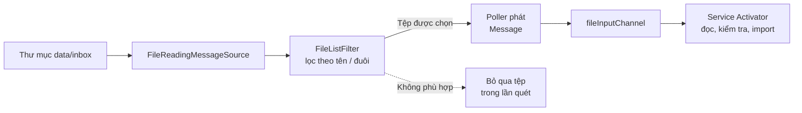
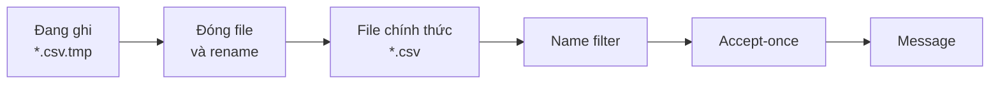

# FileListFilter theo tên mẫu và phần mở rộng

## 1. Bối cảnh và mục tiêu bài học

Trong module **SPRING_INTEGRATION_ADAPTERS**, ứng dụng sử dụng inbound/outbound adapter, gateway, poller và `MessageChannel` để kết nối với hệ thống bên ngoài. Ở chương **Adapter file**, một yêu cầu thường gặp là **chỉ tiếp nhận những tệp có tên hoặc phần mở rộng phù hợp hợp đồng trao đổi**.

Giả sử một đối tác đặt dữ liệu vào thư mục `data/inbox`:

```text
data/inbox/
├── orders_20261123.csv
├── orders_20261124.csv
├── orders_20261125.CSV
├── orders_20261126.csv.tmp
├── customers_20261123.csv
├── readme.txt
└── orders_20261127.json
```

Luồng nhập đơn hàng chỉ được phép xử lý tệp CSV có tên đúng quy ước. Nếu không đặt bộ lọc, ứng dụng có thể nhận nhầm file tạm, file hướng dẫn hoặc dữ liệu thuộc một luồng nghiệp vụ khác.

Sau bài học, bạn có thể:

- Giải thích `FileListFilter` tham gia vào quá trình chọn tệp trước khi File inbound channel adapter phát `Message<File>`.
- Dùng `SimplePatternFileListFilter` cho mẫu tên đơn giản như `*.csv` và `orders_*.csv`.
- Dùng `RegexPatternFileListFilter` khi cần quy tắc nghiêm ngặt, nhiều phần mở rộng hoặc không phân biệt chữ hoa/chữ thường.
- Phối hợp bộ lọc tên với `AcceptOnceFileListFilter` để hạn chế một tệp được chọn lặp lại.
- Phân biệt lọc theo tên, kiểm tra định dạng nội dung, xác định tệp đã ghi xong và xác nhận xử lý nghiệp vụ thành công.
- Tự kiểm tra hành vi lọc, xử lý retry, restart và các lỗi cấu hình thường gặp.

## 2. FileListFilter nằm ở đâu trong luồng Spring Integration?

Khi dùng `FileReadingMessageSource`, nguồn thực hiện quét thư mục và chọn các đối tượng `java.io.File` phù hợp điều kiện trước khi phát message. `FileListFilter<F>` là hợp đồng lọc đầu vào; với filesystem cục bộ, kiểu phần tử là `File`.



Các thành phần đảm nhiệm những việc khác nhau:

| Thành phần | Trách nhiệm |
| --- | --- |
| `FileReadingMessageSource` | Quét thư mục, lấy các tệp đủ điều kiện và tạo message với payload `File` |
| `FileListFilter<File>` | Chấp nhận hoặc loại tệp theo tiêu chí, ví dụ tên, extension, lịch sử chọn tệp |
| `Poller` | Kích hoạt nguồn theo lịch; điều chỉnh tần suất và số message lấy mỗi lượt |
| `MessageChannel` | Chuyển message đến các endpoint tiếp theo |
| Consumer/transformer | Mở tệp, đọc nội dung, parse dữ liệu, kiểm tra và thực hiện nghiệp vụ |

**Bộ lọc chỉ quyết định tệp nào được lựa chọn ở nguồn.** Chỉ vì tên có đuôi `.csv` không có nghĩa file đã được ghi xong, đúng định dạng CSV hoặc đã được import thành công. Những điều kiện này cần được kiểm tra ở các bước riêng.

### Lọc tên khác lọc nội dung

Ví dụ `orders_20261123.csv` vượt qua bộ lọc `*.csv` ngay cả khi nội dung thực tế là JSON hoặc file rỗng. Tương tự, `orders_20261123.csv.tmp` không vượt qua bộ lọc này dù bên trong nó là CSV hợp lệ.

Vì vậy, thường cần **hai lớp kiểm tra**:

1. **Lớp nhận file**: tên tệp, phần mở rộng, trạng thái đã chọn và điều kiện file sẵn sàng.
2. **Lớp xử lý**: encoding, kích thước, cấu trúc CSV, schema, dữ liệu nghiệp vụ và chính sách lỗi.

## 3. SimplePatternFileListFilter: khớp mẫu tên đơn giản

`SimplePatternFileListFilter` nhận một chuỗi mẫu, rồi so sánh với **tên tệp**. Nó phù hợp khi chỉ có quy tắc ký tự đại diện `*`:

```java
import org.springframework.integration.file.filters.SimplePatternFileListFilter;

SimplePatternFileListFilter csvOnly =
        new SimplePatternFileListFilter("*.csv");

SimplePatternFileListFilter orderCsv =
        new SimplePatternFileListFilter("orders_*.csv");
```

Các mẫu thường gặp:

| Mẫu | Ý nghĩa | Ví dụ khớp |
| --- | --- | --- |
| `*.csv` | Tên kết thúc bằng `.csv` | `orders.csv`, `customers.csv` |
| `orders_*.csv` | Bắt đầu bằng `orders_` và kết thúc `.csv` | `orders_20261123.csv` |
| `report-*.txt` | File text có tiền tố `report-` | `report-daily.txt` |
| `*.tar.gz` | File có hậu tố đầy đủ `.tar.gz` | `backup.tar.gz` |
| `batch_*_done.csv` | Mẫu có nhiều dấu `*` | `batch_42_done.csv` |

Một điểm cần nhớ: đây là **simple pattern** theo cơ chế khớp chuỗi của Spring, không phải ngôn ngữ glob đầy đủ của shell hoặc Ant. Không mặc định rằng `?`, `[0-9]`, `**/` hay `{csv,tsv}` mang ý nghĩa như trên Bash. Khi cần ràng buộc vị trí, số lượng ký tự, nhóm đuôi hoặc kiểu chữ, hãy dùng biểu thức chính quy.

### Phân biệt chữ hoa và chữ thường

Mẫu `*.csv` thường được khớp **phân biệt chữ hoa/chữ thường** ở cấp so sánh chuỗi. Vì thế `orders_20261125.CSV` không được chọn chỉ vì hệ điều hành có thể coi phần mở rộng hoa và thường tương đương nhau.

Nếu đối tác có thể gửi cả `.csv` lẫn `.CSV`, hãy quy định rõ hợp đồng hoặc dùng `RegexPatternFileListFilter` với cờ `(?i)`.

## 4. RegexPatternFileListFilter: tên và phần mở rộng có ràng buộc

Khi tên tệp bắt buộc có ngày gồm tám chữ số, hoặc cho phép cả CSV và TSV, `RegexPatternFileListFilter` giúp diễn tả điều kiện rõ ràng hơn.

```java
import org.springframework.integration.file.filters.RegexPatternFileListFilter;

RegexPatternFileListFilter orderDataFilter =
        new RegexPatternFileListFilter(
                "(?i)^orders_[0-9]{8}\\.(csv|tsv)$"
        );
```

Ý nghĩa của biểu thức:

- `(?i)`: không phân biệt chữ hoa/chữ thường.
- `^orders_`: tên bắt đầu bằng `orders_`.
- `[0-9]{8}`: yêu cầu đúng tám chữ số, ví dụ `20261123`.
- `\\.` ở chuỗi Java: tạo ký tự `\.` trong regex, nghĩa là **dấu chấm thật**.
- `(csv|tsv)`: cho phép một trong hai phần mở rộng.
- `$`: kết thúc tên tại đó, không cho thêm hậu tố `.tmp`.

| Tệp | `*.csv` | Regex `(?i)^orders_[0-9]{8}\\.(csv|tsv)$` | Lý do |
| --- | --- | --- | --- |
| `orders_20261123.csv` | Có | Có | Đúng tên và phần mở rộng |
| `orders_20261124.CSV` | Không | Có | Regex cho phép chữ hoa |
| `orders_20261125.tsv` | Không | Có | Regex chấp nhận TSV |
| `orders_2026-11-25.csv` | Có | Không | Ngày chứa dấu gạch ngang |
| `customers_20261123.csv` | Có | Không | Không có tiền tố `orders_` |
| `orders_20261123.csv.tmp` | Không | Không | Có hậu tố `.tmp` |
| `orders_20261123.json` | Không | Không | Phần mở rộng không hợp lệ |
| `orders_20261123.csv.bak` | Không | Không | Có phần tên mở rộng thêm |

**Lưu ý:** regex kiểm tra tám chữ số, nhưng không tự xác định `20261399` có phải ngày hợp lệ. Nếu ngày là dữ liệu nghiệp vụ quan trọng, hãy parse bằng `LocalDate` với `DateTimeFormatter` ở bước xử lý sau.

### Khi nào chọn mẫu đơn giản, khi nào chọn regex?

Chọn `SimplePatternFileListFilter` khi quy tắc chỉ là tiền tố hoặc hậu tố, chẳng hạn `*.csv`. Chọn `RegexPatternFileListFilter` khi yêu cầu nhiều kiểu phần mở rộng, cấu trúc tên nghiêm ngặt, độ dài cố định hoặc không phân biệt chữ hoa/chữ thường. Regex dễ mắc lỗi escape hoặc viết quá rộng; kiểm chứng bằng tập tên tệp hợp lệ và không hợp lệ trước khi đưa vào môi trường thật.

## 5. Ví dụ Spring Boot đầy đủ: chỉ nhận tệp CSV

Ví dụ sau dùng Java 17+ và Spring Boot, với `spring-boot-starter-integration` và `spring-integration-file`:

```xml
<dependencies>
    <dependency>
        <groupId>org.springframework.boot</groupId>
        <artifactId>spring-boot-starter-integration</artifactId>
    </dependency>
    <dependency>
        <groupId>org.springframework.integration</groupId>
        <artifactId>spring-integration-file</artifactId>
    </dependency>
</dependencies>
```

Ta muốn đọc tệp `*.csv` trong `data/inbox`, mỗi hai giây lấy tối đa ba tệp đủ điều kiện. Khi xử lý, chỉ in tên và kích thước để quan sát luồng; việc parse/ghi database sẽ nằm trong bước tiếp theo.

```java
import java.io.File;

import org.springframework.context.annotation.Bean;
import org.springframework.context.annotation.Configuration;
import org.springframework.integration.annotation.InboundChannelAdapter;
import org.springframework.integration.annotation.Poller;
import org.springframework.integration.annotation.ServiceActivator;
import org.springframework.integration.channel.DirectChannel;
import org.springframework.integration.config.EnableIntegration;
import org.springframework.integration.core.MessageSource;
import org.springframework.integration.file.FileReadingMessageSource;
import org.springframework.integration.file.filters.AcceptOnceFileListFilter;
import org.springframework.integration.file.filters.ChainFileListFilter;
import org.springframework.integration.file.filters.SimplePatternFileListFilter;
import org.springframework.messaging.MessageChannel;

@Configuration
@EnableIntegration
public class CsvFileFilterConfig {

    @Bean
    public MessageChannel csvFileChannel() {
        return new DirectChannel();
    }

    @Bean
    @InboundChannelAdapter(
        channel = "csvFileChannel",
        poller = @Poller(
            fixedDelay = "2000",
            maxMessagesPerPoll = "3"
        )
    )
    public MessageSource<File> csvInboundSource() {
        FileReadingMessageSource source = new FileReadingMessageSource();
        source.setDirectory(new File("data/inbox"));

        ChainFileListFilter<File> filters = new ChainFileListFilter<>();
        filters.addFilter(new SimplePatternFileListFilter("*.csv"));
        filters.addFilter(new AcceptOnceFileListFilter<>());

        source.setFilter(filters);
        return source;
    }

    @ServiceActivator(inputChannel = "csvFileChannel")
    public void consume(File file) {
        System.out.printf(
            "Nhan file: %s (%d bytes)%n",
            file.getName(),
            file.length()
        );
        // Buoc sau: mo file, parse CSV, validate va ghi du lieu.
    }
}
```

Cấu hình phải nằm trong phạm vi component scan của `@SpringBootApplication` hoặc được import vào Spring context. Tạo thư mục `data/inbox` trước khi chạy. Đường dẫn tương đối được tính từ **working directory của tiến trình**, có thể khác khi chạy bằng IDE, Docker hoặc service manager. Tiến trình phải có quyền đọc thư mục và file.

### Vì sao dùng ChainFileListFilter?

`ChainFileListFilter` chạy các bộ lọc **theo thứ tự**:

1. `SimplePatternFileListFilter` loại bỏ các file không có hậu tố `.csv`.
2. `AcceptOnceFileListFilter` chỉ xem xét các file còn lại và hạn chế chọn chúng nhiều lần trong vòng đời trạng thái bộ lọc.

Thứ tự này có ý nghĩa khi kết hợp bộ lọc **có trạng thái**. Bộ lọc accept-once nên được đặt sau điều kiện loại trừ file theo tên hoặc điều kiện file sẵn sàng để giảm nguy cơ ghi nhận một file không định xử lý.

`CompositeFileListFilter` cũng cho phép kết hợp nhiều bộ lọc theo điều kiện tất cả phải chấp nhận. Khi yêu cầu một chuỗi điều kiện tuần tự với filter lưu trạng thái, `ChainFileListFilter` giúp làm rõ thứ tự áp dụng. Không nên giả định mọi cách kết hợp đều có hành vi tương đương khi bộ lọc có side effect.

### Vì sao cần AcceptOnceFileListFilter?

File inbound adapter có thể quét lại cùng một thư mục qua nhiều lần poll. Nếu chỉ đặt bộ lọc mẫu tên và tệp vẫn nằm trong thư mục, nó có thể được chọn lại. `AcceptOnceFileListFilter<File>` ghi nhớ các file đã chấp nhận trong **trạng thái của filter**, giúp tránh phát lại file không đổi trong một phiên chạy bình thường.

Khi gọi `source.setFilter(...)`, ta **chủ động thay bộ lọc của nguồn**. Vì vậy, không được chỉ thiết lập một filter mẫu tên rồi cho rằng cơ chế accept-once mặc định chắc chắn vẫn được giữ lại. Luồng mẫu khai báo cả hai điều kiện một cách rõ ràng.

Giới hạn: accept-once không phải xác nhận rằng consumer đã ghi database thành công. Trạng thái trong bộ nhớ cũng có thể mất khi restart. Nếu cần bảo toàn lịch sử chọn file qua lần khởi động, cần cân nhắc một persistent accept-once filter với `MetadataStore` bền vững và cơ chế idempotency ở nghiệp vụ.

## 6. Thay đổi điều kiện để chỉ nhận báo cáo đơn hàng

Nếu chỉ cho phép các file có tên `orders_YYYYMMDD.csv` hoặc `orders_YYYYMMDD.tsv` (không phân biệt chữ hoa/chữ thường), thay dòng thêm bộ lọc mẫu trong ví dụ bằng:

```java
import org.springframework.integration.file.filters.RegexPatternFileListFilter;

filters.addFilter(
        new RegexPatternFileListFilter(
                "(?i)^orders_[0-9]{8}\\.(csv|tsv)$"
        )
);
```

Đây là **đoạn thay thế** cho:

```java
filters.addFilter(new SimplePatternFileListFilter("*.csv"));
```

Giữ `AcceptOnceFileListFilter` ở sau regex. Lưu ý rằng khi chấp nhận cả `.tsv`, consumer phía sau phải biết đọc đúng cấu trúc TSV, không áp dụng parser CSV có dấu phẩy cho mọi file. Bộ lọc tên không tự chọn parser.

Nếu hợp đồng chỉ nhận file `*.csv` nhưng bất kể tên nào, dùng simple pattern; nếu cần tên đúng theo mã đối tác, có thể thay regex bằng ví dụ `^(?:partnerA|partnerB)_[0-9]{8}\\.csv$` rồi xác thực lại ID khi import.

## 7. Thực hành: kiểm chứng tệp được chọn và bị loại

Đặt các tệp sau vào `data/inbox` **trước khi ứng dụng bắt đầu**:

```text
data/inbox/
├── orders_20261123.csv
├── customers_20261123.csv
├── orders_20261124.CSV
├── orders_20261125.csv.tmp
├── notes.txt
└── orders_20261126.tsv
```

Với filter `*.csv` như mã ở mục 5, dự kiến:

| Tệp | Kết quả | Nguyên nhân |
| --- | --- | --- |
| `orders_20261123.csv` | Nhận | Đúng hậu tố `.csv` |
| `customers_20261123.csv` | Nhận | Bộ lọc mẫu chỉ kiểm tra đuôi, không kiểm tra loại nghiệp vụ |
| `orders_20261124.CSV` | Bỏ qua | Chữ hoa khác `.csv` |
| `orders_20261125.csv.tmp` | Bỏ qua | Tên kết thúc bằng `.tmp` |
| `notes.txt` | Bỏ qua | Không phải CSV |
| `orders_20261126.tsv` | Bỏ qua | Phần mở rộng là TSV |

Chuyển sang regex của mục 6 rồi chạy trên một **phiên ứng dụng mới** hoặc với thư mục test riêng:

| Tệp | Kết quả |
| --- | --- |
| `orders_20261123.csv` | Nhận |
| `customers_20261123.csv` | Bỏ qua vì sai tiền tố |
| `orders_20261124.CSV` | Nhận vì `(?i)` |
| `orders_20261125.csv.tmp` | Bỏ qua vì không khớp toàn bộ tên |
| `notes.txt` | Bỏ qua |
| `orders_20261126.tsv` | Nhận nếu consumer hỗ trợ TSV |

Để quan sát accept-once, để nguyên file đã nhận rồi chờ thêm vài lượt poll: nó không được phát lặp lại chỉ vì vẫn có mặt trên đĩa. Sau restart, kết quả có thể khác vì trạng thái bộ lọc trong bộ nhớ đã được khởi tạo lại.

Nếu bên gửi thường xuyên thay đổi nội dung file **với cùng một tên**, cần thiết kế chính sách phiên bản/định danh file rõ ràng; tránh giả định kiểm tra tên hay accept-once là đủ để xử lý cập nhật nội dung an toàn.

## 8. Lọc theo extension không có nghĩa file đã ghi xong

Đối tác có thể tạo ngay `orders_20261123.csv` rồi ghi dữ liệu từ từ. Poller thấy tên hợp lệ và chọn file trước khi bên gửi đóng. Khi đó consumer có thể nhận dữ liệu thiếu.

Một hợp đồng thực tế nên quy định:

1. Bên gửi ghi vào `orders_20261123.csv.tmp`.
2. Bên gửi đóng file và bảo đảm ghi xong, rồi rename thành `orders_20261123.csv`.
3. Bộ lọc `*.csv` hoặc regex chỉ nhận tên cuối sau rename.



Nếu có thể, rename trong cùng filesystem để tận dụng khả năng công bố tên cuối một cách nguyên tử, nhưng phải kiểm chứng với network share và loại filesystem thực tế. Khi không thể phối hợp tên file tạm, có thể dùng thêm **bộ lọc thời gian sửa cuối** (`LastModifiedFileListFilter`) để chỉ chấp nhận file đủ cũ hoặc cơ chế ready marker. Thời gian chờ chỉ làm giảm nguy cơ, không bảo đảm tệp đã hoàn tất.

Điểm quan trọng là **đặt bộ lọc trạng thái sau các điều kiện file sẵn sàng**, để tránh đánh dấu đã nhận file khi nó chưa đạt điều kiện xử lý.

## 9. Kiểm tra tên file không thay thế kiểm tra bảo mật và dữ liệu

### Bảo vệ dữ liệu nhập

Đuôi `.csv` có thể xuất hiện trên file giả mạo hoặc file chứa dữ liệu không hợp lệ. Sau khi nhận file, nên kiểm tra:

- Dung lượng tối đa và quyền đọc file.
- Encoding (ví dụ UTF-8), ký tự phân tách, dòng header và số cột.
- Trường bắt buộc, kiểu dữ liệu và quy tắc nghiệp vụ.
- Bản ghi trùng, import ID và cơ chế rollback hoặc bù khi lỗi.

Nếu dùng tên tệp để xác định đối tác hoặc mã giao dịch, hãy xác thực ID được trích ra khỏi tên thay vì mặc định nó đáng tin cậy.

### Mẫu quá rộng và tệp nhạy cảm

Mẫu `*` hoặc một regex quá rộng có thể nhận cả file log, bản backup hoặc tệp cấu hình ở cùng thư mục. Nên giới hạn thư mục chuyên dụng cho từng hợp đồng, mẫu tên cụ thể và quyền filesystem tối thiểu. Đừng dựa vào extension để xác thực nguồn gốc của dữ liệu hoặc cho phép ghi/xóa những đường dẫn ngoài vùng làm việc.

### Chữ hoa, dấu chấm và hệ điều hành

Filesystem có thể xử lý `Report.csv` và `report.csv` khác nhau tùy hệ điều hành, còn bộ lọc Java so khớp chuỗi theo quy tắc của filter. Regex `(?i)` hỗ trợ tên hoa/thường nhưng có thể gây trùng mã khi hai file chỉ khác nhau ở kiểu chữ. Nên quy định một chuẩn đặt tên duy nhất khi các hệ thống chạy trên nhiều nền tảng.

## 10. Vận hành: xử lý lỗi, restart và nhiều instance

| Tình huống | Hậu quả có thể | Hướng xử lý |
| --- | --- | --- |
| Chỉ cấu hình `*.csv` mà quên accept-once | Tệp còn nguyên trên đĩa có thể được phát lại | Kết hợp bộ lọc lịch sử hoặc di chuyển tệp đã xong |
| Tên file khớp nhưng nội dung hỏng | Consumer lỗi khi parse/import | Đưa sang `failed/`, lưu thông tin lỗi và chính sách retry |
| Tệp mới vẫn đang được ghi | Đọc thiếu dữ liệu | File tạm + rename, ready marker hoặc bộ lọc ổn định |
| Ứng dụng restart | State accept-once trong JVM không còn | Persistent metadata nếu cần và xử lý idempotent |
| Hai instance cùng quét inbox | Cùng file có thể được xử lý hai lần | Điều phối ownership, locking hoặc lưu trạng thái dùng chung |
| Regex bỏ sót file hợp lệ | Tên không đúng chữ hoa, escape hoặc định dạng ngày | Kiểm tra tập tên mẫu và contract đối tác |
| Đặt `maxMessagesPerPoll` quá nhỏ | Backlog tăng khi nhiều file đến | Theo dõi tốc độ nhập, thời gian xử lý và điều chỉnh poller |
| Dùng `DirectChannel` với consumer chậm | Thời gian xử lý ảnh hưởng tốc độ poll | Tách xử lý bằng queue/executor có giới hạn tải nếu cần |

**Bộ lọc không quản lý giao dịch nghiệp vụ**. Nếu consumer thất bại sau khi tệp đã được chọn, filter có trạng thái có thể không phát lại tệp đó trong lần poll kế tiếp. Với import quan trọng, cần checkpoint/trạng thái nghiệp vụ, retry có kiểm soát và khóa idempotent trong database. Không coi việc thêm accept-once là đạt bảo đảm exactly-once.

Mặt khác, khi một bộ lọc chỉ khớp tên file ở nguồn inbound, phần còn lại của module vẫn tuân theo các semantics riêng: FTP/SFTP có bộ lọc tên remote và xử lý tải file, JMS/AMQP/Kafka quản lý message/ack theo broker, còn HTTP có request/response. Không suy ra rằng thay filter tên là đủ quản lý lỗi hoặc vòng đời kết nối của các adapter khác.

## 11. Bài tập thực hành

1. **Lọc theo phần mở rộng:** tạo `a.csv`, `b.CSV`, `c.txt` và `d.csv.tmp`. Dùng `*.csv` và giải thích kết quả của từng file.
2. **Lọc theo tiền tố:** đổi mẫu thành `orders_*.csv`. Thử `orders_1.csv`, `customers_1.csv` và `orders_.csv`. Xác định xem mẫu đơn giản có bắt buộc phần giữa không rỗng hay không.
3. **Đổi sang regex:** dùng `(?i)^orders_[0-9]{8}\\.csv$`. Thử các tên có ngày 8 chữ số, ngày có dấu gạch nối và phần mở rộng hoa.
4. **Ghép nhiều bộ lọc:** chỉ nhận CSV không đổi nội dung trong thời gian chờ theo một tiêu chí sẵn sàng, sau đó áp dụng accept-once. Giải thích vì sao thứ tự có ý nghĩa.
5. **Chạy lại:** nhận một file, để nguyên file trong thư mục rồi restart ứng dụng. Đề xuất cách không nhập trùng dữ liệu database.
6. **Tạo file chưa hoàn tất:** ghi `sample.csv.tmp`, đóng file rồi đổi tên thành `sample.csv`. Quan sát poller chỉ nhận file khi tên chính thức xuất hiện.
7. **Lỗi parse:** tạo file `orders_20261123.csv` đúng tên nhưng chứa JSON. Thiết kế bước kiểm tra nội dung và đưa file lỗi vào vùng cách ly.
8. **Nhiều hệ thống gửi:** cho hai đối tác đưa file vào cùng thư mục. Đề xuất mẫu tên, metadata, cách cấp quyền và tránh va chạm tên.

### Câu hỏi tự kiểm tra

**Q1. `SimplePatternFileListFilter("*.csv")` có đọc nội dung CSV không?**  
Không. Nó chỉ kiểm tra tên file; parsing và validation là trách nhiệm của consumer.

**Q2. Muốn nhận cả `.csv` và `.CSV` thì làm thế nào?**  
Dùng biểu thức chính quy có `(?i)` hoặc thống nhất phía gửi chỉ dùng một kiểu phần mở rộng.

**Q3. Vì sao nên kết hợp mẫu tên với accept-once?**  
Để một tệp vẫn nằm trong thư mục không tự động được chọn lặp lại ở mỗi lần poll trong cùng vòng đời filter.

**Q4. Accept-once có bảo đảm xử lý thành công hay không?**  
Không. Nó ghi nhận lựa chọn của nguồn, không xác nhận parse/ghi database hoàn tất.

**Q5. Vì sao `orders_20261123.csv.tmp` không được nhận bằng `*.csv`?**  
Vì tên kết thúc bằng `.tmp`; quy ước này hữu ích để tránh nhận file còn đang ghi.

**Q6. Nếu regex yêu cầu tám chữ số, nó có xác nhận ngày hợp lệ không?**  
Không. Kiểm tra ngày hợp lệ cần parser ngày và quy tắc nghiệp vụ riêng.

## 12. Ghi nhớ

`FileListFilter` giúp **chọn đúng tệp trước khi File inbound channel adapter phát message**. `SimplePatternFileListFilter` phù hợp với các mẫu tên và hậu tố đơn giản; `RegexPatternFileListFilter` hỗ trợ quy tắc chặt chẽ hoặc nhiều phần mở rộng. Khi kết hợp với `AcceptOnceFileListFilter`, cần chú ý thứ tự bộ lọc và trạng thái qua restart. Lọc đúng tên mới là bước đầu: hệ thống thực tế vẫn phải xác định file đã ghi xong, validate dữ liệu, xử lý lỗi và chống nhập trùng.

### Tài liệu tham khảo

- [Spring Integration Reference — Reading Files](https://docs.spring.io/spring-integration/reference/file/reading.html)
- [Spring Integration API — FileListFilter](https://docs.spring.io/spring-integration/api/org/springframework/integration/file/filters/FileListFilter.html)
- [Spring Integration API — SimplePatternFileListFilter](https://docs.spring.io/spring-integration/api/org/springframework/integration/file/filters/SimplePatternFileListFilter.html)
- [Spring Integration API — RegexPatternFileListFilter](https://docs.spring.io/spring-integration/api/org/springframework/integration/file/filters/RegexPatternFileListFilter.html)
