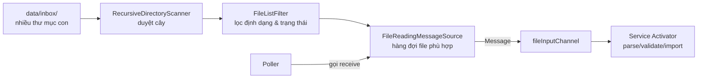

# RecursiveDirectoryScanner cho thư mục lồng nhau

## 1. Bối cảnh và mục tiêu

Trong module **SPRING_INTEGRATION_ADAPTERS**, Spring Integration giúp kết nối hệ thống ngoài bằng inbound/outbound adapter, gateway, poller và `MessageChannel`. Chương **Adapter file** giải quyết việc đưa tệp trên filesystem vào luồng message. Đôi khi đối tác không đặt tất cả tệp trong một thư mục phẳng mà chia chúng theo đối tác, năm, tháng hoặc loại dữ liệu.

Ví dụ một hệ thống tiếp nhận báo cáo đơn hàng:

```text
data/inbox/
├── partner-a/
│   ├── direct.csv
│   └── 2026/
│       └── 11/
│           ├── orders-001.csv
│           ├── orders-002.csv
│           └── upload.csv.tmp
├── partner-b/
│   └── 2026/
│       └── 11/
│           └── orders-001.csv
└── readme.txt
```

Hai tệp `orders-001.csv` thuộc hai đối tác **khác nhau**, mặc dù có cùng tên. Nếu chỉ quét cấp đầu tiên của `data/inbox`, adapter sẽ bỏ qua phần lớn dữ liệu. Nếu dùng cơ chế tránh trùng chỉ dựa trên tên tệp, có nguy cơ nhầm hai báo cáo.

**RecursiveDirectoryScanner** giải quyết việc duyệt **toàn bộ cây thư mục** đến một độ sâu được cấu hình, rồi đưa các tệp đủ điều kiện cho `FileReadingMessageSource`. Sau bài này, bạn có thể:

- So sánh `DefaultDirectoryScanner` và `RecursiveDirectoryScanner`.
- Cấu hình inbound adapter quét thư mục con bằng Java, phối hợp `Poller`, `FileListFilter` và `MessageChannel`.
- Dùng `setMaxDepth`, `setAlwaysAcceptDirectories` và `setForRecursion(true)` đúng chỗ.
- Lấy đường dẫn tương đối từ `FileHeaders.RELATIVE_PATH` để giữ thông tin thư mục nguồn.
- Tránh lỗi trùng tên giữa nhiều nhánh, quét sâu ngoài ý muốn, đọc file chưa xong hoặc xử lý lặp sau restart.
- Đánh giá chi phí quét, thứ tự message, lỗi quyền đọc và phương án phục hồi khi số lượng file lớn.

## 2. RecursiveDirectoryScanner làm gì?

`FileReadingMessageSource` là một nguồn message có payload `java.io.File`. Nó dùng một đối tượng `DirectoryScanner` để **liệt kê các file đủ điều kiện**, đưa chúng vào hàng đợi nội bộ, rồi trả từng file theo các lần poll.

Mặc định, `DefaultDirectoryScanner` kiểm tra thư mục đầu vào thông thường. `RecursiveDirectoryScanner` mở rộng cách duyệt bằng `Files.walk(...)` của Java NIO, lấy thêm các tệp nằm bên trong thư mục con. Từ Spring Integration 5.0 đã có lớp này.



Vai trò của từng thành phần:

| Thành phần | Trách nhiệm | Lưu ý |
| --- | --- | --- |
| `RecursiveDirectoryScanner` | Đi qua cây thư mục, liệt kê các file theo cấu hình duyệt | Việc duyệt không tự đọc nội dung file |
| `FileListFilter<File>` | Lọc tên, định dạng, trạng thái tệp đã chọn | Bộ lọc tên không xác nhận file đã ghi xong |
| `FileReadingMessageSource` | Nhận kết quả quét, xếp hàng, phát `Message<File>` | Có thể giữ các file chờ trong hàng đợi nội bộ |
| `Poller` | Kích hoạt nguồn và giới hạn số message trong một lần poll | Không bảo đảm file được xử lý đúng một lần về mặt nghiệp vụ |
| `MessageChannel` và consumer | Chuyển message rồi đọc và xử lý dữ liệu | Cần idempotency, retry và quản lý lỗi riêng |

Đây vẫn là **File inbound channel adapter**. Việc thêm scanner đệ quy không biến nó thành gateway có phản hồi và cũng không khiến mỗi thư mục con trở thành một channel riêng.

## 3. Độ sâu của cây thư mục và điều kiện duyệt

`RecursiveDirectoryScanner` dựa trên `Files.walk(Path start, int maxDepth, FileVisitOption...)`. Khi tính độ sâu, **thư mục gốc là mức 0**:

```text
data/inbox/                         depth 0 (goc)
data/inbox/partner-a/               depth 1
data/inbox/partner-a/direct.csv     depth 2
data/inbox/partner-a/2026/          depth 2
data/inbox/partner-a/2026/11/       depth 3
data/inbox/partner-a/2026/11/orders-001.csv   depth 4
```

Như vậy, `scanner.setMaxDepth(2)` lấy được `partner-a/direct.csv` nhưng không lấy được `partner-a/2026/11/orders-001.csv`; cần `setMaxDepth(4)` trở lên cho ví dụ này.

| Cấu hình | Kết quả với cây minh họa |
| --- | --- |
| `DefaultDirectoryScanner` | Liệt kê cấp đầu của `inbox`, không tự tìm file trong toàn bộ cây |
| `RecursiveDirectoryScanner`, `maxDepth=2` | Có thể gặp file trực tiếp trong `partner-a`, bỏ qua file sâu hơn |
| `RecursiveDirectoryScanner`, `maxDepth=4` | Gặp file trong nhánh `partner-a/2026/11` và `partner-b/2026/11` |
| Không giới hạn độ sâu trong scanner đệ quy | Duyệt tất cả cấp bên dưới gốc theo khả năng truy cập; có thể tốn chi phí lớn |

Mặc định, `RecursiveDirectoryScanner` không yêu cầu `FOLLOW_LINKS`. Hãy cẩn thận nếu bật theo symbolic link, vì có thể dẫn sang vùng lưu trữ khác, tạo vòng lặp liên kết hoặc phát hiện một tệp qua nhiều đường dẫn.

Thư mục **gốc** được loại khỏi danh sách kết quả quét; các thư mục con và file bên dưới chịu ảnh hưởng của bộ lọc đã cấu hình. Đây là lý do bộ lọc mẫu tên có thể làm hỏng quy trình quét đệ quy nếu nó loại toàn bộ thư mục con.

## 4. Bẫy quan trọng: đặt bộ lọc trên scanner

Khi truyền một `RecursiveDirectoryScanner` tùy chỉnh vào `FileReadingMessageSource`, cần đặt filter và locker (nếu có) **trên chính scanner**.

**Cấu hình đúng:**

```java
RecursiveDirectoryScanner scanner = new RecursiveDirectoryScanner();
scanner.setFilter(myFilter);

FileReadingMessageSource source = new FileReadingMessageSource();
source.setDirectory(new File("data/inbox"));
source.setScanner(scanner);
```

Không đặt `source.setFilter(myFilter)` **sau khi đã cung cấp custom scanner**, vì các thuộc tính filter/locker thuộc quyền quản lý của scanner được tiêm vào, và việc cấu hình cả hai nơi có thể bị từ chối hoặc tạo hành vi không mong muốn theo phiên bản.

### Vì sao một pattern chỉ nhận `*.csv` có thể gặp vấn đề?

`SimplePatternFileListFilter("*.csv")` theo mặc định không chấp nhận **directory** vì tên thư mục không khớp `*.csv`. Khi dùng với scanner đệ quy, cần nói rõ rằng **thư mục được phép đi qua, chỉ các file mới kiểm tra phần mở rộng**:

```java
SimplePatternFileListFilter csvPattern =
        new SimplePatternFileListFilter("*.csv");
csvPattern.setAlwaysAcceptDirectories(true);
```

Thiết lập này cho phép các thư mục con vượt qua pattern filter; nó không có nghĩa rằng consumer sẽ nhận payload là thư mục. File inbound source phát message cho những file phù hợp.

Nếu dùng `RegexPatternFileListFilter` thay vì `SimplePatternFileListFilter`, cũng cần thiết lập `setAlwaysAcceptDirectories(true)` khi muốn regex kiểm tra **tên file**, còn cây thư mục vẫn được duyệt.

## 5. Ví dụ Spring Boot: nhận CSV trong thư mục lồng nhau

Ví dụ sử dụng Java 17+, Spring Boot, Spring Integration File; các phiên bản dependency được Spring Boot quản lý:

```xml
<dependencies>
    <dependency>
        <groupId>org.springframework.boot</groupId>
        <artifactId>spring-boot-starter-integration</artifactId>
    </dependency>
    <dependency>
        <groupId>org.springframework.integration</groupId>
        <artifactId>spring-integration-file</artifactId>
    </dependency>
</dependencies>
```

Cấu hình dưới đây:

- Duyệt `data/inbox` đến độ sâu 4.
- Chỉ nhận tên có phần mở rộng `.csv` (phân biệt hoa/thường).
- Cho phép đi qua thư mục con trong filter.
- Hạn chế chọn lại cùng file bằng bộ lọc metadata có khóa **đường dẫn đầy đủ** trong phiên chạy.
- Đưa các tệp phù hợp đến `fileInputChannel`.

```java
import java.io.File;

import org.springframework.context.annotation.Bean;
import org.springframework.context.annotation.Configuration;
import org.springframework.integration.annotation.InboundChannelAdapter;
import org.springframework.integration.annotation.Poller;
import org.springframework.integration.annotation.ServiceActivator;
import org.springframework.integration.channel.DirectChannel;
import org.springframework.integration.config.EnableIntegration;
import org.springframework.integration.core.MessageSource;
import org.springframework.integration.file.FileHeaders;
import org.springframework.integration.file.FileReadingMessageSource;
import org.springframework.integration.file.RecursiveDirectoryScanner;
import org.springframework.integration.file.filters.ChainFileListFilter;
import org.springframework.integration.file.filters.FileSystemPersistentAcceptOnceFileListFilter;
import org.springframework.integration.file.filters.SimplePatternFileListFilter;
import org.springframework.integration.metadata.SimpleMetadataStore;
import org.springframework.messaging.Message;
import org.springframework.messaging.MessageChannel;

@Configuration
@EnableIntegration
public class RecursiveFileInboundConfig {

    @Bean
    public MessageChannel fileInputChannel() {
        return new DirectChannel();
    }

    @Bean
    @InboundChannelAdapter(
        channel = "fileInputChannel",
        poller = @Poller(fixedDelay = "2000", maxMessagesPerPoll = "5")
    )
    public MessageSource<File> recursiveFileSource() {
        FileReadingMessageSource source = new FileReadingMessageSource();
        source.setDirectory(new File("data/inbox"));

        RecursiveDirectoryScanner scanner = new RecursiveDirectoryScanner();
        scanner.setMaxDepth(4);

        SimplePatternFileListFilter csvNames =
                new SimplePatternFileListFilter("*.csv");
        csvNames.setAlwaysAcceptDirectories(true);

        // Store nay nam trong bo nho: phu hop demo, khong ben vung qua restart.
        FileSystemPersistentAcceptOnceFileListFilter acceptOnce =
                new FileSystemPersistentAcceptOnceFileListFilter(
                        new SimpleMetadataStore(),
                        "recursive-csv:"
                );
        // Dung duong dan day du lam key, chap nhan thu muc o moi lan quet.
        acceptOnce.setForRecursion(true);

        ChainFileListFilter<File> filters = new ChainFileListFilter<>();
        filters.addFilter(csvNames);
        filters.addFilter(acceptOnce);

        // Khi dung custom scanner, filter phai dat tren scanner.
        scanner.setFilter(filters);
        source.setScanner(scanner);

        return source;
    }

    @ServiceActivator(inputChannel = "fileInputChannel")
    public void consume(Message<File> message) {
        File file = message.getPayload();
        Object relativePath =
                message.getHeaders().get(FileHeaders.RELATIVE_PATH);

        System.out.printf(
                "Nhan file: %s | relativePath=%s%n",
                file.getAbsolutePath(),
                relativePath
        );
        // Thuc te: doc file, parse CSV, validate, ghi database.
    }
}
```

Đặt lớp này trong phạm vi component scan của `@SpringBootApplication` hoặc import vào Spring context. Thư mục gốc `data/inbox` phải tồn tại và tiến trình cần có quyền đi qua các thư mục con. Đường dẫn tương đối được tính từ **working directory** của JVM, có thể khác nhau giữa IDE, Docker và tiến trình chạy nền.

### Vì sao dùng FileSystemPersistentAcceptOnceFileListFilter?

Với cây đệ quy, hai file ở `partner-a/2026/11/orders-001.csv` và `partner-b/2026/11/orders-001.csv` có tên cuối **giống nhau** nhưng là hai nguồn độc lập.

`FileSystemPersistentAcceptOnceFileListFilter` có tùy chọn `setForRecursion(true)`, giúp dùng **đường dẫn đầy đủ** khi tạo khóa metadata và **luôn chấp nhận directory** để lần quét sau có thể tiếp tục đi qua cây. Điều này phù hợp hơn một bộ lọc lưu trạng thái chỉ dùng tên ngắn hoặc vô tình chặn lại thư mục con sau lần quét đầu.

Tuy nhiên, **`SimpleMetadataStore` trong ví dụ chỉ lưu trong bộ nhớ**. Dù lớp bộ lọc có chữ “Persistent”, metadata không tự bền vững khi JVM tắt nếu store thực tế không lưu xuống đĩa hoặc một hệ thống ngoài. Trong production, nên dùng `ConcurrentMetadataStore` có khả năng lưu bền vững hoặc chia sẻ phù hợp, đồng thời thiết kế khóa nghiệp vụ để tránh import trùng.

### Vì sao dùng ChainFileListFilter?

`ChainFileListFilter` thực hiện từng bộ lọc **theo thứ tự**: trước tiên chọn tệp đúng tên và cho directory đi qua, sau đó mới đánh dấu những tệp đã được chấp nhận bằng metadata store.

Điều này hữu ích khi một filter có trạng thái. Nếu metadata filter chạy trước quy tắc “file đã sẵn sàng”, nó có thể ghi nhận cả file chưa được phép nhập và khiến file bị bỏ qua ở lần quét sau. Cách bố trí trong ví dụ giúp phân biệt **kiểm tra tên** với **đánh dấu đã chọn**.

### Message nhận được có gì?

Payload là `File`, không phải text CSV:

```text
payload = File("data/inbox/partner-a/2026/11/orders-001.csv")
headers[FileHeaders.FILENAME] = "orders-001.csv"
headers[FileHeaders.ORIGINAL_FILE] = File(".../orders-001.csv")
headers[FileHeaders.RELATIVE_PATH] = <phan duong dan tuong doi duoi data/inbox>
```

`FileHeaders.RELATIVE_PATH` cho biết phần đường dẫn tương đối với thư mục gốc quét, có thể dùng để phân loại đối tác hoặc tái tạo cấu trúc thư mục khi ghi file ra nơi khác. **Giá trị và dấu phân tách thực tế cần lấy từ message đang nhận**, không hard-code các slash hoặc dựa riêng vào `FileHeaders.FILENAME`. Header `FILENAME` chỉ có tên cuối, nên không đủ phân biệt file trùng tên nằm ở hai nhánh.

## 6. Thử nghiệm theo các trường hợp

Tạo cây thư mục của bài học (hoặc cây tương đương) và đặt các file trong ví dụ `orders-001.csv`, `orders-002.csv`, `upload.csv.tmp`. Khởi động ứng dụng Spring Boot.

| Đường dẫn so với `data/inbox` | Độ sâu file | Kết quả khi `maxDepth=4`, `*.csv` |
| --- | ---: | --- |
| `partner-a/direct.csv` | 2 | Được nhận |
| `partner-a/2026/11/orders-001.csv` | 4 | Được nhận |
| `partner-a/2026/11/orders-002.csv` | 4 | Được nhận |
| `partner-b/2026/11/orders-001.csv` | 4 | Được nhận, độc lập với file trùng tên ở partner-a |
| `partner-a/2026/11/upload.csv.tmp` | 4 | Không nhận do đuôi `.tmp` |
| `readme.txt` | 1 | Không nhận vì không khớp `*.csv` |

Kiểm tra ba thay đổi:

1. **Giảm độ sâu:** chuyển sang `scanner.setMaxDepth(2)`; các file ở `2026/11` sẽ không còn nằm trong phạm vi duyệt, nhưng file trực tiếp trong `partner-a` vẫn có thể được nhận.
2. **Tạo thư mục mới:** sau khi ứng dụng chạy, tạo `partner-c/direct.csv`. Khi nguồn cần quét lại, file mới sẽ được chọn nếu thuộc độ sâu cho phép.
3. **Thử trùng tên:** giữ hai file `orders-001.csv` ở hai nhánh. Quan sát `File.getAbsolutePath()` và `FileHeaders.RELATIVE_PATH` để thấy chúng là hai file khác nhau.

Để nhận dữ liệu mới sau lần khởi động, thử giữ `data/inbox` ổn định rồi thêm file mới. `fixedDelay=2000` chỉ thiết lập nhịp poll, không cam kết file sẽ xuất hiện trong consumer đúng sau hai giây: hàng đợi của nguồn, tổng số file, thời gian quét và thời gian consumer chạy đều ảnh hưởng.

## 7. Hàng đợi nội bộ, thứ tự và scanEachPoll

`FileReadingMessageSource` đưa các file đủ điều kiện từ scanner vào một **hàng đợi nội bộ**. Mặc định, `scanEachPoll=false`: nguồn có thể đợi hàng đợi cũ được rút hết rồi mới thực hiện lần quét bổ sung. Đây là lựa chọn hữu ích khi thư mục có rất nhiều tệp, vì giảm số lần duyệt cây tốn I/O.

Nếu cần liên tục cập nhật danh sách ngay cả khi vẫn còn file cũ đang chờ:

```java
source.setScanEachPoll(true);
```

Khi dùng `scanEachPoll=true`, file mới có thể được thêm vào giữa các file cũ trong hàng đợi theo thứ tự comparator. Nếu hợp đồng yêu cầu xử lý file theo ngày hoặc mã đối tác, **đừng suy ra thứ tự từ trình tự `Files.walk` trả về**. Hãy đặt comparator có chủ đích cho `FileReadingMessageSource` và kiểm thử hành vi dưới tải.

Ví dụ minh họa bổ sung:

```java
FileReadingMessageSource source = new FileReadingMessageSource(
        java.util.Comparator.comparing(File::getName)
                .thenComparing(File::getAbsolutePath)
);
```

Đoạn trên là **cách khởi tạo thay thế** `new FileReadingMessageSource()` khi cần ưu tiên tên file. Nó **không bảo đảm** các đối tác ghi xong file theo thứ tự tên; muốn xử lý đúng thứ tự nghiệp vụ còn cần thêm hợp đồng “đã hoàn tất”, khóa thứ tự hoặc bộ đệm phù hợp.

`maxMessagesPerPoll=5` giới hạn số message mà endpoint lấy trong một lần poll. Với `DirectChannel` và consumer đồng bộ, điều này **không có nghĩa** năm file xử lý song song. Khi cây thư mục sâu và số lượng file lớn, việc tăng poll rate có thể làm I/O tăng mạnh mà chưa cải thiện throughput.

## 8. Duyệt thư mục, bộ lọc và file đang ghi dở

Trong thực tế, đối tác có thể ghi trực tiếp `orders-003.csv` trước khi nội dung hoàn tất. Recursive scanner sẽ nhìn thấy tên file hợp lệ ngay khi file xuất hiện, bất kể file còn đang được ghi. Bộ lọc accept-once chỉ ghi nhận **việc chọn file**, không đảm bảo file đã sẵn sàng.

Hợp đồng an toàn hơn:

1. Đối tác ghi vào `orders-003.csv.tmp` trong đúng thư mục con.
2. Đối tác đóng file rồi đổi tên thành `orders-003.csv` khi hoàn tất.
3. Pattern `*.csv` bỏ qua file tạm và chỉ nhận tên cuối.

Nếu bên gửi không hỗ trợ rename, có thể cân nhắc `LastModifiedFileListFilter` để trì hoãn chọn file cho tới khi đủ cũ, hoặc một file marker như `orders-003.done`. Với `ChainFileListFilter`, bộ lọc tên và bộ lọc file sẵn sàng nên chạy **trước** bộ lọc có trạng thái accept-once. Biện pháp “đủ cũ” làm giảm rủi ro nhưng không chứng minh file đã hoàn tất.

Một vấn đề khác là **nhận nhầm thư mục**. Khi thiết lập `setAlwaysAcceptDirectories(true)`, directory được phép đi qua bộ lọc tên để scanner thấy các tệp bên trong; điều đó không có nghĩa nghiệp vụ phải xử lý directory như một file CSV. Consumer vẫn cần xác nhận `file.isFile()` trước khi mở và parse trong trường hợp xử lý nguồn tùy chỉnh.

## 9. Vận hành: hiệu năng, symlink và quyền truy cập

Duyệt cả cây bằng `Files.walk` tốn chi phí tăng theo số lượng mục và độ sâu. Một cây có nhiều năm lịch sử, file đã xử lý và bản backup có thể gây độ trễ lớn cho mỗi lần quét.

| Vấn đề | Ảnh hưởng | Biện pháp |
| --- | --- | --- |
| Quá nhiều file/thư mục | Tăng thời gian liệt kê, sử dụng I/O và bộ nhớ | Giới hạn `maxDepth`, chuyển file đã xử lý khỏi vùng inbox, chia nguồn theo vùng dữ liệu |
| `scanEachPoll=true` trên cây lớn | Liệt kê thường xuyên dù còn backlog | Dùng theo nhu cầu; quan sát thời gian scan và số file chờ |
| Thư mục không đủ quyền | Một nhánh có thể không đọc được, scanner có thể báo lỗi | Cấp quyền đi qua từng thư mục; ghi log và alert rõ nhánh lỗi |
| Symlink/junction | Có thể dẫn ra ngoài root, trùng đường dẫn hoặc gặp vòng lặp | Không bật follow links khi chưa xác minh; giới hạn root và quyền OS |
| Hai instance cùng quét root | Có thể import trùng cùng file | Metadata store chia sẻ, ownership/locking và idempotency |
| File đã xử lý vẫn tồn tại | Scanner tiếp tục thấy file trong các lần quét | Bộ lọc có trạng thái và archive hợp lý |
| Nhiều file trùng tên ở các nhánh | Nhầm báo cáo của đối tác khác | Dùng full path/relative path trong khóa nhận diện |

### Giới hạn theo thư mục con

`setMaxDepth` giúp giới hạn độ sâu, nhưng **không giới hạn nội dung của mọi nhánh theo tên đối tác**. Nếu chỉ cho phép `partner-a` và `partner-b`, nên cấu hình các root đã được cấp phép hoặc xây dựng filter/scan strategy kiểm tra đường dẫn tương đối. Một pattern chỉ kiểm tra tên cuối như `*.csv` có thể chấp nhận file thuộc bất kỳ thư mục con nào trong phạm vi quét.

Trong môi trường nhiều đối tác, cần cẩn thận với tên thư mục được cung cấp từ bên ngoài, quyền ghi vào inbox và xử lý symlink. Lọc phần mở rộng **không thay cho** xác thực nguồn dữ liệu và quyền đọc filesystem.

## 10. Lỗi, restart và tính idempotent

### Trạng thái accept-once khác trạng thái import thành công

Ngay cả khi bộ lọc dùng full path, nó chỉ biết rằng file từng được chọn. Xem xét chuỗi sự kiện:

1. Recursive scanner tìm thấy `partner-a/2026/11/orders-001.csv`.
2. Bộ lọc ghi metadata rằng file đã được chấp nhận.
3. Consumer bắt đầu parse rồi gặp lỗi khi ghi database.
4. File vẫn ở `inbox` nhưng có thể không được filter phát lại ngay.

Vì vậy, **không xem accept-once là cơ chế retry nghiệp vụ**. Cần ghi trạng thái import theo mã đối tác, mã batch, đường dẫn tương đối hoặc checksum; consumer phải có khả năng xử lý idempotent để lần retry không nhân đôi dữ liệu.

### Qua lần khởi động

Trong ví dụ, `SimpleMetadataStore` dùng một `ConcurrentHashMap` trong bộ nhớ. Khi JVM restart, metadata đã chọn mất và các file còn trên đĩa có thể được nhận lại. Thay `SimpleMetadataStore` bằng một `ConcurrentMetadataStore` thực sự lưu trạng thái bền vững hoặc chia sẻ nếu cần.

Khi dùng persistent accept-once với cây thư mục, `setForRecursion(true)` còn có tác dụng đổi cách tạo key sang **full path**. Nếu chuyển một hệ thống đang hoạt động từ `forRecursion=false` sang `true`, những key cũ có thể không còn khớp và file lịch sử có thể được nhận lại; cần lên kế hoạch di chuyển metadata hoặc xử lý replay.

Lưu metadata bền vững vẫn không giải quyết được việc file được đánh dấu đã chọn nhưng consumer thất bại trước khi commit DB. Cần thiết kế retry/reconciliation hoặc cơ chế chuyển file sang `processing`, `archive`, `failed` theo quy trình rõ ràng.

### Khi nhiều instance chạy đồng thời

Hai pod có thể cùng quét cây và cùng lấy một file, dù mỗi pod có bộ lọc trong bộ nhớ riêng. Nếu cần một file chỉ được nhập bởi một instance, hãy dùng cơ chế nhận quyền xử lý dùng chung (ví dụ shared metadata store hỗ trợ compare-and-set, khóa hoặc phân công root), rồi vẫn bảo vệ dữ liệu nghiệp vụ bằng unique key/idempotency. Khi thiết lập `FileLocker` cho scanner, cần có quy tắc unlock phù hợp để không giữ lock sau khi xử lý.

## 11. Phân biệt các lựa chọn quét file

| Cơ chế | Khi phù hợp | Cần lưu ý |
| --- | --- | --- |
| `DefaultDirectoryScanner` | Một thư mục phẳng, không cần duyệt nhánh | Đơn giản và ít chi phí hơn |
| `RecursiveDirectoryScanner` | Cần duyệt cấu trúc thư mục con theo nhiều cấp | Tốn chi phí theo kích thước cây; chú ý filter directory |
| Java DSL `recursive(true)` (Spring Integration 5.5+) | Muốn cấu hình ngắn gọn trong IntegrationFlow DSL | Dùng cùng semantics quét đệ quy của nguồn file |
| `WatchServiceDirectoryScanner` | Muốn dựa vào sự kiện filesystem thay vì thường xuyên quét toàn bộ | Cấu hình độc lập với custom scanner; cần xử lý overflow, rename và các sự kiện |
| Một nguồn riêng cho từng root | Root có quyền, lịch, chính sách lọc khác nhau | Cần quản lý nhiều endpoint nhưng dễ cô lập lỗi |

`WatchServiceDirectoryScanner` có thể theo dõi các thư mục con, nhưng cấu hình `useWatchService` **không kết hợp với `setScanner(customScanner)` cho cùng một FileReadingMessageSource**. Nếu chuyển sang WatchService, cần xem kỹ cơ chế đăng ký directory, overflow sự kiện và cách giữ trạng thái file.

Khi tích hợp với SFTP, FTP, SMB hoặc nguồn remote khác, không bê nguyên logic của local recursive scanner sang remote adapter: mỗi giao thức có scanner/filter và semantics truyền file riêng. Spring Integration cũng hỗ trợ HTTP, JMS, AMQP, Kafka và database, nhưng việc lựa chọn nguồn và xác nhận message ở các hệ thống đó cần hợp đồng tương ứng.

## 12. Bài tập thực hành

1. **Quét đa cấp:** tạo cây `partner-a/2026/11` và `partner-b/2026/11`, thêm CSV vào hai nhánh rồi chạy ví dụ. Quan sát full path và relative path.
2. **Giới hạn độ sâu:** đổi `setMaxDepth(4)` thành `setMaxDepth(2)`. Dự đoán trước file nào còn được nhận và kiểm tra thực tế.
3. **Bỏ cấu hình chấp nhận directory:** thử bỏ `csvNames.setAlwaysAcceptDirectories(true)`, quan sát kết quả quét và giải thích vai trò của directory trong filter.
4. **Hai file trùng tên:** tạo `orders-001.csv` ở hai đối tác, dùng `setForRecursion(true)` và đối chiếu khóa file. Thử mô tả rủi ro khi chỉ lấy `File.getName()` làm import ID.
5. **File tạm:** tạo `orders-002.csv.tmp`, ghi xong rồi rename thành `orders-002.csv`. Quan sát thời điểm file được nhận.
6. **Restart:** để nguyên file sau khi đã đọc, khởi động lại ứng dụng dùng `SimpleMetadataStore`. Đề xuất phương án lưu trạng thái bền vững và chống nhập trùng.
7. **Thứ tự hàng đợi:** tạo file ở các đối tác có tên không theo thứ tự thời gian; thử comparator của `FileReadingMessageSource` và `scanEachPoll=true`, kiểm tra thứ tự thực tế.
8. **Kiểm thử lỗi:** cho consumer ném exception khi gặp nội dung CSV không hợp lệ. Thiết kế đường `failed`, retry và ghi import ID rõ ràng.

### Câu hỏi tự kiểm tra

**Q1. Vì sao `DefaultDirectoryScanner` không đủ với dữ liệu chia theo đối tác/năm/tháng?**  
Vì nó không tự duyệt hết các thư mục con; cần `RecursiveDirectoryScanner` hoặc chiến lược quét khác.

**Q2. Khi gắn custom scanner, đặt `FileListFilter` ở đâu?**  
Trên scanner bằng `scanner.setFilter(...)`, không cấu hình filter đồng thời trên `FileReadingMessageSource`.

**Q3. Tại sao `setAlwaysAcceptDirectories(true)` quan trọng?**  
Để bộ lọc tên chỉ loại tệp không phù hợp nhưng vẫn cho phép các thư mục con tham gia quá trình quét.

**Q4. Vì sao `setForRecursion(true)` hữu ích với bộ lọc metadata?**  
Vì nó dùng full path làm khóa và cho phép đi qua các thư mục ở những lần quét sau; hai file trùng tên tại hai nhánh không bị coi là cùng một file.

**Q5. `SimpleMetadataStore` có lưu qua restart không?**  
Không, với constructor mặc định dữ liệu nằm trong bộ nhớ. Cần store bền vững nếu muốn giữ lịch sử qua khởi động lại.

**Q6. RecursiveDirectoryScanner có bảo đảm file đã ghi xong và DB import thành công không?**  
Không. Nó giúp tìm tệp; readiness, validation, idempotency và retry là trách nhiệm của thiết kế luồng.

## 13. Ghi nhớ

`RecursiveDirectoryScanner` cho phép File inbound channel adapter **đi qua thư mục lồng nhau** và phát `Message<File>` từ nhiều nhánh. Khi thay scanner mặc định, cần cấu hình bộ lọc trên **scanner**, bảo đảm bộ lọc tên **chấp nhận directory** để có thể quét sâu, và dùng `setForRecursion(true)` cho persistent accept-once filter khi cần khóa theo full path. Giới hạn độ sâu, chú ý chi phí quét và thứ tự message, đồng thời quản lý file chưa hoàn tất, lỗi, metadata qua restart và chống nhập trùng ở tầng nghiệp vụ.

### Tài liệu tham khảo

- [Spring Integration Reference — Reading Files: Directory Scanning and Polling](https://docs.spring.io/spring-integration/reference/file/reading.html)
- [Spring Integration API — RecursiveDirectoryScanner](https://docs.spring.io/spring-integration/api/org/springframework/integration/file/RecursiveDirectoryScanner.html)
- [Spring Integration API — AbstractDirectoryAwareFileListFilter](https://docs.spring.io/spring-integration/api/org/springframework/integration/file/filters/AbstractDirectoryAwareFileListFilter.html)
- [Spring Integration API — FileSystemPersistentAcceptOnceFileListFilter](https://docs.spring.io/spring-integration/api/org/springframework/integration/file/filters/FileSystemPersistentAcceptOnceFileListFilter.html)
