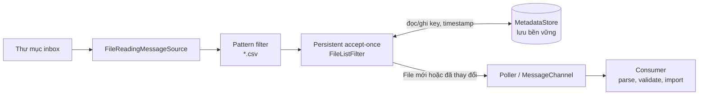
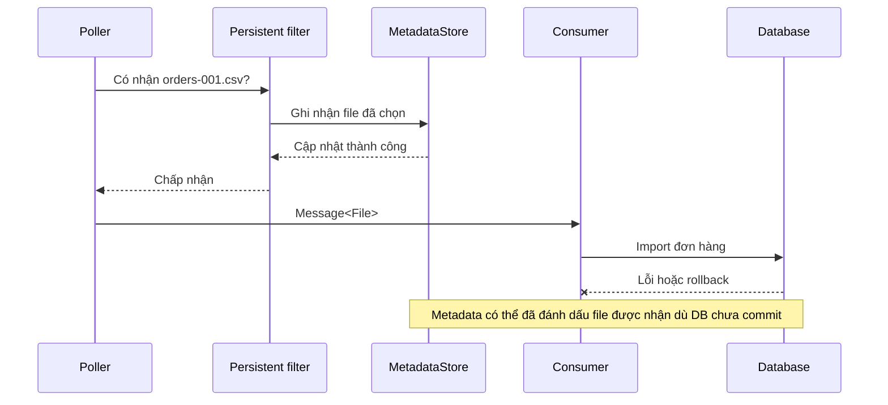

# MetadataStore chống đọc lặp cùng một tệp

## 1. Bài toán: cùng một tệp được nhận lại sau khi khởi động lại

Trong module **SPRING_INTEGRATION_ADAPTERS**, ứng dụng kết nối các hệ thống bên ngoài thông qua inbound/outbound adapter, gateway, poller và `MessageChannel`. Với **Adapter file**, một hệ thống đối tác có thể đặt tệp CSV vào thư mục chung để ứng dụng Spring Integration nhập dữ liệu vào database. Bài toán vận hành là: **làm sao hạn chế phát lại cùng một tệp qua nhiều lần poll và sau khi ứng dụng restart?**

Ví dụ:

```text
data/
├── inbox/
│   ├── orders-001.csv
│   ├── orders-002.csv
│   └── orders-003.csv.tmp
└── metadata/
    └── file-import.properties
```

Luồng cần đọc hai tệp `*.csv`, bỏ qua tệp `*.tmp` và ghi nhớ các file đã được **chọn bởi nguồn**. Sau khi dừng rồi chạy lại ứng dụng, `orders-001.csv` và `orders-002.csv` vẫn nằm trong inbox nhưng không nên được chọn lại nếu chúng không thay đổi. Nếu đối tác cập nhật nội dung file và thời gian sửa cuối thay đổi, hệ thống có thể coi đó là một phiên bản mới.

Sau bài học, bạn có thể:

- Giải thích vai trò của `MetadataStore` và `ConcurrentMetadataStore` trong Spring Integration.
- So sánh `AcceptOnceFileListFilter` lưu trạng thái trong RAM và `FileSystemPersistentAcceptOnceFileListFilter` dùng metadata store.
- Cấu hình `PropertiesPersistingMetadataStore` để giữ dấu vết tệp đã chọn qua restart.
- Hiểu key, value, prefix, thời gian sửa cuối, `flushOnUpdate` và hành vi khi tệp thay đổi.
- Phân biệt **chống chọn trùng** với **xử lý nghiệp vụ thành công**; thiết kế retry và idempotency phù hợp.
- Nhận diện giới hạn khi có nhiều instance, lưu trạng thái trên ổ đĩa không bền vững hoặc file đang được ghi dở.

## 2. MetadataStore nằm ở đâu trong luồng?

`FileReadingMessageSource` quét thư mục, thông qua `FileListFilter<File>` để quyết định file nào được chấp nhận, rồi phát `Message<File>` khi poller gọi `receive()`. Một bộ lọc **persistent accept-once** sử dụng `MetadataStore` để ghi dấu file đã được thấy.



Điểm cần phân biệt là **metadata của adapter** và **trạng thái nghiệp vụ**:

| Trạng thái | Thành phần quản lý | Trả lời được câu hỏi |
| --- | --- | --- |
| File từng được nguồn lựa chọn? | `FileSystemPersistentAcceptOnceFileListFilter` + `MetadataStore` | Có nên phát tệp này thêm lần nữa không? |
| File đã ghi DB thành công? | Consumer và kho trạng thái nghiệp vụ | Import đã commit chưa? |
| Bên ngoài đã nhận phản hồi? | Hợp đồng ACK của hệ thống đích | Đối tác đã tiêu thụ kết quả chưa? |

**MetadataStore không đồng nghĩa một transaction log nhập dữ liệu.** Bộ lọc có thể lưu dấu tệp *trước khi* consumer ghi database. Nếu consumer thất bại, metadata vẫn có thể ghi nhận file đã chọn, và các lần poll tiếp theo sẽ bỏ qua file đó.

## 3. Từ AcceptOnceFileListFilter đến persistent filter

`AcceptOnceFileListFilter<File>` thường được dùng khi chỉ cần nhớ những file đã thấy trong một phiên JVM. Nó lưu trạng thái trong bộ nhớ, nên khi restart, thông tin bị mất. Đối với file còn ở inbox, adapter có thể phát lại.

`FileSystemPersistentAcceptOnceFileListFilter` khác ở chỗ sử dụng một `ConcurrentMetadataStore` được truyền từ ngoài vào. Nó lưu một dấu vết file, thường dựa vào **đường dẫn/tên tệp** và **thời gian sửa cuối** (`lastModified`). Nếu store thực sự bền vững, dấu vết có thể sống qua restart.

| Tiêu chí | `AcceptOnceFileListFilter` | `FileSystemPersistentAcceptOnceFileListFilter` |
| --- | --- | --- |
| Trạng thái | Trong bộ nhớ của filter | Trong `ConcurrentMetadataStore` |
| Qua restart | Thông thường mất | Giữ được nếu store và dữ liệu thực sự bền vững |
| Xử lý tệp sửa đổi | Phụ thuộc cơ chế nhận diện của filter trong bộ nhớ | Có thể nhận lại khi timestamp sửa cuối khác giá trị đã lưu |
| Dùng chung giữa nhiều instance | Không | Có thể nếu store chia sẻ có thao tác nguyên tử phù hợp |
| Xác nhận DB commit | Không | Không |

Tên lớp có chữ **Persistent** không tự bảo đảm lưu qua restart. Ví dụ:

```java
new FileSystemPersistentAcceptOnceFileListFilter(
        new SimpleMetadataStore(), "orders:"
);
```

Đây là persistent filter **về loại bộ lọc** nhưng `SimpleMetadataStore` mặc định giữ dữ liệu trong RAM. Nó phù hợp để thử nghiệm API, song không giải quyết yêu cầu bền vững qua lần khởi động lại JVM.

## 4. MetadataStore và ConcurrentMetadataStore

`MetadataStore` là giao diện key–value trong Spring Integration. Các thao tác cốt lõi gồm `get(key)`, `put(key, value)` và `remove(key)`. `ConcurrentMetadataStore` bổ sung thao tác nguyên tử như `putIfAbsent(key, value)` và `replace(key, oldValue, newValue)`.

Việc dùng `ConcurrentMetadataStore` quan trọng vì có thể có hai poller/instance cùng nhìn thấy một tệp. Nếu cả hai cùng thực hiện “đọc key → thấy chưa tồn tại → ghi key” như hai thao tác độc lập, cả hai có thể nghĩ mình sở hữu file. Các thao tác nguyên tử của store giúp bộ lọc phối hợp việc chấp nhận file, **trong phạm vi bảo đảm của implementation và nơi lưu trữ**.

| Loại store | Nơi giữ trạng thái | Cách dùng điển hình |
| --- | --- | --- |
| `SimpleMetadataStore` | Bộ nhớ JVM | Demo/test; không giữ dấu vết qua restart |
| `PropertiesPersistingMetadataStore` | Tệp properties tại thư mục được chỉ định | Một ứng dụng đơn lẻ, cần giữ trạng thái qua restart trên ổ đĩa bền vững |
| `RedisMetadataStore` | Redis | Nhiều instance cần metadata chia sẻ và thao tác có tính cạnh tranh |
| `JdbcMetadataStore` | Database | Cần metadata chia sẻ hoặc quản trị cùng hạ tầng database |

Các implementation có cấu hình và độ bền khác nhau. **Không dùng một file properties được nhiều pod cùng sửa như một khóa phân tán.** Nếu chạy nhiều instance, cần store được thiết kế cho chia sẻ và bảo đảm thao tác nguyên tử giữa các tiến trình. Khi dùng database hoặc Redis, còn phải thiết kế quyền truy cập, kết nối, retry, giám sát và vòng đời của store đó.

## 5. Cách filter nhận diện một file

Với `FileSystemPersistentAcceptOnceFileListFilter`, ý tưởng về key–value như sau:

```text
key   = "orders-import:" + <duong-dan-file-duoc-nhan-dien>
value = <lastModified cua file>
```

Ví dụ minh họa (không phải định dạng byte chính xác của file properties):

```text
orders-import:/app/data/inbox/orders-001.csv -> 1795380600000
orders-import:/app/data/inbox/orders-002.csv -> 1795380660000
```

Nếu key chưa tồn tại, file được chấp nhận và bộ lọc lưu dấu. Nếu key có cùng timestamp, file được xem là đã thấy. Nếu timestamp thay đổi, bộ lọc có thể chấp nhận lại và cập nhật metadata. **`lastModified` không phải checksum nội dung.**

| Tình huống | Hành vi thường kỳ vọng |
| --- | --- |
| File mới, chưa có key | Chấp nhận |
| File cũ, cùng key và timestamp | Bỏ qua |
| File cũ, timestamp thay đổi | Có thể được nhận lại |
| File nội dung thay đổi nhưng timestamp được giữ nguyên | Có thể bị bỏ qua |
| Hai file cùng tên ở hai thư mục khác nhau | Cần bảo đảm khóa phân biệt được đường dẫn đầy đủ |
| Đổi đường dẫn gốc giữa hai lần chạy | Key có thể khác và file có thể được coi là mới |

Đừng dùng thời điểm sửa cuối để kết luận dữ liệu khác nhau về nghiệp vụ. Các filesystem có độ phân giải timestamp khác nhau; thao tác copy, đồng bộ thời gian hoặc chỉnh timestamp có thể khiến việc so sánh không phản ánh chính xác nội dung.

### Prefix để tách namespace

Tham số `prefix` của constructor dùng phân tách metadata giữa các luồng:

```java
new FileSystemPersistentAcceptOnceFileListFilter(
        store, "orders-import:"
);
```

Nên dùng prefix ổn định, có ý nghĩa theo **ứng dụng + luồng + nguồn dữ liệu**, đặc biệt nếu nhiều inbound adapter dùng chung store. Đổi prefix sau khi triển khai khiến key cũ không còn được tìm thấy và có thể phát lại các file lịch sử; khi đổi prefix phải có phương án di chuyển metadata hoặc xử lý replay.

## 6. Ví dụ Spring Boot hoàn chỉnh có lưu trạng thái qua restart

Ví dụ dùng Java 17+, Spring Boot, Spring Integration File. Khi Spring Boot quản lý dependency, khai báo Maven:

```xml
<dependencies>
    <dependency>
        <groupId>org.springframework.boot</groupId>
        <artifactId>spring-boot-starter-integration</artifactId>
    </dependency>
    <dependency>
        <groupId>org.springframework.integration</groupId>
        <artifactId>spring-integration-file</artifactId>
    </dependency>
</dependencies>
```

Đầu vào là `data/inbox`; metadata nằm trong `data/metadata/file-import.properties`. **Thư mục `data/metadata` phải được giữ lại sau restart và phải có quyền đọc/ghi**. Trong container, hãy gắn volume bền vững thay vì dùng thư mục tạm mất dữ liệu sau khi container bị thay.

```java
import java.io.File;

import org.springframework.context.annotation.Bean;
import org.springframework.context.annotation.Configuration;
import org.springframework.integration.annotation.InboundChannelAdapter;
import org.springframework.integration.annotation.Poller;
import org.springframework.integration.annotation.ServiceActivator;
import org.springframework.integration.channel.DirectChannel;
import org.springframework.integration.config.EnableIntegration;
import org.springframework.integration.core.MessageSource;
import org.springframework.integration.file.FileReadingMessageSource;
import org.springframework.integration.file.filters.ChainFileListFilter;
import org.springframework.integration.file.filters.FileSystemPersistentAcceptOnceFileListFilter;
import org.springframework.integration.file.filters.SimplePatternFileListFilter;
import org.springframework.integration.metadata.PropertiesPersistingMetadataStore;
import org.springframework.messaging.MessageChannel;

@Configuration
@EnableIntegration
public class PersistentFileInboundConfig {

    @Bean
    public MessageChannel fileImportChannel() {
        return new DirectChannel();
    }

    @Bean
    public PropertiesPersistingMetadataStore fileImportMetadataStore() {
        PropertiesPersistingMetadataStore store =
                new PropertiesPersistingMetadataStore();
        store.setBaseDirectory("data/metadata");
        store.setFileName("file-import.properties");
        return store;
    }

    @Bean
    @InboundChannelAdapter(
        channel = "fileImportChannel",
        poller = @Poller(
            fixedDelay = "2000",
            maxMessagesPerPoll = "3"
        )
    )
    public MessageSource<File> fileImportSource(
            PropertiesPersistingMetadataStore fileImportMetadataStore) {

        FileReadingMessageSource source = new FileReadingMessageSource();
        source.setDirectory(new File("data/inbox"));

        FileSystemPersistentAcceptOnceFileListFilter seenFiles =
                new FileSystemPersistentAcceptOnceFileListFilter(
                        fileImportMetadataStore,
                        "orders-import:"
                );

        // Store co Flushable: ghi thay doi xuong file sau moi update.
        seenFiles.setFlushOnUpdate(true);

        ChainFileListFilter<File> filters = new ChainFileListFilter<>();
        filters.addFilter(new SimplePatternFileListFilter("*.csv"));
        filters.addFilter(seenFiles);
        source.setFilter(filters);

        return source;
    }

    @ServiceActivator(inputChannel = "fileImportChannel")
    public void importFile(File file) {
        System.out.printf(
                "Dang nhan: %s (%d bytes)%n",
                file.getAbsolutePath(),
                file.length()
        );
        // Demo chi quan sat. Xu ly that can parse va luu trang thai DB.
    }
}
```

Class cấu hình nằm trong phạm vi component scan của `@SpringBootApplication` hoặc được import vào Spring context. Đảm bảo `data/inbox` và `data/metadata` tồn tại, có quyền phù hợp, và **working directory** của JVM ổn định giữa các lần chạy.

### Vì sao dùng ChainFileListFilter?

Ở ví dụ:

1. `SimplePatternFileListFilter("*.csv")` loại tệp tạm `*.csv.tmp` và các tệp không đúng phần mở rộng.
2. `FileSystemPersistentAcceptOnceFileListFilter` chỉ thấy những tệp đạt điều kiện tên, rồi cập nhật metadata.

`ChainFileListFilter` thực hiện các điều kiện **theo thứ tự**. Điều này quan trọng với filter có trạng thái: không nên ghi nhận một file là “đã chọn” trước khi các điều kiện đơn giản hoặc điều kiện “file đã sẵn sàng” được kiểm tra. Một `CompositeFileListFilter` cũng kết hợp nhiều bộ lọc, nhưng cách chạy khác có thể ảnh hưởng tới các filter lưu trạng thái; nên chọn rõ cơ chế và kiểm chứng theo phiên bản.

Khi gọi `source.setFilter(filters)`, ta chủ động cung cấp bộ lọc của nguồn. Không giả định bộ lọc mặc định của `FileReadingMessageSource` tiếp tục tồn tại sau khi bị thay bằng một filter tùy chỉnh.

### Vì sao đặt flushOnUpdate=true?

`PropertiesPersistingMetadataStore` hỗ trợ `Flushable`. `seenFiles.setFlushOnUpdate(true)` yêu cầu bộ lọc flush khi cập nhật metadata, giúp ghi trạng thái xuống tệp properties ngay hơn thay vì chỉ giữ thay đổi trong bộ nhớ chờ lifecycle/flush.

Điều này **không tạo transaction nguyên tử với việc import DB**, cũng không phải cam kết chống mất dữ liệu tuyệt đối khi máy chủ mất điện hoặc ổ đĩa gặp lỗi. Nó chỉ làm rõ thời điểm cố gắng đồng bộ metadata trong phạm vi cơ chế store. Với lưu trữ thực tế, cần cân nhắc mức độ bền vững của volume, backup và quy trình khôi phục.

## 7. Thực hành: kiểm chứng qua restart

Tạo thư mục `data/inbox` và `data/metadata` từ working directory của ứng dụng. Thêm hai file CSV và một file tạm:

```text
data/inbox/orders-001.csv
data/inbox/orders-002.csv
data/inbox/orders-003.csv.tmp
```

Nội dung file `orders-001.csv` có thể là:

```csv
order_id,total
ORD-001,150000
```

Tiến hành theo thứ tự:

1. **Lần chạy đầu:** khởi động ứng dụng. Đợi poller phát hiện hai file `*.csv`; tệp `*.tmp` bị bỏ qua.
2. **Đọc metadata:** quan sát tệp `data/metadata/file-import.properties` được tạo/cập nhật. Không sửa trực tiếp các key lúc ứng dụng đang chạy.
3. **Dừng và khởi động lại:** giữ nguyên inbox, metadata và working directory. Hai file cũ với timestamp không đổi sẽ không được nguồn phát lại.
4. **Thêm file mới:** tạo `orders-004.csv`; nó được nhận vì chưa có dấu vết metadata.
5. **Đổi timestamp:** chỉnh file `orders-001.csv` sao cho thời gian sửa cuối thay đổi; nguồn có thể nhận lại vì dữ liệu nhận diện file thay đổi.
6. **Khôi phục thử trạng thái:** trong môi trường test tách biệt, tạm cất metadata file rồi restart; các tệp cũ có thể được xem là mới. Khôi phục file metadata đã cất trước khi tiếp tục bài thực hành.

Đây là **kết quả kỳ vọng từ cấu hình**, không phải log thực nghiệm đã chạy trong bài. Hành vi quan sát còn phụ thuộc filesystem, thời điểm poll, việc file còn tồn tại, thời gian sửa cuối và khả năng lưu metadata thật sự.

### Bảng tình huống để tự đối chiếu

| File trong inbox | Metadata đã có? | Timestamp có thay đổi? | Kỳ vọng |
| --- | --- | --- | --- |
| `orders-001.csv` | Không | — | Nhận |
| `orders-001.csv` | Có | Không | Bỏ qua |
| `orders-001.csv` | Có | Có | Có thể nhận lại |
| `orders-002.csv` | Có nhưng metadata bị mất sau restart | — | Nhận lại |
| `orders-003.csv.tmp` | Không | — | Không nhận vì filter `*.csv` |
| `orders-004.csv` | Không | — | Nhận |

## 8. Chống phát lại và exactly-once là hai yêu cầu khác nhau

Ví dụ thực tế: ứng dụng nhận một tệp rồi ghi các đơn hàng vào database.



Vấn đề: metadata lưu dấu **trước** khi công việc nghiệp vụ chắc chắn thành công. Nếu `importFile` ném exception sau khi filter đã ghi nhận file, việc poll lại cùng file không phải đường retry bảo đảm. Nếu tự xóa metadata bừa bãi để cố nhận lại, có thể làm dữ liệu trùng khi DB thực ra đã commit nhưng ứng dụng crash trước lúc nhận kết quả.

Một quy trình đáng tin cậy hơn cần thêm trạng thái nghiệp vụ:

```text
DISCOVERED -> PROCESSING -> IMPORTED -> ARCHIVED
                 |
                 +----> FAILED / RETRY_PENDING
```

Ví dụ bảng `file_import` có `import_id`, `source_path`, `checksum`, `status`, `attempt_count` và `last_error`. Consumer dùng khóa duy nhất cho đơn hàng hoặc import ID để có **idempotency**: xử lý cùng một lô lần nữa không tạo bản ghi thừa.

Hai lớp có mục tiêu riêng:

- **Persistent filter:** giảm việc phát lại file không đổi ở nguồn, kể cả qua restart.
- **Import state + idempotent consumer:** xác định nghiệp vụ đã hoàn tất hay chưa và cho phép phục hồi an toàn khi thất bại.

Không nên tuyên bố có **exactly-once end-to-end** chỉ vì dùng `MetadataStore`. Filesystem, metadata store và DB thường không cùng một giao dịch nguyên tử.

## 9. File bị ghi dở và thứ tự kết hợp bộ lọc

Nếu bên gửi tạo trực tiếp `orders-005.csv` rồi ghi dữ liệu trong nhiều giây, filter có thể chọn file ngay khi nó xuất hiện. Khi đó metadata đã được cập nhật nhưng consumer đọc được nội dung chưa hoàn chỉnh.

Một hợp đồng nhận file an toàn hơn:

1. Bên gửi ghi vào `orders-005.csv.tmp`.
2. Bên gửi đóng file, hoàn tất dữ liệu rồi đổi tên thành `orders-005.csv`.
3. Bộ lọc `*.csv` chỉ nhận tên cuối.
4. Persistent filter ghi nhận file sau khi nó vượt qua quy tắc tên.

Nếu không đổi tên được, có thể dùng thêm `LastModifiedFileListFilter` để chờ file có thời gian sửa cuối đủ cũ, hoặc yêu cầu file marker `*.done`. Đặt bộ lọc “file đã sẵn sàng” **trước** persistent accept-once trong `ChainFileListFilter`.

Chờ một khoảng thời gian chỉ **giảm xác suất** đọc file đang được ghi, không chứng minh file hoàn tất. Nên quy định rõ hợp đồng file với bên gửi thay vì chỉ tăng thời gian chờ.

## 10. Khi tệp thay đổi, đổi tên hoặc chuyển thư mục

Một metadata key có thể phụ thuộc vào đường dẫn file và thời gian sửa cuối. Vì vậy:

- **Thay đổi nội dung và timestamp:** filter có thể xem file là bản mới. Consumer phải biết đây là bản cập nhật hay file bị gửi trùng.
- **Thay đổi nội dung nhưng giữ timestamp:** filter có thể bỏ qua. Nếu đối tác thường ghi lại cùng tên, yêu cầu họ cung cấp version/hash hoặc tên file duy nhất.
- **Đổi tên hoặc di chuyển file trong vùng được quét:** có thể tạo key mới, dẫn tới việc nhận thêm lần nữa.
- **Đổi working directory hoặc đường dẫn mount sau deploy:** file cũ có thể được nhận diện theo đường dẫn khác. Nên cấu hình đường dẫn tuyệt đối ổn định.
- **File nhiều ngày tuổi bị xóa khỏi inbox:** metadata cũ có thể tiếp tục tồn tại. Cần có chính sách archive và làm sạch metadata theo vòng đời dữ liệu, nhưng chỉ xóa key sau khi đã đối chiếu trạng thái nghiệp vụ.

Trong thư mục lồng nhau, cần đặc biệt chú ý hai file cùng tên nhưng ở hai nhánh khác nhau. `FileSystemPersistentAcceptOnceFileListFilter` hỗ trợ `setForRecursion(true)` để sử dụng full path và luôn cho phép đi qua directory khi quét đệ quy. Khi dùng `RecursiveDirectoryScanner` tùy chỉnh, filter thuộc scanner và cần bảo đảm các bộ lọc tên cũng chấp nhận thư mục để scanner duyệt sâu.

**Không tự chuyển sang quét đệ quy bằng cách chỉ bật `setForRecursion(true)`.** Nó thay đổi cách bộ lọc nhận diện file; việc duyệt cây thực tế cần cấu hình `RecursiveDirectoryScanner` hoặc cơ chế tương ứng.

## 11. Nhiều instance và khả năng chia sẻ MetadataStore

Giả sử hai pod cùng trỏ tới thư mục chung:

```text
                   +--> Pod A: FileReadingMessageSource
Shared inbox ------|
                   +--> Pod B: FileReadingMessageSource

                         |
                         v
               Shared ConcurrentMetadataStore
```

Nếu mỗi pod sử dụng một `SimpleMetadataStore` hoặc một file properties riêng, cả hai đều có thể coi `orders-001.csv` là tệp mới và cùng xử lý. **PropertiesPersistingMetadataStore không được xem là shared metadata store an toàn cho nhiều tiến trình cùng ghi một file.**

Muốn phối hợp giữa instance, cần:

1. Dùng một `ConcurrentMetadataStore` **chia sẻ thật sự** với bảo đảm nguyên tử xuyên nhiều tiến trình (ví dụ Redis/JDBC được cấu hình đúng).
2. Thống nhất cùng prefix, đường dẫn file và quy tắc timestamp giữa các instance.
3. Quy định ai xử lý file khi một pod crash sau khi nhận quyền từ filter.
4. Vẫn dùng idempotency tại database để bảo vệ khi có retry hoặc các tình huống bất định.

Atomic `putIfAbsent`/`replace` giúp phối hợp **quyết định chọn file**, nhưng không cung cấp ACK sau xử lý nghiệp vụ. Khi pod nhận file rồi chết trước khi commit, cần cơ chế thu hồi quyền sở hữu hoặc reconciliation; không nên chỉ trông vào việc file vẫn nằm trong inbox.

## 12. Khôi phục file lỗi và quản lý metadata

Trong hệ thống vận hành thực tế, nên có đường xử lý tệp:

```text
inbox/ -> processing/ -> archive/
                     \-> failed/
```

Ví dụ, sau khi nhận một file, ứng dụng có thể chuyển nó sang `processing`, tạo import ID rồi ghi DB. Nếu thất bại, giữ file trong `failed` cùng nguyên nhân và số lần thử. Khi retry, consumer lấy lại từ `failed`/`processing` theo trạng thái import; không phụ thuộc vào việc persistent filter có phát file ở inbox lại hay không.

Lớp `FileSystemPersistentAcceptOnceFileListFilter` hỗ trợ giao diện `ResettableFileListFilter`, với thao tác `remove(file)` để làm cho một file có thể được cân nhắc trở lại. Tuy nhiên, **không gọi remove tùy tiện trong một consumer đang xử lý**, vì còn có trạng thái queue của nguồn, xử lý đồng thời và khả năng DB đã commit. Nếu buộc phải mở lại một file, thực hiện trong quy trình retry có khóa/idempotency, sau khi xác định chính xác trạng thái file và metadata.

Tương tự, không chỉnh thủ công file properties trong lúc ứng dụng chạy. Việc sửa key sai prefix hoặc xóa toàn bộ metadata có thể làm một lượng lớn file cũ được nhập lại.

## 13. Quan sát và xử lý sự cố

| Triệu chứng | Nguyên nhân thường gặp | Kiểm tra/hướng khắc phục |
| --- | --- | --- |
| Restart vẫn đọc lại mọi file | Dùng `SimpleMetadataStore`, metadata file không bền vững, đổi prefix hoặc đường dẫn | Kiểm tra store thực, volume, key và working directory |
| Không nhận được file mới | Tên không khớp `*.csv`, không có quyền đọc, filter đã có key/timestamp | Kiểm tra tên, đường dẫn, timestamp và log của poller |
| File cập nhật bị nhận lại | Timestamp thay đổi | Kiểm tra hợp đồng version; dùng import ID/idempotency |
| File được chọn nhưng DB không có dữ liệu | Consumer lỗi sau khi metadata đã cập nhật | Dùng import state và đường retry có kiểm soát |
| Không thấy file properties | Sai đường dẫn, store chưa được flush, không đủ quyền | Kiểm tra `setBaseDirectory`, quyền ghi, `flushOnUpdate` và lifecycle |
| Hai instance nhập cùng file | Store tách biệt, không có thao tác đồng bộ xuyên pod | Dùng shared atomic metadata store, thống nhất prefix và ID |
| Không đọc được CSV mới do file đang ghi | Tên file được công bố quá sớm | Quy ước `*.tmp` → `*.csv`, hoặc cơ chế ready marker |
| File cũ được nhận lại sau deploy | Đổi đường dẫn mount, prefix hoặc metadata bị mất | Lập kế hoạch di chuyển state và kiểm chứng replay |
| Metadata ngày càng lớn | File cũ đã archive nhưng key vẫn giữ | Thiết kế retention/cleanup chỉ sau khi đối chiếu trạng thái nghiệp vụ |

Khi cần giám sát, nên thu thập: số file được chọn, số file import thành công/thất bại, độ trễ từ lúc file sẵn sàng tới lúc nhận, kích thước inbox/failed, lỗi ghi metadata và thời gian đọc/ghi store. Một bộ lọc chỉ “không thấy file mới” không thể phân biệt thư mục thực sự rỗng với lỗi quyền truy cập hoặc metadata không hoạt động đúng.

## 14. Liên hệ với các adapter khác

Ý tưởng `MetadataStore` còn xuất hiện ở các adapter tải file từ **SFTP, FTP hoặc SMB**, nhưng cơ chế nhận diện tệp phía remote và local filter có thể khác nhau. Một luồng SFTP có thể có **remote persistent filter** để quyết định tệp nào được tải và **local file filter** để quyết định tệp nào được phát thành message sau khi tải về. Việc chống tải lại và chống xử lý lại là hai tầng riêng.

Các adapter HTTP, JMS, AMQP, Kafka và database có hợp đồng phản hồi, xác nhận hoặc offset khác nhau. Đừng bê nguyên ý tưởng “metadata đã ghi nghĩa là xong” sang ACK của broker hay transaction database. `MessageChannel` chỉ vận chuyển message giữa các endpoint; độ tin cậy cuối cùng phụ thuộc vào từng nguồn, đích và cơ chế phục hồi.

## 15. Bài tập thực hành

1. **Nhận file lần đầu:** tạo hai `*.csv` và một `*.csv.tmp`; chạy chương trình và xác định file nào vào `fileImportChannel`.
2. **Restart với store bền vững:** dừng rồi mở lại chương trình, giữ nguyên file metadata; xác minh file không đổi không bị phát lại.
3. **So sánh store trong RAM:** thay `PropertiesPersistingMetadataStore` bằng `SimpleMetadataStore` qua một cấu hình test phù hợp. Giải thích vì sao restart gây nhận lại.
4. **File sửa đổi:** thay nội dung và timestamp của một file đã đọc, quan sát điều kiện được nhận lại. Đánh giá rủi ro nếu bên gửi không đổi timestamp.
5. **Đổi prefix:** thay `orders-import:` thành `orders-import-v2:` trong môi trường thử nghiệm; dự đoán ảnh hưởng tới các key cũ.
6. **Lỗi sau khi chọn file:** cho consumer ném exception; quan sát metadata, rồi đề xuất luồng retry riêng để không tạo bản ghi DB trùng.
7. **Nhiều pod:** mô tả vấn đề nếu mỗi pod giữ file properties riêng, rồi đề xuất một shared `ConcurrentMetadataStore` và quy tắc ownership.
8. **Khôi phục sự cố:** giả lập file đã import DB nhưng tiến trình crash trước khi ghi trạng thái. Thiết kế import ID/unique constraint và bước reconciliation.
9. **Quét đệ quy:** thêm hai file trùng tên tại hai thư mục con; giải thích vì sao phải phân biệt full path, và ý nghĩa `setForRecursion(true)`.

### Câu hỏi tự kiểm tra

**Q1. MetadataStore lưu gì trong ví dụ này?**  
Một dấu vết nhận diện file dưới dạng key–value, thường gồm prefix/đường dẫn file và timestamp sửa cuối, phục vụ quyết định có nhận lại hay không.

**Q2. `FileSystemPersistentAcceptOnceFileListFilter` luôn bền vững qua restart không?**  
Không. Nó phụ thuộc vào store thực sự bền vững; `SimpleMetadataStore` mặc định chỉ lưu trong bộ nhớ.

**Q3. Tại sao filter cần `ConcurrentMetadataStore`?**  
Để có các thao tác key–value nguyên tử giúp phối hợp việc nhận file khi có xử lý cạnh tranh.

**Q4. Vì sao file thay đổi timestamp có thể được nhận lại?**  
Vì persistent accept-once xem timestamp sửa cuối là một phần dấu vết file đã được thấy.

**Q5. `flushOnUpdate=true` có bảo đảm transaction giữa metadata và DB không?**  
Không. Nó chỉ yêu cầu flush metadata store hỗ trợ `Flushable` sau khi metadata được cập nhật.

**Q6. Nếu consumer xử lý lỗi, có nên xóa toàn bộ metadata để chạy lại không?**  
Không. Cần xác định file nào chưa hoàn tất, dùng idempotency và retry có kiểm soát để tránh nhập trùng.

**Q7. File properties có đủ cho hai pod cùng xử lý một inbox không?**  
Không thể mặc định. Cần metadata store chia sẻ và thao tác nguyên tử xuyên các instance, cùng cơ chế phục hồi ownership.

## 16. Ghi nhớ

`MetadataStore` giúp **File inbound channel adapter nhớ các tệp đã được lựa chọn**, còn `FileSystemPersistentAcceptOnceFileListFilter` sử dụng `ConcurrentMetadataStore` để quyết định có phát lại file theo đường dẫn và thời gian sửa cuối. `PropertiesPersistingMetadataStore` là lựa chọn đơn giản để thử cơ chế bền vững qua restart cho **một ứng dụng đơn lẻ**, với điều kiện file metadata được lưu trên ổ đĩa bền vững và được flush phù hợp.

Để nhập file đáng tin cậy, cần tiếp tục thiết kế **file đã ghi xong, trạng thái import, retry, idempotency và phục hồi sau crash**. Persistent filter chống chọn trùng ở đầu luồng; nó **không xác nhận DB đã commit** và không thay thế cơ chế phối hợp của một hệ thống phân tán.

### Tài liệu tham khảo

- [Spring Integration Reference — Reading Files](https://docs.spring.io/spring-integration/reference/file/reading.html)
- [Spring Integration Reference — Metadata Store](https://docs.spring.io/spring-integration/reference/meta-data-store.html)
- [Spring Integration API — FileSystemPersistentAcceptOnceFileListFilter](https://docs.spring.io/spring-integration/api/org/springframework/integration/file/filters/FileSystemPersistentAcceptOnceFileListFilter.html)
- [Spring Integration API — AbstractPersistentAcceptOnceFileListFilter](https://docs.spring.io/spring-integration/api/org/springframework/integration/file/filters/AbstractPersistentAcceptOnceFileListFilter.html)
- [Spring Integration API — PropertiesPersistingMetadataStore](https://docs.spring.io/spring-integration/api/org/springframework/integration/metadata/PropertiesPersistingMetadataStore.html)
