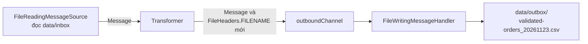
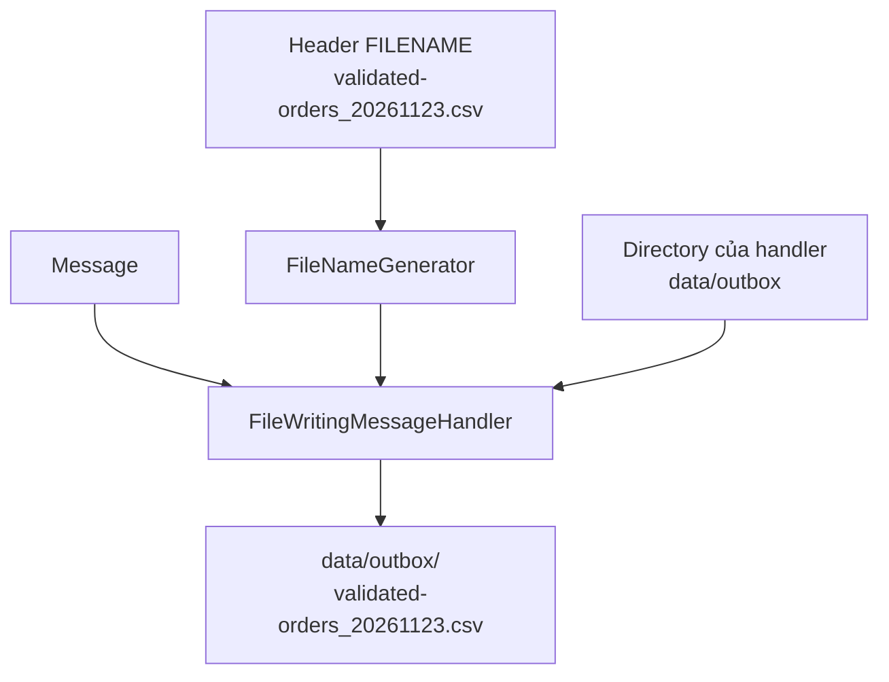

# FileHeaders và đường dẫn tệp trong message

## 1. Bối cảnh và mục tiêu bài học

Trong module **SPRING_INTEGRATION_ADAPTERS**, các hệ thống bên ngoài kết nối với Spring Integration qua inbound/outbound adapter, gateway, poller và `MessageChannel`. Khi trao đổi file, một message không chỉ chứa dữ liệu cần đọc hoặc ghi: nó còn có thể mang **tên tệp, tham chiếu tệp gốc và thông tin đường dẫn tương đối**. Hiểu sai các thông tin này dễ khiến luồng lấy nhầm file, ghi đè sai vị trí hoặc không xác định được file nào đã xử lý.

Ở chương **Adapter file**, xét một ứng dụng nhập báo cáo vào `data/inbox` rồi xuất bản sao đã kiểm tra sang `data/outbox`:

```text
data/
├── inbox/
│   └── orders_20261123.csv
└── outbox/
    └── validated-orders_20261123.csv
```

Đầu vào có thể là `Message<File>`: payload là đối tượng file ở inbox, còn các headers cung cấp metadata liên quan. Sau transformer, payload có thể trở thành `byte[]`, trong khi một header mới chỉ định **tên file cần ghi ở outbox**. Vì loại payload và vị trí file có thể thay đổi qua mỗi endpoint, cần một **hợp đồng message** rõ ràng.

Sau bài này, bạn có thể:

- Phân biệt payload `File`, tên file, đường dẫn tương đối và đường dẫn tuyệt đối.
- Nhận diện các header thường gặp trong `org.springframework.integration.file.FileHeaders`, đặc biệt `FILENAME`, `ORIGINAL_FILE`, `RELATIVE_PATH` và `SET_MODIFIED`.
- Giải thích khi nào inbound adapter tạo metadata file và khi nào outbound adapter dùng metadata đó.
- Tạo message mới bằng `MessageBuilder` mà không vô tình làm mất hoặc dùng nhầm thông tin tệp nguồn.
- Cấu hình `FileWritingMessageHandler` với thư mục đầu ra cố định và tên file được kiểm tra.
- Thiết kế an toàn cho đường dẫn, chống path traversal, ghi trùng, xử lý lỗi và idempotency.

## 2. Hai phần của một Spring Integration message

Spring Messaging định nghĩa `Message<T>` gồm **payload** và **headers**:

```java
Message<File> message = ...;

File inputFile = message.getPayload();
Object inputName = message.getHeaders().get(FileHeaders.FILENAME);
```

Payload chứa dữ liệu chính của message. Headers là các trường metadata đi kèm để mô tả hoặc định tuyến message. Đối với file, một header thường rất hữu ích vì downstream có thể đã đổi payload từ `File` thành `byte[]`, `String` hay một DTO nghiệp vụ.



Một ví dụ mang tính khái niệm:

```text
Message vào:
  payload = File("data/inbox/orders_20261123.csv")
  headers[FileHeaders.FILENAME] = "orders_20261123.csv"

Message sau transformer:
  payload = byte[] chứa nội dung CSV
  headers[FileHeaders.FILENAME] = "validated-orders_20261123.csv"
  headers["sourceAbsolutePath"] = ".../data/inbox/orders_20261123.csv"
```

Ở đây, `sourceAbsolutePath` là **header ứng dụng tự định nghĩa**, không phải hằng số thuộc `FileHeaders`. Không nên tự đặt tên các header như `file_path` rồi mặc định rằng Spring Integration sẽ tự hiểu chúng.

## 3. Những FileHeaders cần nắm

`FileHeaders` cung cấp các tên header dùng trong thành phần File của Spring Integration. Không phải mọi endpoint đều tự tạo **tất cả** các header dưới đây; cần kiểm tra loại adapter, phiên bản thư viện và đường đi message cụ thể.

| Hằng số | Mục đích | Kiểu giá trị thường gặp | Lưu ý |
| --- | --- | --- | --- |
| `FileHeaders.FILENAME` | Tên file cần tham chiếu hoặc cần tạo | `String` | Thường là **tên cuối**, không phải đường dẫn tuyệt đối |
| `FileHeaders.ORIGINAL_FILE` | Tham chiếu đến file nguồn ban đầu | `File` | Hữu ích khi payload đã được chuyển đổi; không phải lời hứa rằng file vẫn còn tồn tại |
| `FileHeaders.RELATIVE_PATH` | Đường dẫn tương đối gắn với việc đọc file từ cây thư mục | Thông tin đường dẫn, thường dạng chuỗi | Đặc biệt liên quan đến nguồn quét đệ quy; không giả định luôn có |
| `FileHeaders.SET_MODIFIED` | Metadata để điều khiển thời điểm sửa cuối của file đích khi ghi | Giá trị thời gian sửa cuối theo hợp đồng endpoint | Không phải header ghi nhận “thời gian xử lý nghiệp vụ thành công” |

Ngoài ra, mọi `Message<?>` còn có các header chung như `MessageHeaders.ID`, `MessageHeaders.TIMESTAMP` và có thể có `replyChannel`, `errorChannel`. Chúng phục vụ định danh/định tuyến message, **không tự đại diện cho đường dẫn file**.

### 3.1. FILENAME là tên, không phải full path

Ví dụ một nguồn đọc `C:\app\data\inbox\orders_20261123.csv` hoặc `/srv/app/data/inbox/orders_20261123.csv`. Header:

```text
FileHeaders.FILENAME = "orders_20261123.csv"
```

không đủ để khôi phục vị trí file gốc. Hai file nằm ở hai thư mục khác nhau hoàn toàn có thể cùng `FileHeaders.FILENAME`. Khi cần đọc file thực, dùng payload `File` hoặc `FileHeaders.ORIGINAL_FILE` nếu nó được cung cấp đúng ngữ cảnh.

### 3.2. ORIGINAL_FILE khác payload sau transformer

Với File inbound adapter, payload ban đầu thường là `java.io.File`. Nếu một transformer đọc tệp rồi đổi payload thành bytes/DTO, ta có thể cần giữ **thông tin nguồn** để phục vụ audit, đối chiếu lỗi hoặc archive.

Không nên tự suy rằng `ORIGINAL_FILE` luôn theo message qua mọi bước: transformer có thể tạo message mới và không copy header; một số router/gateway cũng có quy tắc tạo hoặc lọc header riêng. Cần quyết định chủ động sẽ giữ metadata nào.

### 3.3. RELATIVE_PATH dành cho cấu trúc thư mục

Giả sử scanner nhận hai file:

```text
data/inbox/partner-a/2026/11/orders.csv
data/inbox/partner-b/2026/11/orders.csv
```

Cả hai có `FILENAME = "orders.csv"`. Thông tin đường dẫn tương đối, khi được nguồn cung cấp, giúp phân biệt ngữ cảnh của từng file. Nhưng **đừng giả định sẵn định dạng** của `RELATIVE_PATH` (có hay không tên file cuối, có dấu `/` hay `\`, v.v.) mà không quan sát message thực tế.

Nếu một bước ghi cần giữ nguyên cây thư mục, hãy chuẩn hóa đường dẫn tương đối bằng `Path`, kiểm tra nó vẫn nằm dưới **outbox root** và có chính sách cho symbolic link. Không nối thẳng một header bên ngoài vào đường dẫn ghi.

### 3.4. SET_MODIFIED không thay thế timestamp message

`FileHeaders.SET_MODIFIED` liên quan đến việc thiết lập thuộc tính thời gian sửa cuối của file đích khi handler hỗ trợ. `MessageHeaders.TIMESTAMP` lại là thời điểm tạo message trong Spring Messaging. Hai giá trị này có ý nghĩa khác nhau: một cái thuộc metadata filesystem, một cái thuộc message.

Một file đã được ghi thành công không nhất thiết có `lastModified` bằng thời điểm nghiệp vụ hoàn tất. Nếu muốn audit thời điểm import, hãy lưu trạng thái và timestamp nghiệp vụ riêng trong database hoặc metadata store phù hợp.

## 4. Đường dẫn tuyệt đối, tương đối và tên file

Các khái niệm sau thường bị trộn lẫn:

| Khái niệm | Ví dụ Linux | Ví dụ Windows | Mục đích |
| --- | --- | --- | --- |
| Tên file | `orders.csv` | `orders.csv` | Tên cuối của tệp |
| Relative path | `partner-a/orders.csv` | `partner-a\orders.csv` | Vị trí so với một root đã định |
| Absolute path | `/srv/app/inbox/partner-a/orders.csv` | `C:\app\inbox\partner-a\orders.csv` | Vị trí cụ thể trong một filesystem |
| Root directory | `/srv/app/inbox` | `C:\app\inbox` | Ranh giới quét hoặc ghi |

Ví dụ Java:

```java
File file = new File("data/inbox/orders.csv");

System.out.println(file.getName());
System.out.println(file.getPath());
System.out.println(file.getAbsolutePath());
System.out.println(file.toPath().toAbsolutePath().normalize());
```

- `getName()` chỉ cho tên file cuối.
- `getPath()` cho chuỗi path của đối tượng `File`, có thể là tương đối.
- `getAbsolutePath()` là đường dẫn tuyệt đối theo working directory hiện tại; không đồng nghĩa tệp thực sự tồn tại.
- `toAbsolutePath().normalize()` chuẩn hóa các thành phần `.` và `..` theo cú pháp. Nó **không tự bảo vệ trước symlink**.

Với đường dẫn tương đối, working directory của JVM khác nhau giữa IntelliJ, Maven, Docker, Windows service hoặc môi trường production. Không nên giả định `new File("data/inbox")` luôn trỏ về thư mục dự án.

### Ví dụ về trùng tên

```text
inbox/
├── vendor-1/orders.csv
└── vendor-2/orders.csv
```

Nếu đặt **khóa import** chỉ bằng `FILENAME = orders.csv`, hai file sẽ bị coi là cùng một nguồn. Có thể cần kết hợp `relativePath + fileName`, mã đối tác, file size, checksum hoặc ID nghiệp vụ. Khi triển khai bộ lọc quét đệ quy, cần cấu hình cách nhận diện tệp theo full path phù hợp.

## 5. File outbound adapter dùng tên và directory như thế nào?

`FileWritingMessageHandler` cần hai thông tin khác nhau:

1. **Thư mục đích**: cấu hình ở handler, ví dụ `data/outbox` hoặc directory expression.
2. **Tên tệp đích**: do `FileNameGenerator` xác định, thường từ `FileHeaders.FILENAME` hoặc payload theo cấu hình.



Không nên đặt cả đường dẫn tuyệt đối vào `FileHeaders.FILENAME` rồi mong handler tự thực hiện kiểm soát an toàn. Nếu tên nhận từ hệ thống bên ngoài chứa `../secret.txt`, dấu phân cách thư mục hoặc đường dẫn Windows, có nguy cơ ghi sai vùng mong đợi nếu ứng dụng không xác thực.

Một quy tắc tốt là **handler kiểm soát thư mục**, còn generator chỉ trả một **basename hợp lệ**. Khi thực sự cần cấu trúc thư mục con, xây dựng directory từ một mapping cho phép, thay vì nhận nguyên chuỗi path từ bên gửi.

## 6. Ví dụ Spring Boot end-to-end: giữ đường dẫn nguồn, đổi tên file đích

Ứng dụng minh họa:

1. Poll `data/inbox` để lấy file có tên `orders_YYYYMMDD.csv`.
2. Nhận `Message<File>` với headers từ nguồn.
3. Transformer đọc file sang `byte[]`, lưu đường dẫn nguồn vào header audit riêng.
4. Transformer đặt lại `FileHeaders.FILENAME` thành `validated-orders_YYYYMMDD.csv`.
5. File outbound adapter kiểm tra tên một lần nữa và ghi vào `data/outbox`.

Các dependency Maven (Spring Boot quản lý phiên bản):

```xml
<dependencies>
    <dependency>
        <groupId>org.springframework.boot</groupId>
        <artifactId>spring-boot-starter-integration</artifactId>
    </dependency>
    <dependency>
        <groupId>org.springframework.integration</groupId>
        <artifactId>spring-integration-file</artifactId>
    </dependency>
</dependencies>
```

Ví dụ Java dùng Java 17+:

```java
import java.io.File;
import java.io.IOException;
import java.nio.file.Files;

import org.springframework.context.annotation.Bean;
import org.springframework.context.annotation.Configuration;
import org.springframework.integration.annotation.InboundChannelAdapter;
import org.springframework.integration.annotation.Poller;
import org.springframework.integration.annotation.ServiceActivator;
import org.springframework.integration.channel.DirectChannel;
import org.springframework.integration.config.EnableIntegration;
import org.springframework.integration.core.MessageSource;
import org.springframework.integration.file.FileHeaders;
import org.springframework.integration.file.FileReadingMessageSource;
import org.springframework.integration.file.FileWritingMessageHandler;
import org.springframework.integration.file.filters.AcceptOnceFileListFilter;
import org.springframework.integration.file.filters.ChainFileListFilter;
import org.springframework.integration.file.filters.SimplePatternFileListFilter;
import org.springframework.integration.file.support.FileExistsMode;
import org.springframework.messaging.Message;
import org.springframework.messaging.MessageChannel;
import org.springframework.messaging.support.MessageBuilder;

@Configuration
@EnableIntegration
public class FileHeadersFlowConfig {

    @Bean
    public MessageChannel incomingFiles() {
        return new DirectChannel();
    }

    @Bean
    public MessageChannel outgoingBytes() {
        return new DirectChannel();
    }

    @Bean
    @InboundChannelAdapter(
        channel = "incomingFiles",
        poller = @Poller(fixedDelay = "2000", maxMessagesPerPoll = "3")
    )
    public MessageSource<File> fileSource() {
        FileReadingMessageSource source = new FileReadingMessageSource();
        source.setDirectory(new File("data/inbox"));

        ChainFileListFilter<File> filter = new ChainFileListFilter<>();
        filter.addFilter(new SimplePatternFileListFilter("orders_*.csv"));
        filter.addFilter(new AcceptOnceFileListFilter<>());
        source.setFilter(filter);
        return source;
    }

    @ServiceActivator(
        inputChannel = "incomingFiles",
        outputChannel = "outgoingBytes"
    )
    public Message<byte[]> prepareFile(Message<File> inbound)
            throws IOException {

        File sourceFile = inbound.getPayload();
        String sourceName = sourceFile.getName();

        if (!sourceName.matches("orders_[0-9]{8}\\.csv")) {
            throw new IllegalArgumentException(
                    "Ten file nguon khong dung quy uoc: " + sourceName
            );
        }
        if (!sourceFile.isFile()) {
            throw new IllegalArgumentException(
                    "Nguon khong phai file: " + sourceFile
            );
        }

        byte[] content = Files.readAllBytes(sourceFile.toPath());
        String targetName = "validated-" + sourceName;

        // Tao message moi va CHU DONG giu metadata can thiet.
        MessageBuilder<byte[]> builder = MessageBuilder
                .withPayload(content)
                .setHeader(FileHeaders.FILENAME, targetName)
                .setHeader("sourceAbsolutePath",
                        sourceFile.toPath().toAbsolutePath()
                                .normalize().toString())
                .setHeader("sourceFileName", sourceName);

        Object relativePath =
                inbound.getHeaders().get(FileHeaders.RELATIVE_PATH);
        if (relativePath != null) {
            builder.setHeader(
                    "sourceRelativePath",
                    relativePath.toString()
            );
        }

        return builder.build();
    }

    @Bean
    @ServiceActivator(inputChannel = "outgoingBytes")
    public FileWritingMessageHandler fileOutput() {
        FileWritingMessageHandler handler =
                new FileWritingMessageHandler(new File("data/outbox"));

        handler.setAutoCreateDirectory(true);
        handler.setExpectReply(false);
        handler.setFileExistsMode(FileExistsMode.FAIL);
        handler.setTemporaryFileSuffix(".writing");

        handler.setFileNameGenerator(message -> {
            Object raw =
                    message.getHeaders().get(FileHeaders.FILENAME);
            if (raw instanceof String name
                    && name.matches(
                            "validated-orders_[0-9]{8}\\.csv"
                    )) {
                return name;
            }
            throw new IllegalArgumentException(
                    "Ten file dich khong hop le"
            );
        });

        return handler;
    }
}
```

Class cấu hình cần nằm trong vùng component scan của `@SpringBootApplication` hoặc được import vào Spring context. Thư mục `data/inbox` phải tồn tại trước khi inbound source khởi động, và tiến trình cần quyền đọc nguồn/ghi đích. `outbox` có thể được handler tạo khi được cấp quyền.

### Vì sao không copy toàn bộ headers đầu vào?

Ví dụ **tạo mới** `Message<byte[]>` và chỉ chuyển những trường audit thực sự cần thiết:

- `FileHeaders.FILENAME` được **đặt lại** để nói về tên file **đích**.
- `sourceAbsolutePath` và `sourceFileName` mô tả **file nguồn**; đây là header của ứng dụng.
- `sourceRelativePath` chỉ được đặt khi inbound thực sự có `FileHeaders.RELATIVE_PATH`.

Nếu copy tất cả headers đầu vào mà không xem xét, bước sau có thể vô tình dùng `FileHeaders.FILENAME` cũ và ghi file ra tên không mong muốn, hoặc giữ `FileHeaders.ORIGINAL_FILE` khiến một bước có `deleteSourceFiles` sau này thao tác với file nguồn ngoài ý định. Cũng không nên copy `MessageHeaders.ID` hay `TIMESTAMP` như một cách thay thế import ID nghiệp vụ.

Trong một số flow, ta cần giữ `FileHeaders.ORIGINAL_FILE` để archive hoặc cleanup sau xử lý; khi đó nên **chủ động giữ**, đồng thời kiểm soát phần downstream sẽ dùng nó ra sao. Đây là quyết định thiết kế hợp đồng message, không phải bước bắt buộc cho mọi transformer.

### Vai trò của hai bước kiểm tra tên

`SimplePatternFileListFilter("orders_*.csv")` giúp nguồn bỏ qua file không đúng dạng chung. Transformer kiểm tra chặt hơn: đúng tám chữ số ngày. Outbound `FileNameGenerator` kiểm tra lại **tên đích** theo quy ước. Hai bước bảo vệ ranh giới khác nhau:

| Bước | Dữ liệu kiểm tra | Mục đích |
| --- | --- | --- |
| Inbound filter | Tên của file trên đĩa | Giảm file không liên quan lọt vào flow |
| Transformer | Tên, loại file và nội dung nếu cần | Xác định input đáp ứng hợp đồng nghiệp vụ |
| FileNameGenerator | Tên file đầu ra từ message | Chặn ghi file sai tên hoặc sai đường dẫn |

Regex `[0-9]{8}` xác nhận đúng tám chữ số, **không chứng minh ngày hợp lệ**. Nếu ngày ảnh hưởng nghiệp vụ, hãy parse nó bằng `LocalDate` và `DateTimeFormatter` sau bước kiểm tra cơ bản.

## 7. Thử nghiệm và quan sát headers

Tạo một file `data/inbox/orders_20261123.csv` có nội dung:

```csv
order_id,total
OD-001,120000
OD-002,95000
```

Khởi động Spring Boot. Khi poller lấy file và ghi thành công, cấu trúc dự kiến:

```text
data/
├── inbox/
│   └── orders_20261123.csv
└── outbox/
    └── validated-orders_20261123.csv
```

Trong ví dụ, file nguồn **không bị xóa**. Handler dùng payload `byte[]`, không được bật `setDeleteSourceFiles(true)`, và file đầu ra có tên từ `FileHeaders.FILENAME` đã được transformer đặt.

Thử các tình huống:

1. **Tên hợp lệ:** `orders_20261124.csv` → `validated-orders_20261124.csv`.
2. **Tên không đủ tám chữ số:** `orders_123.csv` có thể qua pattern `orders_*.csv` nhưng sẽ bị transformer từ chối.
3. **Tên file đang ghi tạm:** `orders_20261125.csv.tmp` không khớp bộ lọc và không được nhận.
4. **Tên trùng ở outbox:** nếu `validated-orders_20261123.csv` đã có, `FileExistsMode.FAIL` làm thao tác ghi thất bại, không âm thầm ghi đè.
5. **Restart:** do ví dụ dùng `AcceptOnceFileListFilter` trong bộ nhớ, file nguồn có thể được chọn lại sau restart; lúc đó xung đột đầu ra là điều cần xử lý.
6. **Thay đổi payload:** thử chuyển payload sau transformer thành một DTO. Outbound File handler không tự biết serialize mọi DTO; cần mapper/transformer chuyển lại thành dạng mà handler chấp nhận.

Khi cần quan sát message thật, có thể ghi log **một tập header đã được chọn** (không log tất cả headers vô điều kiện). Ví dụ trong `prepareFile`:

```java
System.out.println("payload.File = " + sourceFile.getAbsolutePath());
System.out.println("fileNameHeader = "
        + inbound.getHeaders().get(FileHeaders.FILENAME));
System.out.println("originalFileHeader = "
        + inbound.getHeaders().get(FileHeaders.ORIGINAL_FILE));
System.out.println("relativePathHeader = "
        + inbound.getHeaders().get(FileHeaders.RELATIVE_PATH));
```

Đường dẫn tuyệt đối có thể tiết lộ cấu trúc máy chủ hoặc tên đối tác; trong production chỉ ghi log khi cần, có kiểm soát quyền truy cập và che dữ liệu nhạy cảm.

## 8. Khi dùng thư mục lồng nhau

Với scanner đệ quy, một nghiệp vụ có thể muốn đưa file đến thư mục đích tương ứng với đối tác:

```text
inbox/partner-a/orders.csv  ->  outbox/partner-a/validated-orders.csv
inbox/partner-b/orders.csv  ->  outbox/partner-b/validated-orders.csv
```

Đây là bài toán **route theo directory**, không phải chỉ đổi `FILENAME`. Có thể dùng directory expression của `FileWritingMessageHandler` hoặc router chọn một handler cho từng vùng hợp lệ. Chẳng hạn, lấy `partnerId` đã được parse/kiểm tra từ đường dẫn tương đối, rồi ánh xạ:

```java
import java.nio.file.Path;
import java.util.Map;

Path outRoot = Path.of("data/outbox")
        .toAbsolutePath().normalize();
Map<String, String> allowedPartners = Map.of(
        "partner-a", "partner-a",
        "partner-b", "partner-b"
);

String partner = "partner-a"; // Gia tri da xac thuc.
String folder = allowedPartners.get(partner);
if (folder == null) {
    throw new IllegalArgumentException("Partner khong duoc phep");
}

Path targetDirectory = outRoot.resolve(folder).normalize();
if (!targetDirectory.startsWith(outRoot)) {
    throw new IllegalArgumentException("Duong dan ngoai outbox");
}
```

Đây là **đoạn minh họa logic lựa chọn thư mục**, chưa phải toàn bộ bean handler. Khi dùng directory expression trong thực tế, chỉ chuyển vào expression một `File`/`Path` đã qua whitelist và kiểm tra. Việc `normalize()` + `startsWith()` bảo vệ tốt hơn nối chuỗi tùy ý, nhưng không tự loại hết rủi ro **symlink**; cần kiểm tra đường dẫn thực và phân quyền filesystem nếu nguồn dữ liệu không đáng tin cậy.

Nếu consumer đọc lại file từ metadata tương đối, cũng phải gắn nó với **root directory được phép** chứ không mở tùy ý một đường dẫn do message cung cấp.

## 9. SET_MODIFIED và quản lý thời gian sửa tệp

Một số quy trình trao đổi file cần giữ hoặc đặt lại timestamp của file đầu ra:

- Bên gửi yêu cầu bên nhận giữ `lastModified` như nguồn.
- Hệ thống muốn xác định snapshot mới nhất bằng timestamp.
- Một luồng đồng bộ chọn cập nhật file khi timestamp nguồn khác timestamp đích.

`FileWritingMessageHandler` có thể được cấu hình để **giữ thời gian sửa tệp nguồn** khi payload là `File`, chẳng hạn:

```java
handler.setPreserveTimestamp(true);
```

Đối với message không còn payload `File`, `FileHeaders.SET_MODIFIED` có thể được dùng để chuyển thông tin thời gian sửa đến handler theo hợp đồng API và phiên bản tương ứng. Không nên nhầm trường này với `MessageHeaders.TIMESTAMP` hoặc timestamp nghiệp vụ trong CSV.

**Cảnh báo:** File timestamp thường chỉ có độ chính xác phụ thuộc filesystem, có thể thay đổi khi copy/tải file, và không phải dấu vân tay nội dung. Nếu yêu cầu chống xử lý lại tuyệt đối theo phiên bản dữ liệu, cần có **hash, export ID hoặc version ID** riêng.

## 10. Bảo mật: không tin đường dẫn hoặc tên file từ bên ngoài

Các lỗi điển hình:

| Input không mong muốn | Rủi ro | Kiểm soát |
| --- | --- | --- |
| `../config.yml` | Thoát ra khỏi thư mục đích dự kiến | Không nhận path trong filename; validate basename |
| `C:\Windows\...` | Đường dẫn tuyệt đối từ một nguồn không tin cậy | Cấm dấu phân cách/ổ đĩa trong tên |
| `folder/../../secret.csv` | Path traversal qua đường dẫn tương đối | Resolve với root, normalize, kiểm tra real path và whitelist |
| Hai đối tác cùng `orders.csv` | Va chạm tên, xử lý sai đối tác | Kết hợp partner ID với khóa nghiệp vụ và đường dẫn |
| Tệp nguồn là symlink | Đọc ra ngoài inbox hoặc trỏ tới vùng nhạy cảm | Quyền OS tối thiểu và chính sách xử lý symbolic link |
| Tên hợp lệ nhưng nội dung giả mạo | Dữ liệu nhập sai hoặc độc hại | Parse/schema validation, giới hạn kích thước, kiểm tra nguồn |

Đừng đưa `FileHeaders.ORIGINAL_FILE` hoặc `sourceAbsolutePath` từ nguồn không tin cậy thẳng vào API xóa file. Nếu có bước archive/cleanup, nó phải xác nhận đường dẫn thuộc vùng được phép, cùng import ID và quyền truy cập.

Header `FILENAME` chỉ là metadata, **không chứng thực nguồn gửi**. Với SFTP, HTTP, JMS, AMQP, Kafka hoặc database, mỗi adapter còn có hợp đồng xác thực, định tuyến và xác nhận riêng. Đừng lấy một header tự khai báo để thay thế kiểm soát quyền ở endpoint.

## 11. Lỗi, retry và vòng đời tệp

Sau khi file được chọn ở inbound source, rất nhiều lỗi có thể xảy ra:

| Giai đoạn | Lỗi có thể gặp | Hành động cần thiết |
| --- | --- | --- |
| Quét inbox | Sai đường dẫn, không có quyền đọc | Kiểm tra working directory, quyền và poller |
| Đọc file | Tệp bị xóa, đang ghi dở, encoding/định dạng sai | Dùng file tạm + rename, kiểm tra nội dung và xử lý ngoại lệ |
| Tạo message mới | Mất `FILENAME`, giữ nhầm header nguồn | Kiểm tra hợp đồng message của transformer |
| Ghi outbox | Trùng tên, hết đĩa, không có quyền ghi | `FileExistsMode` và cơ chế phục hồi có kiểm soát |
| Khởi động lại | Filter trong bộ nhớ quên file đã chọn | Persistent metadata hoặc trạng thái nghiệp vụ bền vững |
| Xử lý downstream | Database/broker không commit dù file đã ghi | Theo dõi trạng thái độc lập, retry/idempotency |

### Không xem FileHeaders là trạng thái xử lý thành công

`FileHeaders.FILENAME` có thể giúp định danh file, nhưng nó không nói được:

- File đã ghi xong hay vẫn bị thay đổi?
- Consumer đã parse CSV thành công chưa?
- Database đã commit chưa?
- Hệ thống ngoài đã tải file trong outbox chưa?
- Lần retry này có phải lần gửi lại của cùng một công việc không?

Một luồng production có thể dùng trạng thái:

```text
DISCOVERED -> VALIDATED -> EXPORTED -> ACKNOWLEDGED
                    |
                    +----> FAILED / RETRY_PENDING
```

Trong đó `ACKNOWLEDGED` chỉ được đặt nếu có **xác nhận riêng** từ bên nhận, không phải vì file đã xuất hiện trên đĩa. Nên lưu `importId`/`exportId`, tên nguồn, đường dẫn đã chuẩn hóa, checksum, thời gian xử lý và trạng thái. Khi retry, kiểm tra file đích hiện có có trùng ID/checksum hay không trước khi ghi.

## 12. Các lỗi hiểu sai thường gặp

**“Header `FILENAME` là absolute path.”** Thường không. Nó là tên file; thư mục thực được quyết định bởi nguồn hoặc handler ghi.

**“Thay payload `File` thành `byte[]` thì các header tự biến mất.”** Tùy cách bước biến đổi xây dựng message. Nếu muốn giữ hoặc đổi metadata, hãy làm rõ trong code bằng `MessageBuilder`.

**“Nếu có `ORIGINAL_FILE` thì file nguồn chắc chắn tồn tại.”** Không. File nguồn có thể bị chuyển, xóa hoặc đổi giữa thời điểm nhận message và thời điểm consumer xử lý.

**“Có `RELATIVE_PATH` thì có thể ghi thẳng vào bất kỳ đường dẫn tương đối nào.”** Không. Cần gắn với root cho phép, kiểm tra đường dẫn và quyền truy cập.

**“`MessageHeaders.TIMESTAMP` và `SET_MODIFIED` là cùng một giá trị.”** Không. Một cái gắn với message, cái còn lại với metadata thời gian sửa của file.

**“Đổi tên đầu ra là đủ để chống trùng.”** Không. Retry có thể sinh tên mới cho cùng nội dung, hoặc cùng tên cho nội dung khác. Cần import/export ID và tính idempotent ở tầng nghiệp vụ.

## 13. Bài tập thực hành

1. **Quan sát inbound headers:** đưa `orders_20261123.csv` vào inbox, log có chọn lọc `FILENAME`, `ORIGINAL_FILE` và `RELATIVE_PATH`. Giải thích header nào có/không có trong cấu hình thực tế.
2. **Đổi tên đầu ra:** thay tiền tố `validated-` bằng `accepted-`, đồng thời cập nhật validation của generator. Kiểm tra file trong outbox có đúng tên.
3. **Ngăn path traversal:** gửi một message thử có `FileHeaders.FILENAME="../secret.txt"` trực tiếp vào channel đầu ra. Đảm bảo generator từ chối nó.
4. **Payload thay đổi:** đổi transformer thành tạo `String` hoặc DTO, sau đó bổ sung bước serialize thích hợp trước file outbound handler.
5. **Trùng tên ở hai thư mục con:** tạo `partner-a/orders.csv` và `partner-b/orders.csv`. Thiết kế tên đích và khóa import không làm mất thông tin đối tác.
6. **Bảo toàn metadata audit:** tạo message mới bằng `MessageBuilder`, giữ `sourceAbsolutePath` và `sourceFileName`; không giữ nhầm đường dẫn nguồn làm tên file đích.
7. **Thử restart:** xử lý một file, giữ nó trong inbox và restart. Giải thích vì sao bộ lọc accept-once trong bộ nhớ có thể nhận lại tệp.
8. **Thời gian sửa file:** so sánh `File.lastModified()`, `MessageHeaders.TIMESTAMP` và `FileHeaders.SET_MODIFIED` trong một kịch bản tạo bản sao; mô tả ý nghĩa từng giá trị.
9. **Retry sau lỗi ghi:** để sẵn file đích, chạy flow với `FileExistsMode.FAIL` và đưa ra chiến lược xác minh checksum/import ID trước lần thử lại.

### Câu hỏi tự kiểm tra

**Q1. Payload `File` và `FileHeaders.FILENAME` khác nhau như thế nào?**  
Payload `File` đại diện cho đối tượng tệp và đường dẫn của nó; `FILENAME` thường chỉ là tên file dùng trong hợp đồng message.

**Q2. Khi cần giữ đường dẫn nguồn qua transformer, nên làm gì?**  
Tạo message mới có các header audit rõ ràng, hoặc chủ động chuyển header gốc phù hợp; không mặc định metadata sẽ luôn có.

**Q3. Vì sao hai tệp ở các thư mục khác nhau có thể cùng `FILENAME`?**  
Vì `FILENAME` là tên cuối, không bao gồm toàn bộ vị trí file.

**Q4. Có nên dùng trực tiếp giá trị `RELATIVE_PATH` để ghi tệp?**  
Không. Phải đặt trong root được phép, xác thực và kiểm tra path traversal/symlink.

**Q5. `FileHeaders.SET_MODIFIED` có tương đương timestamp tạo message không?**  
Không. Nó phục vụ metadata thời gian sửa file, còn timestamp tạo message thuộc `MessageHeaders`.

**Q6. Vì sao chỉ có FileHeaders không thể bảo đảm exactly-once?**  
Vì headers mô tả message/file, không xác nhận transaction nghiệp vụ; cần trạng thái bền vững, retry và idempotency.

## 14. Ghi nhớ

**FileHeaders** là phần quan trọng của hợp đồng file message trong Spring Integration: `FILENAME` mô tả tên file, `ORIGINAL_FILE` có thể giữ tham chiếu tệp nguồn, `RELATIVE_PATH` hữu ích khi nguồn có cấu trúc thư mục con, còn `SET_MODIFIED` liên quan tới metadata thời gian sửa của file đích. **Tên file không đồng nghĩa đường dẫn đầy đủ**, và header không chứng minh file đã được xử lý thành công.

Trong luồng File inbound → transformer → File outbound, cần chủ động xác định **payload type, header nguồn, header đích, thư mục thực tế và quy tắc tên hợp lệ**. Khi kết nối tiếp với SFTP, HTTP, JMS, AMQP, Kafka hoặc cơ sở dữ liệu, hãy giữ hợp đồng message rõ ràng, hạn chế đường dẫn không tin cậy và thiết kế lỗi/retry/idempotency theo từng endpoint.

### Tài liệu tham khảo

- [Spring Integration Reference — Reading Files](https://docs.spring.io/spring-integration/reference/file/reading.html)
- [Spring Integration Reference — Writing Files](https://docs.spring.io/spring-integration/reference/file/writing.html)
- [Spring Integration API — FileHeaders](https://docs.spring.io/spring-integration/api/org/springframework/integration/file/FileHeaders.html)
- [Spring Integration API — FileWritingMessageHandler](https://docs.spring.io/spring-integration/api/org/springframework/integration/file/FileWritingMessageHandler.html)
