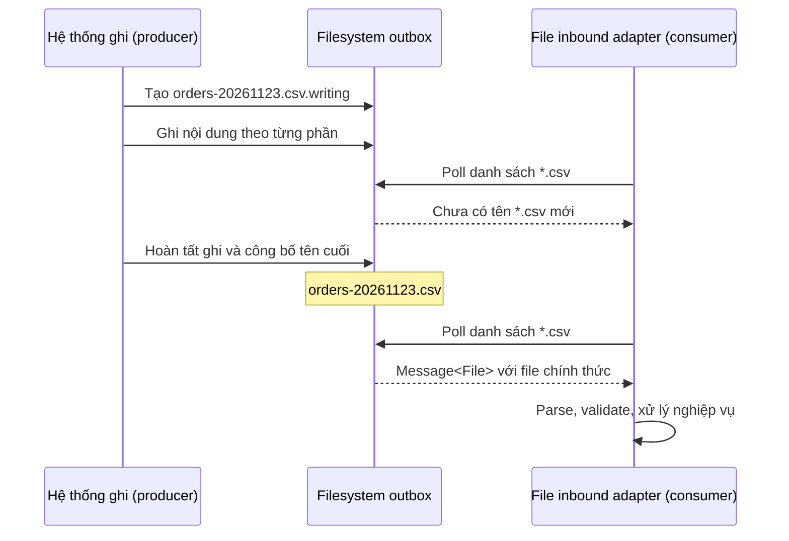
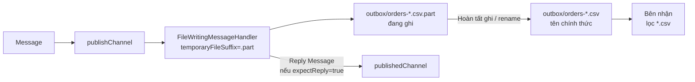

# Temporary file suffix và thao tác nguyên tử

## 1. Bài toán: tệp xuất hiện khi chưa ghi xong

Trong module **SPRING_INTEGRATION_ADAPTERS**, Spring Integration kết nối các hệ thống ngoài thông qua inbound/outbound adapter, gateway, poller và `MessageChannel`. Khi trao đổi file, phần khó không chỉ là ghi được bytes ra đĩa: **bên nhận phải biết lúc nào file đã hoàn tất để bắt đầu xử lý**. Bài này thuộc chương **Adapter file**, tập trung vào `temporary file suffix`, cơ chế công bố tệp và giới hạn của tính nguyên tử trên filesystem.

Giả sử ứng dụng A xuất báo cáo đơn hàng dài 100 MB. Ứng dụng B chạy File inbound adapter quét thư mục chung mỗi giây:

```text
data/outbox/
└── orders-20261123.csv
```

Nếu A tạo ngay `orders-20261123.csv` rồi mất 30 giây để ghi toàn bộ nội dung, B có thể nhìn thấy tên tệp ở giây thứ nhất và **đọc một báo cáo chưa hoàn chỉnh**. Bộ lọc `*.csv` chỉ kiểm tra tên; nó không biết writer đã đóng luồng dữ liệu.

Quy ước tốt hơn là ghi dưới **tên tạm**:

```text
Giai đoạn 1: orders-20261123.csv.writing    (đang ghi)
Giai đoạn 2: orders-20261123.csv            (đã công bố)
```

Reader chỉ chọn `*.csv`, không chọn `*.writing`. Đến khi writer hoàn tất ghi và đổi tên, file mới trở thành ứng viên xử lý.

### Mục tiêu học tập

Sau bài này, bạn sẽ:

- Mô tả cơ chế **write temporary → rename final** trong Spring Integration File.
- Dùng `FileWritingMessageHandler.setTemporaryFileSuffix(...)` để tùy chỉnh hậu tố tạm.
- Phân biệt **atomic visibility của một lần rename** với **durability, exactly-once và transaction toàn luồng**.
- Hiểu ảnh hưởng của `FileExistsMode`, đặc biệt `REPLACE`, `FAIL`, `IGNORE`, `APPEND` và `APPEND_NO_FLUSH`.
- Phối hợp bên ghi và File inbound adapter của bên đọc qua hợp đồng tên file.
- Nhận diện file tạm còn sót sau crash, xung đột tên, cạnh tranh giữa writers và rủi ro network filesystem.
- Thiết kế retry, phục hồi, monitoring, kiểm thử và bảo vệ đường dẫn đầu ra.

## 2. Sự khác nhau giữa file chưa hoàn chỉnh và file đã sẵn sàng

Quá trình xuất file thường có ba thời điểm:

1. **Bắt đầu ghi:** file bắt đầu xuất hiện và kích thước tăng dần.
2. **Ghi xong:** ứng dụng đóng stream hoặc hoàn tất thao tác write.
3. **Công bố:** file có tên chính thức mà bên nhận được phép xử lý.

Với tên tạm, ba thời điểm này được tách rõ hơn. Bên nhận không cần đoán rằng file đủ cũ hoặc kích thước không đổi trong vài giây là đã hoàn tất.



**Hậu tố tạm là một quy ước phối hợp giữa writer và reader**, không phải một transaction nghiệp vụ. Reader vẫn phải kiểm tra file có thể đọc được, schema hợp lệ và nội dung đầy đủ theo hợp đồng.

## 3. FileWritingMessageHandler và temporary file suffix

Spring Integration File dùng `FileWritingMessageHandler` để ghi các payload `File`, `String`, `byte[]` và `InputStream` vào filesystem. Nó có thể là:

| Cấu hình | Ý nghĩa |
| --- | --- |
| File outbound **channel adapter** | Ghi tệp rồi kết thúc bước xuất; `expectReply=false` |
| File outbound **gateway** | Ghi tệp rồi phát reply message với payload `File` đích; `expectReply=true` |

Với thao tác tạo/ghi file thông thường, handler mặc định dùng hậu tố tạm **`.writing`**. Java API cho phép đổi:

```java
FileWritingMessageHandler handler =
        new FileWritingMessageHandler(new File("data/outbox"));

handler.setTemporaryFileSuffix(".part");
```

Đối với tệp có tên đích `orders-20261123.csv`, file đang ghi sẽ xuất hiện dưới tên `orders-20261123.csv.part` và được công bố bằng tên cuối khi handler hoàn tất.

Trong XML namespace, cả file outbound channel adapter và outbound gateway đều có thuộc tính `temporary-file-suffix`. Với Java DSL, `FileWritingMessageHandlerSpec` hỗ trợ `temporaryFileSuffix(...)`. Ví dụ Java config trong bài sử dụng trực tiếp `setTemporaryFileSuffix` để tránh phụ thuộc cú pháp của một DSL cụ thể.

### Các thành phần trong luồng



`FileHeaders.FILENAME` thường được dùng để xác định **tên file đích** thông qua `FileNameGenerator`. Đây là tên, không phải cơ chế xác thực đường dẫn. Thư mục đầu ra được cấu hình ở handler hoặc qua directory expression; không nên nhận đường dẫn ghi tùy ý từ nguồn không tin cậy.

## 4. “Nguyên tử” nghĩa là gì trong trường hợp này?

**Atomic operation** nghĩa là một thao tác được nhìn thấy như một bước không thể chia nhỏ trong phạm vi bảo đảm của hệ thống: bên quan sát không thấy trạng thái trung gian của **chính thao tác đó**.

Ví dụ, nếu filesystem hỗ trợ atomic rename và quá trình ghi diễn ra trong vùng phù hợp:

```text
Trước rename: orders.csv.part tồn tại; orders.csv chưa xuất hiện
Sau rename:   orders.csv xuất hiện; tên .part không còn
```

Reader quét tên chính thức có thể tránh nhìn thấy một **bản ghi dở** thông qua tên chính thức. Nhưng điều này **không đồng nghĩa**:

- Việc ghi 100 MB dữ liệu là một thao tác nguyên tử.
- File chắc chắn đã `fsync`/được ghi bền vững xuống thiết bị lưu trữ.
- Một rename qua hai filesystem/volume khác nhau cũng nguyên tử.
- Mọi network filesystem, Windows share hay công cụ đồng bộ đều có cùng semantics.
- Consumer chỉ xử lý một lần hoặc database đã commit.
- Hai writer cùng xuất một tên file được phối hợp an toàn.

Đặt tên file tạm và đổi tên cuối là kỹ thuật **atomic publication** trong những điều kiện hỗ trợ; nó không biến tất cả I/O trong chuỗi thành một transaction duy nhất.

### Ba mức bảo đảm cần phân biệt

| Tính chất | Câu hỏi | Temporary suffix có giải quyết không? |
| --- | --- | --- |
| **Visibility** | Reader có nhìn thấy tên chính thức khi file còn đang ghi? | Giảm rủi ro rõ rệt khi writer chỉ công bố sau khi hoàn tất |
| **Durability** | Sau mất điện, bytes và tên file đã thực sự bền vững? | Không tự bảo đảm; phụ thuộc filesystem, flush/fsync và thiết bị |
| **Business atomicity** | Ghi file, ghi database, gửi broker có cùng commit/rollback? | Không; cần workflow phục hồi, idempotency hoặc giao thức khác |

Spring Integration hỗ trợ quá trình ghi qua tên tạm rồi rename; mức **nguyên tử thực tế** của việc công bố phải kiểm chứng trên hệ điều hành, filesystem và đường dẫn triển khai. Không hứa “mọi file luôn an toàn” chỉ vì có `.writing`.

## 5. Cấu hình Spring Boot hoàn chỉnh: ghi file qua hậu tố tạm

Ví dụ sử dụng Java 17+, Spring Boot và Spring Integration File. Trong Maven, sử dụng các dependency được Spring Boot quản lý phiên bản:

```xml
<dependencies>
    <dependency>
        <groupId>org.springframework.boot</groupId>
        <artifactId>spring-boot-starter-integration</artifactId>
    </dependency>
    <dependency>
        <groupId>org.springframework.integration</groupId>
        <artifactId>spring-integration-file</artifactId>
    </dependency>
</dependencies>
```

Đoạn Java dưới đây gồm một channel nhận message, một file outbound gateway và một consumer nhận `File` sau khi ghi:

```java
import java.io.File;
import java.nio.charset.StandardCharsets;

import org.springframework.beans.factory.annotation.Qualifier;
import org.springframework.boot.ApplicationRunner;
import org.springframework.context.annotation.Bean;
import org.springframework.context.annotation.Configuration;
import org.springframework.integration.annotation.ServiceActivator;
import org.springframework.integration.channel.DirectChannel;
import org.springframework.integration.config.EnableIntegration;
import org.springframework.integration.file.FileHeaders;
import org.springframework.integration.file.FileWritingMessageHandler;
import org.springframework.integration.file.support.FileExistsMode;
import org.springframework.messaging.MessageChannel;
import org.springframework.messaging.support.MessageBuilder;

@Configuration
@EnableIntegration
public class AtomicFilePublishConfig {

    @Bean
    public MessageChannel publishChannel() {
        return new DirectChannel();
    }

    @Bean
    public MessageChannel publishedChannel() {
        return new DirectChannel();
    }

    @Bean
    @ServiceActivator(
        inputChannel = "publishChannel",
        outputChannel = "publishedChannel"
    )
    public FileWritingMessageHandler writeReportGateway() {
        FileWritingMessageHandler handler =
                new FileWritingMessageHandler(new File("data/outbox"));

        handler.setAutoCreateDirectory(true);
        handler.setExpectReply(true);
        handler.setFileExistsMode(FileExistsMode.FAIL);
        handler.setTemporaryFileSuffix(".part");

        // Khong cho message ben ngoai chi dinh duong dan tuy y.
        handler.setFileNameGenerator(message -> {
            Object raw = message.getHeaders()
                    .get(FileHeaders.FILENAME);
            if (raw instanceof String name
                    && name.matches("orders-[0-9]{8}\\.csv")) {
                return name;
            }
            throw new IllegalArgumentException(
                    "Invalid report file name"
            );
        });
        return handler;
    }

    @ServiceActivator(inputChannel = "publishedChannel")
    public void onReportPublished(File completedFile) {
        System.out.println(
                "Published: " + completedFile.getAbsolutePath()
        );
        // Co the ghi metric, audit hoac phat event thong bao.
    }

    @Bean
    public ApplicationRunner sendSample(
            @Qualifier("publishChannel") MessageChannel channel) {
        return args -> {
            String csv = "id,total\n"
                    + "ORD-001,150000\n"
                    + "ORD-002,220000\n";

            boolean accepted = channel.send(
                    MessageBuilder
                            .withPayload(
                                    csv.getBytes(StandardCharsets.UTF_8)
                            )
                            .setHeader(
                                    FileHeaders.FILENAME,
                                    "orders-20261123.csv"
                            )
                            .build()
            );
            if (!accepted) {
                throw new IllegalStateException(
                        "Message not accepted by publishChannel"
                );
            }
        };
    }
}
```

Lớp `AtomicFilePublishConfig` phải nằm trong phạm vi component scan của `@SpringBootApplication` hoặc được import vào context. Với bean handler trong Java config, Spring quản lý vòng đời endpoint; không cần tự gọi `handleMessage(...)`.

### Giải thích từng thiết lập

| Thiết lập | Tác dụng |
| --- | --- |
| `setAutoCreateDirectory(true)` | Tạo `data/outbox` nếu chưa tồn tại và có quyền |
| `setExpectReply(true)` | Gửi reply `Message<File>` khi thao tác ghi đã hoàn tất |
| `setTemporaryFileSuffix(".part")` | Dùng tên tạm `orders-20261123.csv.part` khi ghi |
| `setFileExistsMode(FileExistsMode.FAIL)` | Từ chối nếu tên đích đã tồn tại theo chính sách handler |
| `setFileNameGenerator(...)` | Chỉ cho phép một basename đúng hợp đồng, giảm rủi ro path traversal |
| `FileHeaders.FILENAME` | Tên file đầu ra do message xác định, qua kiểm tra của generator |

Ví dụ cố định tên `orders-20261123.csv` để dễ kiểm chứng. **Lần khởi động thứ hai** trong cùng thư mục, nếu file đích còn tồn tại, có thể thất bại vì `FAIL`. Đây là hành vi có chủ đích nhằm ngăn vô tình ghi đè, không phải lỗi của hậu tố tạm. Khi thử lại, hãy dùng tên báo cáo mới hoặc một thư mục test riêng.

### Vì sao dùng outbound gateway trong ví dụ?

Vì `expectReply=true`, bước `onReportPublished(...)` nhận đối tượng `File` của file kết quả. Nếu chỉ cần ghi rồi kết thúc, có thể đặt `expectReply=false` và bỏ `outputChannel` / consumer reply; lúc đó endpoint hoạt động như **file outbound channel adapter**. Trong cả hai kiểu, chính sách tên tạm áp dụng cho thao tác ghi tương ứng.

Không suy rằng reply nghĩa là đối tác bên ngoài đã nhận file. Reply nội bộ chỉ liên quan đến bước ghi của handler; phía nhận vẫn có thể đang tắt hoặc chưa poll được file.

## 6. Chạy thử và kiểm chứng tên file

Khởi động ứng dụng với thư mục `data/outbox` chưa có bản báo cáo cùng tên. Trong lúc ghi, có thể thấy tệp mang hậu tố `.part`; sau khi hoàn tất, trạng thái kỳ vọng:

```text
data/outbox/
└── orders-20261123.csv
```

Nội dung kỳ vọng:

```csv
id,total
ORD-001,150000
ORD-002,220000
```

Ví dụ khá nhỏ nên thao tác ghi có thể hoàn tất trước khi bạn kịp quan sát file `.part`. Không thấy file tạm bằng mắt thường **không có nghĩa** cơ chế tên tạm đã bị bỏ qua.

### Các phép thử nên làm

1. **Thư mục trống:** chạy ứng dụng và kiểm tra chỉ còn tên chính thức khi thao tác thành công.
2. **Tên file trùng:** giữ `orders-20261123.csv` rồi chạy lại. Kỳ vọng báo lỗi theo `FileExistsMode.FAIL`.
3. **Tên không hợp lệ:** đổi header `FileHeaders.FILENAME` thành `../config.yml`. Generator phải từ chối trước khi ghi.
4. **Hậu tố khác:** thay `setTemporaryFileSuffix(".part")` bằng `setTemporaryFileSuffix(".writing")`; tên tạm thay đổi, tên chính thức không thay đổi.
5. **File lớn:** gửi payload có kích thước lớn hơn, cho một reader quan sát thư mục liên tục; xác minh reader chỉ nhận `*.csv` khi file hoàn tất.
6. **Disk full/quyền ghi:** chạy trên vùng test có quyền hoặc dung lượng được kiểm soát; quan sát exception và việc file tạm có thể còn tồn tại sau lỗi.

> Đoạn mã trên là ví dụ cấu hình, không phải bản ghi kết quả từ một lần chạy. Không cố gây lỗi ổ đĩa hoặc xóa file trên môi trường production để kiểm thử.

## 7. Phối hợp với File inbound adapter ở phía nhận

Reader phải **cùng hiểu quy ước tên file**. Ví dụ cấu hình `FileReadingMessageSource` chỉ nhận `*.csv`:

```java
import java.io.File;

import org.springframework.integration.file.FileReadingMessageSource;
import org.springframework.integration.file.filters.ChainFileListFilter;
import org.springframework.integration.file.filters.SimplePatternFileListFilter;
import org.springframework.integration.file.filters.AcceptOnceFileListFilter;

FileReadingMessageSource source = new FileReadingMessageSource();
source.setDirectory(new File("data/outbox"));

ChainFileListFilter<File> filters = new ChainFileListFilter<>();
filters.addFilter(new SimplePatternFileListFilter("*.csv"));
filters.addFilter(new AcceptOnceFileListFilter<>());
source.setFilter(filters);
```

Đây là **đoạn cấu hình nguồn nhận** cần được đặt trong một inbound endpoint có poller hoặc IntegrationFlow riêng; nó không phải bean thứ hai bắt buộc trong ứng dụng ghi ở mục 5.

| File nhìn thấy ở outbox | Kết quả của `*.csv` | Lý do |
| --- | --- | --- |
| `orders-20261123.csv.part` | Bỏ qua | Tên kết thúc bằng `.part` |
| `orders-20261123.csv.writing` | Bỏ qua | Tên kết thúc bằng `.writing` |
| `orders-20261123.csv` | Chấp nhận | Đúng phần mở rộng `.csv` |
| `orders-20261123.csv.bak` | Bỏ qua | Có hậu tố `.bak` |
| `readme.txt` | Bỏ qua | Không đúng định dạng tên |

`AcceptOnceFileListFilter` hạn chế phát lại cùng file trong phiên chạy; **không xác nhận** file đã được parse/ghi database thành công. Nếu cần giữ lịch sử qua restart, dùng metadata store bền vững và lưu trạng thái nghiệp vụ riêng.

### Trường hợp writer không do Spring Integration quản lý

Nếu đối tác khác ghi file trực tiếp dưới tên `*.csv` ngay từ đầu, bộ lọc `*.csv` **không đủ** ngăn file đọc dở. Hai hệ thống phải thống nhất kỹ thuật công bố, ví dụ:

- Ghi `*.tmp` rồi rename thành `*.csv` sau khi đóng file.
- Chỉ tạo marker `*.done` sau khi ghi tệp dữ liệu thành công; reader kiểm tra marker.
- Khi không thể thay đổi phía gửi, cân nhắc filter thời gian sửa cuối hoặc cơ chế xác định file ổn định; đây chỉ là biện pháp giảm rủi ro, không phải xác nhận tuyệt đối.

Trong Spring Integration có `FileSystemMarkerFilePresentFileListFilter` dành cho kiểu hợp đồng marker file. Khi dùng marker, cần nêu rõ naming convention, thời điểm tạo marker, quy trình xóa/đổi marker và cách xử lý marker còn sót từ phiên trước.

## 8. FileExistsMode và tương tác với suffix

`FileExistsMode` quyết định điều gì xảy ra nếu tên file đầu ra đã tồn tại. Chọn sai mode có thể phá hỏng mục tiêu “chỉ công bố bản hoàn chỉnh”.

| Mode | Hành vi đối với file đích | Liên hệ với tên tạm |
| --- | --- | --- |
| `REPLACE` | Thay nội dung file đích; mặc định | Thường ghi bản tạm rồi công bố; cần hiểu tác động thay bản đã có đối với reader |
| `REPLACE_IF_MODIFIED` | Ghi lại khi timestamp nguồn và đích khác theo quy tắc handler | Dựa trên thời gian sửa file, không phải checksum |
| `FAIL` | Ném exception nếu đích đã tồn tại | Tránh ghi đè im lặng; cần xử lý retry và xung đột tên |
| `IGNORE` | Bỏ qua payload mới khi đích đã tồn tại | Khi dùng suffix tạm, có thể bỏ qua nếu **tên cuối hoặc tên tạm** đã tồn tại |
| `APPEND` | Nối dữ liệu trực tiếp vào file hiện tại | **Bỏ qua temporary-file-suffix**; file đích có thể được đọc giữa các lượt append |
| `APPEND_NO_FLUSH` | Append nhưng không flush/đóng sau mỗi message | Không cung cấp ranh giới công bố từng message bằng rename; có rủi ro mất dữ liệu chưa flush |

### IGNORE và tệp tạm còn sót

Giả sử trước đó ứng dụng bị tắt giữa lúc ghi:

```text
data/outbox/
└── orders-20261123.csv.part
```

Khi retry với `FileExistsMode.IGNORE`, handler có thể **bỏ qua payload mới vì file tạm còn tồn tại**, dù chưa có tên cuối `orders-20261123.csv`. Do vậy, không nên dùng IGNORE làm cơ chế tự khôi phục một file bị ghi dở.

Một tệp `.part` tồn tại lâu cần được điều tra: writer nào sở hữu, tiến trình còn chạy không, file có đang mở, kích thước/checksum ra sao? Không tự động rename một file tạm chưa xác minh thành tên cuối.

### FAIL và REPLACE khác nhau thế nào?

- Với `FAIL`, một file chính thức cùng tên xuất hiện trước khiến lần ghi mới thất bại. Phù hợp mô hình **mỗi report ID có một file bất biến**.
- Với `REPLACE`, writer có thể phát hành bản cập nhật cùng tên. Reader đã mở file cũ hoặc đang đọc có thể nhìn thấy hành vi khác nhau theo nền tảng; phải thiết kế versioning, reader locking hoặc quy trình thay thế.
- Với `REPLACE_IF_MODIFIED`, timestamp có thể được lấy từ payload `File` hoặc `FileHeaders.SET_MODIFIED` cho payload khác. Thời gian sửa cuối không đồng nghĩa file có cùng nội dung; kiểm tra checksum khi cần.

Trong hệ thống có nhiều đối tác, nên đưa **report ID hoặc version** vào tên tệp, rồi dùng `FAIL` để tránh va chạm. Dùng `REPLACE` chỉ khi hợp đồng cho phép thay thế bản đã công bố.

## 9. APPEND: không có ranh giới rename cho mỗi bản ghi

Ví dụ một message `String` được append vào `daily-events.csv`:

```java
handler.setFileExistsMode(FileExistsMode.APPEND);
handler.setTemporaryFileSuffix(".part"); // Khong co tac dung voi APPEND
```

Ở chế độ này, dữ liệu được nối trực tiếp vào file hiện có. Một reader quét file có thể thấy **một phần bản ghi mới** nếu writer chưa hoàn tất lượt append. `APPEND_NO_FLUSH` còn giữ buffer/file mở, nhằm tăng throughput nhưng có thể mất nội dung chưa flush khi process gặp lỗi.

Nếu muốn một file chứa nhiều message nhưng reader chỉ đọc sau khi **toàn bộ batch** hoàn tất, nên dùng một trong các cách:

1. Writer tổng hợp batch trong bộ nhớ hoặc một tệp staging riêng, sau đó xuất một **file cuối** qua rename.
2. Writer append vào tệp staging, đóng file khi batch hoàn tất rồi tự công bố tên cuối bằng cơ chế filesystem đã được kiểm chứng.
3. Writer phát marker `*.done` theo hợp đồng, reader chỉ bắt đầu xử lý khi marker có mặt.

Chỉ gắn suffix vào handler đang dùng `APPEND` sẽ không tạo ra hàng rào “đã ghi xong” ở mỗi lượt message.

## 10. Có thể cần atomic move thật sự bằng Java NIO

Khi một ứng dụng **không sử dụng FileWritingMessageHandler** mà tự ghi file, Java NIO cho phép yêu cầu atomic rename:

```java
import java.io.IOException;
import java.nio.charset.StandardCharsets;
import java.nio.file.AtomicMoveNotSupportedException;
import java.nio.file.Files;
import java.nio.file.Path;
import java.nio.file.StandardCopyOption;

Path outbox = Path.of("data/outbox").toAbsolutePath().normalize();
Files.createDirectories(outbox);

Path staging = outbox.resolve("orders-20261123.csv.part");
Path published = outbox.resolve("orders-20261123.csv");

// Demo chi chay khi ten staging va published duoc quan ly rieng.
Files.writeString(staging, "id,total\nORD-001,150000\n",
        StandardCharsets.UTF_8);

try {
    Files.move(staging, published, StandardCopyOption.ATOMIC_MOVE);
} catch (AtomicMoveNotSupportedException ex) {
    throw new IOException(
            "Filesystem khong ho tro atomic move; khong cong bo file",
            ex
    );
}
```

Đây là **ví dụ riêng của Java NIO**, không phải cấu hình bắt buộc để FileWritingMessageHandler hoạt động. Khi chỉ định `ATOMIC_MOVE`, ứng dụng yêu cầu filesystem thực hiện move nguyên tử. Nếu không hỗ trợ, ví dụ **từ chối công bố** thay vì âm thầm chuyển sang thao tác không nguyên tử.

Cần hiểu các giới hạn:

- Đặt staging và published **cùng một filesystem** là điều kiện thực tế quan trọng; di chuyển giữa các volume thường không hỗ trợ atomic move.
- Với `ATOMIC_MOVE`, cách xử lý khi **file đích đã tồn tại** có thể phụ thuộc implementation. Không dùng riêng đoạn mẫu như một cơ chế bảo đảm không ghi đè trong môi trường có nhiều writer.
- Nếu nhiều writer có thể dùng cùng tên staging, cần tên staging riêng cho từng phiên và quyền sở hữu/locking, rồi xác nhận ai được phép công bố tên cuối.
- `ATOMIC_MOVE` **không tự đồng bộ bytes và metadata xuống thiết bị lưu trữ**. Nếu cần durability trước mất điện, phải nghiên cứu flush/fsync file và directory tương ứng với nền tảng.
- `Files.writeString` trong ví dụ có thể ghi lại nội dung staging nếu đã tồn tại. Chỉ chạy với đường dẫn dành riêng cho test; với production, ưu tiên tạo staging bằng tên duy nhất và `CREATE_NEW`.

**Điểm chính:** FileWritingMessageHandler quản lý quy ước tệp tạm cho luồng integration; Java NIO có lựa chọn yêu cầu atomic move ở cấp API. Hai cách tiếp cận đều không tự tạo transaction bao phủ xử lý database hay broker.

## 11. Crash và retry: các trạng thái cần phân biệt

Giả sử ứng dụng bị dừng ở các thời điểm khác nhau:

| Thời điểm lỗi | Trạng thái file có thể còn lại | Phương án xử lý |
| --- | --- | --- |
| Trước khi bắt đầu ghi | Chưa có file tạm hoặc file cuối | Retry với cùng report ID |
| Đang ghi file tạm | `*.part` chưa hoàn chỉnh | Điều tra writer, dọn/ghi lại sau khi xác nhận không còn sử dụng |
| Hoàn tất ghi nhưng chưa rename | File tạm có thể đầy đủ, tên cuối chưa có | Kiểm tra checksum/size và điều kiện công bố trước khi retry |
| Rename thành công nhưng app crash trước khi ghi trạng thái DB | File cuối tồn tại, DB chưa phản ánh kết quả | Đối chiếu file/report ID và cập nhật trạng thái idempotent |
| File cuối được đối tác đọc nhưng chưa ACK | Producer không biết đối tác đã xử lý | Cần ACK riêng, thời gian chờ và reconciliation |
| Hai writer cùng dùng một tên | Va chạm file tạm/đích, có thể ghi đè hoặc thất bại | Thống nhất ownership, tên duy nhất và quy tắc cạnh tranh |

### Recovery không phải “rename mọi file .part”

Không thể suy rằng file `*.part` nào cũng đã ghi xong. Một file tạm có thể bị cắt giữa dòng CSV hoặc chưa flush. Cần tối thiểu:

1. Xác định writer đã chết hay vẫn đang hoạt động (PID, lease/lock hoặc trạng thái điều phối).
2. Đối chiếu report ID, kích thước dự kiến, checksum hoặc số bản ghi.
3. Kiểm tra tên cuối đã tồn tại hay chưa và có cùng phiên bản dữ liệu không.
4. Nếu dữ liệu không đáng tin cậy, cách ly file tạm và chạy lại từ nguồn bền vững.
5. Nếu đủ điều kiện công bố, thực hiện thao tác có kiểm soát, ghi audit và trạng thái nghiệp vụ.

Quy tắc cleanup tự động phải tránh xóa file tạm của một writer còn đang chạy; chỉ dựa vào “file cũ hơn N phút” có thể sai nếu file xuất rất lớn hoặc I/O đang tắc.

## 12. Tính nguyên tử, idempotency và trạng thái nghiệp vụ

Một quy trình xuất bản báo cáo có thể có trạng thái:

```text
CREATED -> WRITING_TEMP -> PUBLISHED -> ACKNOWLEDGED
               |
               +----> FAILED / RETRY_PENDING
```

Trong đó:

- `WRITING_TEMP`: writer đang chuẩn bị nội dung; file chưa sẵn sàng cho đối tác.
- `PUBLISHED`: tên cuối đã được công bố theo điều kiện filesystem.
- `ACKNOWLEDGED`: đối tác **đã xác nhận nhận/xử lý** theo một giao thức riêng; không suy ra từ file rename.
- `FAILED`: lỗi kỹ thuật hoặc nghiệp vụ cần xử lý/điều tra.

Với mỗi báo cáo, nên lưu `reportId`, `version`, `targetFile`, `checksum`, `status`, `attemptCount` và `lastError`. Khi retry, trước khi ghi lại:

1. Kiểm tra đã có file cuối chưa.
2. Nếu đã có, so khớp report ID/checksum và trạng thái.
3. Nếu đúng bản mong đợi, có thể coi bước công bố là hoàn tất thay vì ghi đè.
4. Nếu không khớp, dừng và báo xung đột; không dùng `IGNORE` để che lỗi.

Không có transaction nguyên tử chung giữa **ghi file, cập nhật database và gửi thông báo Kafka/JMS/AMQP** chỉ nhờ suffix tạm. Nếu cần độ tin cậy cao, dùng workflow phục hồi, outbox pattern hoặc nguồn message có replay/ack phù hợp với từng endpoint.

## 13. Các vấn đề về hiệu năng, khóa và bảo mật

### Nhiều writer và tên tạm trùng nhau

Nếu hai instance cùng tạo `orders-20261123.csv.part`, việc gắn suffix không phân chia ownership. Handler với `FileExistsMode.FAIL` giúp phát hiện va chạm, nhưng tính đúng đắn trong tình huống race còn phụ thuộc filesystem và lock. Nên có một writer cho mỗi report ID hoặc dùng tên staging duy nhất theo execution ID, cùng một bước công bố đã được điều phối.

### Directory và filename không tin cậy

`FileHeaders.FILENAME` có thể đến từ message của đối tác. Không dùng trực tiếp tên chứa `../`, dấu phân cách path hoặc absolute path. Ví dụ trong bài chỉ chấp nhận `orders-[0-9]{8}\\.csv`. Với thư mục động, ánh xạ mã đối tác sang whitelist root; kiểm tra đường dẫn chuẩn hóa, real path và chính sách symlink.

### Network filesystem

Trên NFS/SMB hoặc thư mục đồng bộ cloud, **rename, cache metadata và thời điểm các client nhìn thấy file** có thể khác filesystem cục bộ. Các hệ thống có cache hoặc đồng bộ bất đồng bộ có thể khiến tên cuối xuất hiện trễ hoặc xuất hiện trong trạng thái bất ngờ. Kiểm thử bằng đúng loại mount/OS sử dụng ở production và thu thập metric về độ trễ publish → consume.

### Throughput và file lớn

Với file lớn, cách ghi/đọc trực tiếp bằng `byte[]` làm tăng bộ nhớ JVM. Có thể chọn payload `File` hoặc `InputStream` khi phù hợp, nhưng phải quản lý quyền sở hữu stream, khả năng retry và vòng đời file nguồn. Nếu sau ghi muốn trả đường dẫn file đích, cấu hình outbound gateway; nếu chỉ cần publish mà không cần reply, dùng channel adapter.

## 14. Troubleshooting

| Hiện tượng | Nguyên nhân có thể | Cách xử lý |
| --- | --- | --- |
| Reader nhận file chưa hoàn chỉnh | Writer ghi trực tiếp vào tên cuối hoặc reader không loại tên tạm | Thống nhất temp suffix/marker và filter đầu vào |
| Không thấy file tạm trong lúc thử | File nhỏ được ghi quá nhanh | Kiểm tra tên cuối và cấu hình; thử file lớn trong test |
| Chỉ thấy `*.part`, không thấy tên cuối | Writer gặp lỗi, bị dừng hoặc rename không thành công | Kiểm tra exception, quyền, dung lượng, filesystem |
| Retry không ghi lại file | `FAIL` hoặc `IGNORE` và file cuối/tạm tồn tại | Đối chiếu trạng thái, không xóa/đổi tên mù quáng |
| APPEND vẫn bị reader đọc dở | `APPEND` bỏ qua temporary suffix | Dùng batch staging hoặc marker file |
| File cuối tồn tại nhưng DB báo chưa xuất | Crash sau rename trước cập nhật DB | Recovery theo report ID/checksum |
| Hai pod viết cùng một file | Chưa có ownership, tên staging không duy nhất | Điều phối một writer, khóa và quy tắc publish |
| Đổi tên lỗi trên network share | Hạn chế rename, quyền, mount hoặc lock | Kiểm thử trực tiếp và thay quy ước publish nếu cần |
| Đối tác chưa thấy file dù handler đã trả reply | Đối tác chưa poll, cache hoặc network delay | Phân biệt reply nội bộ và ACK bên nhận |

## 15. Bài tập thực hành

1. **Hậu tố mặc định:** bỏ `setTemporaryFileSuffix(".part")` và giải thích tên `.writing` mà handler sử dụng.
2. **Hậu tố tùy chỉnh:** dùng `.uploading`, thêm reader chỉ nhận `*.csv` và kiểm tra file tạm không được chọn.
3. **Xung đột tên:** gửi hai message tạo cùng `orders-20261123.csv` với `FAIL`. Quan sát lỗi và thiết kế quy tắc report ID duy nhất.
4. **Chế độ IGNORE:** thử khi chỉ còn tệp `.part`; giải thích vì sao lần ghi mới có thể bị bỏ qua theo chính sách handler.
5. **Chế độ APPEND:** đổi sang `APPEND`, gửi nhiều dòng và quan sát file cuối tăng trực tiếp; xác định điểm khác so với ghi qua file tạm.
6. **Phục hồi sau crash:** giả lập (trong vùng test) file tạm cũ và file cuối đã tồn tại, đề xuất thuật toán kiểm tra checksum trước retry.
7. **Atomic move ở NIO:** chạy `Files.move(..., ATOMIC_MOVE)` trên filesystem được phép thử; ghi nhận xử lý khi không hỗ trợ.
8. **Lỗi đường dẫn:** gửi header `FILENAME` có `../secret.csv` hoặc dấu phân cách thư mục; xác minh generator từ chối.
9. **Reader restart:** để file chính thức trong outbox, khởi động lại reader dùng accept-once trong bộ nhớ, đánh giá rủi ro xử lý lặp và cách lưu metadata bền vững.
10. **Kết nối broker:** thiết kế luồng sau publish gửi event lên Kafka/JMS. Chỉ ra khoảng hở nếu app crash giữa rename và publish event, đề xuất cơ chế reconciliation.

### Câu hỏi tự kiểm tra

**Q1. Temporary file suffix mặc định trong file outbound handler là gì?**  
Thông thường là `.writing`, có thể thay bằng `setTemporaryFileSuffix(...)`.

**Q2. Vì sao một reader lọc `*.csv` thường bỏ qua file đang được ghi với hậu tố `.part`?**  
Vì tên tạm không kết thúc bằng `.csv`. Reader chỉ nhìn thấy tên cuối sau bước công bố.

**Q3. Hậu tố tạm có bảo đảm exactly-once qua nhiều instance không?**  
Không. Nó không quản lý cạnh tranh giữa writers, trạng thái DB hay ACK của bên nhận.

**Q4. `APPEND` có sử dụng hậu tố tạm theo cách ghi file mới không?**  
Không. `APPEND` ghi trực tiếp vào file đích và bỏ qua `temporary-file-suffix`.

**Q5. Tại sao không tự động rename tất cả file `*.part` còn sót?**  
Vì chúng có thể chưa ghi xong, chưa flush hoặc thuộc một writer vẫn đang chạy.

**Q6. `Files.move(..., ATOMIC_MOVE)` có thay thế transaction database không?**  
Không. Nó chỉ yêu cầu một thao tác move nguyên tử ở cấp filesystem; database và các broker vẫn độc lập.

## 16. Ghi nhớ

**Temporary file suffix** tạo một ranh giới **công bố file**: writer ghi với tên tạm như `.writing` hoặc `.part` và đổi sang tên cuối khi hoàn tất. Bên nhận chỉ chọn file mang tên chính thức để giảm nguy cơ đọc dữ liệu chưa ghi xong. Spring Integration File hỗ trợ điều này qua `FileWritingMessageHandler.setTemporaryFileSuffix(...)` cho các chế độ ghi thích hợp; `APPEND` không dùng cơ chế rename từ file tạm.

**Atomic rename không phải transaction end-to-end.** Độ tin cậy vẫn phụ thuộc vào filesystem, độ bền sau crash, chính sách tên file trùng, quyền truy cập, recovery, idempotency và xác nhận của hệ thống đích. Khi nối tiếp luồng sang SFTP, HTTP, JMS, AMQP, Kafka hay database, cần giữ hợp đồng message, lỗi và vòng đời kết nối rõ ràng ở từng ranh giới.

### Tài liệu tham khảo

- [Spring Integration Reference — Writing Files](https://docs.spring.io/spring-integration/reference/file/writing.html)
- [Spring Integration Reference — Reading Files, Dealing with Incomplete Data](https://docs.spring.io/spring-integration/reference/file/reading.html)
- [Spring Integration API — FileWritingMessageHandler](https://docs.spring.io/spring-integration/api/org/springframework/integration/file/FileWritingMessageHandler.html)
- [Java NIO Files.move và StandardCopyOption.ATOMIC_MOVE](https://docs.oracle.com/en/java/javase/17/docs/api/java.base/java/nio/file/Files.html#move(java.nio.file.Path,java.nio.file.Path,java.nio.file.CopyOption...))
