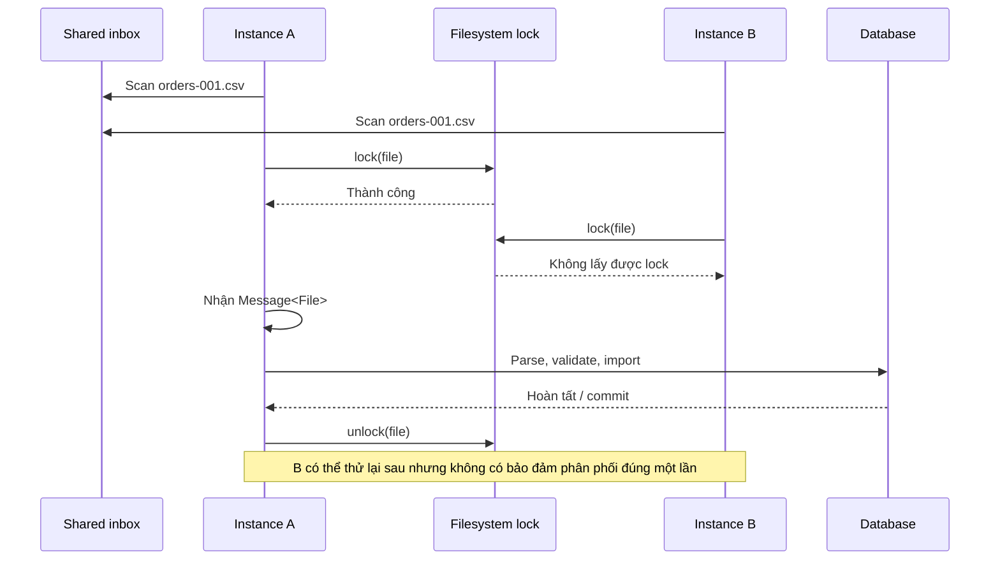
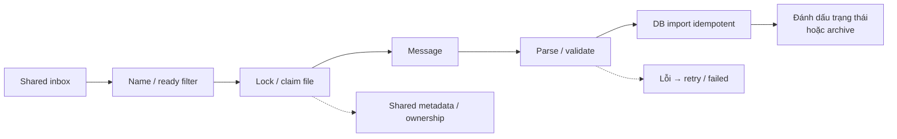

# File locking khi nhiều tiến trình cùng đọc

## 1. Bài toán: nhiều tiến trình nhìn thấy cùng một tệp

Module **SPRING_INTEGRATION_ADAPTERS** hướng dẫn kết nối hệ thống bên ngoài bằng inbound/outbound adapter, gateway, poller và `MessageChannel`; đồng thời xử lý hợp đồng message, lỗi và vòng đời kết nối. Trong chương **Adapter file**, một tình huống quan trọng là **nhiều ứng dụng hoặc nhiều instance cùng theo dõi một thư mục nhận file**.

Giả sử có hai instance của dịch vụ nhập đơn hàng:

```text
                  data/inbox/
                  orders-001.csv
                       |
            +----------+----------+
            |                     |
        Instance A            Instance B
        Poller 2s             Poller 2s
            |                     |
       Import DB?             Import DB?
```

Nếu cả A và B đều thấy `orders-001.csv`, hai tiến trình có thể cùng nhập các đơn hàng vào database. Hậu quả có thể là bản ghi trùng, cập nhật tồn kho hai lần hoặc hai thông báo thanh toán cho một đơn.

**File locking** giúp các tiến trình có phối hợp phân quyền đọc/xử lý file trong cùng khoảng thời gian. Trong Spring Integration File, thành phần mở rộng chính là `FileLocker`, với triển khai sẵn có `NioFileLocker` dựa trên Java NIO.

Sau bài học, bạn có thể:

- Mô tả vòng đời **tìm file → thử lấy lock → nhận message → xử lý → unlock**.
- Phân biệt `FileLocker`, `NioFileLocker`, `FileListFilter`, `AcceptOnceFileListFilter` và `MetadataStore`.
- Cấu hình `FileReadingMessageSource.setLocker(...)` trong một File inbound channel adapter.
- Gọi `FileLocker.unlock(File)` ở đúng thời điểm, kể cả khi consumer ném exception.
- Nhận diện giới hạn của lock giữa nhiều JVM, nhiều pod hoặc trên network filesystem.
- Thiết kế retry, cơ chế phân quyền sở hữu, file sẵn sàng, chống trùng và phục hồi sau crash.

## 2. FileLocker nằm ở đâu trong luồng Spring Integration?

`FileReadingMessageSource` quét một thư mục, chọn các file đủ điều kiện rồi phát từng `Message<File>` theo lịch của poller. Có thể cấu hình `FileLocker` vào nguồn để nó **cố gắng giữ lock trước khi file được nhận**.



Đây là một ví dụ về **phối hợp khi cùng đọc một file**, không phải giao thức phân phối message của Kafka hay JMS. Mặc dù Spring Integration lấy lock ở đầu vào, nó **không tự unlock file sau khi xử lý**: ứng dụng cần tự thực hiện điều đó khi không còn cần giữ lock.

### Vai trò của từng thành phần

| Thành phần | Làm gì? | Không làm gì? |
| --- | --- | --- |
| `FileReadingMessageSource` | Chọn file và phát `Message<File>` | Không xác nhận DB commit |
| `FileLocker` | Chiến lược kiểm tra, lấy và giải phóng lock trên file | Không bảo đảm exactly-once end-to-end |
| `NioFileLocker` | Dùng khóa file của Java NIO để phối hợp các tiến trình phù hợp | Không bắt buộc mọi phần mềm không hợp tác phải tuân thủ |
| `FileListFilter<File>` | Lọc theo tên, tuổi file, dấu vết đã chọn | Không giữ lock trong suốt transaction nghiệp vụ |
| `AcceptOnceFileListFilter` | Hạn chế phát lặp cùng file theo trạng thái bộ lọc | Không tự bền vững qua restart |
| `MetadataStore` | Lưu key/value về file đã chọn qua các lần poll hoặc restart | Không thay thế lock đang giữ hay trạng thái xử lý nghiệp vụ |

Thông thường, một hệ thống cần **nhiều cơ chế phối hợp**, không chỉ bật một công tắc lock.

## 3. Hợp đồng FileLocker

Interface `org.springframework.integration.file.FileLocker` có ba thao tác chính:

```java
public interface FileLocker {
    boolean isLockable(File file);
    boolean lock(File file);
    void unlock(File file);
}
```

- `isLockable(file)` dùng kiểm tra khả năng khóa theo logic của implementation; không tự thay đổi trạng thái giữ lock.
- `lock(file)` thử lấy lock, trả `true` khi thành công, `false` nếu không thể khóa theo chính sách; có thể phát sinh exception tùy implementation/hệ thống tệp.
- `unlock(file)` giải phóng lock đang giữ đối với file tương ứng.

**Interface không tự quy định một mức bảo đảm an toàn chung cho mọi implementation.** Khi viết `FileLocker` tùy chỉnh, phải định nghĩa rõ lock thuộc về ai, thời hạn bao lâu, cách xử lý cạnh tranh, lỗi mạng và giải phóng lock.

### NioFileLocker khác gì khóa của Java NIO?

`org.springframework.integration.file.locking.NioFileLocker` dùng `java.nio.channels.FileLock` để thực hiện chiến lược khóa file. File lock của NIO được thực thi theo semantics của hệ điều hành và filesystem.

Những điểm quan trọng:

1. Khóa NIO nhìn chung có ý nghĩa **giữa các tiến trình** phối hợp thông qua cơ chế OS, nhưng không nhất thiết ngăn một chương trình khác đọc file nếu chương trình đó không tham gia cơ chế khóa.
2. Lock của `FileChannel` thuộc phạm vi JVM theo đặc tính của Java NIO. `NioFileLocker` **không nên được coi là cách chống chọn trùng giữa các nguồn khác nhau trong cùng JVM** nếu mỗi nguồn dùng locker tách biệt. Nếu nhiều `FileReadingMessageSource` ở cùng JVM cần phối hợp, dùng một locker dùng chung và bộ lọc/trạng thái phù hợp.
3. Cơ chế này có thể giữ tài nguyên `FileLock` và `FileChannel` trong khi khóa tồn tại. Quên `unlock` sau xử lý có thể giữ tài nguyên và gây rò rỉ bộ nhớ/tài nguyên.
4. Việc khóa nhiều file đồng thời có chi phí; không mặc định phù hợp với hàng chục nghìn file đang xử lý cùng lúc.

**Không nhầm “có lock” với “file đã ghi xong”.** Một chương trình ghi file không sử dụng cùng quy ước khóa vẫn có thể ghi vào file đang được đọc, tùy filesystem. Khi trao đổi file, phía ghi nên dùng tên tạm `*.writing` rồi đổi thành tên cuối sau khi ghi hoàn tất.

## 4. Lấy lock và mở lock: ai chịu trách nhiệm?

Khi File inbound adapter được cấu hình với locker, Spring Integration **nhận trách nhiệm thử lấy lock trước khi cho file được nhận**. Nhưng Spring Integration **không nhận trách nhiệm giải phóng lock** sau khi toàn bộ nghiệp vụ hoàn tất.

Ứng dụng phải xác định thời điểm hợp lý:

```text
File sẵn sàng
    |
    v
Thử lock(file) -- thất bại --> không nhận vào luồng tại thời điểm đó
    |
    v
Đọc file / validate / cập nhật nghiệp vụ
    |
    +--> Thành công --> unlock(file)
    |
    +--> Exception  --> ghi lỗi / đánh dấu trạng thái --> unlock(file)
```

Với consumer **đồng bộ**, nên giải phóng lock trong `finally` sau khi đã xử lý xong hoặc xác định lỗi:

```java
try {
    // Đọc và xử lý file đã được khóa.
} finally {
    fileLocker.unlock(file);
}
```

Nếu consumer chuyển công việc sang executor, queue hay một workflow **bất đồng bộ**, không unlock ngay sau khi enqueue rồi tuyên bố file đã được xử lý. Cần xác định **ai sở hữu lock** và lúc nào công việc thực sự kết thúc; đặc biệt, khóa dựa trên `FileLock` không nên bị giữ vô hạn trong khi consumer chờ dịch vụ ngoài.

Trong hệ thống xử lý file lớn, khóa filesystem có thể chỉ được giữ trong giai đoạn **đọc hoặc claim file**; công việc xử lý nghiệp vụ lâu dài nên dùng trạng thái bền vững và quyền sở hữu riêng.

## 5. Ví dụ Spring Boot: khóa file trước khi nhập CSV

Ví dụ dùng Java 17+ và Spring Boot quản lý phiên bản Spring Integration. Maven:

```xml
<dependencies>
    <dependency>
        <groupId>org.springframework.boot</groupId>
        <artifactId>spring-boot-starter-integration</artifactId>
    </dependency>
    <dependency>
        <groupId>org.springframework.integration</groupId>
        <artifactId>spring-integration-file</artifactId>
    </dependency>
</dependencies>
```

Tệp đầu vào: `data/inbox/orders-001.csv`, có nội dung:

```csv
order_id,amount
ORD-001,120000
ORD-002,95000
```

Ví dụ cấu hình một `NioFileLocker` dùng chung cho source và consumer. Poller lấy tối đa hai file mỗi lần, channel và consumer đồng bộ. Consumer đếm số dòng thay vì ghi DB để có thể quan sát khóa an toàn trên dữ liệu test.

```java
import java.io.BufferedReader;
import java.io.File;
import java.io.IOException;
import java.io.UncheckedIOException;
import java.nio.charset.StandardCharsets;
import java.nio.file.Files;

import org.springframework.context.annotation.Bean;
import org.springframework.context.annotation.Configuration;
import org.springframework.integration.annotation.InboundChannelAdapter;
import org.springframework.integration.annotation.Poller;
import org.springframework.integration.annotation.ServiceActivator;
import org.springframework.integration.channel.DirectChannel;
import org.springframework.integration.config.EnableIntegration;
import org.springframework.integration.core.MessageSource;
import org.springframework.integration.file.FileLocker;
import org.springframework.integration.file.FileReadingMessageSource;
import org.springframework.integration.file.filters.AcceptOnceFileListFilter;
import org.springframework.integration.file.filters.ChainFileListFilter;
import org.springframework.integration.file.filters.SimplePatternFileListFilter;
import org.springframework.integration.file.locking.NioFileLocker;
import org.springframework.messaging.MessageChannel;
import org.springframework.messaging.MessageHandler;

@Configuration
@EnableIntegration
public class LockedFileInboundConfig {

    @Bean
    public MessageChannel lockedFileChannel() {
        return new DirectChannel();
    }

    @Bean
    public FileLocker fileLocker() {
        return new NioFileLocker();
    }

    @Bean
    @InboundChannelAdapter(
        channel = "lockedFileChannel",
        poller = @Poller(fixedDelay = "2000", maxMessagesPerPoll = "2")
    )
    public MessageSource<File> lockedFileSource(FileLocker fileLocker) {
        FileReadingMessageSource source = new FileReadingMessageSource();
        source.setDirectory(new File("data/inbox"));

        ChainFileListFilter<File> filters = new ChainFileListFilter<>();
        filters.addFilter(new SimplePatternFileListFilter("*.csv"));
        filters.addFilter(new AcceptOnceFileListFilter<>());
        source.setFilter(filters);

        // Source se thu lay lock truoc khi phat file.
        source.setLocker(fileLocker);
        return source;
    }

    @Bean
    @ServiceActivator(inputChannel = "lockedFileChannel")
    public MessageHandler processLockedFile(FileLocker fileLocker) {
        return message -> {
            File file = (File) message.getPayload();

            try (BufferedReader reader =
                    Files.newBufferedReader(
                        file.toPath(), StandardCharsets.UTF_8)) {

                long lineCount = 0;
                while (reader.readLine() != null) {
                    lineCount++;
                }

                System.out.printf(
                    "Processed %s (%d lines)%n",
                    file.getAbsolutePath(), lineCount
                );
                // Neu ghi DB, can thuc hien va xac nhan commit
                // truoc khi coi nghiep vu la thanh cong.
            }
            catch (IOException ex) {
                throw new UncheckedIOException(
                    "Cannot read " + file, ex
                );
            }
            finally {
                // Quan trong: source KHONG tu unlock.
                fileLocker.unlock(file);
            }
        };
    }
}
```

Đặt class trong vùng component scan của `@SpringBootApplication` hoặc import vào Spring context. Thư mục `data/inbox` cần tồn tại và ứng dụng cần có quyền đọc file, lấy lock. Ví dụ không chạy trong bài viết; hành vi thật cần được kiểm chứng trên hệ điều hành/filesystem được sử dụng.

### Vì sao cấu hình theo cách này?

| Cấu hình | Mục đích |
| --- | --- |
| `FileReadingMessageSource` | Tạo message có payload `File` |
| `SimplePatternFileListFilter("*.csv")` | Loại file tạm và file không phải CSV |
| `AcceptOnceFileListFilter` | Giảm phát lại file trong vòng đời filter tại instance |
| `source.setLocker(fileLocker)` | Thử khóa file ở bước chọn/nhận |
| `DirectChannel` | Consumer xử lý đồng bộ, dễ xác định thời điểm kết thúc để unlock |
| `finally { fileLocker.unlock(file); }` | Giải phóng khóa sau khi consumer không còn sử dụng file |

**Lưu ý khi dùng custom scanner:** nếu thay scanner mặc định bằng `DefaultDirectoryScanner` hoặc `RecursiveDirectoryScanner` do bạn tự khởi tạo và đưa vào `source.setScanner(scanner)`, hãy cấu hình **filter và locker trên scanner**, không đồng thời trên `FileReadingMessageSource`. Spring Integration có thể báo `IllegalStateException` nếu cấu hình trùng hai nơi.

Ví dụ với custom scanner:

```java
import org.springframework.integration.file.DefaultDirectoryScanner;

DefaultDirectoryScanner scanner = new DefaultDirectoryScanner();
scanner.setFilter(filters);
scanner.setLocker(fileLocker);

FileReadingMessageSource source = new FileReadingMessageSource();
source.setDirectory(new File("data/inbox"));
source.setScanner(scanner);
```

Đây là đoạn **thay thế cấu hình source**; không giữ thêm `source.setFilter(...)` và `source.setLocker(...)` trong cùng source dùng scanner tùy chỉnh.

## 6. Đừng nhầm lock với accept-once và MetadataStore

Ba cơ chế có ý nghĩa khác nhau:

| Cơ chế | Phạm vi bảo vệ chính | Qua restart | Khi consumer thất bại |
| --- | --- | --- | --- |
| `NioFileLocker` | Hạn chế nhiều tiến trình phối hợp nắm file **đồng thời** | Lock của tiến trình có thể được OS giải phóng khi tiến trình chết | Lock có thể đã nhả, nhưng không tự tạo retry |
| `AcceptOnceFileListFilter` | Giảm **phát lại** file từ cùng source | Trạng thái trong bộ nhớ bị mất | Có thể đã đánh dấu file là được chọn |
| `FileSystemPersistentAcceptOnceFileListFilter` + shared `ConcurrentMetadataStore` | Chia sẻ dấu vết file đã chọn giữa instance và qua restart | Có, nếu store thực sự bền vững | Vẫn không đồng nghĩa consumer đã commit |

### Trường hợp chỉ dùng NioFileLocker

Hai instance có thể không cùng giữ lock tại một thời điểm. Nhưng sau khi A xử lý và unlock, B **có thể nhận file sau đó** nếu file vẫn nằm trong thư mục và B chưa ghi nhận nó là đã chọn. Vậy nên lock **không bảo đảm mỗi file chỉ xử lý đúng một lần trong suốt vòng đời của hệ thống**.

### Trường hợp chỉ dùng shared MetadataStore

Một persistent accept-once filter với metadata store dùng chung có thể giúp hai instance không cùng đánh dấu file mới theo cơ chế compare-and-set, nếu store triển khai thao tác nguyên tử. Nhưng nó cũng có thể đánh dấu file là đã nhận trước khi nghiệp vụ commit. Nếu instance đã giành quyền rồi crash, file có thể bị bỏ qua về sau nếu không có recovery.

### Kết hợp nhưng vẫn cần idempotency

Kiến trúc có thể sử dụng lock để giảm cạnh tranh trên file, shared metadata để giảm nhận lặp và **unique key** trong database để tránh nhập trùng. Tuy nhiên, cả ba không tạo thành một transaction nguyên tử bao phủ filesystem, metadata store và DB. Muốn độ tin cậy cao cần chính sách ownership, timeout/lease, retry và reconciliation rõ ràng.



Sơ đồ là **kiến trúc đề xuất**, không khẳng định các bước trong hình có cùng giao dịch.

## 7. Tại sao finally chưa đủ để bảo đảm xử lý thành công?

Trong ví dụ, `finally` bảo đảm code ứng dụng **cố gắng nhả lock** khi đọc kết thúc hoặc ném exception. Nhưng có hai trường hợp khác:

1. **Lỗi trước khi consumer nhận message:** nguồn đã thử khóa file, nhưng message không đến consumer như mong muốn (endpoint dừng, delivery lỗi, v.v.). Cần quan sát lifecycle và đường lỗi của inbound adapter.
2. **Crash trước khi finally chạy:** ứng dụng có thể chết đột ngột. Các khóa OS thường được giải phóng khi process kết thúc, nhưng metadata và trạng thái nghiệp vụ có thể còn ở trạng thái dở. Network filesystem có thể có delay hoặc chính sách lock khác.

Ngoài ra, khi consumer ném exception, `AcceptOnceFileListFilter` có thể đã nhận diện file là được chọn. **Nhả lock không tự xóa dấu vết accept-once.** Vì vậy, file không nhất thiết được phát lại ở lần poll tiếp theo.

Nếu cần retry:

- Đưa file vào trạng thái `PROCESSING`/`FAILED` hoặc ghi import ID trong kho bền vững.
- Chỉ reset filter/metadata khi đã đối chiếu rằng nghiệp vụ chưa hoàn tất, tránh phát lặp toàn bộ file cũ.
- Thiết kế consumer idempotent, ví dụ `UNIQUE(import_id, order_id)` hoặc ghi đè có điều kiện theo version.
- Thực hiện retry có giới hạn, tách lỗi tạm thời như database timeout khỏi lỗi dữ liệu CSV không hợp lệ.

Đối với flow có consumer bất đồng bộ, không dựa vào `finally` của một bước chỉ enqueue để kết luận transaction đã kết thúc; cần cơ chế claim/lease có khả năng khôi phục lâu dài.

## 8. Lock và file chưa được ghi xong

Một producer khác có thể ghi trực tiếp vào `orders-001.csv` trong lúc các consumer quét. File locking **không thể thay thế hợp đồng công bố file** khi producer không cùng tham gia khóa.

Quy ước khuyến nghị:

```text
Producer:
  orders-001.csv.writing   ->  hoàn tất ghi  ->  orders-001.csv

Consumer:
  lọc *.csv  ->  thử lấy FileLocker  ->  xử lý  ->  unlock
```

Nếu không thể sửa producer, có thể kết hợp `LastModifiedFileListFilter` để trì hoãn nhận file hoặc marker `*.done`, nhưng việc chờ vài giây không chứng minh file đã hoàn chỉnh.

Đối với filter có trạng thái, dùng `ChainFileListFilter` để điều kiện **tên và file sẵn sàng** chạy trước accept-once, tránh đánh dấu những file chưa thể xử lý.

## 9. Hai instance trong cùng JVM và hai JVM khác nhau

Đây là điểm dễ hiểu nhầm của `NioFileLocker`:

| Trường hợp | Điều cần biết |
| --- | --- |
| Hai `FileReadingMessageSource` trong cùng JVM | Dùng cùng một `FileLocker` và phối hợp filter; khóa NIO vốn có phạm vi JVM, không được xem là khóa phân tán cho các thread |
| Hai JVM độc lập trên một máy | Khả năng phối hợp phụ thuộc khóa OS và việc cả hai sử dụng cơ chế lock tương thích |
| Hai pod trên một shared volume | Phụ thuộc semantics của CSI driver/network filesystem; phải kiểm thử tính loại trừ xuyên pod |
| Một consumer không sử dụng lock | Không thể giả định nó sẽ tự tránh file đang bị khóa bởi ứng dụng Spring |
| Một writer thay file bằng rename | Lock trên một file/handle không tự đồng nghĩa khóa **tên đường dẫn** vĩnh viễn; cần hợp đồng công bố file |

**Không dùng hai instance để chứng minh exactly-once chỉ bằng cách nhìn một lần chạy thành công.** Thử lặp lại nhiều lần, gây cạnh tranh có kiểm soát, cho một instance chết giữa lúc đang xử lý rồi quan sát khả năng phục hồi.

### Khi nào nên dùng cơ chế claim khác?

Với Kubernetes hoặc nhiều máy, một chiến lược có thể là **claim file** trước khi xử lý:

```text
inbox/orders-001.csv
     |
     +--> claim/worker-a/orders-001.csv
                  |
                  +--> imported/     (thành công)
                  +--> failed/       (thất bại)
```

Việc chuyển file giữa thư mục có thể giúp biểu diễn ownership, nhưng cần kiểm chứng rename, các filesystem, quyền truy cập và race condition. `FileWritingMessageHandler.setDeleteSourceFiles(true)` không được mặc định là atomic move; nếu cần rename nguyên tử phải thiết kế thao tác NIO và kiểm soát đường dẫn phù hợp.

Khi nguồn sự kiện có giá trị giao dịch cao, sử dụng broker như JMS/AMQP/Kafka hoặc cơ chế outbox với khóa/idempotency có thể đơn giản hơn việc tạo hàng đợi phân tán trên filesystem.

## 10. XML namespace: cách khai báo locker gọn hơn

Spring Integration File còn hỗ trợ cấu hình XML:

```xml
<int-file:inbound-channel-adapter
    id="lockedFiles"
    directory="file:data/inbox"
    channel="fileInputChannel"
    prevent-duplicates="true">
    <int-file:nio-locker/>
    <int:poller fixed-delay="2000"/>
</int-file:inbound-channel-adapter>
```

Đây là **đoạn cấu hình minh họa**. Dự án XML còn cần khai báo namespace Spring Integration, bean `fileInputChannel` và consumer; phần consumer vẫn có trách nhiệm `unlock` đúng lúc. Với locker tùy chỉnh, namespace hỗ trợ cấu hình `<int-file:locker ref="customLocker"/>`. Đừng đồng thời đặt locker trong một scanner tùy chỉnh và vào adapter theo hai cách nếu chúng xung đột.

## 11. Kiểm thử thực tế bằng hai tiến trình

Chuẩn bị một thư mục **chỉ dành cho test**, chứa:

```text
data/inbox/
├── orders-001.csv
├── orders-002.csv
└── orders-003.csv.writing
```

Thực hiện:

1. **Một instance:** khởi động ứng dụng, quan sát file `*.csv` được xử lý và lock được nhả sau đó.
2. **Hai instance:** khởi động hai JVM có cùng đường dẫn inbox trên filesystem thực; tăng thời gian xử lý trong consumer (ví dụ chèn sleep trong test) để tạo khoảng thời gian cạnh tranh.
3. **Không hỗ trợ lock:** thử trên filesystem dùng ở production; kiểm tra exception/lock failure thay vì giả định luôn có exclusivity.
4. **File tạm:** xác minh `orders-003.csv.writing` không được nhận.
5. **Restart:** giữ file trong inbox rồi restart; với accept-once trong bộ nhớ, file có thể được nhận lại.
6. **Crash:** kết thúc một instance khi file đang được xử lý, kiểm tra lock, trạng thái DB/metadata và khả năng nhận lại theo kế hoạch recovery.
7. **Nhiều file:** tăng lượng file và quan sát số lock giữ cùng lúc, tốc độ poll, memory footprint và thời gian xử lý.

> Không cố tình khóa/xóa file của dịch vụ khác hoặc ngắt một tiến trình production để kiểm chứng. Các phép thử gây crash/race chỉ nên chạy trên dữ liệu giả lập và filesystem test.

### Gợi ý quan sát

Nên ghi log có kiểm soát:

```text
instance=A file=orders-001.csv stage=LOCKED
instance=A file=orders-001.csv stage=PROCESSING
instance=A file=orders-001.csv stage=UNLOCKED
```

Đây là **định dạng log đề xuất** để quan sát, không phải sự kiện framework tự phát ra ở đúng tên stage như trên. Tương quan `instanceId`, `file path`, `importId` và thời điểm giúp xác định cùng một file có bị xử lý đồng thời hay không.

## 12. Các lỗi vận hành thường gặp

| Hiện tượng | Nguyên nhân có thể | Cách xử lý |
| --- | --- | --- |
| File không được nhận dù tên hợp lệ | Tiến trình khác giữ lock; lỗi quyền, thiếu khả năng khóa trên FS | Kiểm tra trạng thái lock, quyền và log exception |
| File vẫn được nhận lặp sau unlock | Lock chỉ bảo vệ khoảng xử lý đồng thời | Dùng trạng thái chọn file/DB idempotency và archive |
| Bộ nhớ/tài nguyên tăng dần | Giữ `FileLock`/`FileChannel` mà không gọi `unlock` | Đảm bảo finally hoặc đường giải phóng có giám sát |
| Một instance chết rồi file không được xử lý lại | Persistent filter/claim đã ghi nhưng nghiệp vụ chưa commit | Reconciliation và retry có lease/timeout, không xóa metadata bừa bãi |
| Hai pod xử lý cùng file trên network share | FS lock không được hỗ trợ/chưa kiểm thử; owner/filter không chia sẻ | Shared metadata/ownership có CAS, idempotent DB |
| Writer còn ghi khi reader bắt đầu | Writer không hợp tác với lock hoặc công bố tên quá sớm | Suffix tạm + rename/marker |
| Chuyển sang custom scanner thì lỗi khởi động | Filter/locker đặt ở cả source và scanner | Đặt cả hai trên custom scanner |
| Process file xong nhưng vẫn bị kẹt trong inbox | Không có archive/cleanup hoặc filter đã chặn | Quản lý trạng thái file sau import |
| Hai file cùng tên ở thư mục con | Định danh bằng basename không đủ | Sử dụng đường dẫn đầy đủ và cấu hình filter đệ quy phù hợp |
| DB nhập trùng dù lock hoạt động | Lock không bao phủ retry/commit/định danh nghiệp vụ | Unique key và idempotency ở tầng DB |

## 13. Bài tập thực hành

1. **Cấu hình NioFileLocker:** chạy ví dụ và giải thích nguồn lấy lock ở bước nào, consumer nhả lock ở đâu.
2. **Bỏ unlock:** trong môi trường thử nghiệm, tạm bỏ `finally`; đo ảnh hưởng khi nhiều file được chọn, giải thích vì sao cần khôi phục `unlock`.
3. **Hai instance:** chạy hai JVM với chung inbox, thêm sleep trong consumer, đo có thời điểm hai instance cùng xử lý một file hay không.
4. **Accept-once và restart:** giữ file ở inbox, restart từng JVM và ghi nhận vì sao chỉ có lock chưa đủ ngăn nhận lại.
5. **Tiêm lỗi đọc:** tạo file không có quyền đọc hoặc ném `IOException` trong consumer. Kiểm tra nhánh `finally` và lập kế hoạch retry.
6. **Dữ liệu chưa sẵn sàng:** ghi file `*.writing` rồi đổi thành `*.csv` sau khi hoàn tất, quan sát cách filter tên phối hợp với lock.
7. **Custom scanner:** thay source bằng `DefaultDirectoryScanner` tùy chỉnh, di chuyển filter/locker xuống scanner và lý giải vì sao không được cấu hình trùng.
8. **Shared metadata:** so sánh hai JVM dùng store riêng và store chia sẻ có CAS; xác định nơi vẫn có nguy cơ mất file khi một instance chết.
9. **Kịch bản file lớn:** thử nhiều file cỡ lớn trên filesystem test; quan sát số lượng lock mở và thời gian chờ, đề xuất cách giảm số file concurrent.
10. **Phục hồi:** vẽ state machine `DISCOVERED → CLAIMED → IMPORTED/FAILED` với import ID, lease timeout và database unique constraint.

### Câu hỏi tự kiểm tra

**Q1. Ai lấy lock trong File inbound adapter?**  
`FileReadingMessageSource`/scanner được cấu hình sẽ cố gắng lấy lock trước khi file được cho phép vào luồng.

**Q2. Ai chịu trách nhiệm gọi unlock?**  
Ứng dụng/consumer phải chủ động gọi `FileLocker.unlock(file)` ở thời điểm phù hợp; Spring Integration không tự unlock sau xử lý.

**Q3. NioFileLocker có bảo đảm exactly-once giữa hai pod không?**  
Không. Nó chỉ cung cấp cơ chế khóa theo semantics của filesystem; không xác nhận nghiệp vụ đã commit hoặc kiểm soát retry sau crash.

**Q4. AcceptOnceFileListFilter và FileLocker khác nhau thế nào?**  
Accept-once nhớ file từng được chọn; locker bảo vệ việc truy cập đồng thời trong một giai đoạn. Cả hai không thay thế trạng thái import thành công.

**Q5. Tại sao phải dùng finally khi xử lý đồng bộ?**  
Để cố gắng giải phóng lock ngay cả khi đọc file hoặc xử lý nghiệp vụ gặp exception.

**Q6. Vì sao đặt locker trên custom scanner?**  
Vì custom scanner chịu trách nhiệm liệt kê/lọc/khóa file; cấu hình đồng thời trên source có thể dẫn tới lỗi.

**Q7. Nếu file đã unlock, nó có được xử lý lại không?**  
Có thể. Lock không ngăn lần xử lý **tuần tự** sau đó; cần trạng thái đã chọn, archive hoặc idempotent processing.

## 14. Ghi nhớ

**File locking** giải quyết **cạnh tranh đọc/xử lý cùng tệp trong một khoảng thời gian**. Spring Integration hỗ trợ `FileLocker` và `NioFileLocker`, cấu hình thông qua `FileReadingMessageSource` hoặc scanner. Điểm vận hành quan trọng nhất là: **framework lấy lock, ứng dụng phải tự unlock** khi đã xử lý xong.

Lock không chứng minh file đã ghi hoàn chỉnh, không bền vững thay cho import state và **không tạo exactly-once end-to-end**. Khi nhiều JVM/pod cùng đọc, cần kiểm thử filesystem thực, kết hợp bộ lọc, metadata store dùng chung, phân quyền ownership, retry, archive và khóa nghiệp vụ trong database. Các hệ thống SFTP, HTTP, JMS, AMQP, Kafka và database có cơ chế ACK, timeout, khóa hoặc transaction riêng; không áp dụng máy móc semantics của `FileLock` cho các giao thức đó.

### Tài liệu tham khảo

- [Spring Integration Reference — Reading Files (locking, scanning, polling)](https://docs.spring.io/spring-integration/reference/file/reading.html)
- [Spring Integration API — FileLocker](https://docs.spring.io/spring-integration/api/org/springframework/integration/file/FileLocker.html)
- [Spring Integration API — NioFileLocker](https://docs.spring.io/spring-integration/api/org/springframework/integration/file/locking/NioFileLocker.html)
- [Spring Integration API — FileReadingMessageSource](https://docs.spring.io/spring-integration/api/org/springframework/integration/file/FileReadingMessageSource.html)
- [Java NIO FileLock](https://docs.oracle.com/en/java/javase/17/docs/api/java.base/java/nio/channels/FileLock.html)
