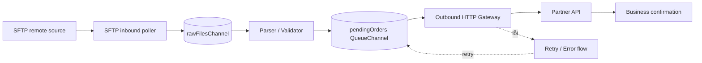
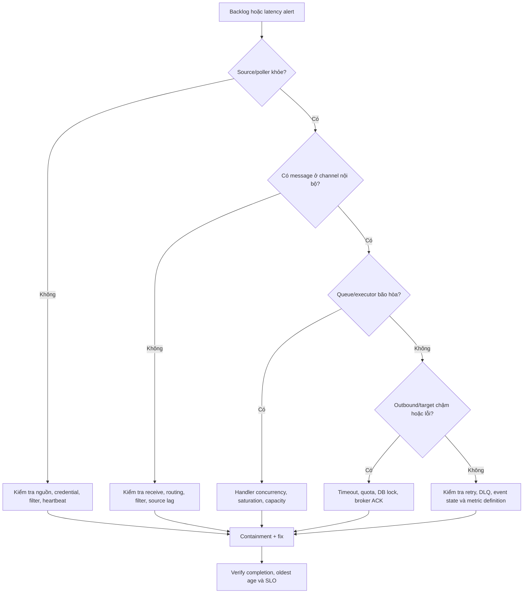

# Giám sát backlog và độ trễ trong Spring Integration Adapters ở Production

## 1. Vì sao backlog và độ trễ là vấn đề vận hành trọng yếu?

Một luồng tích hợp có thể **không báo lỗi** nhưng vẫn không đáp ứng yêu cầu nghiệp vụ. Ví dụ:

- **SFTP inbound adapter** vẫn poll thành công, nhưng hàng nghìn file nằm trong thư mục đợi nhiều giờ vì transformer xử lý chậm.
- **Kafka consumer** liên tục nhận record, trong khi tốc độ xử lý thấp hơn tốc độ producer, khiến **consumer lag** tăng.
- **JMS/AMQP queue** còn kết nối, nhưng số message ready hoặc unacknowledged tăng và các tác vụ kinh doanh bị quá hạn.
- **HTTP outbound gateway** gọi API đối tác ngày càng chậm; thread đồng bộ bị chiếm, kéo theo queue của các bước trước.
- **JDBC polling adapter** đọc được dữ liệu, nhưng transaction ở bước ghi bị lock hoặc retry, khiến tuổi công việc chưa hoàn tất tăng.
- **File adapter** ghi file ra đích nhưng không có dấu xác nhận hoàn tất; đội vận hành khó biết độ trễ nằm ở khâu đọc, xử lý hay xuất.
- **MessageChannel** nội bộ được khai báo đúng, nhưng executor bão hòa làm message nằm chờ; **health indicator** chỉ báo các dependency vẫn kết nối được.

**Backlog** là công việc đã xuất hiện trong phạm vi được đo nhưng **chưa đạt trạng thái hoàn tất đã định nghĩa**. **Độ trễ** (*latency*) là khoảng thời gian giữa hai mốc cụ thể trong vòng đời message. Hai khái niệm liên quan nhưng không thay thế nhau.

Trong chương **Production** của mô-đun `SPRING_INTEGRATION_ADAPTERS`, bài học **“Giám sát backlog và độ trễ”** hướng dẫn thiết kế tín hiệu đủ tin cậy để vận hành **inbound/outbound adapter, gateway, poller và MessageChannel** trên các transport **File, SFTP, HTTP, JMS, AMQP, Kafka và cơ sở dữ liệu**, đồng thời giữ đúng hợp đồng delivery, xử lý lỗi và vòng đời kết nối.

Sau bài học, bạn có thể:

1. Phân biệt backlog trong nguồn, trong channel, trong broker, trong retry và trong hệ thống đích.
2. Đo **queue wait**, **processing latency**, **external call latency** và **end-to-end latency** mà không nhập nhằng timestamp.
3. Đọc đúng các chỉ số queue depth, Kafka consumer lag, oldest message age, throughput và retry backlog.
4. Dùng **Micrometer/Actuator** và các nguồn metrics của broker/adapter, có chú ý khác biệt phiên bản.
5. Đặt ngưỡng cảnh báo theo **SLO, độ tuổi công việc, tốc độ tăng backlog, thời gian phục hồi**, thay vì chỉ một con số đếm.
6. Tìm nút thắt cổ chai bằng flow graph, metrics, logs, traces và readback ở target.
7. Điều chỉnh poller, concurrency, backpressure, retry, queue capacity và autoscaling có kiểm soát.
8. Kiểm thử khi tăng tải, broker redelivery, downstream outage và triển khai/khởi động lại.

> **Nguyên tắc xuyên suốt:** queue đang ít message chưa chắc nhanh; queue nhiều message chưa chắc vi phạm SLA. Cần xem **tuổi công việc cũ nhất, tốc độ đến/hoàn tất, phân bố latency và hạn nghiệp vụ**.

## 2. Ngôn ngữ đo lường: backlog, lag, latency, throughput và freshness

### 2.1. Định nghĩa các khái niệm

| Khái niệm | Định nghĩa | Đơn vị thường dùng | Cảnh báo cần nhớ |
|---|---|---|---|
| **Backlog depth** | Số đơn vị công việc đang chờ hoặc chưa hoàn tất trong phạm vi đo | Message, file, row, task | Phải định nghĩa trạng thái nào được tính |
| **Queue wait** | Từ lúc vào hàng đợi đến lúc bắt đầu xử lý | ms, s | Không tính nhầm processing time |
| **Processing time** | Thời gian handler thực thi một attempt | ms, s | Có thể không gồm chờ broker hay retry |
| **External-call latency** | Từ lúc gọi API/DB/broker đến khi nhận kết quả theo hợp đồng | ms, s | ACK/commit không đồng nghĩa business completion |
| **End-to-end latency** | Từ mốc nguồn đã chọn đến lúc nghiệp vụ hoàn tất đã xác minh | s, phút | Cần đồng hồ/timestamp và tiêu chí hoàn tất rõ |
| **Consumer lag** | Khoảng cách giữa vị trí tiến độ của consumer và nguồn có thể đọc | Record, offset | Cách tính có thể theo position hay committed offset |
| **Oldest pending age** | Tuổi của công việc chưa hoàn tất cũ nhất | s, phút, giờ | Thường nhạy với message bị kẹt hơn depth |
| **Arrival rate** | Số công việc mới tới đơn vị thời gian | message/s | Burst làm méo giá trị trung bình |
| **Completion rate** | Số công việc hoàn tất đúng tiêu chí trên đơn vị thời gian | message/s | Không lấy số attempts thay số logical events |
| **Retry rate** | Tần suất thực hiện lại do lỗi | attempt/s | Retry có thể làm tăng tải mà không tăng thành công |
| **Freshness** | Độ mới dữ liệu kết quả so với nguồn/thời điểm nghiệp vụ | s, phút | Nguồn ít sự kiện có thể hoàn toàn bình thường |

**Một backlog count không có scope là một số liệu mơ hồ.** Ví dụ “1.200 message” có thể là 1.200 record chưa commit ở Kafka, 1.200 message **ready** trong RabbitMQ, 1.200 message **unacked**, 1.200 message trong `QueueChannel`, hoặc 1.200 business events chưa hoàn tất trên tất cả tầng. Chúng **không mặc nhiên bằng nhau**.

### 2.2. Ba tầng quan sát

Nên tách rõ:

- **Source backlog:** công việc còn ở nơi sản sinh, ví dụ remote SFTP folder, Kafka partition, JMS/AMQP queue, bảng DB chưa được đánh dấu.
- **In-process backlog:** message trong `QueueChannel`, nhiệm vụ chờ executor hoặc retry scheduler, các nhóm đang chờ aggregator.
- **End-to-end outstanding work:** business event đã đến hạn hoặc đã nhận nhưng chưa có kết quả đích được xác minh.

**Không cộng thẳng các chỉ số từ ba tầng.** Một business event có thể vừa được tính trong Kafka lag (chưa commit) vừa nằm trong hàng đợi nội bộ và đồng thời thuộc bản ghi outstanding; cộng lại sẽ **đếm trùng**.

Đối với **quyết định nghiệp vụ**, nên thiết kế một registry trạng thái **mỗi logical event một bản ghi** hoặc một phép đối soát có khóa định danh ổn định. Đối với **bottleneck vận hành**, vẫn cần hiển thị queue/lag riêng từng tầng.

## 3. Hành trình message và các mốc thời gian cần thu

Giả sử luồng:



Ở đây chỉ một message đi qua nhiều mốc:

| Timestamp | Nguồn tạo | Ý nghĩa |
|---|---|---|
| `source_occurred_at` | Nguồn nghiệp vụ/manifest/file metadata đã tin cậy | Công việc xuất hiện ở nguồn lúc nào? |
| `discovered_at` | Poller hoặc inbound adapter | Hệ thống phát hiện công việc lúc nào? |
| `accepted_at` | Channel sau inbound | Công việc được chấp nhận vào flow lúc nào? |
| `enqueued_at` | Khi đưa vào queue nội bộ | Bắt đầu chờ trong queue |
| `processing_started_at` | Worker nhận message và bắt đầu attempt | Kết thúc queue wait của attempt |
| `external_request_started_at` | Trước outbound call | Bắt đầu gọi hệ thống ngoài |
| `external_response_at` | Khi nhận response/ACK thích hợp | Kết thúc external-call segment |
| `attempt_finished_at` | Khi attempt kết thúc (success/failure) | Thời gian xử lý attempt |
| `completed_at` | Khi kết quả nghiệp vụ được xác minh tại đích | Hoàn tất end-to-end theo hợp đồng |
| `due_at` | SLA/SLO từng loại nghiệp vụ | Deadline cần đạt |

Không phải flow nào cũng có đủ mốc. Với **HTTP inbound gateway**, source event có thể chính là request đến; với **file nhận từ đối tác**, thời điểm file được tạo có thể lệch đồng hồ hoặc không phản ánh lúc nó sẵn sàng để đọc. Nếu thiếu nguồn đáng tin, báo **“latency từ lúc nhận vào hệ thống”**, không khẳng định đó là độ trễ từ lúc sự kiện thật phát sinh.

### 3.1. Các phép tính latency có nghĩa

\[
T_{\mathrm{discovery}}=t_{\mathrm{discovered}}-t_{\mathrm{source}}
\]

\[
T_{\mathrm{queue}}=t_{\mathrm{processing\_started}}-t_{\mathrm{enqueued}}
\]

\[
T_{\mathrm{attempt}}=t_{\mathrm{attempt\_finished}}-t_{\mathrm{processing\_started}}
\]

\[
T_{\mathrm{external}}=t_{\mathrm{response}}-t_{\mathrm{request\_started}}
\]

\[
T_{\mathrm{end\_to\_end}}=t_{\mathrm{completed}}-t_{\mathrm{source}}
\]

**Không cộng tùy tiện các thành phần đo chồng lấn.** `T_attempt` có thể đã bao gồm `T_external`; cộng cả hai sẽ đếm lại cùng khoảng. Khi có retry, end-to-end còn gồm **thời gian chờ retry/backoff** giữa các attempt.

Nếu đo một đoạn trên cùng JVM, nên dùng **đồng hồ đơn điệu** (ví dụ `System.nanoTime()` hoặc Micrometer Timer) để đo elapsed time, thay vì trừ hai wall-clock timestamps dễ bị đồng hồ hệ thống điều chỉnh. Các mốc giao tiếp xuyên process cần wall-clock timestamp có offset/UTC, đồng bộ clock và ghi độ tin cậy.

### 3.2. Ví dụ timeline cụ thể

Một file nghiệp vụ xuất hiện theo timestamp nguồn lúc **08:00**; SFTP poller phát hiện lúc **08:03**, vào queue lúc **08:04**, worker bắt đầu lúc **08:05**, và target xác minh hoàn tất lúc **08:11**.

| Đoạn | Cách tính | Kết quả |
|---|---|---|
| Nguồn → phát hiện | 08:03 − 08:00 | **3 phút** |
| Phát hiện → vào queue | 08:04 − 08:03 | **1 phút** |
| Chờ trong queue | 08:05 − 08:04 | **1 phút** |
| Bắt đầu xử lý → đích xác minh | 08:11 − 08:05 | **6 phút** |
| Tổng nguồn → đích | 08:11 − 08:00 | **11 phút** |
| Tổng hệ thống nhìn thấy → đích | 08:11 − 08:03 | **8 phút** |

Nếu SLA yêu cầu **10 phút kể từ thời điểm nguồn**, ví dụ trễ **1 phút**; nếu SLO của riêng ứng dụng tính từ lúc vào channel và cho 10 phút, hệ thống có thể đạt. **Không thay mốc bắt đầu sau khi thấy kết quả** để biến một lỗi thành thành công.

**Giới hạn:** ví dụ giả định timestamp nguồn đáng tin và mỗi mốc được ghi đúng lúc. Với thời gian file `mtime` do đối tác thay đổi, cần mô tả không chắc chắn.

## 4. Backlog count và oldest pending age

### 4.1. Backlog tuyệt đối

Tại thời điểm `t`, định nghĩa:

\[
B(t)=\left|\{m \mid m\ \text{nằm trong phạm vi đo và chưa hoàn tất tại}\ t\}\right|
\]

Tùy phạm vi, `m` có thể là **record**, **message**, **file**, **job**, **processing attempt** hoặc **logical business event**. Số record Kafka chưa commit không bằng số đơn hàng chưa hoàn tất vì một đơn hàng có thể tạo nhiều event và một record có thể được xử lý lại.

Nên ghi trong dashboard:

```text
metric: integration_backlog
scope: kafka/orders.created/group=orders-consumer
unit: records
definition: approximate log-end-offset minus committed next offset
snapshot_time: ...
notes: includes records processed but not yet committed
```

Đây là **metadata mô tả metric**, không phải một schema có sẵn của Spring Integration.

### 4.2. Oldest pending age

\[
A_{\mathrm{oldest}}(t)
=\max_{m\in\mathrm{pending}(t)} (t-t_{\mathrm{accepted}}(m))
\]

Định nghĩa **accepted timestamp** theo phạm vi: khi source phát sinh, khi broker có record, khi ứng dụng nhập, hay khi retry được tạo. Nếu queue empty, nên biểu diễn **không có công việc đang chờ** (*no data/null*) thay vì một “oldest age = 0” mang cùng nghĩa với message vừa vào; việc dùng 0 là lựa chọn dashboard cần chú thích.

**Độ tuổi tăng đều nhưng backlog nhỏ** là tín hiệu quan trọng: có thể chỉ **một poison message** mắc kẹt, chưa có dead-letter/quarantine hoặc một partition bị chặn.

Nếu queue có priority, delayed delivery, reordering, retry hoặc custom selection, không giả định phần tử đầu queue là message **cũ nhất theo thời gian nghiệp vụ**. Cần đo đúng theo tập pending hoặc chọn một proxy đã được công bố.

### 4.3. Đếm cả message đang xử lý và retry ở đâu?

Một dashboard đầy đủ nên phân loại:

| Trạng thái | Có nằm trong backlog chưa hoàn tất? | Có nằm trong queue depth? |
|---|---|---|
| `READY/ENQUEUED` | Có | Thường có |
| `IN_FLIGHT/PROCESSING` | Có nếu chưa đạt completion | Thường **không** còn trong queue ready |
| `RETRY_WAIT` | Có | Tùy dùng queue riêng, scheduler hay DB |
| `REDELIVERED` | Vẫn là logical work cũ | Có thể tăng số attempts |
| `DEAD_LETTER` | Theo chính sách: thường chưa hoàn tất nghiệp vụ | Không ở queue chính, nhưng còn ở DLQ/DLT |
| `SUCCEEDED_AND_VERIFIED` | Không | Không |
| `CANCELLED_WITH_APPROVAL` | Không nếu hợp đồng xác nhận được hủy hợp lệ | Không |
| `UNKNOWN` | Không được mặc nhiên tính là hoàn tất | Có thể không thấy từ channel |

Vì vậy, một queue trống không chứng minh **không còn outstanding work** nếu nhiều message đã chuyển vào DLQ hoặc in-flight bị treo.

## 5. Arrival rate, completion rate và xu hướng tăng backlog

Trong một phạm vi có thể đối soát, nếu `A` là số công việc **mới đến**, `C` là số **hoàn tất đúng hợp đồng** trong khoảng \([t_0,t_1]\), bỏ qua những trạng thái chuyển ra/vào phạm vi khác:

\[
B(t_1)\approx B(t_0)+A(t_0,t_1)-C(t_0,t_1)
\]

Đây là **mô hình bảo toàn công việc**, không phải công thức tự đúng khi có duplicate, replay, drop, chuyển DLQ, cancellation hoặc thay đổi scope. Cần ghi các dòng chuyển trạng thái đó khi đối soát.

Tốc độ tăng backlog gần đúng:

\[
g = \lambda_{\mathrm{in}}-\mu_{\mathrm{complete}}
\]

Trong đó:

- \(\lambda_{\mathrm{in}}\): tốc độ logical work đến (message/s).
- \(\mu_{\mathrm{complete}}\): tốc độ logical work hoàn tất đã xác minh (message/s).

**Ví dụ:** trung bình 20 công việc/s đến, hệ thống xử lý xong 15 công việc/s. Nếu giữ nguyên, backlog tăng **5 công việc/s**. Tăng concurrency chỉ hiệu quả nếu **nút thắt thực sự có thể song song hóa**, không phải downstream có quota cố định.

**Ngược lại**, nếu đang có 360 công việc, nguồn tiếp tục đến 20/s còn hệ thống hoàn tất 25/s thì **net drain = 5/s**. Theo mô hình tốc độ không đổi và không có retry:

\[
T_{\mathrm{drain}}\approx \frac{360}{25-20}=72\ \mathrm{giây}
\]

Đây là **ước lượng lý tưởng**, không phải lời hứa SLA. Trong thực tế, burst, phân vùng, thời gian xử lý không đều, retry, thứ tự bắt buộc và throttling có thể làm thời gian lâu hơn nhiều.

### 5.1. Khi nào dùng định luật Little?

Trong hệ thống **ổn định**, với đơn vị công việc và cửa sổ đo nhất quán, định luật Little mô tả:

\[
L=\lambda W
\]

- `L`: số công việc trung bình trong hệ thống.
- \(\lambda\): throughput trung bình của luồng công việc ổn định.
- `W`: thời gian trung bình mà một công việc ở trong phạm vi.

Có thể dùng để **kiểm tra tính hợp lý** của số liệu queue/processing khi các điều kiện ổn định, bảo toàn population và đo đủ thời gian. **Không** lấy consumer lag đang tăng mạnh rồi chia throughput tức thời để công bố một “ETA chính xác”; điều kiện ổn định không đạt và phân bố latency có thể rất lệch.

### 5.2. Những trường hợp tổng tốc độ che dấu nút thắt

- Kafka có 8 partition; tổng completion rate cao nhưng **1 partition chứa poison record** không tiến.
- JMS có nhiều consumer; một consumer bị kẹt làm số `unacked` cao dù `ready` giảm.
- HTTP gateway có throughput tốt với route ngắn, trong khi route nghiệp vụ trọng yếu p99 tăng.
- SFTP nhận nhiều file nhỏ; một file lớn kéo dài hơn deadline.
- JDBC xử lý nhiều row nhanh nhưng một transaction bị lock quá lâu.

Vì vậy, xem **distribution**, **per-partition/per-flow**, **oldest age** và **SLO**, không chỉ tổng average.

## 6. Đo latency bằng percentile và SLO

### 6.1. Vì sao average chưa đủ?

Giả sử 990 message được xử lý trong 100 ms, nhưng 10 message mất 60 giây. Average có thể không phản ánh rõ nhóm message bị trễ nghiêm trọng. **p95/p99**, tỷ lệ vượt deadline và tuổi pending giúp nhìn tail latency.

| Chỉ số | Nói lên điều gì? | Chú ý |
|---|---|---|
| Average latency | Thời gian trung bình các trường hợp được tính | Bị tác động bởi outlier |
| p50 | Trung vị | Có thể bỏ qua tail |
| p95 | 95% mẫu có latency không lớn hơn ngưỡng percentile | Cần đủ mẫu và cùng loại nghiệp vụ |
| p99 | Mức đuôi chậm hơn | Dễ dao động khi sample nhỏ |
| `late_completed_total` | Số công việc hoàn tất sau deadline | Không bao gồm ca chưa hoàn tất nếu không bổ sung |
| `overdue_open` | Số công việc vẫn mở và đã quá hạn | Bắt được backlog chưa có latency hoàn tất |
| `oldest_pending_age` | Độ tuổi công việc chờ lâu nhất | Bắt poison message và backlog tồn dư |

**Lưu ý thống kê:** percentile trên những message **đã hoàn tất** có hiện tượng **survivorship bias**: khi hệ thống kẹt, các message chậm nhất chưa hoàn tất nên chưa được ghi vào histogram completion. Vì thế dashboard production phải hiển thị thêm **pending age** và **overdue open**.

### 6.2. Xác định SLI/SLO bằng câu có thể kiểm chứng

Ví dụ SLO do tổ chức giả định:

> 99% sự kiện đơn hàng **được nhận hợp lệ** phải có kết quả ghi DB **đã commit và xác minh** trong vòng **5 phút**, đo trong **cửa sổ 7 ngày**; những sự kiện quá hạn mà chưa hoàn tất được tính là chưa đạt.

Cần làm rõ:

- **Denominator:** sự kiện nào được nhận hợp lệ, bị từ chối schema có tính không?
- **Numerator:** xác minh commit là gì? JDBC API response, transaction record hay readback?
- **Thời điểm bắt đầu:** source event time hay accepted time?
- **Deadline:** 5 phút theo từng event, không phải 5 phút sau mỗi retry.
- **Scope:** production, nhóm đối tác nào, loại event nào?
- **Exclusions:** maintenance có phê duyệt, event hủy, dữ liệu source đến quá muộn có được loại theo policy không?
- **Open work:** quá hạn nhưng chưa hoàn tất phải hiển thị, không để “biến mất” khỏi mẫu số.

### 6.3. Sai số và nguồn thời gian

- **Wall-clock** giữa hệ thống dùng UTC hoặc offset rõ; đồng bộ NTP và ghi nguồn timestamp.
- **Monotonic clock** dùng cho elapsed time trong một JVM khi có thể.
- **Source timestamp** từ file/SFTP hoặc bên ngoài không mặc nhiên đáng tin; timezone, clock skew hoặc khả năng sửa metadata phải được xét.
- **Broker append timestamp** và event timestamp có thể khác; Kafka record timestamp có `CreateTime` hoặc `LogAppendTime` tùy cấu hình/topic/broker.
- **Metrics scrape timestamp** khác thời điểm message thực sự được nhận/xử lý.
- **Async logging** có thể ghi sau khi handler xong; không dùng thời điểm log sink nhận sự kiện làm processing timestamp.

Khi một đoạn có timestamp sai âm do lệch đồng hồ, không âm thầm dùng `abs()` rồi kết luận latency hợp lệ. Ghi lỗi chất lượng dữ liệu và sửa nguồn timestamp.

## 7. QueueChannel, DirectChannel và ExecutorChannel

**Spring Integration `MessageChannel`** có nhiều kiểu, mỗi kiểu cần cách đo backlog khác nhau.

| Channel | Đặc tính | Có backlog lưu trong channel? | Tín hiệu quan trọng |
|---|---|---|---|
| `DirectChannel` | Dispatch xử lý đồng bộ | Thông thường không có queue lưu trữ | Handler latency, send block, error, upstream waiting |
| `QueueChannel` | Channel pollable, message nằm trong queue | **Có** | Queue depth, capacity, oldest enqueue age, poll rate |
| `ExecutorChannel` | Dispatch nhờ executor | Không phải hàng đợi message của `QueueChannel`, nhưng executor có thể queue task | Active threads, executor queue size, rejected tasks, handler latency |
| `PublishSubscribeChannel` | Nhiều subscriber; có thể sync hoặc async | Phụ thuộc executor/subscriber | Latency từng nhánh, subscriber error, task backlog |
| Broker-backed/integration store | Có buffer phụ thuộc implementation | Phụ thuộc store/transport | Durable/ACK, queue/lag và state tại store |

### 7.1. DirectChannel: chậm nhưng depth có thể bằng 0

Một **HTTP inbound gateway → DirectChannel → HTTP outbound gateway** có thể làm caller chờ 30 giây vì API ngoài chậm. Trong channel **không có queue depth để đo**. Cần quan sát:

- HTTP request concurrency và p95/p99 latency.
- Timeout, exception, circuit breaker, connection-pool saturation.
- Thread pool server (active, queued tasks), giới hạn concurrent requests.
- In-flight requests và error-rate.

**Không kết luận không backlog chỉ vì `QueueChannel.size() == 0`** khi phần lớn công việc đang treo đồng bộ trong handler.

### 7.2. QueueChannel: nhìn thấy số message đang chờ

`QueueChannel` cho phép message lưu tạm và được consumer/poller lấy. Nếu queue được giới hạn dung lượng, cần biết:

- `queue_size` và `remaining_capacity`.
- Mốc enqueue/receive để đo queue wait.
- Poller heartbeat, rate và batch/maxMessagesPerPoll.
- Message store **memory hay persistent**.
- Đường xử lý khi queue full: block timeout, exception, reject/backpressure.

**QueueChannel trong bộ nhớ không tự là hàng đợi bền vững**; process chết có thể làm mất message chưa được bảo toàn ở source hoặc store. Nếu có persistent message store, phải kiểm tra transaction semantics và khả năng khôi phục thực tế.

### 7.3. ExecutorChannel: backlog có thể nằm ở task executor

`ExecutorChannel` chuyển dispatch sang executor. Nếu một `ThreadPoolTaskExecutor` có pool 8 threads, queue 500, và downstream mất 10 giây/operation, task backlog có thể tăng mạnh trước khi message ở handler.

Cần quan sát:

- `active_threads`, `pool_size`, `executor_queue_depth`.
- `tasks_rejected_total`, `task_wait_duration`.
- `handler_duration`, `external_call_duration`, `inflight`.
- `queue_capacity` và saturation policy.

Đừng đặt executor queue vô hạn để làm metric “rejected = 0”. Việc này có thể làm memory bùng nổ và giấu nguồn gây quá tải.

### 7.4. Aggregator, resequencer và delayed processing

Một flow dùng **Aggregator/Resequencer** có thể giữ message group cho tới khi đủ sequence hoặc timeout. Công việc “đang chờ” ở đây nằm trong **message group store**, không nhất thiết trong QueueChannel.

Nên đo thêm:

- Số message groups mở, tuổi group cũ nhất.
- Số message chờ hoàn tất nhóm.
- Tỷ lệ group timeout/expired/partial release.
- Duplicate correlation keys, orphan groups và cleanup.
- Transaction và storage của message store.

Không gộp `open_group_count` với `message_count` thành một đơn vị “backlog” nếu không chú thích.

## 8. Poller: không có message không có nghĩa không có backlog

**Polling consumer** hoặc inbound poller thường quyết định lịch nhận message từ File/SFTP/JDBC hay từ QueueChannel. Các tham số như **fixedDelay/fixedRate/cron**, `maxMessagesPerPoll`, executor, transaction và concurrency ảnh hưởng trực tiếp đến tốc độ thoát backlog.

Ví dụ:

- Nguồn SFTP có 500 file, poller chỉ lấy tối đa 1 message mỗi 5 giây.
- Trong điều kiện lý tưởng, riêng giới hạn poller cho phép tối đa khoảng **0,2 file/s**.
- Nếu downstream xử lý rất nhanh, tăng thread handler **không giải quyết** giới hạn do poller.
- Nếu mỗi poll xử lý đúng 10 file và có overhead kết nối, cần xem lại trade-off batch/transaction, chứ không tăng không kiểm soát.

Các câu hỏi vận hành:

1. Poller đang `running` và heartbeat đúng lịch không?
2. Có `receive()` hay `poll()` nào đang treo vì network/lock không?
3. Có nhiều endpoint cùng dùng scheduler thread pool nhỏ không?
4. Bộ lọc file/metadata store có loại nhầm dữ liệu?
5. `maxMessagesPerPoll`, batch size và fixed delay có hạn chế throughput không?
6. Transaction commit/rollback có khiến một message được poll lại không?
7. Khi pause bằng Control Bus, nguồn có tiếp tục tích tụ và SLA có thay đổi không?

**Tín hiệu tối thiểu cho poller:** `last_poll_started_at`, `last_poll_completed_at`, `poll_duration`, `poll_errors_total`, `messages_produced_total`, `polls_without_messages_total` và `endpoint_running`, phù hợp khả năng instrument.

Không để “0 message được nhận” trở thành bằng chứng “0 file/row còn chờ” khi poller đã dừng từ vài giờ trước.

## 9. Kafka: consumer lag không chỉ là độ trễ thời gian

### 9.1. Định nghĩa lag theo offset

Với Kafka, có thể tính một dạng backlog ở từng partition:

\[
L_p=\max(0,\ E_p-C_p)
\]

Trong đó:

- `E_p`: **log end offset** (vị trí ngay sau record cuối tại thời điểm đo).
- `C_p`: **committed next offset** của consumer group nếu muốn đo công việc chưa commit.
- `L_p`: số offset vị trí chênh lệch, thường được dùng làm ước lượng record chưa commit.

Tổng theo các partition thuộc group:

\[
L_{\mathrm{group}}=\sum_{p\in P} L_p
\]

**Đây là một cách định nghĩa**, không phải mọi số mang tên `records-lag` đều dùng committed offset. Một số Kafka client metrics dựa trên **consumer position** thay vì committed offset; monitoring system có thể lấy broker/group committed offsets. Phải ghi rõ bạn dùng **position, committed offset hay high watermark** và cách xử lý partition mới/retention/compaction.

**Ví dụ:** end offset ở một partition là 125.000, group đã commit next offset 124.200. Chênh lệch là **800 vị trí offset**. Nếu consumer đã process nhưng chưa commit batch, con số này vẫn có thể cao hơn số record chưa xử lý về mặt nghiệp vụ.

### 9.2. Lag count và lag time khác nhau

| Chỉ số | Đơn vị | Cách dùng |
|---|---|---|
| Per-partition lag | Offset/record estimate | Phát hiện partition bị tụt |
| Sum consumer-group lag | Offset/record estimate | Nhìn backlog tổng |
| Max partition lag | Offset/record estimate | Tránh tổng che một partition kẹt |
| Event processing delay | Giây/phút | Từ event time đến xử lý/completion |
| Oldest unprocessed event age | Giây/phút | Đánh giá SLO của dữ liệu cũ |
| Consumer record processing rate | Record/s | Đo tốc độ theo group/instance |
| Retry/DLT backlog | Record/topic/attempt | Công việc lỗi chưa hoàn tất nghiệp vụ |
| Commit latency/rate | Giây/số lần | Phân biệt xử lý khỏi cập nhật committed progress |

Nếu một partition có 10 record rất cũ nhưng producer im lặng, tổng lag count nhỏ mà **data freshness có thể vi phạm nhiều giờ**. Ngược lại, một producer tạo burst 100.000 record có thể làm lag count lớn trong vài phút nhưng consumer vẫn đáp ứng SLO nếu đủ capacity và có thời hạn phù hợp.

### 9.3. Retry, redelivery và offset

- Consumer có thể xử lý record rồi crash **trước commit** → record được phát lại, lag không phản ánh chính xác số logical business events còn thiếu.
- Khi áp dụng retry topic/DLT, record có thể **không còn trong queue chính** nhưng vẫn chưa xử lý nghiệp vụ; theo dõi riêng retries và DLQ/DLT.
- Batch và transaction có thể trì hoãn commit, khiến lag đột ngột giảm sau một đợt.
- Không tự cộng lag ở retry topics và topic chính thành “số đơn hàng chưa hoàn thành” nếu có duplicate/copy.
- Partition assignment/rebalance có thể làm metric biến động; dashboard nên tách các mốc deploy/rebalance.

**Điểm kiểm chứng cuối:** offset commit không tự chứng minh **JDBC transaction**, HTTP target hoặc side effect nghiệp vụ đã thành công nếu thiết kế commit không gắn với xử lý.

## 10. JMS và AMQP: ready, unacked, retry và dead-letter

### 10.1. JMS

Với **JMS**, queue depth có thể đến từ provider/broker management metrics; tên metric và mức chi tiết phụ thuộc ActiveMQ Artemis, ActiveMQ Classic hoặc provider khác.

Cần phân biệt:

- Message vẫn ở **broker queue**.
- Message đã được listener/container **dispatch** nhưng chưa ACK/commit.
- Message trong **transaction đang xử lý**.
- Message **redelivery** sau rollback hoặc connection loss.
- Message chuyển sang **DLQ** theo policy.
- Message đã ACK nhưng downstream business chưa chắc hoàn tất.

Một consumer đang treo có thể làm **ready depth giảm** vì message đã được dispatch; tổng outstanding vẫn cao. Nên kết hợp `inflight`, processing latency, transaction outcomes, DLQ và oldest pending age.

### 10.2. AMQP/RabbitMQ

RabbitMQ thường có các khái niệm:

- **Ready:** message nằm trong queue và sẵn sàng dispatch.
- **Unacknowledged:** message đã được giao cho consumer nhưng chưa ACK.
- **Total messages:** thường bao gồm ready và unacked theo thống kê broker.
- **Prefetch:** giới hạn unacked message có thể được giao cho consumer.
- **Dead-letter:** message chuyển qua DLX/queue khác khi reject/expire/giới hạn delivery theo cấu hình.

**Không chỉ cảnh báo `messages_ready`.** Khi prefetch rất cao và consumer bị kẹt, ready có thể nhỏ trong khi `unacked` cao, message age và end-to-end latency vẫn tăng.

| Tín hiệu | Điều cần đặt câu hỏi |
|---|---|
| Ready tăng | Consumer có nhận đủ nhanh? |
| Unacked tăng | Handler, downstream hoặc ACK bị chậm/treo? |
| Redelivery rate tăng | Transaction/consumer lỗi, requeue loop? |
| DLQ count tăng | Có poison message hoặc contract error? |
| Publisher confirm latency tăng | Broker accept/persistence bị chậm? |
| Queue oldest age tăng | Có message chờ quá deadline? |
| Connection/consumer count giảm | Listener đã dừng hay broker kết nối lỗi? |

Broker **publisher confirm** không đồng nghĩa consumer đã xử lý nghiệp vụ; **consumer ACK** không đồng nghĩa dữ liệu đã được hệ thống khác xác minh, trừ khi hợp đồng/transaction làm điều đó đúng.

## 11. File, SFTP và JDBC: backlog ngoài broker

### 11.1. File inbound

Backlog có thể là số file đã sẵn sàng trong thư mục nhưng chưa được adapter chấp nhận hoặc chưa có kết quả nghiệp vụ. Cần quyết định:

- File hoàn tất ghi được xác nhận bằng cách nào? Temp extension, rename atomic, manifest hay marker file?
- Count file dựa trên pattern/filter nào?
- Có file đã bị accept-once filter đánh dấu nhưng vẫn chưa xử lý thành công?
- File rất lớn có bị giữ lâu hoặc làm đầy disk?
- File trong thư mục `error`, `retry`, `archive` có tính vào outstanding work không?

**Quét toàn bộ thư mục lớn mỗi vài giây để đếm backlog** có thể gây I/O đắt và ảnh hưởng chính poller. Ưu tiên metadata/index, incremental scan, thống kê theo batch hoặc job kiểm kê thưa với thời gian chốt rõ ràng.

### 11.2. SFTP

SFTP source backlog phải xét:

- Remote directory và điều kiện file đã hoàn tất upload.
- Filter pattern, metadata store/accept-once, duplicate file names.
- Lần poll/session thành công; host-key verification và auth.
- Download in progress, temp local file, transfer throughput.
- File còn chờ tại remote, file local đang chờ xử lý, file đã chuyển sang error/quarantine.

Một dashboard “0 file” khi SFTP session **không kết nối được** không được báo là backlog bằng 0. Phải thể hiện **UNKNOWN / STALE** và lý do thiếu quan sát.

**Không dùng `mtime` file remote làm duy nhất event time** khi đối tác có thể thay đổi hoặc đồng hồ không đồng bộ. Nếu cần SLA chính xác, yêu cầu manifest/event metadata với timestamp và file ID tin cậy.

### 11.3. JDBC/database polling

Backlog thường là **số row đang ở trạng thái ready/pending**, hoặc các outbox events chưa publish; tuy nhiên counting toàn bảng có thể gây tải.

Cần lưu ý:

- Query theo `status`, `created_at`, `next_attempt_at` và index thích hợp.
- Row đang bị claim/lock có thể không còn trong pending query nhưng chưa hoàn tất.
- Transaction rollback có thể làm row xuất hiện trở lại.
- Poller xử lý `maxMessagesPerPoll`, paging, watermark hoặc row locking có thể gây starvation một nhóm.
- Outbox được publish chưa chắc consumer downstream đã commit hoặc tạo business result.
- DB clock, application clock và event clock cần thống nhất hoặc đánh dấu sai số.

Một **counter thông lượng** có thể rẻ hơn một `COUNT(*)` nặng mỗi vài giây; tuy nhiên count suy ra cần reconciliation vì restart, bỏ event và duplicate có thể tạo drift.

### 11.4. HTTP inbound/outbound không tự có durable backlog

**HTTP inbound gateway** thường là request–reply: request đang chờ thread hoặc connection, nhưng không có khái niệm “queue depth broker” mặc định. Cần đo:

- Active/in-flight HTTP requests và server worker queue.
- Request latency p95/p99, timeout, 429/5xx.
- HTTP client connection pool pending/active, retries và circuit breaker.
- Hàng đợi riêng **nếu** ứng dụng chủ động đưa request vào QueueChannel/broker/outbox.

**Không tự đặt metric `http_backlog=0` rồi kết luận request không bị kẹt.** Một gateway đồng bộ có thể giữ nhiều request trong handler/outbound call mà queue nội bộ không chứa message nào.


## 12. Một chiến lược metrics đủ dùng trong production

Cần kết hợp **hai nhóm metric**:

1. **Metric do ứng dụng tạo:** trạng thái logical event, queue wait, business completion, in-flight, retry, deadlines.
2. **Metric do framework/transport cung cấp:** Kafka consumer lag, RabbitMQ queue ready/unacked, JMS broker queue depth, DataSource pool, HTTP server/client, Spring Integration channel/handler, executor.

Một số khả năng đo có thể được Spring Integration Management, Micrometer Observation, Spring Boot Actuator hoặc connector cụ thể cung cấp **tùy phiên bản và cấu hình**. Không giả định một tên metric có sẵn chỉ vì nó xuất hiện trong tài liệu bài học.

### 12.1. Metric đề xuất và đơn vị rõ ràng

| Metric đề xuất | Loại | Đơn vị | Phạm vi/định nghĩa |
|---|---|---|---|
| `integration_messages_accepted_total` | Counter | Message | Logical event được nhận hợp lệ |
| `integration_messages_completed_total` | Counter | Message | Event có kết quả nghiệp vụ được xác minh |
| `integration_message_attempts_total` | Counter | Attempt | Các lần xử lý, gồm retry |
| `integration_message_failures_total` | Counter | Attempt/event, ghi rõ | Lỗi theo category |
| `integration_queue_depth` | Gauge | Message | Công việc đang nằm trong một queue cụ thể |
| `integration_queue_capacity` | Gauge | Slot | Giới hạn của bounded queue |
| `integration_queue_remaining_capacity` | Gauge | Slot | Dung lượng còn lại |
| `integration_inflight_messages` | Gauge | Message | Đã bắt đầu nhưng chưa kết thúc attempt |
| `integration_oldest_pending_age_seconds` | Gauge | Giây | Message outstanding cũ nhất theo phạm vi |
| `integration_overdue_open` | Gauge | Logical event | Outstanding events quá hạn |
| `integration_queue_wait_seconds` | Histogram/Timer | Giây | Enqueue → bắt đầu attempt |
| `integration_handler_duration_seconds` | Histogram/Timer | Giây | Thời gian handler mỗi attempt |
| `integration_external_call_duration_seconds` | Histogram/Timer | Giây | Gọi transport/target tới response phù hợp |
| `integration_end_to_end_duration_seconds` | Histogram/Timer | Giây | Mốc nhận/source → verified completion |
| `integration_retry_waiting` | Gauge | Event | Logical work đang chờ retry |
| `integration_poller_last_success_age_seconds` | Gauge | Giây | Từ lần poll transport thành công |
| `integration_telemetry_collection_failures_total` | Counter | Lần | Collector/metrics source hỏng |

**Các tên trên do bài học đề xuất**, không phải khẳng định Micrometer/Actuator tự sinh toàn bộ metric. Có thể cần đổi tên/đơn vị theo quy ước Prometheus, OpenTelemetry Semantic Conventions và những instrument đã được framework cung cấp để tránh trùng lặp.

### 12.2. Cardinality và an toàn dữ liệu

Nhãn nên có **số giá trị hữu hạn**:

```text
flow="orders-import"
stage="validate"
adapter="sftp"
outcome="success"
target="partner-a"
environment="production"
```

Tránh nhãn:

```text
messageId="..."
traceId="..."
orderId="..."
filename="private-customer-2026.csv"
payloadHash="..."
rawException="..."
```

Một `messageId` khác nhau cho mỗi record sẽ tạo metric series tăng gần theo số message. Các ID có thể dùng trong **structured logs/traces có phân quyền** để điều tra, nhưng không phải metric tags vô hạn. Ngay cả `target` cũng cần danh mục được quản lý nếu số partner/topic/tenant được tạo động.

Khi gửi dữ liệu sang hệ thống giám sát bên ngoài, không ghi nguyên payload, token, mật khẩu, private key, HTTP headers nhạy cảm hoặc thông tin cá nhân vào logs/trace attributes.

### 12.3. Dashboard nên có nhiều góc nhìn đồng thời

Một dashboard hữu ích cho một flow gồm:

- **Đầu vào:** arrival rate, source backlog, poller heartbeat, connection errors.
- **Hàng đợi:** depth, oldest age, utilization/capacity, ingress và drain rate.
- **Xử lý:** in-flight, p50/p95/p99 handler latency, retry rate, error categories.
- **Hệ thống ngoài:** HTTP/DB/broker p95, timeout, ACK/commit, connection pool.
- **Kết quả nghiệp vụ:** completion rate, end-to-end percentile, overdue open, SLO compliance.
- **Hạ tầng:** CPU, heap/GC, executor active/queued/rejected, network, disk.
- **Rủi ro giám sát:** timestamp metric mới nhất, metric missing/stale và collector failures.

**Tách “đã phát request” khỏi “đã được target xác nhận”** trên biểu đồ. Trong các flow bất đồng bộ, đây là hai mốc khác nhau.

## 13. Ví dụ Java DSL: QueueChannel bounded và metric queue depth

Ví dụ tạo một flow nội bộ: message từ `ordersIngress` được chuyển vào `pendingOrders` (bounded `QueueChannel`), poller lấy message và chuyển cho handler nghiệp vụ.

```java
import java.time.Duration;

import org.springframework.beans.factory.annotation.Qualifier;
import org.springframework.context.annotation.Bean;
import org.springframework.context.annotation.Configuration;
import org.springframework.integration.channel.DirectChannel;
import org.springframework.integration.channel.QueueChannel;
import org.springframework.integration.config.EnableIntegration;
import org.springframework.integration.dsl.IntegrationFlow;
import org.springframework.integration.dsl.Pollers;
import org.springframework.messaging.MessageChannel;
import org.springframework.messaging.MessageHandler;

@Configuration
@EnableIntegration
public class OrdersBacklogFlowConfiguration {

    @Bean
    MessageChannel ordersIngress() {
        return new DirectChannel();
    }

    @Bean
    QueueChannel pendingOrders() {
        // Có giới hạn; không coi QueueChannel memory là durable queue.
        return new QueueChannel(500);
    }

    @Bean
    IntegrationFlow enqueueOrders() {
        return IntegrationFlow.from("ordersIngress")
                .channel("pendingOrders")
                .get();
    }

    @Bean
    IntegrationFlow drainOrders(
            @Qualifier("ordersOutboundHandler") MessageHandler handler) {

        return IntegrationFlow.from(
                        "pendingOrders",
                        endpoint -> endpoint.poller(
                                Pollers.fixedDelay(Duration.ofMillis(200))
                                        .maxMessagesPerPoll(10)
                        )
                )
                .handle(handler, endpoint ->
                        endpoint.id("ordersOutboundEndpoint"))
                .get();
    }
}
```

**Giả định:** `ordersOutboundHandler` là `MessageHandler` bean do ứng dụng cung cấp, có xử lý lỗi và kết quả theo hợp đồng; ví dụ không kết nối trực tiếp HTTP/Kafka/JDBC. Cú pháp Java DSL phải được đối chiếu và build trên **đúng Spring Integration version** mà dự án sử dụng.

Các điểm cần hiểu:

- `QueueChannel(500)` có capacity tối đa theo cấu hình; không tự bảo vệ tất cả memory khác trong hệ thống.
- Poller `fixedDelay(200 ms)` và `maxMessagesPerPoll(10)` mô tả nhịp và số lượng polling attempt theo cơ chế framework; **không phải cam kết throughput 50 message/s** khi handler có thể block.
- Khi queue đầy, người gửi có thể bị block hoặc fail theo timeout/chính sách send. **Không bỏ qua boolean/exception từ send**, vì mất message âm thầm là sai hợp đồng.
- Nếu message bị mất khi process crash, nguồn có được retry/redeliver hay không phụ thuộc SFTP/file metadata, broker acknowledgment hoặc kiến trúc durable queue.
- Không xem message đi vào `pendingOrders` là đã gửi HTTP hoặc đã commit JDBC.

### 13.1. Đăng ký Gauge qua Micrometer

Có thể dùng `MeterBinder` để công bố queue depth và remaining capacity, không cần đọc lại toàn bộ message mỗi lần scrape:

```java
import io.micrometer.core.instrument.Gauge;
import io.micrometer.core.instrument.binder.MeterBinder;

import org.springframework.beans.factory.annotation.Qualifier;
import org.springframework.context.annotation.Bean;
import org.springframework.context.annotation.Configuration;
import org.springframework.integration.channel.QueueChannel;

@Configuration
public class OrdersQueueMeterConfiguration {

    @Bean
    MeterBinder ordersQueueMeters(
            @Qualifier("pendingOrders") QueueChannel queue) {
        return registry -> {
            Gauge.builder(
                    "integration_queue_depth",
                    queue,
                    QueueChannel::getQueueSize
            )
            .description("Messages waiting in this QueueChannel")
            .tag("flow", "orders-import")
            .tag("channel", "pendingOrders")
            .register(registry);

            Gauge.builder(
                    "integration_queue_remaining_capacity",
                    queue,
                    QueueChannel::getRemainingCapacity
            )
            .description("Remaining slots in bounded QueueChannel")
            .tag("flow", "orders-import")
            .tag("channel", "pendingOrders")
            .register(registry);
        };
    }
}
```

**Cảnh báo về cách đo:** các getter `getQueueSize()`, `getRemainingCapacity()` và khả năng meter binding phụ thuộc loại channel/version. Chỉ dùng mẫu này với bean `QueueChannel` có các API đó trong phiên bản thực; kiểm thử build trước khi áp dụng. Nếu queue dùng persistent message store, cần kiểm tra chi phí và ngữ nghĩa việc lấy size; không gọi một truy vấn DB nặng trên mỗi lần scrape.

**Gauge đo tại thời điểm lấy mẫu.** Một queue có thể tăng 10.000 rồi giảm giữa hai lần scrape mà biểu đồ chỉ thấy 500; cần counter arrivals/completions và đo oldest pending age để phát hiện burst.

### 13.2. Đo handler latency mà không log payload

Một mẫu dùng `Timer.Sample` của Micrometer để ghi thời gian thực thi từng attempt:

```java
import io.micrometer.core.instrument.MeterRegistry;
import io.micrometer.core.instrument.Timer;
import org.springframework.messaging.Message;

public final class TimedOrderProcessor {

    private final MeterRegistry registry;
    private final OrderService service;

    public TimedOrderProcessor(
            MeterRegistry registry,
            OrderService service) {
        this.registry = registry;
        this.service = service;
    }

    public void handle(Message<?> message) {
        Timer.Sample sample = Timer.start(registry);
        String outcome = "success";

        try {
            service.process(message);
        } catch (RuntimeException ex) {
            outcome = "failure";
            throw ex;
        } finally {
            sample.stop(
                    Timer.builder("integration_handler_duration_seconds")
                            .tag("flow", "orders-import")
                            .tag("outcome", outcome)
                            .register(registry)
            );
        }
    }

    public interface OrderService {
        void process(Message<?> message);
    }
}
```

Trong ví dụ này:

- Timer đo **thời gian thực thi handler attempt**, không bao gồm queue wait trước khi handler nhận message.
- Nếu `service.process()` chỉ enqueue một tác vụ async rồi trả về, Timer đo **thời gian enqueue**, **không phải** lúc tác vụ async hoàn tất.
- `outcome=success` ở đây nghĩa là method return bình thường; không tự khẳng định business outcome đã commit tại downstream.
- Không ghi `message.getPayload().toString()` để làm nhãn hoặc log.
- Trong Micrometer, convention về đơn vị khi xuất sang Prometheus phụ thuộc registry/naming convention; kiểm tra tên metric **thực tế** để tránh tự thêm hậu tố `_seconds` rồi tạo tên lặp/hậu tố sai. Tên ở ví dụ chỉ mang tính minh họa.

### 13.3. Đo queue wait cần timestamp tại đúng điểm

`QueueChannel` depth không giúp tính từng message chờ bao lâu. Một giải pháp là:

1. Ghi timestamp **ngay trước khi enqueue thành công**, hoặc đưa timestamp vào message header khi message được gửi vào channel.
2. Khi poller lấy ra và bắt đầu handler, đọc mốc đó.
3. Tính queue wait và ghi histogram, phân biệt lần xử lý và business event.
4. Với queue có message store bền vững/restart, dùng timestamp lưu được trong message và đồng hồ có kiểm soát; `System.nanoTime()` từ process trước **không có ý nghĩa sau restart**.
5. Khi message retry quay lại queue, quyết định giữ **original accepted time** cho end-to-end và dùng **retry enqueued time** mới cho queue wait từng attempt.

Không dùng timestamp từ log exporter sau khi task đã hoàn tất để suy ngược thời gian enqueue: logging async có thể trễ hơn processing.

## 14. SQL minh họa: outstanding, overdue và p95 latency

Giả sử ứng dụng có **business event state/snapshot** riêng, không phải dữ liệu mặc định của Spring Integration. Để đo **logical business backlog** mà không đếm trùng retry attempts, một snapshot có thể dùng khóa:

```text
(snapshot_at, flow_id, event_id)
```

và các trường:

```text
source_occurred_at
accepted_at
due_at
state                    # PENDING | PROCESSING | RETRY_WAIT | DONE | CANCELLED
processing_started_at
completed_at
verified_at
retry_attempts
target_system
```

Một bản ghi cho mỗi `event_id` trong **một snapshot**. `event_id` phải là định danh logical event ổn định; không lấy `MessageHeaders.ID` nếu transformer/retry tạo message mới.

### 14.1. Backlog và overdue tại thời điểm chốt

Ví dụ PostgreSQL:

```sql
WITH pending AS (
    SELECT
        flow_id,
        event_id,
        snapshot_at,
        accepted_at,
        due_at,
        state
    FROM integration_message_snapshot
    WHERE snapshot_at =
          TIMESTAMPTZ '2026-11-23 15:00:00+07'
      AND state IN ('PENDING', 'PROCESSING', 'RETRY_WAIT')
      AND accepted_at IS NOT NULL
)
SELECT
    flow_id,
    COUNT(*) AS outstanding_events,
    COUNT(*) FILTER (
        WHERE due_at IS NOT NULL AND due_at < snapshot_at
    ) AS overdue_open,
    ROUND(
        MAX(
            EXTRACT(EPOCH FROM (snapshot_at - accepted_at))
        )::numeric,
        1
    ) AS oldest_pending_age_seconds,
    COUNT(*) FILTER (WHERE state = 'RETRY_WAIT')
        AS retry_waiting
FROM pending
GROUP BY flow_id
ORDER BY oldest_pending_age_seconds DESC;
```

**Giả định quan trọng:**

- Bảng `integration_message_snapshot` phải lưu **trạng thái thực ở đúng `snapshot_at`**, không phải bảng current state đã bị cập nhật sau thời điểm chốt.
- `accepted_at` có nghĩa nhất quán theo flow.
- Các trạng thái được tính là chưa hoàn tất đã được chính sách phê duyệt.
- Những sự kiện thiếu `accepted_at` cần xuất hiện trong **báo cáo chất lượng dữ liệu** riêng, không biến mất khỏi điều tra.
- Nếu `due_at` là `NULL`, cần xác định đó là không có SLA hay dữ liệu bị thiếu; không tự coi là đạt.
- Quá hạn dùng `due_at < snapshot_at`; nếu chính sách coi đúng thời điểm deadline là đã quá hạn, thay bằng `<=` và ghi rõ.

### 14.2. p95 của các sự kiện đã hoàn tất

Giả sử có bảng lifecycle chứa một record cho mỗi logical event:

```sql
SELECT
    flow_id,
    COUNT(*) AS completed_events,
    ROUND(
        percentile_cont(0.95) WITHIN GROUP (
            ORDER BY EXTRACT(
                EPOCH FROM (verified_at - accepted_at)
            )
        )::numeric,
        2
    ) AS p95_verified_latency_seconds
FROM integration_message_lifecycle
WHERE accepted_at IS NOT NULL
  AND verified_at IS NOT NULL
  AND verified_at >= accepted_at
  AND verified_at >=
      TIMESTAMPTZ '2026-11-16 00:00:00+07'
  AND verified_at <
      TIMESTAMPTZ '2026-11-23 00:00:00+07'
GROUP BY flow_id
ORDER BY flow_id;
```

Truy vấn này đo percentile theo **verified timestamp** của những sự kiện đã hoàn tất trong cửa sổ. Nó **không tự đo toàn bộ SLO** vì event đã quá hạn nhưng chưa verified chưa góp mặt. Hãy kết hợp `overdue_open` và cohort nhận vào theo deadline.

Cần tối ưu schema/index, retention, volume và thời điểm chạy. Không đưa truy vấn phân tích nặng vào mỗi request `/actuator/health` hay mỗi scrape metrics.

### 14.3. Đối soát sự kiện trùng

Một event có thể được xử lý nhiều lần:

```text
event-42, attempt 1 -> HTTP timeout
event-42, attempt 2 -> HTTP 503
event-42, attempt 3 -> DB commit verified
```

**Logical backlog** tại một thời điểm chỉ là **một event-42** chưa hoàn tất; **attempt counter** là ba. Nếu database snapshot chứa một row cho mỗi attempt mà `COUNT(*)` dùng trực tiếp, backlog bị đếm sai.

## 15. Cảnh báo production dựa trên nhiều tín hiệu

Một alert tốt không chỉ phát khi queue có 100 message. Cần diễn giải **công việc đang trễ so với điều gì và tại sao cần can thiệp bây giờ**.

### 15.1. Một ma trận cảnh báo gợi ý

| Tín hiệu | Tình huống cần cảnh báo | Tại sao hữu ích |
|---|---|---|
| Oldest pending age | Vượt ngân sách thời gian với điều kiện tồn tại liên tục | Phát hiện event kẹt |
| Overdue open | Có event đã quá hạn và chưa hoàn tất | Gắn trực tiếp SLA |
| Backlog growth | Tăng liên tục và \(\lambda_{\mathrm{in}}>\mu_{\mathrm{complete}}\) | Nguy cơ quá tải kéo dài |
| Queue utilization | Sát capacity, send timeout/reject tăng | Nguy cơ mất message/backpressure |
| Completion rate bằng 0 | Có nguồn đến hoặc backlog nhưng không có thành công | Phát hiện flow đã dừng |
| Kafka max partition lag | Một partition tăng cao dù tổng group ổn | Phát hiện partition starvation |
| JMS/AMQP unacked tăng | Consumer đã nhận nhưng không hoàn tất ACK | Phát hiện handler/transaction treo |
| Retry/DLT growth | Poison message hoặc phụ thuộc hỏng | Tách lỗi dữ liệu khỏi lỗi capacity |
| Poller heartbeat stale | Không có lần poll thành công đúng lịch | Phân biệt không có dữ liệu với không vận hành |
| External-call p95 tăng | Downstream trở thành nút thắt | Chỉ nơi cần điều tra |
| Missing metric / stale data | Collector im lặng | Tránh “0 lỗi” giả |

**Ngưỡng phải gắn với SLO**, tốc độ bình thường theo giờ/ngày, quy mô lưu lượng, priority và mức rủi ro. Ví dụ “backlog 500 là Critical” không đúng nếu 500 message được xử lý trong một giây và hạn xử lý 15 phút.

### 15.2. Ví dụ alert rule minh họa

Giả sử ứng dụng đã **tự xuất metric** `integration_oldest_pending_age_seconds` theo định nghĩa bài học. Quy tắc kiểu Prometheus:

```yaml
groups:
  - name: integration-orders
    rules:
      - alert: IntegrationOldestPendingTooOld
        expr: integration_oldest_pending_age_seconds{flow="orders-import"} > 300
        for: 5m
        labels:
          severity: warning
        annotations:
          summary: "Order ingestion: oldest pending item exceeds 5 minutes"
          description: "Check queue, retries, poller and downstream latency"
```

Đây là rule **minh họa**, cần chỉnh theo naming/exporter và thời hạn của sản phẩm. `for: 5m` có nghĩa tín hiệu phải liên tục đáp ứng điều kiện trong khoảng đó; nó không tự “gửi cảnh báo sớm hơn deadline”. Với SLO 5 phút nghiêm ngặt, chỉ phát cảnh báo khi đã quá hạn thêm 5 phút có thể là quá chậm. Nên đặt **early warning** trước ngưỡng vi phạm khi cần.

**Quy tắc trên không phát hiện metric bị mất hẳn**. Cần một alert độc lập cho `absent`/scrape failure/freshness theo cấu hình collector. Nếu queue empty và metric không được xuất, phải phân biệt empty hợp lệ với lỗi export.

### 15.3. Tách warning, critical và incident escalation

Một ví dụ phân cấp:

- **Warning:** queue age tăng và còn ít margin đến deadline, nhưng throughput vẫn vượt arrival rate.
- **Critical:** có event overdue, completion rate thấp hơn arrival kéo dài hoặc capacity gần cạn.
- **Incident:** nhiều nghiệp vụ đã quá hạn, target inaccessible, send rejected hoặc dữ liệu có nguy cơ mất/duplicate.

Không tự áp dụng một ngưỡng 5 phút/500 message cho mọi flow. Cần owner, runbook, severity, pager policy, maintenance windows và cơ chế tự đóng alert khi tín hiệu phục hồi được xác minh.

### 15.4. Alert không được tạo vòng lặp xử lý sai

Nếu backlog tăng mà automation liên tục restart pod hoặc stop/start Kafka consumer, hệ thống có thể gây rebalance, redelivery và làm nghẽn thêm. Hành động tự động cần:

- Điều kiện **dựa trên nhiều tín hiệu**, không chỉ một gauge.
- Cooldown/hysteresis và giới hạn số lần.
- Desired state từ Control Bus hoặc orchestrator.
- Có kiểm tra **tác dụng thực** trước khi tiếp tục.
- Audit quyết định và rollback/stop condition.

## 16. Năng lực xử lý, backpressure và dự báo

Khi \(\lambda_{\mathrm{in}}\) lớn hơn \(\mu_{\mathrm{complete}}\) trong thời gian dài, queue sẽ tăng nếu không có drop/throttle hoặc tăng capacity. **Backpressure** giúp hệ thống hạn chế nhận thêm công việc trước khi vượt giới hạn bộ nhớ hoặc làm sai delivery contract.

### 16.1. Các lựa chọn cần cân nhắc

| Biện pháp | Khi nào hữu ích? | Rủi ro cần kiểm tra |
|---|---|---|
| Tăng concurrency handler | CPU/I/O độc lập còn tài nguyên | DB/API quota, thứ tự message, duplicate, thread exhaustion |
| Tăng số consumer | Broker partition/queue có khả năng parallelize | Partition count, rebalance, transaction |
| Tối ưu batch | Polling/JDBC/Kafka có overhead mỗi message cao | Latency tail, transaction kích thước lớn |
| Bounded queue | Cần giới hạn memory | Send rejection, upstream retry, lost messages |
| Rate limiting | Downstream có quota | Cần durable buffer hoặc backpressure upstream |
| Circuit breaker | External target lỗi kéo dài | Phải quản lý retry sau khi recover |
| Retry backoff + jitter | Lỗi transient và nhiều instance | Retry storm, DLQ và deadline |
| DLQ/quarantine | Poison message chặn luồng | Không tự coi chuyển DLQ là hoàn tất nghiệp vụ |
| Autoscale workers | Nút thắt có thể phân tán | Hạn mức DB/broker, startup/rebalance |
| Optimize database/index | JDBC poll/write bottleneck | Locking, query plan, transaction |
| Control Bus pause intake | Bảo trì/containment được phê duyệt | Backlog tích tụ ở nguồn, resume surge |

**Không có biện pháp nào tự đúng trong mọi hệ thống.** Nếu API đối tác giới hạn 100 request/s, tăng worker từ 10 lên 100 có thể chỉ tạo thêm HTTP 429 và retry.

### 16.2. Bảo toàn message khi queue đầy

Một bounded `QueueChannel` có thể đạt capacity. Lúc này:

1. Quy định `send timeout` hoặc policy phù hợp.
2. Nếu upstream là Kafka/JMS/AMQP, thiết kế ACK/commit sao cho **không ghi nhận đã xử lý** trước khi công việc được tiếp nhận bền vững theo hợp đồng.
3. Nếu nguồn là HTTP request đồng bộ, trả lỗi hoặc phản hồi 429/503 có kiểm soát, không im lặng “thành công”.
4. Nếu nguồn là file/SFTP poller, bảo toàn dấu trạng thái file/metadata, để lần poll sau còn cơ hội xử lý.
5. Theo dõi `rejected`, `retry`, `overflow` và độ tuổi backlog tại nguồn.
6. Kiểm thử restart/redeploy đúng vào lúc queue bão hòa.

**Giới hạn quan trọng:** ack/commit ở broker khác nhau theo listener container, transaction mode và phiên bản adapter; không thể kết luận chắc chỉ bằng `QueueChannel`. Cần kiểm thử với broker thật/test container và đúng chính sách delivery.

### 16.3. Hệ quả của scale-out

- **Kafka:** throughput bị giới hạn bởi số partition có thể xử lý song song trong một consumer group; tăng instance quá số partition không tạo thêm consumer hữu ích cho các partition đó.
- **JMS/AMQP:** tăng consumer có thể tăng throughput nhưng thay đổi prefetch, in-flight và áp lực lên downstream.
- **File/SFTP:** nhiều replica cùng poll một directory có thể nhập trùng nếu filter/locking/claim chưa được thiết kế cho phân tán.
- **JDBC:** nhiều pollers có thể tranh row/lock, cần claim/lease/transaction đúng.
- **HTTP:** scale-out có thể tăng tổng concurrent calls vượt quota của dịch vụ ngoài.

**Tăng số pod không phải bằng chứng backlog sẽ giảm**. Sau scale, đo net drain rate, p95 latency, error/retry rate, duplicate count và downstream health.

## 17. Runbook: backlog tăng và độ trễ vượt SLO

Giả sử cảnh báo: **“orders-import oldest pending age vượt 5 phút, backlog tăng liên tục”**. Quy trình điều tra có thể đi theo thứ tự sau.

### Bước 1 — Chốt ý nghĩa metric và phạm vi

- Đó là queue depth, broker lag, số file hay logical event outstanding?
- Metric có timestamp mới không, collector có lỗi hoặc mất series không?
- Threshold dựa trên accepted time, source event time hay retry enqueue time?
- Đang có maintenance window hoặc Control Bus pause có chủ đích không?

Nếu metric stale hoặc nguồn SFTP đang không truy cập được, **không** được nói “backlog bằng 0” chỉ vì chart trống.

### Bước 2 — Xác định thay đổi gần sự cố

- Deploy/config/poller schedule thay đổi?
- Kafka partition/rebalance, JMS/AMQP consumer count giảm?
- Credential rotation, TLS/SSH hoặc API quota thay đổi?
- JDBC lock/index/slow query mới phát sinh?
- Số file/record tăng do burst hoặc backfill?

Xem lịch thay đổi và log có correlation, không mặc định “do traffic”.

### Bước 3 — Xem ingress và completion rate

Đo trong cùng cửa sổ:

```text
accepted_rate: 120 logical events/s
completed_rate: 80 logical events/s
net_growth: approximately +40 events/s
retry_attempt_rate: 60 attempts/s
```

Nếu accepted lớn hơn completed kéo dài, backlog tăng theo mô hình bảo toàn. Retry nhiều có thể đang chiếm capacity nhưng không tạo thêm business completion.

### Bước 4 — Tìm vị trí tích tụ



Dùng **integration graph** để biết channel/handler liên kết; dùng **logs/traces/metrics** để xác định nơi message thực sự dừng. Graph chỉ là topology, không chứng minh từng message đã qua edge.

### Bước 5 — Kiểm tra downstream

- SFTP/file: tốc độ phát hiện, file đang tải dở, quota disk/network.
- Kafka: lag từng partition, commit, consumer assignment và DLT.
- JMS/AMQP: ready/unacked, redelivery/DLQ, consumer health.
- HTTP: p95/timeout/429/503, connection pool, circuit breaker.
- JDBC: pool saturation, transaction lock, query plan, commit.
- Executor: active/queued/rejected và thread starvation.

### Bước 6 — Chọn containment trước tuning

Nếu có nguy cơ tràn RAM, message loss hoặc tạo side effect trùng, ưu tiên:

- Giới hạn intake có kiểm soát.
- Bảo toàn nguồn và trạng thái ACK/commit.
- Pause adapter qua cơ chế được phê duyệt, nếu cần.
- Quarantine poison message theo policy.
- Thống nhất retry budget và tránh retry storm.
- Cảnh báo owner downstream để xử lý nguyên nhân.

**Không xóa queue, đổi offset về cuối hoặc ACK thủ công để làm dashboard đẹp** nếu chưa có quy trình nghiệp vụ chấp nhận mất dữ liệu và đối soát đầy đủ.

### Bước 7 — Phục hồi theo năng lực

- Khi target khỏe, mở lại consumer/poller từ từ.
- Theo dõi CPU, pool, timeout, net drain và p95.
- Nếu tăng concurrency, test idempotency, partition order, transaction và rate limit.
- Kiểm tra DLQ/DLT còn công việc cần replay theo quy trình.
- Xác minh file/row/message **thực sự hoàn tất ở đích**, không chỉ rời queue.

### Bước 8 — Đối soát và đóng sự cố

- Oldest pending age ngừng tăng và giảm.
- Backlog giảm ổn định; \(\mu_{\mathrm{complete}}>\lambda_{\mathrm{in}}\) đủ lâu.
- Số overdue open giảm và được xử lý/giải thích.
- Không tăng duplicate, DLQ hoặc retry sau phục hồi.
- Các sample end-to-end có target verification.
- Có timeline, root cause, action owner và cảnh báo ngăn tái diễn.

Đừng đóng incident chỉ vì **queue depth về 0** nếu có message đã bị chuyển sang DLQ hoặc source chưa được poll lại.

## 18. Kịch bản kiểm thử tải và lỗi

Các bài test ở production-like environment nên dùng **đơn vị logical work** có ID ổn định, nguồn test và đích kiểm chứng được. Không phát dữ liệu nhạy cảm hoặc tạo giao dịch thật ngoài phạm vi cho phép.

| Kịch bản | Điều cần chứng minh |
|---|---|
| Burst ingress gấp 5 lần | Bounded queue/backpressure hoạt động; không OOM |
| Arrival rate lớn hơn completion rate | Backlog tăng đúng dự kiến; alert phát đúng |
| Downstream HTTP timeout | Queue wait/oldest age tăng, retry có giới hạn |
| HTTP trả 429 | Rate limiting/backoff, không tạo retry storm |
| JDBC lock/pool exhausted | Handler latency tăng; health và transaction metric khác nhau |
| Kafka một partition chứa poison record | Max partition lag/age phát hiện dù tổng throughput tốt |
| JMS/AMQP unacked tăng | Dashboard không chỉ nhìn ready depth |
| Kafka consumer rebalance | Metric không được kết luận mất dữ liệu chỉ từ biến động |
| Poller ngừng | Heartbeat alert, không có message không bị hiểu là nguồn trống |
| SFTP auth failure | Source backlog hiển thị UNKNOWN/stale nếu không thể kiểm kê |
| File metadata store lỗi | Không nhập trùng hoặc bỏ mất file ngoài policy |
| Queue full | Sender xử lý đúng timeout/reject/ACK, không báo success giả |
| Message bị retry 3 lần | Attempt counter = 3, logical backlog chỉ đếm 1 event |
| Crash/restart giữa xử lý | Durable state, replay và idempotency được kiểm chứng |
| DLQ/DLT tiếp nhận poison message | Outstanding business state không biến mất âm thầm |
| Metric exporter down | Có alert missing telemetry; không coi 0 events là bình thường |
| Clock skew giữa service | Không xuất latency âm như số liệu hợp lệ |
| Control Bus pause/resume | Alert hiểu maintenance intent; backlog source được theo dõi |
| Scale từ 2 lên 6 workers | Đo net drain và lỗi downstream, không suy đoán scale luôn tốt |
| Rolling deployment | Không nhầm reset counter và time series cũ |
| SLO deadline đã trễ nhưng chưa completed | Overdue open vẫn được đếm |

### 18.1. Một test bounded queue cụ thể

Với `QueueChannel(2)` trong unit test cô lập:

1. Tạo queue không có consumer.
2. Send hai message với timeout thích hợp; kiểm tra queue size là 2.
3. Send message thứ ba với timeout ngắn; kiểm tra **hành vi từ chối/hết chỗ** theo API và policy đang dùng.
4. Đảm bảo metric queue depth không báo 0 khi queue thực sự đầy.
5. Poll một message; kiểm tra remaining capacity tăng.
6. Kiểm tra thứ tự và thời gian chờ nếu chính sách FIFO được áp dụng.
7. Với persistent store/restart, cần integration test riêng, không chỉ unit test trong bộ nhớ.

**Không giả định** API send luôn trả `false` khi full: tùy channel, timeout và error path có thể ném exception. Test phải xác nhận contract thực tế.

## 19. Đếm chính xác một logical event khi có retry

Đây là vấn đề dễ làm dashboard sai nhất.

Giả sử `order-event-42`:

| Lần | Đường đi | Trạng thái |
|---|---|---|
| Attempt 1 | Kafka inbound → JDBC | DB timeout |
| Attempt 2 | Retry topic → JDBC | DB deadlock |
| Attempt 3 | Retry worker → JDBC | Commit thành công |
| Verification | Readback/order state | Hoàn tất |

Nếu mỗi attempt được instrument thành `messages_received_total`, hệ thống có thể báo “4 lần xử lý” trong khi chỉ có **1 logical event**. Các chỉ số nên tách:

- `logical_events_accepted_total`: đếm event ID theo hợp đồng nhận vào.
- `processing_attempts_total`: đếm mọi lần thử.
- `retries_total`: đếm attempt có lý do retry.
- `logical_events_completed_total`: đếm kết quả đã xác minh đúng một lần.
- `outstanding_logical_events`: tính theo event ID và state hiện tại.

**Không sử dụng trace ID làm idempotency key**: retry có thể tạo trace khác. Spring `MessageHeaders.ID` cũng có thể đổi khi transformer/replay tạo message mới. Dùng `event_id`/business key ổn định, có cơ chế deduplication và transaction phù hợp.

## 20. Dashboard cho các kiểu SLO khác nhau

### 20.1. File/SFTP theo lịch

Giả sử đối tác gửi file giao dịch **trước 06:00** và hệ thống phải xử lý xong **trước 06:15**.

Đo riêng:

- **Arrival SLO:** file đã hoàn tất upload trước 06:00?
- **Discovery delay:** từ lúc file ready đến lúc poller phát hiện?
- **Processing SLO:** từ lúc file ready/accepted đến target verified trước 06:15?
- **Missing-file condition:** hết deadline mà chưa có file; không thể tính như queue backlog nếu nguồn chưa gửi.
- **Partial file/error:** file có metadata nhưng chưa ready hoặc đã chuyển quarantine.

Một dashboard chỉ có throughput files/min không thể biết **file đáng lẽ đến mà chưa xuất hiện**. Cần lịch kỳ vọng và manifest/đối soát business.

### 20.2. Kafka streaming gần thời gian thực

Giả sử sản phẩm yêu cầu **99% event được áp dụng vào DB trong 30 giây**.

- Đo `source/accepted → verified` cho logical event.
- Theo dõi Kafka lag per partition và max partition lag.
- Theo dõi consumer processing p95, commit rate và retry/DLT.
- Theo dõi DB transaction p95, pool pending và deadlocks.
- Cảnh báo **overdue open** ngay cả khi chưa có completion latency.

**Kafka lag = 0** không tự chứng minh DB state đã đúng; có thể consumer commit sớm hơn business write theo cấu hình sai.

### 20.3. HTTP request–reply

Giả sử HTTP gateway có SLO **p95 response dưới 800 ms**.

- Đo server request p95, outbound client p95, executor queue wait và concurrency.
- Theo dõi status codes/timeout/circuit breaker.
- Phân biệt HTTP response `202 Accepted` với công việc async đã hoàn tất.
- Nếu API nhận request rồi ghi vào durable queue, cần **SLO thứ hai** cho background completion, không coi response nhanh là end-to-end done.

### 20.4. Batch JDBC

Giả sử poller chạy mỗi 10 phút, xử lý 5.000 row trong 4 phút là hợp lệ. Đồ thị throughput có thể bằng 0 trong nhiều phút giữa hai batch.

Đừng đặt `no_messages_for_60s` làm outage. Dùng **last scheduled batch start**, **last successful batch completion**, **pending row age**, **batch duration** và **business deadline**.

## 21. Điều gì không nên làm khi xử lý backlog?

1. **Tăng heap/queue vô hạn** chỉ để không thấy lỗi full capacity.
2. **Xóa queue hoặc skip Kafka offset** mà không có phê duyệt và đối soát mất dữ liệu.
3. **Tăng số consumer vượt giới hạn downstream** khiến HTTP 429/DB lock nhiều hơn.
4. **Gộp tất cả retry attempts thành new business events** khiến số liệu backlog sai.
5. **Tin một giá trị `consumer-lag=0`** là mọi nghiệp vụ đã commit.
6. **Chỉ theo dõi RabbitMQ ready**, bỏ quên unacked.
7. **Tạo COUNT/scan toàn bộ thư mục SFTP hoặc bảng DB trên mỗi scrape**, tự gây tải.
8. **Dùng thời điểm ingestion của log như thời điểm business event**, dẫn tới latency giả.
9. **Lấy histogram của các event đã hoàn tất làm toàn bộ SLO**, bỏ qua overdue pending.
10. **Cộng source lag + QueueChannel depth + DLQ mà không dedupe**, đếm trùng.
11. **Chỉ giám sát average**, bỏ qua tail p95/p99 và oldest item.
12. **Dùng cùng một ngưỡng cho streaming và batch**, tạo alert fatigue.
13. **Không báo metric stale**, dashboard im lặng trông như bình thường.
14. **Đánh dấu queue empty khi không kết nối được nguồn**, che giấu thiếu dữ liệu.
15. **Restart pod do dependency ngoài lỗi trong liveness**, gây retry/rebalance storm.
16. **Coi flow graph là chứng cứ message đã đi qua tất cả handler**, graph chỉ là topology.
17. **Chỉ nhìn `isRunning()` của adapter**, bỏ qua poll heartbeat và ACK/commit.
18. **Coi ACK outbound là xác minh nghiệp vụ cuối cùng** khi hợp đồng còn bước khác.
19. **Không gắn owner và runbook vào alert**, cảnh báo khó hành động.
20. **Dùng tên file/customer ID/trace ID làm Prometheus tag**, gây high cardinality và nguy cơ lộ dữ liệu.
21. **Bỏ qua message group store của aggregator**, backlog chờ đủ nhóm không xuất hiện trong queue.
22. **Dừng ingress mà không theo dõi backlog nguồn**, đến lúc resume tạo burst lớn.
23. **Không kiểm tra idempotency khi replay**, xử lý backlog nhưng nhân đôi side effect.
24. **Tối ưu một handler mà không đo net drain**, không biết nút thắt đã chuyển nơi khác.
25. **Không phân biệt send accepted với target verified**, báo hoàn tất sớm.

## 22. Bài tập tự kiểm tra

**Bài 1 — Backlog tăng.** Một flow nhận 20 logical events/s, hoàn tất 15 events/s liên tục trong 10 phút. Bỏ qua drop/retry, backlog tăng bao nhiêu?

**Gợi ý đáp án:** Tăng \((20-15)\times600=3.000\) events. Nếu ban đầu 100 thì cuối kỳ khoảng 3.100. Nếu có retry, cancellation hoặc thay đổi scope, phải điều chỉnh phương trình bảo toàn.

**Bài 2 — Net drain.** Backlog ban đầu 360 events. Arrival rate 20/s, completion rate 25/s duy trì ổn định. Bao lâu để hết backlog theo mô hình lý tưởng?

**Đáp án:** \(\frac{360}{25-20}=72\) giây. Chỉ là ước lượng dưới giả định tốc độ giữ nguyên; không tự coi là SLO.

**Bài 3 — Queue trống nhưng request chậm.** Một `DirectChannel` nối HTTP inbound tới HTTP outbound. Queue depth luôn bằng 0 nhưng p99 HTTP request là 30 giây. Có mâu thuẫn không?

**Đáp án:** Không. DirectChannel xử lý đồng bộ nên công việc có thể nằm trong thread/handler/HTTP connection wait, không phải queue channel. Cần handler duration, in-flight, client pool/timeout và server concurrency.

**Bài 4 — Kafka lag.** Partition có end offset 125.000, committed next offset 124.200. Chênh lệch bao nhiêu và chứng minh được gì?

**Đáp án:** 800 vị trí offset. Đây là lag theo định nghĩa `end - committed`, không chứng minh chính xác 800 business events chưa xử lý hoặc DB chưa commit vì batch, replay và offset semantics.

**Bài 5 — RabbitMQ.** `messages_ready=5`, `messages_unacked=1.000`; các consumer đang timeout. Chỉ cảnh báo khi ready lớn hơn 500 có đủ không?

**Đáp án:** Không. Unacked rất cao cho thấy nhiều delivery đã gửi cho consumer nhưng chưa được xác nhận. Cần in-flight, handler latency, prefetch, ACK và downstream health.

**Bài 6 — File không tới.** Đối tác phải gửi file trước 06:00 nhưng lúc 06:05 chưa có file; directory backlog là 0. Có thể báo pipeline đạt SLO không?

**Đáp án:** Không. Đây có thể là **missing expected arrival** dù backlog quan sát được bằng 0. Cần lịch/manifest và cảnh báo SLA đến hạn; đồng thời kiểm tra poller/transport health.

**Bài 7 — Percentile thiên lệch.** Trong incident, p95 latency của các message đã hoàn tất là 200 ms, nhưng oldest pending age là 45 phút. Vì sao?

**Đáp án:** Histogram chỉ có event đã hoàn tất; message bị kẹt chưa vào mẫu. Cần outstanding age/overdue open, retry và phân tích tail.

**Bài 8 — Retry đếm trùng.** Một logical event retry ba lần rồi thành công. Dashboard đang báo accepted=3, completed=1. Có chắc hai event bị mất không?

**Đáp án:** Chưa. Có thể accepted đang đếm **attempts**. Cần xác định metric theo event ID hay attempts, thiết kế dedupe và đo logical backlog riêng.

**Bài 9 — Poller giới hạn.** SFTP có 500 file; poller chỉ nhận 1 file/5 giây dù handler xử lý ngay. Nếu không có overhead khác, tối thiểu mất bao lâu để nhập hết?

**Đáp án:** Khoảng \(500\times5=2.500\) giây, tương đương 41 phút 40 giây, với giả định nhịp 5 giây cho từng file và không có xử lý song song bổ sung. Cần xem maxMessagesPerPoll và lịch thực tế, không tăng worker trước khi đo poll rate.

**Bài 10 — Queue full.** `QueueChannel(500)` đã đầy. Người gửi từ Kafka inbound nhận lỗi send, nhưng ứng dụng commit offset. Nguy cơ gì?

**Đáp án:** Record có thể được coi là đã tiêu thụ trong khi chưa được giữ bền vững/hoàn tất; tùy cấu hình có thể mất message. Cần thiết kế ACK/transaction, retry/backpressure và kiểm thử redelivery.

**Bài 11 — HTTP response 202.** Gateway trả 202 ngay khi enqueue một đơn hàng. Có thể tính end-to-end completion tại thời điểm trả 202 không?

**Đáp án:** Không nếu hợp đồng yêu cầu đơn hàng được DB hoặc bên thứ ba xử lý xong. 202 chỉ là accepted; cần metric/background SLO riêng cho verified completion.

**Bài 12 — Metric mất.** Dashboard Kafka lag về 0 sau khi exporter crash. Vì sao không nên kết luận backlog đã hết?

**Đáp án:** Series có thể biến mất/stale hoặc dashboard điền 0 cho dữ liệu thiếu. Cần alert scrape/collector failures và phân biệt null/unknown với 0.

**Bài 13 — Scale-out.** Consumer Kafka tăng từ 4 lên 12 instances trong group có 6 partitions; downstream DB vẫn chỉ xử lý 200 events/s. Throughput có chắc tăng gấp ba không?

**Đáp án:** Không. Số partitions giới hạn parallelism hữu ích của group, DB có thể là nút thắt; thêm instance còn có thể gây rebalance. Đo net drain, commit, DB latency và retry.

**Bài 14 — Tính thời gian.** Nguồn 08:00, poller thấy 08:03, queue 08:04, handler chạy 08:05 và target verified 08:11. End-to-end từ nguồn và queue wait là bao nhiêu?

**Đáp án:** 11 phút end-to-end (nếu source clock tin cậy), 1 phút queue wait. Nếu chỉ có quyền đo từ accepted vào flow, phải báo phạm vi đó rõ ràng.

**Bài 15 — Đổi status.** Message chuyển sang DLT do lỗi schema. Queue chính đã trống. Có thể loại message đó khỏi backlog nghiệp vụ không?

**Đáp án:** Chỉ khi chính sách quy định DLT là một trạng thái kết thúc hợp lệ hoặc có quyết định hủy được chấp nhận. Thông thường nó vẫn là công việc chưa hoàn tất, cần owner, deadline, quarantine và replay có kiểm soát.

## 23. Checklist triển khai giám sát production

- [ ] Mỗi flow có **owner, transport, đơn vị công việc, scope và SLO** rõ.
- [ ] Đã phân biệt **source backlog, in-process backlog và end-to-end outstanding**.
- [ ] Không cộng backlog nhiều tầng khi chưa có cơ chế dedupe theo logical event.
- [ ] Có timestamp nguồn/accepted/queued/start/verified đủ để đo latency cần thiết.
- [ ] Dùng **monotonic timer** cho elapsed duration trong JVM; dùng time offset/UTC khi qua process.
- [ ] Có **queue depth, oldest pending age, accepted/completed rates và overdue open**.
- [ ] Có p50/p95/p99 latency và không quên công việc chưa hoàn tất.
- [ ] Theo dõi poller heartbeat, `maxMessagesPerPoll`, timeouts và lịch chạy.
- [ ] Theo dõi QueueChannel capacity và ExecutorChannel/executor saturation.
- [ ] Kafka có lag per partition/group, retry/DLT, offset semantics và consumer processing.
- [ ] JMS/AMQP có ready, unacked, redelivery, DLQ và broker/consumer health.
- [ ] File/SFTP có nguồn ready, file age, session/poll error, metadata store và duplicate risk.
- [ ] HTTP có request p95, in-flight, pool wait, 429/5xx và circuit breaker.
- [ ] JDBC có pending rows/outbox, connection pool, lock, transaction và verified commit.
- [ ] Aggregator/resequencer có group store backlog và timeout nếu sử dụng.
- [ ] Cảnh báo tách **backlog count, tuổi pending, tốc độ tăng và metric stale**.
- [ ] Dashboard gắn alert tới runbook/owner và phân biệt maintenance.
- [ ] Metrics/labels có cardinality giới hạn; không log payload, secret và PII.
- [ ] Đã kiểm thử queue full, timeout, retry, redelivery, DLQ, crash/restart và replay.
- [ ] Có phương án backpressure, durable buffer, idempotency và throttling được phê duyệt.
- [ ] Khi scale/tune, đã đo **completion rate thực và tác động xuống downstream**.
- [ ] Có target readback/business verification, không coi enqueue hay ACK trung gian là hoàn tất.
- [ ] Đã xác nhận tên metrics/API instrumentation của **đúng Spring Integration/Spring Boot và transport version** trong project.
- [ ] Có cơ chế kiểm tra alert khi exporter/collector down, không biến missing data thành 0.
- [ ] Có hậu kiểm sau incident: latency tail, overdue unresolved, dropped events và root cause.

## Ghi nhớ

**Giám sát backlog và độ trễ** trong production không phải chỉ vẽ một đường **queue depth**. Phải xác định **đơn vị công việc và phạm vi đo**, thu **arrival/completion rates, queue wait, handler/external latency, oldest pending age, SLO deadline và kết quả nghiệp vụ đã xác minh**. Với **Spring Integration Adapters**, backlog có thể nằm ở **File/SFTP source, QueueChannel, executor, Kafka consumer group, JMS/AMQP broker, JDBC/outbox hoặc retry/DLQ**; một flow HTTP đồng bộ có thể chậm dù không có queue. Hãy kết hợp **Micrometer/Actuator, broker metrics, poller heartbeat, integration graph, structured logs, tracing và health indicators**, dùng **bounded queue, backpressure, retry có giới hạn, idempotency và runbook** để khôi phục an toàn. Kết quả cuối cùng không phải “queue xanh”, mà là **message được xử lý đúng, không mất hoặc nhân đôi ngoài hợp đồng và hoàn tất trong thời hạn nghiệp vụ**.

