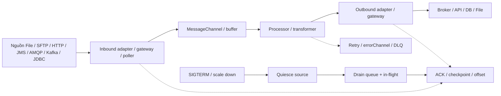
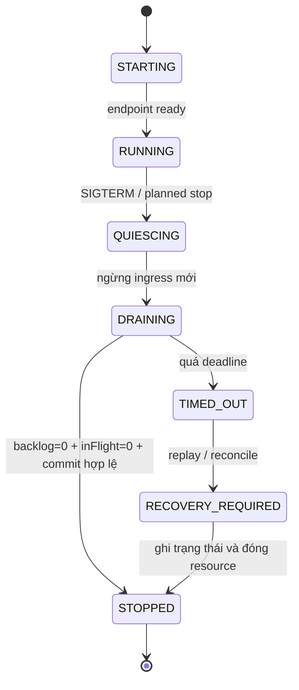
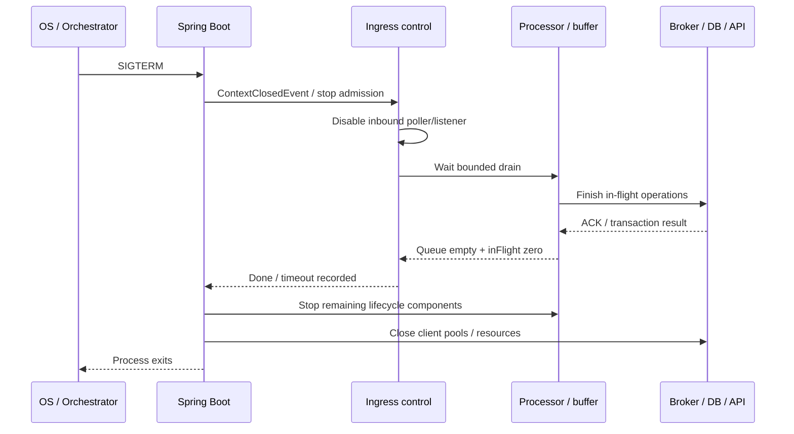
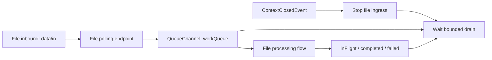
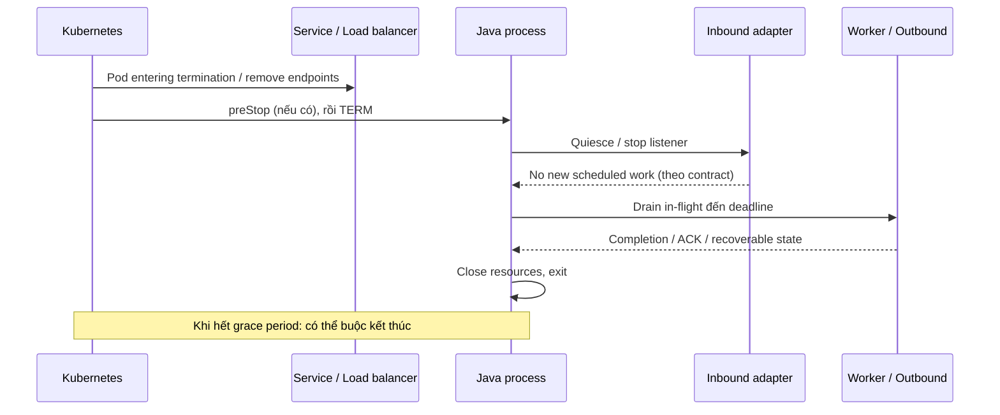

# Shutdown graceful và draining message trong Spring Integration Adapters

> **Chương:** Production  
> **Chủ đề:** Shutdown graceful và draining message  
> **Module:** `SPRING_INTEGRATION_ADAPTERS` — kết nối hệ thống ngoài bằng inbound/outbound adapter, gateway, poller và `MessageChannel`; trao đổi File, SFTP, HTTP, JMS, AMQP/RabbitMQ, Kafka và cơ sở dữ liệu; xử lý hợp đồng message, lỗi và vòng đời kết nối.  
> **Đối tượng:** Java/Spring Boot developer, integration engineer, SRE, người vận hành consumer và pipeline đồng bộ.  
> **Môi trường minh họa:** Java 17+, Spring Boot 3.x, Spring Integration 6.x với phiên bản đồng bộ qua Boot BOM. Tên API, container behavior và mặc định có thể thay đổi theo phiên bản; hãy đối chiếu dự án thực tế trước khi đưa ví dụ vào production.

## 1. Tại sao shutdown graceful là một phần của tính đúng đắn?

Ứng dụng tích hợp không chỉ xử lý HTTP request. Nó có thể đang poll SFTP, giữ một JMS message chưa ACK, đọc Kafka record chưa commit offset, cập nhật một bảng JDBC hoặc chuẩn bị ghi file outbound. Khi Kubernetes gửi `SIGTERM`, triển khai rolling update hoặc đội vận hành dừng một connector, **đóng process ngay** có thể gây mất dữ liệu, nhân đôi tác dụng phụ hoặc giữ tài nguyên ở trạng thái mơ hồ.

Ví dụ: worker đọc file `orders-001.csv`, gửi `OrderImported` tới Kafka rồi cập nhật database. Đúng lúc publish Kafka thành công, process bị dừng trước khi ghi checkpoint nguồn. Sau restart, file được nhận lại và event có thể được gửi lần hai. Nếu chỉ sửa "shutdown chờ thêm 30 giây" mà không có idempotency, trường hợp này vẫn tồn tại khi node mất điện hoặc crash.

**Graceful shutdown** là quy trình giảm hoặc chặn công việc mới, cho công việc đang xử lý cơ hội hoàn tất trong thời hạn, xác nhận ACK/commit đúng ranh giới, đóng kết nối và bàn giao công việc chưa hoàn thành cho cơ chế replay/redelivery bền vững.

**Draining message** là xử lý nốt các message đã được nhận hoặc đang nằm trong buffer/queue theo một hợp đồng rõ ràng, đến khi hết backlog cho phép, hết thời gian chờ hoặc chuyển sang chế độ khôi phục an toàn. Nó **không có nghĩa** mọi message tồn tại trên broker phải được đọc hết trước khi dừng một instance.

### 1.1. Đầu ra bài học

Sau bài này, bạn có thể:

1. Phân biệt shutdown đột ngột, graceful stop, quiesce ingress, drain backlog, ACK/commit và replay.
2. Xác định công việc **đã nhận, đang xử lý, chưa ACK, đang nằm trong queue**, cùng giới hạn quan sát của từng adapter.
3. Thiết kế thứ tự dừng cho `Inbound Adapter → MessageChannel → Transformer/Handler → Outbound Adapter/Gateway`.
4. Hiểu `ContextClosedEvent`, `SmartLifecycle`, phase, timeout Spring Boot, graceful web server shutdown và cách chúng không tự giải quyết broker/file semantics.
5. Triển khai lab Java/Spring Integration với File inbound, `QueueChannel`, worker poller và coordinator chờ drain có hạn.
6. Xác định cách dừng an toàn cho File, SFTP, HTTP, JMS, AMQP/RabbitMQ, Kafka, JDBC, đồng thời xử lý connection/stream/transaction.
7. Thiết kế readiness, `SIGTERM`, `terminationGracePeriodSeconds`, rollout/rollback và tiêu chí chấp nhận khi còn message in-flight.
8. Viết test cho shutdown trong từng điểm lỗi, xác nhận không **mất dấu message**, và xử lý duplicate bằng business idempotency.

### 1.2. Bức tranh đầu-cuối



**Nguyên tắc chính:** Không cấp ACK/commit cho nguồn sớm hơn ranh giới hoàn tất nghiệp vụ đã được thỏa thuận. Không chờ một message vô hạn chỉ để hy vọng quá trình thoát là "graceful". Nếu chưa thể hoàn tất, phải có **redelivery/replay hoặc bằng chứng cần hòa giải**.

## 2. Từ vựng và các trạng thái cần định nghĩa chính xác

### 2.1. Quiesce, drain, terminate khác nhau

| Khái niệm | Ý nghĩa | Điều không được suy ra |
|---|---|---|
| **Quiesce ingress** | Ngừng nhận/poll/subscribe công việc mới hoặc ngừng route request mới đến instance | Những request/message đã được nhận đều hoàn tất |
| **In-flight** | Message đang nằm trong một bước xử lý đang chạy | Không nhất thiết nằm trong queue hoặc được framework đếm |
| **Backlog** | Message đã nhận, đang chờ xử lý ở buffer/`QueueChannel` hoặc broker | Tất cả message của broker cần được drain |
| **Drain** | Xử lý nốt backlog/ in-flight theo ngân sách thời gian | Sẽ luôn đạt zero khi có lỗi downstream |
| **ACK / offset commit** | Báo với nguồn theo chính sách nhận/xử lý | Database và API downstream đã hoàn tất, nếu không có liên kết hợp đồng |
| **Checkpoint** | Dấu tiến độ có thể lưu bền vững | Một checkpoint bất kỳ đồng nghĩa exactly-once |
| **Graceful terminate** | Đóng listener, worker và resource theo thứ tự | Chống được SIGKILL, mất điện hoặc lỗi node |
| **Replay/redelivery** | Đưa message chưa hoàn tất vào lần xử lý sau | Không thể sinh duplicate |
| **Readiness** | Instance có nên nhận công việc mới hay không | Đồng nghĩa drain đã kết thúc |

### 2.2. Thống kê `received`, `queued`, `inFlight`, `completed`, `acked`

Một metric `inFlight=0` không đủ nếu còn `QueueChannel` có 1.000 message. Ngược lại, `queueDepth=0` không đủ nếu một message đã được consumer lấy khỏi queue và đang chờ HTTP response.

Ví dụ diễn tiến:

```text
t0: inbound đã nhận 10, queueDepth=8, inFlight=2
t1: ngừng tạo nhận mới (quiesce)
t2: queueDepth=5, inFlight=2, completed=3
t3: queueDepth=0, inFlight=1, completed=9
t4: queueDepth=0, inFlight=0, completed=10  -> drain thành công về mặt worker
t5: đóng source/outbound, xác nhận ACK/checkpoint theo transport
```

Đây chỉ là ví dụ điều kiện **công việc đã vào worker**. Với broker như Kafka/JMS, còn phải xem listener và transaction/commit để đảm bảo ACK đúng; với buffer in-memory, dữ liệu có thể mất nếu timeout hoặc process bị kill.

### 2.3. Mô hình state machine



**Không đánh đồng TIMED_OUT với SUCCESS.** Một lần drain hết hạn phải tạo metric/log/evidence `remainingQueue`, `inFlight`, số ACK còn chờ và phương án replay. Không ghi “all messages processed” khi thực tế chỉ “process has exited”.

## 3. Hợp đồng hoàn tất: ACK sau khi nào?

Trước khi viết shutdown hook, cần trả lời **điều gì được coi là xử lý thành công**.

### 3.1. Những ranh giới dễ nhầm

| Hành động | Có thể kết luận | Chưa thể kết luận |
|---|---|---|
| `MessageChannel.send(...)` trả `true` | Channel chấp nhận handoff theo contract của channel | Broker hoặc DB downstream đã commit nếu channel bất đồng bộ |
| Message được lấy khỏi `QueueChannel` | Không còn ở queue trong bộ nhớ | Business handler đã xử lý xong |
| HTTP outbound trả `2xx` | Server trả response thành công theo API contract | Hành động không thể bị duplicate sau retry/crash |
| Kafka producer callback thành công | Broker phản hồi theo cấu hình producer `acks`/error policy | Consumer đã xử lý message |
| JMS/AMQP consumer ACK | Broker có thể không redeliver message theo ACK semantics | Một giao dịch DB khác đã commit nếu không bảo đảm |
| JDBC transaction commit | DB thay đổi được commit trong transaction đó | Kafka/HTTP side effect cũng đã commit atomically |
| File được archive | File đã được di chuyển theo quy trình | Mọi event đích đã bền vững nếu không có checkpoint phối hợp |

`DirectChannel` đồng bộ thường làm lỗi handler propagate đến sender trong cùng call stack. `ExecutorChannel`, `QueueChannel` hoặc listener async tạo **ranh giới thread/transaction**; ACK khi chỉ mới đưa vào kênh bất đồng bộ có thể quá sớm. Đó là một anti-pattern quan trọng khi chuyển flow từ local test sang production.

### 3.2. Ma trận quyết định redelivery

| Thời điểm process chết | Thiết kế nguồn/ACK đúng | Kết quả kỳ vọng |
|---|---|---|
| Trước khi nhận message | Broker/source vẫn còn message | Instance mới nhận lại |
| Sau nhận, trước xử lý | Source chưa ACK; File/SFTP cần cơ chế chọn lại/checkpoint | Redelivery/replay |
| Đang gọi downstream nhưng chưa có phản hồi | Có thể đã thành công hoặc chưa | Retry có **idempotency key** và đối soát |
| Downstream thành công, trước source ACK | Source còn quyền redeliver | Có duplicate về transport; nghiệp vụ phải dedupe |
| Sau source ACK/commit | Nguồn coi đã hoàn tất | Phải bảo đảm điểm ACK không sớm hơn ranh giới business |
| Sau timeout drain, `SIGKILL` | Phần chưa commit có thể được replay | Kiểm thử lỗi và lưu bằng chứng/alert |

### 3.3. At-most-once, at-least-once và exactly-once

- **At-most-once:** có thể không trùng, nhưng một số công việc có thể bị mất khi ACK sớm hoặc buffer không bền vững bị hủy.
- **At-least-once:** không mất message đã được nguồn lưu bền vững theo giả định, nhưng xử lý có thể lặp do retry/rebalance/crash.
- **Exactly-once effect trong phạm vi nghiệp vụ:** cần kết hợp transaction, dedupe key, outbox/inbox, idempotent handler và ranh giới cụ thể; không xuất hiện chỉ nhờ bật graceful shutdown.

Kafka transaction có thể cung cấp ngữ nghĩa xử lý exactly-once **trong một số luồng Kafka → Kafka** theo cấu hình thích hợp. Không suy ra nó bao trùm PostgreSQL, HTTP hoặc filesystem. Với `JDBC → Kafka`, transactional outbox/CDC hoặc mô hình nhất quán được thiết kế riêng thường dễ kiểm soát hơn một lần gửi ngoài transaction.

## 4. Spring Boot và Spring Integration dừng ứng dụng như thế nào?

### 4.1. Vòng đời shutdown của ApplicationContext

Khi process được dừng **có trật tự** (ví dụ `SIGTERM` và JVM shutdown hook của Spring được sử dụng), Spring đóng `ApplicationContext`. Trong quá trình đó, `ContextClosedEvent` được phát và lifecycle processor dừng các bean `SmartLifecycle`, sau đó bean destruction callbacks chạy. Thứ tự này có thể chịu ảnh hưởng của phase, dependencies và cách từng endpoint/container triển khai stop.



**Giới hạn:** Sơ đồ là **thứ tự mong muốn**, không cam kết tự động có ở mọi Spring Integration adapter. Nếu lifecycle processor dừng consumer trước source hoặc một executor bị destroy trước khi queue drain, công việc có thể bị bỏ dở. Phải cấu hình và kiểm thử thứ tự với implementation thật.

### 4.2. `SmartLifecycle` và phase

`SmartLifecycle` có các phương thức như `start()`, `stop()`, `stop(Runnable callback)`, `isRunning()` và `getPhase()`. Trong shutdown của lifecycle processor, các nhóm phase cao thường được **stop trước** phase thấp; startup đi theo chiều ngược lại. Tuy nhiên **dependencies, implementation và stop callback** cũng tác động đến thứ tự cụ thể.

Tư duy thiết kế:

- **Ingress/source**: ngừng nhận trước.
- **Worker/consumer**: còn chạy để xử lý backlog đã chấp nhận.
- **Outbound client, transaction manager, connection pool**: còn dùng được tới khi xử lý/commit xong.
- **Cleanup**: đóng kết nối và tài nguyên cuối cùng.

Không thay đổi `phase` toàn hệ thống dựa trên giả định chưa kiểm thử: các inbound endpoint, listener container và task executor có thể có phase mặc định khác nhau theo phiên bản/cấu hình. Nếu tự triển khai `SmartLifecycle.stop(Runnable)`, phải **gọi callback hoàn tất đúng một lần** sau khi stop, kể cả khi timeout hoặc lỗi; nếu không lifecycle processor có thể chờ hết hạn mà không rõ nguyên nhân.

### 4.3. Các thuộc tính Spring Boot liên quan

```yaml
spring:
  lifecycle:
    timeout-per-shutdown-phase: 30s
  main:
    # Với một ứng dụng web thật, cấu hình shutdown theo phiên bản Boot.
    # Một worker không có HTTP server không cần bật web chỉ để có graceful.
    web-application-type: none
```

`spring.lifecycle.timeout-per-shutdown-phase` đặt ngân sách chờ của lifecycle processor **cho từng phase group**, không phải thời hạn tổng cho **toàn bộ shutdown**, và không tự đảm bảo mọi `IntegrationFlow` drain sạch.

Khi ứng dụng **có HTTP server**, cơ chế graceful web-server shutdown còn phụ thuộc embedded server, phiên bản Boot và cấu hình runtime. Ở dòng Boot hỗ trợ `server.shutdown=graceful`, cấu hình này điều khiển chấm dứt HTTP request tại server; không tự dừng Kafka, JMS, SFTP hoặc JDBC poller. Trong các phiên bản Boot, cách bật/mặc định graceful web server có thể khác, nên xác minh deployment thực tế.

### 4.4. `ContextClosedEvent` là cơ hội điều phối, không thay thế transaction

Một handler nhận `ContextClosedEvent` có thể chủ động dừng nguồn nhận rồi đợi in-flight/backlog có hạn, trong khi các endpoint còn chạy. Nhưng nó có thể bị giới hạn bởi:

- Event listener được gọi đồng bộ hoặc bất đồng bộ tùy event multicaster đang cấu hình.
- Endpoint source có thể đang xử lý một lần poll; gọi `stop()` không luôn chứng minh không còn message vừa được nhận.
- Một `QueueChannel` chỉ phản ánh queue trong JVM, không phản ánh broker hoặc HTTP request mới đang tới.
- Một phần công việc có thể ở trong executor riêng mà counter chưa đo.
- Khi JVM chết không trật tự, hook **không chạy** hoặc không có đủ thời gian.

Với production, cần **ingress admission fence** đủ chặt, đếm công việc trước handoff, quiescence barrier, metric/timing và cơ chế replay bền vững. Lab phía dưới minh họa các phần, **không tuyên bố thay thế broker ACK, metadata store hoặc khóa giao dịch phân tán**.

### 4.5. Graceful web shutdown và readiness

Đối với inbound HTTP gateway, dừng nhận traffic mới thường cần **readiness chuyển Not Ready**, load balancer ngừng route, HTTP server cho request đang chạy cơ hội hoàn tất, rồi adapter trả reply/timeout đúng hợp đồng. Khi nhận `SIGTERM`, thứ tự thực tế giữa readiness propagation, proxy cache, preStop hook và server shutdown có thể tạo khoảng thời gian ngắn request mới vẫn đến.

Với **message-driven consumers** (Kafka, AMQP, JMS), HTTP readiness **không tự dừng consumer**. Cần stop/pause listener container theo API hỗ trợ và đảm bảo ACK/offset strategy phù hợp.


## 5. Thiết kế thứ tự dừng theo topology Spring Integration

### 5.1. Nguyên tắc “nguồn trước, đích sau”

Một pipeline:

```text
File/SFTP/Kafka inbound
         |
         v
  MessageChannel
         |
         v
 Validate / Transform
         |
         v
 DB transaction / HTTP / Kafka outbound
         |
         v
   ACK nguồn / checkpoint
```

Khi rolling update hoặc scale down, thứ tự mong muốn là:

1. **Quiesce nguồn:** dừng nhận thêm file/row, dừng listener hoặc rút pod khỏi tuyến HTTP.
2. **Chặn admission mới:** bảo đảm request ngoại lệ còn đến muộn không được chấp nhận thêm như công việc mới; có phản hồi/retry đúng protocol.
3. **Đợi những bước đang chạy:** nguồn đã đọc nhưng chưa handoff, queue nội bộ, consumer handler, downstream operation, callback/ACK.
4. **Commit kết quả bền vững:** chỉ ACK/commit/checkpoint sau khi điều kiện nghiệp vụ được đáp ứng.
5. **Chốt trạng thái còn lại:** nếu quá hạn, để nguồn có khả năng redeliver hoặc ghi lại công việc chưa hoàn tất trong kho bền vững.
6. **Đóng kết nối:** dừng workers, đóng session/file stream, pool HTTP/JDBC, producer/consumer và executor.
7. **Xác minh:** log kết quả drain, event ID/correlation, queue depth và số công việc cần recovery.

Quy tắc “source first, sink last” là **mục tiêu thiết kế**, không phải cấu hình mặc định đã được Spring Boot bảo đảm trong mọi tình huống.

### 5.2. Chặn nhận mới khác chặn xử lý công việc cũ

Nếu dùng một `QueueChannel`, đừng dừng consumer ngay khi bắt đầu shutdown; nếu source đã bị quiesce nhưng queue còn 100 message, consumer cần chạy để drain. Ngược lại, nếu consumer xử lý chậm mà nguồn vẫn poll, queue không bao giờ về zero.

Nếu dùng `DirectChannel` đồng bộ từ File poller tới handler, `inFlight` có thể chính là tác vụ poller đang thực thi. Nếu dùng `ExecutorChannel`, cần đếm cả công việc đã được executor nhận nhưng **chưa chạy** hoặc đang chạy. Một metric chỉ đếm method handler bắt đầu sẽ bỏ sót queue của executor.

### 5.3. Admission gate và quiescence barrier

**Admission gate** quyết định có chấp nhận message mới hay không. Một gate được cài đúng nên thực hiện atomically:

- Khi `OPEN`, tăng số công việc đã chấp nhận **trước** khi handoff tới downstream.
- Khi `CLOSING`, từ chối/chuyển hướng công việc mới theo transport contract.
- Khi handler hoàn tất hoặc giao lại nguồn theo chính sách, giảm counter **đúng một lần**.
- Khi không còn producer nào có thể thêm message và mọi công việc chấp nhận đã hoàn thành/được lưu bền vững, có thể kết luận barrier đã đạt.

Ví dụ, nếu đếm `inFlight` chỉ lúc method consumer bắt đầu, một source poll đang chạy có thể handoff sau khi controller thấy `queueDepth=0` và `inFlight=0`. Vì vậy **đếm + quiesce** cần được thiết kế không có khoảng trống trạng thái. Không dùng một vòng `while(queue.size()==0)` làm bằng chứng tuyệt đối đã drain.

### 5.4. Đồng bộ, bất đồng bộ và callback muộn

| Mô hình | Nơi message có thể đang nằm | Bước bắt buộc khi drain |
|---|---|---|
| `DirectChannel` | Call stack của poller/gateway/handler | Chờ call stack hoàn tất, kiểm tra exception |
| `QueueChannel` in-memory | Bộ nhớ queue và thread consumer | Dừng source, tiếp tục poll queue đến hết hoặc deadline |
| `ExecutorChannel` | Executor queue, đang chạy hoặc bị reject | Chặn submit mới, chờ queued+running tasks theo giới hạn |
| `PublishSubscribeChannel` | Một hoặc nhiều subscriber, có thể async | Kiểm tra completion/ACK của **tất cả nhánh bắt buộc** |
| Broker inbound | Broker inflight/prefetched messages + app | Stop listener, ACK/nack theo container và xử lý |
| Outbound async producer | Client buffer/network và callback | Flush/await callback, ghi outcome và release client |

Nếu một fan-out có nhánh A commit DB và nhánh B gửi Kafka, “nhánh A done” không đồng nghĩa toàn bộ message done. Điều kiện complete phải được định nghĩa theo hợp đồng nghiệp vụ; tránh cho một nhánh optional làm block shutdown mãi.

## 6. Shutdown theo từng inbound adapter

### 6.1. File inbound: poller, persistent filter và tệp còn nguyên

**Hành vi cần hiểu:** `Files.inboundAdapter(...)` thường thăm dò thư mục và phát một `File` vào flow; nhận file không có giao thức ACK broker. Muốn không mất nghiệp vụ cần tự thiết kế cách chứng minh file đã được xử lý, archive và checkpoint.

Trình tự:

1. Dừng File polling endpoint, tránh lượt poll mới.
2. Đợi các file đã được nhận qua channel được xử lý và downstream ACK.
3. Chỉ archive/đánh dấu hoàn tất khi business effect bền vững.
4. Khi lỗi hoặc shutdown hết hạn, file nguồn và metadata phải cho phép replay an toàn.
5. Đóng file stream, tránh ghi file đích dang dở; với file outbound, dùng staging/temp suffix và rename nguyên tử nếu filesystem hỗ trợ.

**Cạm bẫy:** Một persistent accept-once filter có thể đánh dấu file đã thấy **trước** khi downstream commit. Nếu process chết sau khi đánh dấu nhưng trước xử lý, file còn trên disk mà filter không chọn lại, gây mất xử lý logic. Cần thiết kế trạng thái `claimed → processing → completed` và cơ chế phục hồi claim hết hạn, không gọi persistent filter là exactly-once.

**Idempotency:** Dùng khóa từ nội dung nghiệp vụ, checksum/phiên bản file hoặc partner+file identity có kiểm soát. Không coi tên file một mình là key bất biến nếu đối tác có thể ghi đè.

### 6.2. SFTP inbound: session và file remote

SFTP polling/streaming có thêm session SSH/SFTP và trạng thái đồng bộ remote/local:

- Ngừng poll trước để không tải thêm file mới.
- Với **synchronized inbound**, phân biệt file đã tải xuống staging nhưng chưa xử lý; có quy trình recover local staging và remote source.
- Với **streaming inbound**, bảo đảm downstream đọc/đóng `InputStream` đúng vòng đời; không đóng session trước khi đọc xong.
- Dùng host-key verification, key/credential được quản lý; không tắt trust check chỉ để vượt lỗi shutdown/reconnect.
- Remote rename/marker hoặc filter bền vững cần xử lý an toàn khi shutdown giữa upload/download.
- Khi nguồn remote không hỗ trợ transaction, dùng trạng thái/idempotency và kiểm tra file hoàn chỉnh thay vì coi rename/ACK là atomic với DB/Kafka.

Nếu SFTP `SessionFactory` dùng cache, thao tác stop endpoint và stop session cache/cleanup là hai bước khác nhau. Đóng session quá sớm có thể cắt stream đang xử lý; đóng quá muộn có thể làm pod không kết thúc đúng grace period.

### 6.3. HTTP inbound: dừng traffic và trả kết quả có trách nhiệm

HTTP inbound gateway có request–reply semantics. Khi shutdown:

1. Chuyển readiness để load balancer ngừng gửi request mới.
2. Cho các request đã vào server tiếp tục trong giới hạn `server.shutdown`/graceful period và timeout ứng dụng.
3. Với request mới đến muộn, trả một phản hồi rõ ràng (thường `503 Service Unavailable` hoặc mã phù hợp hợp đồng) kèm chính sách retry, thay vì nhận việc mới rồi mất dấu.
4. Không trả `200/202` trước khi bảo đảm công việc đã được ghi bền vững nếu hợp đồng đòi hỏi.
5. Dừng client pools/callbacks sau khi các request hợp lệ được xử lý hoặc chuyển thành công việc có thể replay.

**Ngoại lệ:** HTTP server graceful shutdown chỉ biết lifecycle của HTTP request/connection. Nếu inbound gateway trả `202 Accepted` rồi đẩy việc vào queue in-memory, request đã kết thúc nhưng công việc chưa bền vững; pod có thể chết và mất job. Cần durable queue/outbox trước khi ACK HTTP.

### 6.4. JMS inbound: stop listener, ACK và transaction

Với Spring Integration JMS message-driven inbound, cần tìm listener container/provider thực đang được adapter sử dụng:

- Dừng nhận message mới bằng lifecycle của listener container/endpoint.
- Kiểm tra số listener đang xử lý, concurrency, prefetched/unacknowledged messages.
- Với **transacted session**, chỉ commit khi xử lý theo contract đã thành công; lỗi cần rollback/redelivery theo provider/broker.
- Với **client ACK/auto ACK**, phải hiểu thời điểm container thực sự ACK; không suy một message gửi qua async channel là đã được xử lý thành công.
- Khi timeout, message chưa commit/ACK cần còn khả năng redelivery; DLQ xử lý poison messages có giới hạn.
- Đóng `jakarta.jms.ConnectionFactory`/connection theo cơ chế quản lý và provider tương ứng sau khi listener dừng.

Nếu flow JMS → `ExecutorChannel` → DB, consumer có thể coi đã giao message cho thread khác trước khi DB commit. Muốn bảo đảm “ACK sau DB commit”, cần thiết kế bridge/transaction boundary phù hợp; không chỉ tăng shutdown timeout.

### 6.5. AMQP/RabbitMQ: prefetch và requeue

Spring Integration AMQP dùng Spring AMQP listener/handler. Cần phân biệt:

- `prefetch`: broker có thể giao nhiều message chưa ACK tới consumer, dù executor chưa bắt đầu xử lý tất cả.
- `manual ack`/container ack policy: thời điểm broker coi message hoàn tất.
- `nack/requeue`: xử lý khi thất bại hoặc timeout; nếu lặp vô hạn gây poison-message loop.
- Publisher confirms/returns: khi outbound RabbitMQ gửi đi, đợi xác nhận thích hợp trước khi đánh dấu business complete theo yêu cầu.

Khi quiesce, ngừng listener trước nhưng giữ worker/outbound connection đủ lâu để xử lý message đang có; theo dõi unacked trên broker, số consumer và DLQ. Nếu container bị dừng giữa message, broker có thể redeliver sau khi connection đóng theo trạng thái ACK. **Redelivery là điều bình thường** trong at-least-once; handler phải idempotent.

### 6.6. Kafka inbound: offset commit và rebalance

Kafka consumer được tổ chức theo consumer group, poll loop, partitions, offsets và listener container. Khi dừng:

1. Ngừng lấy record mới theo API container phù hợp; xử lý records đã được chuyển vào flow theo giới hạn shutdown.
2. Chỉ commit offsets tương ứng với các records được coi xử lý xong theo policy.
3. Chấp nhận rebalance khi consumer rời group; instances còn lại sẽ tiếp nhận partitions.
4. Nếu handler async, một callback “đã submit” không được dùng làm bằng chứng business đã commit; kiểm tra acknowledgment mode, async acks/offset ordering theo phiên bản.
5. Khi producer outbound còn record trong buffer, cần `flush` và chờ callbacks thích hợp trước khi đóng theo deadline.

**Cạm bẫy:** Commit offset của record có thứ tự cao hơn khi những record trước chưa hoàn tất có thể làm mất khả năng replay đúng. Với xử lý async/out-of-order, cần tracking completed offsets liên tục theo partition và chiến lược listener hỗ trợ. Không tuyên bố `enable-auto-commit=false` tự giải quyết vấn đề.

Đặt `max.poll.interval.ms`, thời gian xử lý batch và shutdown timeout nhất quán: handler quá chậm có thể khiến group rebalance **ngay trong lúc drain**. Đừng tăng mọi timeout vô hạn; hãy giới hạn batch/in-flight và tách công việc dài sang durable work queue nếu cần.

### 6.7. JDBC inbound: claim/lock và rollback

JDBC polling source thường đọc row đủ điều kiện, có thể đánh dấu đã xử lý. Để dừng đúng:

- Ngừng poll query mới; đợi transaction đang thực hiện hoặc rollback có kiểm soát.
- Có cách phân biệt row `NEW`, `CLAIMED`, `PROCESSING`, `COMPLETED`, `FAILED`.
- Khi dùng nhiều instance, claim theo transaction/locking để tránh hai worker lấy cùng row.
- Nếu process chết khi row `CLAIMED`, cần lease/timeout và reconciliation để row được xử lý lại.
- Không giữ DB transaction mở trong lúc chờ HTTP request dài nếu có giải pháp outbox/async phù hợp.
- Đóng pool sau khi các giao dịch cần nó đã kết thúc, không trước.

Spring Integration JDBC adapter cung cấp endpoint/query support, **không tự tạo business checkpoint hoặc distributed transaction**. Với JDBC → Kafka, outbox/CDC và consumer idempotency là công cụ thiết kế quan trọng.

## 7. Outbound adapters và hoàn tất tác dụng phụ

### 7.1. Đích ở đâu thì drain phải quan sát tới đó

| Outbound | Điều kiện hoàn tất đáng tin hơn “đã gửi vào channel” | Khi hết deadline |
|---|---|---|
| File writer | File đã ghi an toàn theo policy, rename/flush được kiểm tra | Giữ temp file và reconcile, không công bố file dở |
| SFTP uploader | Remote upload hoàn tất, temp rename/marker theo hợp đồng | Giữ local checkpoint và retry idempotent |
| HTTP gateway | Nhận response có ý nghĩa; timeout không loại trừ server đã thành công | Tra cứu bằng idempotency key/correlation trước khi retry |
| JMS producer | Send/transaction thành công theo provider semantics | Outbox/retry, không tự nhận broker đã lưu |
| RabbitMQ publisher | Confirm/return xử lý theo policy và routing thành công | Giữ event bền vững để gửi lại |
| Kafka producer | Producer callback/acks đúng yêu cầu; flush có hạn | Không mất event nếu dùng durable outbox |
| JDBC handler | Transaction commit; close resource hợp lệ | Rollback/retry/reconcile theo key |

### 7.2. Outbound gateway khác outbound adapter

**Outbound gateway** có response tiếp tục trong flow, ví dụ HTTP hoặc JMS request–reply; request đang chờ reply phải được đưa vào danh sách in-flight. Nếu timeout reply, cần xác định có đang tiếp tục chờ callback muộn hay bỏ response, đồng thời bảo đảm request ID/idempotency.

**Outbound channel adapter** thường one-way ở góc nhìn flow. Tuy vậy API underlying có thể hỗ trợ callback/confirm; nếu nghiệp vụ cần xác nhận đã bền vững, thiết kế async completion tracking hoặc outbox riêng. Không coi kiểu endpoint “one-way” là một bằng chứng ACK.

### 7.3. Chặn tác dụng phụ trùng khi shutdown

Ví dụ flow File → HTTP tạo đơn → JDBC:

- File filter đã nhận `order-42.csv`.
- HTTP trả timeout sau 5 giây.
- Process nhận `SIGTERM` trước khi JDBC ghi `DONE`.
- Sau restart, file được lấy lại và HTTP có thể được gọi lần nữa.

Cách giảm rủi ro: tạo **business idempotency key** `partnerId + orderId + schemaVersion`, truyền tới API qua header được đối tác hỗ trợ hoặc lưu bảng dedupe trước/ trong transaction thích hợp. Retry cần giữ **cùng key**, không tạo UUID khác trên mỗi lần. Khi server không hỗ trợ idempotency, thiết kế reconciliation API/trạng thái ngoài trước khi gửi lại.


## 8. Lab Spring Boot: quiesce File ingress và drain QueueChannel

### 8.1. Mục tiêu và giới hạn

Ta xây một Spring Boot worker:



Mục tiêu: có thể nhận file khi ứng dụng đang chạy; khi context đóng có trật tự, coordinator chủ động stop nguồn File rồi đợi queue và handler trong một deadline. **Không có broker hoặc database bền vững trong lab**. Đừng triển khai nguyên xi như hệ thống không được phép mất message: `QueueChannel` mặc định ở đây lưu trong RAM, có thể mất dữ liệu ở `SIGKILL`, process crash hoặc hết deadline. Đặc biệt, đếm in-flight ở handler **chưa** phải admission barrier nguyên tử.

### 8.2. Dependency

Trong Maven project đã dùng Spring Boot parent/BOM, thêm các dependency sau; đoạn này là một phần của POM hợp lệ:

```xml
<dependencies>
    <dependency>
        <groupId>org.springframework.boot</groupId>
        <artifactId>spring-boot-starter-integration</artifactId>
    </dependency>
    <dependency>
        <groupId>org.springframework.integration</groupId>
        <artifactId>spring-integration-file</artifactId>
    </dependency>
    <dependency>
        <groupId>org.springframework.boot</groupId>
        <artifactId>spring-boot-starter-test</artifactId>
        <scope>test</scope>
    </dependency>
    <dependency>
        <groupId>org.springframework.integration</groupId>
        <artifactId>spring-integration-test</artifactId>
        <scope>test</scope>
    </dependency>
</dependencies>
```

Gradle Groovy DSL tương đương (project đã import Boot dependency management):

```groovy
dependencies {
    implementation 'org.springframework.boot:spring-boot-starter-integration'
    implementation 'org.springframework.integration:spring-integration-file'
    testImplementation 'org.springframework.boot:spring-boot-starter-test'
    testImplementation 'org.springframework.integration:spring-integration-test'
}
```

Không cần Kafka/JMS/Rabbit starter để học `QueueChannel` trong JVM. Ngược lại, nếu đưa nguồn thật từ broker vào topology, phải thêm đúng adapter module, client/provider và test ACK/redelivery thực tế.

### 8.3. Cấu trúc file và cấu hình

```text
graceful-drain-lab/
├── pom.xml
└── src/
    ├── main/
    │   ├── java/com/example/drain/
    │   │   ├── DrainApplication.java
    │   │   ├── WorkCounters.java
    │   │   ├── FileWorkFlows.java
    │   │   └── DrainOnShutdown.java
    │   └── resources/application.yml
    └── test/java/com/example/drain/
        └── WorkCountersTest.java
```

File `src/main/resources/application.yml`:

```yaml
spring:
  application:
    name: graceful-drain-lab
  main:
    web-application-type: none
  lifecycle:
    timeout-per-shutdown-phase: 30s

app:
  file:
    inbox: ./data/in
  drain:
    timeout: 15s

logging:
  level:
    com.example.drain: INFO
    org.springframework.integration: INFO
```

`web-application-type: none` thể hiện worker này không nhận HTTP request. `timeout-per-shutdown-phase` là giới hạn Spring Boot lifecycle, còn `app.drain.timeout` là **giới hạn do lab coordinator dùng**. Chúng không cộng lại thành một cam kết tổng thời gian đóng process. Cần dành biên độ cho bean destruction và orchestration.

File `DrainApplication.java`:

```java
package com.example.drain;

import org.springframework.boot.SpringApplication;
import org.springframework.boot.autoconfigure.SpringBootApplication;

@SpringBootApplication
public class DrainApplication {
    public static void main(String[] args) {
        SpringApplication.run(DrainApplication.class, args);
    }
}
```

### 8.4. Bộ đếm tác vụ đang xử lý

File `WorkCounters.java`:

```java
package com.example.drain;

import java.util.concurrent.atomic.AtomicInteger;
import java.util.concurrent.atomic.AtomicLong;
import org.springframework.stereotype.Component;

@Component
public class WorkCounters {
    private final AtomicInteger inFlight = new AtomicInteger();
    private final AtomicLong completed = new AtomicLong();
    private final AtomicLong failed = new AtomicLong();

    public void entered() {
        inFlight.incrementAndGet();
    }

    public void succeeded() {
        completed.incrementAndGet();
    }

    public void failed() {
        failed.incrementAndGet();
    }

    public void exited() {
        inFlight.decrementAndGet();
    }

    public int inFlight() {
        return inFlight.get();
    }

    public long completed() {
        return completed.get();
    }

    public long failures() {
        return failed.get();
    }
}
```

`AtomicInteger` và `AtomicLong` giúp metric thread-safe cho **một process**. Bộ đếm này chưa bao phủ message đang được File source lấy nhưng chưa tới queue, executor queue ẩn hoặc broker-prefetched records; production phải theo dõi cả admission/handoff và trạng thái nguồn.

### 8.5. Tạo hai IntegrationFlow bean

File `FileWorkFlows.java`:

```java
package com.example.drain;

import java.io.File;
import java.time.Duration;

import org.slf4j.Logger;
import org.slf4j.LoggerFactory;
import org.springframework.beans.factory.annotation.Value;
import org.springframework.context.annotation.Bean;
import org.springframework.context.annotation.Configuration;
import org.springframework.integration.channel.QueueChannel;
import org.springframework.integration.dsl.IntegrationFlow;
import org.springframework.integration.dsl.Pollers;
import org.springframework.integration.file.dsl.Files;

@Configuration(proxyBeanMethods = false)
public class FileWorkFlows {
    private static final Logger log =
            LoggerFactory.getLogger(FileWorkFlows.class);

    @Bean("workQueue")
    QueueChannel workQueue() {
        // Bounded queue: giới hạn buffer trong một JVM, KHÔNG bền vững.
        return new QueueChannel(100);
    }

    @Bean("fileIngressFlow")
    IntegrationFlow fileIngressFlow(
            @Value("${app.file.inbox}") String inbox) {
        return IntegrationFlow
            .from(
                Files.inboundAdapter(new File(inbox))
                     .autoCreateDirectory(true)
                     .patternFilter("*.txt"),
                endpoint -> endpoint
                    .id("fileIngressEndpoint")
                    .poller(
                        Pollers.fixedDelay(Duration.ofMillis(300))
                               .maxMessagesPerPoll(1)
                    )
            )
            .channel("workQueue")
            .get();
    }

    @Bean("fileProcessorFlow")
    IntegrationFlow fileProcessorFlow(WorkCounters counters) {
        return IntegrationFlow
            .from(
                "workQueue",
                endpoint -> endpoint.poller(
                    Pollers.fixedDelay(Duration.ofMillis(150))
                           .maxMessagesPerPoll(1)
                )
            )
            .handle(message -> {
                File file = (File) message.getPayload();
                counters.entered();
                try {
                    // CHỈ MÔ PHỎNG tác vụ lâu, không làm trong production.
                    Thread.sleep(700);
                    log.info("PROCESSED file={}", file.getName());
                    counters.succeeded();
                } catch (InterruptedException ex) {
                    Thread.currentThread().interrupt();
                    counters.failed();
                    throw new IllegalStateException(
                        "Processing interrupted", ex
                    );
                } catch (RuntimeException ex) {
                    counters.failed();
                    throw ex;
                } finally {
                    counters.exited();
                }
            })
            .get();
    }
}
```

**Cách đọc flow:**

1. `fileIngressEndpoint` là ID endpoint nguồn dùng để stop khi shutdown.
2. `FileReadingMessageSource` đưa `File` vào `QueueChannel` `workQueue`.
3. Processor flow poll `workQueue` và giả lập xử lý mỗi file khoảng 700 ms.
4. `QueueChannel(100)` giới hạn queue; nếu đầy, việc gửi vào channel có thể thất bại hoặc chờ theo semantics/timeout và cấu hình source. **Không được bỏ qua lỗi handoff.**
5. `WorkCounters` đếm công việc **sau khi ra khỏi queue**; muốn sản phẩm tin cậy phải mở rộng để đếm cả admission và giữ trạng thái durable.

### 8.6. Coordinator khi context đóng

File `DrainOnShutdown.java`:

```java
package com.example.drain;

import java.time.Duration;
import java.util.concurrent.TimeUnit;
import java.util.concurrent.atomic.AtomicBoolean;

import org.slf4j.Logger;
import org.slf4j.LoggerFactory;
import org.springframework.beans.factory.annotation.Qualifier;
import org.springframework.beans.factory.annotation.Value;
import org.springframework.context.ApplicationContext;
import org.springframework.context.Lifecycle;
import org.springframework.context.event.ContextClosedEvent;
import org.springframework.context.event.EventListener;
import org.springframework.integration.channel.QueueChannel;
import org.springframework.stereotype.Component;

@Component
public class DrainOnShutdown {
    private static final Logger log =
            LoggerFactory.getLogger(DrainOnShutdown.class);

    private final ApplicationContext context;
    private final QueueChannel queue;
    private final WorkCounters counters;
    private final Duration timeout;
    private final AtomicBoolean closing = new AtomicBoolean(false);

    public DrainOnShutdown(
            ApplicationContext context,
            @Qualifier("workQueue") QueueChannel queue,
            WorkCounters counters,
            @Value("${app.drain.timeout:15s}") Duration timeout) {
        this.context = context;
        this.queue = queue;
        this.counters = counters;
        this.timeout = timeout;
    }

    @EventListener(ContextClosedEvent.class)
    public void onContextClosed() {
        if (!closing.compareAndSet(false, true)) {
            return;
        }

        log.info("DRAIN_START queue={} inFlight={}",
                 queue.getQueueSize(), counters.inFlight());

        // Stop nguồn trước, giữ processor poller chạy trong lúc chờ.
        Lifecycle ingress =
            context.getBean("fileIngressEndpoint", Lifecycle.class);
        ingress.stop();

        long deadline = System.nanoTime() + timeout.toNanos();
        boolean interrupted = false;

        while (System.nanoTime() < deadline) {
            if (queue.getQueueSize() == 0 && counters.inFlight() == 0) {
                break;
            }
            try {
                TimeUnit.MILLISECONDS.sleep(100);
            } catch (InterruptedException ex) {
                Thread.currentThread().interrupt();
                interrupted = true;
                break;
            }
        }

        boolean drained =
            queue.getQueueSize() == 0 && counters.inFlight() == 0
            && !interrupted;

        if (drained) {
            log.info("DRAIN_FINISHED completed={} failed={}",
                     counters.completed(), counters.failures());
        } else {
            log.warn("DRAIN_INCOMPLETE queue={} inFlight={} failed={}",
                     queue.getQueueSize(), counters.inFlight(),
                     counters.failures());
        }
    }
}
```

**Diễn giải trung thực về độ an toàn:**

- Handler nhận `ContextClosedEvent` được gọi khi context đóng theo đường thông thường. Với cấu hình event multicaster mặc định đồng bộ, nó có cơ hội giữ processor sống trước giai đoạn stop lifecycle beans.
- Nó gọi `stop()` trên nguồn File theo endpoint ID, sau đó chờ `queueDepth` và `inFlight` về 0 hoặc hết deadline.
- `@EventListener` **không phải giao thức quiescence barrier được chứng minh tuyệt đối**: có race nếu lần poll hiện hành đang chuyển message nhưng chưa cập nhật queue/counter; một event multicaster bất đồng bộ sẽ làm thay đổi thứ tự.
- `DRAIN_FINISHED` chỉ có nghĩa **hai counter quan sát được đang bằng 0**; không chứng minh downstream bền vững hoặc không có file đang được đọc ở biên source. Trong production phải thiết kế admission fence với bước xác nhận mọi source tasks đã quiesce và completion tracking trước lúc ACK/checkpoint.
- Nếu queue còn dữ liệu khi timeout, **lab có thể mất dữ liệu trong bộ nhớ**. Đừng dùng làm chiến lược recovery production. Chuyển sang durable broker, `MessageStore` thích hợp hoặc transaction/outbox theo yêu cầu, đồng thời test cách xử lý của source khi stop giữa poll.

### 8.7. Chạy lab và quan sát

Từ thư mục Maven project có wrapper:

```bash
./mvnw spring-boot:run
```

Trên Windows dùng `mvnw.cmd spring-boot:run`. Tạo các file `data/in/order-001.txt`, `order-002.txt`, `order-003.txt` với nội dung giả. Vì processor chậm hơn file polling, có thể quan sát queue tăng, rồi giảm.

Để mô phỏng stop có trật tự, chạy ứng dụng trong terminal và dùng **Ctrl+C** để gửi interrupt/termination theo môi trường, hoặc gửi `SIGTERM` tới PID của process JVM khi quản lý process độc lập. **Không** dùng `kill -9` nếu mục tiêu là kiểm tra graceful path; `SIGKILL` được dùng ở một bài kiểm thử lỗi riêng sau khi đã có cơ chế khôi phục.

Kỳ vọng log dạng:

```text
PROCESSED file=order-001.txt
DRAIN_START queue=2 inFlight=1
PROCESSED file=order-002.txt
PROCESSED file=order-003.txt
DRAIN_FINISHED completed=3 failed=0
```

Thứ tự, giá trị counter và số message thực sẽ khác theo lịch thread/timing và số file đã được poll; **đây là log kỳ vọng minh họa, không phải kết quả đã chạy**. Trường hợp stop quá sớm hoặc inbound chưa kịp nhận file, các file chưa nhận vẫn nằm trên filesystem để source xử lý khi khởi chạy lại, tùy chính sách file filter.

### 8.8. Thử một deadline quá ngắn

Đổi:

```yaml
app:
  drain:
    timeout: 200ms
```

Cho nhiều file vào inbox rồi dừng. Có thể nhận `DRAIN_INCOMPLETE` với queue hoặc in-flight còn dương. Bài học: có giới hạn chờ và biết **còn bao nhiêu công việc**, nhưng **không** làm các message chưa xong trở nên bền vững. Đừng báo success khi còn buffered work; cần replay strategy trước khi sử dụng trong hệ thống quan trọng.

### 8.9. Các nâng cấp bắt buộc trước production

1. Thay in-memory queue bằng **durable work store/broker** khi chấp nhận mất message là không được phép.
2. Thực hiện **admission fence nguyên tử** trước mọi handoff; sau khi đóng admission, nguồn không nhận job mới và drain chờ cả source tasks đã bước vào vùng critical.
3. Bổ sung completed/failed/retry/recoverable counts; kết quả complete gắn với **business ID** và downstream commit.
4. Đảm bảo file source chưa ACK/checkpoint sớm hơn business completion; thiết kế lease/claim và replay khi crash.
5. Thiết kế poison-message quarantine, không để một lỗi lặp làm drain chờ mãi.
6. Xác minh graceful stop của endpoint thực theo Spring Integration version đã chọn; không chỉ dựa vào bean name suy luận.
7. Kiểm thử stop giữa read/queue/handler/outbound/commit bằng failure injection và process termination.
8. Có observability, audit, deadline, và phương án trả việc chưa xử lý cho instance mới hoặc operator.


## 9. Kiểm thử shutdown và các điểm lỗi trong lab

### 9.1. Unit test bộ đếm, không cần chạy Spring context

File `WorkCountersTest.java`:

```java
package com.example.drain;

import org.junit.jupiter.api.Test;
import static org.assertj.core.api.Assertions.assertThat;

class WorkCountersTest {

    @Test
    void tracksCompletionAndActiveWork() {
        WorkCounters counters = new WorkCounters();

        counters.entered();
        counters.entered();
        assertThat(counters.inFlight()).isEqualTo(2);

        counters.succeeded();
        counters.exited();
        assertThat(counters.inFlight()).isEqualTo(1);
        assertThat(counters.completed()).isEqualTo(1);

        counters.failed();
        counters.exited();
        assertThat(counters.inFlight()).isZero();
        assertThat(counters.failures()).isEqualTo(1);
    }
}
```

Test này xác nhận logic counter cơ bản. Nó **không kiểm tra race trong admission gate, listener stop, session close hoặc độ bền queue**. Không được dùng pass của unit test này để chứng minh hệ thống an toàn khi pod bị kill.

### 9.2. Ma trận kiểm thử có kết quả quan sát được

| Tình huống | Thiết lập | Điều nên thấy | Điều chưa thể suy ra |
|---|---|---|---|
| Dừng khi rảnh | Không có file đang xử lý | `DRAIN_FINISHED` nhanh, queue 0/inFlight 0 | Tất cả nguồn khác đều an toàn |
| Dừng khi handler chạy | Có ít nhất một file đang `Thread.sleep` | Process chờ handler hoặc hết deadline | File không thể duplicate sau restart |
| Dừng khi backlog tăng | Nhiều file `*.txt` hơn tốc độ processor | Queue giảm dần nếu còn thời gian | Queue in-memory được lưu khi crash |
| Deadline quá ngắn | `app.drain.timeout=200ms`, nhiều file | `DRAIN_INCOMPLETE`/log remaining | Dữ liệu chưa xử lý đã recover được |
| Nguồn tiếp tục poll | Cố tình không stop source trong bản sao lab | Backlog có thể không bao giờ về zero | Chỉ chỉnh counter sẽ đủ |
| Processor ném exception | Thêm nhánh lỗi cho file `bad.txt` | Metric failure tăng, có error log | Message từ queue sẽ tự redeliver |
| Process chết cưỡng bức | `SIGKILL` trong môi trường cô lập | Không chạy close hook và không drain | Có thể chấp nhận nếu queue không bền vững |
| Restart với file cũ | Giữ file nguồn sau stop | File có thể được đọc lại | Exactly-once không được chứng minh |
| Queue đầy | Hơn 100 file, producer nhanh | Back-pressure/send failure cần xử lý | Mất message là chấp nhận được |
| Multi-instance | Hai app cùng poll thư mục | Nguy cơ nhận trùng | `QueueChannel` chia sẻ lock giữa instance |

**Tiêu chí kỹ thuật:** Có thể tái hiện stop trong ba vị trí: **trước queue**, **đang xử lý**, **sau downstream thành công nhưng trước checkpoint**. Trường hợp thứ ba thường đòi hỏi fault injection/mocks và một durable store; lab ở mục 8 chỉ mô phỏng các phần cơ bản.

### 9.3. Tại sao nhìn log `DRAIN_FINISHED` vẫn chưa đủ?

- Bộ đếm `inFlight` tăng khi handler bắt đầu; message có thể nằm giữa file source và queue, chưa được tính.
- Handler báo `completed` khi giả lập sleep xong; chưa có transaction hoặc broker confirm.
- Một `QueueChannel` ở trong JVM không tồn tại sau process crash.
- File accept-once filter có thể ghi trạng thái khác với business completion.
- Poller/worker lifecycle có thể khác giữa Spring Integration versions.

Vì vậy trong báo cáo test cần ghi **scope của bảo đảm**: “Drain thành công đối với queue và inFlight quan sát được trong một process khi shutdown có trật tự”, không ghi “không mất dữ liệu ở mọi lỗi”.

### 9.4. Cách làm lab gần production hơn

Một bản nâng cấp có thể xây:

1. `PendingWork` store bền vững chứa `eventId`, source ID, trạng thái `PENDING/PROCESSING/DONE` và lease.
2. Ingress claim công việc trong transaction; **không** xóa/checkpoint nguồn trước khi có cam kết phù hợp.
3. Processor xác nhận kết quả downstream bằng business idempotency key.
4. Mark `DONE` trong transaction, hỗ trợ reconciliation cho trạng thái bất định.
5. Khi restart, scan leases hết hạn và retry idempotent.
6. Khi shutdown, đóng admission, chờ active tasks; nếu hết hạn, giữ `PENDING/PROCESSING` để instance sau tiếp nhận.
7. Test process crash thật trong môi trường cô lập, không chỉ gọi method `onContextClosed()` thủ công.

Trong thực tế, có thể dùng **JMS/AMQP/Kafka** làm durable ingress hoặc **JDBC outbox/inbox**; không nhất thiết tự xây một queue DB khi broker đã cung cấp ranh giới bền vững phù hợp.

## 10. Kubernetes: terminationGracePeriod và rolling deployment

### 10.1. Dòng thời gian shutdown của Pod

Khi Pod bị terminate bình thường, Kubernetes bắt đầu một **grace period**; nếu có `preStop` hook, nó được chạy trong ngân sách đó, sau đó runtime gửi tín hiệu dừng tới container theo quy tắc và cuối cùng có thể buộc kết thúc process khi hết hạn. Tổng thời gian phải tính cả hook, propagation, drain, cleanup và biên độ.



**Không bảo đảm** rằng mọi load balancer ngừng route ngay lập tức; có độ trễ đồng bộ endpoint và connection keep-alive. Với inbound HTTP, kết hợp readiness, server graceful shutdown và hợp đồng trả lỗi/retry. Với Kafka/JMS/Rabbit listeners, phải điều khiển consumer; readiness HTTP không tự giảm prefetch hoặc stop poll.

### 10.2. Ví dụ cấu hình Deployment (rút gọn)

```yaml
apiVersion: apps/v1
kind: Deployment
metadata:
  name: order-integration
spec:
  replicas: 2
  strategy:
    type: RollingUpdate
    rollingUpdate:
      maxUnavailable: 0
      maxSurge: 1
  selector:
    matchLabels:
      app: order-integration
  template:
    metadata:
      labels:
        app: order-integration
    spec:
      terminationGracePeriodSeconds: 90
      containers:
        - name: worker
          image: example.invalid/order-integration:release-tag
          # Command/entrypoint phải chuyển tín hiệu TERM tới JVM.
          env:
            - name: JAVA_TOOL_OPTIONS
              value: "-XX:+ExitOnOutOfMemoryError"
          resources:
            requests:
              cpu: "200m"
              memory: "256Mi"
            limits:
              memory: "512Mi"
```

**Đây là YAML minh họa**, chưa có image thật, probes, service account, network policy, ConfigMap, Secret, volume hoặc các điều kiện triển khai bắt buộc. `example.invalid` cố tình không phải image registry production.

Lý do chọn ví dụ `90s`: nếu budget drain + lifecycle chờ khoảng vài chục giây, còn biên độ cho preStop, signal forwarding và cleanup. **Không phải** một giá trị tối ưu chung; phải đo `p99` processing latency, queue/backlog, broker rebalancing, downstream SLA, shutdown callback và thời gian phát tín hiệu ở cluster thật.

### 10.3. Phép tính ngân sách thời gian

Định nghĩa:

- `T_hook`: preStop hook và thời gian chờ routing drain nếu dùng.
- `T_quiesce`: dừng source/listener và chờ lần poll hiện tại.
- `T_drain`: xử lý in-flight đã nhận và commit/ACK.
- `T_cleanup`: đóng producer, pools, file streams, context.
- `T_margin`: phần dự phòng do jitter, scheduler, mạng, logging.

Cần thiết kế sao cho:

\[
T_{\text{hook}} + T_{\text{quiesce}} + T_{\text{drain}} +
T_{\text{cleanup}} + T_{\text{margin}}
\le T_{\text{terminationGracePeriod}}
\]

Ví dụ **minh họa**: preStop 5 s + quiesce 5 s + drain 40 s + cleanup 10 s + dự phòng 15 s = 75 s, nhỏ hơn grace 90 s. Đây là mô hình ngân sách, không phải thời lượng được framework bảo đảm. Nếu `spring.lifecycle.timeout-per-shutdown-phase=30s` mà ứng dụng có nhiều phase, tổng Spring shutdown có thể vượt 30 s; phải đo và giới hạn tổng bằng deadline của orchestrator.

### 10.4. PID 1, ENTRYPOINT và tín hiệu

Nếu container chạy qua một shell wrapper không chuyển `SIGTERM` xuống Java, shutdown hook có thể không chạy; từ góc nhìn JVM, process chỉ bị kill sau grace period. Nên dùng dạng exec/entrypoint chuyển tín hiệu đúng theo image/tooling.

Ví dụ nguyên tắc với Dockerfile:

```dockerfile
# Chỉ minh họa điểm về exec form; image và jar phải có thật.
ENTRYPOINT ["java", "-jar", "/app/app.jar"]
```

Không dùng `sh -c "java -jar ..."` mà không xử lý `exec` hoặc forwarding signals. Test `kubectl delete pod` ở môi trường staging và xác minh **log DRAIN_START/DRAIN_FINISHED, số message replay, elapsed time**.

### 10.5. PreStop hook: dùng có mục đích, không sleep mù

`preStop` hữu ích khi cần gọi một endpoint **được xác thực** để ngừng nhận công việc trước TERM hoặc chờ load balancer rút tuyến. Nhưng một hook đơn giản `sleep 30` chỉ **tiêu hao** ngân sách termination và không chứng minh message đang được drain.

Nếu cần hook gọi admin API, endpoint đó phải có RBAC/allowlist, audit, timeout và không được mở công khai. Với broker consumer không expose HTTP management, có thể để shutdown hook của Spring điều khiển listener khi nhận TERM; đừng dựng API chỉ để “cho có preStop”.

### 10.6. Scale-down, rolling update và rebalance

- **Kafka:** Khi replica rời consumer group, partitions sẽ rebalance. Tốc độ xử lý, `max.poll.interval.ms` và commit policy quyết định các record nào replay.
- **JMS/AMQP:** Broker có thể redeliver message chưa ACK cho consumer khác; queue depth/unacked là metric quan trọng.
- **SFTP/File/JDBC polling:** Hai replicas có thể cùng nhìn một nguồn không hỗ trợ claim độc quyền; scaling cần persistent lock/lease/idempotency.
- **HTTP:** Pod còn request in-flight cần có thời gian trả response hoặc giao việc sang durable queue.
- **Workload critical:** `PodDisruptionBudget`, rollout surge và readiness có thể giảm gián đoạn, **không thay thế** logic ACK/replay.

Với định tuyến theo tenant/partner, deployment mới phải xác minh secret/host/topic/DB đúng **môi trường và tenant** trước khi nhận workload. Rolling update không được lặng lẽ chuyển dữ liệu sang cluster khác.

## 11. Đo lường draining và tạo cảnh báo hữu ích

### 11.1. Metrics cần tách theo nguồn và xử lý

| Metric | Ý nghĩa | Lỗi phát hiện |
|---|---|---|
| `shutdown_state` | RUNNING/QUIESCING/DRAINING/STOPPED/TIMED_OUT | Pod bị dừng khi chưa drain |
| `ingress_accepting` | Có còn nhận công việc mới không? | Readiness báo false nhưng source vẫn poll |
| `queue_depth` | Số message đang đợi trong app | Chỉ đếm in-flight sẽ bỏ sót backlog |
| `in_flight` | Message đang chạy ở handler/outbound | Queue=0 nhưng vẫn còn việc |
| `accepted_total` | Số message được admission | Phát hiện khoảng trống admission/completion |
| `completed_total` | Business completion đã xác minh | Phân biệt chỉ gửi channel với downstream commit |
| `failed_total` / `retry_total` | Lỗi và xử lý lại | Poison-message loop |
| `acked_total` / `committed_total` | Checkpoint nguồn hoàn tất | ACK sớm hoặc thiếu ACK |
| `drain_duration_seconds` | Thời gian cho một shutdown drain | Tuning grace period |
| `drain_timeout_total` | Số lần hết deadline | Cảnh báo mất khả năng dừng an toàn |
| `replay_total` / `duplicate_total` | Công việc được xử lý lại hoặc dedupe | Biết hiệu quả at-least-once/idempotency |
| `consumer_lag` / `broker_unacked` | Backlog ngoài JVM | Không nhầm empty app queue với empty broker |

**Tùy transport**, không thể tính `acked_total` đáng tin chỉ từ log consumer handler; cần dữ liệu callback/transaction của client/container. Khi meter gắn tenant/partner, hạn chế label cardinality, không dùng `eventId` hoặc message ID làm nhãn metric.

### 11.2. Log có cấu trúc cho từng pha

Ví dụ event log **không chứa secret**:

```json
{
  "event": "DRAIN_INCOMPLETE",
  "service": "order-integration",
  "instance": "pod-17",
  "sourceType": "kafka",
  "phase": "DRAINING",
  "deadlineMs": 40000,
  "queued": 7,
  "inFlight": 2,
  "uncommitted": 4,
  "lastErrorCode": "DOWNSTREAM_TIMEOUT",
  "recovery": "REDELIVERY_EXPECTED"
}
```

Không đưa password, bearer token, Kafka SASL config, SFTP private key, connection string có secret hoặc toàn bộ payload PII vào log. Có thể lưu event/correlation ID trong audit store phù hợp, nhưng không gắn hàng triệu ID vào metric labels.

### 11.3. Alert và SLO

Một bộ alert thực tế nên bao gồm:

- Graceful termination có `DRAIN_INCOMPLETE` vượt tỉ lệ cho phép.
- Message đã ACK nguồn nhưng thiếu business-completion evidence.
- Kafka consumer lag hoặc Rabbit unacked không giảm sau quiesce.
- File/SFTP claim lease hết hạn nhưng chưa retry/recover.
- Shutdown duration chạm gần `terminationGracePeriodSeconds` liên tục.
- Số duplicate/dedupe tăng mạnh sau rollout.
- Pod mới không đạt readiness do broker/DB/TLS hoặc sai topic/queue/host.
- Queue in-memory còn message lúc process đóng; coi như rủi ro mất dữ liệu và cần remediation.

**Đặt SLO dựa trên mức độ quan trọng của luồng.** Ví dụ cảnh báo “hơn một số lần drain timeout trong 100 deploy gần đây” chỉ có ý nghĩa khi có đủ mẫu và quy trình phản ứng. Không báo zero data loss chỉ dựa vào log ứng dụng nếu nguồn và sink không có chứng cứ bền vững.


## 12. Runbook vận hành: dừng worker và xử lý drain timeout

### 12.1. Runbook A — Rolling update dự kiến

**Trước khi triển khai:**

1. Xác nhận thay đổi image/config, active profiles, broker/DB/SFTP endpoint và identity/secret đúng môi trường.
2. Kiểm tra backlog hiện tại, `p95/p99` processing latency, downstream error rate, consumer lag và số job đang xử lý.
3. Xác nhận thời gian `terminationGracePeriodSeconds` đủ cho stop/drain/cleanup với biên độ; kiểm tra `spring.lifecycle.timeout-per-shutdown-phase` và custom drain deadline.
4. Bảo đảm phiên bản mới tương thích schema message, idempotency key và checkpoint; rollout không phải một thao tác migrate dữ liệu ngầm.
5. Kiểm tra retry/DLQ, durable store/outbox, alert và quyền operator xử lý sự cố.
6. Kiểm tra cơ chế nhận `SIGTERM` của container và cách quay lại phiên bản cũ.

**Trong lúc dừng một instance:**

1. Đánh dấu instance không nhận công việc mới theo ranh giới phù hợp: readiness cho HTTP, stop/pause listener hoặc ngừng poll cho các nguồn khác.
2. Giữ worker và outbound dependencies hoạt động trong giới hạn để xử lý in-flight.
3. Quan sát `accepted/completed`, `queueDepth`, `inFlight`, broker unacked/consumer lag và những transaction chưa xong.
4. Cho process đóng sau khi hoàn tất/đạt deadline; khi hết deadline, ghi `DRAIN_INCOMPLETE` và để nguồn durable redeliver theo policy.
5. Kiểm tra pod/instance mới đã ready, sử dụng đúng endpoint, không tăng duplicate bất thường và không có dữ liệu stranded.

**Sau triển khai:** So sánh message counters trước/sau, queue lag, duplicates, DLQ, HTTP errors, file age và trạng thái recovery. Nếu phát hiện điểm bất định (ví dụ Kafka send callback thành công nhưng DB checkpoint chưa có), kích hoạt reconciliation bằng business ID thay vì replay mù.

### 12.2. Runbook B — Drain không kết thúc đúng deadline

**Triệu chứng:** `queueDepth` hoặc `inFlight` không về zero, `ContextClosedEvent` handler ghi `DRAIN_INCOMPLETE`, hoặc orchestrator sắp hết grace period.

Các bước:

1. Xác định nguồn: `File/SFTP`, `HTTP`, `JMS/AMQP/Kafka` hay `JDBC` và vị trí message đang tồn tại.
2. Kiểm tra có còn ingress mới hay không; nếu còn, cô lập nguyên nhân và stop đúng endpoint.
3. Phân loại tác vụ kẹt: network timeout, deadlock, DB lock, slow HTTP, retry loop, poison message hoặc executor không thoát.
4. Xem **khả năng replay**: broker unacked/offset chưa commit, file chưa archive, DB lease còn, outbox pending.
5. Nếu sắp bị kill, **không ACK/commit giả** để làm metric đẹp. Ghi evidence trước khi process thoát nếu còn thời gian, cho phép nguồn xử lý lại.
6. Sau restart, kiểm tra backlog, reconciliation và business idempotency; chỉ đóng incident khi xác minh tác dụng phụ không bị thiếu/trùng.
7. Mở postmortem: ngưỡng timeout, pool, batch size, topology async, source/quiescence race, shutdown phase và retry policy có phù hợp không.

Nếu task không thể ngắt an toàn, có thể cần thiết kế sao cho **một bước công việc** đủ ngắn để hoàn tất trong grace period; công việc dài phải được checkpoint hoặc chuyển sang durable executor với khả năng resume.

### 12.3. Runbook C — Credential hoặc kết nối bị thu hồi giữa lúc drain

Ví dụ SFTP session bị đóng hoặc RabbitMQ broker đổi credential trong lúc instance đang dừng.

- Không disable TLS/SSH validation để “hoàn thành drain”.
- Không lặp vô hạn với credential hết hạn hoặc lock account.
- Ghi loại lỗi và số công việc cần recovery, không ghi secret.
- Đưa công việc chưa hoàn tất về nguồn/retry store theo contract.
- Rotate/reconfigure credential bằng quy trình phê duyệt ở instance mới; test kết nối và phân quyền.
- Đối soát những tác vụ có trạng thái bất định do downstream thành công nhưng source chưa ACK.

### 12.4. Runbook D — Worker cũ và mới chạy song song

**Rủi ro:** Kafka group rebalance, Rabbit competing consumers, File/SFTP/JDBC pollers cùng claim một bản ghi. Với rolling update không thể giả định chỉ có một instance đọc cùng nguồn.

Cần:

- **Kafka/JMS/AMQP:** dựa vào broker consumer semantics, idempotent handler và offset/ACK policy; theo dõi message duplicate khi chuyển instance.
- **File/SFTP:** shared lock/lease, remote rename/marker hoặc phân vùng nguồn theo worker; kiểm soát checkpoint giữa instances.
- **JDBC:** transaction claim/row-level lock/lease và retry khi worker cũ chết.
- **HTTP:** load balancer route tới pod ready, request ID/idempotency, tránh nhận công việc rồi mất khi pod bị rút tuyến.
- **Outbound:** outbox/deduplication để message không được publish hai lần chỉ vì worker cũ/mới cùng hoạt động.

Đừng đặt `replicas: 1` như phương án duy nhất chống race: crash/rolling update vẫn có thể tạo overlap hoặc replay. Cần correctness ở cấp dữ liệu.

## 13. Anti-patterns production và cách sửa

| Anti-pattern | Hậu quả | Biện pháp |
|---|---|---|
| Dùng `Thread.sleep(30_000)` trong preStop rồi cho là đã drain | Chỉ tiêu hao grace period, không chặn nguồn hoặc đếm work | Quiesce thực, completion tracking và bounded wait |
| Chờ `queueDepth == 0` duy nhất | Bỏ sót handler đang chạy/executor queue/source handoff | Đếm accepted, in-flight, buffer, quiescence |
| Dừng consumer trước source | Queue tích tụ hoặc message chưa ACK | Stop ingress trước, sink/processor sau |
| Dừng connection pool ngay khi nhận TERM | Transaction/HTTP callback đang chạy bị cắt | Giữ outbound resources đến khi completion/deadline |
| ACK khi gửi vào async channel | Mất message nếu downstream fail | Chuyển ACK tới đúng business completion boundary |
| Commit Kafka offset vượt message chưa xong | Bỏ qua record khi restart | Quản lý contiguous completion theo partition |
| Đánh dấu File đã xử lý khi vừa poll | Crash có thể làm file không được đọc lại | Claim/lease/checkpoint sau hoàn tất, recovery |
| Bỏ qua RabbitMQ prefetch | App queue trống nhưng broker vẫn có nhiều unacked | Theo dõi consumer unacked/ACK |
| Chỉ bật Boot graceful web server | Kafka/JMS poller tiếp tục hoặc dừng sai thứ tự | Stop/coordinate riêng từng adapter |
| Cho timeout vô hạn | Pod bị SIGKILL, kéo dài rollout và outage | Deadline theo SLA, durable retry |
| Chọn `QueueChannel` in-memory cho công việc critical | Mất backlog nếu process chết | Durable broker/message store/outbox |
| Dùng random event ID mỗi lần retry | Không dedupe được side effect | Business idempotency key ổn định |
| Xóa file/row khi chưa xác minh downstream | Mất nguồn replay | Archive/mark completed theo contract |
| Coi `stop()` là không còn source task đang chạy | Race giữa stop và lượt poll/dispatch | Quiescence barrier, stop callback và tests |
| Bỏ qua `SIGTERM` do shell wrapper | Hook không chạy, chỉ còn hard kill | Entrypoint chuyển signal, staging test |
| Coi “DRAIN_FINISHED” là “exactly once” | Báo cáo bảo đảm sai và khó điều tra | Nêu giới hạn, kiểm tra ACK/commit + durable evidence |

### 13.1. Bốn câu hỏi để đánh giá một bản thiết kế

- **Source đã thực sự ngừng giao việc mới chưa?** Nếu chỉ đặt readiness false cho HTTP, có listener broker khác vẫn nhận không?
- **Điều kiện complete là gì?** Đã xử lý trong RAM, đã nhận HTTP response, đã được broker xác nhận hay đã commit transaction?
- **Nếu dừng ở bất cứ dòng nào, công việc còn ở đâu?** Broker, File, SFTP remote, DB pending row, durable outbox hay chỉ RAM?
- **Khi restart, duplicate được xử lý thế nào?** Có business key, replay plan và bằng chứng reconciliation không?

Nếu không trả lời được bất kỳ câu nào, **chưa có căn cứ để tuyên bố graceful shutdown bảo vệ dữ liệu**.

## 14. Bài tập thực hành và đánh giá

### 14.1. Nhiệm vụ cho học viên

1. Vẽ topology `Source → MessageChannel → Processor → Outbound` và xác định chính xác nơi ACK/checkpoint.
2. Xây lab mục 8 với ba bean: `workQueue`, `fileIngressFlow`, `fileProcessorFlow`; xác minh nhận file giả và xử lý qua poller.
3. Bổ sung `DrainOnShutdown`, đưa nhiều file vào `data/in`, dừng có trật tự và ghi lại queueDepth/inFlight/completed trước/sau.
4. Đặt timeout drain ngắn để tái hiện `DRAIN_INCOMPLETE`, giải thích dữ liệu chưa được bảo đảm.
5. Viết một admission fence có atomic count bắt đầu **trước handoff** và một barrier đợi mọi ingress call kết thúc; thêm test race giữa stop và send.
6. Đề xuất durable alternative: Kafka/JMS/RabbitMQ hoặc JDBC outbox/lease; chỉ rõ khi nào source ACK và khi nào business complete.
7. Thiết kế test cho File/SFTP khi stop giữa download, giữa parse và sau Kafka publish nhưng trước checkpoint.
8. So sánh `DirectChannel`, `QueueChannel`, `ExecutorChannel`: những bộ đếm nào cần có để drain chính xác?
9. Với Kafka, viết quy tắc commit offset an toàn khi xử lý bất đồng bộ và các record hoàn tất không theo thứ tự.
10. Với RabbitMQ, phân tích một consumer có prefetch lớn và 10 message unacked lúc TERM.
11. Lập ngân sách shutdown trên Kubernetes; chứng minh cả `preStop`, drain, cleanup và margin nằm trong grace period.
12. Viết runbook khắc phục một trường hợp `DRAIN_INCOMPLETE`, bao gồm đếm message, reconciliation và rollback.

### 14.2. Ma trận pass/fail tối thiểu

| Thử nghiệm | Điều kiện | PASS khi |
|---|---|---|
| Idle stop | Không còn work mới | Endpoint dừng, không rò connection |
| Graceful in-flight | Một handler đang chạy | Handler hoàn tất hoặc chưa-ACK có khả năng replay |
| Backlog drain | Queue có nhiều message | Queue/inFlight giảm tới zero trong deadline hoặc log timeout rõ |
| New work blocked | Gửi yêu cầu sau quiesce | Không âm thầm nhận job mới rồi mất |
| Short deadline | Timeout cố ý nhỏ | Có `DRAIN_INCOMPLETE` và recovery plan |
| Force kill | Process bị kill trong test cô lập | Durable source/replay plan giữ được công việc cần khôi phục |
| Source redelivery | Message chưa ACK | Có thể xử lý lại với cùng business key |
| Duplicate replay | Source gửi lại message đã complete | Side effect không nhân đôi |
| Outbound timeout | Đích có thể đã xử lý | Idempotency/reconciliation được dùng |
| Kafka rebalance | Rút một consumer khỏi group | Partition tiếp quản, offset không bỏ qua business chưa xong |
| Rabbit prefetch | Consumer có unacked backlog | Không ACK sớm, redelivery/DLQ hợp lý |
| JDBC row lease | Instance chết khi CLAIMED | Lease expires, row được nhận lại an toàn |
| SFTP partial file | Shutdown giữa streaming | Session/stream cleanup và file được retry an toàn |
| Rollout | Có hai instance chồng lấn | Không mất tác dụng phụ, duplicate được kiểm soát |

### 14.3. Thang điểm gợi ý

| Tiêu chí | Điểm |
|---|---:|
| Hiểu trạng thái quiesce/drain, in-flight, backlog, ACK/replay | 20 |
| Thiết kế thứ tự stop source → drain → sink/cleanup | 20 |
| Lab Spring Integration File + QueueChannel + coordinator và counters | 20 |
| Phân tích đúng File/SFTP/HTTP/JMS/AMQP/Kafka/JDBC | 15 |
| Grace period, SIGTERM, readiness và rollout Kubernetes | 10 |
| Test lỗi, idempotency, metric, runbook và báo cáo giới hạn | 15 |
| **Tổng** | **100** |

**Điều kiện đạt:** Học viên không nhầm `ContextClosedEvent` hoặc `queueDepth=0` với bảo đảm exactly-once, trình bày được thứ tự dừng đúng, biết khi nào cần durable queue/outbox, làm rõ ACK của từng transport và xây được kế hoạch test SIGTERM/timeout/replay.

### 14.4. Câu hỏi ôn tập nâng cao

1. Graceful shutdown khác việc gọi `System.exit(0)` ngay sau khi dừng poller thế nào?
2. Vì sao `spring.lifecycle.timeout-per-shutdown-phase=30s` không đồng nghĩa toàn bộ shutdown chắc chắn xong trong 30 giây?
3. Khi `QueueChannel` trống nhưng handler đang đợi HTTP response, có thể đóng connection pool chưa?
4. Tại sao stop nguồn File chưa chắc đã chứng minh lượt poll hiện hành không còn handoff?
5. Cơ chế nào cần có để `QueueChannel` trong RAM không làm mất công việc nếu pod bị `SIGKILL`?
6. Với JMS/AMQP, ACK nguồn khi vừa gửi message sang `ExecutorChannel` có thể gây lỗi gì?
7. Vì sao RabbitMQ `prefetch` có thể khiến broker vẫn ghi nhận nhiều unacked dù queue nội bộ trống?
8. Trong Kafka, việc commit offset cho record cuối batch khi record giữa chưa xong có rủi ro nào?
9. Nếu một HTTP POST timeout ngay sau khi đối tác tạo đơn thành công, làm sao retry mà không tạo đơn thứ hai?
10. SFTP streaming inbound cần làm gì trước khi đóng `SessionFactory`?
11. Khi `preStop` sleep 20 giây và `terminationGracePeriodSeconds=30`, process còn bao nhiêu ngân sách để tự drain và cleanup?
12. Vì sao `readiness=false` không tự dừng consumer Kafka hoặc JDBC poller?
13. Nếu file filter đã ghi “đã đọc” nhưng DB chưa commit, lần restart sẽ gặp nguy cơ gì?
14. Với `JDBC → Kafka`, outbox giải quyết tình huống commit một bên thành công, bên kia thất bại như thế nào?
15. Một deployment có metric `DRAIN_FINISHED` nhưng sau rollout phát hiện duplicate, điều đó có nhất thiết là lỗi graceful shutdown không?
16. Khi thời gian processing `p99` vượt termination grace period, nên thay đổi kiến trúc công việc như thế nào?

## 15. Checklist production và kết luận

### 15.1. Checklist trước khi đưa vào production

- [ ] Có sơ đồ topology và hợp đồng hoàn tất cho từng inbound/outbound endpoint.
- [ ] Biết rõ nơi message có thể đang tồn tại: source, prefetch, queue, executor, handler, producer buffer, DB transaction.
- [ ] Có cách quiesce ingress, fence admission và xác nhận nguồn đã dừng nhận work mới.
- [ ] Có bộ đếm queue/in-flight/ACK và correlation theo business ID, không chỉ `isRunning()`.
- [ ] Có timeout bounded và recovery plan khi drain không hoàn tất.
- [ ] ACK/offset/checkpoint sau đúng ranh giới nghiệp vụ; không ACK khi mới submit vào async channel.
- [ ] Có idempotency key, retry/replay, DLQ/quarantine và reconciliation.
- [ ] Có persistent state/durable broker khi mất message là không thể chấp nhận.
- [ ] Các connection/session/producer/pool giữ sống đủ lâu cho drain rồi được đóng đúng.
- [ ] Cấu hình Boot lifecycle phase, timeout, readiness và web graceful phù hợp phiên bản.
- [ ] Container nhận TERM đúng; Pod grace period đủ và đã test đường force-kill.
- [ ] Rollout nhiều replicas có lock/claim/consumer group strategy để không xử lý trùng ngoài ý muốn.
- [ ] Có tests stop lúc idle, in-flight, queue đầy, timeout, broker outage và restart.
- [ ] Có metrics, logs, alert và runbook `DRAIN_INCOMPLETE` cho operator.
- [ ] Không ghi secret hoặc PII vào shutdown logs; audit người thực hiện stop/start.
- [ ] Có chính sách rollout/rollback và đối soát sau deploy.

### 15.2. Những điều có thể và không thể bảo đảm

**Có thể hướng tới:** Dừng nhận mới có kiểm soát, xử lý hết những công việc đã nhận trong deadline, ACK/commit đúng hợp đồng, đóng tài nguyên có trật tự, và replay idempotent những công việc chưa xong.

**Không thể suy ra chỉ từ một shutdown hook:** Không mất dữ liệu khi mất điện hoặc `SIGKILL`, exactly-once giữa mọi hệ thống, mọi async callback đã thành công, hoặc tính đúng đắn của filter/checkpoint không bền vững.

**Kết luận:** Shutdown graceful trong Spring Integration là một **giao thức vận hành end-to-end**, không phải một property đơn lẻ. Cần phối hợp **ngừng ingress → drain queue và in-flight → hoàn tất/ACK đúng ranh giới → lưu hoặc replay phần chưa xong → đóng connection và context**, đồng thời quản lý thời hạn Kubernetes, chứng cứ quan sát và idempotency trên File, SFTP, HTTP, JMS, AMQP, Kafka và JDBC. Khi không thể drain xong, hệ thống tốt phải **biết điều gì chưa xong và cách khôi phục an toàn**, thay vì chỉ cố thoát với mã trạng thái thành công.


