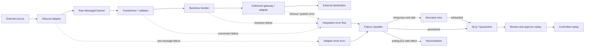
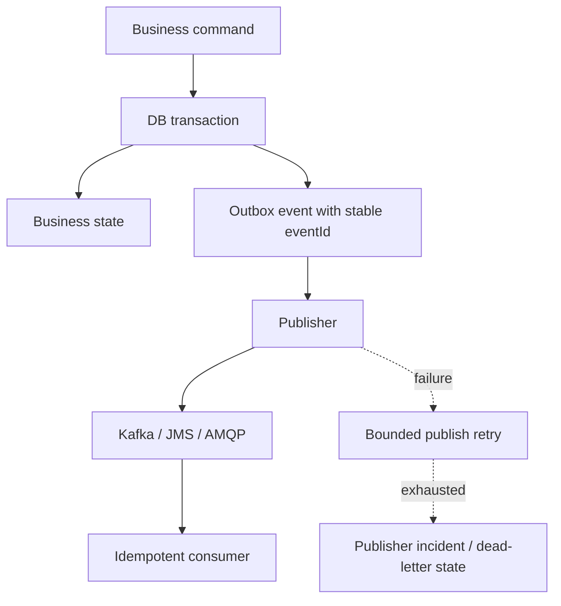
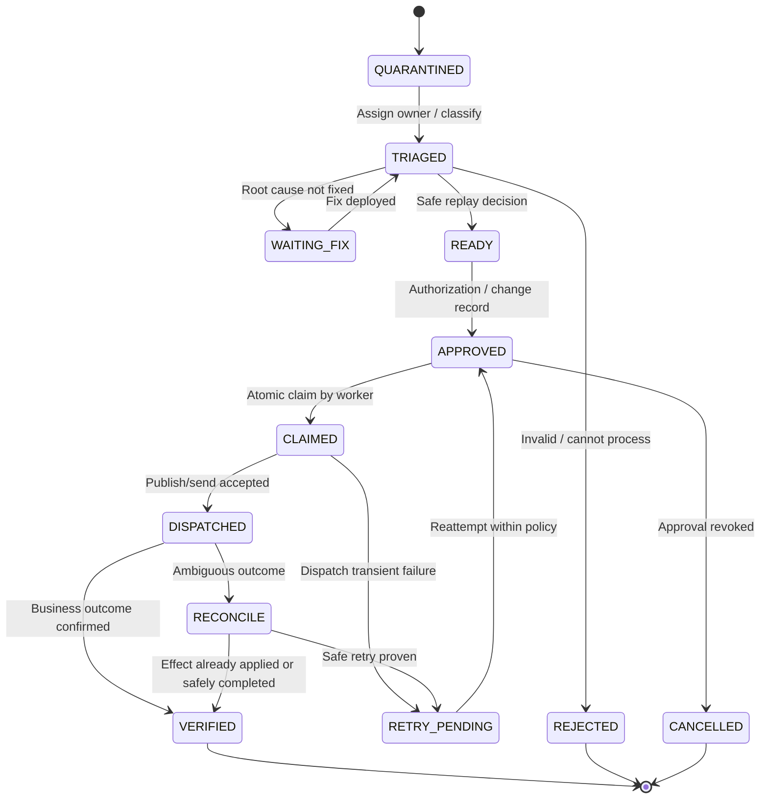
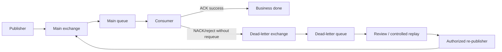
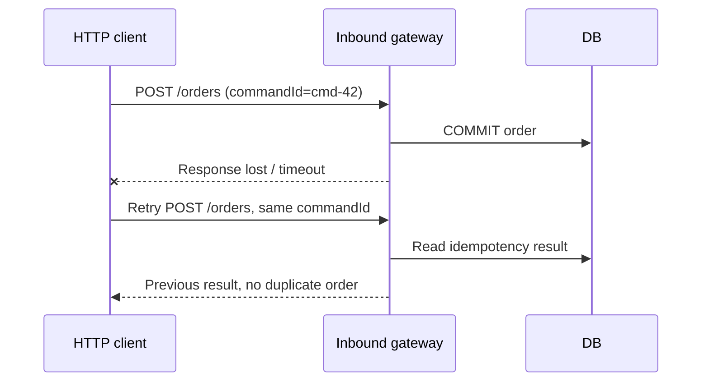

# Replay message và vận hành dead-letter trong Spring Integration Adapters

Trong môi trường **production**, một message có thể thất bại vì JSON không hợp lệ, schema đã thay đổi, quyền truy cập bị từ chối, database quá tải, một API bên ngoài timeout, broker ngắt kết nối hoặc chính consumer gặp lỗi lập trình. Nếu chỉ retry ngay lập tức, hệ thống có thể gặp **poison message**, nghẽn queue/partition, tiêu hao tài nguyên hoặc lặp tác động nghiệp vụ. Nếu bỏ message, dữ liệu có thể mất và không còn bằng chứng để điều tra. Hai năng lực quan trọng để giải quyết tình huống này là **dead-letter** và **replay**.

- **Dead-letter**: đưa message không thể xử lý theo đường thông thường vào một vùng lỗi được quản lý như **dead-letter queue (DLQ)**, **dead-letter topic (DLT)**, bảng lỗi hoặc thư mục quarantine, kèm lý do và metadata.
- **Replay**: tái đưa message đã lưu về một luồng xử lý được chọn, **sau khi** xác minh nguyên nhân, điều kiện an toàn, schema, quyền truy cập, idempotency và trạng thái nghiệp vụ.

Bài **“Replay message và vận hành dead-letter”** thuộc chương **Production** của module **SPRING_INTEGRATION_ADAPTERS**. Trọng tâm là luồng kết nối hệ ngoài qua **inbound/outbound adapter, gateway, poller và MessageChannel**, bao gồm **file, SFTP, HTTP, JMS, AMQP, Kafka và cơ sở dữ liệu**. Nội dung đi từ hợp đồng message, phân loại lỗi, cơ chế redelivery/acknowledgement đến runbook vận hành, kiểm toán và quản lý vòng đời kết nối.

> **Nguyên tắc chủ đạo:** Dead-letter **không đồng nghĩa message chưa từng được áp dụng nghiệp vụ**, và replay **không phải nút “gửi lại cho tới khi thành công”**. Trước khi replay phải biết *message nào*, *đã xảy ra tác động gì*, *sẽ chạy qua phiên bản xử lý nào*, *ai được phép thực hiện* và *cơ chế nào ngăn tác động trùng*.

## 1. Mục tiêu học tập

Sau bài này, người học có thể:

1. Phân biệt **retry**, **redelivery**, **dead-letter**, **quarantine**, **replay**, **reconciliation** và **compensation**.
2. Biết khi nào lỗi nên retry tự động, khi nào cần chuyển DLQ/DLT và khi nào phải dừng để kiểm tra kết quả bên ngoài.
3. Thiết kế **error envelope** có correlation, event ID, nguồn, schema, attempts, nguyên nhân và tham chiếu payload.
4. Giải thích cách sử dụng `ErrorMessage`, `MessagingException.getFailedMessage()`, error channel và adapter-level error handlers.
5. Thiết lập chính sách **durable capture, retention, bảo mật, phân quyền, replay approval và audit trail**.
6. Xây dựng state machine của dead-letter và replay, tránh hai worker cùng claim một bản ghi.
7. Giữ **idempotency key** ổn định và phân biệt identity của event với identity của lần replay.
8. Hiểu khả năng và giới hạn DLQ của **JMS, AMQP/RabbitMQ, Kafka, file/SFTP, HTTP và JDBC/outbox**.
9. Thiết kế replay theo lô, canary, rate limiting, backpressure, thứ tự và rollback.
10. Kiểm thử các cửa sổ crash, kết quả mơ hồ, publish lỗi, schema migration, DLQ backlog và duplicate side effect.

## 2. Thuật ngữ: cùng là “xử lý lại” nhưng khác mục đích

| Khái niệm | Định nghĩa | Điểm dễ nhầm |
| --- | --- | --- |
| **Immediate retry** | Thử lại một operation ngay trong lần xử lý, thường có giới hạn. | Có thể lặp tác động nếu kết quả trước không rõ. |
| **Delayed retry** | Thử lại sau backoff hoặc bằng một retry queue/topic riêng. | Vẫn cần deadline, attempt budget và dedup. |
| **Broker redelivery** | Broker giao lại message chưa được ACK/commit. | Consumer có thể đã commit DB trước đó. |
| **DLQ/DLT** | Vùng lưu message không đi tiếp theo xử lý bình thường. | Không bảo đảm side effect chưa từng xảy ra. |
| **Quarantine** | Cách ly dữ liệu cần kiểm tra/sửa/phê duyệt trước khi tái xử lý. | Không nhất thiết là queue có broker. |
| **Replay** | Đưa lại bản ghi đã lưu qua pipeline được lựa chọn. | Có thể khác schema, code version, auth context thời điểm gốc. |
| **Reconciliation** | Đối chiếu kết quả thực tế giữa các hệ thống. | Không đồng nghĩa retry; thường cần trước replay. |
| **Compensation** | Thực hiện nghiệp vụ bù trừ tác động đã xảy ra. | Không làm biến mất lịch sử tác động ban đầu. |

### 2.1. Một ví dụ liên tục

Ứng dụng nhận `OrderPaid`, lưu order vào DB rồi gọi outbound HTTP để gửi biên nhận. Provider nhận request, gửi email thành công nhưng **response timeout**. Nếu consumer coi timeout là “email chưa gửi” và replay cả `OrderPaid`, có thể ghi nhận doanh thu và gửi email **hai lần**.

Cách xử lý tốt hơn là phân loại outcome của từng bước, truy vấn provider nếu có, giữ một **notification ID** ổn định và chỉ replay bước cần thiết khi có bằng chứng an toàn.

## 3. Một message thất bại có thể nằm ở nhiều tầng



Các nhánh được mô tả **theo logic**, không phải một cấu hình Spring Integration hoàn chỉnh. Lỗi từ HTTP decoder, Kafka deserializer hoặc SFTP session có thể xảy ra **trước khi có Spring Message**, vì vậy không nên giả định error handler nào cũng có `failedMessage`.

### 3.1. Bốn ranh giới cần xác định

1. **Transport receipt:** broker/HTTP/file/JDBC có cho rằng message đã được nhận hoặc đọc không?
2. **Decode/validation:** payload đã thành DTO hợp lệ hay chưa?
3. **Business commit:** transaction nghiệp vụ đã bền vững chưa?
4. **Downstream delivery:** HTTP/Kafka/JMS/email/payment bên ngoài đã nhận và áp dụng chưa?

Một message được dead-letter sau bước (3) vẫn có thể đã tạo side effect, dù bước (4) thất bại.

## 4. Dead-letter giải quyết vấn đề gì?

Một DLQ/DLT/quarantine tốt phục vụ ít nhất năm mục tiêu:

- **Cách ly:** lỗi dữ liệu cố định không chặn vô hạn queue, partition hoặc poller.
- **Bảo toàn:** payload hoặc tham chiếu payload đủ để điều tra, theo chính sách.
- **Chẩn đoán:** có reason code, source, event ID và bằng chứng lần xử lý.
- **Khôi phục:** cho phép sửa nguyên nhân, phân loại, phê duyệt và replay.
- **Kiểm toán:** có actor, thời gian, quyết định, trạng thái và kết quả xử lý.

Không nên hiểu DLQ là nơi “ném message lỗi rồi quên”. DLQ không có owner, hạn xử lý hoặc cảnh báo backlog chỉ **chuyển một sự cố trực tiếp thành nợ vận hành tích tụ**.

### 4.1. DLQ không phải long-term data lake

Một broker queue/topic có thể giới hạn TTL, retention, dung lượng và chính sách xóa. Nếu yêu cầu giữ bằng chứng trong thời gian dài, nên có **kho dữ liệu quản trị hoặc audit store** với retention, encryption, phân quyền và cơ chế xóa phù hợp. Không mặc định DLQ sẽ giữ được payload mãi mãi.

## 5. Phân loại lỗi trước khi quyết định replay

| Lỗi | Bản chất | Hướng vận hành thường phù hợp |
| --- | --- | --- |
| JSON/XML/CSV sai cấu trúc | **Permanent với cùng payload/code** | Dead-letter/quarantine; producer sửa hoặc có mapping được duyệt. |
| Charset không hợp lệ | Thường permanent | Cách ly raw bytes, kiểm tra contract; tránh decode thay ký tự. |
| Schema version không hỗ trợ | Contract/version | Triển khai decoder tương thích hoặc migration trước replay. |
| Header nguồn bắt buộc thiếu | Contract/adapter mapping | Sửa producer/mapper; không tự đoán tenant. |
| Quyền bị từ chối | Security/policy | Không “retry để vượt quyền”; cần quyết định mới có thẩm quyền. |
| JDBC deadlock | Có thể transient | Retry bounded transaction với idempotency. |
| Kafka/JMS/AMQP connection tạm mất | Có thể transient | Reconnect/retry có giới hạn, theo broker policy. |
| HTTP `429` / `503` | Thường transient | Respect retry-after/backoff, chỉ retry side effect an toàn. |
| HTTP timeout sau POST ghi dữ liệu | **Ambiguous outcome** | Đối soát hoặc retry **cùng idempotency key** nếu provider bảo đảm. |
| Business rule violation | Thường là definitive rejection | Ghi trạng thái bị từ chối; không replay y nguyên vô hạn. |
| Không biết DB đã commit hay chưa | Chưa xác định | Kiểm tra transaction/business state trước replay. |
| Bug trong converter mới | Infrastructure/code defect | Fix/deploy/test rồi replay canary, có thể cần pin schema version. |

**Lưu ý:** cùng exception name có thể có semantics khác nhau theo vị trí. Một timeout **trước khi gửi request** khác timeout **sau khi server đã ghi nhận tác động**. Dùng error class + operation contract + stage + evidence để quyết định.

## 6. Vì sao không retry vô hạn thay cho dead-letter?

Giả sử một Kafka record có JSON sai cú pháp. Consumer liên tục ném lỗi, framework thử lại không giới hạn và không thể commit/skip record theo chính sách. Partition có thể không tiến; dữ liệu hợp lệ phía sau bị chặn.

```text
record offset 120: MALFORMED_JSON
record offset 121: valid OrderCreated
record offset 122: valid OrderCancelled

Nếu luôn retry offset 120:
  offset 121 và 122 có thể không được xử lý theo flow hiện tại.
```

Cần một **termination policy**:

1. Retry bounded nếu lỗi có khả năng hồi phục.
2. Nếu permanent hoặc hết budget, đưa message vào dead-letter **được xác nhận thành công**.
3. Chỉ sau khi lưu cách ly thành công, xử lý ack/commit/skip nguồn theo contract.
4. Nếu dead-letter publish thất bại, **không tuyên bố đã lưu an toàn**.
5. Có cảnh báo, owner và đường replay kiểm soát.

## 7. Ngữ nghĩa xác nhận: ACK, commit, archive và trạng thái nguồn

| Nguồn | Tín hiệu đã xử lý từ phía nguồn | Điểm nguy hiểm |
| --- | --- | --- |
| JMS | ACK / commit transaction của listener/container. | DB đã commit nhưng ACK chưa → redelivery. |
| AMQP | ACK/NACK/REJECT, requeue/dead-letter theo policy. | NACK requeue lặp mãi hoặc ACK trước khi ghi DLQ. |
| Kafka | Consumer offset commit / transaction theo cấu hình. | Offset commit trước khi lưu DLQ → có thể mất record. |
| File/SFTP | File filter, move/rename/archive, metadata store. | Đánh dấu đã thấy trước khi xử lý thành công rồi crash. |
| JDBC polling | Claim/lease, status update hoặc checkpoint row. | Mark processed trước side effect hoặc sau side effect không atomic. |
| HTTP inbound | HTTP response/status trả caller. | Trả success dù không bảo toàn yêu cầu; caller có thể retry khi timeout. |

Không có một ACK thống nhất của Spring Integration cho mọi transport. **ErrorMessage xuất hiện trên error channel không tự động chứng minh message nguồn đã được ACK**, và ngược lại, ACK thành công chưa bảo đảm mọi downstream side effect đã hoàn tất.

## 8. Hợp đồng message bắt buộc trước khi lưu lỗi

Một sự kiện tích hợp nên có metadata đủ để tái lập ngữ cảnh:

| Trường | Mục tiêu | Ghi chú |
| --- | --- | --- |
| `eventId` / `commandId` | Identity của một logical event/operation. | Giữ ổn định khi retry/replay. |
| `producerId` / `sourceSystem` | Hệ thống phát nguồn. | Xác minh ở transport boundary. |
| `tenantId` | Phạm vi phân quyền/dedupe. | Không tin từ header client tự khai. |
| `correlationId` / `traceId` | Nối đường xử lý giữa nhiều hop. | Không thay idempotency key. |
| `schemaId` / `schemaVersion` | Giải mã và migrate dữ liệu. | Giữ contract version gốc. |
| `contentType` / `charset` | Chọn converter phù hợp. | Phân biệt wire content type với Java payload type. |
| `sourceLocation` | Queue/topic/partition/offset, file path, row key... | Chuẩn hóa theo transport, tránh lộ chi tiết nhạy cảm. |
| `receivedAt` / `failedAt` | Tính tuổi bản ghi và SLA. | UTC instant. |
| `reasonCode` / `failureStage` | Phân loại nguyên nhân. | Dùng code ổn định; không dựa vào exception string. |
| `attempt` | Số lần xử lý trước khi cách ly. | Phân biệt attempt/replay generation. |
| `payloadReference` / `payloadHash` | Kiểm tra tính toàn vẹn, truy vấn payload. | Hash không thay encryption/access control. |
| `processingOutcome` | FAILED/UNKNOWN/PARTIAL_APPLIED... | Không tự suy nếu thiếu bằng chứng. |

### 8.1. Raw headers không phải hợp đồng dữ liệu

Spring `MessageHeaders` có thể chứa `replyChannel`, `errorChannel` hoặc đối tượng Java không thể serialize. HTTP headers có token/cookie; Kafka headers có thể là byte[]; JMS/AMQP có properties và types khác. Khi đưa message vào DLQ/quarantine, **không serialize toàn bộ raw headers một cách vô điều kiện**. Thay bằng allowlist metadata có typed schema.

## 9. Thiết kế error envelope dùng chung

Một mẫu JSON cho vận hành:

```json
{
  "failureId": "fail-2026-00981",
  "originalEventId": "evt-1001",
  "correlationId": "req-72e4",
  "sourceSystem": "partner-a",
  "tenantScope": "tenant-a",
  "adapterType": "KAFKA",
  "sourceLocation": {
    "topic": "orders.v1",
    "partition": 3,
    "offset": 48102
  },
  "receivedAt": "2026-11-23T08:01:00Z",
  "failedAt": "2026-11-23T08:01:03Z",
  "failureStage": "VALIDATION",
  "reasonCode": "MALFORMED_JSON",
  "retryable": false,
  "attempt": 3,
  "schemaVersion": "v1",
  "wireContentType": "application/json",
  "processingOutcome": "NOT_APPLIED_CONFIRMED",
  "payloadReference": "quarantine/fail-2026-00981",
  "payloadSha256": "example-hash-from-ingress"
}
```

Đây là **một schema minh họa**, không phải object hay output tự động có sẵn trong Spring Integration. Những giá trị như `processingOutcome=NOT_APPLIED_CONFIRMED` chỉ nên ghi khi có bằng chứng; nếu không chắc phải ghi `UNKNOWN`.

### 9.1. Phân biệt ba định danh

```text
originalEventId = định danh sự kiện nghiệp vụ; ổn định khi replay
failureId       = định danh một bản ghi lỗi/quarantine
replayRunId     = định danh đợt replay được phê duyệt
```

Một event có thể gặp lỗi nhiều lần và sinh nhiều failure records. Nếu replay tạo `eventId` mới, consumer có thể coi đó là **giao dịch mới** và áp dụng side effect trùng.

### 9.2. Không đẩy stack trace thô cho mọi consumer

Exception message và stack trace có thể chứa payload, URL nội bộ, SQL, tokens hoặc path nhạy cảm. Chỉ publish **reason code**, stage và evidence reference cần thiết; chi tiết debug đặt ở hệ thống logs bảo vệ theo retention.

## 10. Bảo toàn original message trong Spring Integration

Spring Integration dùng các abstraction từ Spring Messaging:

```java
Message<T>
MessageHeaders
ErrorMessage
MessagingException
```

Trong nhiều luồng, `ErrorMessage` có payload là một `Throwable`. Nếu exception có `MessagingException.getFailedMessage()`, error flow có thể lấy payload và headers của message thất bại. Một số error message có thêm `getOriginalMessage()`.

**Nhưng**:

- `ErrorMessage.getHeaders()` **không đương nhiên chứa toàn bộ headers của failed message**.
- Một exception có thể bị wrap nhiều lớp; không mặc nhiên `getCause()` đúng một tầng.
- Lỗi deserializer trước Spring Message có thể **không có failedMessage**.
- Không nên tạo originalMessage giả khi không còn chứng cứ nguồn.

### 10.1. Transformer gắn failedMessage

```java
import com.fasterxml.jackson.core.JsonProcessingException;
import com.fasterxml.jackson.databind.ObjectMapper;
import org.springframework.integration.annotation.Transformer;
import org.springframework.messaging.Message;
import org.springframework.messaging.MessageHandlingException;
import org.springframework.stereotype.Component;

@Component
public class OrderInboundTransformer {

    private final ObjectMapper mapper;

    public OrderInboundTransformer(ObjectMapper mapper) {
        this.mapper = mapper;
    }

    @Transformer(
        inputChannel = "rawOrdersChannel",
        outputChannel = "canonicalOrdersChannel"
    )
    public OrderCreated convert(Message<byte[]> message) {
        try {
            return mapper.readValue(
                message.getPayload(), OrderCreated.class
            );
        } catch (JsonProcessingException ex) {
            throw new MessageHandlingException(
                message, "ORDER_JSON_INVALID", ex
            );
        }
    }
}
```

Nếu dữ liệu sai, exception có tham chiếu `message` để error handler truy lại `eventId`, `correlationId` và các header đã chuẩn hóa. Ví dụ chưa bao gồm schema validation, kích thước tối đa và bảo mật ObjectMapper.

### 10.2. Error handler trích context có kiểm soát

```java
import org.springframework.integration.annotation.ServiceActivator;
import org.springframework.messaging.Message;
import org.springframework.messaging.MessagingException;
import org.springframework.messaging.support.ErrorMessage;
import org.springframework.stereotype.Component;

@Component
public class IntegrationErrorObserver {

    @ServiceActivator(inputChannel = "ordersErrorChannel")
    public void observe(ErrorMessage error) {
        Message<?> failed = findFailed(error);

        Object eventId = failed == null
            ? null : failed.getHeaders().get("eventId");

        Object correlation = failed == null
            ? null : failed.getHeaders().get("correlationId");

        // Chuyển sang error envelope có validation và allowlist.
        // Lưu quarantine + metadata; không in raw payload/secret.
        // ACK/offset của source không được suy ra từ method này.
    }

    private static Message<?> findFailed(ErrorMessage error) {
        Throwable failure = error.getPayload();

        // Trong thực tế có thể cần duyệt cause-chain có giới hạn.
        if (failure instanceof MessagingException messagingException
                && messagingException.getFailedMessage() != null) {
            return messagingException.getFailedMessage();
        }

        return error.getOriginalMessage();
    }
}
```

Đoạn code chỉ là ví dụ đọc metadata; không phải một DLQ handler hoàn chỉnh. Cần kiểm tra endpoint/adapter thực tế gửi lỗi vào channel nào và ai sở hữu việc publish/ack/retry.

## 11. Đường lỗi đồng bộ khác bất đồng bộ

### 11.1. DirectChannel và gateway đồng bộ

Với luồng đồng bộ, exception của transformer/handler có thể **lan về caller**. Không được mặc định mỗi exception tự biến thành `ErrorMessage` trên global `errorChannel`.

Ví dụ:

```text
HTTP inbound gateway
   -> DirectChannel
   -> service activator
   -> exception
   -> gateway error mapping / HTTP response theo cấu hình
```

Nếu request chưa được ghi durable, client timeout rồi gửi lại có thể tạo duplicate. Với command quan trọng, cần request ID/idempotency contract và storage bền, không dùng HTTP response như bằng chứng duy nhất.

### 11.2. Poller và message-driven adapters

Với poller/executor hoặc listener, có thể có **error channel/error message strategy/container error handler**. Tên, cơ chế publish, thứ tự retry và ack phụ thuộc implementation.

Trước khi thiết kế DLQ chung, trả lời:

1. Lỗi có xảy ra **trước** khi tạo `Message<?>` không?
2. Lỗi có bị container retry **trước** khi đến Spring Integration error flow không?
3. ErrorMessage có giữ được original message không?
4. Bước lưu DLQ có chung transaction với ACK/offset không?
5. Nếu DLQ publish lỗi, nguồn sẽ redeliver hay message bị mất?
6. Nếu error handler thành công, message gốc được coi như đã xử lý theo cơ chế nào?

## 12. Ba trạng thái outcome cần phân biệt trước replay

| Outcome | Có thể khẳng định | Hành động kế tiếp |
| --- | --- | --- |
| `NOT_APPLIED_CONFIRMED` | Có bằng chứng side effect chưa xảy ra. | Có thể replay khi hợp đồng/version/quyền đã hợp lệ. |
| `APPLIED_CONFIRMED` | Side effect đã commit hoặc được bên ngoài xác nhận. | Không chạy lại tác động đó; có thể khôi phục riêng bước còn thiếu. |
| `UNKNOWN` | Không có bằng chứng dứt khoát. | Reconciliation trước replay nguy hiểm, hoặc retry cùng key được provider bảo đảm. |

### 12.1. Tại sao `FAILED` thường chưa đủ?

Một HTTP POST timeout có thể:

1. Không tới server.
2. Tới server nhưng bị từ chối.
3. Tới server, đã commit, response mất.
4. Tới server, xử lý bất đồng bộ chưa hoàn tất.

Nếu DLQ chỉ ghi `status=FAILED`, người vận hành dễ replay thành một thao tác mới dù bước trước đã commit. Với hiệu ứng bên ngoài, **hãy lưu outcome theo bằng chứng chứ không dựa vào việc caller thấy exception**.

## 13. Idempotency là điều kiện tiên quyết của replay

Một hệ thống **at-least-once** có thể giao lại message sau crash hoặc mất ACK. Replay chủ động cũng làm tăng lần giao. Điều cần bảo đảm là **một logical event chỉ tạo business side effect được phép một lần**.

Ví dụ:

```text
EventId:      evt-1001
First process: DB commit -> crash before ACK
Redelivery:   event evt-1001 again
Manual replay: event evt-1001 again

Business effect count phải giữ ở 1 nếu semantics yêu cầu exactly-once effect.
```

### 13.1. Chọn key đúng

Một key có thể gồm:

```text
verifiedTenantId | verifiedProducerId | operationType | originalEventId
```

Cần:

- **Ổn định qua retry, DLQ và replay**.
- Đủ phân biệt hai sự kiện hợp lệ khác nhau.
- Gắn với nguồn/tenant đã được xác thực khi cần.
- Có request fingerprint/semantic hash để phát hiện **cùng key nhưng body khác**.
- Lưu bền qua restart và concurrency.
- Retention ít nhất phù hợp cửa sổ redelivery/replay được cam kết.

### 13.2. Không dùng `replayRunId` làm business idempotency key

```text
originalEventId = evt-1001
replayRunId     = replay-2026-11-23-batch-3

Idempotency remains:
  tenant-a | partner-a | create-order | evt-1001
```

Replay run ID là thông tin kiểm toán, không phải cách hợp lệ hóa tác động nghiệp vụ lần thứ hai.

## 14. Transactional inbox chống duplicate trong cùng DB

Một mẫu thiết kế là bảng `processed_event` với unique key và side effect nằm **trong cùng transaction DB**.

```sql
CREATE TABLE processed_event (
    tenant_id      VARCHAR(64) NOT NULL,
    producer_id    VARCHAR(64) NOT NULL,
    event_id       VARCHAR(128) NOT NULL,
    payload_hash   VARCHAR(64) NOT NULL,
    processed_at   TIMESTAMPTZ NOT NULL DEFAULT now(),
    PRIMARY KEY (tenant_id, producer_id, event_id)
);

CREATE TABLE order_projection (
    tenant_id      VARCHAR(64) NOT NULL,
    order_id       VARCHAR(128) NOT NULL,
    total_cents    BIGINT NOT NULL,
    PRIMARY KEY (tenant_id, order_id)
);
```

PostgreSQL transaction minh họa:

```sql
BEGIN;

INSERT INTO processed_event (
    tenant_id, producer_id, event_id, payload_hash
)
VALUES (
    'tenant-a', 'partner-a', 'evt-1001', 'hash-of-approved-payload'
)
ON CONFLICT DO NOTHING;

-- Ứng dụng phải kiểm tra ROW_COUNT:
--   Nếu inserted = 1: xử lý effect.
--   Nếu inserted = 0: đọc bản cũ, so hash/contract,
--                    không xử lý effect lần thứ hai.

INSERT INTO order_projection (
    tenant_id, order_id, total_cents
)
VALUES ('tenant-a', 'ORD-42', 159900);

COMMIT;
```

Đây là **mã minh họa transaction flow**, không phải script thực thi nguyên văn để chống duplicate: code phải **branch dựa vào kết quả insert**, không tiếp tục `INSERT order_projection` ở trường hợp duplicate.

### 14.1. Cửa sổ crash

| Tình huống | Nếu marker + side effect cùng transaction | Kết quả |
| --- | --- | --- |
| Crash trước commit | Cả hai rollback. | Redelivery có thể xử lý lại. |
| Crash sau commit, trước ACK | Cả hai đã bền. | Replay nhận diện duplicate và bỏ hiệu ứng. |
| Hai consumer chạy đồng thời | Unique constraint/transaction điều phối. | Một logical key không được áp side effect trùng. |
| Cùng key, nội dung khác | Code đối chiếu fingerprint. | Conflict, không âm thầm coi thành công. |

**Giới hạn:** transaction DB không tự bao trùm publish Kafka, gửi email hoặc gọi payment API. Mỗi side effect ngoài DB cần giao thức riêng (idempotency provider, outbox, status lookup hoặc reconciliation).

## 15. Transactional outbox và dead-letter của publisher

Một DB transaction có thể ghi thay đổi nghiệp vụ + một row outbox. Một publisher đọc outbox rồi gửi broker. Nếu gửi thành công nhưng crash trước khi mark SENT, nó có thể gửi lại **cùng event**.



**Outbox không tự đảm bảo chỉ publish một lần.** DLQ của publisher có thể chứa event đã được broker nhận nhưng publisher không biết; khi replay phải giữ `eventId` và consumer phải chống duplicate.

### 15.1. Không mark SENT quá sớm

- Mark `SENT` **trước** khi publish: có thể mất event nếu process crash.
- Publish trước rồi mark `SENT`: có thể publish trùng sau crash.
- Outbox + stable ID + consumer idempotency chấp nhận được at-least-once và bảo vệ effect.

## 16. Một state machine cho DLQ/replay

Đừng quản lý DLQ bằng một boolean `isReplayed`. Nên có trạng thái và chuyển trạng thái có điều kiện:



### 16.1. Cần định nghĩa quyền ở các điểm chuyển

- Ai được **triage** và xem payload?
- Ai được sửa schema hoặc payload?
- Ai phê duyệt replay ở production?
- Ai được cancel replay run?
- Ai xác nhận outcome VERIFIED?
- Có yêu cầu **hai người phê duyệt** cho payment/financial effects?
- Hệ thống ghi audit actor, thời gian và diff thế nào?

Không phải môi trường nào cũng cần đủ trạng thái, nhưng những tác động quan trọng cần tách **ready**, **approved**, **dispatched** và **verified**.

## 17. Thiết kế persistence cho bản ghi dead-letter

Một bảng có thể lưu **metadata** và tham chiếu blob/quarantine:

```sql
CREATE TABLE integration_dead_letter (
    failure_id        VARCHAR(128) PRIMARY KEY,
    event_id          VARCHAR(128),
    source_system     VARCHAR(128) NOT NULL,
    tenant_scope      VARCHAR(64),
    adapter_type      VARCHAR(24) NOT NULL,
    reason_code       VARCHAR(128) NOT NULL,
    failure_stage     VARCHAR(64) NOT NULL,
    outcome           VARCHAR(40) NOT NULL,
    state             VARCHAR(32) NOT NULL,
    schema_version    VARCHAR(64),
    payload_ref       TEXT,
    payload_sha256    VARCHAR(64),
    replay_run_id     VARCHAR(128),
    claimed_by        VARCHAR(128),
    claim_until       TIMESTAMPTZ,
    attempt_count     INTEGER NOT NULL DEFAULT 0,
    created_at        TIMESTAMPTZ NOT NULL DEFAULT now(),
    updated_at        TIMESTAMPTZ NOT NULL DEFAULT now()
);

CREATE INDEX idx_dead_letter_state_created
    ON integration_dead_letter (state, created_at);
```

Ví dụ dùng PostgreSQL syntax cho kiểu thời gian; bảng này **không phải framework schema mặc định**. Thiết kế thực tế cần thêm audit history, reason detail đã giới hạn, request fingerprint, retention, version counter và indexes theo tải.

### 17.1. Durable claim ngăn hai replay worker chọn cùng lỗi

Một cách claim có điều kiện:

```sql
UPDATE integration_dead_letter
SET state = 'CLAIMED',
    claimed_by = :worker_id,
    claim_until = now() + INTERVAL '2 minutes',
    updated_at = now()
WHERE failure_id = :failure_id
  AND state = 'APPROVED'
RETURNING failure_id, event_id, payload_ref, payload_sha256;
```

Nếu không trả row, worker khác đã claim hoặc record không còn đủ điều kiện. **Đây chỉ là coordination cho replay dispatcher**, chưa bảo đảm không publish hai lần khi worker crash sau publish và trước khi cập nhật state. Vẫn cần stable event ID và idempotent consumer/recipient.

### 17.2. Lease expiry không đủ để biết kết quả gửi

Khi lease hết hạn ở trạng thái CLAIMED/DISPATCHED:

- Kiểm tra broker confirm, record delivery, outcome log hoặc provider status.
- Nếu chưa biết đã publish thành công chưa, coi là **UNKNOWN**, không tạo event mới.
- Nếu retry publish, giữ event identity và fingerprint.
- Lưu lịch sử attempt riêng, không ghi đè bằng chứng cũ.

## 18. Replay dispatcher và điều kiện an toàn

Một dispatcher được thiết kế tốt gồm:

1. Chọn record **APPROVED** đúng scope, version và thời hạn.
2. Atomic claim hoặc lease.
3. Tải payload từ kho có phân quyền và kiểm tra checksum/hash.
4. Kiểm tra schema, producer/source, tenant, destination allowlist và trạng thái hiện tại.
5. Giữ `originalEventId`, `schemaVersion` và business idempotency key.
6. Thêm `replayRunId`, `replayAttempt` và provenance **đã xác minh**.
7. Dispatch qua adapter/outbound gateway với rate limit và timeout.
8. Xác định outcome từ ACK/confirm và **business-level verification** tương ứng.
9. Nếu không biết outcome, đặt `RECONCILE`, không đoán thành công hay thất bại.
10. Ghi durable audit event và cho phép resume an toàn sau restart.

### 18.1. Pseudocode replay

```text
replay(failureId, operatorContext):
    assert operator is authorized for source/tenant/operation
    record = atomicClaim(failureId, expectedState=APPROVED)
    if no record: return ALREADY_CLAIMED_OR_NOT_APPROVED

    payload = secureLoad(record.payloadRef)
    verifyHash(payload, record.payloadSha256)
    verifyContractVersion(record.schemaVersion)
    assert destination is allowlisted
    assert key remains original business event key

    if record.outcome == APPLIED_CONFIRMED:
        return RECONCILIATION_OR_NEXT_STEP_ONLY

    if record.outcome == UNKNOWN:
        return REQUIRE_RECONCILIATION

    message = buildReplayMessage(
        payload,
        originalEventId=record.eventId,
        replayRunId=currentRun.id
    )

    publishOrInvoke(message, boundedTimeout)
    persist dispatch evidence

    if transportAcknowledged and businessOutcomeVerified:
        transition to VERIFIED
    else:
        transition to DISPATCHED_OR_RECONCILE

    never mark business success based only on an in-memory function return
```

Pseudocode này là **quy trình quyết định**, không thay thế transaction, broker-specific publisher confirm hoặc response contract. Với một sự kiện thuần Kafka-to-Kafka, xác nhận ở mức broker có thể đủ cho một stage publish; với payment API, cần **business outcome** ở provider.

## 19. Spring Integration: đâu là nơi đưa message vào replay flow?

Có nhiều cách hợp lệ:

| Nguồn replay | Cách đưa vào flow | Thích hợp khi |
| --- | --- | --- |
| Database quarantine table | JDBC/MessageSource polling hoặc service dispatcher. | Cần approval/state machine/claims bền. |
| Kafka DLT | Consumer chuyên trách đọc DLT; không auto xử lý nếu chưa được duyệt. | Volume lớn, event log có retention. |
| JMS DLQ | Listener riêng với chính sách recovery. | Queue-based workflows. |
| AMQP DLQ | Listener DLQ, exchange/routing key replay được quản trị. | Broker routing theo dead-letter exchange. |
| SFTP/file quarantine | File source/poller riêng đọc thư mục APPROVED. | Batch files, lưu raw file để sửa/replay. |
| HTTP admin action | API quản trị tạo **replay job** bền, không gọi nghiệp vụ đồng bộ tùy tiện. | Replay chọn lọc và được phê duyệt. |

### 19.1. Không nối thẳng DLQ vào production input

Một đường:

```text
DLQ -> inbound handler -> main channel -> DLQ
```

nếu không có guardrails có thể tạo **vòng lặp vô hạn**: message lỗi quay lại ngay, lỗi tiếp, lại dead-letter. Bản ghi lỗi cần **terminal state**, quyền replay, limits và cơ chế quyết định độc lập.

### 19.2. Ví dụ tạo replay message nội bộ có header kiểm soát

```java
import org.springframework.messaging.Message;
import org.springframework.messaging.MessageHeaders;
import org.springframework.messaging.support.MessageBuilder;
import org.springframework.util.MimeTypeUtils;

public final class ReplayMessageFactory {

    public Message<byte[]> create(
        byte[] originalBytes,
        String originalEventId,
        String correlationId,
        String replayRunId
    ) {
        if (originalEventId == null || originalEventId.isBlank()) {
            throw new IllegalArgumentException("eventId is required");
        }

        return MessageBuilder.withPayload(originalBytes)
            .setHeader("eventId", originalEventId)
            .setHeader("correlationId", correlationId)
            .setHeader("replayRunId", replayRunId)
            .setHeader("replayed", true)
            .setHeader(
                MessageHeaders.CONTENT_TYPE,
                MimeTypeUtils.APPLICATION_JSON
            )
            .build();
    }
}
```

**Giới hạn:** chỉ áp dụng nếu message thực sự có JSON bytes. Trong production phải lấy content type/schema từ **hợp đồng đã xác minh**, không mặc định mọi payload quarantine là JSON. Không copy token/replyChannel/errorChannel từ message cũ vào message replay gửi sang hệ ngoài.

## 20. Replay không được tự “sửa” payload tùy tiện

Có ba lựa chọn phục hồi dữ liệu:

- **Exact replay:** giữ nguyên payload gốc, dùng lại schema decoder/hành vi xử lý tương ứng.
- **Versioned migration:** chuyển payload v1 → v2 bằng mapping được duyệt, có source hash và output hash.
- **Business correction:** tạo **một command mới** có chủ đích thay vì giả vờ đây là sự kiện cũ.

### 20.1. Khi nào cần command mới?

Nếu đơn hàng có số tiền sai và bên gửi đã sửa trong hệ thống nguồn, có thể cần một **CorrectionEvent** hoặc lệnh nghiệp vụ mới với event ID mới, tham chiếu event cũ. Không nên sửa ngầm raw bytes nhưng giữ cùng idempotency key của event cũ nếu fingerprint ngữ nghĩa khác; consumer có quyền từ chối là **idempotency conflict**.

### 20.2. Schema migration có dấu vết

Một log/mapping record nên chỉ rõ:

```text
original eventId: evt-1001
original schema: order-created-v1
original hash:   sha256(...)
migration:       order-v1-to-v2 version 3
migrated schema: order-created-v2
migrated hash:   sha256(...)
approved by:     designated operator
replay run:      replay-42
```

Nếu thay đổi ngữ nghĩa tiền tệ, timezone hoặc business key, cần review nghiệp vụ, không chỉ sửa JSON fields cho parse thành công.

## 21. JMS: dead-letter và redelivery trong production

JMS thường có listener/container với transaction hoặc acknowledge mode. Broker/provider có thể hỗ trợ **dead-letter queue** sau số lần giao lại; tên queue, cấu hình delay và policy khác nhau theo sản phẩm.

### 21.1. Cửa sổ lỗi quan trọng

```text
JMS receive
 -> DB COMMIT
 -> application crash before ACK
 -> JMS redelivery
```

Nếu handler không idempotent, tác động DB có thể xảy ra lần hai. Một DLQ record do listener sinh ra **không chứng minh DB chưa commit**.

### 21.2. JMS delivery count

Một số JMS provider hỗ trợ `JMSXDeliveryCount` hoặc redelivery metadata; không nên coi mọi provider có cùng tên/property, độ tin cậy hoặc semantics. Cần kiểm thử listener factory, ack/transaction, redelivery policy và mapping sang Spring Message.

### 21.3. Quy trình xử lý DLQ JMS

1. Xác định destination nguồn và DLQ theo cấu hình broker.
2. Xem message type (TextMessage/BytesMessage) và converter.
3. Kiểm tra property correlation/event ID, delivery attempts và schema version.
4. Xác nhận lỗi permanent hay transient.
5. Đối chiếu DB/provider outcome nếu consumer có side effect.
6. Chuẩn bị replay qua một **controlled producer** dùng cùng logical event ID.
7. Phê duyệt, rate limit, quan sát ACK, redelivery và kết quả nghiệp vụ.
8. Đóng incident chỉ khi đã xác minh outcome và backlog/metric trở về mức chấp nhận.

**Không copy mọi JMS transport header** sang message mới; broker có thể cấp lại JMSMessageID và thông tin delivery, còn business event ID phải giữ theo contract.

## 22. AMQP/RabbitMQ: DLX, DLQ và requeue

Trong RabbitMQ, dead-lettering thường dựa trên cấu hình **dead-letter exchange (DLX)** và routing tới queue đích. Message có thể bị dead-letter do reject/nack không requeue, TTL hết hạn hoặc các điều kiện broker tương ứng. Chính sách cụ thể tùy broker, queue type và version.



### 22.1. Tránh `requeue=true` không giới hạn

Nếu message có JSON sai cấu trúc, consumer reject và requeue ngay, message có thể quay về liên tục, gây CPU/network churn và nghẽn queue. Cần:

- Bounded retry cho lỗi có khả năng phục hồi.
- Delayed retry queue/strategy khi cần.
- Dead-letter cho lỗi permanent hoặc hết budget.
- Monitoring DLQ depth và oldest age.
- Replay chỉ sau khi fix schema/code hoặc có quyết định vận hành.

### 22.2. Header death/redelivery

RabbitMQ có thể thêm metadata dead-letter (ví dụ nhóm header liên quan `x-death` trong những đường đi phù hợp). Đây là **bằng chứng broker-specific**, không thay một `eventId` nghiệp vụ ổn định và không nên được copy/nhân bản tùy tiện qua mỗi lần publish thủ công.

### 22.3. Publisher confirms và tính bền của dead-letter

Khi chuyển message giữa queue/source và DLQ do ứng dụng tự publish, phải xét **atomicity** giữa publish và ACK. Nếu publish DLQ không thành công mà consumer đã ACK source, có thể **mất message**. Nếu publish thành công nhưng ACK source lỗi, có thể có **duplicate trong DLQ**. Cần xử lý bằng bảo đảm của broker/transaction phù hợp, stable failure ID và replay dedup, không đánh đồng confirm với business commit.

## 23. Kafka: DLT, offset commit và replay thứ tự

Kafka sử dụng topic/partition/offset; dead-letter thường là **DLT** (dead-letter topic). Spring Kafka có các thành phần hỗ trợ như `DeadLetterPublishingRecoverer`, `DefaultErrorHandler` và `ErrorHandlingDeserializer`; chúng thuộc **Spring Kafka**, không đồng nhất với global Spring Integration error channel.

### 23.1. Luồng Kafka minh họa

```text
orders.v1 (topic)
  -> Kafka consumer/Integration adapter
  -> converter/handler
      | success:
      |   business commit, offset handling
      |
      | failure:
      |   bounded retry
      |   publish to orders.v1.DLT
      |   source offset handled according to listener/container policy

orders.v1.DLT
  -> monitored retention
  -> approval / replay orchestrator
  -> replay with same logical eventId
```

### 23.2. Offset chưa commit sau business commit

```text
record offset 48102
 -> DB COMMIT
 -> crash before offset commit
 -> redelivery offset 48102
```

Nếu consumer không idempotent, DB side effect trùng. Nếu record bị đưa vào DLT nhưng DB effect đã commit một phần, replay cần reconciliation.

### 23.3. DLT publish và offset

Không được giả định framework luôn commit source offset **chỉ sau khi** DLT publish bền nếu chưa kiểm tra cấu hình transaction, error handler và publisher. Cần test:

- DLT broker không khả dụng.
- DLT publisher trả lỗi.
- Publish DLT thành công nhưng process crash trước source offset commit.
- Lỗi deserialize trước khi Integration tạo `Message<?>`.
- Replay message của schema v1 sau khi code đã chuyển sang v2.

### 23.4. Ordering

Kafka bảo đảm thứ tự trong **một partition** đối với các record được đọc theo log. Nhưng nếu một record được bỏ qua sang DLT, các record phía sau có thể được xử lý trước, và khi replay record cũ, **thứ tự nghiệp vụ bị đảo**.

Ví dụ:

```text
offset 100: OrderCreated v1 -> DLT
offset 101: OrderCancelled v2 -> processed
replay offset 100 later -> must not re-open cancelled order
```

Giải pháp: aggregate version, state machine, optimistic lock, partition key phù hợp hoặc yêu cầu replay kiểm tra trạng thái hiện hành. **Dedup riêng không đủ giải quyết ordering.**

### 23.5. Không dùng offset làm event ID toàn cục

Offset chỉ có nghĩa cùng topic + partition. Một DLT record có offset **mới**, nhưng phải giữ `originalEventId` cho cùng logical event và metadata của topic/partition/offset gốc để tra cứu.

## 24. File/SFTP: dead-letter thường là quarantine folder

File và SFTP không nhất thiết có broker DLQ. Thay vào đó, một quy trình có thể dùng:

```text
remote/incoming/
   -> local/staging/
   -> parse + validate + business process
       -> success: archive/
       -> failure: quarantine/
                      + failure metadata manifest
                      + original bytes/checksum
```

### 24.1. Không chỉ dựa vào đuôi file

`orders.csv` có thể là UTF-8, Windows-1252, file thiếu record hoặc format không đúng. Phải dùng **partner contract**, schema, charset và file readiness. Không rename một file sang `.ok` chỉ để parser bỏ qua lỗi.

### 24.2. Một quarantine manifest

```yaml
failureId: fail-file-00042
sourceSystem: sftp-partner-a
originalRemotePath: /incoming/orders-42.csv
originalFilename: orders-42.csv
receivedAt: 2026-11-23T08:01:00Z
schemaVersion: csv-v2
reasonCode: INVALID_CSV_QUOTE
businessOutcome: NOT_APPLIED_CONFIRMED
payloadReference: quarantine/fail-file-00042.bin
replayEligible: false
```

Manifest cần được tạo từ metadata đã kiểm soát; đường dẫn nguồn không được dùng trực tiếp làm local write path nếu chưa sanitize và giới hạn trong thư mục được phép.

### 24.3. Atomic move và file readiness

Một hệ thống có thể ghi file tạm rồi rename atomically trong **cùng filesystem** khi được hỗ trợ, hoặc dùng marker file để biết upload đã hoàn tất. Với SFTP, cần thỏa thuận cách producer hoàn thiện file. Không coi việc polling thấy filename là bằng chứng file đã sẵn sàng.

### 24.4. Replay file lớn

Nếu file có nhiều record, cần quyết định:

- Replay **toàn file** hay **chỉ record lỗi**?
- Những record thành công trước đó đã commit chưa?
- Có record ID/idempotency key theo từng dòng không?
- File parser có thể xử lý streaming không?
- Nếu một record lỗi ở giữa, checkpoint như thế nào?
- Số lượng record và downstream capacity có cho phép phát lại cả batch không?

Replay toàn file khi 999/1.000 record đã thành công sẽ rất nguy hiểm nếu không có record-level dedup.

## 25. HTTP: không có “HTTP DLQ” mặc định

HTTP inbound gateway thường nhận request/response đồng bộ, không có broker tự lưu message khi handler thất bại. Nếu cần replay HTTP command, ứng dụng phải tạo **durable command inbox** hoặc một cơ chế lưu request có hợp đồng trước khi trả kết quả.

### 25.1. HTTP request mất response



Nếu client tạo commandId khác mỗi retry, server có thể coi đó là yêu cầu mới. Contract HTTP phải phân biệt **client retry cùng ý định** và **người dùng tạo ý định mới**.

### 25.2. Outbound HTTP gateway gặp timeout

Nếu Spring Integration gọi API ngoài để thanh toán/gửi hàng/gửi thông báo và timeout, error record phải ghi `UNKNOWN_OUTCOME` cho đến khi có bằng chứng. Replay chỉ được phép:

- Dùng **cùng provider idempotency key** trong phạm vi nhà cung cấp hỗ trợ.
- Hoặc tra cứu trạng thái bằng business reference.
- Hoặc thực hiện quy trình reconciliation/manual quyết định.

Không tự phát lệnh mới với ID mới chỉ vì HTTP call trước trả exception.

## 26. JDBC và database outbox: bảng lỗi khác bảng xử lý

Với JDBC polling, mỗi row có thể chứa payload JSON/XML và trạng thái công việc:

```text
integration_outbox
  event_id
  payload_json
  schema_version
  status = NEW / CLAIMED / SENT / INVALID / ...
```

Lỗi parsing một row có thể chuyển row sang `INVALID` và ghi failure record trong cùng transaction nếu phù hợp, thay vì để poller liên tục chọn lại `status=NEW`.

### 26.1. Claim atomic

Nhiều poller có thể cùng query row `NEW`. Cần cơ chế claim/lease/row locking hoặc optimistic version, tùy DB. Chỉ `SELECT ... WHERE status='NEW'` không đủ để bảo đảm mỗi row chỉ có một worker xử lý.

### 26.2. Reopen sau fix

Khi một row `INVALID` được phép replay:

1. Kiểm tra root cause đã được sửa.
2. Kiểm tra dữ liệu, contract, side effect trước đó.
3. Chuyển trạng thái có điều kiện và lưu replayRunId.
4. Worker claim lại row an toàn.
5. Dedup theo event ID khi handler có thể đã commit.
6. Ghi kết quả VERIFIED hoặc RECONCILE theo bằng chứng.

**Không cập nhật hàng loạt `INVALID → NEW` trong production mà thiếu giới hạn, snapshot và owner**. Điều này có thể tạo burst load và mất dấu ai đã cho phép replay.

## 27. Error handling: tránh DLQ tự gây lỗi lần hai

Một error handler có thể thất bại vì:

- DLQ broker/database không khả dụng.
- JSON serializer của error envelope không hỗ trợ một object exception.
- Error payload chứa `MessageChannel`/InputStream không serialize được.
- Tên topic/queue đích không hợp lệ.
- Credential của DLQ publisher hết hạn.
- Payload vượt kích thước tối đa.
- Quota/retention của quarantine store đã hết.

### 27.1. Fallback và terminal sink

Cần thiết kế một đường lỗi cho **chính error pipeline**:

```text
original processing error
  -> error mapper
  -> DLQ publish failure
      -> bounded retry/reconnect
      -> terminal incident + durable local/outbox fallback
      -> original source ACK/commit policy remains correct
```

Không tạo chu trình vô hạn:

```text
errorChannel -> error handler -> exception -> errorChannel -> ...
```

Nếu không thể lưu bản ghi lỗi một cách bền vững, **không báo đã bảo toàn message**. Trong nhiều cấu hình, nên để nguồn redeliver hoặc dừng consumer để tránh mất dữ liệu, nhưng phải theo đúng cơ chế transaction và an toàn của từng adapter.

## 28. Replay theo lô và kiểm soát tải

Replay 100.000 bản ghi cùng lúc có thể bão hòa API, database, broker, pool kết nối hoặc scheduler. Một công cụ vận hành cần:

- **Batch size** giới hạn và checkpoint theo lô.
- **Rate limit** theo source, tenant, operation và dependency.
- **Concurrency cap**; tránh hai worker cùng một aggregate nếu cần ordering.
- **Canary replay** một vài bản ghi đã chọn.
- **Pause/resume/cancel** có ghi nhận.
- **Circuit breaker** khi downstream báo lỗi.
- **Backpressure** khi queue/broker/DB backlog tăng.
- **Dedup** qua các replay run.
- **Deadline** và quy tắc dừng khi tỷ lệ lỗi vượt ngưỡng.
- **Dry-run** để đánh giá contract và tác động trước khi dispatch thật.

### 28.1. Dry-run không phải execution thật

Dry-run có thể:

- Parse/validate payload.
- Kiểm tra schema version, resource scope và trạng thái hiện tại.
- Phân loại outcome.
- Ước tính số lần gọi/chi phí.
- Báo key conflict/duplicate dự kiến.

Nhưng dry-run **không thể chứng minh** race condition không xảy ra giữa lúc kiểm tra và lúc replay. Production execution vẫn cần transaction/claim/idempotency.

## 29. Quy tắc replay theo thứ tự và aggregate

Một hệ thống có các event:

```text
E1: OrderCreated version 1  -> DLT
E2: OrderConfirmed version 2 -> processed
E3: OrderCancelled version 3 -> processed
```

Replay E1 sau khi E3 hoàn tất không được đưa order trở về trạng thái CREATED.

Có thể áp:

- Aggregate ID + version và state machine.
- Optimistic locking hoặc conditional update.
- Partitioning theo aggregate key khi publish/consume.
- Reconciliation trước khi replay version cũ.
- Chỉ replay **tác động chưa thực hiện** thay vì tái tạo toàn bộ luồng.
- Chia lô sao cho giữ thứ tự tương đối cho cùng aggregate.

**Idempotency trả lời “đã thấy event này chưa”; ordering trả lời “event này còn hợp lệ với trạng thái hiện tại không”.** Hai bài toán khác nhau.

## 30. Cửa sổ crash của replay dispatcher

| Thời điểm crash | Có thể xảy ra | Điều cần thiết |
| --- | --- | --- |
| Trước atomic claim | Record vẫn APPROVED. | Worker khác có thể claim. |
| Sau claim, trước dispatch | Không có side effect từ dispatch đó. | Lease expiry và retry có kiểm soát. |
| Sau broker nhận message, trước ghi DISPATCHED | Có thể gửi trùng khi retry. | Stable event ID, publisher evidence, consumer dedup. |
| Sau HTTP provider commit, trước nhận response | Outcome mơ hồ. | Provider status lookup/idempotency key. |
| Sau DB business commit, trước ACK nguồn | Nguồn có thể redeliver. | Transactional inbox/dedup. |
| Sau ghi VERIFIED, trước gửi notification vận hành | Replay đã kết thúc, notification thiếu. | Notification outbox/idempotency riêng. |
| Trong lúc operator cancel | Một số message có thể đã dispatch. | Cancel ngăn lượt mới, reconcile những lượt đang chạy. |

Không nên xây hệ thống replay dựa vào giả định **mọi bước đều có một điểm ACK chung**. Hãy ghi trạng thái bền vững và cho phép resume an toàn.

## 31. Cấu hình production và phân tách trách nhiệm

Một cấu hình ứng dụng có thể mô tả chính sách (mẫu YAML minh họa, **không phải auto-config có sẵn của Spring Integration**):

```yaml
app:
  dead-letter:
    enabled: true
    retention-days: 30
    max-payload-bytes: 1048576
    require-payload-encryption: true
    alert-oldest-age-minutes: 60

  replay:
    require-approval: true
    dry-run-first: true
    max-batch-size: 50
    max-in-flight: 5
    max-attempts-per-record: 3
    require-idempotency-key: true
    stop-on-error-rate-percent: 10
```

Phải có code/bean/service áp dụng các settings. Những con số chỉ minh họa; chính sách thực tế tùy SLA, rủi ro dữ liệu, chi phí hạ tầng và pháp lý.

### 31.1. Tách ba vai trò

| Vai trò | Trách nhiệm |
| --- | --- |
| **Application owner** | Xác định ngữ nghĩa nghiệp vụ, idempotency, schema, outcome. |
| **Platform/operations** | Quản lý broker/DLQ/quarantine, retention, credentials, capacity, alerts. |
| **Replay approver/operator** | Phân loại ticket, phê duyệt phạm vi, chạy có kiểm soát, xác minh và ghi audit. |

Ở hệ thống nhạy cảm, người **sửa payload** không nên là người duy nhất **phê duyệt replay**; quyền xem dữ liệu và quyền phát lại tác động nghiệp vụ cần tách phù hợp.

## 32. Bảo mật và quyền riêng tư của dead-letter

Dead-letter thường chứa **những dữ liệu khó xử lý nhất**: malformed PII, credential trong header, payload cũ chứa trường nhạy cảm, nội dung từ đối tác không tin cậy. Vùng lỗi không nên có quyền truy cập rộng hơn production source.

Các kiểm soát:

1. **Encrypt at rest và in transit** cho payload/reference có yêu cầu bảo vệ.
2. **RBAC/ABAC**: phân biệt xem metadata, tải raw payload, sửa, phê duyệt và replay.
3. **Tenant isolation**: không cho operator tenant A xem/replay event tenant B nếu không có quyền.
4. **Redact secrets** khỏi logs, metrics, error envelope và alert.
5. **Retention** theo dữ liệu/contract, không giữ vô hạn vì “phòng khi cần”.
6. **Audit immutability**: ghi ai đã xem/sửa/phê duyệt/replay/cancel.
7. **Checksums**: xác minh payload không bị thay không được phép.
8. **Destination allowlist**: không cho user cung cấp tùy ý topic, HTTP URL hoặc file path.
9. **Schema validation**: dữ liệu trong DLQ vẫn là dữ liệu không tin cậy khi replay.
10. **Quy trình xóa**: tuân thủ yêu cầu lưu giữ/xóa, tránh sao chép payload nhạy cảm thành nhiều nơi khó kiểm soát.

### 32.1. Replay header không phải quyền

Một payload cũ có header `role=ADMIN` hoặc `tenantId=tenant-b` không chứng minh nó được phép xử lý tại runtime mới. Phải xác minh nguồn, tenant và authorization ở boundary được quản trị, không nâng metadata do client khai thành quyền.

## 33. Schema evolution, replay và các deployment mới

Một DLQ record được lưu tháng trước có thể được replay hôm nay khi:

- Java class/DTO đã đổi.
- Schema v1 không còn được hỗ trợ.
- Event type đã được rename.
- Logic nghiệp vụ đã đổi.
- Tenant/khóa API đã bị thu hồi.
- Đích downstream đã chuyển endpoint.
- Data retention hoặc policy đã thay đổi.

### 33.1. Ba phương án

| Phương án | Ưu điểm | Rủi ro |
| --- | --- | --- |
| **Dùng decoder v1 tương thích** | Giữ nguyên event gốc. | Tốn chi phí duy trì legacy parser. |
| **Migration v1 → v2 được version hóa** | Dùng pipeline hiện đại. | Có thể thay semantics; cần audit và kiểm thử. |
| **Không replay, tạo correction command mới** | Minh bạch về ý định nghiệp vụ mới. | Cần contract và workflow chấp thuận riêng. |

Không chọn version theo một header Java class name do client tự khai. Mapping `eventType + schemaVersion → converter/validator` phải được quản trị với allowlist.

## 34. Observability: dashboard cho DLQ/replay

Các số đo nên tách **ingress errors**, **dead-letter capture**, **replay attempts** và **business outcomes**.

| Chỉ số | Ý nghĩa |
| --- | --- |
| `integration_error_total{adapter,reason}` | Lỗi theo adapter và reason code. |
| `dead_letter_created_total{source,reason}` | Số bản ghi được cách ly. |
| `dead_letter_publish_failure_total` | Lỗi ngay khi ghi vùng dead-letter. |
| `dead_letter_pending_count{state}` | Backlog theo state. |
| `dead_letter_oldest_age_seconds` | Tuổi bản ghi chờ lâu nhất. |
| `dead_letter_storage_bytes` | Dung lượng vùng lưu. |
| `replay_requested_total` | Số yêu cầu replay. |
| `replay_approved_total` | Số yêu cầu được duyệt. |
| `replay_dispatched_total` | Số lần dispatch thực tế. |
| `replay_verified_total` | Số outcome nghiệp vụ đã xác nhận. |
| `replay_failed_total{reason}` | Lỗi replay. |
| `duplicate_suppressed_total` | Duplicate được idempotent consumer chặn. |
| `ambiguous_outcome_pending_count` | Số tác động cần reconciliation. |
| `dlq_retention_expiry_total` | Bản ghi tới hạn retention. |

Các metric name là **gợi ý**, không phải toàn bộ metrics Spring Integration tạo tự động. Giữ cardinality thấp: không gắn `eventId`, `correlationId`, raw HTTP URL hoặc user ID thành metric labels. Dùng logs/traces có phân quyền để truy vấn chi tiết.

### 34.1. Ví dụ audit log một replay

```json
{
  "event": "REPLAY_RUN_ITEM_VERIFIED",
  "replayRunId": "replay-2026-0007",
  "failureId": "fail-2026-00981",
  "originalEventId": "evt-1001",
  "sourceSystem": "partner-a",
  "tenantScope": "tenant-a",
  "approvedBy": "ops-reviewer",
  "replayedBy": "replay-dispatcher",
  "schemaVersion": "v1",
  "result": "DUPLICATE_SUPPRESSED",
  "businessEffectCountAdditional": 0
}
```

Giá trị chỉ minh họa; ghi audit cần xác minh claim, số lần tác động và kết quả thực tế. Không tự suy `businessEffectCountAdditional=0` nếu không có bằng chứng dedup/business transaction.

## 35. Cảnh báo và SLO vận hành

Một số tín hiệu cần cảnh báo:

- DLQ backlog tăng liên tục theo source.
- Tuổi oldest dead-letter vượt SLO.
- Tỷ lệ malformed payload tăng sau deployment.
- Bản ghi có `UNKNOWN_OUTCOME` quá lâu chưa đối soát.
- Replay run chạy vượt thời gian dự kiến.
- DLT publisher thất bại hoặc quarantine storage gần đầy.
- Tăng `duplicate_suppressed_total` bất thường sau restart/cutover.
- DLQ retention sắp xóa các bản ghi chưa triage.
- Error mapper bị lỗi khiến metadata lineage mất.
- Source broker/file poller dừng hoặc kết nối không khôi phục.

### 35.1. Alert phải dẫn tới hành động

Alert tốt nêu:

```text
What:    Kafka orders.v1.DLT oldest age > SLO
Scope:   tenant group / producer / schema version
Impact:  orders may be delayed, no known double-charge proof
Action:  open DLQ triage dashboard / runbook
Owner:   integration on-call + domain owner
Evidence: incident ID / metric / trace query
```

Không nhúng raw payload nhạy cảm vào email/Slack alert. Alert đơn thuần “DLQ count > 0” có thể không đủ nếu một số dead-letter record đang trong quy trình review hợp lệ.

## 36. Runbook vận hành dead-letter: triage đến replay

**Bước 1 — Nhận diện và khoanh vùng**

Xác định topic/queue/folder/table, nguồn, số lượng, tuổi backlog, reason code, consumer deployment version và tác động tới SLA. Nếu nhiều lỗi cùng bắt đầu sau một release, xem xét dừng/cô lập luồng thay vì replay ngay.

**Bước 2 — Bảo toàn bằng chứng**

Giữ failureId, originalEventId, schemaVersion, content type, source location, payload hash và metadata theo quyền. Không xuất raw data ra máy cá nhân hoặc ticket chung để “xem thử”.

**Bước 3 — Phân loại nguyên nhân**

Phân biệt permanent contract failure, infrastructure transient, security rejection, business rejection, programming defect và ambiguous downstream outcome. Kiểm tra liệu nguyên nhân đã được sửa hay chưa.

**Bước 4 — Đối soát side effect**

Đọc DB business state, provider status, outbox/inbox, source offset/ACK và log có kiểm chứng. Đánh dấu NOT_APPLIED_CONFIRMED, APPLIED_CONFIRMED hoặc UNKNOWN. Với UNKNOWN, chuyển sang reconciliation trước khi replay lệnh ghi dữ liệu.

**Bước 5 — Xác minh khả năng replay**

Kiểm tra phiên bản schema, DTO, tenant, authorization, retention, checksum, idempotency key, ordering và destination. Nếu cần chỉnh payload, phải có migration/correction được review.

**Bước 6 — Dry-run và canary**

Chạy validation không side effect; chọn một tập nhỏ đại diện, rate limit, giới hạn concurrency và theo dõi kết quả. Không dùng dữ liệu thật để test destructive replay ngoài phạm vi được duyệt.

**Bước 7 — Phê duyệt**

Tạo replay run với danh sách failure IDs, tiêu chí chọn, người duyệt, kế hoạch rollback/pause và giới hạn tải. Các hệ thống thanh toán/đơn hàng có thể cần kiểm soát hai người theo chính sách.

**Bước 8 — Dispatch có kiểm soát**

Atomic claim, giữ originalEventId, không copy secrets, log replayRunId/attempt, không để hai dispatcher cùng gửi một record thiếu coordination.

**Bước 9 — Xác minh nghiệp vụ**

So số lượng event đã dispatch với số outcome business verified, duplicate suppressed, rejected và ambiguous. Không coi “broker ACK” tương đương “business completed” nếu có downstream xử lý bất đồng bộ.

**Bước 10 — Đóng run và cải tiến**

Đóng record theo state đúng, giữ lịch sử, cập nhật metrics, root-cause, tests, contract và runbook. Đặt owner cho record chưa rõ kết quả; không đóng incident khi chỉ mới làm giảm DLQ count.

## 37. Khi nào không nên replay?

Có những trường hợp cần **dừng hoặc tạo quy trình khác**:

1. **Payment outcome UNKNOWN** và provider không có idempotency guarantee/lookup đáng tin.
2. **APPLIED_CONFIRMED** nhưng replay sẽ chạy lại toàn bộ luồng side effect.
3. **Security rejection** mà danh tính/quyền chưa được giải quyết.
4. **Schema migration** làm thay đổi số tiền, tenant hoặc resource semantics nhưng chưa được phê duyệt.
5. **Event đã lỗi thời** so với aggregate version hiện tại.
6. **Payload bị hỏng/không có bằng chứng toàn vẹn**.
7. **Data retention** hoặc quyền xử lý dữ liệu hiện tại không còn cho phép.
8. **Replay destination** khác production target đã được phê duyệt.
9. **Downstream đang outage/quá tải**, replay chỉ làm sự cố nặng thêm.
10. **Thiếu idempotency** cho một operation không được phép thực hiện hai lần.

Trong những trường hợp đó, có thể cần reconciliation, bù trừ, business correction, hỗ trợ khách hàng hoặc một quyết định loại bỏ có audit.

## 38. Kiểm thử failure injection bắt buộc

| Test case | Điểm inject lỗi | Kỳ vọng |
| --- | --- | --- |
| Malformed JSON | Converter | Vào quarantine, không retry vô hạn. |
| Unsupported schema v1 | Version routing | Có reason code, replay sau fix không sai semantics. |
| ErrorMessage thiếu failedMessage | Adapter pre-conversion | Ghi lineage missing trung thực, tận dụng metadata transport. |
| DLQ publisher offline | Error pipeline | Không ACK sớm/mất nguồn theo policy; cảnh báo terminal failure. |
| DLT publish xong, source commit chưa | Kafka listener | Có thể DLT duplicate; idempotent/capture dedup xử lý đúng. |
| DB commit xong, JMS ACK chưa | Consumer | Redelivery nhưng DB effect count vẫn 1. |
| AMQP requeue mãi | Broker policy | Hết attempts đưa DLQ, không loop vô hạn. |
| SFTP file replay lại sau archive failure | File lifecycle | Record-level dedup, không nhân side effect. |
| HTTP response lost after POST commit | Outbound gateway | UNKNOWN outcome; status lookup/same provider key. |
| Hai dispatcher cùng claim | Replay table | Chỉ một claim hợp lệ; vẫn xử lý crash window. |
| Replay run bị cancel giữa chừng | Operator control | Dừng dispatch mới; kết quả đã gửi được reconciliation. |
| Replay cùng event sau 30 ngày | Dedupe retention | Guarantee được kiểm chứng hoặc replay bị chặn/phê duyệt riêng. |
| Same event ID, different payload | Fingerprint comparison | Conflict, không ghi đè event cũ. |
| Event cũ sau state version mới | Ordering | Không rollback state machine. |
| Payload bị sửa trong storage | Checksum | Replay bị từ chối, security incident nếu cần. |
| Replay 1000 records nhưng limit 50 | Rate/batch control | Chia batch và giữ checkpoint. |
| Error handler tự ném exception | Error pipeline | Terminal sink, không vòng lặp vô hạn. |
| Retention job xóa record chưa triage | Data lifecycle | Block/alert theo policy, không xóa âm thầm. |

### 38.1. Đo **business effect count**, không chỉ số handler calls

Ví dụ mong đợi:

```text
original deliveries:       1
broker redeliveries:       1
manual replay deliveries:  1
handler invocations:       3
business effect commits:   1
duplicates suppressed:     2
```

Một hệ at-least-once hoạt động đúng **có thể gọi handler ba lần**. Điều cần kiểm tra là hiệu ứng nghiệp vụ **không bị nhân ngoài ý định**.

## 39. Kiểm thử Java: mapping failed message và idempotency

Ví dụ unit test tập trung vào ngữ cảnh lỗi:

```java
import static org.junit.jupiter.api.Assertions.*;

import org.junit.jupiter.api.Test;
import org.springframework.messaging.Message;
import org.springframework.messaging.MessageHandlingException;
import org.springframework.messaging.support.MessageBuilder;
import org.springframework.messaging.support.ErrorMessage;

class DeadLetterContextTest {

    @Test
    void failedMessageRetainsEventIdentity() {
        Message<byte[]> input = MessageBuilder
            .withPayload(new byte[] {1, 2, 3})
            .setHeader("eventId", "evt-1001")
            .setHeader("correlationId", "req-72e4")
            .setHeader("sourceSystem", "partner-a")
            .build();

        MessageHandlingException failure =
            new MessageHandlingException(
                input, "INVALID_PAYLOAD", new IllegalArgumentException()
            );

        ErrorMessage error = new ErrorMessage(
            failure, java.util.Map.of("errorStage", "decode"), input
        );

        assertSame(input, failure.getFailedMessage());
        assertSame(input, error.getOriginalMessage());
        assertEquals(
            "evt-1001",
            failure.getFailedMessage().getHeaders().get("eventId")
        );
    }
}
```

Test này chỉ chứng minh exception giữ tham chiếu và metadata, **không** chứng minh dead-letter được ghi bền hay source ACK đúng. Cần integration tests với transport thật.

### 39.1. Test retry + dedup

Với DB mock/integration test:

1. Gửi event `evt-1001` lần đầu và xác nhận business row được tạo.
2. Gửi lại cùng event ID/payload và xác nhận **không có side effect thứ hai**.
3. Gửi cùng event ID nhưng payload khác và xác nhận conflict.
4. Chạy hai consumer đồng thời với cùng event ID.
5. Inject crash sau DB commit nhưng trước source ACK.
6. Replay từ quarantine và xác nhận business effect count vẫn đúng.

Những case đồng thời cần DB thật/transaction semantics đủ gần production; mock chỉ kiểm tra logic, không chứng minh race-free.

## 40. Checklist production cho dead-letter và replay

- [ ] Có phân loại permanent, transient, ambiguous và business rejection.
- [ ] Retry bounded, backoff/jitter/budget và terminal dead-letter được thiết kế rõ.
- [ ] Biết lỗi xảy ra trước hay sau khi có Spring Message.
- [ ] Có context từ failedMessage/originalMessage khi khả dụng; không bịa lineage.
- [ ] Có error envelope schema ổn định, reason code, source, event ID, schema version.
- [ ] Không copy raw headers/token/Channel object ra broker/quarantine.
- [ ] ACK/offset/archive/status transition phù hợp với mức durable capture.
- [ ] Đã test DLQ publisher failure, source ACK failure và crash windows.
- [ ] Có idempotency key ổn định cho logical event và fingerprint chống key conflict.
- [ ] Có dedup trong cùng DB transaction khi business effect nằm ở DB đó.
- [ ] External API có provider idempotency/status lookup hoặc reconciliation.
- [ ] Không coi DLQ là bằng chứng business effect chưa xảy ra.
- [ ] State machine phân biệt TRIAGED, APPROVED, CLAIMED, DISPATCHED, VERIFIED và UNKNOWN.
- [ ] Replay dispatcher có atomic claim/lease và durable attempt history.
- [ ] Replay giới hạn theo batch, rate, concurrency, deadline và source/tenant.
- [ ] Có dry-run/canary, pause/cancel và runbook rollback.
- [ ] Replay giữ original event ID, không thay bằng replay run ID.
- [ ] Payload hash/schema/version/tenant/destination được xác minh trước dispatch.
- [ ] Có ordering/aggregate version check khi cần.
- [ ] Kafka DLT/source offset semantics đã được kiểm thử với listener thật.
- [ ] AMQP DLX/NACK/requeue/dead-letter policy không tạo infinite loop.
- [ ] JMS transaction/ACK/redelivery và provider DLQ policy được kiểm tra.
- [ ] File/SFTP quarantine giữ raw file/batch/record metadata, file readiness và idempotency.
- [ ] HTTP command inbox và outbound UNKNOWN outcome có chiến lược rõ.
- [ ] JDBC poller/claim/status transition có transaction và duplicate control.
- [ ] Dead-letter storage có encryption, retention, access control, audit và deletion policy.
- [ ] Replay approval theo rủi ro, có owner và tiêu chí xác nhận business outcome.
- [ ] Dashboard theo dõi DLQ backlog, oldest age, publish failures, replay outcomes.
- [ ] Có alert khi dead-letter capture hỏng, reconciliation pending hoặc retention sắp hết.
- [ ] Có kiểm thử schema migration, duplicate, concurrency, crash, DLT replay cũ và error pipeline.
- [ ] Đã xác định owner xử lý lỗi và SLA, không để DLQ thành vùng dữ liệu bị bỏ quên.

## 41. Những anti-pattern cần tránh

| Anti-pattern | Hậu quả | Thay bằng |
| --- | --- | --- |
| Retry mọi lỗi không giới hạn | Poison message và retry storm. | Phân loại lỗi, giới hạn và DLQ. |
| DLQ chỉ chứa `exception.getMessage()` | Mất event ID, source, schema và dữ liệu cần phục hồi. | Error envelope, payload reference có kiểm soát. |
| Auto-replay mọi DLT vào main topic | Lặp lỗi vô hạn, tạo duplicate. | Approval, rate limit và reconciliation. |
| Coi dead-letter là “chưa xử lý” | Side effect có thể đã commit. | Kiểm tra outcome và idempotency. |
| Replay tạo UUID event mới | Bypass dedup, tạo logical event mới. | Giữ original event ID, tạo replayRunId riêng. |
| Dùng offset Kafka làm ID xuyên DLT | Offset đổi khi republish. | Business event ID và source locator riêng. |
| Mark DB row PROCESSED trước lưu DLQ | Có thể mất record khi dead-letter publish lỗi. | Durable capture và transaction/ack policy. |
| Publish DLQ rồi ACK mà không xét crash | Có thể DLT duplicate hoặc mất message. | Stable ID, publish confirm và test crash windows. |
| Copy mọi headers vào DLT | Token, framework object, data leak. | Allowlists và sanitized envelope. |
| Retention vô hạn | Chi phí và rủi ro dữ liệu. | Retention/legal hold theo chính sách. |
| Retention quá ngắn, không alert | Record mất trước khi triage. | SLO, oldest-age alert và capacity plan. |
| Replay 100% backlog một lần | Quá tải downstream. | Canary, batch, rate limit và pause. |
| Thay schema âm thầm giữ cùng event ID | Fingerprint conflict, sai nghiệp vụ. | Versioned migration/correction approval. |
| Chỉ đo “replay sent” | Không biết business outcome. | VERIFIED vs UNKNOWN, reconciliation. |
| Dedupe chỉ trong cache | Restart/multi-replica có thể trùng. | Durable unique key/transaction. |
| Không xử lý lỗi ngay trong DLQ publisher | Mất nguồn hoặc vòng lặp lỗi. | Terminal fallback và alert. |
| Cho operator đổi destination tùy ý | Data exfiltration hoặc gửi nhầm production. | Destination allowlist/RBAC. |
| Đóng incident khi DLQ count giảm | Có thể đã mất dữ liệu hoặc tác động trùng. | Business-level verification và audit. |

## 42. Tình huống thực hành

### Tình huống A — Kafka DLT sau khi DB đã commit

Consumer đã ghi DB thành công nhưng lỗi khi publish outbound HTTP; record bị đưa sang Kafka DLT. Operator muốn replay toàn bộ handler.

**Câu hỏi:** Vì sao replay toàn bộ có thể không an toàn?

**Gợi ý:** DLT không chứng minh DB chưa commit. Cần xác minh bước nào đã áp dụng, idempotency/inbox, và chỉ khôi phục bước HTTP nếu chưa hoàn tất hoặc có provider key an toàn.

### Tình huống B — AMQP requeue loop

Message sai JSON được NACK với requeue=true mãi, queue tăng CPU và message hợp lệ không tiến.

**Câu hỏi:** Chính sách sửa thế nào?

**Gợi ý:** Phân loại malformed JSON permanent, bounded retry nếu cần, dead-letter qua DLX/DLQ và alert owner; không lặp ngay vô hạn.

### Tình huống C — JMS DLQ thiếu correlation

Provider đưa message tới DLQ nhưng error dashboard chỉ có JMSMessageID, không có event ID nghiệp vụ.

**Câu hỏi:** Cần cải thiện hợp đồng gì?

**Gợi ý:** Producer/adapter cần business event ID ổn định, mapping correlation và schema version; JMS transport ID có thể thay đổi trong các lần republish.

### Tình huống D — File CSV có 1/1.000 record lỗi

Một file SFTP có 999 record đã commit và record cuối sai format. Operator muốn replay cả file sau khi sửa một dòng.

**Câu hỏi:** Làm sao ngăn 999 record thành công bị áp lại?

**Gợi ý:** Record-level idempotency, batch/record identity, schema migration/correction rõ, checkpoint và lựa chọn replay chỉ record lỗi nếu contract cho phép.

### Tình huống E — HTTP timeout gửi thanh toán

Payment API timeout nhưng provider có thể đã capture. DLQ record được đánh dấu `FAILED` và operator chuẩn bị POST lại bằng key mới.

**Câu hỏi:** Nên dừng ở bước nào?

**Gợi ý:** Đánh dấu UNKNOWN, truy vấn provider status hoặc retry với **cùng idempotency key được provider bảo đảm**; không phát payment intent mới tự động.

### Tình huống F — Replay đồng thời từ hai instance

Hai replay workers cùng đọc record APPROVED, cả hai publish lên Kafka trước khi cập nhật database.

**Câu hỏi:** Atomic claim có giải quyết hết không?

**Gợi ý:** Atomic claim giúp giảm concurrent dispatch, nhưng crash sau publish vẫn có thể tạo trùng; giữ stable eventId và consumer idempotent.

### Tình huống G — Schema v1 bị gỡ

DLT lưu event JSON v1 ba tháng trước; production chỉ còn DTO v2, parser ném lỗi.

**Câu hỏi:** Có thể sửa header `schemaVersion=v2` để parse lại không?

**Gợi ý:** Không nếu cấu trúc/semantics khác. Cần decoder v1 tương thích hoặc versioned migration có kiểm thử, audit và approval.

### Tình huống H — DLT publisher lỗi khi main consumer muốn commit

Kafka DLT broker không khả dụng, nhưng error handler được viết để coi mọi exception đã được “handled”.

**Câu hỏi:** Rủi ro?

**Gợi ý:** Source offset có thể bị commit dù DLT không lưu bền, gây mất dữ liệu. Kiểm tra error handler/transaction semantics và cách ứng dụng phản ứng với DLT publish failure.

### Tình huống I — Event cũ đảo trạng thái

`OrderCancelled v3` đã xử lý; sau đó replay `OrderCreated v1` từ DLQ.

**Câu hỏi:** Vì sao idempotency theo event ID chưa đủ?

**Gợi ý:** Đây là bài toán ordering/state machine/version. Chỉ chấp nhận transition hợp lệ với aggregate version hiện tại.

### Tình huống J — DLQ retention sắp hết

Kho DLT có retention 7 ngày, 2.000 record chưa triage đã 6 ngày tuổi.

**Câu hỏi:** Cần làm gì trước khi hết hạn?

**Gợi ý:** Cảnh báo owner, quyết định legal retention/secure archive theo policy, ưu tiên triage, xác minh dữ liệu được giữ an toàn và không tự kéo dài retention vô hạn.

### Tình huống K — Header chứa bearer token

Một message lỗi có HTTP Authorization header; DLQ publisher copy toàn bộ headers sang topic nhiều nhóm đọc.

**Câu hỏi:** Đây là lỗi ở tầng nào?

**Gợi ý:** Trust boundary/privacy. Chuẩn hóa error envelope và loại secrets; RBAC đối với DLQ, audit access và đánh giá sự cố lộ dữ liệu nếu đã xảy ra.

### Tình huống L — Replay thành công ở broker nhưng business chưa xong

Replay dispatcher nhận Kafka producer ACK rồi đánh dấu tất cả record là VERIFIED, trong khi downstream consumer còn backlog.

**Câu hỏi:** Nhãn trạng thái nào phù hợp hơn?

**Gợi ý:** DISPATCHED hoặc broker-acknowledged; chỉ VERIFIED khi business outcome đã được chứng minh theo contract hoặc bước hiện tại chỉ yêu cầu publish bền.

## 43. Ghi nhớ

**Dead-letter và replay là hai phần của cùng một năng lực vận hành đáng tin cậy**: dead-letter bảo toàn message lỗi với metadata và nguyên nhân có thể điều tra; replay đưa lại message theo một quy trình có kiểm soát sau khi đã xác minh **khả năng xử lý, idempotency, quyền, schema và business outcome**.

Trong **Spring Integration Adapters**, vị trí lỗi quyết định nguồn bằng chứng: lỗi trong `Transformer` có thể truy `failedMessage`; lỗi HTTP/Kafka/JMS/AMQP ở transport layer có thể xảy ra trước Spring Message; file/SFTP dùng quarantine file; JDBC/outbox thường dùng bảng trạng thái. **MessageChannel, gateway, poller và adapter không tự cung cấp một bảo đảm exactly-once xuyên mọi hệ thống**.

Một runbook production cần trả lời được:

1. **Message này đã gây side effect nào, và phần nào còn UNKNOWN?**
2. **Bản ghi dead-letter có đủ payload/reference, event ID, nguồn, version và reason code để tái xử lý an toàn không?**
3. **Nếu replay hai lần, consumer/recipient có ngăn business effect trùng không?**
4. **Ai được xem, sửa, duyệt và chạy replay, và toàn bộ hành động có audit không?**
5. **Replay có giới hạn tải, canary, dừng khẩn cấp, kiểm tra ordering và reconciliation không?**
6. **Khi broker, DB hoặc chính error pipeline lại lỗi, message có còn được giữ bền và không bị bỏ quên không?**

**Tiêu chí hoàn thành không phải “DLQ đã rỗng”**, mà là **mọi bản ghi đã có trạng thái cuối được chứng minh, không làm mất hay nhân đôi tác động nghiệp vụ, vẫn tuân thủ quyền riêng tư và có dấu vết kiểm toán**.
