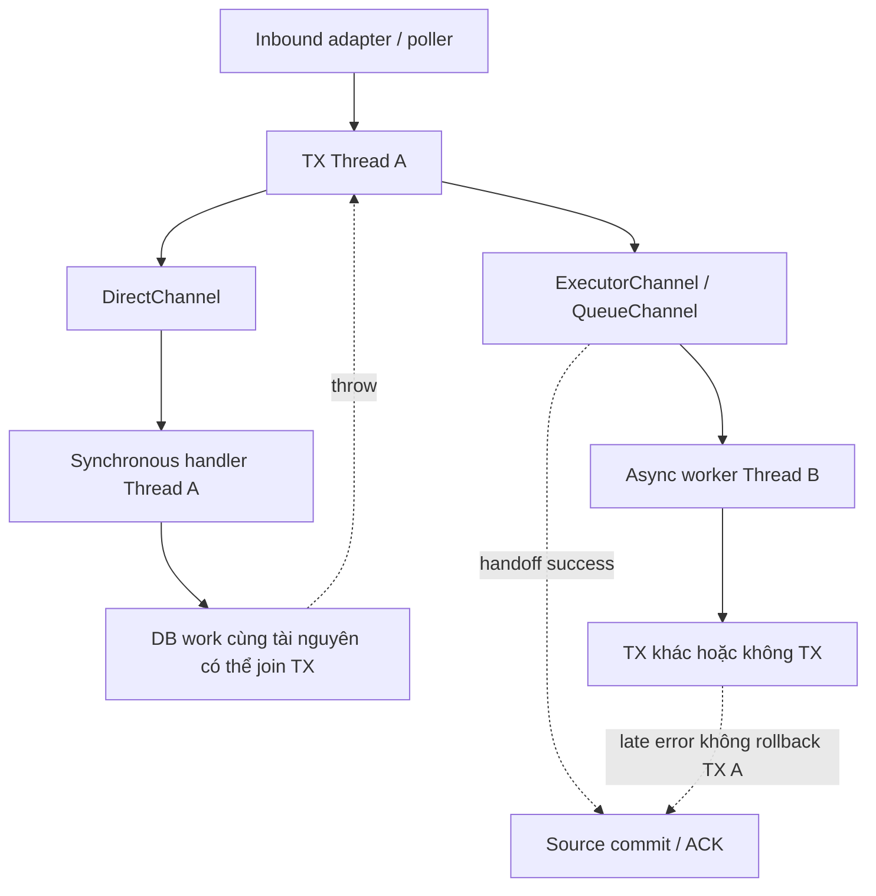
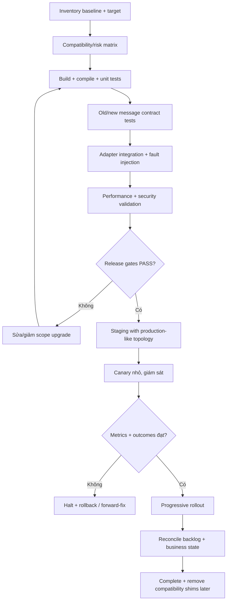
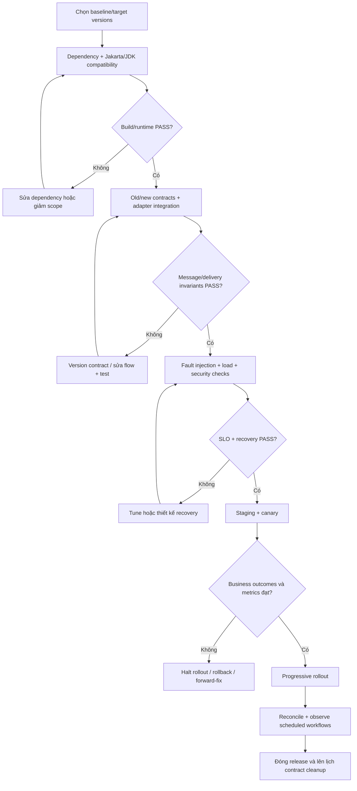

# Kiểm tra tương thích khi nâng phiên bản Spring Integration Adapters

## 1. Nâng phiên bản thành công không chỉ là build xanh

Một ứng dụng Spring Integration có thể biên dịch thành công sau khi nâng Java, Spring Boot, Spring Framework, Spring Integration hoặc driver, nhưng vẫn gây sự cố khi chạy:

- JDBC inbound adapter không còn đọc/claim row giống trước và bỏ sót bản ghi.
- File/SFTP inbound adapter tải lại file đã xử lý hoặc không còn kết nối được vì thuật toán SSH bị thay đổi.
- JMS/AMQP listener nhận message nhưng acknowledgment, retry hoặc dead-letter khác với hợp đồng cũ.
- Kafka producer/consumer thay đổi serializer, header mapping hoặc ack/offset behavior, gây duplicate hay mất việc.
- HTTP gateway thay đổi converter hoặc mã lỗi; một payload từng được đối tác chấp nhận giờ nhận `415` hoặc `400`.
- Một flow từng xử lý đồng bộ bỗng có bước chuyển thread; database transaction không còn bao tới handler cuối.
- Các cấu hình SSL/TLS, chứng thư, pool, scheduler và metrics vẫn khởi động nhưng có độ trễ, kết nối hoặc khả năng phục hồi khác.

**Kiểm tra tương thích khi nâng phiên bản** là việc chứng minh sau thay đổi rằng hệ thống vẫn giữ được **hợp đồng dữ liệu, semantics xử lý, bảo đảm lỗi/phục hồi, bảo mật và hiệu năng** trong phạm vi đã cam kết; không chỉ là mọi dependency có thể resolve hoặc một `@SpringBootTest` khởi động.

Bài này thuộc chương **Production** của module **SPRING_INTEGRATION_ADAPTERS**. Phạm vi là các inbound/outbound adapter, gateway, poller và `MessageChannel` dùng kết nối **File, SFTP, HTTP, JMS, AMQP, Kafka và database**. Những nguyên tắc còn áp dụng khi nâng Spring Boot, Spring Framework, JDK, Spring Kafka, Spring AMQP, driver JDBC, JMS provider, broker và thư viện xác thực.

### Mục tiêu học tập

Sau bài này, bạn có thể:

1. Lập bản đồ phụ thuộc và **compatibility matrix** giữa JDK, Spring Boot/Framework/Integration, Jakarta APIs, Spring Kafka/AMQP, drivers và broker.
2. Phân biệt **API compatibility**, **binary compatibility**, **message contract compatibility** và **behavioral compatibility** trong một IntegrationFlow.
3. Xác định những điểm dễ vỡ khi nâng File/SFTP, HTTP, JMS, AMQP, Kafka và JDBC adapters.
4. Thiết kế regression tests cho payload, headers, acknowledgment, offset, transaction, retry, DLQ, lifecycle và backpressure.
5. Xây dựng quy trình preflight → staging → canary → rollout → rollback với bằng chứng và tiêu chí dừng rõ ràng.
6. Triển khai thay đổi theo kiểu **expand–migrate–contract** để các phiên bản cũ và mới có thể cùng tồn tại trong một khoảng thời gian an toàn.

## 2. Tương thích có nhiều chiều

| Chiều | Câu hỏi cần chứng minh | Ví dụ lỗi |
|---|---|---|
| **Source compatibility** | Mã Java, DSL/XML còn biên dịch không? | Method/factory signature đổi, import không còn |
| **Binary/runtime compatibility** | Không có `NoSuchMethodError`, `ClassNotFoundException`, lỗi linkage? | JAR lẫn nhiều version Spring, Jakarta/Javax không tương thích |
| **Configuration compatibility** | Property name, bean names, namespace và defaults có cùng ý nghĩa? | Poller interval hoặc listener ack policy khác |
| **Message schema compatibility** | DTO, JSON/XML/Avro/Protobuf, content type, encoding còn đọc được? | Thêm required field làm consumer cũ lỗi |
| **Header/metadata compatibility** | Routing key, correlation ID, tracing headers, JMS/Kafka properties được ánh xạ đúng? | Header thay kiểu hoặc không được propagate |
| **Transport/protocol compatibility** | Client kết nối được server/broker với TLS, SASL, SSH và phiên bản protocol? | SFTP key exchange không có thuật toán chung |
| **Transaction/delivery semantics** | Receive, ack, commit, retry, redelivery, duplicate behavior còn đúng? | Source ack sớm, handler lỗi không còn rollback |
| **Thread/lifecycle compatibility** | MessageChannel, scheduler, executor, listener containers vẫn start/stop đúng? | Async handoff khiến transaction context bị cắt |
| **Security compatibility** | Truststore, credentials, cipher suites, ACL, authentication còn hợp lệ? | Provider mới từ chối cert yếu hoặc auth mechanism cũ |
| **Performance/capacity** | Throughput, p95/p99 latency, memory, connection count và backlog trong SLO? | Producer buffer tăng, queue lag, GC pressure |
| **Operational compatibility** | Metrics, logs, tracing, health/readiness, runbook còn quan sát được? | Dashboard không thấy listener bị dừng |
| **Data/replay compatibility** | Event cũ, file cũ, DLQ, outbox, offsets còn xử lý/replay an toàn? | Consumer mới không giải mã message lưu trước upgrade |

Một nâng cấp có thể đạt chiều đầu tiên nhưng thất bại nhiều chiều sau. **Mức độ tương thích phải được kiểm theo tuyến end-to-end**, từ nguồn đến kết quả nghiệp vụ và đường phục hồi.

### 2.1 Phân biệt “tương thích API” và “tương thích hành vi”

Ví dụ một `IntegrationFlow` vẫn chạy với `Jms.messageDrivenChannelAdapter(...)` sau nâng cấp, nhưng:

- Converter không còn ánh xạ một header như trước.
- Container xử lý exception qua error channel khác.
- Message gửi sang `ExecutorChannel` nên upstream JMS transaction commit trước xử lý downstream.

Mã có thể biên dịch nhưng hợp đồng **redelivery** thay đổi. Vì vậy cần test **state của broker và database sau fault injection**, không chỉ gửi thử một message hợp lệ.

### 2.2 Hợp đồng tại boundary quan trọng hơn chi tiết implementation

Một abstraction như `MessageChannel` giúp tách flow khỏi transport, nhưng không xóa được semantics của transport. JMS acknowledgment, Kafka offset, AMQP publisher confirm, SFTP file rename và HTTP response là những loại kết quả khác nhau. Compatibility test phải ghi rõ **điều kiện nào được coi là thành công** ở từng biên.

## 3. Xác định baseline và target trước khi thay dependency

### 3.1 Thu thập inventory có chủ đích

Trước khi upgrade, lập một inventory gồm:

| Thành phần | Baseline cần lưu | Target cần xác minh |
|---|---|---|
| Java runtime/toolchain | Vendor, major version, GC, TLS settings | JDK target và bytecode target |
| Spring Boot | Phiên bản và BOM quản lý | Target Boot BOM và migration guidance |
| Spring Framework | Version thực resolved | Version tương thích Boot/Integration |
| Spring Integration | Core + HTTP/JMS/Kafka/AMQP/SFTP/JDBC modules | Một tập version có quản lý đồng nhất |
| Spring Kafka / Spring AMQP | Version resolved, client dependencies | Tính tương thích adapter, broker và listener |
| JDBC/JPA | Driver, dialect, connection pool, database | Type mapping, transaction/isolation behavior |
| JMS provider | Client API + broker/server version | `jakarta.jms`/`javax.jms`, broker protocol |
| SFTP SSH library | Client implementation, host key/algorithms | Key exchange, auth, host key validation |
| HTTP client | Library, TLS, proxy, redirects, timeout | Converter, pool, connection reuse, errors |
| Serialization | Jackson, schema registry, converters | Default typing, field handling, encoding |
| Observability | Micrometer/tracing, metric names | Dashboards, logs, health/alerts |
| External systems | API versions, certificates, broker settings | Compat window và khả năng rollback |

**Không dựa vào phiên bản khai báo trong một file build để khẳng định phiên bản thực tế**: dependency management, BOM, transitive dependencies, plugin và conflict resolution có thể làm kết quả runtime khác.

### 3.2 Freeze đường kiểm thử

Một baseline có giá trị gồm:

1. Artifact/build ID và dependency lock/BOM hiệu lực.
2. Configuration được version hóa, không chứa secrets.
3. Một tập message/file/test fixtures đại diện production; loại bỏ hoặc ẩn PII.
4. Golden results: payload serialized, headers, DB state, broker acknowledgment, file outcomes.
5. Metrics/SLO trước upgrade: lag, throughput, retry, DLQ, CPU/heap và connection count.
6. Danh sách known issues và acceptance criteria có owner.

Đừng nâng 5 thành phần lớn cùng lúc nếu không cần thiết. Một upgrade có thể gồm nhiều dịch chuyển bắt buộc, nhưng vẫn nên **phân tách các nhóm thay đổi** thành commit/cấu hình/test phù hợp để xác định nguyên nhân khi phát sinh lỗi.

### 3.3 Ví dụ compatibility manifest

```yaml
compatibilityReview:
  service: "SPRING_INTEGRATION_ADAPTERS"
  environment: "staging"
  baseline:
    java: "<baseline-java-version>"
    springBoot: "<baseline-boot-version>"
    springIntegration: "<baseline-integration-version>"
  target:
    java: "<approved-target-java-version>"
    springBoot: "<approved-target-boot-version>"
    springIntegration: "<approved-target-integration-version>"
  endpoints:
    - id: "orders-jdbc-in"
      transport: "JDBC"
      contract: "claim+process+rollback"
    - id: "orders-kafka-out"
      transport: "KAFKA"
      contract: "event-schema-v2+publish-confirmation"
    - id: "invoices-sftp-in"
      transport: "SFTP"
      contract: "accepted-file+deduplication"
  owners:
    development: "integration-team"
    operations: "platform-oncall"
  gates:
    compile: "required"
    contractTests: "required"
    faultInjection: "required"
    canaryMetrics: "required"
    rollbackDryRun: "required"
```

Các giá trị trong dấu `<...>` là placeholder cần điền sau khi kiểm hệ thống; tài liệu này không giả định một phiên bản cụ thể của dự án đã được cung cấp.

## 4. Kiểm ma trận Java – Boot – Framework – Integration – Jakarta

### 4.1 Dùng BOM và release train thay vì ghép phiên bản tùy ý

Trong dự án Spring Boot, BOM/dependency management của Boot thường quản lý một bộ phiên bản Spring Framework, Spring Integration và thư viện liên quan. Nếu tự override một Spring Integration module, Spring Core hoặc Jackson riêng lẻ, cần chứng minh chúng tương thích với **toàn bộ** runtime classpath.

Quy trình:

1. Chọn target Spring Boot hoặc Spring Framework theo yêu cầu nền tảng.
2. Đọc release notes và compatibility guidance cho các major version liên quan.
3. Xác định BOM/dependency management điều phối Spring Integration và các adapter module.
4. Kiểm resolved dependencies: không có nhiều bản Spring Integration cùng nằm trên classpath ngoài ý muốn.
5. Kiểm các adapter-specific clients: Kafka, RabbitMQ, JMS vendor, HTTP client, SSH, JDBC driver.
6. Chạy smoke/contract tests trên **JDK production target** chứ không chỉ JDK ở máy phát triển.

### 4.2 Ví dụ đường nâng lớn: javax → jakarta

Một thay đổi hệ sinh thái đáng lưu ý khi chuyển từ các thế hệ Spring Framework/Boot cũ sang thế hệ tương thích Jakarta là việc nhiều enterprise APIs chuyển **package namespace** từ `javax.*` sang `jakarta.*`, ví dụ `javax.jms` → `jakarta.jms` và `javax.servlet` → `jakarta.servlet`.

| Kiểu thay đổi | Kiểm tra bắt buộc |
|---|---|
| Source imports | Tất cả source code, custom converters, custom adapters, test fixtures |
| Library artifacts | JMS client, servlet container, Jakarta Persistence/Validation và phụ thuộc transitive |
| Provider compatibility | Broker client/provider có API Jakarta phù hợp runtime không? |
| Reflection/config | Class name trong YAML/XML, serializers, exception handling, plugin loaders |
| Integration tests | Endpoint JMS/HTTP có thực sự start, kết nối và trao đổi message không? |

**Ví dụ lịch sử phổ biến:** Spring Framework 6 và Spring Boot 3 đặt baseline Java 17 và hướng tới Jakarta EE APIs; đây là lý do nhiều dự án cần migration imports/dependencies khi vượt ranh giới major version. Khi lập kế hoạch nâng sang một target khác, phải đọc **requirements chính thức của chính target đó**, không suy tất cả version Spring Integration đều dùng cùng baseline.

### 4.3 Đừng chỉnh imports rồi bỏ qua runtime

Mã Java dùng `jakarta.jms.Message` vẫn có thể lỗi runtime nếu provider client hoặc adapter dùng loại API không tương thích. Một trường hợp khác: ứng dụng compile được nhưng có `NoClassDefFoundError` khi listener container khởi động bởi auto-configuration chưa được exercise trong unit tests.

Nên thêm smoke test khởi tạo **tất cả adapter endpoints** dự kiến chạy ở production và gọi ít nhất một round-trip với hệ thống thử hoặc broker/container tương thích.

### 4.4 Không trộn majors của module một cách vô tình

Một application có `spring-integration-core` version A nhưng `spring-integration-kafka` hoặc `spring-integration-sftp` version B có thể xuất hiện compile/linkage/runtime behavior khó chẩn đoán, nhất là khi API nội bộ thay đổi. Hãy kiểm artifact graph và dependency convergence theo ecosystem build đang dùng; **không chạy một lệnh cố định trong mọi repository** nếu không biết Gradle/Maven và convention thực tế.

## 5. Checklist API và Java DSL sau nâng cấp

Khi nâng Spring Integration, các thay đổi có thể liên quan:

- `IntegrationFlow`, factory methods của inbound/outbound adapter và gateway.
- `Pollers`, `PollerMetadata`, `SourcePollingChannelAdapter`, `PollingConsumer`.
- Handler/endpoint spec cho File, SFTP, JDBC, JMS, AMQP, Kafka và HTTP.
- Message converters, transformers, header mappers và type parameters.
- Các DSL methods từng deprecated, đã bỏ hoặc chuyển sang API khác.
- Java configuration, annotations, XML namespace, bean registration và lifecycle.

### 5.1 Từ compile đến behavioral tests

Nếu compile báo một method không tồn tại, hãy:

1. Xác định target API/alternative trong release notes.
2. Sửa tối thiểu để bảo toàn **hợp đồng message**.
3. Chạy unit tests cho transformer/handler.
4. Chạy integration tests với adapter thật.
5. Kiểm thread, transaction, acknowledgment và error channel.

Không thay API bằng một hàm “trông tương tự” nếu khác semantics. Ví dụ thay inbound gateway bằng inbound adapter có thể làm mất cơ chế reply/correlation và HTTP response mà client trông đợi.

### 5.2 Ví dụ skeleton trước/sau API migration

```java
// Mẫu cấu trúc, không khẳng định đây là một breaking change
// ở một cặp version cụ thể.
IntegrationFlow flow = IntegrationFlow
    .from(inboundMessageSource,
        endpoint -> endpoint.poller(
            Pollers.fixedDelay(Duration.ofSeconds(2))
                .maxMessagesPerPoll(1)))
    .transform(payloadTransformer)
    .channel("outboundInput")
    .get();
```

Checklist sau khi thay DSL:

- Source có còn là **polling** source hay chuyển thành listener message-driven?
- `maxMessagesPerPoll`, fixed delay/rate, receive timeout có còn đúng kỳ vọng?
- Một `receive()` trả một message hay list/batch? Nếu là JDBC, row count không tự bằng message count.
- `outboundInput` có subscriber đúng, và channel được đặt synchronous/async có chủ đích?
- Handler có được gọi cùng thread để transaction advice bao phủ?
- Nếu transformer ném lỗi, `errorChannel` nào nhận? Nguồn còn có thể retry không?

### 5.3 Kiểm XML namespace và bean name

Các dự án lâu năm có thể dùng XML `<int:poller>`, `<int-jms:...>`, `<int-file:...>`. Khi nâng:

- Đối chiếu schema/namespace mapping của version mới.
- Kiểm attribute bị deprecate/thay đổi, property defaults và validation errors.
- Kiểm endpoint IDs/bean names do monitoring, control bus hoặc operations script tham chiếu.
- Không coi việc Spring context load thành công là đủ: adapter có thể lazy-connect, chỉ lỗi ở lần poll đầu.

## 6. Message contract là điểm bất biến quan trọng nhất

Một IntegrationFlow đóng vai trò cầu nối, nên hợp đồng giữa producer và consumer thường sống lâu hơn code implementation.

### 6.1 Golden messages

Chuẩn bị một bộ fixtures đại diện:

- JSON cũ/mới, có field tùy chọn, field unknown, null, Unicode và nested object.
- XML có namespace, attribute và content-type đặc thù.
- Avro/Protobuf dùng schema version cũ và mới nếu ứng dụng có.
- Header/correlation metadata, Kafka record keys, JMS properties.
- File rỗng, file lớn, file tên Unicode, SFTP partial upload.
- Message đã có trong DLQ/outbox trước nâng cấp.

Với mỗi fixture, lưu **expected business state**, serialized payload hợp lệ, error classification và routing destination. Đừng chỉ snapshot cả object Java rồi so sánh `toString()`: nó không phải contract trên wire.

### 6.2 Forward, backward và full compatibility

- **Backward compatibility:** consumer phiên bản mới vẫn đọc được sự kiện do producer cũ phát.
- **Forward compatibility:** consumer cũ vẫn đọc được sự kiện mới theo phạm vi đã cam kết.
- **Full/bidirectional:** cả hai chiều cần hoạt động trong cửa sổ triển khai nhiều version.

Các thuật ngữ này phải được gắn với **schema format và logic consumer cụ thể**. Thêm field optional vào JSON chưa chắc vô hại nếu consumer cũ cấu hình strict unknown-properties; đổi enum value có thể phá code dù schema vẫn parse.

### 6.3 Header mapping và tính đúng đắn

`MessageHeaders` ở Spring Integration có thể được converter ánh xạ sang:

- JMS headers/properties và `JMSCorrelationID`.
- Kafka headers, record key, topic/partition metadata.
- AMQP properties, routing key và correlation fields.
- HTTP request/response headers.
- File name, directory và content-type khi đi qua File/SFTP.

Khi nâng mapper hoặc framework, **không coi mọi header đều được chuyển y nguyên**. Test phải kiểm:

1. Header cần thiết có tồn tại ở đích?
2. Kiểu dữ liệu của header có thay đổi không?
3. Header nào bị loại do allowlist, bảo mật hoặc type restrictions?
4. Header có bị nhân bản hoặc ghi đè bởi framework không?
5. Correlation, tenant và idempotency keys có được giữ nguyên qua retry/relay không?

Không đưa token, credential hay private key vào headers để “giữ cho tương thích”. Các dữ liệu đó cần được xử lý theo hợp đồng bảo mật của destination.

### 6.4 Serialization, charset và giới hạn kích thước

Một nâng cấp converter hoặc serializer có thể thay đổi format bytes, escaping, timezone, enum representation hay error behavior. So sánh `byte[]` hoặc payload theo **hợp đồng** thay vì kỳ vọng byte-for-byte trên mọi format nếu thứ tự field không quan trọng. Với digital signature, canonicalization hoặc schema registry, byte-level compatibility có thể trở thành yêu cầu thật.

Đồng thời kiểm kích thước payload **sau chuyển đổi** và transport overhead. Một schema vẫn tương thích logic nhưng vượt Kafka/broker/HTTP max size có thể là **production incompatibility**.

## 7. Adapter compatibility matrix: cần kiểm điều gì theo từng giao thức?

| Adapter | Hợp đồng dữ liệu | Hợp đồng vận hành | Regression test tối thiểu |
|---|---|---|---|
| **File inbound/outbound** | Filename, encoding, filtering, checksum, directory layout | Polling, lock/temp file, metadata store, move-on-success | File cũ/mới, restart, file ghi dở, duplicate |
| **SFTP inbound/outbound** | Tên remote file, directory, charset, attributes | SSH auth, host key, key exchange, session pool, reconnect | Connect/auth, sync, rename, network drop, retry |
| **HTTP inbound/outbound gateway** | Method, URI, query, headers, JSON/XML, status | Timeout, TLS, redirect, proxy, pooling, streaming | Contract 2xx/4xx/5xx, charset, timeout, large body |
| **JMS inbound/outbound** | Text/Bytes/Map message, correlation, destination | Jakarta/Javax API, session transaction, ACK, listener recovery | Delivery, rollback/redelivery, reply correlation |
| **AMQP inbound/outbound** | Exchange/routing key, properties, converter | Ack/nack/requeue, publisher confirm, DLQ, broker recovery | Route, reject/requeue, returned message, duplicate |
| **Kafka inbound/outbound** | Record key, topic, headers, serializer/schema | Consumer group, offset, partition ordering, producer ack/transaction | Rebalance/retry, schema, DLT, duplicate |
| **JDBC inbound/outbound** | SQL columns, row mapper, BLOB/CLOB, batch | Poller transaction, isolation/locks, pool, driver type mapping | Claim+rollback, concurrency, pagination, restart |

Ma trận là **bản đồ cần kiểm**, không phải bằng chứng mỗi adapter đều thay hành vi khi nâng version. Những khác biệt thực phải dựa vào release notes và test của **cặp baseline–target**.

## 8. File adapter: filter, metadata store và file lifecycle

### 8.1 File inbound

Một File inbound adapter có thể poll thư mục và dùng filter xác định file nào đã nhận. Khi nâng phiên bản, kiểm:

- Hành vi `FileReadingMessageSource` và filters với filename, timestamp, case sensitivity.
- `AcceptOnceFileListFilter` hoặc persistent metadata store nếu dùng: key, namespace, serialization và retention có đổi không?
- File được nhận lại sau restart hay bị bỏ sót vì metadata cũ?
- Poller đã chờ file ghi hoàn tất chưa? Bên phát có dùng temporary filename rồi rename atomically khi filesystem hỗ trợ?
- Permission, symbolic links, path traversal defenses, file timestamp resolution và encoding tên file.
- `maxMessagesPerPoll`, scheduler, concurrent pollers và file ordering.

**Kịch bản bắt buộc:** có file đã xử lý, file chưa xử lý và một file đang ghi dở; restart ứng dụng phiên bản mới. Kiểm **không bỏ sót file chưa xử lý**, file cũ không gây duplicate business effect và file đang ghi dở không được xử lý sai.

### 8.2 File outbound

Một outbound adapter có thể dùng temporary file và rename khi hoàn tất. Kiểm:

- Đường dẫn, cách tạo directory, file-exists mode và overwrite policy.
- Quá trình write → close → rename trong trường hợp process crash.
- Checksums/size và encoding line endings khi transformer thay đổi.
- Giao dịch DB có commit rồi file move failed không? **Filesystem không tự rollback với JDBC.**
- Cleanup của temporary/partial files và owner xử lý lỗi.

Ví dụ test đưa payload ra file tạm, cố ý mất quyền rename, xác minh DB/business state và file partial-state theo chính sách. Không coi `afterCommit` callback là một transaction file thật sự.

## 9. SFTP adapter: kiểm cả SSH protocol và tính toàn vẹn của file

SFTP compatibility chịu ảnh hưởng của Spring Integration, SSH client library, crypto provider/JDK, OpenSSH server và chính sách bảo mật phía máy chủ.

### 9.1 Những thay đổi có thể phá kết nối dù API không đổi

- Thuật toán key exchange, host-key signature, cipher, MAC không còn giao nhau.
- Khóa SSH private/public key format hoặc password/key passphrase không được client mới chấp nhận.
- Server host key rotate, `known_hosts` không phù hợp, policy xác minh host key bị thay đổi.
- Username, chroot, remote directory và permission khác theo session.
- Kết nối idle/pool reuse, reconnect, keepalive, timeout hoặc session factory cleanup khác.
- Proxy/jump host, DNS hoặc IPv6 bị ảnh hưởng.

**Không sửa lỗi nâng cấp bằng cách tắt host-key verification hoặc bật thuật toán yếu vô thời hạn.** Nếu algorithm không còn hỗ trợ, ưu tiên nâng cấu hình/server hoặc phối hợp migration crypto có giám sát và được phê duyệt.

### 9.2 Test inbound synchronization

Một test tối thiểu:

1. Dùng SFTP test server có user/key và `known_hosts` hợp lệ.
2. Tạo remote file hợp lệ, file trùng tên và một file upload dở.
3. Chạy đồng bộ bằng adapter target, kiểm dữ liệu local và remote filter/metadata.
4. Cố ý ngắt kết nối khi đang tải, sau đó reconnect.
5. Kiểm file local không bị xem là hoàn tất nếu upload chưa xong, checksum/size đúng sau retry.
6. Restart và kiểm không tải/xử lý trùng nếu metadata contract yêu cầu once-per-file; với at-least-once cần idempotency business.

### 9.3 Test outbound upload/rename

Kiểm chuyển từ temporary name sang final name theo cấu hình và khả năng remote filesystem; xử lý trường hợp rename fail sau khi upload hoàn tất. Nếu client timeout, remote file **có thể đã tồn tại**. Dùng content hash/manifest hoặc versioned filename trước khi re-upload.

### 9.4 Vòng đời connection/session

Ngoài happy path, quan sát số session đang mở và khả năng shutdown. Một upgrade làm đổi connection caching có thể gây:

- Leak session khi exception tại handler.
- Too many connections sau rollout.
- Hung poll khi server down.
- Application không shutdown sạch vì thread/socket chưa được đóng.

Đưa connect/handshake latency, session count, reconnect attempts và transfer failure metrics vào compatibility gate.

## 10. HTTP adapter/gateway: method, status, converter và client behavior

### 10.1 Contract của HTTP gateway

Khi chuyển Spring Framework/Boot hoặc HTTP client backend, kiểm:

- HTTP method, URI template expansion, query parameter encoding.
- Request/response body type, charset và `Content-Type`/`Accept`.
- Header propagation, authentication token handling, correlation/tracing.
- Status mapping 2xx/4xx/5xx và `ResponseErrorHandler`/exception policy.
- Connect/read/response timeout, redirect, proxy, connection pooling.
- Multipart, streaming, compression và maximum in-memory buffering.
- TLS truststore, hostname verification và HTTP/1.1/HTTP/2 negotiation theo client.

Một lỗi phổ biến: client mới thay đổi default converter, request JSON của một DTO trở thành dạng không đúng contract, server trả `415 Unsupported Media Type`. Test ở tầng unit handler không thấy lỗi vì chưa tạo HTTP request thật.

### 10.2 Contract test với mock HTTP server

Với `WireMock` hoặc `MockWebServer`, tạo fixture kiểm:

| Trường hợp | Assertions |
|---|---|
| 200 JSON | URI/method/headers/body đúng; DTO parse đúng |
| 201 Created | Location header và response body mapping đúng |
| 202 Accepted | Không nhầm accepted với business completed |
| 400/422 | Không retry deterministic validation failure vô hạn |
| 401/403 | Token/auth scope đúng; không log secrets |
| 404 | Mapping lỗi phù hợp domain contract |
| 408/429/503 | Retry/backoff theo hợp đồng, không retry storm |
| 5xx sau remote side effect | Idempotency key, reconciliation |
| Timeout sau response đã được server ghi | Outcome unknown; không suy chưa xử lý |
| Redirect/cert error | Không vô ý gửi credential sang host ngoài allowlist |

### 10.3 Inbound gateway và response semantics

Đối với HTTP inbound gateway, kiểm status response, exception translation và timeout khi downstream handler xử lý chậm. Nếu thay `DirectChannel` bằng một async channel hoặc reactive boundary, request thread/connection có thể hoàn tất trước business work. API client không nên nhận success chỉ vì nội bộ đã enqueue công việc, trừ khi contract chủ đích là `202 Accepted` với operation ID.

### 10.4 Response memory limit

Một nâng cấp HTTP client/codec có thể làm mặc định buffering khác. Test response lớn và binary stream để kiểm memory/GC; không tăng `maxInMemorySize` vô hạn để “cho qua”. Streaming hoặc object storage reference có thể thích hợp hơn khi dữ liệu lớn.

## 11. JMS adapter: Jakarta, listener transaction và correlation

### 11.1 API/provider compatibility

Khi vượt ranh giới Spring/Jakarta API, cần kiểm đồng nhất:

- `jakarta.jms` hoặc `javax.jms` package của application và JMS adapter.
- ConnectionFactory/client library từ vendor tương thích server/broker.
- JMS message converter, `TextMessage`/`BytesMessage`/`MapMessage` mapping.
- `JMSCorrelationID`, `JMSReplyTo` và headers/properties.
- Listener container concurrency, durable subscription, temporary reply destination.

Các client/provider JMS khác nhau có khả năng hỗ trợ và lộ trình Jakarta riêng; **không thay dependency bằng một artifact có tên tương tự mà chưa chạy round-trip integration test**.

### 11.2 Acknowledgment và transaction regression

Với `DefaultMessageListenerContainer` hoặc listener container đang dùng, lập test:

1. Handler thành công: JMS receive commit/ack theo policy.
2. Handler ném exception đồng bộ: rollback/redelivery theo session/container.
3. Handler bắt lỗi rồi return: container có thể coi message hoàn tất.
4. Handler đi qua `ExecutorChannel`: lỗi worker sau handoff có thể không rollback receive.
5. DB commit rồi JMS chưa commit: broker có thể redeliver; inbox ledger không tạo business effect trùng.
6. Poison message: retry budget/DLQ/quarantine đúng.

**Đừng suy từ cấu hình `sessionTransacted=true` rằng JDBC transaction cùng rollback.** `JmsTransactionManager` và `DataSourceTransactionManager` quản lý local resources khác nhau nếu không có XA/JTA phù hợp.

### 11.3 Request/reply gateway

Đối với JMS inbound/outbound gateway, kiểm:

- Correlation ID mapping có còn đúng?
- Reply được gửi đến destination mà client mong đợi?
- Reply timeout có tạo duplicate request khi client retry?
- Late reply được xử lý thế nào?
- Business event/request ID có ổn định qua retry?

Một nâng cấp có thể không phá message receive nhưng phá response correlation: hệ thống tiếp tục xử lý business request, client timeout và retry, từ đó tạo duplicate.

## 12. AMQP adapter: topology, ACK và publisher confirm

Với Spring Integration AMQP/RabbitMQ, compatibility không chỉ là kết nối broker thành công. Kiểm:

- Exchange, queue, binding, routing key và declaration policy.
- Queue arguments như TTL, DLX, dead-letter routing, quorum/classic policy nếu có.
- Message converter, headers/properties, charset và payload size.
- Listener container acknowledge mode, requeue policy, retry/error handler.
- Publisher confirm và returned-message handling cho message không route được.
- Channel/connection recovery, heartbeats, pool/concurrency.

### 12.1 Phân biệt publisher confirm với consumer ack

Producer có thể nhận publisher confirm cho biết broker đã xử lý publish theo hợp đồng cấu hình. Nhưng consumer còn chưa xử lý business event. Test phải có **hai loại assertions**: một cho publication, một cho consumption/business state.

### 12.2 Regression matrix AMQP

| Kịch bản | Điều cần quan sát |
|---|---|
| Route hợp lệ | Message đến đúng queue |
| Routing key không có binding | Return/reject theo mandatory/confirm policy |
| Handler throw | Nack/requeue/DLQ đúng, không mất message |
| Poison message | Bị cách ly sau budget, message khác tiếp tục |
| Consumer crash sau DB commit, trước broker ack | Redelivery và idempotent business effect |
| Broker restart | Reconnect và queue topology không bị khai báo sai |
| Concurrency tăng | Ordering theo nghiệp vụ và memory phù hợp |

Không sử dụng các constant của JMS `CLIENT_ACKNOWLEDGE` để mô tả AMQP ack; đây là hai API và giao thức khác nhau.

## 13. Kafka adapter: schema, offset, rebalance và producer behavior

### 13.1 Producer compatibility

Đối với Kafka outbound adapter, kiểm:

- Key/value serializers và tương thích schema registry nếu dùng.
- Headers được map, topic và partition key.
- Producer `acks`, retries, idempotence và transactional ID nếu dùng.
- Callback/future completion semantics: `MessageChannel.send()` thành công **không luôn đồng nghĩa broker ACK** nếu producer async.
- Cấu hình kích thước record/request/batch, compression, buffer memory và timeout.
- Error channel/async failure routing, tránh đánh dấu outbox `SENT` trước broker confirmation.

### 13.2 Consumer compatibility

Kiểm:

- Deserializer, schema reader và handling của unknown/malformed messages.
- Consumer group ID, partition assignment/rebalance behavior.
- Ack mode, manual commit/auto commit theo container config.
- Error handler, seek/retry, retry topics/DLT và listener exceptions.
- Offset retention, reset policy và startup behavior khi consumer group mới.
- Ordering per partition/aggregate và duplicate suppression.

### 13.3 Crash test bắt buộc

Gửi một event `E-101`. Cho consumer **DB commit** rồi crash **trước offset commit**:

1. Record có thể được giao lại sau restart/rebalance.
2. Consumer nhận lần hai, dùng business event ID và inbox unique constraint để không ghi nghiệp vụ lặp.
3. Offset/progress cuối cùng được commit theo hợp đồng container.

Ngược lại, nếu offset commit **trước** khi DB write hoàn tất, sự cố DB có thể dẫn đến **mất công việc**. Test hai chiều để chọn đúng thứ tự và transaction model.

### 13.4 Kafka transaction không tự là XA với DB

Producer transactions và cơ chế phối hợp offset trong Kafka có phạm vi được Kafka hỗ trợ. Không mặc định một `@Transactional` trong service khiến cả database, Kafka topic và HTTP API cùng commit nguyên tử. Dùng outbox/inbox và retry/reconciliation hoặc transaction coordination rõ khi cần.

### 13.5 Schema registry và rolling upgrade

Trong thời gian chạy song song old/new instances:

- Consumer mới phải đọc được event cũ vẫn còn trong topic.
- Nếu old consumer còn chạy, event mới phải tương thích với nó **hoặc được route sang version/topic riêng**.
- Schema registry compatibility mode cần phù hợp với migration sequence.
- Thêm field required hay đổi enum cần chiến lược default/dual-read/versioned event, không chỉ tăng schemaVersion.

Thử cả **producer cũ → consumer mới** và **producer mới → consumer cũ** khi canary coexistence là yêu cầu.

## 14. JDBC adapter: claim, transaction, driver và database consistency

### 14.1 JDBC inbound poller

JDBC polling có thể dùng một câu `SELECT` đọc row và câu `UPDATE` đánh dấu đã nhận. Kiểm:

- Query syntax/dialect, named parameters, row mapper và JDBC data types.
- `maxRows` so với `maxMessagesPerPoll`: một receive có thể trả một message chứa danh sách row.
- Source update có cùng transaction với handler downstream đồng bộ không?
- DataSource/transaction manager có đúng, connection pooling/timeout có thay đổi?
- Isolation và concurrent claim có bảo đảm tránh trùng giữa nhiều instance?
- Null/LOB/timestamp/timezone conversion qua driver mới có giữ contract?

### 14.2 Negative rollback test

Tạo row `NEW`, cho poller đọc/cập nhật claim và handler ghi ledger rồi ném `RuntimeException`. Khi poller transaction advice và `DirectChannel` thật sự bảo vệ cùng DataSource, expected outcome:

```sql
-- Sau rollback, đọc bằng transaction/kết nối độc lập:
SELECT status FROM incoming_order WHERE id = 101;
-- Kỳ vọng: NEW

SELECT COUNT(*) FROM order_ledger WHERE order_id = 101;
-- Kỳ vọng: 0
```

**Quan trọng:** `@Transactional` trên **test method** có thể tạo false positive vì test tự rollback; fixture không commit có thể bị poller ở thread khác không nhìn thấy. Dùng committed fixtures và readback độc lập.

### 14.3 Outbound JDBC

Một outbound JDBC adapter có thể dùng prepared statements, batch updates, upsert và type conversion. Kiểm dữ liệu khi:

- Null được map vào SQL type phù hợp.
- Boolean, timestamp/timezone, JSON/JSONB, UUID, decimal precision hoặc LOB chuyển qua driver.
- Batch lỗi ở row giữa chừng: partial commits có phù hợp transaction scope?
- Trùng business key, deadlock, lock timeout và retry logic.
- Outbound source row đã được ack/claim trước khi DB target commit hay chưa.

### 14.4 Migration database schema theo expand–contract

Nếu nâng adapter cùng schema:

1. **Expand:** thêm cột/field mới theo cách old app còn đọc/ghi được.
2. **Dual-read hoặc dual-write có kiểm soát:** nếu cần, cho old/new version cùng hiểu dữ liệu.
3. **Migrate/backfill:** dữ liệu cũ được chuyển, có kiểm đếm và checksum.
4. **Switch:** chuyển producer/consumer sang contract mới.
5. **Contract:** chỉ xóa cột/event format cũ khi không còn old app/consumer/replay phụ thuộc.

Không drop cột hoặc đổi kiểu dữ liệu không tương thích trước khi canary/rollback window kết thúc. Rollback binary thường không rollback được database schema đã thay một chiều.

## 15. Poller, MessageChannel và transaction boundary sau upgrade

Các endpoint có thể “khởi động được” nhưng đổi hành vi vì scheduler, executor, channel hoặc advice chain khác so với baseline. Đây là nhóm lỗi đặc biệt khó phát hiện bằng unit test.

### 15.1 Poller contract

Kiểm đúng từng endpoint:

- Trigger: fixed-delay, fixed-rate, cron, initial delay.
- `maxMessagesPerPoll`, receive timeout và số lần xử lý trong một chu kỳ.
- TaskScheduler/TaskExecutor đã được gắn đúng bean?
- Poller advice: retry, transaction interceptor, metrics, custom filters.
- Endpoint lifecycle: autoStartup, phase, stop/start và graceful shutdown.
- Backpressure: khi nguồn trả message liên tục, poller có dừng hoặc chiếm executor không?

Một `SourcePollingChannelAdapter` polling JDBC có thể trả một **message chứa nhiều row**, trong khi `PollingConsumer` nhận từ `QueueChannel`. Không đồng nhất số lần poll với số row hoặc số business messages. Khi nâng version, test phải so đúng behavior ở hai phía.

### 15.2 DirectChannel so với ExecutorChannel



**Không tự khẳng định bất kỳ major upgrade nào cũng đổi channel type.** Đây là một invariant phải bảo toàn nếu cấu hình hoặc refactor đồng thời với upgrade. Chỉ cần một thay đổi vô tình trong DSL wiring cũng có thể làm JMS listener ack sớm hoặc JDBC poller commit claim trước khi handler xử lý.

### 15.3 Advice chain và exception propagation

Kiểm:

1. `TransactionInterceptor` còn được gắn đúng poller/handler?
2. Retry advice ở trong hay ngoài transaction? Mỗi attempt có transaction mới không?
3. `errorChannel` có bắt và coi exception là đã xử lý không?
4. Lỗi đồng bộ có đến được listener container để rollback/redeliver?
5. Lỗi từ producer callback bất đồng bộ được ghi nhận ở đâu?

Khi có version nâng và logic error handling thay đổi, kết quả test phải chứng minh **source trạng thái cuối + target business state**, không chỉ số log `ERROR`.

### 15.4 Graceful shutdown

Đặt test dừng phiên bản cũ và khởi động mới khi đang có:

- JDBC poll/transaction đang chạy.
- JMS/AMQP listener có unacknowledged message.
- Kafka consumer đang xử lý batch và giữ offsets chưa commit.
- SFTP đang tải file, HTTP gateway chờ response.
- QueueChannel có message in-memory hoặc persistent.

Đọc lại source/broker/file/DB sau restart. Nếu có transient duplicate, consumer phải idempotent. Nếu dùng in-memory queue, không được mặc định nó bền vững sau process restart.

## 16. Retry, DLQ và outbox compatibility

### 16.1 Cần giữ error contract

Một producer/consumer cũ có thể phân loại một lỗi là retryable nhưng phiên bản mới chuyển thành permanent exception; hoặc ngược lại. Điều này làm thay đổi retry count, ack, DLQ/quarantine và vận hành.

| Nhóm lỗi | Kỳ vọng regression |
|---|---|
| Validation/schema | Không retry vô hạn; quarantine/DLQ có metadata |
| Network transient | Backoff/jitter, retry budget, reconnect |
| Authentication/authorization | Không retry dày với credentials sai; alert và không log secrets |
| Timeout outcome unknown | Không khẳng định chưa gửi; retry idempotent |
| Oversized payload | Không retry cùng bytes vô ích |
| Deadlock/transaction conflict | Rollback và retry đúng tài nguyên, không duplicate effect |
| Poison message | Sau budget có durable failure state và owner |
| AfterCommit callback failure | Đã commit rồi thì không giả lập rollback; reconciliation |

### 16.2 Test DLQ cũ vẫn đọc được

Sau upgrade, chạy consumer mới trên một tập message từng lỗi và nằm trong DLQ:

- Header/exception metadata do phiên bản cũ ghi có được parse không?
- Converter có đọc được schema cũ?
- Replay có preserve event ID không?
- DLT/DLQ routing có còn cùng đích, tên, retention và ACL?
- Khi retry từ DLQ, consumer có idempotent business update?

**Không xóa DLQ hoặc reset offsets để dashboard xanh** khi chưa có đánh giá nghiệp vụ và quy trình recovery.

### 16.3 Outbox publisher và producer acknowledgment

Outbox giữ ý định gửi trong database cùng business state, nhưng publisher có thể gửi lại sau crash. Sau nâng version, kiểm:

- Mark `SENT` chỉ sau **publisher confirmation** đủ điều kiện, không chỉ sau `MessageChannel.send()`.
- Một producer tương tác bất đồng bộ có thể thay đổi callback/future behavior; mã mới có còn xử lý kết quả muộn?
- Worker claim/lease/fencing và retry schedule vẫn an toàn khi phiên bản cũ và mới cùng chạy?
- Event payload/headers do worker mới tạo vẫn được consumer cũ chấp nhận trong cửa sổ coexistence.

Test **broker nhận event nhưng DB mark SENT thất bại**, sau restart publisher gửi lại cùng event ID. Kết quả PASS nếu không mất event và consumer không tạo business effect trùng.

## 17. Bảo mật và xác thực khi nâng phiên bản

### 17.1 Đổi dependency có thể đổi crypto policy

JDK, HTTP/TLS, SSH/SFTP, JMS/AMQP/Kafka security client hoặc crypto provider có thể thay đổi các thuật toán và cấu hình được hỗ trợ. Kiểm trước rollout:

- TLS versions/cipher suites và server hostname verification.
- Truststore/keystore format, certificate chain, expiration và rotation.
- SASL/SCRAM/OAuth hoặc client certificate auth của Kafka/broker.
- SSH host key verification, key exchange, key type và private-key format.
- Proxy/NO_PROXY, service discovery, DNS cache, timeout.
- ACL đối với topics, queues, destinations, directories và schemas.
- Secrets injection/rotation, không bake vào image hoặc test artifact.

### 17.2 Hành vi thất bại an toàn

Nếu upgrade khiến một endpoint không xác thực được:

- Readiness/health phải phản ánh mức độ không thể phục vụ đã cam kết.
- Không tự tắt TLS certificate validation hoặc host key checking.
- Retry có hạn; credential sai thường không được retry dày.
- Không commit/ack message nguồn khi outbound side effect chưa có durable recovery state.
- Thu thập error code/endpoint ID mà không log password, bearer token hay private key.

Một “upgrade thành công” nhưng phải giảm chuẩn xác thực để có kết nối là **failure của security compatibility gate** cho đến khi được đánh giá và chấp thuận chính thức.

### 17.3 Trusted boundaries và metadata

Nếu phiên bản mới thay header mapper, không để client tự đặt route destination, file path, SQL fragment hoặc tenant ID không được kiểm soát. Test:

- Header giả mạo destination có bị chặn?
- Path traversal trong filename có bị từ chối?
- Tenant ID từ source có được xác minh trước khi gán vào outbound message?
- Payload quá lớn/decompression bomb có bị bounded parse?
- Log/tracing có vô tình xuất raw headers/payload nhạy cảm sau upgrade?

Nâng cấp không chỉ cần bảo toàn tính năng, mà còn **không hồi sinh lỗ hổng đã được khắc phục**.

## 18. Chiến lược kiểm thử 7 tầng

Để nâng cấp có bằng chứng, chia kiểm thử thành các tầng từ rẻ đến đắt:

1. **Dependency validation:** target dependency graph, Java/Jakarta API, missing/conflicting classes.

2. **Compile + unit tests:** transformers, validators, routers, error classification.

3. **Application-context tests:** endpoint bean wiring, poller, channels, advice, converter, health/lifecycle.

4. **Consumer-driven contract tests:** old/new JSON/headers/schema, request/reply, routing.

5. **Integration tests:** real/test-equivalent broker, SFTP server, HTTP mock, database và transaction manager.

6. **Failure/recovery tests:** broker outage, crash/rollback, duplicate, DLQ, timeout, in-flight messages.

7. **Performance/operational gates:** throughput, backlog, memory, connection counts, drain/shutdown, canary.

Không phải mỗi test đều bắt buộc chạy mọi commit; phân loại CI smoke, nightly regression và release gate. Nhưng không bỏ tầng 5–7 rồi coi một major upgrade production đã được chứng minh.

### 18.1 Chọn môi trường test có tính đại diện

| Tầng | Công cụ/vật liệu | Chứng minh |
|---|---|---|
| Java unit | JUnit 5, Mockito | Transform logic, validation, routing |
| Spring integration test | `@SpringBootTest`, `@SpringIntegrationTest`, `MockIntegrationContext` | Bean/flow/advice wiring |
| JDBC | Testcontainers PostgreSQL/MySQL hoặc DB thử tương đương | Transaction, lock, driver type conversion |
| JMS | Provider thử tương ứng với production | Session ack, redelivery, reply correlation |
| AMQP | RabbitMQ test broker cùng chính sách tương đương | Routing, confirm, nack/DLQ |
| Kafka | Kafka broker thử + schema registry khi dùng | Serializers, offset/rebalance, DLT |
| HTTP | WireMock/MockWebServer và staging API | Status/body/headers/timeout/auth |
| SFTP | SFTP test server với host key/crypto policy | Handshake, sync, rename, retries |
| Chaos/performance | Controlled process kill/network outage và load generator | Recovery, backlog, pool/capacity |

**Lưu ý:** mock hoặc embedded broker có thể không tái hiện provider production. Nếu contract phụ thuộc vào một broker vendor, ít nhất release gate cần test môi trường tương đương về major version, cấu hình ACK, TLS và routing.

### 18.2 Không chạy test toàn bộ trong transaction của test runner

Khi test polling, fixture cần **commit trước** để scheduler/listener thread đọc được. Nếu đặt `@Transactional` trên cả JUnit test, nó có thể tạo false positive rollback hoặc khiến poller thread không thấy dữ liệu. Readback nên dùng transaction độc lập; đảm bảo endpoint được dừng trước cleanup để không race.

### 18.3 Golden test fixtures phải bất biến

Golden messages nên có phiên bản và mục tiêu rõ:

```text
fixtures/
  contract-v1-order-created.json
  contract-v2-order-created.json
  legacy-jms-text-message.json
  legacy-amqp-headers.json
  legacy-kafka-key-value.json
  sftp-unicode-filename.txt
  jdbc-legacy-row.json
```

Danh sách trên là **minh họa cấu trúc dữ liệu test**, không yêu cầu tạo file ngoài phạm vi bài này. Với message nhạy cảm, sử dụng synthetic fixtures, không sao chép dữ liệu khách hàng chưa được cho phép.

## 19. Test matrix old/new: ngoài upgrade đường thẳng

Khi rollout nhiều instance, phiên bản cũ và mới có thể cùng publish/consume trong thời gian dài. Điều này tạo **ma trận 2×2**:

| Producer | Consumer | Điều kiện |
|---|---|---|
| **Old** | **Old** | Baseline phải giữ nguyên cho tới lúc rollout |
| **Old** | **New** | Backward read compatibility, nhất là backlog/DLQ |
| **New** | **Old** | Forward compatibility trong canary/rollback window |
| **New** | **New** | Target contract hoạt động end-to-end |

### 19.1 Khi nào bắt buộc kiểm New → Old?

- Các instance cũ và mới cùng kết nối một Kafka topic/JMS queue/AMQP exchange.
- Gateway request qua service mới có thể tới service cũ sau load balancing.
- Có khả năng rollback binary version nhưng event/schema mới đã được phát.
- Dead-letter/replay xảy ra trong cửa sổ nhiều version.

Nếu New → Old không tương thích, cần **versioned topics/queues/endpoints**, feature gate hoặc sequence rollout để không đẩy schema mới tới consumer cũ. Không tự kết luận mọi queue consumer sẽ luôn cùng một version trong rolling deployment.

### 19.2 Contract test theo chiều producer/consumer

Ví dụ event `OrderCreated` version 2 thêm field `discountReason`:

- Consumer mới cần chấp nhận v1 khi backlog vẫn còn.
- Consumer cũ chỉ chấp nhận v2 nếu field mới optional hoặc có decoder tolerant theo contract.
- Nếu v2 đổi ý nghĩa `totalAmount`, đó là thay đổi semantic lớn ngay cả khi JSON parse được.
- Thêm enum mới có thể phá consumer cũ sử dụng switch exhaustive.

Chạy fixture với dữ liệu thực tế đã ẩn thông tin nhạy cảm, kiểm **business outcome**, không chỉ schema validation.

### 19.3 Cùng tồn tại metadata store và offsets

Ngoài payload, old/new version có thể chia sẻ:

- File/SFTP persistent filter metadata keys.
- JDBC row claim statuses hoặc outbox state/lease fields.
- Kafka consumer group ID và committed offsets.
- JMS durable subscription/client ID.
- AMQP queue declarations, DLX và TTL arguments.

Những trạng thái này phải tương thích **hai chiều** hoặc được tách/migrate có kiểm soát. Đừng đổi group ID để “reset vấn đề” mà không tính replay toàn bộ topic/backlog.

## 20. Mẫu contract test cho adapter route

Ví dụ dưới đây là **pseudocode theo kiểu Spring/JUnit**, tập trung vào invariant cần chứng minh; các class `TestFlowHarness`, `BrokerProbe`, `DbProbe` và method điều khiển là abstraction dự án cần hiện thực hóa, không phải API có sẵn.

```java
@SpringBootTest
class UpgradeCompatibilityIT {

    @Autowired TestFlowHarness flow;
    @Autowired BrokerProbe broker;
    @Autowired DbProbe db;

    @Test
    void legacyEventIsStillAcceptedByNewConsumer() {
        Message<byte[]> legacy = flow.loadGoldenMessage("order-created-v1");
        flow.deliverToNewConsumer(legacy);

        flow.awaitBusinessOutcome("order-101", Duration.ofSeconds(10));
        assertEquals("CREATED", db.orderStatus("order-101"));
        assertEquals(1, db.businessEffectCount("order-101"));
    }

    @Test
    void rollbackPreservesSourceAndBusinessState() {
        flow.insertCommittedJdbcFixture(101L, "NEW");
        flow.enableFault("AFTER_DB_WRITE_BEFORE_POLLER_COMMIT");
        flow.startJdbcPoller();
        flow.awaitRollback(Duration.ofSeconds(10));
        flow.stopJdbcPoller();

        assertEquals("NEW", db.sourceStatus(101L));
        assertEquals(0, db.ledgerCount(101L));
    }

    @Test
    void publisherDoesNotMarkSentBeforeBrokerConfirmation() {
        flow.createCommittedOutboxEvent("event-101");
        broker.failProducerAcknowledgmentFor("event-101");
        flow.runOutboxPublisherOnce();

        assertNotEquals("SENT", db.outboxStatus("event-101"));
        assertTrue(db.isRetryable("event-101"));
    }
}
```

Các tests ở trên chỉ là **mẫu hợp đồng**. Một test thật phải điều khiển đúng boundary, dùng DB/broker test tương đương, fixture đã commit, deadline, cleanup và lỗi được inject tại mốc được chứng minh. Không ghi PASS chỉ vì stub/mock trả kết quả kỳ vọng.

### 20.1 Kiểm byte-level và header-level khi cần

```java
// Ví dụ assertions trên message sau transformer/mapper.
assertEquals("application/json", headers.get("contentType"));
assertEquals("event-101", headers.get("eventId"));
assertTrue(serializedPayload.length <= allowedPayloadBytes);
// Đồng thời kiểm message broker thật, vì key/properties/headers
// và framing có thể làm size vượt contract dù payload nhỏ.
```

Ví dụ trên giả định `headers`, `serializedPayload` và `allowedPayloadBytes` đã được test setup. Không xem `payload.length` là toàn bộ wire/broker message size.

### 20.2 Test channel handoff

Chạy cùng một business event qua:

1. `DirectChannel` + handler đồng bộ có transaction.
2. `ExecutorChannel` + handler bất đồng bộ.

Inject lỗi ở handler cuối, đối chiếu source claim/ack và DB state. Một cấu hình không an toàn có thể pass với `DirectChannel` nhưng thất bại sau khi flow vô tình chuyển sang executor.

## 21. Performance regression: sự tương thích về năng lực phục vụ

Một version target có thể đúng về chức năng nhưng không đáp ứng throughput/latency production vì connection pool, codec, thread scheduler, compression hoặc broker client thay đổi.

### 21.1 So sánh với baseline theo cùng workload

| SLI | Baseline cần ghi | Gate ví dụ |
|---|---|---|
| Throughput | Messages/s, bytes/s theo route | Không giảm vượt ngưỡng được chấp thuận |
| End-to-end latency | p50/p95/p99 từ receive đến business commit | Không vi phạm deadline |
| Poll latency | `receive()` duration, source rows/s | Không tăng bất thường |
| Broker lag | Oldest message age, Kafka consumer lag, queue depth | Có khả năng drain backlog |
| Retry/redelivery | Retry count/rate, DLQ growth | Không tăng đáng kể với cùng workload |
| CPU/heap | Heap used, GC pause, allocation rate | Còn headroom khi peak |
| Connection pool | Active, idle, pending, timeout | Không cạn pool |
| Thread pool | Active, queued, rejected tasks | Không deadlock hoặc starvation |
| SFTP/HTTP | Connection/session count, handshake latency, timeout | Không tăng leak/reconnect storm |
| Database | Lock wait, deadlock, transaction p99 | Trong budget |
| Shutdown/restart | Time to stop/drain, recovery lag | Đạt SLA vận hành |

Các cột là phương pháp đo, không phải số liệu mặc định. Ngưỡng nên dựa trên baseline, mục tiêu sản phẩm và capacity, không chọn một phần trăm tùy ý rồi coi universal.

### 21.2 Đo với concurrency thật

Lần test chỉ có một producer/consumer không đủ:

- JDBC nhiều instance có thể tranh chấp row.
- Kafka producer batching có thể thay đổi throughput/latency khi tăng concurrency.
- JMS/AMQP listener container có thể tạo thêm sessions/consumers và ảnh hưởng ordering.
- SFTP pool có thể tạo nhiều SSH handshakes.
- HTTP connection pool có thể cạn do timeout hoặc leak.
- Aggregator có thể giữ message trong `MessageStore` lâu hơn và tăng heap.

Chạy ít nhất một workload tương đương peak và một workload ở chế độ downstream chậm/lỗi có kiểm soát. Kiểm **backpressure và resource cleanup**, không chỉ throughput tối đa.

### 21.3 Benchmark cùng điều kiện

Để so sánh công bằng:

1. Giữ workload data shape và message distribution tương đương.
2. Giữ broker/database/server configs tương đương, ngoài phần bắt buộc thay.
3. Warm up, thu số liệu đủ lâu, ghi JDK/GC/CPU/memory quota.
4. Không so p99 của baseline production peak với target staging idle.
5. Phân biệt improvements do config tuning với ảnh hưởng do dependency upgrade.

Nếu target có thay đổi JDK/GC hoặc broker version bắt buộc, ghi rõ các biến đó trong báo cáo. “Nhanh hơn 10%” không có ý nghĩa nếu điều kiện tải khác.

## 22. Lộ trình nâng phiên bản an toàn trong production

### 22.1 Quy trình tổng thể



### 22.2 Pha A — Discovery và change scope

- Xác định đường nâng giữa **baseline thực tế** và target được duyệt.
- Tách thay đổi JDK, BOM, Integration DSL, broker clients và schema.
- Liệt kê adapters đang dùng, endpoint IDs và owners.
- Xác định nhà cung cấp/đối tác cần phối hợp certificate, client protocol hoặc API compatibility.
- Đóng băng golden fixtures và hiện trạng metrics, incidents, DLQ/outbox.
- Ghi rủi ro có rollback khó: schema một chiều, offset migration, certificate rotations và data format mới.

### 22.3 Pha B — Build/test trong branch nâng cấp

- Resolve dependency graph và xử lý incompatibility theo guides/notes chính thức.
- Biên dịch trên JDK target.
- Unit/contract tests, context load cho tất cả endpoint.
- Adapter integration tests với broker/database/SFTP/HTTP test tương đương.
- Crash/retry/redelivery tests cho những đường có bảo đảm delivery.
- Kiểm resource leaks, performance và security.

Mỗi thay đổi code nên có **một bằng chứng**: compile errors đã giải quyết, golden message tương thích, broker outcome và business state. Không chỉ tick “tests passed” không nêu test coverage.

### 22.4 Pha C — Staging có nhiều phiên bản

Nếu production sẽ rolling deploy:

1. Chạy old producer và new consumer.
2. Chạy new producer và old consumer khi rollback/coexistence có thể xảy ra.
3. Kiểm cùng queue/topic/directory/database với các endpoint IDs được tách hợp lý.
4. Giả lập broker restart, database failover, network timeout và process restart.
5. Kiểm DLQ/outbox/backlog phát sinh từ phiên bản cũ vẫn xử lý được bởi phiên bản mới.
6. Kiểm shutdown của phiên bản cũ không làm rơi in-flight work.

Đối với JMS durable subscribers, Kafka consumer groups và SFTP metadata store, cẩn thận khi cho old/new cùng chiếm cùng định danh: thực tế có thể cạnh tranh/giành partition hoặc dùng chung state. Phải thiết kế topology staging cho đúng semantics, không gắn hai endpoint cùng client ID khi provider không cho phép.

### 22.5 Pha D — Canary

Chọn một lượng traffic/capacity ban đầu đủ nhỏ để hạn chế tác động nhưng đủ đại diện cho **loại message khó**. Có thể dùng:

- Một replica mới trong consumer group, nếu partition/assignment semantics cho phép và đã thiết kế.
- Một canary service với destination hoặc routing được kiểm soát.
- Shadow consumption/read-only với side effects bị vô hiệu hóa, nếu có cơ chế đảm bảo không ack/commit sai source.
- Một nhóm tenant/event classes được định tuyến có chủ đích.

**Không mirror command có side effect** như thanh toán, gửi email, tạo invoice vào hai handlers active chỉ để so sánh output. Shadow mode phải tách write path hoặc có idempotency và authorization rõ.

### 22.6 Pha E — Progressive rollout

Sau khi canary đạt:

1. Tăng replica/traffic theo đợt có checkpoint.
2. Giám sát metrics và business outcomes theo **version label** với cardinality kiểm soát.
3. Kiểm queue/topic backlog drain sau mỗi đợt.
4. Đảm bảo rollback còn khả thi trước khi chuyển schema/contract sang chỉ target mới.
5. Sau full rollout, tiếp tục quan sát trong một cửa sổ đủ bao các job theo lịch chậm: nightly poll, weekly file và deferred DLQ replay.

Không đánh dấu rollout thành công ngay khi tất cả pods healthy nếu các poller theo lịch chưa đến lượt chạy hoặc file SFTP định kỳ chưa được xử lý.

## 23. Canary gates và tiêu chí dừng rõ ràng

### 23.1 Hãy đặt gate định lượng và định tính

Một canary có thể pass khi:

- **Functional:** golden events từ source đến target đúng output, không sai mapping.
- **Delivery:** không tăng mất message, unacknowledged backlog hoặc duplicate business effect.
- **Reliability:** error rate/timeout/retry/DLQ trong ngưỡng đã thống nhất.
- **Latency/capacity:** p95/p99, oldest queue age, connection count và heap trong SLO.
- **Security:** không có fail-open TLS/SSH/auth, credential leakage.
- **Recoverability:** stop/restart và rollback/failback được thử, runbook có owner.

### 23.2 Ví dụ release gate manifest

```yaml
releaseGates:
  artifact:
    candidate: "<build-id>"
    dependencyLockReviewed: true
  contracts:
    oldProducerToNewConsumer: "PASS"
    newProducerToOldConsumer: "PASS_OR_NOT_APPLICABLE"
    messageHeadersAndSchema: "PASS"
  reliability:
    jdbcRollback: "PASS"
    jmsRedelivery: "PASS"
    kafkaOffsetRecovery: "PASS"
    sftpRestart: "PASS"
    httpUnknownOutcome: "PASS"
  operations:
    metricsAvailable: true
    errorBudgetWithinApprovedThreshold: true
    noUnownedDlqOrQuarantine: true
    rollbackDrill: "PASS"
  approval:
    releaseOwner: "<approved-owner>"
    rollbackOwner: "<approved-oncall>"
```

Các trường là **mẫu kiểm soát**, không phải một hệ thống CI/CD tự động có sẵn của Spring Integration. `PASS_OR_NOT_APPLICABLE` chỉ được dùng khi có lý do rõ ràng; không phải cách bỏ qua forward compatibility khi production thật sẽ có old consumers.

### 23.3 Không dùng “pod healthy” làm điều kiện duy nhất

Một ứng dụng có thể healthy trong khi:

- SFTP host-key verification không được thực hiện vì chưa đến lần poll.
- JMS listener container stop/reconnect loop.
- Kafka consumer chưa được assign partitions hoặc lag tăng.
- JDBC poller không thấy row do query/mapper thay đổi.
- HTTP gateway chỉ lỗi khi gọi endpoint đối tác.
- Outbox publisher không nhận callback nên `SENT` không bao giờ được mark.

Canary cần **synthetic business transactions** hoặc production-like traffic có thể đối soát, cùng metrics của từng adapter thực sự xử lý.

## 24. Kế hoạch rollback phải được chuẩn bị trước khi rollout

“Quay lại image cũ” chỉ là một phần của rollback. Phải xét **dữ liệu, broker state, offsets, metadata và security changes** đã phát sinh trong thời gian target chạy.

### 24.1 Ba loại rollback

| Loại | Ý nghĩa | Rủi ro |
|---|---|---|
| **Binary rollback** | Deploy lại ứng dụng phiên bản cũ | Old app có đọc được data/event mới không? |
| **Config rollback** | Khôi phục poller, producer/consumer, TLS/routing configs | Có thể làm đổi ACK/retry hoặc invalidate secrets |
| **Data/contract recovery** | Backfill, replay, restore/migrate schema hoặc sửa state | Thường không đảo ngược hoàn toàn, phải đối soát và có approval |

### 24.2 Điều kiện rollback “một bước”

Một binary rollback có thể an toàn khi:

- Schema/database vẫn backward-compatible.
- Event phát ra bởi target vẫn đọc được bởi old consumer, hoặc được versioned route an toàn.
- Không mất offsets/metadata compatibility.
- Broker queue/topic và file destinations không bị đổi phá hủy.
- Old binary vẫn dùng được credentials, TLS/cert và dependency protocol hiện tại.

Nếu một điều kiện không đạt, phải chọn **forward-fix** hoặc quy trình migration/recovery đã thiết kế. Không vội rollback khi dữ liệu mới đã được ghi theo format mà old app không hiểu.

### 24.3 Rollback sau khi đã phát event mới

Ví dụ target producer phát `OrderCreatedV2` nhưng old consumer chỉ đọc V1:

1. Dừng mở rộng rollout, chuyển producer sang schema compatible mode hoặc pause có kiểm soát.
2. Ghi lại event IDs và destination/offsets đã bị ảnh hưởng.
3. Không tùy tiện reset consumer group offset vì có thể reprocess không kiểm soát.
4. Dùng compatible translator/dual-reader/versioned topic nếu thiết kế cho phép.
5. Đối soát business state của V2 events trước khi quyết định replay.
6. Chỉ rollback binary sau khi đã xác nhận old consumers có đường xử lý dữ liệu target đã phát.

### 24.4 Rollback sau database migration

Nếu target đã rename/drop cột hoặc đổi trạng thái claim/outbox format, old app có thể không khởi động/hoạt động đúng. Mẫu **expand–migrate–contract** giữ backward compatibility trong rollback window; bước contract/xóa cột cũ nên là một release riêng sau thời gian ổn định và kiểm không còn phụ thuộc.

### 24.5 Rollback với in-flight messages

Trước khi dừng target:

- Dừng nhận message mới có kiểm soát.
- Cho các handler đang chạy kết thúc trong timeout hoặc rollback/ACK theo semantics.
- Kiểm durable state của unfinished jobs, claim leases, unacknowledged messages và outbox pending.
- Restart old version với năng lực đọc backlog phù hợp.
- Kiểm không duplicate business effects và không mất pending records.

Một runbook cần nói rõ “pause rồi drain” có áp dụng cho **tất cả adapter** hay không; File/SFTP poller và Kafka listener có cơ chế dừng/khởi động khác.

## 25. Incident runbook khi nâng phiên bản gây lỗi adapter

### Giai đoạn A — Phát hiện

1. Định danh bản build/version, thời điểm rollout và endpoints bị ảnh hưởng.
2. So sánh error rate/latency/backlog/DLQ theo baseline–canary.
3. Tách lỗi connect/auth/protocol, converter/schema, ack/transaction, metadata store, performance.
4. Xác định mốc lần đầu phát sinh: context startup, first poll, after broker reconnect hay batch tải lớn.
5. Chụp trạng thái nguồn/đích với event IDs, không thu thập secrets.

### Giai đoạn B — Giảm tác động

1. **Halt progressive rollout** và freeze thay đổi đồng thời có thể làm nhiễu chẩn đoán.
2. Giảm concurrency hoặc pause endpoint có kiểm soát nếu retry storm hoặc duplicate.
3. Không xóa queue, DLQ, outbox, file chưa xử lý hoặc reset offsets bừa.
4. Nếu security handshake fail, không tắt verification để workaround ngoài quy trình.
5. Nếu DB lock/connection pool cạn, điều tiết polling và producer load.

### Giai đoạn C — Quyết định rollback hay forward-fix

1. Kiểm old binary có đọc được schema/events/state mới không?
2. Kiểm host/broker APIs có còn tương thích old client không?
3. Xác định dữ liệu đã bị ghi theo contract mới và hoạt động chưa hoàn tất.
4. Dựa trên impact/time-to-recover, chọn rollback an toàn hoặc hotfix có test.
5. Nếu outcome không rõ, cần reconciliation trước khi replay.

### Giai đoạn D — Phục hồi

1. Quản lý stop/drain/restart endpoint theo transport.
2. Khôi phục route/version tương thích, kiểm credentials/cert.
3. Reprocess pending/failed messages với business ID ổn định và retry budget.
4. Đối soát source DB, broker, file/SFTP và HTTP target state.
5. Giám sát lag, retries, commit/rollback và idempotency duplicate suppression.

### Giai đoạn E — Hậu kiểm

Ghi dependency/version diff, root cause, contract bị phá, khoảng dữ liệu ảnh hưởng, phép kiểm thiếu, recovery actions và regression tests bổ sung. Một incident report chỉ viết “upgraded dependency caused error” mà không xác định **hợp đồng nào bị phá** chưa đủ để ngăn tái diễn.

## 26. Ví dụ tổng hợp: nâng một hệ thống xử lý đơn hàng đa adapter

Giả sử một service Spring Integration vận hành ba flow:

**Flow A — nhập đơn từ SFTP**

```text
Remote SFTP /incoming/orders/
    -> SFTP inbound synchronization
    -> File reading adapter + polling
    -> CSV transformer/validation
    -> DirectChannel
    -> JDBC save order + outbox event
```

**Flow B — phát sự kiện tới Kafka**

```text
JDBC outbox poller
    -> claim event
    -> transformer JSON + headers
    -> Kafka outbound
    -> broker confirmation
    -> mark outbox SENT
```

**Flow C — nhận yêu cầu đối soát qua JMS**

```text
JMS queue reconciliation.requests
    -> transacted listener container
    -> DirectChannel
    -> JDBC reconciliation handler
    -> JMS reply gateway/outbound adapter
```

### 26.1 Ma trận thay đổi giả định

| Thành phần | Baseline | Target | Rủi ro ưu tiên |
|---|---|---|---|
| Spring/JDK | Thế hệ framework cũ | Bộ release mới theo BOM đã duyệt | Runtime/Jakarta API |
| SFTP client | SSH library/host key policy cũ | Client mới, cipher rules mới | Không connect/tải dở |
| Kafka producer | Serializer + headers cũ | Bộ client/adapter mới | Header/key/ack semantics |
| JMS client | Provider API cũ | Client tương thích target runtime | Namespace + session transaction |
| JDBC driver | Driver cũ | Driver mới | Timestamp/JSON mapping, locks |
| Outbox publisher | Send rồi mark SENT | Cần giữ đúng confirmation | Không mất event do async behavior |

**Không nêu phiên bản cụ thể khi chưa có inventory.** Bài tập là lựa chọn và chứng minh compatibility cho target thực, không giả định phiên bản mới nhất luôn tương thích.

### 26.2 Regression suite cho Flow A

1. SFTP connect với host key và private key được xác minh.
2. Tải file CSV đã có từ trước upgrade, giữ encoding/line ending.
3. File tạm đang upload **không được xử lý trước khi hoàn tất** theo hợp đồng producer.
4. Transformer parse giá trị ngày/số tiền theo cùng locale/format.
5. Handler lưu business row và outbox trong **một DB transaction**.
6. Fault trước commit: cả business row/outbox rollback; file còn đường retry.
7. Crash sau DB commit nhưng trước remote rename: replay không tạo duplicate nhờ business ID.
8. Check persistent filter metadata sau restart; file chưa xử lý không bị bỏ sót.

### 26.3 Regression suite cho Flow B

1. Outbox event V1, V2 đều được transformer target xử lý.
2. Kafka record key bằng aggregate ID như contract, headers/correlation chính xác.
3. Payload sau serialize không vượt transport limits.
4. Broker send confirmation được xử lý trước `status='SENT'`.
5. Broker ACK thành công nhưng mark SENT lỗi: worker có thể gửi lại; consumer dedupe.
6. Two workers claim cùng outbox: lease/fencing bảo vệ ownership.
7. Kafka outage: backlog còn bền vững và có retry/backoff, không cạn connection pool.
8. Consumer cũ đọc được events target phát trong canary hoặc có versioned routing.

### 26.4 Regression suite cho Flow C

1. JMS client/provider API tương thích với runtime target, queue connect thành công.
2. Payload/header mapper và `JMSCorrelationID` đúng.
3. Handler throw trong `DirectChannel`: JMS receive rollback/redelivery.
4. DB commit trước JMS commit rồi crash: inbox idempotency bảo vệ.
5. Reply timeout: client có thể retry cùng business request ID mà không duplicate effect.
6. Poison message được DLQ/quarantine, không retry nóng.
7. Dừng target listener container: unacknowledged requests còn đường recovery.

### 26.5 Điều gì làm release FAIL dù smoke test xanh?

Ví dụ, cả ba flow đều connect thành công nhưng:

- File SFTP tải lại toàn bộ file cũ vì persistent accept-once metadata không được đọc tương thích.
- Kafka outbound adapter mark outbox SENT ngay sau async send, trước broker future success.
- JMS listener xử lý qua `ExecutorChannel` nên ACK receive trước khi DB reconciliation handler hoàn tất.

Đó là **FAIL**, vì tính đúng đắn production bị phá. Hãy dùng assertions về business records, offsets, broker messages, file metadata và audit để phát hiện.

## 27. Mẫu bảng quyết định Go / No-Go

| Hạng mục | PASS | NO-GO / cần xử lý |
|---|---|---|
| Dependency graph | Java/Spring/Jakarta/clients đồng bộ target | Xung đột classpath, unsupported provider |
| Source/API | Compile, tests, deprecated replacements đã review | Startup/linkage lỗi |
| Contracts | Old/new payload, headers, routes và request/reply đúng | Consumer cũ không đọc được event mới khi coexist |
| JDBC | Claim/rollback, locks, driver mappings đã kiểm | Partial commit, duplicate claim |
| JMS/AMQP/Kafka | Ack, offset, retry, DLQ và idempotency đã kiểm | Mất việc hoặc duplicate business effect |
| File/SFTP | Host key, transfer, filters, restart, cleanup đã kiểm | Auth bypass, file bị mất/bỏ sót |
| HTTP | Response/error/timeout/idempotency đúng | Silent retries hoặc payload incompatibility |
| Capacity | p95/p99, backlog, pool và memory đạt ngưỡng | Resource leak, không drain backlog |
| Security | TLS/SSH/ACL và secrets an toàn | Tắt verification hoặc giảm chuẩn ngoài phê duyệt |
| Operations | Dashboards, alerts, canary, rollback drill và owners rõ | Không giám sát được hoặc không có đường rollback |

### 27.1 Một lỗi nghiêm trọng vẫn là NO-GO

Không lấy tỷ lệ tổng test PASS cao để che một điều kiện safety-critical. Ví dụ 98% tests qua nhưng test “JMS nhận message rồi DB fail không redeliver” thất bại là lý do dừng nâng cấp đối với hệ thống không được mất nghiệp vụ.

### 27.2 Khi nào chấp nhận exception?

Nếu một contract không còn được hỗ trợ ở phiên bản mới, có thể chấp nhận breaking change **chỉ khi**:

- Có kế hoạch versioned API/topic/schema.
- Các đối tác/consumers bị ảnh hưởng đã được thông báo hoặc chuyển tiếp.
- Có migration/backfill/replay plan với kiểm soát dữ liệu.
- Có SLO và operational owner.
- Rollback/forward recovery được phê duyệt và kiểm thử.

Không đánh dấu tương thích chỉ vì đã có kế hoạch “xử lý sau”.

## 28. Anti-pattern cần tránh khi nâng Spring Integration Adapters

**“Nâng Spring Boot, compile xanh là xong.”** Classpath và DSL có thể hợp lệ nhưng converter, ack, retry và file state thay đổi.

**“Dùng version mới nhất cho tất cả Spring modules.”** Ghép Spring Integration core, adapter modules và Spring Framework không theo BOM/compatibility guidance dễ gây lỗi runtime.

**“Import `jakarta.jms` là đủ chuyển JMS.”** Provider client, listener container, converter và broker round-trip còn cần kiểm.

**“Không cần thử dữ liệu cũ vì code mới chỉ phát schema mới.”** Backlog, DLQ, retained Kafka events và historical files vẫn có thể chứa format cũ.

**“JSON thêm optional field chắc chắn consumer cũ đọc được.”** Consumer có thể strict schema, enum switch hoặc business logic khác.

**“Một test gửi Kafka thành công chứng minh broker/consumer đã xử lý.”** Producer async confirmation, broker accept và consumer business commit là những mốc khác nhau.

**“Một JMS listener hoạt động có nghĩa rollback behavior không đổi.”** Session transacted/ack mode, error channel và async channel có thể thay đổi kết quả.

**“Chuyển DirectChannel sang ExecutorChannel chỉ để tăng tốc.”** Thread/transaction boundary thay đổi, cần durable handoff và retry riêng.

**“Đổi Kafka group ID khi upgrade để tránh offset cũ.”** Có thể đọc lại toàn bộ topic hoặc bỏ qua dữ liệu tùy offset reset policy; cần migration plan.

**“Tăng broker limits là đủ nếu serializer mới làm payload lớn.”** Producer, broker, consumer, network, memory và contract đều có giới hạn.

**“SFTP connect thất bại thì tắt host-key verification.”** Đây là fail-open security; phải giải quyết key/algorithm/cert đúng cách.

**“Chỉ test một file mới trên SFTP.”** Files cũ, metadata store, partial uploads và restart có thể là nơi lỗi phát sinh.

**“Metadata store không quan trọng vì chỉ là cache.”** Persistent file accept-once/filter metadata và claim states có thể quyết định dữ liệu bị đọc trùng hoặc bỏ sót.

**“Spring app khởi động nghĩa là endpoints healthy.”** Poller chưa chạy, broker chưa assign partition hoặc gateway chưa gọi remote có thể che lỗi.

**“Canary 1% traffic luôn đủ.”** Một route hiếm, job chạy cuối ngày hoặc DLQ replay có thể không xuất hiện trong canary.

**“Rollback chỉ cần deploy lại image cũ.”** Schema/events/offsets/credentials/metadata mới có thể đã không còn tương thích.

**“Cùng chạy old/new là không có side effect vì chia traffic.”** Consumer groups, SFTP polling và shared DB claims có thể cạnh tranh, tạo duplicate.

**“Retry vô hạn là phương án bảo vệ reliability.”** Poison messages hoặc auth/config errors có thể gây retry storm và backlog.

**“Không cần đo hiệu năng vì tests xanh.”** P99 latency, memory leaks, pool exhaustion và retry load có thể làm ứng dụng ngừng phục vụ.

**“Thêm một migration test rồi bỏ cảnh báo lỗi sau rollout.”** Compatibility còn phụ thuộc dữ liệu theo lịch dài, broker outages và thao tác khôi phục; phải tiếp tục quan sát.

## 29. Checklist thực thi trước production

### A. Chuẩn bị baseline–target

- [ ] Đã ghi chính xác baseline/target versions và resolved dependency graph?
- [ ] Đã đọc yêu cầu JDK/Boot/Framework/Integration và release notes liên quan?
- [ ] Đã kiểm các module Spring Integration được quản lý đồng bộ?
- [ ] Đã kiểm `jakarta.*`/`javax.*` và client/provider compatibility?
- [ ] Đã lưu configuration snapshot, contract fixtures, SLO và rollback owner?
- [ ] Đã phân loại risk theo từng File/SFTP/HTTP/JMS/AMQP/Kafka/JDBC endpoint?

### B. API và message contract

- [ ] Compile/unit tests thành công trên target JDK?
- [ ] Các DSL/XML endpoint IDs và bean wiring còn đúng?
- [ ] Golden messages V1/V2 được parse/serialize theo schema contract?
- [ ] Headers, correlation ID, routing keys, content type, encoding còn chính xác?
- [ ] Cả old → new và new → old đã được thử khi coexistence có thể xảy ra?
- [ ] Converter/serializer mapping đã được kiểm với external transport thực?

### C. Delivery semantics

- [ ] JDBC poller transaction advice có rollback được source+handler?
- [ ] JMS listener redelivery/ACK/transaction theo policy?
- [ ] AMQP nack/requeue/DLQ và publisher confirms đúng?
- [ ] Kafka consumer offset/rebalance, producer acknowledgment và DLT đúng?
- [ ] ErrorChannel, retry advice và async callback không swallow lỗi?
- [ ] Outbox không mark SENT trước broker confirmation?
- [ ] Inbox/idempotency bảo vệ duplicate business effects khi crash/restart?

### D. File/SFTP/HTTP và bảo mật

- [ ] File filters/metadata stores tương thích qua restart?
- [ ] SFTP host-key verification, SSH algorithms, session lifecycle và rename được kiểm?
- [ ] HTTP method/path/query/body/status/timeout/headers tương thích?
- [ ] Certificates, truststores, TLS/SASL/ACL và token rotation đạt security gate?
- [ ] Không có secret trong logs/traces, không fail-open security?
- [ ] Partial file, HTTP outcome unknown và remote duplicate có đường reconciliation?

### E. Production rollout

- [ ] Staging đã chạy integration/fault-injection với provider tương đương?
- [ ] Đã kiểm retry, DLQ, backlog, resource leaks và peak load?
- [ ] Có canary traffic đại diện cho route hiếm và message lớn?
- [ ] Có SLO/go-no-go threshold, dashboard và người trực?
- [ ] Có kế hoạch pause/drain/resume và shutdown in-flight?
- [ ] Binary rollback có còn đọc được schema/events/offsets mới?
- [ ] Đã dry-run rollback/forward recovery và đối soát data?
- [ ] Đã có owner/retention cho quarantined/DLQ/outbox events?

## 30. Bài tập tình huống

### Tình huống A — Nâng Spring Boot/Jakarta, JMS không khởi động

Ứng dụng nâng từ một thế hệ Spring cũ sang release sử dụng Jakarta APIs. Code Java đã đổi import sang `jakarta.jms`, nhưng listener container ném `ClassNotFoundException` khi khởi tạo ConnectionFactory.

**Yêu cầu:** Lập checklist đối chiếu JDK, Boot BOM, Spring Integration JMS module, JMS provider client và server version. Vì sao đổi import không chứng minh runtime compatibility? Nêu test round-trip và fault rollback cần chạy trước production.

*Gợi ý:* Dependency convergence, provider artifact tương ứng API, DMLC listener, session transacted, redelivery.*

### Tình huống B — Kafka message schema mới làm old consumer lỗi

Trong canary, producer target thêm một enum value vào `OrderStatus`. Consumer mới xử lý tốt nhưng một consumer cũ bị deserialization/business mapping failure và gửi message tới DLT.

**Yêu cầu:** Phân tích vì sao compile test target không phát hiện. Xây 2×2 old/new matrix và đề xuất versioned event hoặc compatibility gate để giữ khả năng rollback.

*Gợi ý:* Forward compatibility, consumer-driven contract, schema evolution, DLT replay.*

### Tình huống C — SFTP tải lại hàng nghìn file sau deploy

Ứng dụng target kết nối SFTP được nhưng toàn bộ file từng xử lý bị tải lại. Đội vận hành thấy persistent filter metadata store keys không còn được đọc như baseline.

**Yêu cầu:** Đưa ra test restart/filter state, kế hoạch reconcile và cách bảo vệ business ID khỏi duplicate. Vì sao chỉ test một file mới không đủ?

*Gợi ý:* Persistent metadata, accept-once, remote/local filters, checksum và replay.*

### Tình huống D — JDBC polling rollback bị phá khi refactor flow

Sau upgrade, team thay `DirectChannel` thành `ExecutorChannel` để tăng throughput. Handler thread khác ném lỗi, nhưng row nguồn vẫn CLAIMED và không được poll lại.

**Yêu cầu:** Vẽ transaction boundary cũ/mới, viết negative test với DB readback, đề xuất durable queue/lease và idempotency. Tại sao đây là regression dù tất cả classes hợp lệ?

*Gợi ý:* Thread-bound transaction và điểm handoff.*

### Tình huống E — HTTP gateway trả 202 nhưng nghiệp vụ chưa hoàn tất

HTTP outbound gateway sau nâng cấp vẫn gọi API thành công. API trả `202 Accepted`, nhưng handler coi đó là đã hoàn thành thanh toán; sau đó không có callback và request bị mất.

**Yêu cầu:** Tách contract accepted với completed. Thiết kế operation ID, timeout, reconciliation, retry idempotent và regression test với delayed callback.

*Gợi ý:* Response semantics và unknown outcome.*

### Tình huống F — JMS listener duplicate sau crash

Consumer mới dùng local JMS transacted session. DB đã commit, nhưng app chết trước JMS commit. Broker giao lại message, dẫn tới handler được gọi hai lần.

**Yêu cầu:** Có phải JMS transaction bị lỗi không? Thiết kế inbox unique constraint và kiểm test PASS dựa trên business effect. Phân biệt JMS transaction với JDBC transaction.

*Gợi ý:* At-least-once, two independent commits, idempotency.*

### Tình huống G — Canary xanh nhưng batch đêm thất bại

Canary chạy ban ngày trên các HTTP requests nhỏ. Sau rollout toàn bộ, một JDBC aggregator gộp dữ liệu đêm thành Kafka record lớn; producer bị reject do `max.request.size`/broker limits.

**Yêu cầu:** Thiết kế canary coverage có workload theo lịch, serialized byte budget, size-aware split, backpressure và go/no-go gate.

*Gợi ý:* Happy path không đại diện workload; record/batch limits khác payload length.*

### Tình huống H — Rollback binary không đọc được database mới

Target app đã đổi cột `state` thành enum mới và xoá cột cũ. Khi rollback sang image cũ, query JDBC inbound adapter lỗi và poller dừng.

**Yêu cầu:** Đề xuất expand–migrate–contract theo nhiều release, dual-read/write và kiểm sự tương thích rollback. Khi nào forward-fix an toàn hơn binary rollback?

*Gợi ý:* Schema migration một chiều và contract coexistence.*

### Tình huống I — AMQP publish confirm thành công nhưng consumer không xử lý

Sau nâng producer client, team ghi `outbox.status=SENT` khi nhận publisher confirm. Broker chấp nhận message nhưng consumer luôn reject vì schema không tương thích.

**Yêu cầu:** Vì sao broker confirmation không phải business success? Cần thêm consumer contract tests, DLT monitoring và end-to-end business SLO như thế nào?

*Gợi ý:* Publication/consumption là hai milestones khác nhau.*

### Tình huống J — TLS/SSH thuật toán cũ bị từ chối

Target SSH/TLS client không còn thương lượng được thuật toán cũ với server đối tác. Một người đề xuất tắt host-key/certificate validation để khôi phục kết nối.

**Yêu cầu:** Đánh giá security compatibility, phương án server-side crypto migration, dual compatibility window, chứng cứ handshake và điều kiện NO-GO.

*Gợi ý:* Không đánh đổi bảo mật để có “deployment green”.*

## 31. Mô hình quyết định cuối cùng



Khi được hỏi “phiên bản mới có tương thích không?”, hãy trả lời bằng **bằng chứng cho từng contract**:

1. Dependency graph/JDK/Jakarta hợp lệ?
2. Inbound/outbound endpoints khởi động, kết nối và **thật sự trao đổi message**?
3. Old/new schema, header và serialization còn đọc được theo yêu cầu?
4. Transaction/ack/retry/offset/claim có giữ invariants khi fault?
5. File/SFTP/HTTP remote side effects có đường recovery và idempotency?
6. Capacity, SLO, bảo mật và monitoring đạt trên workload đại diện?
7. Rollback có thể xử lý dữ liệu/events đã được target ghi chưa?

## 32. Điều cần ghi nhớ

**Kiểm tra tương thích khi nâng phiên bản** trong Spring Integration Adapters là hoạt động **bảo vệ hợp đồng tích hợp trong production**, không chỉ nâng số phiên bản thư viện. Cần kiểm **dependency compatibility**, **Java/Jakarta API**, **message schema/headers**, **File/SFTP/HTTP/JMS/AMQP/Kafka/JDBC adapter semantics**, **poller/MessageChannel thread boundary**, **transaction/ack/retry/DLQ**, **security**, **hiệu năng** và **khả năng phục hồi**. Một nâng cấp an toàn có **baseline rõ, bộ test old/new, integration/fault-injection, canary có gates, rollback tương thích dữ liệu và reconciliation**. Thành công chỉ được khẳng định khi **dữ liệu nghiệp vụ không mất, không bị thực hiện trùng ngoài hợp đồng và hệ thống tiếp tục phục vụ trong SLO đã cam kết**.

## Tài liệu tham khảo định hướng

- Spring Integration Reference — [Overview](https://docs.spring.io/spring-integration/reference/), Message Channels, Pollers, Transaction Support và từng adapter module.
- Spring Integration — Release Notes / Migration Guides cho **đúng cặp** phiên bản baseline–target.
- Spring Boot Reference — Dependency Management, Upgrade/Migration Guides và production-ready monitoring.
- Spring Framework Reference — Transaction Management, JMS listener containers, HTTP clients, serialization và testing.
- Spring Kafka / Spring AMQP Reference — Consumer/listener ack, offset, error handling, DLQ/DLT và publisher confirms.
- Apache Kafka / JMS provider / RabbitMQ / SFTP server và JDBC driver documentation — protocol/client version compatibility, brokers, ciphers, limits và transaction behavior.
- Java/Jakarta EE documentation — JDK requirements, API namespace migration và runtime behavior.

Các phiên bản, YAML, Java code và test harness trong bài dùng để minh họa phương pháp. **Không có baseline/target cụ thể được cung cấp**, vì vậy không khẳng định một cặp version nhất định đã được kiểm hoặc tương thích. Trước khi nâng production, phải đối chiếu **release notes và compatibility guidance chính thức của các thành phần đang chạy**, sau đó chứng minh bằng tests và rollout gates trên môi trường đại diện.
