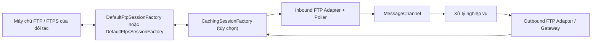

# FTP session factory và kết nối máy chủ trong Spring Integration

## 1. Bối cảnh và mục tiêu

Giả sử ứng dụng cần nhận file đơn hàng từ một đối tác qua FTP, chuyển dữ liệu vào quy trình xử lý rồi gửi file xác nhận trở lại máy chủ. Trong Spring Integration, **Adapter FTP** thực hiện việc đọc/ghi file; còn **FTP session factory** chịu trách nhiệm tạo các phiên kết nối để adapter hoặc gateway thao tác với máy chủ từ xa.

Đây là một phần của module **SPRING_INTEGRATION_ADAPTERS**: kết nối hệ thống bên ngoài bằng *inbound/outbound adapter*, *gateway*, *poller* và *MessageChannel*, đồng thời quản lý hợp đồng message, lỗi và vòng đời kết nối. Bên cạnh FTP, module còn đề cập file, SFTP, HTTP, JMS, AMQP, Kafka và cơ sở dữ liệu. Bài này tập trung vào lớp kết nối FTP; các thành phần luồng message sẽ được đặt vào bối cảnh để thấy session factory phục vụ chúng như thế nào.

Sau bài học, bạn có thể:

- Phân biệt FTP, FTPS và SFTP, chọn đúng loại session factory và cổng kết nối.
- Cấu hình host, tài khoản, chế độ truyền dữ liệu, timeout và kiểu file.
- Sử dụng `CachingSessionFactory` để tái sử dụng phiên, giới hạn số kết nối đồng thời và kiểm tra phiên còn sống.
- Xác minh kết nối thực tế, đóng/trả phiên đúng cách và khoanh vùng lỗi kết nối, xác thực, quyền truy cập hoặc truyền dữ liệu.

## 2. Session factory nằm ở đâu trong luồng FTP?



Sơ đồ mô tả **quan hệ sử dụng**, không phải các kết nối TCP độc lập giữa từng ô. Khi cần thao tác từ xa, adapter/gateway mượn một `Session<FTPFile>` từ `SessionFactory<FTPFile>`; phiên này giao tiếp với máy chủ. Với `CachingSessionFactory`, việc `close()` phiên thường có nghĩa là **trả phiên về cache**, thay vì luôn ngắt TCP ngay lập tức.

| Thành phần | Trách nhiệm |
| --- | --- |
| `DefaultFtpSessionFactory` | Tạo phiên FTP dựa trên Apache Commons Net `FTPClient`; thiết lập host, đăng nhập, chế độ dữ liệu, timeout. |
| `DefaultFtpsSessionFactory` | Tạo phiên **FTPS** (FTP được bảo vệ bằng TLS), dùng `FTPSClient`. |
| `Session<FTPFile>` / `FtpSession` | Đại diện cho một phiên làm việc; cung cấp `list`, `read`, `write`, `remove`, `rename`, `close`... |
| `CachingSessionFactory<FTPFile>` | Bọc factory gốc để giới hạn và tái sử dụng các phiên. |
| Inbound adapter + poller | Theo lịch, kiểm tra/tải file từ xa và đưa message vào `MessageChannel`. |
| Outbound adapter / gateway | Dùng phiên để gửi file hoặc thực thi các lệnh thao tác từ xa. |
| `FtpRemoteFileTemplate` | API thao tác FTP bằng Java, tự quản lý việc lấy và trả/đóng phiên trong callback. |

**Phân biệt vòng đời:** tạo bean `DefaultFtpSessionFactory` chỉ cấu hình cách kết nối; máy chủ không nhất thiết được liên hệ ngay khi ứng dụng khởi động. Việc gọi `getSession()` hoặc thực thi một thao tác qua adapter/template mới buộc ứng dụng mở hoặc lấy kết nối thật.

## 3. Chọn đúng giao thức trước khi cấu hình

Tên gọi dễ nhầm nhưng FTP, FTPS và SFTP **không thay thế trực tiếp cho nhau**:

| Giao thức | Cổng phổ biến | Cơ chế bảo mật | Factory tương ứng |
| --- | --- | --- | --- |
| FTP | TCP **21** (kênh điều khiển) | Thông tin đăng nhập và dữ liệu thường truyền dạng rõ; chỉ phù hợp môi trường thử nghiệm hoặc mạng tin cậy có kiểm soát. | `DefaultFtpSessionFactory` |
| FTPS explicit | Thường TCP **21** | Kết nối FTP ban đầu rồi nâng cấp lên TLS qua `AUTH TLS`. | `DefaultFtpsSessionFactory` với chế độ *explicit*. |
| FTPS implicit | Thường TCP **990** | Bắt đầu kết nối bằng TLS. | `DefaultFtpsSessionFactory` với chế độ *implicit*. |
| SFTP | Thường TCP **22** | Truyền file qua SSH; giao thức hoàn toàn khác FTP/FTPS. | `DefaultSftpSessionFactory` thuộc module Spring Integration SFTP. |

Máy chủ có thể dùng cổng khác theo cấu hình của đối tác. **Không đặt cổng 22 vào `DefaultFtpSessionFactory` để kết nối SFTP**: client vẫn nói giao thức FTP và quá trình bắt tay sẽ thất bại.

FTP/FTPS thường có **hai kết nối**: kênh điều khiển để gửi lệnh và kênh dữ liệu cho `LIST`, `RETR`, `STOR`. Với chế độ **passive**, client chủ động kết nối tới cổng dữ liệu do server cung cấp; lựa chọn này thường dễ triển khai hơn khi ứng dụng nằm sau NAT/firewall. Chế độ **active** yêu cầu server kết nối ngược về client, nên cần quy tắc mạng tương ứng.

## 4. Cấu hình FTP session factory bằng Java

### 4.1. Thêm dependency và cấu hình bên ngoài mã nguồn

Với Maven và dự án đã dùng Spring Boot BOM hoặc Spring Integration BOM tương thích:

```xml
<dependency>
    <groupId>org.springframework.integration</groupId>
    <artifactId>spring-integration-ftp</artifactId>
</dependency>
```

Khai báo thông số trong `application.yml`:

```yaml
partner:
  ftp:
    host: ${PARTNER_FTP_HOST}
    port: ${PARTNER_FTP_PORT:21}
    username: ${PARTNER_FTP_USER}
    password: ${PARTNER_FTP_PASSWORD}
    incoming-directory: /incoming/orders
```

Các biến `PARTNER_FTP_*` cần được cấp từ môi trường triển khai hoặc secret manager. Đường dẫn `/incoming/orders` là đường dẫn **trên máy chủ FTP**, không phải đường dẫn trên ổ đĩa của ứng dụng.

### 4.2. Tạo factory và cache

```java
import org.apache.commons.net.ftp.FTP;
import org.apache.commons.net.ftp.FTPClient;
import org.apache.commons.net.ftp.FTPFile;
import org.springframework.beans.factory.annotation.Qualifier;
import org.springframework.beans.factory.annotation.Value;
import org.springframework.context.annotation.Bean;
import org.springframework.context.annotation.Configuration;
import org.springframework.integration.file.remote.session.CachingSessionFactory;
import org.springframework.integration.file.remote.session.SessionFactory;
import org.springframework.integration.ftp.session.DefaultFtpSessionFactory;
import org.springframework.integration.ftp.session.FtpRemoteFileTemplate;

@Configuration
public class PartnerFtpConfiguration {

    @Bean
    public SessionFactory<FTPFile> partnerFtpSessionFactory(
            @Value("${partner.ftp.host}") String host,
            @Value("${partner.ftp.port}") int port,
            @Value("${partner.ftp.username}") String username,
            @Value("${partner.ftp.password}") String password) {

        DefaultFtpSessionFactory target = new DefaultFtpSessionFactory();
        target.setHost(host);
        target.setPort(port);
        target.setUsername(username);
        target.setPassword(password);

        // Firewall/NAT thường hoạt động tốt hơn với passive mode.
        target.setClientMode(FTPClient.PASSIVE_LOCAL_DATA_CONNECTION_MODE);
        // Bảo toàn byte của ZIP, PDF, CSV, ảnh và file bất kỳ.
        target.setFileType(FTP.BINARY_FILE_TYPE);
        target.setConnectTimeout(10_000);   // ms: thiết lập kết nối
        target.setDefaultTimeout(10_000);   // ms: socket điều khiển
        target.setDataTimeout(30_000);      // ms: socket truyền dữ liệu

        CachingSessionFactory<FTPFile> cache =
                new CachingSessionFactory<>(target, 5);
        cache.setSessionWaitTimeout(3_000); // ms: chờ phiên rảnh
        cache.setTestSession(true);         // kiểm tra phiên khi lấy từ cache
        return cache;
    }

    @Bean
    public FtpRemoteFileTemplate partnerFtpTemplate(
            @Qualifier("partnerFtpSessionFactory")
            SessionFactory<FTPFile> sessionFactory) {
        return new FtpRemoteFileTemplate(sessionFactory);
    }
}
```

Ví dụ tạo tối đa **5 phiên hoạt động cùng lúc** trong cache này. Nếu cả 5 đang được mượn, luồng thứ sáu đợi tối đa **3 giây** để có phiên rảnh rồi có thể phát sinh lỗi hết thời gian chờ. Đây là timeout **chờ tài nguyên nội bộ**, khác `connectTimeout` (kết nối tới server) và `dataTimeout` (socket dữ liệu).

Các thuộc tính quan trọng:

| Thuộc tính | Ý nghĩa và lựa chọn |
| --- | --- |
| `host`, `port` | DNS/IP và cổng giao thức mà đối tác cung cấp. |
| `username`, `password` | Tài khoản FTP; tránh ghi giá trị thật vào Git hoặc log. |
| `clientMode` | `FTPClient.PASSIVE_LOCAL_DATA_CONNECTION_MODE` cho passive; `ACTIVE_LOCAL_DATA_CONNECTION_MODE` khi hạ tầng yêu cầu active. |
| `fileType` | `FTP.BINARY_FILE_TYPE` tránh biến đổi byte; phù hợp cho hầu hết tệp trao đổi ứng dụng. |
| `connectTimeout` | Giới hạn thời gian thiết lập socket kết nối tới server. |
| `defaultTimeout` | Timeout socket điều khiển; không đồng nhất với thời gian tải toàn bộ một file. |
| `dataTimeout` | Timeout đọc/ghi trên socket dữ liệu FTP; cần xét dung lượng file và chất lượng mạng. |
| `controlEncoding` | Mã hóa ký tự của kênh lệnh/tên file khi server có yêu cầu đặc biệt; ưu tiên thống nhất UTF-8 nếu hai phía hỗ trợ. |
| `sessionCacheSize` | Số phiên tối đa được cache/pool quản lý; cân nhắc song song thực tế và hạn mức kết nối server. |
| `sessionWaitTimeout` | Thời gian chờ mượn phiên khi cache đã đạt giới hạn. |
| `testSession` | Gửi lệnh kiểm tra (FTP: `NOOP`) trước khi tái sử dụng phiên cache; giảm lỗi do server đã đóng kết nối rảnh. |

**Không có cache mặc định:** Từ Spring Integration 3.0, session không tự được cache. Nếu không bọc `CachingSessionFactory`, mỗi lần lấy/đóng phiên có thể tạo/đóng kết nối mới. Cache giúp giảm chi phí đăng nhập lặp lại, nhưng không tự giải quyết mọi lỗi mạng và cũng không nên tăng vô hạn.

## 5. Kiểm tra kết nối và vòng đời session

### 5.1. Kiểm tra bằng thao tác thật

Một cách kiểm tra có giá trị là **đăng nhập, liệt kê được thư mục mà ứng dụng sẽ dùng** và xác minh quyền truy cập. `FtpRemoteFileTemplate` lấy phiên, chạy callback rồi trả/đóng phiên kể cả khi thao tác có lỗi.

```java
import org.apache.commons.net.ftp.FTPFile;
import org.springframework.beans.factory.annotation.Qualifier;
import org.springframework.beans.factory.annotation.Value;
import org.springframework.integration.ftp.session.FtpRemoteFileTemplate;
import org.springframework.stereotype.Service;

@Service
public class PartnerFtpConnectionProbe {

    private final FtpRemoteFileTemplate ftpTemplate;
    private final String incomingDirectory;

    public PartnerFtpConnectionProbe(
            @Qualifier("partnerFtpTemplate") FtpRemoteFileTemplate ftpTemplate,
            @Value("${partner.ftp.incoming-directory}") String incomingDirectory) {
        this.ftpTemplate = ftpTemplate;
        this.incomingDirectory = incomingDirectory;
    }

    // Gọi chủ động khi cần chẩn đoán, không tự chạy liên tục lúc khởi động.
    public int countFilesInIncomingDirectory() {
        Integer count = ftpTemplate.execute(session -> {
            FTPFile[] entries = session.list(incomingDirectory);
            return entries.length;
        });
        if (count == null) {
            throw new IllegalStateException("Không nhận được kết quả liệt kê FTP");
        }
        return count;
    }
}
```

Nếu phương thức trả `0`, thư mục có thể hoàn toàn rỗng; kết quả đó **không đồng nghĩa kết nối thất bại**. Nếu exception xảy ra, hãy kiểm tra theo từng lớp: DNS/cổng → đăng nhập → kênh dữ liệu → quyền với thư mục. Một phép kiểm tra chỉ gọi `isOpen()` chưa đủ để xác nhận lệnh `LIST` có chạy được qua kênh dữ liệu.

### 5.2. Nếu lấy Session trực tiếp, luôn trả lại

```java
import java.io.IOException;
import org.apache.commons.net.ftp.FTPFile;
import org.springframework.integration.file.remote.session.Session;
import org.springframework.integration.file.remote.session.SessionFactory;

public class FtpSessionDemo {
    public int countFiles(SessionFactory<FTPFile> factory) throws IOException {
        try (Session<FTPFile> session = factory.getSession()) {
            return session.list("/incoming/orders").length;
        } // close(): trả về cache hoặc đóng phiên thật, tùy factory
    }
}
```

Không giữ `Session` trong singleton service để các thread cùng sử dụng; mỗi thao tác nên mượn phiên riêng rồi trả ngay. Khi dùng `readRaw(...)`, phải đóng `InputStream` **và** gọi `finalizeRaw()` theo hợp đồng của API trước khi trả phiên. Với thao tác thông thường, ưu tiên `FtpRemoteFileTemplate` và adapter để tránh tự quản lý các bước này.

Đối với cache:

- `close()` trên session được mượn trả nó về pool để phiên khác dùng tiếp; kết nối có thể vẫn mở.
- `testSession(true)` kiểm tra phiên được lấy từ pool, nhưng không bảo đảm server sẽ không ngắt giữa chừng khi truyền file.
- `resetCache()` loại bỏ phiên rảnh và đánh dấu những phiên đang dùng sẽ đóng khi được trả; hữu ích khi cần làm mới kết nối. Nếu thay mật khẩu, cần cập nhật cấu hình factory/bean tương ứng trước, không chỉ gọi `resetCache()`.
- Session bị lỗi nặng cần được loại bỏ; không tái sử dụng một đối tượng phiên hỏng bằng cách lưu nó trong biến toàn cục.

## 6. Đưa session factory vào adapter và gateway

Các endpoint FTP dùng cùng kiểu `SessionFactory<FTPFile>`; adapter xử lý **định dạng message** và quy tắc luồng, còn factory xử lý **kết nối**.

Ví dụ luồng nghiệp vụ:

1. **Poller** kích hoạt inbound FTP adapter theo chu kỳ; adapter dùng session factory để truy cập `/incoming/orders`, lọc và tải file về thư mục local, sau đó phát message chứa `File` vào `MessageChannel`.
2. Một handler nhận file, xác thực nội dung (ví dụ CSV), biến đổi thành đối tượng nghiệp vụ và lưu cơ sở dữ liệu.
3. Outbound FTP adapter nhận `Message<File>` hoặc payload phù hợp để tải tệp xác nhận lên máy chủ; outbound gateway có thể dùng các lệnh như `ls`, `get`, `put`, `rm` theo nhu cầu.

Ví dụ cấu hình ở mức khái niệm:

```text
FTP server
  → inbound adapter + poller
  → MessageChannel("incomingOrders")
  → validate / transform / persist
  → MessageChannel("outgoingAcknowledgements")
  → outbound FTP adapter
  → FTP server

            inbound và outbound đều dùng SessionFactory<FTPFile>
```

Lưu ý các trách nhiệm **khác** với session factory:

| Bài toán | Nơi nên xử lý |
| --- | --- |
| Mấy giây kiểm tra file một lần? | Cấu hình `Poller`. |
| Có tải lại file đã xử lý không? | Remote/local file filter, lưu trạng thái xử lý và chiến lược idempotency. |
| Payload và header của message gồm gì? | Adapter, transformer và hợp đồng `Message<?>`. |
| Lỗi xử lý dữ liệu chuyển đi đâu? | Error channel, retry advice, cơ chế dead-letter/lưu file lỗi theo kiến trúc ứng dụng. |
| Tối đa bao nhiêu phiên FTP đồng thời? | `CachingSessionFactory` và giới hạn kết nối từ server. |
| Socket timeout, TLS, passive/active? | Session factory cùng cấu hình mạng/FTP server. |

**Tình huống thực tế:** poller chạy mỗi 5 giây nhưng lần tải file trước mất 20 giây. Nếu bạn bật xử lý song song hoặc có thêm outbound gateway cùng dùng cache 5 phiên, các tác vụ sẽ cạnh tranh mượn session. Hãy chọn kích thước cache và timeout dựa trên số tác vụ có thể chạy đồng thời, thay vì chỉ dựa vào chu kỳ poller.

## 7. Khi máy chủ yêu cầu FTPS

Đối tác có thể yêu cầu **FTP over TLS** để bảo vệ đăng nhập và nội dung. Khi đó thay factory gốc bằng `DefaultFtpsSessionFactory`. Ví dụ phần cấu hình cốt lõi cho **FTPS explicit**:

```java
import org.apache.commons.net.ftp.FTP;
import org.apache.commons.net.ftp.FTPClient;
import org.springframework.integration.ftp.session.DefaultFtpsSessionFactory;

DefaultFtpsSessionFactory ftps = new DefaultFtpsSessionFactory();
ftps.setHost("ftps.partner.example"); // host minh họa
ftps.setPort(21);                       // explicit FTPS: thường cổng 21
ftps.setUsername(System.getenv("FTPS_USER"));
ftps.setPassword(System.getenv("FTPS_PASSWORD"));
ftps.setImplicit(false);
ftps.setProtocol("TLS");
ftps.setProt("P");                      // bảo vệ cả kênh dữ liệu
ftps.setEndpointCheckingEnabled(true); // kiểm tra hostname chứng chỉ
ftps.setClientMode(FTPClient.PASSIVE_LOCAL_DATA_CONNECTION_MODE);
ftps.setFileType(FTP.BINARY_FILE_TYPE);
```

Đây là phần cấu hình kết nối, chưa thay thế việc thiết lập **truststore/CA đáng tin cậy**, kiểm tra chứng chỉ server, chính sách TLS được doanh nghiệp chấp thuận và kiểm thử với máy chủ thật. Không dùng trust manager chấp nhận mọi chứng chỉ để “sửa nhanh” lỗi TLS. Với **implicit FTPS**, thông thường cần `setImplicit(true)` và cổng thích hợp (thường 990), theo hợp đồng của đối tác.

FTPS vẫn dùng cơ chế **control/data connection** của FTP, do đó kênh dữ liệu passive vẫn cần được mở qua firewall. Nếu đối tác cung cấp **SFTP/SSH**, phải dùng module `spring-integration-sftp` và session factory SFTP riêng, đồng thời xác thực host key SSH; không thể xử lý bằng cách thay cổng của factory FTP/FTPS.

## 8. Chẩn đoán lỗi kết nối

Quá trình tạo phiên có các bước phụ thuộc nhau:

```text
Đọc cấu hình → phân giải DNS → kết nối TCP/control
→ phản hồi banner FTP → USER/PASS hoặc bắt tay FTPS
→ thiết lập chế độ truyền → mở data connection khi LIST/RETR/STOR
→ đọc/ghi file → trả/đóng session
```

Nếu biết lỗi nằm ở bước nào, bạn sẽ tránh nhầm một lỗi firewall với lỗi mật khẩu.

| Triệu chứng | Nguyên nhân cần xem xét | Cách kiểm tra/xử lý |
| --- | --- | --- |
| `Connection refused`, `connect timed out` | Sai host/cổng, firewall, server ngừng hoạt động, DNS. | Xác minh host/cổng với đối tác; kiểm tra TCP tới **control port** từ chính môi trường chạy ứng dụng. |
| FTP reply `530`, `Login incorrect` | Sai username/password, tài khoản khóa hoặc server yêu cầu loại xác thực khác. | Kiểm tra secret thực tế, quyền đăng nhập và log server; không in mật khẩu vào log. |
| Đăng nhập được nhưng `LIST`/`RETR` treo; `425 Can't open data connection` | Kênh dữ liệu bị firewall/NAT chặn; sai passive/active mode hoặc dải passive port của server. | Thử passive mode; kiểm tra địa chỉ/port server trả về và quy tắc mở cổng dữ liệu. |
| `550 File unavailable` hoặc không liệt kê được thư mục | Sai đường dẫn remote, thiếu quyền, file chưa có. | Kiểm tra path theo root của tài khoản FTP; quyền list/read/write riêng từng thư mục. |
| Phiên trong cache thường lỗi sau thời gian nhàn rỗi | Server đóng idle session; kết nối mạng thay đổi. | Bật `testSession(true)`, đặt timeout phù hợp, trả session đúng vòng đời và cân nhắc làm mới cache. |
| `SSLHandshakeException`, lỗi chứng chỉ FTPS | Không tin CA, hostname không khớp, cấu hình TLS/cổng implicit-explicit sai. | Kiểm tra truststore, SAN/hostname, cổng và chế độ FTPS; bảo đảm bảo vệ kênh dữ liệu. |
| Nhiều tác vụ bị kẹt hoặc lỗi chờ session | Cache cạn vì số tác vụ đồng thời cao hoặc quên `close()`. | Theo dõi số phiên đang dùng; đóng/trả phiên bằng try-with-resources/template, điều chỉnh cache và `sessionWaitTimeout`. |

Trong lúc chẩn đoán, có thể bật logging mức `DEBUG` hoặc `TRACE` có giới hạn cho `org.springframework.integration.file` và các thành phần FTP liên quan. Cần lọc thông tin nhạy cảm, tránh ghi USER/PASS, payload hoặc nội dung file vào log. Log phía máy chủ FTP và kết quả lệnh `LIST` thường phân biệt được “đăng nhập thành công” với “truyền dữ liệu thành công”.

## 9. Các nguyên tắc vận hành

1. **Ưu tiên giao thức bảo mật:** dùng FTPS có kiểm tra chứng chỉ hoặc SFTP khi được phép; FTP thuần chỉ cho môi trường phù hợp với yêu cầu bảo mật.
2. **Cấp quyền tối thiểu:** tài khoản inbound chỉ cần quyền list/read, outbound chỉ cần quyền ghi tương ứng; tách tài khoản nếu chính sách đối tác hỗ trợ.
3. **Tách cấu hình khỏi mã nguồn:** lấy host, port, credential từ cấu hình/secret manager; không đóng gói bí mật trong bản build.
4. **Chọn passive/binary và timeout có chủ đích:** kiểm tra đường đi của cả control lẫn data; đừng vô hiệu hóa timeout để che lỗi.
5. **Quản lý session như tài nguyên hữu hạn:** đặt giới hạn cache phù hợp, luôn trả session sau thao tác, không chia sẻ session giữa các thread.
6. **Tính đến lỗi từng phần:** một lần gửi file có thể thành công trên server nhưng ứng dụng không nhận được phản hồi. Cần quy tắc tên tạm/đổi tên sau hoàn thành, chống trùng và retry phù hợp ở tầng adapter/luồng nghiệp vụ.
7. **Quan sát đúng tín hiệu:** đo số lần connect/login thất bại, thời gian lấy session, lỗi kênh dữ liệu và số file đã xử lý; phân biệt tình trạng mạng với lỗi business.

## 10. Thực hành tự kiểm tra

**Bài tập:** Một dịch vụ nhận `/incoming/orders/*.csv` từ server của đối tác, tối đa 4 tác vụ tải file chạy đồng thời. Server dùng FTP cổng 21, chỉ mở các cổng passive data, đóng kết nối rảnh sau vài phút.

Hãy xác định:

1. Nên dùng factory nào và `clientMode` nào?
2. Cấu hình cache cỡ bao nhiêu, tại sao cần `testSession`?
3. Tại sao kiểm tra kết nối TCP tới cổng 21 thành công vẫn chưa chứng minh tải file được?
4. Khi `LIST` báo lỗi 425, nên kiểm tra thành phần nào trước?
5. Có nên đặt một `Session<FTPFile>` làm field singleton để cả 4 tác vụ dùng chung không?

**Gợi ý đáp án:** (1) `DefaultFtpSessionFactory` với passive mode, nếu hạ tầng thực sự cho phép FTP thuần; (2) giới hạn cache quanh mức 4 hoặc theo tổng mức đồng thời bao gồm outbound, bật kiểm tra phiên vì server đóng idle connection; (3) FTP cần kết nối dữ liệu riêng; (4) passive data ports, NAT và firewall; (5) không, mỗi tác vụ mượn và trả phiên riêng. Nếu có yêu cầu mã hóa, cần chuyển sang FTPS/SFTP theo giao thức server hỗ trợ.

## Tóm tắt kiến thức

- `DefaultFtpSessionFactory` và `DefaultFtpsSessionFactory` tạo **kết nối**, còn adapter/gateway quyết định **đọc/ghi gì** và đưa kết quả vào luồng `MessageChannel`.
- `CachingSessionFactory` cần được khai báo tường minh nếu muốn tái sử dụng phiên; `testSession` giúp hạn chế tái sử dụng kết nối đã chết.
- FTP có kênh control và data: đăng nhập thành công chưa chắc lệnh liệt kê hoặc truyền file thành công.
- `FtpRemoteFileTemplate` hoặc `try-with-resources` giúp giữ đúng vòng đời session.
- Chẩn đoán theo thứ tự **mạng → xác thực/TLS → chế độ data → quyền file → vòng đời cache** để tìm đúng nguyên nhân.

## Tài liệu tham khảo

- [Spring Integration — FTP Session Factory](https://docs.spring.io/spring-integration/reference/ftp/session-factory.html)
- [Spring Integration — FTP Session Caching](https://docs.spring.io/spring-integration/reference/ftp/session-caching.html)
- [Spring Integration — FTP Advanced Configuration](https://docs.spring.io/spring-integration/reference/ftp/advanced-configuration.html)
- [Spring Integration API — `CachingSessionFactory`](https://docs.spring.io/spring-integration/api/org/springframework/integration/file/remote/session/CachingSessionFactory.html)
- [Spring Integration API — `Session`](https://docs.spring.io/spring-integration/api/org/springframework/integration/file/remote/session/Session.html)
