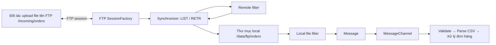
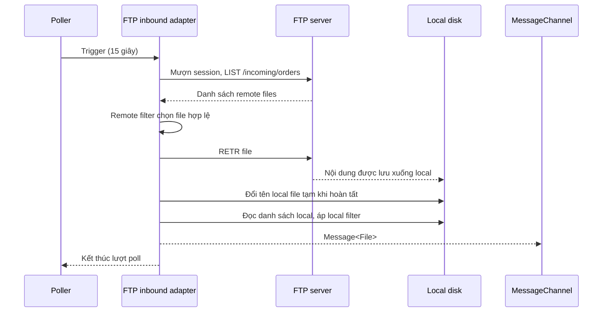

# FTP inbound adapter lấy tệp từ máy chủ

## 1. Mục tiêu và bối cảnh

Trong nhiều hệ thống doanh nghiệp, một đối tác không gửi đơn hàng qua REST API mà đặt định kỳ các tệp CSV lên máy chủ FTP. Ứng dụng của chúng ta cần tự tìm tệp mới, tải về thư mục nội bộ, chuyển tệp vào luồng xử lý và không xử lý đi xử lý lại cùng một dữ liệu mỗi lần kiểm tra máy chủ.

**FTP inbound channel adapter** của Spring Integration giải quyết phần *nhận tệp*: dùng `SessionFactory` để kết nối FTP, đồng bộ tệp từ thư mục remote về local, sau đó phát ra một **Spring Message có payload là `java.io.File`** cho các thành phần phía sau. Nó phù hợp với module **SPRING_INTEGRATION_ADAPTERS**, nơi dữ liệu đi qua inbound/outbound adapter, gateway, poller và `MessageChannel` để liên kết hệ thống ngoài (file, SFTP, HTTP, JMS, AMQP, Kafka, cơ sở dữ liệu) đồng thời xử lý hợp đồng message, lỗi và vòng đời kết nối.

Bài học thuộc chương **Adapter FTP**, tập trung vào việc *lấy tệp từ máy chủ* bằng inbound adapter. Sau khi học, bạn có thể:

- Giải thích hai bước **đồng bộ remote → local** và **phát message từ file local**.
- Cấu hình `SessionFactory<FTPFile>`, thư mục remote/local và **poller** bằng Java DSL.
- Kết hợp bộ lọc theo tên và bộ lọc ghi nhớ trạng thái để giảm tải lại hoặc phát lại tệp.
- Xử lý file đang được tải dở, duplicate, retry, lỗi kết nối và quyền truy cập.
- Phân biệt inbound FTP adapter với *streaming inbound adapter*, outbound FTP adapter và FTP gateway.

## 2. Dòng chảy của inbound adapter



Hình vẽ diễn đạt **luồng dữ liệu**, không phải mỗi bước có một kết nối FTP riêng. Adapter dùng factory để lấy session khi đồng bộ và đóng/trả phiên sau thao tác.

Inbound FTP adapter thông thường có **hai công đoạn khác nhau**:

1. **Remote synchronization:** kiểm tra thư mục FTP, chọn các tệp hợp lệ qua *remote filter*, tải chúng về local bằng giao thức FTP (các lệnh thường liên quan tới `LIST` và `RETR`). Trong lúc tải, framework có thể dùng hậu tố tệp tạm ở local rồi đổi sang tên chính thức sau khi tải xong.
2. **Local message emission:** nguồn đọc file local áp dụng *local filter*, sau đó phát `Message<File>` vào kênh. Thành phần downstream tự mở và xử lý file.

Sự phân tách này quan trọng: **tải file xong không đồng nghĩa nghiệp vụ đã xử lý thành công**. Nếu parser CSV hoặc thao tác ghi cơ sở dữ liệu lỗi, file vẫn có thể nằm trong thư mục local. Bạn cần thiết kế retry, idempotency và cơ chế lưu trữ/đưa file lỗi sang khu vực kiểm tra.

| Thành phần | Vai trò | Ví dụ quyết định |
| --- | --- | --- |
| FTP server | Lưu file mà đối tác cung cấp | `/incoming/orders/order-2026-11-23.csv` |
| `SessionFactory<FTPFile>` | Tạo hoặc tái sử dụng kết nối FTP | Host, cổng, tài khoản, passive mode, timeout |
| Remote file filter | Chọn file nào cần **tải** | Chỉ `*.csv`, bỏ file đã nhận |
| File synchronizer | Tải từ FTP về ổ đĩa local | Tải bằng tên tạm rồi đổi tên |
| Local file filter | Chọn file nào cần **phát message** | Không phát lại file đã phát trước đó |
| Poller | Kích hoạt lượt kiểm tra theo lịch | 15 giây một lần |
| `MessageChannel` | Chuyển message sang xử lý tiếp | `ftpIncomingOrders` |
| Business handler | Kiểm tra, phân tích và lưu dữ liệu | CSV → đối tượng đơn hàng → DB |

## 3. Chuẩn bị máy chủ, dependency và cấu hình

### 3.1. Điều kiện phía máy chủ

Giả sử đối tác đã cấp:

- Tên máy chủ `ftp.partner.example`, cổng điều khiển FTP 21 (chỉ là ví dụ).
- Tài khoản có quyền **đăng nhập, liệt kê thư mục và đọc file** ở `/incoming/orders`.
- Cách thức phát hành file hoàn chỉnh: tải tên `*.uploading`, sau khi upload xong mới **rename** thành `*.csv`.
- Firewall/NAT cho phép kênh điều khiển và **kênh dữ liệu passive**. Kết nối TCP đến cổng 21 thành công chưa đủ để khẳng định lệnh `LIST` hoặc `RETR` hoạt động.

FTP thuần thường truyền mật khẩu và dữ liệu dưới dạng không mã hóa. Trong môi trường có dữ liệu nhạy cảm, nên dùng **FTPS** hoặc **SFTP** theo hợp đồng thực tế với đối tác. FTPS dùng factory FTP-over-TLS; SFTP là giao thức SSH riêng, phải dùng Spring Integration SFTP chứ không thể chuyển bằng cách đổi cổng FTP sang 22.

### 3.2. Thêm thư viện

Với dự án Spring Boot sử dụng BOM tương thích, ví dụ Maven:

```xml
<dependencies>
    <dependency>
        <groupId>org.springframework.boot</groupId>
        <artifactId>spring-boot-starter-integration</artifactId>
    </dependency>
    <dependency>
        <groupId>org.springframework.integration</groupId>
        <artifactId>spring-integration-ftp</artifactId>
    </dependency>
</dependencies>
```

Nếu dự án không dùng Spring Boot BOM, hãy quản lý các phiên bản Spring Integration đồng bộ bằng BOM thích hợp. Không trộn tùy tiện các phiên bản `spring-integration-core`, `spring-integration-file` và `spring-integration-ftp`.

Đặt thông số theo môi trường thay vì hardcode bí mật:

```yaml
partner:
  ftp:
    host: ${PARTNER_FTP_HOST}
    port: ${PARTNER_FTP_PORT:21}
    username: ${PARTNER_FTP_USER}
    password: ${PARTNER_FTP_PASSWORD}
    remote-directory: /incoming/orders
    local-directory: /data/ftp/orders
```

**Lưu ý về hai đường dẫn:** `remote-directory` nằm trên máy chủ FTP; `local-directory` nằm trong filesystem của chính tiến trình Spring Boot hoặc container chạy ứng dụng. Khi chạy Docker/Kubernetes, cần bảo đảm đường dẫn local tồn tại hoặc được tạo, có quyền ghi và có đủ dung lượng. Nếu trạng thái cần bền qua restart, hãy chủ động quản lý volume cũng như metadata store.

## 4. Cấu hình Java DSL: nhận tệp CSV định kỳ

Ví dụ sau dùng Spring Integration Java DSL hiện đại. `Ftp.inboundAdapter(...)` là factory DSL tạo endpoint nhận file, còn `IntegrationFlow.from(..., e -> e.poller(...))` gắn lịch poll. Mã giả định một ứng dụng Spring Boot đã kích hoạt Spring Integration qua starter.

### 4.1. Tạo FTP session factory

```java
import org.apache.commons.net.ftp.FTP;
import org.apache.commons.net.ftp.FTPClient;
import org.apache.commons.net.ftp.FTPFile;
import org.springframework.beans.factory.annotation.Value;
import org.springframework.context.annotation.Bean;
import org.springframework.context.annotation.Configuration;
import org.springframework.integration.file.remote.session.CachingSessionFactory;
import org.springframework.integration.file.remote.session.SessionFactory;
import org.springframework.integration.ftp.session.DefaultFtpSessionFactory;

@Configuration
public class OrdersFtpSessionConfig {

    @Bean("ordersFtpSessionFactory")
    public SessionFactory<FTPFile> ordersFtpSessionFactory(
            @Value("${partner.ftp.host}") String host,
            @Value("${partner.ftp.port}") int port,
            @Value("${partner.ftp.username}") String username,
            @Value("${partner.ftp.password}") String password) {

        DefaultFtpSessionFactory target = new DefaultFtpSessionFactory();
        target.setHost(host);
        target.setPort(port);
        target.setUsername(username);
        target.setPassword(password);

        target.setClientMode(FTPClient.PASSIVE_LOCAL_DATA_CONNECTION_MODE);
        target.setFileType(FTP.BINARY_FILE_TYPE);
        target.setConnectTimeout(10_000); // ms
        target.setDefaultTimeout(10_000); // ms
        target.setDataTimeout(30_000);    // ms

        CachingSessionFactory<FTPFile> cache =
                new CachingSessionFactory<>(target, 4);
        cache.setSessionWaitTimeout(3_000);
        cache.setTestSession(true);
        return cache;
    }
}
```

`PASSIVE_LOCAL_DATA_CONNECTION_MODE` thường phù hợp với client nằm sau NAT/firewall; `BINARY_FILE_TYPE` bảo toàn byte của CSV, ZIP, ảnh và tệp nhị phân. Cache tối đa bốn session ở đây chỉ là giá trị minh họa, cần dựa trên số luồng đồng thời và giới hạn của FTP server.

**Phân biệt các timeout:** `connectTimeout` giới hạn thời gian thiết lập kết nối, `dataTimeout` liên quan socket truyền dữ liệu FTP; `sessionWaitTimeout` giới hạn thời gian đợi lấy session từ pool khi mọi session đang được sử dụng. Không dùng một timeout duy nhất để thay thế tất cả.

### 4.2. Khai báo filter và inbound flow

```java
import java.io.File;
import java.time.Duration;
import org.apache.commons.net.ftp.FTPFile;
import org.springframework.beans.factory.annotation.Qualifier;
import org.springframework.beans.factory.annotation.Value;
import org.springframework.context.annotation.Bean;
import org.springframework.context.annotation.Configuration;
import org.springframework.integration.channel.DirectChannel;
import org.springframework.integration.dsl.IntegrationFlow;
import org.springframework.integration.dsl.Pollers;
import org.springframework.integration.file.filters.ChainFileListFilter;
import org.springframework.integration.file.filters.FileSystemPersistentAcceptOnceFileListFilter;
import org.springframework.integration.file.remote.session.SessionFactory;
import org.springframework.integration.ftp.dsl.Ftp;
import org.springframework.integration.ftp.filters.FtpPersistentAcceptOnceFileListFilter;
import org.springframework.integration.ftp.filters.FtpSimplePatternFileListFilter;
import org.springframework.integration.metadata.ConcurrentMetadataStore;
import org.springframework.integration.metadata.SimpleMetadataStore;
import org.springframework.messaging.MessageChannel;

@Configuration
public class OrdersFtpInboundConfig {

    @Bean("ftpIncomingOrders")
    public MessageChannel ftpIncomingOrders() {
        return new DirectChannel();
    }

    // Chỉ để minh họa. Dữ liệu của SimpleMetadataStore mất khi ứng dụng restart.
    @Bean("ordersFtpMetadataStore")
    public ConcurrentMetadataStore ordersFtpMetadataStore() {
        return new SimpleMetadataStore();
    }

    @Bean
    public IntegrationFlow ordersFtpInboundFlow(
            @Qualifier("ordersFtpSessionFactory")
            SessionFactory<FTPFile> sessionFactory,
            @Qualifier("ordersFtpMetadataStore")
            ConcurrentMetadataStore metadataStore,
            @Value("${partner.ftp.remote-directory}") String remoteDirectory,
            @Value("${partner.ftp.local-directory}") String localDirectory) {

        // Thứ tự có ý nghĩa: lọc đuôi .csv trước, sau đó mới ghi nhận file.
        ChainFileListFilter<FTPFile> remoteFilter = new ChainFileListFilter<>();
        remoteFilter.addFilter(new FtpSimplePatternFileListFilter("*.csv"));
        remoteFilter.addFilter(
                new FtpPersistentAcceptOnceFileListFilter(
                        metadataStore, "orders-remote:"));

        return IntegrationFlow.from(
                Ftp.inboundAdapter(sessionFactory)
                        .remoteDirectory(remoteDirectory)
                        .localDirectory(new File(localDirectory))
                        .autoCreateLocalDirectory(true)
                        .temporaryFileSuffix(".downloading")
                        .preserveTimestamp(true)
                        .filter(remoteFilter)
                        .localFilter(
                                new FileSystemPersistentAcceptOnceFileListFilter(
                                        metadataStore, "orders-local:")),
                endpoint -> endpoint.poller(
                        Pollers.fixedDelay(Duration.ofSeconds(15))
                                .maxMessagesPerPoll(5)))
                .channel("ftpIncomingOrders")
                .get();
    }
}
```

Giải thích từng điểm cần thiết:

| Cấu hình | Kết quả |
| --- | --- |
| `remoteDirectory("/incoming/orders")` | Thư mục nguồn để liệt kê/tải file trên FTP. |
| `localDirectory(new File("/data/ftp/orders"))` | Nơi giữ bản sao vừa tải trong ứng dụng. |
| `autoCreateLocalDirectory(true)` | Tạo thư mục local nếu chưa có; vẫn cần quyền ghi từ OS/container. |
| `temporaryFileSuffix(".downloading")` | Khi tải về local, dùng tên tạm trước khi chuyển sang tên hoàn chỉnh. |
| `preserveTimestamp(true)` | Bảo toàn thời gian sửa đổi từ remote cho file local khi đồng bộ. |
| `filter(remoteFilter)` | Áp dụng bộ lọc **tệp remote** trước khi tải. |
| `localFilter(...)` | Chọn file local nào có thể tiếp tục phát message. |
| `Pollers.fixedDelay(Duration.ofSeconds(15))` | Sau mỗi lượt poll, chờ khoảng 15 giây trước lượt kế tiếp trên cùng trigger. |
| `maxMessagesPerPoll(5)` | Giới hạn số **message phát ra ở mỗi lượt poll**; không nên nhầm với giới hạn tuyệt đối số tệp được đồng bộ về local trong lần đó. |
| `channel("ftpIncomingOrders")` | Chuyển các message chứa `File` tới nơi xử lý. |

Khi một `order-42.csv` hoàn chỉnh được tải, consumer của `ftpIncomingOrders` nhận `Message<File>`; `message.getPayload()` chính là đối tượng `File` trỏ tới bản sao local. Adapter **chưa tự phân tích CSV, validate nghiệp vụ hoặc ghi DB**.

### 4.3. Gắn một bộ xử lý nghiệp vụ

Ví dụ đơn giản:

```java
import java.io.File;
import org.springframework.integration.annotation.ServiceActivator;
import org.springframework.messaging.Message;
import org.springframework.stereotype.Component;

@Component
public class OrderFileConsumer {

    @ServiceActivator(inputChannel = "ftpIncomingOrders")
    public void process(Message<File> message) {
        File downloadedFile = message.getPayload();
        // 1. Xác thực tên, loại file và định dạng CSV.
        // 2. Parse các bản ghi và kiểm tra quy tắc nghiệp vụ.
        // 3. Dùng khóa nghiệp vụ (ví dụ partnerId + orderId) để chống ghi trùng.
        // 4. Lưu DB, ghi nhận kết quả, lưu/archive file theo chính sách.
        System.out.println("Downloaded: " + downloadedFile.getName());
    }
}
```

Đoạn consumer minh họa việc nhận `Message<File>`, **chưa phải triển khai xử lý đơn hàng hoàn chỉnh**. Trong hệ thống thật, thay `System.out.println` bằng service nghiệp vụ, cơ chế idempotency và logging đã loại bỏ thông tin nhạy cảm. Nếu file được di chuyển/xóa bởi handler, cần tổ chức hợp lý bước archive và trạng thái xử lý để không ảnh hưởng đến local filter.

## 5. Hai lớp bộ lọc: remote và local

Sự khác nhau giữa hai lớp filter quyết định việc hệ thống có phát lại file sau restart hay không.

| Câu hỏi | Remote filter | Local filter |
| --- | --- | --- |
| Chạy trên dữ liệu nào? | Danh sách `FTPFile` nhận từ server | Danh sách `java.io.File` trên disk local |
| Can thiệp tại bước nào? | Trước khi đồng bộ file từ FTP | Trước khi phát `Message<File>` |
| Ví dụ | Chỉ nhận `*.csv`, file chưa từng được tải | Chỉ phát file local chưa từng phát |
| Nếu không ghi nhớ trạng thái bền vững | Có thể tải lại file khi restart nếu filter chỉ dùng bộ nhớ | Có thể phát lại file local đã tồn tại khi restart |
| Loại metadata nên dùng | `FtpPersistentAcceptOnceFileListFilter` | `FileSystemPersistentAcceptOnceFileListFilter` |

### 5.1. Lọc theo mẫu tên trước, ghi nhớ sau

`FtpSimplePatternFileListFilter("*.csv")` nhận các tên kết thúc bằng `.csv`. Không nên để server phát hành `order.csv` **trước khi** upload hoàn tất, vì adapter có thể nhìn thấy tệp chưa hoàn chỉnh. Một giao ước khả thi giữa hai phía là:

1. Đối tác upload `order-42.csv.uploading`.
2. Đối tác xác nhận upload thành công.
3. Đối tác thực hiện rename nguyên tử trong cùng filesystem/server thành `order-42.csv`.
4. Inbound adapter chỉ chọn `*.csv` để tải.

Hậu tố `.downloading` **của file local** ở ví dụ Java không giải quyết việc đối tác còn đang upload **file remote**. Hai loại tên tạm này ở hai đầu khác nhau.

Để lần lượt áp dụng pattern filter rồi persistent filter, ví dụ dùng `ChainFileListFilter`. Một chain đưa kết quả của filter trước vào filter sau, giúp bộ lọc ghi nhớ chỉ nhìn thấy những tên đã qua tiêu chí `*.csv`. Nếu muốn lọc theo ngày sửa, kích thước hoặc file `.done`, hãy thiết kế quy tắc theo khả năng của server và đồng thuận với bên phát hành.

### 5.2. Ghi nhớ file đã nhận

`FtpPersistentAcceptOnceFileListFilter` có thể ghi trạng thái qua `ConcurrentMetadataStore` với prefix riêng. Việc "đã nhận" phụ thuộc khóa/thuộc tính remote mà filter quan sát, chứ **không phải cam kết tệp đã xử lý nghiệp vụ thành công**. Nếu server thay nội dung một tên file, chiến lược lọc còn phụ thuộc thuộc tính file (chẳng hạn thời gian sửa) mà FTP server trả về.

Ví dụ dùng `SimpleMetadataStore` là dễ học nhưng **không bền qua restart**. Hệ thống vận hành cần chọn metadata store phù hợp để duy trì trạng thái sau khi khởi động lại; nếu nhiều instance cùng quét một FTP directory, nên dùng kho metadata chia sẻ hỗ trợ thao tác đồng thời và đồng thời kiểm soát cả việc hai instance tranh xử lý cùng file.

Prefix `orders-remote:` và `orders-local:` được đặt khác nhau để tránh trộn key của hai bộ lọc. Không tái sử dụng bừa một prefix cho nhiều đối tác, nhiều thư mục hoặc nhiều ứng dụng.

### 5.3. Duplicate file khác duplicate nghiệp vụ

Giả sử file `order-42.csv` đã tải và được phát message, nhưng service ghi DB bị lỗi sau khi tạo một phần dữ liệu. Nếu poller chạy lại, metadata store có thể ngăn adapter phát message thêm lần nữa; **bộ lọc không tự retry bản ghi nghiệp vụ lỗi**. Ngược lại, khi metadata bị mất, cùng file có thể phát lại; phải có cơ chế không tạo đơn hàng trùng.

Vì vậy nên tách hai tầng:

- **Hạ tầng file**: lọc, đồng bộ, ghi nhớ remote/local, retry lỗi mạng.
- **Nghiệp vụ**: kiểm tra khóa duy nhất, transaction phù hợp, trạng thái `RECEIVED / PROCESSING / COMPLETED / FAILED`, retry có kiểm soát và lưu lại file lỗi.

**Exactly-once end to end không được bảo đảm chỉ bằng inbound adapter hoặc accept-once filter.** Nếu cần kết quả nhất quán, hãy thiết kế idempotency ở nơi ghi dữ liệu nghiệp vụ.

## 6. Hiểu đúng poller và khả năng tải

FTP là hệ thống bên ngoài được **thăm dò (polling)**: server thông thường không đẩy một Spring Message vào ứng dụng ngay khi có tệp mới. Poller chỉ quyết định khi nào hệ thống kiểm tra.



Đây là trình tự logic. Chi tiết số lần `LIST`/`RETR`, bộ đệm và thời điểm đóng session có thể phụ thuộc cấu hình đồng bộ.

**Fixed delay và fixed rate:** `fixedDelay(15s)` đặt khoảng trễ sau khi lần thực thi trước hoàn thành; `fixedRate(15s)` cố gắng giữ nhịp theo thời gian bắt đầu định kỳ. Khi FTP chậm hoặc file lớn, fixed delay thường dễ kiểm soát tải hơn. Lịch 15 giây **không có nghĩa** tệp sẽ luôn đến downstream trong tối đa 15 giây: còn thời gian đồng bộ, hàng chờ, thời gian xử lý và lỗi mạng.

**Max messages per poll:** với `maxMessagesPerPoll(5)`, một lượt poll phát tối đa 5 message từ nguồn local. Đồng bộ FTP có thể đã mang nhiều hơn 5 file về local; các file chờ được phát ở những lượt tiếp theo. Nếu cần hạn chế số file tải về từ remote ở mỗi lần đồng bộ, phải xét thêm cấu hình fetch/batch phù hợp của phiên bản adapter chứ không mặc định `maxMessagesPerPoll` làm việc đó.

**Đồng thời:** cache session chứa 4 phiên **không tự khiến poller xử lý bốn file song song**. Tính đồng thời được quyết định bởi cấu hình scheduler, channel, executor và các luồng downstream. Khi tăng số luồng, phải đo khả năng server và tránh hai lượt poll tranh cùng một tập file.

## 7. Xử lý lỗi, retry và file chưa hoàn chỉnh

| Tình huống | Dấu hiệu thường gặp | Cách xử lý phù hợp |
| --- | --- | --- |
| Sai host/cổng hoặc firewall | `Connection refused`, timeout khi connect | Kiểm tra DNS, cổng điều khiển FTP từ môi trường runtime và cấu hình server. |
| Sai tài khoản | Phản hồi FTP `530` hoặc login thất bại | Kiểm tra secret, tài khoản, quyền; không ghi password vào log. |
| Đăng nhập được, `LIST`/`RETR` thất bại | `425 Can't open data connection`, treo lúc tải | Xác minh passive mode, cổng dữ liệu, NAT/firewall, cấu hình FTP server. |
| Không tìm thấy/không có quyền với thư mục | Lỗi `550`, thư mục không liệt kê được | Kiểm tra remote path, quyền list/read và thư mục gốc mà server cấp cho user. |
| Đối tác đang upload `*.csv` | Nhận CSV thiếu dòng, kích thước thay đổi giữa các lần kiểm tra | Thống nhất giao ước upload tên tạm rồi rename, hoặc marker hoàn tất. |
| Hỏng kết nối trong khi tải | File local chỉ có một phần, exception | Dùng tên tạm local, timeout, retry có kiểm soát; không đọc file khi chưa đổi sang tên hoàn chỉnh. |
| Session cache bị server đóng do idle | Lần poll đầu sau thời gian chờ thất bại | Bật `testSession`, cấu hình thời gian chờ và làm mới session lỗi. |
| Sau restart thấy phát lại file cũ | Metadata store ở bộ nhớ bị mất hoặc local filter chưa bền | Dùng persistent metadata store, phân biệt remote/local keys, vẫn giữ idempotency nghiệp vụ. |
| Hết dung lượng thư mục local | Disk full, không ghi/rename được file | Theo dõi disk/volume, dừng hoặc giới hạn đồng bộ, dọn/archive theo chính sách. |
| CSV lỗi định dạng, DB không khả dụng | File đã tải, handler ném exception | Đưa lỗi vào quy trình retry/quarantine; không mặc định xóa file trên FTP để xử lý. |

### 7.1. Đặt ranh giới xử lý lỗi

Trong Spring Integration, lỗi có thể phát sinh ở nhiều ranh giới:

- **FTP transfer:** lỗi login, `LIST`, `RETR` hoặc mất kết nối. Thường nảy sinh trong tác vụ poller; cần cấu hình logging, error handling và retry tại điểm nguồn phù hợp.
- **Message delivery:** downstream channel/handler không sẵn sàng hoặc xử lý thất bại. Việc file đã có trên local không xác nhận business đã thành công.
- **Business transaction:** file hợp lệ về mặt kỹ thuật nhưng chứa record không hợp lệ hoặc xung đột khóa; cần báo cáo chi tiết, quarantine hoặc xử lý từng dòng theo hợp đồng.

Không nên giả định mọi exception sẽ tự được gửi tới một error channel mà bạn chưa cấu hình. Với endpoint polling, cần xác định rõ **error channel** và chiến lược xử lý lỗi của poller theo kiến trúc ứng dụng. Phân biệt lỗi có thể retry (mạng gián đoạn, server bận) với lỗi cần can thiệp (sai tài khoản, file sai định dạng).

### 7.2. Có nên xóa file trên FTP sau khi tải?

Inbound synchronizer có tùy chọn quản lý file remote sau khi nhận, nhưng **không nên bật xóa remote chỉ để tránh trùng lặp**. Tải thành công về local và ghi DB thành công là hai sự kiện khác nhau. Nếu xóa remote ngay sau tải, downstream hỏng có thể khiến việc khôi phục trở nên khó khăn.

Chỉ xóa/di chuyển file remote nếu hai bên đã thống nhất rõ thời điểm xác nhận nhận file, thời gian lưu trữ và quy trình replay. Một chiến lược phổ biến là giữ file nguồn theo thời hạn, còn ứng dụng ghi nhận danh sách file đã xử lý và khóa đơn hàng đã nhận.

### 7.3. Tên tạm và ghi nhận kết quả

Giả sử đối tác định gửi `order-123.csv`. Dòng thời gian an toàn hơn:

```text
Đối tác:
  order-123.csv.uploading  --(upload xong, rename)-->  order-123.csv

Ứng dụng:
  FTP /incoming/orders/order-123.csv
       --(tải về local với tên tạm)-->
  /data/ftp/orders/order-123.csv.downloading
       --(tải đủ, rename)-->
  /data/ftp/orders/order-123.csv
       --(Message<File>)-->
  Validate → Parse → Persist → COMPLETED / FAILED
```

Sơ đồ cho thấy có **hai lần rename độc lập**: một do đối tác thực hiện để công bố file remote đã hoàn tất; một do ứng dụng thực hiện để công bố file local đã tải đủ. Tùy filesystem/FTP server, việc rename và thông tin timestamp có những giới hạn riêng; kiểm tra với môi trường thật trước khi dựa vào thao tác đó như một cam kết atomic.

## 8. Khi nào dùng streaming inbound adapter hoặc gateway?

| Lựa chọn | Kết quả nhận | Phù hợp khi |
| --- | --- | --- |
| **FTP inbound adapter (đồng bộ local)** | `Message<File>` tham chiếu bản sao local | Cần file trên ổ đĩa để parse, kiểm tra lại, archive hoặc phục hồi sau lỗi. |
| **FTP streaming inbound adapter** | Nội dung dạng `InputStream` từ kết nối remote | Muốn đọc trực tiếp luồng dữ liệu, tránh lưu trước toàn bộ file local; handler phải quản lý tài nguyên và thời gian giữ session. |
| **FTP inbound gateway** | Phản hồi theo lệnh FTP đã gửi (ví dụ list/get) | Muốn điều khiển yêu cầu cụ thể và xử lý kết quả theo mô hình request–reply. |
| **FTP outbound adapter** | Nhận message từ ứng dụng để **đưa file lên** server | Ứng dụng cần gửi file kết quả ra ngoài. |

Với streaming inbound, stream và session cần được giải phóng theo hợp đồng của framework; thao tác đọc quá lâu có thể giữ session trong pool. Adapter đồng bộ local dùng thêm ổ đĩa nhưng thuận tiện cho khôi phục và xử lý bất đồng bộ sau khi đã tải file.

**Không trộn tên gọi:** một adapter nhận file FTP không phải một SFTP adapter; nếu phía đối tác chỉ cung cấp SFTP qua SSH, hãy dùng module SFTP tương ứng. Các khái niệm chung về poller, filter, message và idempotency vẫn có ích, nhưng lớp kết nối và cách xác thực khác nhau.

## 9. Kiểm thử và vận hành thực tế

### 9.1. Kịch bản thử tối thiểu

Một bài kiểm thử tích hợp có giá trị phải chạy với FTP server dành cho thử nghiệm (hoặc container/server kiểm thử được quản lý), không chỉ mock factory. Chuẩn bị thư mục remote, tài khoản và dữ liệu giả lập; thử:

| Kịch bản | Kỳ vọng |
| --- | --- |
| Remote có `order-a.csv` hợp lệ | File được tải về local và phát một `Message<File>`; handler đọc đúng byte. |
| Remote có `readme.txt` | Không được tải theo filter `*.csv`. |
| Remote có `order-b.csv.uploading` | Chưa phát message; sau khi rename thành `order-b.csv` thì được nhận. |
| Poller chạy nhiều lượt với file không đổi | Không phát lại tệp nếu trạng thái filter vẫn còn. |
| Ứng dụng restart với metadata store bền vững | Không phát lại các file đã ghi nhận theo chính sách đang dùng. |
| Xóa metadata store rồi restart | Có thể phát lại; tầng ghi DB vẫn ngăn tạo đơn hàng trùng. |
| Đứt kết nối giữa lúc `RETR` | Không để downstream coi file local chưa hoàn chỉnh là thành công. |
| Tài khoản thiếu quyền `LIST`/`RETR` | Có lỗi dễ chẩn đoán, không báo giả là thư mục trống. |
| Local disk đầy | Có log/metric/cảnh báo, file chưa thành công không bị coi là đã xử lý. |

### 9.2. Các chỉ số cần theo dõi

Theo dõi số lần poll, thời gian một lượt poll, số file/kích thước byte tải thành công, lỗi kết nối/xác thực/đọc ghi, thời gian chờ session cache, dung lượng ổ đĩa local, số file tồn đọng chưa xử lý, thời gian từ lúc file xuất hiện trên FTP đến lúc DB ghi nhận thành công.

Nên đặt cảnh báo khi **không có file mới lâu bất thường** theo lịch giao nhận, hoặc khi số file local chưa xử lý tăng kéo dài. Dùng log có correlation ID như tên file và mã đối tác (loại bỏ dữ liệu nhạy cảm), nhưng không log username/password hoặc toàn bộ nội dung đơn hàng.

### 9.3. Các quyết định trước khi đưa lên production

1. **Hợp đồng phát file:** thống nhất tên file, encoding, nội dung CSV, định dạng timestamp, tên tạm, cách báo hiệu file đã hoàn tất và cách xử lý file gửi lại.
2. **Khả năng khôi phục:** metadata store bền vững, backup/local volume, chính sách archive và retry/quarantine.
3. **Quyền và bảo mật:** tài khoản chỉ có quyền cần thiết, FTPS/SFTP khi phù hợp, secret manager, firewall cho control/data channels.
4. **Hiệu năng:** chu kỳ poll, kích thước cache, số luồng xử lý, băng thông, giới hạn FTP server, dung lượng local.
5. **Độ đúng dữ liệu:** kiểm tra tính đầy đủ, chống trùng theo khóa nghiệp vụ, giao dịch DB và theo dõi trạng thái file.

## 10. Bài tập áp dụng

**Đề bài:** Một đối tác gửi `*.csv` vào `/exports/orders` mỗi 30 phút. Có lúc upload mất 10 phút. Ứng dụng chạy hai replica trên Kubernetes, từng file có thể chứa tới 100.000 đơn hàng. Bạn muốn bảo đảm không xử lý file đang upload và không tạo đơn hàng trùng khi một replica hoặc toàn bộ cụm restart.

**Câu hỏi:**

1. Vì sao chỉ dùng `FtpSimplePatternFileListFilter("*.csv")` là chưa đủ nếu đối tác upload trực tiếp bằng tên `.csv`?
2. Hai lớp remote và local filter có trách nhiệm khác nhau thế nào?
3. `SimpleMetadataStore` có phù hợp để khôi phục qua restart hoặc chia sẻ giữa hai replica không?
4. `maxMessagesPerPoll(5)` có bảo đảm mỗi lượt chỉ tải tối đa 5 file không?
5. Nếu file đã tải xong nhưng DB lỗi ở bản ghi thứ 10.000, hệ thống cần làm gì để có thể retry mà không tạo các đơn hàng 1–9.999 trùng?

**Gợi ý trả lời:** (1) Tệp `.csv` có thể xuất hiện khi chưa đầy đủ; yêu cầu đối tác upload tên tạm rồi rename hoặc có cơ chế báo hoàn tất. (2) Remote filter quyết định tải; local filter quyết định phát message. (3) Không; cần metadata store bền vững/chia sẻ và kiểm soát cạnh tranh của các replica. (4) Không, đây là giới hạn message phát trong poll. (5) Dùng transaction/batch strategy phù hợp, khóa nghiệp vụ idempotent, trạng thái file và retry/quarantine có theo dõi; không coi trạng thái accept-once của adapter là kết quả commit DB.

## Tổng kết

- FTP inbound adapter **đồng bộ file remote về local**, rồi phát `Message<File>` vào `MessageChannel`.
- `SessionFactory` quản lý cách kết nối; `poller` kích hoạt kiểm tra; **remote filter** chọn file cần tải; **local filter** chọn file được phát.
- File remote đang upload và file local đang tải dở là **hai vấn đề riêng**: cần phối hợp tên tạm/rename ở cả hai đầu.
- Metadata store chỉ giúp quản lý trạng thái lọc; tính đúng đắn cuối cùng đòi hỏi **idempotency nghiệp vụ**, chiến lược retry và ghi nhận kết quả rõ ràng.
- Test với FTP server thật ở môi trường thử nghiệm để thấy lỗi passive data connection, permission, restart và transfer gián đoạn.

## Tài liệu tham khảo

- [Spring Integration Reference — FTP Support](https://docs.spring.io/spring-integration/reference/ftp.html)
- [Spring Integration Reference — FTP Inbound Channel Adapter](https://docs.spring.io/spring-integration/reference/ftp/inbound.html)
- [Spring Integration Reference — FTP Session Factory](https://docs.spring.io/spring-integration/reference/ftp/session-factory.html)
- [Spring Integration Reference — FTP Session Caching](https://docs.spring.io/spring-integration/reference/ftp/session-caching.html)
- [Spring Integration API — FTP DSL](https://docs.spring.io/spring-integration/api/org/springframework/integration/ftp/dsl/Ftp.html)
