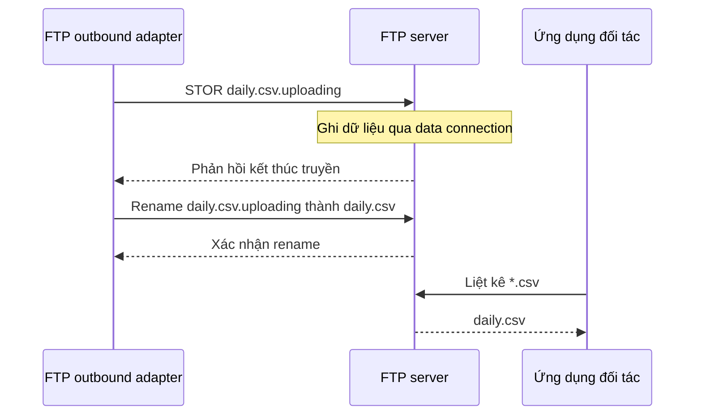

# FTP outbound adapter đẩy tệp lên máy chủ

## 1. Bài toán và mục tiêu

Một dịch vụ kế toán xuất báo cáo đối soát thành tệp CSV vào cuối ngày. Đối tác yêu cầu ứng dụng **đưa tệp lên máy chủ FTP** tại `/incoming/reports`; hệ thống bên họ sẽ tự kiểm tra thư mục để tiếp tục xử lý. Thay vì tự viết mã `FTPClient.connect()`, `login()`, `storeFile()` và quản lý phiên trong từng service, ta có thể dùng **FTP outbound channel adapter** của Spring Integration.

Trong module **SPRING_INTEGRATION_ADAPTERS**, các inbound/outbound adapter, gateway, poller và `MessageChannel` liên kết ứng dụng với hệ thống ngoài như file, SFTP, HTTP, JMS, AMQP, Kafka và cơ sở dữ liệu. Riêng bài thuộc chương **Adapter FTP** này tập trung vào chiều **ứng dụng → máy chủ FTP** và cách đảm bảo hợp đồng message, kết nối, ghi tệp và xử lý lỗi trong chiều gửi.

Sau bài học, bạn sẽ:

1. Phân biệt **outbound adapter** với inbound adapter và outbound gateway.
2. Thiết lập `SessionFactory<FTPFile>` và một `IntegrationFlow` gửi `File` lên FTP bằng Java DSL.
3. Cấu hình thư mục đích, tên tệp, chế độ FTP passive/binary, tên tạm và xử lý tệp đã tồn tại.
4. Hiểu khi nào tác vụ gửi hoàn tất, khi nào lỗi được ném ra và vì sao phải thiết kế retry/idempotency.
5. Xác minh việc gửi bằng thử nghiệm thực tế và chẩn đoán các lỗi phổ biến.

## 2. Outbound adapter hoạt động như thế nào?


**Outbound channel adapter** là endpoint **một chiều** (message đi ra). Nó nhận message từ một `MessageChannel`, dùng `SessionFactory` mượn kết nối FTP, rồi truyền payload lên thư mục remote. Adapter không tự sinh tệp CSV; nhiệm vụ tạo nội dung, kiểm tra nghiệp vụ và chọn thời điểm gửi thuộc về các bước trước đó.

Khi payload là `java.io.File`, adapter lấy dữ liệu từ tệp **trên filesystem của tiến trình Java**, ghi nó lên FTP và trả/đóng session theo cấu hình factory. Mặc định tên tệp remote có thể được suy ra từ payload `File` hoặc cơ chế đặt tên của handler; khi yêu cầu hợp đồng đặt tên cụ thể, hãy cấu hình `fileNameGenerator` rõ ràng.

| Thành phần | Trách nhiệm | Ví dụ |
| --- | --- | --- |
| Producer | Sinh nội dung và quyết định gửi | `daily-2026-11-23.csv` |
| `Message<File>` | Hợp đồng dữ liệu giữa producer và adapter | Payload trỏ đến tệp local đã đóng và hoàn tất ghi |
| `MessageChannel` | Chuyển message tới handler | `ftpOutboundRequests` |
| FTP outbound adapter | Thực hiện **upload** tệp | FTP `STOR`, tùy cấu hình có rename sau upload |
| `SessionFactory<FTPFile>` | Tạo/tái sử dụng FTP session | Host, user, timeout, passive mode |
| FTP server | Lưu tệp tại thư mục đối tác quy định | `/incoming/reports` |
| Consumer phía đối tác | Tự lấy/xử lý tệp đã giao | Quy trình nhập dữ liệu bên đối tác |

Phân biệt các endpoint dễ nhầm:

| Loại endpoint | Hướng | Ý nghĩa |
| --- | --- | --- |
| **FTP inbound adapter** | Server → ứng dụng | Poll FTP, tải tệp về local, phát `Message<File>` |
| **FTP outbound adapter** | Ứng dụng → server | Nhận message, đẩy payload lên FTP; không có kết quả nghiệp vụ dạng reply |
| **FTP outbound gateway** | Ứng dụng ↔ server | Thực thi lệnh FTP theo mô hình request–reply (ví dụ `ls`, `get`, `put`, `rm`) |
| **FTP streaming inbound adapter** | Server → ứng dụng | Đọc nội dung như stream, cần đặc biệt lưu ý vòng đời session/stream |

Một `MessageChannel` không có nghĩa mọi message đều chạy bất đồng bộ: với `DirectChannel`, handler thường chạy **ngay trên thread của sender**; với kênh có executor, hàng đợi hoặc broker, ngữ nghĩa hoàn thành và xử lý lỗi sẽ khác.

## 3. Chuẩn bị môi trường

### 3.1. Thư viện

Ví dụ Maven cho ứng dụng Spring Boot có BOM quản lý phiên bản Spring Integration tương thích:

```xml
<dependencies>
    <dependency>
        <groupId>org.springframework.boot</groupId>
        <artifactId>spring-boot-starter-integration</artifactId>
    </dependency>
    <dependency>
        <groupId>org.springframework.integration</groupId>
        <artifactId>spring-integration-ftp</artifactId>
    </dependency>
</dependencies>
```

Nếu không dùng BOM của Spring Boot, dùng BOM Spring Integration phù hợp để tránh trộn các phiên bản `spring-integration-core`, `spring-integration-file` và `spring-integration-ftp`.

### 3.2. Hợp đồng với FTP server

Trước khi triển khai, cần thống nhất với đối tác:

- **Địa chỉ/cổng**: ví dụ `ftp.partner.example:21`; đây chỉ là địa chỉ minh họa.
- **Tài khoản**: có quyền `STOR` vào `/incoming/reports`, và nếu dùng tên tạm cần thêm quyền **rename** trong thư mục đó; nếu adapter phải tạo thư mục thì cần quyền tương ứng.
- **Quy tắc đặt tên**: tên file cuối cùng, phần mở rộng, encoding, timezone và khả năng gửi lại cùng tên.
- **Quy tắc công bố file hoàn chỉnh**: đối tác bỏ qua tên tạm như `*.uploading`, chỉ đọc `*.csv`.
- **Chính sách file trùng**: ghi đè, từ chối, hay dùng một tên duy nhất theo phiên bản/batch.
- **Hạn chế mạng**: FTP có kết nối điều khiển và kết nối dữ liệu, thường phải cấu hình dải cổng passive trên firewall/NAT.

FTP thuần truyền thông tin đăng nhập và dữ liệu không mã hóa. Dùng **FTPS** hoặc **SFTP** nếu hợp đồng yêu cầu bảo vệ thông tin. FTPS vẫn là FTP có TLS, còn SFTP dùng giao thức SSH và module Spring Integration khác; đổi cổng 21 thành 22 không biến FTP thành SFTP.

### 3.3. Cấu hình ứng dụng

```yaml
# application.yml
partner:
  ftp:
    host: ${PARTNER_FTP_HOST}
    port: ${PARTNER_FTP_PORT:21}
    username: ${PARTNER_FTP_USER}
    password: ${PARTNER_FTP_PASSWORD}
    remote-directory: /incoming/reports
```

Không ghi mật khẩu thật trong mã nguồn, tài liệu triển khai hay log. Cấp biến môi trường hoặc secret thông qua hệ thống quản lý bí mật. Thư mục `/incoming/reports` nằm **trên FTP server**; đường dẫn của payload `File` ở phía ứng dụng là đường dẫn khác.

## 4. Ví dụ đầy đủ: gửi `File` từ ứng dụng

Ví dụ dưới đây sử dụng Java DSL của Spring Integration để người học nhìn thấy trọn đường đi: service gửi message → `DirectChannel` → outbound adapter → FTP.

### 4.1. Khởi tạo session factory

```java
import org.apache.commons.net.ftp.FTP;
import org.apache.commons.net.ftp.FTPClient;
import org.apache.commons.net.ftp.FTPFile;
import org.springframework.beans.factory.annotation.Value;
import org.springframework.context.annotation.Bean;
import org.springframework.context.annotation.Configuration;
import org.springframework.integration.file.remote.session.CachingSessionFactory;
import org.springframework.integration.file.remote.session.SessionFactory;
import org.springframework.integration.ftp.session.DefaultFtpSessionFactory;

@Configuration
public class PartnerFtpConnectionConfiguration {

    @Bean("partnerFtpSessionFactory")
    public SessionFactory<FTPFile> partnerFtpSessionFactory(
            @Value("${partner.ftp.host}") String host,
            @Value("${partner.ftp.port}") int port,
            @Value("${partner.ftp.username}") String user,
            @Value("${partner.ftp.password}") String password) {

        DefaultFtpSessionFactory target = new DefaultFtpSessionFactory();
        target.setHost(host);
        target.setPort(port);
        target.setUsername(user);
        target.setPassword(password);
        target.setClientMode(FTPClient.PASSIVE_LOCAL_DATA_CONNECTION_MODE);
        target.setFileType(FTP.BINARY_FILE_TYPE);
        target.setConnectTimeout(10_000); // ms
        target.setDefaultTimeout(10_000); // ms
        target.setDataTimeout(30_000);    // ms

        CachingSessionFactory<FTPFile> cache =
                new CachingSessionFactory<>(target, 4);
        cache.setSessionWaitTimeout(3_000);
        cache.setTestSession(true);
        return cache;
    }
}
```

`DefaultFtpSessionFactory` tạo session FTP; `CachingSessionFactory` tái sử dụng session và giới hạn số session mượn đồng thời. `setTestSession(true)` giúp kiểm tra phiên được lấy từ cache có còn sử dụng được sau thời gian rảnh. Tùy cài đặt, lỗi mạng vẫn có thể xảy ra **sau khi** phiên được kiểm tra, trong lúc truyền tệp.

`FTP.BINARY_FILE_TYPE` dùng cho CSV, PDF, ZIP, ảnh và các tệp khác để giữ nguyên byte. `PASSIVE_LOCAL_DATA_CONNECTION_MODE` thường phù hợp với ứng dụng chạy trong container hoặc phía sau NAT/firewall; tuy nhiên vẫn cần firewall cho các cổng dữ liệu passive của server.

### 4.2. Khai báo channel và outbound flow

```java
import org.apache.commons.net.ftp.FTPFile;
import org.springframework.beans.factory.annotation.Qualifier;
import org.springframework.beans.factory.annotation.Value;
import org.springframework.context.annotation.Bean;
import org.springframework.context.annotation.Configuration;
import org.springframework.integration.channel.DirectChannel;
import org.springframework.integration.dsl.IntegrationFlow;
import org.springframework.integration.file.remote.session.SessionFactory;
import org.springframework.integration.file.support.FileExistsMode;
import org.springframework.integration.ftp.dsl.Ftp;
import org.springframework.messaging.MessageChannel;

@Configuration
public class PartnerFtpOutboundConfiguration {

    @Bean("ftpOutboundRequests")
    public MessageChannel ftpOutboundRequests() {
        return new DirectChannel();
    }

    @Bean
    public IntegrationFlow ftpOutboundFlow(
            @Qualifier("ftpOutboundRequests") MessageChannel requests,
            @Qualifier("partnerFtpSessionFactory")
            SessionFactory<FTPFile> sessionFactory,
            @Value("${partner.ftp.remote-directory}") String remoteDirectory) {

        return IntegrationFlow.from(requests)
                .handle(Ftp.outboundAdapter(sessionFactory)
                        .remoteDirectory(remoteDirectory)
                        .autoCreateDirectory(true)
                        .fileExistsMode(FileExistsMode.FAIL)
                        .useTemporaryFileName(true)
                        .temporaryFileSuffix(".uploading"))
                .get();
    }
}
```

Các lựa chọn trong flow:

| Cấu hình | Ý nghĩa |
| --- | --- |
| `IntegrationFlow.from(requests)` | Dùng channel làm điểm đầu của luồng gửi. Không cần poller cho nguồn có message được chủ động gửi vào channel. |
| `Ftp.outboundAdapter(sessionFactory)` | Tạo handler tải file lên FTP. |
| `remoteDirectory(...)` | Thư mục đích trên FTP server, không phải thư mục local. |
| `autoCreateDirectory(true)` | Cho phép tạo remote directory khi thiếu, nếu tài khoản có quyền. |
| `fileExistsMode(FileExistsMode.FAIL)` | Khi file đích đã tồn tại, yêu cầu báo lỗi thay vì âm thầm ghi đè. |
| `useTemporaryFileName(true)` | Tải lên với tên tạm rồi đổi sang tên cuối khi hoàn thành. |
| `temporaryFileSuffix(".uploading")` | Hậu tố tên tạm trên **server remote**. |

Trong thực tế, nếu thư mục đích đã được quản trị tạo sẵn và tài khoản chỉ được quyền ghi file, có thể đặt `autoCreateDirectory(false)`. Không cấp quyền tạo thư mục rộng chỉ để endpoint hoạt động.

### 4.3. Service gửi file tới channel

```java
import java.io.File;
import org.springframework.beans.factory.annotation.Qualifier;
import org.springframework.messaging.MessageChannel;
import org.springframework.messaging.support.MessageBuilder;
import org.springframework.stereotype.Service;

@Service
public class ReportFtpSender {

    private final MessageChannel requests;

    public ReportFtpSender(
            @Qualifier("ftpOutboundRequests") MessageChannel requests) {
        this.requests = requests;
    }

    public void sendCompletedReport(File report) {
        if (report == null || !report.isFile() || !report.canRead()) {
            throw new IllegalArgumentException(
                    "Báo cáo phải là file có thể đọc được");
        }

        boolean sentToChannel = requests.send(
                MessageBuilder.withPayload(report).build(), 10_000);
        if (!sentToChannel) {
            throw new IllegalStateException(
                    "Không chuyển được báo cáo vào kênh FTP outbound");
        }
    }
}
```

Ví dụ sử dụng trong nghiệp vụ sau khi CSV đã được ghi hoàn chỉnh và đóng `OutputStream`:

```java
// reportFile do bước xuất báo cáo tạo, ví dụ daily-2026-11-23.csv.
reportFtpSender.sendCompletedReport(reportFile);
```

**Quan trọng:** ví dụ dùng `DirectChannel` nên việc gọi `send(...)` thường dispatch handler đồng bộ trên thread gọi; lỗi FTP có thể ném exception lên caller. Giá trị `true` của `send` biểu thị message được channel chấp nhận/chuyển đi, **không phải ACK nghiệp vụ từ đối tác**, cũng không chứng minh đối tác đã nhập dữ liệu thành công. Nếu chuyển sang `ExecutorChannel`, queue hay broker, `send` có thể thành công trước khi tác vụ upload thực sự kết thúc.

Không tạo `File` trỏ tới tệp còn đang được ứng dụng ghi. File local cần hoàn tất, được đóng và ổn định trước khi gọi `sendCompletedReport`. Nếu nội dung do người dùng cung cấp, xác minh quyền truy cập, giới hạn dung lượng và đường dẫn hợp lệ trước khi đưa vào flow.

## 5. Kiểm soát tên file, thư mục và ghi đè

### 5.1. Tên file từ payload và hợp đồng đặt tên

Với payload là `File`, tên remote thường lấy từ tên file local theo hành vi mặc định của handler. Ví dụ:

```text
Local:  C:/app/reports/daily-2026-11-23.csv
Remote: /incoming/reports/daily-2026-11-23.csv
```

Nếu hợp đồng cần tên khác, có thể cấu hình generator. Ví dụ sau chỉ nhận `File` và đặt tên cuối dựa trên một quy tắc đơn giản:

```java
.fileNameGenerator(message -> {
    File file = (File) message.getPayload();
    String name = file.getName();
    if (!name.matches("[A-Za-z0-9._-]+\\.csv")) {
        throw new IllegalArgumentException("Tên báo cáo không hợp lệ: " + name);
    }
    return name;
})
```

Đoạn trên là **một phần cấu hình của** `Ftp.outboundAdapter(...)`, không phải một method độc lập ở cấp class. Trong dự án thật, quy tắc tên file phải gắn với khóa batch, phiên bản dữ liệu hoặc ngày phát hành để tránh hai báo cáo khác nhau vô tình ghi cùng tên. Luôn loại bỏ `../`, ký tự phân tách đường dẫn và tên file do đầu vào chưa được xác thực; không cho payload không đáng tin chọn thư mục FTP ngoài phạm vi cấp quyền.

### 5.2. Chọn `FileExistsMode`

Một quyết định rất dễ gây mất dữ liệu là xử lý khi đường dẫn remote **đã có file cùng tên**.

| Chế độ | Ý nghĩa thực tế | Khi nên dùng |
| --- | --- | --- |
| `FAIL` | Từ chối ghi nếu đích đã tồn tại; caller thấy lỗi | Báo cáo cần bảo vệ khỏi ghi đè vô tình; ví dụ chính sử dụng chế độ này |
| `REPLACE` | Ghi đè nội dung file đích nếu được phép | File snapshot được phép thay thế, quy ước rõ với đối tác |
| `IGNORE` | Bỏ qua upload khi file đã tồn tại | Chỉ khi việc trùng tên chắc chắn đồng nghĩa nội dung đã hợp lệ; cần cân nhắc việc bỏ sót bản mới |
| `APPEND` | Nối dữ liệu vào file có sẵn | Chỉ dùng khi giao thức nghiệp vụ thực sự quy định append; rủi ro sinh dữ liệu lặp khi retry |

Tập giá trị và khả năng hỗ trợ một số chế độ nâng cao phụ thuộc phiên bản Spring Integration và endpoint. Đừng dùng `REPLACE` hay `APPEND` chỉ để tránh lỗi; hãy chọn dựa trên hợp đồng dữ liệu và chiến lược retry. `FAIL` thường phù hợp với các báo cáo có **tên bất biến theo batch**.

Nếu cần gửi lại cùng một batch để phục hồi, phải có cách kiểm tra remote file là bản đã hoàn chỉnh và đúng nội dung (ví dụ file manifest/chữ ký/hash ở tầng nghiệp vụ), hoặc tạo phiên bản mới có ID rõ ràng.

### 5.3. Tại sao nên dùng tên tạm khi upload?

Giả sử file báo cáo 200 MB. Nếu adapter ghi thẳng `daily.csv`, một consumer phía đối tác đang poll thư mục có thể đọc file khi mới tải được 30 MB.

Với `useTemporaryFileName(true)` và `temporaryFileSuffix(".uploading")`, trình tự điển hình là:



Đối tác cần thống nhất **chỉ đọc tên cuối** (ví dụ `*.csv`) và bỏ qua `*.uploading`. Nếu upload thất bại giữa chừng hoặc lệnh rename lỗi, file tạm có thể còn ở remote. Cần chính sách theo dõi và dọn các file tạm cũ sau khi xác nhận không còn phiên đang tải.

Rename trong cùng một thư mục trên server thường giúp tránh để consumer nhìn thấy nội dung chưa hoàn chỉnh, nhưng **không thể coi đó là giao dịch nguyên tử được mọi FTP server bảo đảm**. Cần thử nghiệm với server thực và cách consumer quan sát file. Nếu server không hỗ trợ rename hoặc tài khoản thiếu quyền, lựa chọn `useTemporaryFileName(true)` có thể khiến upload thất bại dù `STOR` ghi dữ liệu được.

## 6. Hiểu đúng timeout và vòng đời FTP session

FTP có hai loại kết nối đáng chú ý:

- **Control connection**: gửi lệnh như `USER`, `PASS`, `STOR`, `RNFR`, `RNTO`.
- **Data connection**: truyền byte nội dung tệp; với passive mode, client chủ động mở một kết nối dữ liệu đến cổng do server trả về.

Một kết nối điều khiển thành công **không chứng minh** data connection đã thông. Lỗi `425 Can't open data connection` thường liên quan firewall/NAT, cổng passive và cấu hình FTP server.

| Tham số | Tác dụng |
| --- | --- |
| `connectTimeout` | Giới hạn thời gian thiết lập kết nối control TCP |
| `defaultTimeout` | Timeout socket điều khiển FTP |
| `dataTimeout` | Timeout socket dữ liệu khi truyền file |
| `CachingSessionFactory<>(target, 4)` | Giới hạn số session đang được quản lý và tái sử dụng |
| `sessionWaitTimeout` | Thời gian chờ một session rảnh khi cache hết chỗ |
| `testSession(true)` | Kiểm tra session đã cache còn hoạt động trước khi tái sử dụng |

Tăng kích thước pool không tự tạo thêm throughput nếu server chỉ cho ít kết nối hoặc băng thông thấp. Ngược lại, pool quá nhỏ khiến các job đồng thời phải chờ. Nếu nhiều flow inbound/outbound cùng dùng một pool, tổng số message gửi và tác vụ poll đồng thời đều có thể chiếm các session đó.

Mỗi thao tác upload nên lấy và trả session đúng vòng đời. Không giữ một `Session<FTPFile>` làm field singleton dùng chung giữa các thread. Outbound adapter quản lý việc mượn/trả phiên; nếu tự làm việc với `FtpRemoteFileTemplate` hoặc `SessionFactory`, hãy dùng API callback hoặc `try-with-resources` theo hợp đồng.

## 7. Gửi thành công có nghĩa gì?

Trong kịch bản `DirectChannel` + outbound adapter đồng bộ, có ba mốc cần phân biệt:

1. **Producer tạo file local hoàn chỉnh**: ghi xong và đóng file, kiểm tra đúng nội dung.
2. **FTP upload được adapter thực thi**: server chấp nhận truyền và (nếu cấu hình) đổi tên tạm sang tên cuối; bước này có thể ném exception do mạng, quyền hoặc server.
3. **Đối tác xử lý file thành công**: chỉ xác nhận được thông qua cơ chế **ACK nghiệp vụ** riêng (file `.ack`, API callback, bảng đối soát hoặc thông điệp phản hồi theo hợp đồng).

```text
Local CSV ready
      |
      v
Message<File> -- DirectChannel --> FTP outbound adapter
                                      |
                                      +-- STOR / rename thành công
                                      |      |
                                      |      v
                                      |   Trạng thái UPLOADED
                                      |      |
                                      |      v
                                      |   Chờ ACK từ đối tác (nếu có)
                                      |
                                      +-- Exception / timeout
                                             |
                                             v
                                       Xác minh trạng thái remote
                                       trước khi quyết định retry
```

Lệnh upload thành công không có nghĩa đối tác đã parse CSV, xác nhận tổng số bản ghi hoặc commit dữ liệu. Nếu ứng dụng cần SLA “đối tác nhận và xử lý”, hãy lưu riêng trạng thái `CREATED`, `UPLOADING`, `UPLOADED`, `ACKNOWLEDGED`, `FAILED` để người vận hành nhìn thấy chính xác bước nào đang thiếu.

## 8. Retry, idempotency và xử lý lỗi

### 8.1. Vì sao retry có thể tạo lỗi trùng?

Giả sử adapter đã truyền đủ file lên server, nhưng kết nối bị ngắt **trước khi ứng dụng nhận được phản hồi cuối**. Từ góc nhìn ứng dụng, kết quả “đã gửi hay chưa” trở nên **không chắc chắn**. Nếu tự động retry với chế độ `REPLACE`, có thể sửa nội dung một file mà đối tác đang đọc; với `APPEND`, dễ nhân đôi dữ liệu.

Một quy trình an toàn hơn:

1. Đặt **tên file tất định** theo `partnerId + batchId + version`, và lưu trạng thái gửi trong database.
2. Với tên file bất biến, dùng `FAIL` để phát hiện xung đột thay vì ghi đè mặc định.
3. Khi gặp timeout hoặc mất kết nối, kiểm tra **tên cuối**, **tên tạm** và nếu có thể là kích thước/hash/manifest của bản trên server; không suy từ exception rằng server chưa nhận byte nào.
4. Chỉ retry sau khi xác định trạng thái file remote và chính sách cleanup. Gửi lại bằng phiên bản/tên khác nếu hợp đồng cho phép.
5. Chờ ACK nghiệp vụ nếu cần biết phía đối tác đã xử lý; không dùng `send() == true` thay cho ACK.

**Điểm cốt lõi:** outbound adapter hỗ trợ vận chuyển message tới FTP, nhưng một thao tác FTP không phải transaction phân tán với database nội bộ và hệ thống đối tác. “Exactly once” từ lúc tạo báo cáo đến lúc đối tác xử lý phải được thiết kế bằng mã batch, idempotency và cơ chế xác nhận độc lập.

### 8.2. Ranh giới lỗi khi dùng các loại channel

**DirectChannel:** việc chuyển message đến handler diễn ra đồng bộ; exception trong quá trình kết nối/upload có thể truyền về service gọi `send`. Có thể áp dụng retry advice, nhưng cần giới hạn số lần, backoff và quy tắc nhận diện lỗi có thể thử lại.

**ExecutorChannel hoặc queue:** gửi message thành công có thể chỉ nghĩa là message đã được lên lịch/hàng đợi; upload diễn ra sau đó. Lỗi của handler cần cơ chế error channel, retry, lưu trạng thái và cảnh báo cho phù hợp. Không dùng kết quả `MessageChannel.send` làm chứng cứ hoàn tất remote upload khi xử lý bất đồng bộ.

**Gateway kiểu request–reply:** nếu cần trả dữ liệu phản hồi về caller, hoặc thực thi lệnh FTP có kết quả cụ thể, cân nhắc outbound gateway. Outbound channel adapter chỉ là đích một chiều của `Message`.

### 8.3. Các lỗi phổ biến và cách khoanh vùng

| Triệu chứng | Nguyên nhân đáng kiểm tra | Hướng xử lý |
| --- | --- | --- |
| `Connection refused`, connect timeout | Sai host/cổng, DNS, server ngừng hoạt động, firewall | Kiểm tra TCP từ container hoặc host thực tế tới control port |
| FTP reply `530` | Sai username/password hoặc account bị khóa | Xác minh secret và trạng thái user; không log credential |
| `425 Can't open data connection`, `STOR` treo | Chặn cổng passive, NAT/proxy sai hoặc timeout kênh dữ liệu | Kiểm tra passive mode và dải cổng dữ liệu trên FTP server/firewall |
| FTP reply `550` khi ghi | Thiếu quyền ghi, sai remote path, thiếu thư mục, tên file bị từ chối | Kiểm tra tài khoản, quyền directory, quy tắc file trên server |
| STOR xong nhưng rename thất bại | Thiếu quyền rename, server không hỗ trợ thao tác hoặc tên cuối đã tồn tại | Kiểm tra `RNFR/RNTO`, `FileExistsMode`, cleanup tên tạm |
| `FileExistsMode.FAIL` báo file tồn tại | Tên file remote đã được dùng ở batch cũ hoặc upload trước đã thành công | So khớp batch ID, kích thước/hash rồi quyết định bỏ qua, phân phiên bản hay khôi phục |
| `Connection reset` hoặc `SocketTimeoutException` giữa upload | Đường truyền gián đoạn, server giới hạn kết nối, timeout quá thấp | Kiểm tra server log, kích thước file, timeout và trạng thái remote trước retry |
| Pool session báo chờ quá lâu | Cache đầy, job đồng thời nhiều, session chưa được trả | Kiểm tra độ đồng thời, thời gian upload, `sessionWaitTimeout` và server limit |
| Lệnh `send` trả true nhưng đối tác không thấy báo cáo | Gửi nhầm remote path, consumer cần tên file khác, xử lý async hoặc chưa có ACK | Kiểm tra remote directory, tên cuối và hợp đồng tiêu thụ |
| File remote có kích thước bằng 0 hoặc không đầy đủ | Upload lỗi, file local chưa ghi xong, consumer đọc trước rename | Kiểm tra quá trình tạo file local, tên tạm/rename và log `STOR` của server |

Không log toàn bộ nội dung báo cáo, username/password hay chuỗi FTP có thông tin nhạy cảm. Có thể bật mức log chẩn đoán có kiểm soát cho Spring Integration FTP và so sánh với log phía server để phân biệt lỗi điều khiển, mở data connection, ghi dữ liệu và rename.

## 9. Thay đổi giao thức: FTPS và SFTP

Không phải mọi máy chủ “truyền file” đều nói FTP. Chọn factory chính xác:

| Giao thức | Cổng thường gặp | Factory Spring Integration | Ghi chú |
| --- | --- | --- | --- |
| FTP | 21 | `DefaultFtpSessionFactory` | Không mã hóa theo mặc định |
| FTPS explicit | 21 | `DefaultFtpsSessionFactory` | Bắt đầu kết nối FTP rồi dùng TLS |
| FTPS implicit | 990 | `DefaultFtpsSessionFactory` | TLS từ khi thiết lập kết nối |
| SFTP | 22 | `DefaultSftpSessionFactory` thuộc module SFTP | Giao thức SSH, xác thực host key |

Ví dụ phần lõi cấu hình **FTPS explicit** khi đối tác hỗ trợ:

```java
import org.apache.commons.net.ftp.FTP;
import org.apache.commons.net.ftp.FTPClient;
import org.springframework.integration.ftp.session.DefaultFtpsSessionFactory;

DefaultFtpsSessionFactory ftps = new DefaultFtpsSessionFactory();
ftps.setHost("ftps.partner.example");
ftps.setPort(21);
ftps.setUsername(System.getenv("PARTNER_FTPS_USER"));
ftps.setPassword(System.getenv("PARTNER_FTPS_PASSWORD"));
ftps.setImplicit(false);
ftps.setProtocol("TLS");
ftps.setProt("P"); // bảo vệ kênh dữ liệu
ftps.setEndpointCheckingEnabled(true);
ftps.setClientMode(FTPClient.PASSIVE_LOCAL_DATA_CONNECTION_MODE);
ftps.setFileType(FTP.BINARY_FILE_TYPE);
```

Đây là phần minh họa factory, chưa phải toàn bộ cấu hình production: cần truststore/CA đáng tin cậy, kiểm tra chứng chỉ và hostname server, chính sách phiên bản TLS, timeout và firewall cho kênh dữ liệu. Không bỏ xác minh chứng chỉ để “sửa” lỗi handshake. Nếu server chỉ hỗ trợ **SFTP**, phải dùng dependency `spring-integration-sftp` và adapter/factory SFTP thích hợp; không dùng `Ftp.outboundAdapter` với cổng 22.

## 10. Kiểm thử và vận hành

### 10.1. Kịch bản kiểm thử tích hợp

Thử trên FTP server dành riêng cho kiểm thử, có tài khoản và thư mục đích phù hợp. Chỉ mock service nhận message là **chưa đủ** để xác nhận truyền file và rename trên server:

| Tình huống | Kết quả cần quan sát |
| --- | --- |
| Gửi một `File` CSV hợp lệ | Remote có tệp cuối đúng đường dẫn, đúng nội dung byte |
| Gửi PDF/ZIP thử nghiệm | Byte không bị thay đổi do file type/mode |
| `FileExistsMode.FAIL`, tên đã tồn tại | Không âm thầm ghi đè; caller thấy lỗi trong luồng đồng bộ |
| File lớn, producer vẫn đang ghi | Quy trình phải chặn gửi sớm; chỉ gửi file sau khi hoàn tất |
| Đối tác chỉ đọc `*.csv` | Không đọc `*.uploading`; chỉ thấy tên cuối sau upload hoàn tất |
| Cắt kết nối giữa `STOR` | Không xuất hiện file cuối bị coi là hợp lệ; phát hiện và dọn file tạm theo chính sách |
| Thiếu quyền rename | Handler báo lỗi; kiểm tra tên tạm còn trên server |
| Ngắt mạng sau truyền nhưng trước phản hồi | Tái xác minh trạng thái remote, không retry mù |
| Thư mục remote chưa có | Chỉ tự tạo nếu `autoCreateDirectory` được bật và tài khoản được cấp quyền |
| Gửi nhiều file đồng thời | Cache/session không bị cạn; server nhận đủ file và không đụng tên |
| Server chỉ có FTP passive data ports | Test từ chính container runtime để phát hiện thiếu rule firewall |

### 10.2. Chỉ số vận hành cần theo dõi

- **Tốc độ gửi:** số tệp và byte upload thành công, thời gian từ tạo file đến lúc hoàn tất tên cuối.
- **Sức khỏe kết nối:** lỗi DNS, login, timeout, `STOR`, rename, số session đang được sử dụng và thời gian chờ cache.
- **Tệp tồn đọng:** số báo cáo local chờ gửi, retry theo batch ID, số file tạm lâu không được rename.
- **Đối soát:** số file đã upload nhưng chưa nhận ACK nghiệp vụ đúng hạn, số batch bị đối tác từ chối, số batch gửi trùng.

Hãy thiết lập cảnh báo cho lỗi tăng đột biến và báo cáo đến hạn nhưng chưa có trạng thái `UPLOADED` hoặc `ACKNOWLEDGED`. Với dữ liệu quan trọng, lưu correlation ID như `partnerId`, `batchId` và tên file, nhưng che thông tin bí mật.

### 10.3. Checklist trước khi triển khai

1. **Tạo file hoàn chỉnh:** đóng stream, xác minh kích thước/nội dung trước khi phát `Message<File>`.
2. **Chọn đúng giao thức:** FTP, FTPS, SFTP; cấu hình chứng chỉ và firewall phù hợp.
3. **Cấp quyền tối thiểu:** chỉ ghi/rename ở thư mục cần thiết; không yêu cầu quyền xóa nếu quy trình không dùng.
4. **Có quy ước tên bất biến:** đặt tên theo batch/version, xác định rõ hành vi khi file tồn tại.
5. **Dùng tên tạm:** kiểm tra consumer phía đối tác bỏ qua file tạm và FTP server cho phép rename.
6. **Retry có kiểm soát:** xử lý trường hợp upload có thể đã thành công nhưng caller nhận timeout; lưu trạng thái.
7. **Kiểm thử đường truyền thực:** dữ liệu lớn, mất mạng, quyền thư mục, nhiều kết nối đồng thời, restart.
8. **Tách ACK kỹ thuật và ACK nghiệp vụ:** upload hoàn tất khác với việc đối tác đã nhập dữ liệu.

## 11. Bài tập tình huống

**Yêu cầu:** Ứng dụng phải gửi báo cáo `settlement-<batchId>.csv` lên `/incoming/settlements` mỗi ngày. Đối tác poll file `*.csv` mỗi phút. File có thể lớn 500 MB, đôi khi đường truyền mất kết nối; đối tác từ chối file thay đổi nội dung sau khi công bố tên cuối.

Hãy trả lời:

1. Cần dùng outbound adapter hay inbound adapter? Producer truyền loại payload nào cho ví dụ này?
2. Vì sao không nên ghi trực tiếp lên tên `*.csv` trong lúc truyền?
3. Nếu muốn bảo vệ báo cáo không bị ghi đè, nên chọn `FileExistsMode` nào?
4. Nếu upload timeout ở 99%, có nên tự động retry bằng `REPLACE` ngay lập tức không?
5. Dùng `ExecutorChannel` có còn thể coi `MessageChannel.send() == true` là FTP upload xong không?
6. Điều gì xác nhận đối tác đã xử lý thành công chứ không chỉ nhận được file?

**Gợi ý đáp án:** (1) Outbound adapter, gửi `Message<File>` chứa file local đã hoàn tất; (2) dùng tên tạm rồi rename để consumer chỉ nhìn thấy tên cuối sau khi truyền xong; (3) `FAIL`; (4) không, trước tiên xác minh trên server có tên tạm/tên cuối và trạng thái dữ liệu rồi mới quyết định retry; (5) không, xử lý bất đồng bộ có thể xảy ra sau `send()`; (6) cần ACK nghiệp vụ hoặc cơ chế đối soát độc lập từ đối tác.

## Tổng kết

FTP outbound adapter nhận message trong Spring Integration và **đẩy dữ liệu lên FTP server**, thường bằng `Message<File>`. `SessionFactory` quản lý kết nối; `MessageChannel` và `IntegrationFlow` quyết định luồng gửi. Với dữ liệu quan trọng, cấu hình **binary mode**, **passive mode**, **fileExistsMode**, **temporary file name**, timeout và quyền remote nhất quán với hợp đồng đối tác. Mức xác nhận “upload thành công” chỉ là một bước trong chuỗi xử lý; retry, idempotency và ACK nghiệp vụ là phần trách nhiệm cần được thiết kế ở cấp ứng dụng.

## Tài liệu tham khảo

- [Spring Integration Reference — FTP Support](https://docs.spring.io/spring-integration/reference/ftp.html)
- [Spring Integration Reference — FTP Outbound Channel Adapter](https://docs.spring.io/spring-integration/reference/ftp/outbound.html)
- [Spring Integration Reference — FTP Session Factory](https://docs.spring.io/spring-integration/reference/ftp/session-factory.html)
- [Spring Integration Reference — FTP Session Caching](https://docs.spring.io/spring-integration/reference/ftp/session-caching.html)
- [Spring Integration API — FTP DSL](https://docs.spring.io/spring-integration/api/org/springframework/integration/ftp/dsl/Ftp.html)
