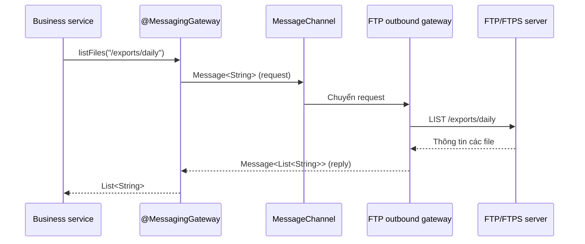
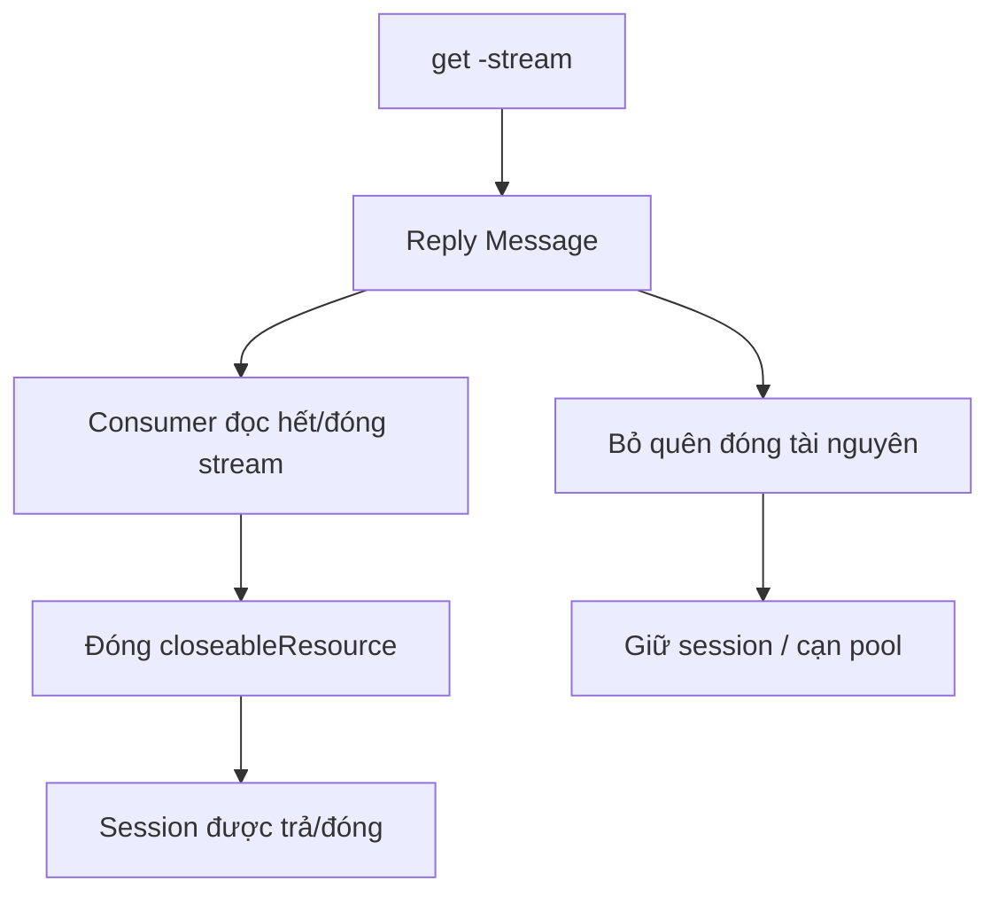

# FTP outbound gateway thao tác request-reply

## 1. Bài toán: cần kết quả trả về sau một thao tác FTP

Giả sử dịch vụ đối soát cần kiểm tra máy chủ FTP của đối tác trước khi nhập dữ liệu:

1. Liệt kê danh sách báo cáo đang có trong `/exports/daily`.
2. Chọn một tên file theo batch cần đối soát.
3. Tải file về thư mục local để kiểm tra.
4. Sau khi xử lý thành công, có thể đổi tên file trên server thành `*.processed` nếu hợp đồng cho phép.
5. Trả lại cho service gọi **danh sách file, đường dẫn local hoặc kết quả thao tác** để nó quyết định bước tiếp theo.

Nếu chỉ cần tự động lấy file theo lịch, **FTP inbound channel adapter + poller** thường thích hợp. Nếu chỉ cần gửi file lên server mà không cần reply, dùng **FTP outbound channel adapter**. Ở đây, ứng dụng muốn **chủ động gọi lệnh FTP và nhận kết quả**, nên sử dụng **FTP outbound gateway**.

Đây là một bài trong chương **Adapter FTP** của module **SPRING_INTEGRATION_ADAPTERS**. Module hướng dẫn nối hệ thống ngoài qua inbound/outbound adapter, gateway, poller và `MessageChannel`; các kênh tích hợp bao gồm file, SFTP, HTTP, JMS, AMQP, Kafka và cơ sở dữ liệu, cùng các yêu cầu về hợp đồng message, xử lý lỗi và vòng đời kết nối. Bài này tập trung vào giao tiếp **request–reply với FTP/FTPS**, không xây dựng toàn bộ luồng nhập dữ liệu nghiệp vụ.

Sau bài, bạn sẽ giải thích được cách một request message kích hoạt lệnh FTP, nhận reply có kiểu dữ liệu phù hợp, cấu hình Java DSL cùng `@MessagingGateway`, kiểm soát đường dẫn và quyền thao tác, sử dụng `ls/get/put/mv/rm/mget/mput` đúng ngữ cảnh và xử lý lỗi khi thao tác hàng loạt chỉ thành công một phần.

## 2. Gateway khác adapter ở chỗ nào?



Trong Spring Integration có **hai loại gateway** thường được kết hợp:

- **FTP outbound gateway**: một endpoint thực hiện lệnh `ls`, `get`, `put`, `rm`... đối với FTP server; sau lệnh, nó tạo **reply message**.
- **`@MessagingGateway`**: giao diện Java cho phép code nghiệp vụ gọi phương thức như `listFiles(path)` thay vì tự tạo `Message<?>`, tự gắn reply channel và đọc reply message. Framework tạo proxy để nối lời gọi Java với messaging flow.

Hai thành phần này có tên giống nhau nhưng ở **hai đầu khác nhau**: `@MessagingGateway` là điểm vào thân thiện với Java; FTP outbound gateway là endpoint cuối làm việc với remote server.

| Cơ chế | Đầu vào | Đầu ra | Trường hợp sử dụng |
| --- | --- | --- | --- |
| FTP inbound adapter | Poller chủ động quét FTP | `Message<File>` đưa vào luồng | Nhận file mới tự động theo lịch |
| FTP outbound adapter | `Message<File>`, `byte[]` hoặc `String` phù hợp | Không có reply nghiệp vụ | Chỉ gửi file lên FTP |
| **FTP outbound gateway** | Request `Message<?>` chứa path/file và headers | **Reply `Message<?>`** có payload theo lệnh | Liệt kê, tải, gửi, đổi tên, xóa có kết quả |
| `@MessagingGateway` | Lời gọi method từ Java | Giá trị trả về Java, ánh xạ từ reply | Service gọi gateway như một API nội bộ |

Kết quả trả về của gateway là **kết quả thao tác FTP theo phản hồi từ server**, chưa chắc là xác nhận nghiệp vụ từ đối tác. Ví dụ `put` trả về đường dẫn tệp trên FTP sau khi chuyển xong, nhưng không chứng minh đối tác đã đọc hoặc ghi nhận dữ liệu trong hệ thống của họ.

## 3. Danh sách lệnh và hợp đồng reply

Spring Integration FTP outbound gateway hỗ trợ các lệnh sau:

| Command | Request thường mang gì? | Reply payload | Ghi chú quan trọng |
| --- | --- | --- | --- |
| `ls` | Đường dẫn thư mục remote, ví dụ `/exports/daily` | `List<FileInfo<FTPFile>>` theo mặc định, hoặc `List<String>` với tùy chọn `-1` | Dùng `LIST` để có thông tin file; có thể lọc, duyệt thư mục |
| `nlst` | Đường dẫn thư mục remote | `List<String>` | Gửi lệnh FTP `NLST`, chỉ tên, không có metadata đầy đủ |
| `get` | Đường dẫn tệp remote | `File` local; hoặc `InputStream` nếu `-stream` | Cần cấu hình thư mục lưu local, chế độ tệp tồn tại |
| `mget` | Thư mục/mẫu tệp cần lấy | `List<File>` | Tải nhiều file, có thể thành công một phần |
| `put` | File, byte array hoặc chuỗi cần gửi | `String` đường dẫn tệp remote đã ghi | Ghi một tệp; nên chọn chính sách file đã tồn tại |
| `mput` | Thư mục local hoặc tập hợp tệp được hỗ trợ | `List<String>` đường dẫn remote | Gửi nhiều tệp, có thể thành công một phần |
| `rm` | Đường dẫn tệp cần xóa | `Boolean.TRUE`/`Boolean.FALSE` theo kết quả | Lệnh có khả năng phá hủy; cần hạn chế quyền |
| `mv` | Đường dẫn nguồn; đường dẫn đích qua `renameExpression` hoặc header | `Boolean.TRUE` khi thành công | Đổi tên/di chuyển trên remote; cần quyền rename |

**Kiểu trả về phụ thuộc command và options**, vì vậy không khai báo chung mọi phương thức trả về `String`. Với `ls`, chọn `-1` nếu chỉ cần tên file; bỏ `-1` nếu cần phân biệt file/thư mục và dùng metadata. `nlst` hữu ích khi server không hỗ trợ `LIST`, nhưng do chỉ nhận tên nên không có đủ dữ liệu để lọc kiểu thư mục hoặc duyệt đệ quy theo metadata.

Một số tùy chọn thường gặp:

| Lệnh | Option | Ý nghĩa |
| --- | --- | --- |
| `ls` | `-1` | Trả danh sách tên `String`, thay cho `FileInfo` |
| `ls` | `-a`, `-dirs`, `-links` | Bao gồm file ẩn, thư mục, symbolic link tương ứng |
| `ls` | `-R` | Liệt kê cây thư mục đệ quy |
| `nlst` | `-f` | Không sắp xếp |
| `get` | `-P` | Giữ timestamp remote cho file local |
| `get` | `-stream` | Trả `InputStream` thay vì tải trước xuống file |
| `get` | `-D` | Xóa remote sau khi tải thành công theo điều kiện của gateway |
| `mget` | `-R`, `-x` | Đệ quy; ném lỗi nếu không có file khớp |
| `mget` | `-P`, `-D` | Giữ timestamp; xóa remote sau khi tải thành công |
| `mput` | `-R` | Gửi các file trong thư mục local và thư mục con |

**Không truyền option tùy ý giữa các lệnh**: mỗi command có tập option hợp lệ riêng. Ví dụ `-stream` áp dụng cho `get`, không phải `mget` thông thường; `mv` và `rm` không có những option liệt kê trên.

## 4. Chuẩn bị dependency, tài khoản và mạng

### 4.1. Dependency Maven

Với ứng dụng Spring Boot sử dụng BOM quản lý phiên bản Spring Integration tương thích:

```xml
<dependencies>
    <dependency>
        <groupId>org.springframework.boot</groupId>
        <artifactId>spring-boot-starter-integration</artifactId>
    </dependency>
    <dependency>
        <groupId>org.springframework.integration</groupId>
        <artifactId>spring-integration-ftp</artifactId>
    </dependency>
</dependencies>
```

Không trộn tùy tiện các phiên bản `spring-integration-core`, `spring-integration-file` và `spring-integration-ftp`. Nếu không dùng Spring Boot BOM, hãy quản lý phiên bản bằng BOM Spring Integration phù hợp với Spring Framework của ứng dụng.

### 4.2. Thông số cấu hình

```yaml
# application.yml
partner:
  ftp:
    host: ${PARTNER_FTP_HOST}
    port: ${PARTNER_FTP_PORT:21}
    username: ${PARTNER_FTP_USER}
    password: ${PARTNER_FTP_PASSWORD}
    download-directory: /data/partner-downloads
```

Máy chủ đối tác ví dụ có thư mục `/exports/daily`. Đây là **remote directory**; `/data/partner-downloads` là **thư mục local** bên trong máy/container chạy Spring Boot. Đường dẫn remote và local có thể có quyền, cách phân giải đường dẫn và vòng đời khác nhau. Khi chạy trong container, kiểm tra volume, quyền ghi và dung lượng lưu trữ.

Các biến credential cần được cấp từ môi trường triển khai hoặc secret manager; không ghi giá trị thật vào Git, tài liệu hay log.

### 4.3. Vòng đời FTP session

FTP thông thường sử dụng **control connection** (cổng 21 phổ biến) cho các lệnh như `LIST`, `RETR`, `STOR`, `RNFR`, `RNTO` và một **data connection** riêng khi liệt kê hoặc truyền byte của file. Nếu ứng dụng chạy sau NAT/firewall, chế độ passive thường dễ kết nối hơn; server vẫn cần cho phép các cổng dữ liệu passive.

`DefaultFtpSessionFactory` tạo session FTP. `CachingSessionFactory` là lớp bọc tùy chọn để tái sử dụng session và giới hạn số session được mượn đồng thời. Đóng/trả session đúng cách đặc biệt quan trọng khi có nhiều luồng request–reply chạy song song.

FTP thuần không mã hóa nội dung theo mặc định. Nếu trao đổi dữ liệu nhạy cảm, chọn **FTPS** (FTP qua TLS với chứng chỉ được xác minh) hoặc **SFTP** (qua SSH) tùy máy chủ hỗ trợ. SFTP không hoạt động qua `DefaultFtpSessionFactory` hoặc `Ftp.outboundGateway` chỉ bằng việc đổi cổng.

## 5. Ví dụ Java DSL hoàn chỉnh: gọi `ls` và `get`

Ví dụ sau dùng Java DSL và `@MessagingGateway`. Để dễ kiểm tra, ví dụ dùng hai request channel với hai lệnh riêng. Hợp đồng của mỗi method Java khớp trực tiếp với reply của lệnh.

### 5.1. Cấu hình `SessionFactory<FTPFile>`

```java
import org.apache.commons.net.ftp.FTP;
import org.apache.commons.net.ftp.FTPClient;
import org.apache.commons.net.ftp.FTPFile;
import org.springframework.beans.factory.annotation.Value;
import org.springframework.context.annotation.Bean;
import org.springframework.context.annotation.Configuration;
import org.springframework.integration.file.remote.session.CachingSessionFactory;
import org.springframework.integration.file.remote.session.SessionFactory;
import org.springframework.integration.ftp.session.DefaultFtpSessionFactory;

@Configuration
public class PartnerFtpSessionConfiguration {

    @Bean("partnerFtpSessionFactory")
    public SessionFactory<FTPFile> partnerFtpSessionFactory(
            @Value("${partner.ftp.host}") String host,
            @Value("${partner.ftp.port}") int port,
            @Value("${partner.ftp.username}") String user,
            @Value("${partner.ftp.password}") String password) {

        DefaultFtpSessionFactory target = new DefaultFtpSessionFactory();
        target.setHost(host);
        target.setPort(port);
        target.setUsername(user);
        target.setPassword(password);
        target.setClientMode(FTPClient.PASSIVE_LOCAL_DATA_CONNECTION_MODE);
        target.setFileType(FTP.BINARY_FILE_TYPE);
        target.setConnectTimeout(10_000); // ms: kết nối control
        target.setDefaultTimeout(10_000); // ms: socket control
        target.setDataTimeout(30_000);    // ms: socket data

        CachingSessionFactory<FTPFile> cache =
                new CachingSessionFactory<>(target, 5);
        cache.setSessionWaitTimeout(3_000); // ms: đợi session rảnh
        cache.setTestSession(true);         // kiểm tra session được tái sử dụng
        return cache;
    }
}
```

Trong ví dụ, cache có giới hạn năm session. Kích thước thực tế cần dựa trên số lời gọi FTP đồng thời, hạn mức do server cho phép và băng thông. `testSession(true)` giúp phát hiện một số session đã bị server đóng khi rảnh; nó không đảm bảo kết nối không thể đứt trong lúc `RETR` hoặc `STOR`.

### 5.2. Cấu hình hai flow request–reply

```java
import java.io.File;
import org.apache.commons.net.ftp.FTPFile;
import org.springframework.beans.factory.annotation.Qualifier;
import org.springframework.beans.factory.annotation.Value;
import org.springframework.context.annotation.Bean;
import org.springframework.context.annotation.Configuration;
import org.springframework.integration.annotation.IntegrationComponentScan;
import org.springframework.integration.dsl.IntegrationFlow;
import org.springframework.integration.file.remote.session.SessionFactory;
import org.springframework.integration.file.support.FileExistsMode;
import org.springframework.integration.ftp.dsl.Ftp;

@Configuration
@IntegrationComponentScan
public class PartnerFtpGatewayFlows {

    @Bean
    public IntegrationFlow ftpListFlow(
            @Qualifier("partnerFtpSessionFactory")
            SessionFactory<FTPFile> sessionFactory) {

        return IntegrationFlow.from("ftpListRequests")
                .handle(Ftp.outboundGateway(sessionFactory, "ls", "payload")
                        .options("-1"))
                .get();
    }

    @Bean
    public IntegrationFlow ftpGetFlow(
            @Qualifier("partnerFtpSessionFactory")
            SessionFactory<FTPFile> sessionFactory,
            @Value("${partner.ftp.download-directory}") String downloadDirectory) {

        return IntegrationFlow.from("ftpGetRequests")
                .handle(Ftp.outboundGateway(sessionFactory, "get", "payload")
                        .localDirectory(new File(downloadDirectory))
                        .autoCreateLocalDirectory(true)
                        .fileExistsMode(FileExistsMode.FAIL))
                .get();
    }
}
```

Giải thích:

- `IntegrationFlow.from("ftpListRequests")` và `from("ftpGetRequests")` tạo nguồn nhận request message trên các kênh tương ứng. Với flow đơn giản này, điểm vào mặc định phù hợp kiểu dispatch đồng bộ; không cần poller vì service chủ động gọi request.
- `Ftp.outboundGateway(sessionFactory, "ls", "payload")` nhận đường dẫn remote từ **payload của request** (SpEL `payload`). `.options("-1")` yêu cầu trả danh sách tên file, nên reply chứa `List<String>`.
- `Ftp.outboundGateway(sessionFactory, "get", "payload")` dùng payload làm **đường dẫn remote của file cần tải**. `.localDirectory(...)` chỉ thư mục **local** lưu file sau khi tải.
- `.fileExistsMode(FileExistsMode.FAIL)` bảo vệ tệp local đã có; với `get`, đây cũng là chế độ mặc định theo hợp đồng gateway, nhưng khai báo tường minh giúp người đọc thấy chính sách.
- Mỗi FTP outbound gateway là handler **có reply**. Spring Integration dùng reply channel của request do messaging gateway quản lý để trả kết quả cho lời gọi Java.

`@IntegrationComponentScan` giúp phát hiện các interface `@MessagingGateway` trong phạm vi quét thích hợp. Nếu ứng dụng đã cấu hình scan ở lớp khởi động hoặc cấu hình khác, chỉ nên bật ở một vị trí đúng phạm vi package.

### 5.3. Định nghĩa API Java request–reply

```java
import java.io.File;
import java.util.List;
import org.springframework.integration.annotation.Gateway;
import org.springframework.integration.annotation.MessagingGateway;

@MessagingGateway
public interface PartnerFtpClient {

    @Gateway(requestChannel = "ftpListRequests", replyTimeout = 30_000)
    List<String> listNames(String remoteDirectory);

    @Gateway(requestChannel = "ftpGetRequests", replyTimeout = 90_000)
    File download(String remoteFilePath);
}
```

Framework tạo bean proxy triển khai interface; code nghiệp vụ không tự mở socket FTP và không cần tự thiết lập reply channel. Ví dụ gọi:

```java
import java.io.File;
import java.util.List;
import org.springframework.stereotype.Service;

@Service
public class DailyReportImportService {

    private final PartnerFtpClient ftp;

    public DailyReportImportService(PartnerFtpClient ftp) {
        this.ftp = ftp;
    }

    public File fetchReport(String batchId) {
        if (!batchId.matches("[A-Za-z0-9_-]{1,64}")) {
            throw new IllegalArgumentException("batchId không hợp lệ");
        }
        String remoteDirectory = "/exports/daily";
        String remoteFile = "report-" + batchId + ".csv";

        List<String> names = ftp.listNames(remoteDirectory);
        if (names == null || !names.contains(remoteFile)) {
            throw new IllegalStateException("Chưa có báo cáo: " + remoteFile);
        }

        return ftp.download(remoteDirectory + "/" + remoteFile);
    }
}
```

Giá trị `batchId` được kiểm tra trước khi ghép vào đường dẫn. Điều này tránh đầu vào như `../../private` tự chọn file ngoài vùng được phép. Danh sách `ls` là thông tin tại **thời điểm kiểm tra**; file vẫn có thể bị xóa hoặc thay đổi trước khi gọi `get`. Phần nghiệp vụ cần xử lý ngoại lệ khi `get` thất bại, không xem `ls` là một khóa giao dịch.

### 5.4. Điều gì xảy ra khi gọi method?

1. Service gọi `ftp.listNames("/exports/daily")`.
2. Proxy `@MessagingGateway` tạo request `Message<String>` mang đường dẫn và thông tin reply/error cần thiết, gửi vào `ftpListRequests`.
3. Endpoint FTP outbound gateway dùng `SessionFactory` lấy session, thực hiện `LIST`, xử lý option `-1`, tạo `Message<List<String>>`.
4. Reply được chuyển về kênh trả lời gắn với request; proxy giải nén payload thành `List<String>` trả cho service.
5. Nếu lệnh/đường truyền lỗi, gateway có thể ném exception hoặc xử lý qua error channel tùy cấu hình; cần xét chính sách retry, timeout và xử lý ngoại lệ tại boundary.

Lệnh `download` đi cùng đường request–reply nhưng kết quả là `File` local. Trước khi mở file, code nên xác minh đường dẫn trả về, kích thước, định dạng và bản ghi nghiệp vụ.

## 6. Timeout và đặc tính đồng bộ

Có **nhiều loại timeout khác nhau**:

| Timeout | Ở đâu? | Ý nghĩa |
| --- | --- | --- |
| `connectTimeout` | FTP session factory | Thời gian tối đa thiết lập kết nối TCP tới server |
| `defaultTimeout` | FTP client | Timeout socket control theo cấu hình client |
| `dataTimeout` | FTP client | Timeout khi giao tiếp qua kênh dữ liệu FTP |
| `sessionWaitTimeout` | `CachingSessionFactory` | Thời gian chờ mượn session từ cache khi cạn |
| `requestTimeout` | Proxy messaging gateway | Thời gian chờ gửi request vào **channel có thể chặn** như bounded queue |
| `replyTimeout` | Proxy messaging gateway | Thời gian chờ **reply message** khi thao tác gửi request đã quay về gateway; chủ yếu cần với xử lý bất đồng bộ |

**Bẫy thường gặp:** `@Gateway(replyTimeout = 30_000)` **không phải giới hạn tổng thời gian của mọi lệnh FTP**. Với `DirectChannel`, handler thường chạy ngay trên thread của caller; `LIST` hoặc `RETR` có thể chiếm thời gian ngay trong bước gửi request. `replyTimeout` không thay thế socket timeout và không nhất thiết ngắt tác vụ mạng đang chạy.

Nếu cần timeout end-to-end theo SLA, hãy thiết kế thêm deadline ở tầng gọi, hạn chế tài nguyên, chính sách cancel/retry phù hợp và quan sát thực tế. Chuyển sang kênh có executor có thể làm lời gọi request–reply chờ reply bất đồng bộ, nhưng cũng đặt ra nhu cầu kiểm soát thread pool, mức song song và xử lý exception.

## 7. Những lệnh khác: `nlst`, `put`, `mput`, `rm`, `mv`

### 7.1. `nlst`: chỉ lấy danh sách tên

Nếu server chỉ cho phép `NLST` hoặc không muốn tải metadata của `LIST`, có thể định nghĩa flow:

```java
@Bean
public IntegrationFlow ftpNamesFlow(
        @Qualifier("partnerFtpSessionFactory")
        SessionFactory<FTPFile> sessionFactory) {
    return IntegrationFlow.from("ftpNamesRequests")
            .handle(Ftp.outboundGateway(sessionFactory, "nlst", "payload"))
            .get();
}
```

Reply payload là `List<String>`. Khác với `ls` có `FileInfo` mặc định, `nlst` không có đầy đủ thuộc tính để xác định directory, timestamp hay kích thước; khi cần lọc cấu trúc thư mục, ưu tiên `ls` nếu server hỗ trợ.

### 7.2. `put`: gửi một tệp và nhận đường dẫn remote

`put` khác outbound adapter ở chỗ nó **trả `String` là đường dẫn remote** đã ghi. Ví dụ cấu hình một flow request–reply cho payload `File`:

```java
@Bean
public IntegrationFlow ftpPutFlow(
        @Qualifier("partnerFtpSessionFactory")
        SessionFactory<FTPFile> sessionFactory) {
    return IntegrationFlow.from("ftpPutRequests")
            .handle(Ftp.outboundGateway(sessionFactory, "put", "payload")
                    .remoteDirectoryExpression("'/incoming/reports'")
                    .fileExistsMode(FileExistsMode.FAIL)
                    .useTemporaryFileName(true)
                    .temporaryFileSuffix(".uploading"))
            .get();
}
```

Với phương thức `@Gateway(requestChannel = "ftpPutRequests") String upload(File localFile);`, code nghiệp vụ nhận đường dẫn remote sau thao tác. Chuỗi trả về là xác nhận kỹ thuật mức gateway; muốn biết đối tác **đã nhập báo cáo thành công** thì cần file ACK, API đối soát hoặc một sự kiện nghiệp vụ riêng.

Chỉ gửi file local sau khi đã ghi xong và đóng stream. `FileExistsMode.FAIL` làm rõ cách xử lý nếu tên remote đã tồn tại; nếu cần tiếp tục sau timeout, kiểm tra trạng thái remote trước khi retry để tránh ghi trùng.

### 7.3. `mput`: gửi nhiều tệp; `mget`: lấy nhiều tệp

`mput` nhận một thư mục local (hoặc loại đầu vào hỗ trợ theo phiên bản) và trả `List<String>` đường dẫn remote; `mget` nhận remote directory/pattern và trả `List<File>` local. Tùy chọn `-R` cho phép đệ quy; riêng `mput` có thể lọc tệp local bằng pattern/regex.

Ví dụ ngắn gọn cấu hình lọc khi gửi nhiều file:

```java
@Bean
public IntegrationFlow ftpMultiPutFlow(
        @Qualifier("partnerFtpSessionFactory")
        SessionFactory<FTPFile> sessionFactory) {
    return IntegrationFlow.from("ftpMultiPutRequests")
            .handle(Ftp.outboundGateway(sessionFactory, "mput", "payload")
                    .remoteDirectoryExpression("'/incoming/batches'")
                    .patternMputFilter("*.csv")
                    .fileExistsMode(FileExistsMode.FAIL))
            .get();
}
```

Trong ví dụ trên, request payload cần là đường dẫn/thư mục local thích hợp, không phải đường dẫn remote. `patternMputFilter("*.csv")` áp dụng ở phía **local**. Nếu thêm `.options("-R")`, cần xét cả điều kiện duyệt vào subdirectory, quy tắc đặt tên và layout thư mục đích; không suy rằng mỗi file CSV ở mọi cấp chắc chắn được gửi chỉ vì tên file khớp.

**Không coi một lượt `mget` hoặc `mput` là giao dịch nguyên tử**: file đầu có thể đã chuyển xong, file sau lỗi. Khi đó cần phân tích kết quả từng file để tránh gửi/tải lặp khi thử lại.

### 7.4. `mv`: đổi tên hoặc di chuyển remote file

Với `mv`, biểu thức chính cho biết **đường dẫn nguồn**; `renameExpression` cho biết **đường dẫn đích**. Mặc định có thể dùng header `file_renameTo`:

```java
@Bean
public IntegrationFlow ftpMoveFlow(
        @Qualifier("partnerFtpSessionFactory")
        SessionFactory<FTPFile> sessionFactory) {
    return IntegrationFlow.from("ftpMoveRequests")
            .handle(Ftp.outboundGateway(sessionFactory, "mv", "payload")
                    .renameExpression("headers['file_renameTo']"))
            .get();
}
```

Ví dụ request message trực tiếp:

```java
Message<String> request = MessageBuilder
        .withPayload("/exports/daily/report-42.csv")
        .setHeader("file_renameTo", "/exports/processed/report-42.csv")
        .build();
```

Nếu cần caller nhận reply, có thể khai báo `@Gateway(requestChannel = "ftpMoveRequests") Boolean move(Message<String> request);` trong interface `@MessagingGateway`. Reply thành công có payload `Boolean.TRUE`, và thông tin tên đích có thể nằm trong header `file_renameTo`. Đường dẫn đích phải được kiểm soát; tài khoản FTP cần có quyền rename/di chuyển và thư mục đích phải phù hợp hợp đồng với đối tác.

### 7.5. `rm`: xóa remote file có kiểm soát

`rm` nhận đường dẫn tệp và trả Boolean thành công/thất bại. Đây là thao tác có thể gây mất dữ liệu, nên **không xóa file sau `get` chỉ để tránh tải trùng**. Nếu cần xóa khi đã nhận và xử lý xong, phải có quy trình phê duyệt/quy tắc lưu trữ, idempotency, kiểm soát đường dẫn và tài khoản được cấp quyền tối thiểu. Có thể thử `rm` với **file giả lập trong môi trường test** thay vì file báo cáo thật.

## 8. Request payload, headers và SpEL

Các thuộc tính `expression`, `remoteDirectoryExpression`, `renameExpression` dùng **Spring Expression Language (SpEL)** và được đánh giá dựa trên request message.

| Expression | Giá trị đánh giá | Trường hợp |
| --- | --- | --- |
| `"payload"` | Giá trị payload của request | `ls("/exports/daily")`, `get("/exports/daily/a.csv")` |
| `"'/incoming/reports'"` | Một chuỗi hằng được bao trong dấu nháy đơn của SpEL | Thư mục remote cố định ở ví dụ `put` |
| `"headers['file_renameTo']"` | Giá trị header tương ứng | Đường dẫn đích của `mv` |
| `"headers['batchRemoteDir']"` | Thư mục remote được caller cung cấp qua header | Dùng khi có nhiều thư mục hợp lệ và được xác thực |

Ví dụ `"payload"` **không phải** literal `"payload"` gửi tới server; nó có nghĩa “lấy giá trị payload của message”. Còn `"'/incoming/reports'"` có hai lớp dấu nháy: chuỗi Java bên ngoài và chuỗi literal SpEL bên trong.

Gateway có thể trả một số header bổ sung hữu ích, như `file_remoteDirectory`, `file_remoteFile` và `file_renameTo` tùy command. Nếu tầng nghiệp vụ cần cả payload và headers, có thể định nghĩa phương thức messaging gateway trả `Message<T>` phù hợp thay cho chỉ `T`, rồi lấy `message.getHeaders()`. **Không nên đoán rằng mọi command đều phát mọi header**; kiểm tra hợp đồng của lệnh đang dùng.

**An toàn đường dẫn:** dữ liệu `remotePath` từ API không đáng tin có thể dẫn đến path traversal hoặc truy cập file ngoài phạm vi. Nên giới hạn thư mục gốc, chuẩn hóa/kiểm tra đường dẫn, xác nhận tên file theo whitelist và cấu hình tài khoản FTP chỉ có quyền trong vùng cần thiết. Tránh cho client bên ngoài tự cung cấp một expression SpEL; các expression phải do ứng dụng định nghĩa.

## 9. Vòng đời stream và `get -stream`

Với `get` mặc định, framework tải tệp xuống local và reply payload là `File`. Khi dùng `-stream`, reply payload là **`InputStream` gắn với phiên FTP đang mở**. Điều này giảm nhu cầu tạo bản sao tệp đầy đủ trên local nhưng chuyển trách nhiệm quản lý tài nguyên sang consumer.



Một cách giải phóng session theo API của Spring Integration:

```java
import java.io.Closeable;
import java.io.IOException;
import org.springframework.integration.IntegrationMessageHeaderAccessor;
import org.springframework.messaging.Message;

public void consumeStream(Message<java.io.InputStream> reply) throws IOException {
    Closeable resource =
            new IntegrationMessageHeaderAccessor(reply).getCloseableResource();
    try (java.io.InputStream input = reply.getPayload()) {
        // Đọc/parse input; ví dụ dùng InputStreamReader với charset hợp đồng.
    } finally {
        if (resource != null) {
            resource.close();
        }
    }
}
```

`closeableResource` được framework cung cấp để giải phóng resource/session sau khi tiêu thụ stream. Một số component như file splitter hoặc stream transformer có cơ chế đóng theo hợp đồng của framework; nếu tự nhận `InputStream`, **consumer phải chịu trách nhiệm đóng**. Không trả stream sang job bất đồng bộ rồi kết thúc request mà chưa có thiết kế rõ ràng về thời gian giữ session, cancel và cleanup.

Nếu cần retry bằng cách đọc lại file, lưu trữ lâu dài hoặc xử lý độc lập sau khi FTP ngắt, `get` thành file local thường đơn giản và an toàn vận hành hơn.

## 10. Lỗi, retry và kết quả thành công một phần

### 10.1. Một lần request có thể thất bại ở nhiều lớp

```text
Caller
  -> Messaging gateway (gửi request, chờ reply)
  -> FTP outbound gateway (mượn session)
  -> DNS/TCP/control login
  -> Lệnh FTP: LIST / RETR / STOR / RNFR / RNTO ...
  -> Data connection khi cần
  -> Tạo reply message
  -> Caller nhận kết quả
```

| Dấu hiệu | Nguyên nhân thường gặp | Cần kiểm tra |
| --- | --- | --- |
| `Connection refused` / connect timeout | DNS/cổng sai, server ngừng hoạt động, firewall | Host/cổng từ runtime, kết nối control |
| FTP `530` | Username/password sai, account bị khóa | Secret và tài khoản phía server |
| `425 Can't open data connection` khi `ls/get/put` | Passive data port bị firewall/NAT chặn | Dải cổng passive, IP do server thông báo, routing |
| FTP `550` | Thiếu quyền, sai path hoặc file chưa tồn tại | Quyền list/read/write/rename, remote directory |
| `get` báo file local đã tồn tại | `FileExistsMode.FAIL` hoặc trùng đích | Quy tắc tên local, cleanup và idempotency |
| `put` hoàn tất byte nhưng caller timeout | Mất phản hồi sau khi server đã ghi | Đối chiếu tên file, kích thước/hash và log server |
| `mv` thất bại | Đích sai hoặc thiếu quyền rename | Header `file_renameTo`, path và quyền đích |
| Không có reply đúng hạn | Queue/executor chậm, handler lỗi hoặc mất kết nối | Cấu hình channel, reply timeout, socket timeout, error handling |
| Lệnh `ls` trả rỗng | Thư mục không có file phù hợp hoặc filter | Phân biệt kết quả rỗng với exception/permission |
| Cache session bị nghẽn | Nhiều request đồng thời hoặc stream chưa đóng | Session đang mượn, `sessionWaitTimeout`, `closeableResource` |

Không logging mật khẩu, dữ liệu báo cáo nhạy cảm hoặc toàn bộ payload. Nên log command, remote directory/file đã chuẩn hóa, correlation ID/batch ID, thời gian thực thi, loại lỗi và mã reply FTP nếu lấy được.

### 10.2. `PartialSuccessException` của `mget` và `mput`

Giả sử `mput` gửi ba file `a.csv`, `b.csv`, `c.csv`. Server nhận `a.csv` và `b.csv`, nhưng mất mạng khi gửi `c.csv`. Spring Integration có thể ném `PartialSuccessException` chứa:

- **`partialResults`**: kết quả của những file đã truyền thành công theo gateway.
- **`derivedInput`**: danh sách đầu vào phát sinh từ request ban đầu.
- **`cause`** và thông tin `failedMessage`: giúp lần theo nguyên nhân và request lỗi.

Khi gửi/nhận đệ quy, exception có thể **lồng nhau**. Vì thế không nên retry toàn bộ thư mục mù quáng. Cần thu thập file đã thành công, đối chiếu với trạng thái remote/local và chỉ retry phần còn thiếu theo chính sách tên file, `FileExistsMode` và khóa batch. Với file nhạy cảm, ưu tiên manifest/checksum hoặc một trạng thái nghiệp vụ tách khỏi mức lệnh FTP.

### 10.3. Hợp đồng `FileExistsMode` và idempotency

Các lệnh `GET`, `MGET`, `PUT`, `MPUT` hỗ trợ `FileExistsMode` như `FAIL`, `REPLACE`, `IGNORE`, `APPEND` (một số phiên bản còn có chế độ mở rộng). Đây là quyết định ở **lớp file**:

- `FAIL`: từ chối khi đích đã có; dễ phát hiện xung đột.
- `REPLACE`: ghi đè; chỉ an toàn khi hợp đồng cho phép.
- `IGNORE`: bỏ qua file đích hiện có; không tự xác minh nội dung đúng.
- `APPEND`: nối thêm; có thể tạo bản ghi trùng khi retry nếu không kiểm soát.

Theo tài liệu Spring Integration, mặc định của `put/mput` là **`REPLACE`**, còn `get/mget` là **`FAIL`**. Không dựa vào default nếu hệ thống cần quy tắc dữ liệu chặt chẽ; hãy cấu hình tường minh.

Một reply thành công không phải transaction “exactly once” từ ứng dụng tới phía đối tác. Hãy dùng batch ID, tên file bất biến, trạng thái xử lý và cơ chế ACK riêng để biết dữ liệu đã được xử lý xong.

### 10.4. Đặt lỗi vào đúng nơi

Với flow đồng bộ qua `DirectChannel`, lỗi FTP thường đi về caller dưới dạng exception trong lời gọi proxy gateway. Với flow bất đồng bộ hoặc handler dùng executor, cần cấu hình error channel, retry advice, lưu trạng thái request và timeout một cách rõ ràng. Lời gọi đã timeout **không chứng minh** lệnh FTP chưa thành công; có thể server đã hoàn tất lệnh trước khi caller mất phản hồi.

## 11. Bài tập thực hành và tình huống tích hợp

**Bối cảnh:** đối tác đặt ba file vào `/exports/2026-11-23`: `report-01.csv`, `report-02.csv` và `report-03.csv`. Ứng dụng cần:

1. Gọi `ls` để lấy tên.
2. Chỉ nhận các file `report-*.csv`.
3. Tải từng file qua `get`, rồi parse CSV và lưu database.
4. Chỉ sau khi commit thành công, gọi `mv` để đổi tên file remote sang `/processed/<tên-file>` khi hợp đồng cho phép.
5. Nếu tải nhiều bằng `mget`, cần biết file nào đã tải thành công trước khi kết nối lỗi.

Hãy thiết kế và trả lời:

| Câu hỏi | Gợi ý đáp án |
| --- | --- |
| Vì sao `ls -1` trả `List<String>` trong khi `ls` không có option mặc định trả metadata? | `-1` yêu cầu chỉ tên file; mặc định có danh sách `FileInfo`. |
| Vì sao cần `@MessagingGateway` khi service muốn API Java có giá trị trả về? | Proxy tạo request/reply message, nối với channel và chuyển reply payload về method. |
| `get` nên trả kiểu gì nếu muốn tải file về local? | `File` (không dùng `-stream`). |
| `mv` cần cung cấp thêm điều gì ngoài đường dẫn nguồn? | Đường dẫn đích qua `renameExpression` hoặc header `file_renameTo`. |
| `replyTimeout` có thay thế socket timeout không? | Không; đặc biệt với `DirectChannel`, handler có thể chạy đồng bộ trong bước gửi. |
| Nếu `mget` đã tải 2/3 file rồi lỗi, nên làm gì? | Đọc `PartialSuccessException`, đối chiếu kết quả và retry phần thiếu có kiểm soát. |
| Nếu `get` thành công mà parse CSV lỗi, có nên `rm` file remote ngay? | Không; giữ file hoặc chuyển vùng lỗi theo hợp đồng để có thể khôi phục. |
| `put` trả đường dẫn remote có xác nhận đối tác đã nhập dữ liệu không? | Không; cần ACK nghiệp vụ từ hệ thống đối tác. |

### Kịch bản kiểm thử tích hợp đề xuất

Khi thực hành trên một FTP server kiểm thử có quyền phù hợp, nên chạy các kịch bản sau:

1. **Thư mục rỗng**: `ls -1` trả danh sách rỗng, không tự coi là lỗi kết nối.
2. **Thư mục có file**: `ls` trả đúng kiểu và tên; `get` tạo file local đúng byte.
3. **Trùng file local**: `get` với `FAIL` báo lỗi thay vì âm thầm ghi đè.
4. **Thiếu quyền**: `ls/get/mv` trả lỗi phân biệt được với không có file.
5. **Đứt kết nối** giữa lúc `RETR`: kiểm tra file local chưa hoàn chỉnh và retry.
6. **`mput/mget` lỗi giữa batch**: thu thập `partialResults` và `derivedInput`.
7. **Cạn session pool**: kiểm tra thời gian chờ, số request song song và đóng stream.
8. **Reply muộn**: xác minh `replyTimeout` không bị hiểu nhầm là timeout toàn bộ FTP transfer.

Không chạy `rm` hoặc `mv` vào thư mục dữ liệu thật khi kiểm thử. Dùng cây thư mục và file giả lập trong môi trường test, đồng thời xác minh quyền đọc, ghi, rename đúng theo từng role.

## 12. Những nguyên tắc cần nhớ

- **FTP outbound gateway là endpoint request–reply**: nhận request message, thực thi một lệnh FTP và tạo reply payload theo command.
- **`@MessagingGateway` là facade Java**: cho phép service gọi `listNames`, `download` như phương thức thông thường và nhận kết quả từ messaging flow.
- **Chọn kiểu trả về từ lệnh**: `ls -1`/ `nlst` → `List<String>`; `get` → `File`; `put` → `String`; `rm/mv` → `Boolean`; `mget/mput` → danh sách kết quả.
- **Phân biệt remote với local, command với option**; chuẩn hóa và giới hạn đường dẫn do caller cung cấp.
- **Socket timeout khác gateway reply timeout**; giới hạn session pool và quản lý stream là những phần của vòng đời kết nối.
- **Partial success và idempotency phải được xử lý**: lệnh truyền nhiều file không phải transaction phân tán, kết quả FTP không thay thế ACK nghiệp vụ.

## Tài liệu tham khảo

- [Spring Integration Reference — FTP Outbound Gateway](https://docs.spring.io/spring-integration/reference/ftp/outbound-gateway.html)
- [Spring Integration Reference — FTP Session Factory](https://docs.spring.io/spring-integration/reference/ftp/session-factory.html)
- [Spring Integration Reference — FTP Session Caching](https://docs.spring.io/spring-integration/reference/ftp/session-caching.html)
- [Spring Integration Reference — Messaging Gateways](https://docs.spring.io/spring-integration/reference/gateway.html)
- [Spring Integration API — FTP Java DSL](https://docs.spring.io/spring-integration/docs/6.5.0/api/org/springframework/integration/ftp/dsl/Ftp.html)
- [Spring Integration API — FTP outbound gateway spec](https://docs.spring.io/spring-integration/docs/6.5.0/api/org/springframework/integration/ftp/dsl/FtpOutboundGatewaySpec.html)
