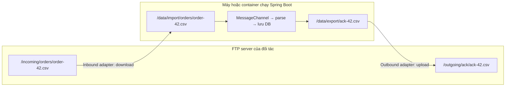
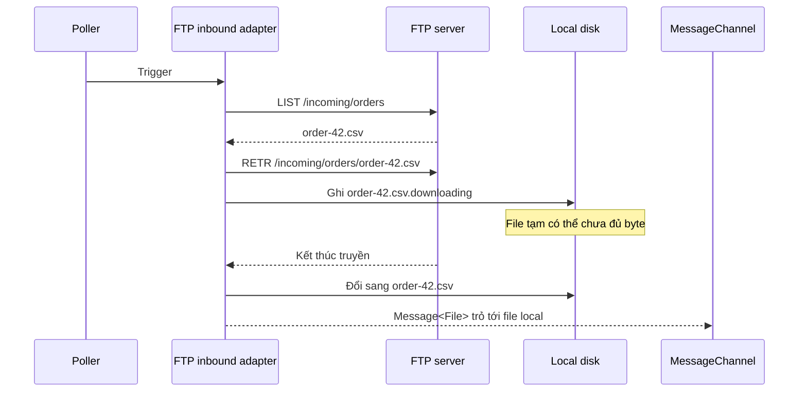

# Thư mục từ xa và thư mục cục bộ trong Spring Integration FTP

## 1. Vì sao cần phân biệt hai loại thư mục?

Đối tác đặt file `orders-2026-11-23.csv` trong thư mục `/incoming/orders` **trên máy chủ FTP**. Ứng dụng Spring Boot lấy file này về `/data/import/orders` **trên máy chạy ứng dụng** để kiểm tra, phân tích CSV và lưu vào cơ sở dữ liệu. Ở chiều ngược lại, ứng dụng xuất `/data/export/ack-42.csv` rồi gửi tới `/outgoing/ack` trên FTP server.

Hai hệ thống có **filesystem độc lập**. Một đường dẫn có thể tồn tại ở cả hai phía nhưng trỏ tới các file hoàn toàn khác nhau. Nhầm `remoteDirectory` với `localDirectory` có thể khiến ứng dụng đọc sai dữ liệu, tải file về nơi không có quyền ghi hoặc gửi file vào sai thư mục đối tác.

Bài học thuộc chương **Adapter FTP** của module **SPRING_INTEGRATION_ADAPTERS**. Trong module này, Spring Integration kết nối hệ thống ngoài bằng inbound/outbound adapter, gateway, poller và `MessageChannel`; những kênh trao đổi khác gồm file, SFTP, HTTP, JMS, AMQP, Kafka và cơ sở dữ liệu. Các quy tắc về message, lỗi và vòng đời kết nối đều quan trọng khi dữ liệu đi từ FTP về thư mục cục bộ hoặc ngược lại.

Sau bài học, bạn có thể:

- Phân biệt đường dẫn **remote** trên FTP server với đường dẫn **local** trong ứng dụng.
- Chỉ ra nơi cần cấu hình `remoteDirectory`, `localDirectory`, `autoCreateLocalDirectory` và `autoCreateDirectory`.
- Thiết lập inbound adapter tải file từ remote về local, outbound adapter gửi file lên remote và outbound gateway tải file theo yêu cầu.
- Hiểu cách tên file, bộ lọc, tệp tạm và trạng thái đồng bộ ảnh hưởng đến việc nhận hoặc gửi file.
- Chẩn đoán lỗi sai thư mục, thiếu quyền, file chưa tải xong, khởi động lại và nhiều replica dùng chung một thư mục FTP.

## 2. Hai không gian lưu trữ nằm ở hai máy khác nhau



Sơ đồ biểu diễn **vị trí file** và hướng dữ liệu. Adapter sử dụng `SessionFactory` để giao tiếp qua FTP; `MessageChannel` chuyển message giữa các bước trong ứng dụng. Poller thường kích hoạt inbound adapter theo chu kỳ, còn outbound adapter thường được kích hoạt khi một message được gửi tới channel.

| Khái niệm | Đường dẫn ví dụ | Thuộc máy nào? | Truy cập bằng gì? |
| --- | --- | --- | --- |
| Remote source directory | `/incoming/orders` | FTP server | FTP `LIST`, `RETR` và session có quyền đọc |
| Local download directory | `/data/import/orders` | Máy/container chạy Java | Java `File`/`Path`, quyền ghi của tiến trình |
| Local upload source | `/data/export/ack-42.csv` | Máy/container chạy Java | Payload `Message<File>` hoặc nguồn dữ liệu được hỗ trợ |
| Remote target directory | `/outgoing/ack` | FTP server | FTP `STOR`, có thể thêm `RNFR`/`RNTO` |

**Không dùng cùng một API để quản lý cả hai phía**: Java `Files.exists(Path.of("/incoming/orders"))` chỉ kiểm tra filesystem **cục bộ**, không kiểm tra thư mục trên FTP server. Muốn xác minh thư mục remote, phải có phiên FTP và quyền thực hiện lệnh thích hợp.

## 3. Cách FTP server diễn giải đường dẫn

### 3.1. Đường dẫn tuyệt đối và tương đối trên FTP

FTP server có thể cung cấp cho tài khoản một **root ảo** hoặc chroot. Ví dụ quản trị viên cấu hình thư mục thật trên server là `/srv/ftp/customer-a/incoming/orders`, nhưng sau khi đăng nhập, client chỉ thấy `/incoming/orders`. Ứng dụng phải dùng **đường dẫn mà tài khoản FTP nhìn thấy**, không suy ra đường dẫn filesystem nội bộ của server.

Hai kiểu đường dẫn cần kiểm tra với đối tác:

| Kiểu | Ví dụ | Cách hiểu |
| --- | --- | --- |
| Remote tuyệt đối | `/incoming/orders` | Tính từ root mà phiên FTP thấy |
| Remote tương đối | `incoming/orders` | Có thể phụ thuộc thư mục hiện hành của phiên sau login |
| Local tuyệt đối trên Linux | `/data/import/orders` | Tính từ root của container/máy Linux |
| Local tuyệt đối trên Windows | `D:\\ftp-data\\orders` | Tính từ ổ đĩa của máy Windows chạy Java |
| Local tương đối | `ftp-data/orders` | Phụ thuộc working directory của tiến trình Java |

Đường dẫn remote trong FTP thông thường dùng dấu `/`, kể cả khi FTP server chạy trên Windows. **Không tự ghép remote path bằng dấu `\\` theo hệ điều hành client**. Nếu server hỗ trợ cách phân tách đặc biệt, chỉ cấu hình khác theo hợp đồng thực tế với server.

Với hệ thống production, nên dùng đường dẫn **tường minh và ổn định**, tránh dựa vào working directory của container hoặc thư mục hiện hành của FTP session. Lệnh `PWD` từ client FTP kiểm thử giúp xác nhận cách server trình bày root; một file `README` ở thư mục hiện tại không chứng minh cấu trúc thư mục mà đối tác kỳ vọng.

### 3.2. Root ảo không đồng nghĩa có quyền đọc/ghi

Tài khoản có thể:

- Đăng nhập và `PWD` thành công nhưng không có quyền `LIST` tại `/incoming/orders`.
- `LIST` thành công nhưng bị từ chối `RETR` file.
- Ghi được file bằng `STOR` nhưng không được `RNFR/RNTO` để đổi tên tạm.
- Đọc file trong `/incoming` nhưng không có quyền tạo `/outgoing`.

Vì vậy kiểm tra kết nối và kiểm tra thư mục là **hai phép thử khác nhau**. Các mã FTP `550` hoặc lỗi permission ở bước `LIST`, `RETR`, `STOR`, `RNFR` cần được đối chiếu với tài khoản, đường dẫn và quyền cụ thể.

### 3.3. Tên file và đường dẫn thư mục là hai quyết định riêng

Nếu thư mục đích được chọn là `/outgoing/ack` và file có tên `ack-42.csv`, đường dẫn cuối thường là:

```text
remoteDirectory = /outgoing/ack
remoteFileName  = ack-42.csv
remoteFilePath  = /outgoing/ack/ack-42.csv
```

Đừng truyền `/outgoing/ack/ack-42.csv` vào thuộc tính vốn yêu cầu **thư mục**, rồi lại thêm tên file một lần nữa. Ngược lại, với FTP outbound gateway `get`, payload của lệnh thường là **đường dẫn remote của file**, ví dụ `/incoming/orders/order-42.csv`, còn `localDirectory` mới là nơi lưu bản sao sau tải.

## 4. Mỗi endpoint dùng thư mục theo cách nào?

| Endpoint | Cấu hình remote | Cấu hình local | Kết quả thông thường |
| --- | --- | --- | --- |
| FTP **inbound channel adapter** | `remoteDirectory` — thư mục nguồn trên server | `localDirectory` — thư mục đích để lưu file tải về | Phát `Message<File>` trỏ tới file local |
| FTP **outbound channel adapter** | `remoteDirectory` hoặc biểu thức thư mục đích | **Nguồn local** lấy từ payload `File`; không cần `localDirectory` cho trường hợp này | Gửi file lên server; không tạo reply nghiệp vụ |
| FTP outbound gateway **`get`** | Request payload/expression xác định file remote | `localDirectory` — thư mục lưu file tải về | Reply thường là `File` local |
| FTP outbound gateway **`put`** | `remoteDirectoryExpression` chỉ thư mục remote | Nguồn từ payload `File` hoặc loại dữ liệu hỗ trợ | Reply thường là `String` đường dẫn remote |
| FTP streaming inbound adapter hoặc gateway `get -stream` | Đường dẫn remote | Không nhất thiết ghi toàn bộ file xuống local | Nội dung dạng stream; phải quản lý resource/session |

**Hai thuộc tính tạo thư mục không thay thế nhau:**

- `autoCreateLocalDirectory(true)`: tạo **thư mục local** cho inbound adapter hoặc `get` khi chưa có, với điều kiện tiến trình Java được phép ghi vào đường dẫn cha.
- `autoCreateDirectory(true)`: cho phép tạo **thư mục remote** của outbound adapter/gateway khi cần, với điều kiện FTP account có quyền `MKD` và server hỗ trợ.

Cả hai cơ chế đều chỉ giải quyết **việc tạo thư mục**. Chúng không tự cấp quyền filesystem, mở firewall, tạo volume bền vững hay bảo đảm server cho phép `STOR`/`RETR` trên file.

## 5. Cấu hình bài toán mẫu

Giả sử có hai quy trình:

- **Nhập:** server `/incoming/orders/*.csv` → container `/data/ftp/orders` → `MessageChannel` → xử lý nghiệp vụ.
- **Xuất:** file local `/data/ftp/ack/ack-42.csv` → FTP server `/outgoing/ack/ack-42.csv`.

Với ứng dụng Spring Boot dùng BOM quản lý phiên bản tương thích, thêm:

```xml
<dependencies>
    <dependency>
        <groupId>org.springframework.boot</groupId>
        <artifactId>spring-boot-starter-integration</artifactId>
    </dependency>
    <dependency>
        <groupId>org.springframework.integration</groupId>
        <artifactId>spring-integration-ftp</artifactId>
    </dependency>
</dependencies>
```

Đặt các đường dẫn bên ngoài source code:

```yaml
# application.yml
partner:
  ftp:
    host: ${PARTNER_FTP_HOST}
    port: ${PARTNER_FTP_PORT:21}
    username: ${PARTNER_FTP_USERNAME}
    password: ${PARTNER_FTP_PASSWORD}
    remote-inbox: /incoming/orders
    local-inbox: /data/ftp/orders
    local-ack: /data/ftp/ack
    remote-ack: /outgoing/ack
```

`host`, `port`, `username` và `password` dùng cho **kết nối FTP**. Hai trường có tiền tố `remote-` mô tả **thư mục FTP server**, còn `local-` mô tả **đường dẫn filesystem của ứng dụng**. Nếu cần nhiều đối tác, đặt mỗi đối tác một cấu hình riêng, cùng các prefix trạng thái lọc riêng để tránh lẫn dữ liệu.

### 5.1. Session factory dùng chung

```java
import org.apache.commons.net.ftp.FTP;
import org.apache.commons.net.ftp.FTPClient;
import org.apache.commons.net.ftp.FTPFile;
import org.springframework.beans.factory.annotation.Value;
import org.springframework.context.annotation.Bean;
import org.springframework.context.annotation.Configuration;
import org.springframework.integration.file.remote.session.CachingSessionFactory;
import org.springframework.integration.file.remote.session.SessionFactory;
import org.springframework.integration.ftp.session.DefaultFtpSessionFactory;

@Configuration
public class PartnerFtpSessionConfiguration {

    @Bean("partnerFtpSessionFactory")
    public SessionFactory<FTPFile> partnerFtpSessionFactory(
            @Value("${partner.ftp.host}") String host,
            @Value("${partner.ftp.port}") int port,
            @Value("${partner.ftp.username}") String username,
            @Value("${partner.ftp.password}") String password) {

        DefaultFtpSessionFactory ftp = new DefaultFtpSessionFactory();
        ftp.setHost(host);
        ftp.setPort(port);
        ftp.setUsername(username);
        ftp.setPassword(password);
        ftp.setClientMode(FTPClient.PASSIVE_LOCAL_DATA_CONNECTION_MODE);
        ftp.setFileType(FTP.BINARY_FILE_TYPE);
        ftp.setConnectTimeout(10_000);
        ftp.setDefaultTimeout(10_000);
        ftp.setDataTimeout(30_000);

        CachingSessionFactory<FTPFile> cache =
                new CachingSessionFactory<>(ftp, 4);
        cache.setSessionWaitTimeout(5_000);
        cache.setTestSession(true);
        return cache;
    }
}
```

Factory trả về phiên để adapter dùng khi cần; không cần tự tạo socket FTP trong service nghiệp vụ. `BINARY_FILE_TYPE` giúp giữ nguyên byte file; passive mode thường phù hợp với client nằm sau NAT/firewall, nhưng **vẫn cần mở các cổng dữ liệu passive** ở phía server. Cache kích thước 4 chỉ là ví dụ: nếu inbound poll và outbound upload hoạt động song song, chúng có thể tranh cùng pool session.

FTP thuần không mã hóa mật khẩu/nội dung. Khi có yêu cầu bảo mật, dùng **FTPS** với chứng chỉ TLS được xác minh hoặc **SFTP** qua SSH theo giao thức đối tác hỗ trợ. SFTP cần module `spring-integration-sftp` và session factory riêng; đổi cổng FTP thành 22 không tạo ra kết nối SFTP.

## 6. Inbound: `remoteDirectory` là nguồn, `localDirectory` là đích

Đây là ví dụ Java DSL dùng một remote filter để chỉ nhận CSV và một local filter để tránh phát lại cùng file trong lần chạy ứng dụng:

```java
import java.io.File;
import java.time.Duration;
import org.apache.commons.net.ftp.FTPFile;
import org.springframework.beans.factory.annotation.Qualifier;
import org.springframework.beans.factory.annotation.Value;
import org.springframework.context.annotation.Bean;
import org.springframework.context.annotation.Configuration;
import org.springframework.integration.dsl.IntegrationFlow;
import org.springframework.integration.dsl.Pollers;
import org.springframework.integration.file.filters.AcceptOnceFileListFilter;
import org.springframework.integration.file.remote.session.SessionFactory;
import org.springframework.integration.ftp.dsl.Ftp;
import org.springframework.integration.ftp.filters.FtpSimplePatternFileListFilter;

@Configuration
public class PartnerFtpInboundDirectoryFlow {

    @Bean
    public IntegrationFlow ftpOrdersInbound(
            @Qualifier("partnerFtpSessionFactory")
            SessionFactory<FTPFile> sessionFactory,
            @Value("${partner.ftp.remote-inbox}") String remoteInbox,
            @Value("${partner.ftp.local-inbox}") String localInbox) {

        return IntegrationFlow.from(
                Ftp.inboundAdapter(sessionFactory)
                        .remoteDirectory(remoteInbox)
                        .localDirectory(new File(localInbox))
                        .autoCreateLocalDirectory(true)
                        .temporaryFileSuffix(".downloading")
                        .preserveTimestamp(true)
                        .filter(new FtpSimplePatternFileListFilter("*.csv"))
                        .localFilter(new AcceptOnceFileListFilter<>()),
                endpoint -> endpoint.poller(
                        Pollers.fixedDelay(Duration.ofSeconds(20))
                                .maxMessagesPerPoll(10)))
                .channel("ftpOrdersFiles")
                .get();
    }
}
```

Luồng này dùng `AcceptOnceFileListFilter` trong bộ nhớ **chỉ để minh họa**. Cách lọc này không phải cơ chế chống trùng bền vững qua restart; và remote pattern filter `*.csv` trong ví dụ không ghi nhớ mọi file đã tải qua các lượt poll. Khi triển khai thật, thường cần **remote persistent accept-once filter** và **local persistent accept-once filter** với metadata store bền vững. Phần dưới giải thích cách tách trách nhiệm của chúng.

Những thuộc tính quan trọng trong ví dụ:

| Thuộc tính | Tác động đến thư mục/file nào? | Hành vi |
| --- | --- | --- |
| `remoteDirectory(remoteInbox)` | Remote source | Liệt kê `/incoming/orders`, chọn file để tải |
| `localDirectory(new File(localInbox))` | Local destination | Lưu bản sao vào `/data/ftp/orders` |
| `autoCreateLocalDirectory(true)` | Local | Tạo thư mục local nếu có quyền ghi |
| `temporaryFileSuffix(".downloading")` | **Tên file local trong lúc tải** | Dùng tên tạm, rồi chuyển sang tên hoàn chỉnh sau khi truyền thành công |
| `preserveTimestamp(true)` | Local file metadata | Giữ thời điểm sửa đổi từ remote khi được server hỗ trợ |
| `filter(... "*.csv")` | Danh sách remote | Chỉ chọn tên file hợp lệ để đồng bộ |
| `localFilter(...)` | Danh sách local | Chỉ phát `Message<File>` cho file chưa được local filter chấp nhận |
| `maxMessagesPerPoll(10)` | Phát message | Giới hạn số message từ nguồn trong một lượt poll; không mặc nhiên giới hạn số file remote được tải về |

Sau khi tải xong, adapter đưa vào `ftpOrdersFiles` một message có payload là `File` cục bộ, ví dụ `/data/ftp/orders/order-42.csv`. Handler có thể mở file này bằng Java IO để parse CSV. Adapter **không** gửi một đường dẫn remote cho handler tự mở bằng `Files.newInputStream()`.

### 6.1. Thư mục local không phải thư mục làm việc của FTP session

Khi FTP client gửi `CWD /incoming/orders`, nó thay đổi thư mục hiện hành **trong phiên FTP**. Việc đó không thay đổi `user.dir` hay working directory trong JVM. Ngược lại, `File("/data/ftp/orders")` không làm FTP server thay đổi thư mục hiện hành. Hai không gian đường dẫn được quản lý độc lập.

### 6.2. File xuất hiện ở local khi nào?



Tên tạm `.downloading` trên local giúp giảm khả năng downstream mở một tệp đang tải dở. Tuy nhiên, nó **không** ngăn việc đọc file remote khi **đối tác vẫn đang upload**. Nếu đối tác viết trực tiếp `order-42.csv`, inbound adapter có thể nhìn thấy file chưa hoàn chỉnh.

Hợp đồng phát file an toàn hơn:

```text
Trên FTP server:
    order-42.csv.uploading
            |
            | đối tác hoàn tất upload rồi rename
            v
    order-42.csv

Trên máy ứng dụng:
    order-42.csv.downloading
            |
            | inbound adapter tải hoàn tất rồi rename
            v
    order-42.csv  ---> Message<File>
```

Hai lần rename diễn ra **ở hai phía khác nhau**, do hai bên thực hiện. Hãy kiểm thử việc rename và cách đối tác công bố file trên server thật; không mặc định mọi FTP server đều bảo đảm atomic rename cho tất cả trường hợp.

## 7. Outbound: thư mục remote là đích, file local nằm trong payload

Khi ứng dụng có sẵn `/data/ftp/ack/ack-42.csv`, nó có thể gửi `Message<File>` vào outbound adapter. Adapter dùng tên file từ payload hoặc `FileNameGenerator` và ghi vào `remoteDirectory` trên FTP server.

```java
import org.apache.commons.net.ftp.FTPFile;
import org.springframework.beans.factory.annotation.Qualifier;
import org.springframework.beans.factory.annotation.Value;
import org.springframework.context.annotation.Bean;
import org.springframework.context.annotation.Configuration;
import org.springframework.integration.dsl.IntegrationFlow;
import org.springframework.integration.file.remote.session.SessionFactory;
import org.springframework.integration.file.support.FileExistsMode;
import org.springframework.integration.ftp.dsl.Ftp;

@Configuration
public class PartnerFtpOutboundDirectoryFlow {

    @Bean
    public IntegrationFlow ftpAcknowledgementsOutbound(
            @Qualifier("partnerFtpSessionFactory")
            SessionFactory<FTPFile> sessionFactory,
            @Value("${partner.ftp.remote-ack}") String remoteAck) {

        return IntegrationFlow.from("ftpAckToSend")
                .handle(Ftp.outboundAdapter(sessionFactory)
                        .remoteDirectory(remoteAck)
                        .autoCreateDirectory(false)
                        .fileExistsMode(FileExistsMode.FAIL)
                        .useTemporaryFileName(true)
                        .temporaryFileSuffix(".uploading"))
                .get();
    }
}
```

Ví dụ gửi:

```java
import java.io.File;
import org.springframework.beans.factory.annotation.Qualifier;
import org.springframework.messaging.MessageChannel;
import org.springframework.messaging.support.MessageBuilder;
import org.springframework.stereotype.Service;

@Service
public class FtpAckSender {
    private final MessageChannel channel;

    public FtpAckSender(
            @Qualifier("ftpAckToSend") MessageChannel channel) {
        this.channel = channel;
    }

    public void send(File ack) {
        if (ack == null || !ack.isFile() || !ack.canRead()) {
            throw new IllegalArgumentException("ACK chưa được tạo hoàn chỉnh");
        }
        boolean accepted = channel.send(
                MessageBuilder.withPayload(ack).build());
        if (!accepted) {
            throw new IllegalStateException("Không chuyển được ACK vào FTP flow");
        }
    }
}
```

Service lấy channel `ftpAckToSend` do flow tạo hoặc do ứng dụng khai báo tương ứng. Ví dụ gọi `ftpAckSender.send(new File("/data/ftp/ack/ack-42.csv"))` sau khi ghi file hoàn chỉnh và đóng stream. Với `DirectChannel` đồng bộ, một exception trong handler FTP có thể lan về caller; nhưng `send() == true` vẫn không phải xác nhận **đối tác đã xử lý ACK**. Nếu flow chuyển sang channel bất đồng bộ, `send()` có thể trả về trước khi upload hoàn tất.

Các điểm liên quan đến thư mục:

- `remoteDirectory(remoteAck)` là **thư mục FTP đích** `/outgoing/ack`; adapter không đi tìm file local trong đường dẫn này.
- `autoCreateDirectory(false)` yêu cầu thư mục remote đã tồn tại; nếu sai path hoặc thiếu quyền, thao tác gửi sẽ lỗi. Chỉ bật `autoCreateDirectory(true)` khi hợp đồng cho phép ứng dụng tự tạo thư mục remote và tài khoản có quyền.
- `fileExistsMode(FAIL)` tránh âm thầm thay nội dung file đích đã tồn tại. Các chiến lược `REPLACE`, `IGNORE`, `APPEND` có ý nghĩa khác; chọn theo hợp đồng dữ liệu, không dùng mặc định một cách tùy tiện.
- `useTemporaryFileName(true)` và suffix `.uploading` tạo tên tạm **trên remote**, sau khi truyền đủ sẽ cố đổi sang tên cuối. Consumer của đối tác cần bỏ qua `*.uploading` và chỉ đọc tên cuối.
- Nếu cần đặt tên file remote khác với tên `File` local, cấu hình `fileNameGenerator` với quy tắc xác định, tránh dùng trực tiếp tên do người dùng không đáng tin cung cấp.

**Phân biệt:** `.temporaryFileSuffix(".downloading")` trong inbound adapter áp dụng cho bản tải về local; `.temporaryFileSuffix(".uploading")` trong outbound adapter áp dụng cho bản gửi lên remote. Cả hai cùng giải quyết nguy cơ consumer đọc file chưa hoàn chỉnh nhưng ở **hai nơi** khác nhau.

## 8. Outbound gateway `get`: dùng remote file path và local directory

FTP outbound gateway cho phép code nghiệp vụ **chủ động gửi lệnh và chờ reply**. Khác với inbound adapter tự polling, lệnh `get` nhận **đường dẫn của một file remote** từ request:

```java
import java.io.File;
import org.apache.commons.net.ftp.FTPFile;
import org.springframework.beans.factory.annotation.Qualifier;
import org.springframework.beans.factory.annotation.Value;
import org.springframework.context.annotation.Bean;
import org.springframework.context.annotation.Configuration;
import org.springframework.integration.dsl.IntegrationFlow;
import org.springframework.integration.file.remote.session.SessionFactory;
import org.springframework.integration.file.support.FileExistsMode;
import org.springframework.integration.ftp.dsl.Ftp;

@Configuration
public class PartnerFtpGetDirectoryFlow {

    @Bean
    public IntegrationFlow ftpGetFlow(
            @Qualifier("partnerFtpSessionFactory")
            SessionFactory<FTPFile> sessionFactory,
            @Value("${partner.ftp.local-inbox}") String localInbox) {

        return IntegrationFlow.from("ftpGetRequests")
                .handle(Ftp.outboundGateway(sessionFactory, "get", "payload")
                        .localDirectory(new File(localInbox))
                        .autoCreateLocalDirectory(true)
                        .fileExistsMode(FileExistsMode.FAIL))
                .get();
    }
}
```

Nếu request payload là `"/incoming/orders/order-42.csv"`, reply của `get` thông thường chứa `File` cục bộ ở `/data/ftp/orders/order-42.csv`. Lệnh `get` dùng **remote file path** từ payload, còn `localDirectory` chỉ quyết định nơi **lưu file trên máy ứng dụng**.

Các lệnh gateway khác có vai trò riêng: `ls` dùng đường dẫn thư mục remote để lấy danh sách; `put` sử dụng payload file để gửi lên remote directory; `mget`/`mput` xử lý nhiều file. Với `get -stream`, reply là stream và không buộc phải tạo bản sao file hoàn chỉnh ở local, nhưng consumer phải đóng stream và resource/session theo hợp đồng framework.

## 9. Bộ lọc và trạng thái: một file có thể xuất hiện lại

Hai kiểu **file filter** quan trọng đối với inbound:

| Bộ lọc | Áp dụng ở đâu? | Trả lời câu hỏi nào? |
| --- | --- | --- |
| **Remote file filter** | Danh sách `FTPFile` lấy từ server | File nào được tải về local? |
| **Local file filter** | Danh sách `java.io.File` trong local directory | File nào được phát tiếp thành `Message<File>`? |

Ví dụ, remote filter chỉ nhận `*.csv`; local filter không phát lại `order-42.csv` ở mọi lượt poll. Tuy vậy, **file đã được tải không đồng nghĩa nghiệp vụ đã commit DB**. Nếu service xử lý lỗi sau khi nhận message, bộ lọc vẫn có thể đánh dấu file là đã thấy. Vì thế trạng thái `RECEIVED`, `PROCESSING`, `COMPLETED`, `FAILED` và cơ chế retry nên nằm ở tầng quản lý nghiệp vụ, tách khỏi trạng thái lọc của adapter.

Khi cần chống tải/phát trùng qua restart, có thể dùng:

```java
// Những đoạn cấu hình minh họa dùng ConcurrentMetadataStore bền vững
// mà ứng dụng đã khai báo/tiêm vào.
ChainFileListFilter<FTPFile> remoteFilters = new ChainFileListFilter<>();
remoteFilters.addFilter(new FtpSimplePatternFileListFilter("*.csv"));
remoteFilters.addFilter(
        new FtpPersistentAcceptOnceFileListFilter(metadataStore, "partner-a-remote:"));

FileSystemPersistentAcceptOnceFileListFilter localFilter =
        new FileSystemPersistentAcceptOnceFileListFilter(
                metadataStore, "partner-a-local:");
```

Các lớp cần import tương ứng từ `org.springframework.integration.file.filters.ChainFileListFilter`, `org.springframework.integration.ftp.filters.FtpPersistentAcceptOnceFileListFilter`, `org.springframework.integration.file.filters.FileSystemPersistentAcceptOnceFileListFilter` và `org.springframework.integration.ftp.filters.FtpSimplePatternFileListFilter`. Sau đó gắn `.filter(remoteFilters)` và `.localFilter(localFilter)` vào inbound adapter. `metadataStore` là một `ConcurrentMetadataStore` do ứng dụng cung cấp, **không phải biến được framework tự tạo trong đoạn mã**.

Để trạng thái tồn tại qua restart, dùng metadata store được lưu bền vững (ví dụ qua JDBC/Redis khi phù hợp) thay cho kho chỉ nằm trong bộ nhớ. Nếu chạy nhiều replica, cần đánh giá khả năng chia sẻ trạng thái và khóa phân tán; chỉ dùng chung metadata store không tự bảo đảm **exactly once** khi nhiều instance cùng poll một thư mục.

**Tình huống:** Ứng dụng tải `order-42.csv` về local thành công, ghi DB thất bại. Khi sửa lỗi và khởi động lại, remote/local filter bền vững có thể không phát lại file cũ theo chính sách đã đánh dấu. Hệ thống cần có hàng đợi retry hoặc kho file lỗi để xử lý lại; không nên xóa metadata thủ công và hy vọng toàn bộ dữ liệu tự nhất quán.

## 10. Local directory trong Docker/Kubernetes và nhiều replica

Với Docker/Kubernetes, `/data/ftp/orders` là **đường dẫn bên trong container**, không tự động là `/data/ftp/orders` trên máy chủ vật lý. Nếu pod bị thay thế và local directory nằm trên filesystem tạm, những file đã tải có thể biến mất. Nếu metadata filter vẫn còn ở store bền vững, adapter có thể coi file là đã nhận dù bản local không còn nữa.

Những quyết định cần thực hiện trước production:

1. **Volume và vòng đời:** cân nhắc persistent volume hay object storage/queue trung gian khi file phải sống qua restart hoặc cần xử lý lại.
2. **Quyền truy cập:** UID/GID của container phải được phép tạo, đổi tên và xóa file ở local directory; `autoCreateLocalDirectory(true)` không vượt qua quyền của OS.
3. **Dung lượng và cleanup:** theo dõi số file, byte đã tải, tệp `.downloading` tồn đọng, file đã hoàn thành/đã xử lý và chính sách archive.
4. **Nhiều replica:** nếu mỗi pod có local directory riêng nhưng cùng poll một remote directory, chúng có thể cùng tải một file. Dùng chiến lược phân công/poller leader/khóa phù hợp nếu yêu cầu chỉ một luồng xử lý, và khóa nghiệp vụ để chống ghi DB trùng.
5. **Lưu trữ bền vững metadata:** phối hợp trạng thái remote/local filter với trạng thái xử lý nghiệp vụ. Cân nhắc khôi phục khi một bên tồn tại nhưng bên kia mất.
6. **Quan sát:** log đường dẫn đã chuẩn hóa và ID batch, số file tải/gửi, thời gian chờ FTP session, lỗi quyền hoặc disk full; che credential và không log toàn bộ payload nhạy cảm.

Thực tế phổ biến là tách thành **thư mục đang tải**, **thư mục đã tải hoàn chỉnh**, **thư mục đang xử lý** và **thư mục lỗi/archive**. Tùy quy trình, việc di chuyển file local sau khi handler nhận `Message<File>` phải được phối hợp với local filter và trạng thái nghiệp vụ để không làm mất cơ hội retry.

## 11. Các lỗi do nhầm hoặc quản lý sai thư mục

| Triệu chứng | Nguyên nhân thường gặp | Cách kiểm tra |
| --- | --- | --- |
| FTP login thành công nhưng không thấy file | Sai `remoteDirectory`, đang trỏ tới root ảo khác hoặc bộ lọc loại hết file | Dùng tài khoản thực tế kiểm tra `PWD`, `LIST`, tên file và pattern |
| FTP `550` khi `LIST`/`RETR` | Sai remote path hoặc thiếu quyền list/read | Kiểm tra quyền trên đúng thư mục và chroot của tài khoản |
| FTP `550` khi `STOR` | Sai thư mục đích, thiếu quyền write, quota hoặc file trùng | Kiểm tra `remoteDirectory`, `FileExistsMode`, tài khoản/quota |
| Lỗi `425 Can't open data connection` | Control connection hoạt động nhưng data connection bị chặn | Kiểm tra passive mode, NAT/firewall và dải data ports của FTP server |
| `AccessDeniedException` hoặc `Permission denied` trên local | Java không có quyền ghi local directory | Kiểm tra UID/GID, mount, filesystem permission, local parent directory |
| `NoSuchFileException` sau khi đổi môi trường | Local path hardcode theo máy cũ hoặc container không mount volume | Kiểm tra property `localDirectory` đang dùng, volume và quyền |
| File local có hậu tố `.downloading` mãi không mất | Đứt kết nối khi `RETR`, disk full hoặc lỗi rename | Kiểm tra FTP/data timeout, disk và log download trước khi cleanup |
| File remote còn `.uploading` | `STOR`/rename lỗi hoặc tài khoản thiếu quyền `RNFR/RNTO` | Kiểm tra log lệnh, quyền rename và file đích đã tồn tại |
| Nhận lại file đã xử lý sau restart | Bộ lọc ở RAM, store không bền hoặc thay prefix | Xem chiến lược remote/local filter và metadata store |
| Không nhận lại file cần retry | Filter đã đánh dấu file là được tải/phát, nhưng nghiệp vụ lỗi | Dùng trạng thái và hàng đợi retry riêng; không sửa metadata mù quáng |
| Hai pod cùng xử lý một file | Cùng poll thư mục remote nhưng không phối hợp | Kiểm soát cạnh tranh, chỉ định một consumer, dùng idempotency DB |
| File chứa dữ liệu đúng nhưng sai vị trí | Nhầm đường dẫn remote/local hoặc thiếu quy ước layout | So sánh đường dẫn từ config, request và đường dẫn mà partner thực sự dùng |

### Kiểm tra theo trình tự

```text
1. Xác định đây là đường dẫn FTP remote hay local trên máy ứng dụng.
2. Kiểm tra property đã được nạp đúng theo môi trường.
3. Remote: kiểm tra PWD, LIST, quyền RETR/STOR/RNFR/RNTO bằng tài khoản ứng dụng.
4. Local: kiểm tra mount, quyền tạo file, rename, dung lượng và cleanup.
5. Kiểm tra suffix file tạm, bộ lọc, metadata store và tên file thực tế.
6. Kiểm tra handler nghiệp vụ, trạng thái retry, ACK và số file được xử lý.
```

Không kết luận thư mục FTP rỗng chỉ vì `Files.list(Path.of("/incoming/orders"))` trên container trả danh sách trống. Phép kiểm tra đó không hề truy cập FTP.

## 12. Bảo mật và quy tắc chọn đường dẫn

Khi đường dẫn lấy từ API/request hoặc header, phải giới hạn đầu vào:

- **Không cho client tự cung cấp SpEL expression:** expression phải do ứng dụng khai báo; input từ người dùng chỉ là dữ liệu đã được kiểm tra.
- **Ngăn path traversal:** từ chối `..`, path tuyệt đối ngoài vùng cho phép, separator hoặc ký tự điều khiển trong tên file khi caller chỉ được chọn một tên tệp. Nên ghép một **base directory tin cậy** với tên file đã kiểm tra bằng chính sách ứng dụng.
- **Tài khoản FTP quyền tối thiểu:** tách tài khoản inbox read-only với tài khoản outbound write nếu hạ tầng hỗ trợ; chỉ cấp rename hoặc delete khi hợp đồng yêu cầu.
- **Bí mật và kết nối:** credential qua secret manager; FTP thuần chỉ phù hợp môi trường được kiểm soát, còn FTPS/SFTP nên được ưu tiên khi cần mã hóa; xác minh chứng chỉ TLS hoặc host key SSH theo giao thức.
- **Không xóa file remote chỉ để giảm tải lại:** tải về local không đồng nghĩa đã xử lý thành công. Nếu bật hành vi xóa/di chuyển sau download, phải có quy tắc phục hồi rõ ràng.

Đối với nhiều đối tác, phân cách thư mục remote, local, prefix metadata và batch ID để hạn chế việc một luồng đọc hoặc ghi đè dữ liệu thuộc đối tác khác.

## 13. Thực hành xác minh trên môi trường kiểm thử

Chuẩn bị FTP server thử nghiệm, cấp một tài khoản có quyền đọc `/incoming/orders`, ghi/rename `/outgoing/ack`. Đặt các file giả lập rồi chạy các kịch bản:

| Kịch bản | Điều cần quan sát |
| --- | --- |
| `/incoming/orders` có `order-42.csv` | Local có `/data/ftp/orders/order-42.csv`; handler nhận `Message<File>` |
| Remote có `order-43.csv.uploading` | Pattern `*.csv` không nhận; sau khi rename thành `*.csv` mới được đồng bộ |
| Không có thư mục local | `autoCreateLocalDirectory(true)` tạo thư mục khi có quyền, sau đó tải thành công |
| Local filesystem readonly hoặc hết dung lượng | Download thất bại; không phát một file không hoàn chỉnh thành kết quả thành công |
| `/outgoing/ack` chưa có, `autoCreateDirectory(false)` | Upload thất bại, chỉ rõ nguyên nhân remote path |
| Upload tên `ack-42.csv` với chế độ `FAIL` và file remote đã tồn tại | Không ghi đè, phải xử lý xung đột theo batch |
| Mất kết nối khi upload | Tên tạm có thể còn trên remote; consumer đối tác không đọc `*.uploading` |
| Restart ứng dụng khi dùng filter bộ nhớ | Quan sát khả năng nhận/phát lại để hiểu tại sao cần metadata bền vững |
| Hai replica cùng poll một folder | Phát hiện nguy cơ duplicate, đánh giá cơ chế phối hợp và idempotency |

Các kiểm tra trên là **kịch bản đề xuất**, chưa khẳng định đã được chạy trong dự án. Khi thực hiện, cần so sánh **nội dung byte**, không chỉ kiểm tra file có tồn tại: một tệp remote đúng tên nhưng thiếu byte vẫn là lỗi truyền dữ liệu. Tách các file giả lập khỏi dữ liệu đối tác thật, đặc biệt khi kiểm tra quyền ghi, rename hoặc xóa.

## 14. Bài tập tình huống

**Đề bài:** Ứng dụng nhập một file `payments.csv` từ máy chủ FTP. Đối tác nhìn thấy thư mục là `/exports/payment`. Ứng dụng chạy hai pod trên Kubernetes và tải về `/work/payment` trong mỗi pod. Một ngày có thể có file 800 MB, pod có thể restart giữa chừng, và đối tác chỉ đọc file xác nhận khi tên kết thúc bằng `.ok.csv`.

Hãy trả lời:

1. Đâu là `remoteDirectory` và đâu là `localDirectory` cho luồng nhận?
2. File local có tự động xuất hiện trên node Kubernetes sau khi bạn cấu hình `localDirectory("/work/payment")` không? Nếu pod bị thay thế, điều gì có thể xảy ra?
3. Vì sao cần hợp đồng upload tên tạm rồi rename của **đối tác**, ngay cả khi inbound adapter đã dùng `.downloading`?
4. Khi xuất `payment-42.ok.csv`, thuộc tính nào quyết định remote target directory và dữ liệu local đến từ đâu?
5. Cần làm gì nếu hai pod cùng quan sát file `payments.csv`?
6. Nếu file đã tải thành công nhưng DB lỗi, có thể dựa vào remote accept-once filter để tự động retry nghiệp vụ không?

**Đáp án gợi ý:** (1) `remoteDirectory = "/exports/payment"`, `localDirectory = "/work/payment"`; (2) đường dẫn nằm **trong pod/container**, không nhất thiết bền qua restart hoặc map ra node nếu không mount volume; (3) suffix local chỉ bảo vệ lúc **ứng dụng tải**, không bảo vệ khi **đối tác còn upload remote**; (4) `remoteDirectory` của outbound adapter là đích, payload `File` cung cấp tệp local; (5) dùng cơ chế phối hợp/leader hoặc phân công dữ liệu, metadata chia sẻ và khóa nghiệp vụ chống trùng; (6) không, cần trạng thái xử lý, retry/quarantine và idempotency ở tầng nghiệp vụ.

## Ghi nhớ

Đối với **FTP inbound adapter**, `remoteDirectory` là nơi **lấy file**, `localDirectory` là nơi **lưu bản sao** trước khi phát `Message<File>`. Đối với **FTP outbound adapter**, `remoteDirectory` là nơi **gửi file lên**, còn nguồn dữ liệu thường đến từ payload `File` cục bộ. Với outbound gateway `get`, request xác định file remote và `localDirectory` quyết định chỗ lưu bản tải về.

Quản lý chính xác thư mục gồm nhiều hơn việc ghép chuỗi đường dẫn: cần hiểu root ảo của tài khoản FTP, quyền `LIST/RETR/STOR/RNFR/RNTO`, volume và quyền filesystem của JVM, tên tạm, filter, metadata store và idempotency. Khi các yếu tố đó được xác định rõ, luồng qua `MessageChannel` có thể xử lý file ổn định và dễ khôi phục hơn.

## Tài liệu tham khảo

- [Spring Integration Reference — FTP Inbound Channel Adapter](https://docs.spring.io/spring-integration/reference/ftp/inbound.html)
- [Spring Integration Reference — FTP Outbound Channel Adapter](https://docs.spring.io/spring-integration/reference/ftp/outbound.html)
- [Spring Integration Reference — FTP Outbound Gateway](https://docs.spring.io/spring-integration/reference/ftp/outbound-gateway.html)
- [Spring Integration Reference — FTP Session Factory](https://docs.spring.io/spring-integration/reference/ftp/session-factory.html)
- [Spring Integration Reference — FTP Session Caching](https://docs.spring.io/spring-integration/reference/ftp/session-caching.html)
