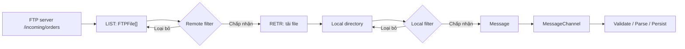
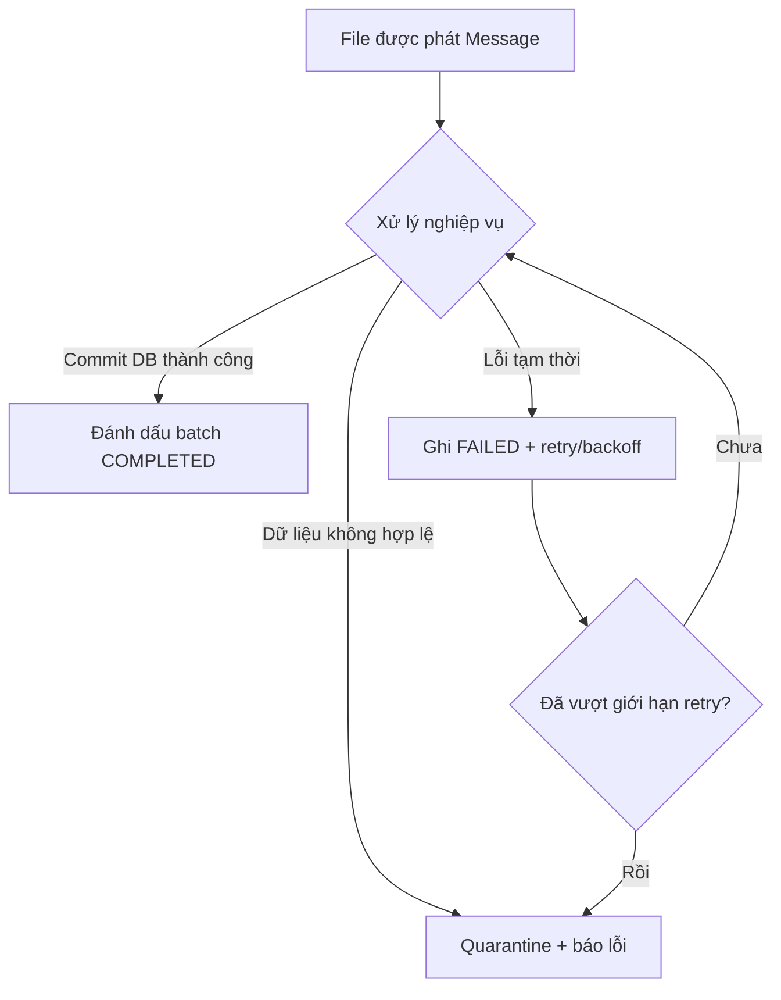

# FTP filter và cơ chế đánh dấu tệp đã lấy

## 1. Bài toán: tại sao poll nhiều lần không được nhận lại cùng một tệp?

Một đối tác gửi đơn hàng vào thư mục FTP `/incoming/orders`. Mỗi 20 giây, ứng dụng Spring Integration kiểm tra thư mục, tải các file CSV mới và chuyển chúng cho service nhập đơn hàng. Nếu mỗi lượt poll lại tải và xử lý toàn bộ file đang có, cùng một đơn hàng có thể bị tạo nhiều lần. Nhưng nếu đánh dấu file là “đã xử lý” quá sớm, lỗi mạng hoặc lỗi cơ sở dữ liệu có thể khiến file bị bỏ qua vĩnh viễn.

Vấn đề này được giải quyết **một phần** bằng cơ chế lọc danh sách tệp (`FileListFilter`) và đánh dấu đã chấp nhận (*accept once*). Bài thuộc chương **Adapter FTP** của module **SPRING_INTEGRATION_ADAPTERS**, nơi inbound/outbound adapter, gateway, poller và `MessageChannel` liên kết ứng dụng với các hệ thống ngoài như file, SFTP, HTTP, JMS, AMQP, Kafka và cơ sở dữ liệu. Trọng tâm ở đây là **FTP inbound adapter**, vì đó là endpoint thường xuyên quét và tải file. Các kết quả lọc gắn trực tiếp với vòng đời message, lỗi và khôi phục dữ liệu.

Sau bài học, bạn có thể:

1. Phân biệt **remote file filter** với **local file filter**.
2. Chọn bộ lọc theo mẫu tên, regex, độ tuổi file và trạng thái accept-once.
3. Dùng `FtpPersistentAcceptOnceFileListFilter`, `FileSystemPersistentAcceptOnceFileListFilter` và `ConcurrentMetadataStore` để kiểm soát file đã được nhận.
4. Hiểu khi nào một file có thể được tải hoặc phát lại, và khi nào dấu nhận **không** được tự động hoàn tác.
5. Thiết kế xử lý khi restart, mất điện, nhiều instance cùng poll và lỗi nghiệp vụ phía sau FTP adapter.

## 2. Hai tầng lọc trong FTP inbound adapter

FTP inbound channel adapter dạng đồng bộ file về local thực hiện hai công đoạn:



**Remote filter** kiểm tra danh sách `FTPFile` mà FTP server trả về để quyết định **file nào có thể được tải**. **Local filter** kiểm tra các đối tượng `java.io.File` trong thư mục local để quyết định **file nào có thể trở thành message** gửi sang downstream. Hai bộ lọc nằm ở những thời điểm khác nhau và lưu trạng thái độc lập.

| Câu hỏi | Remote filter | Local filter |
| --- | --- | --- |
| Chạy trên dữ liệu nào? | `FTPFile` ở server | `File` trên máy/container |
| Nằm trước thao tác nào? | Trước khi tải từ FTP (`RETR`) | Trước khi phát `Message<File>` |
| Loại file thế nào? | Theo tên, regex, tuổi file, đã từng tải | Theo tên local, file đang tải, đã từng phát |
| Bộ lọc persistent thường dùng? | `FtpPersistentAcceptOnceFileListFilter` | `FileSystemPersistentAcceptOnceFileListFilter` |
| Mục tiêu quan sát được | Tránh tải lặp không cần thiết | Tránh phát lặp một file local |
| Có chứng minh DB đã commit không? | **Không** | **Không** |

Ví dụ `order-42.csv` đã được tải xong nhưng consumer không kết nối được database. Remote filter có thể vẫn giữ dấu đã tải; local filter cũng có thể giữ dấu đã phát. Chúng **không phải hàng đợi retry nghiệp vụ**. Hệ thống phải ghi nhận thất bại và có cách xử lý lại riêng.

### 2.1. Dòng thời gian cho một file

```text
FTP /incoming/orders/order-42.csv
           |
           | poll: LIST, kiểm tra remote filter
           v
      CHẤP NHẬN REMOTE
           |
           | RETR qua FTP data connection
           v
Local order-42.csv.downloading
           |
           | tải đủ, đổi sang order-42.csv
           v
Local order-42.csv
           |
           | local filter chấp nhận
           v
Message<File> -> MessageChannel -> xử lý nghiệp vụ
                                      |
                          COMPLETED hoặc FAILED
```

Điểm quyết định là dấu “remote đã chấp nhận” xuất hiện trong quá trình **fetch**, dấu “local đã chấp nhận” xuất hiện trong quá trình **phát message**, còn trạng thái `COMPLETED` của nghiệp vụ chỉ có thể được ghi nhận **sau khi xử lý thực sự thành công**.

## 3. Các bộ lọc phổ biến

Spring Integration cung cấp giao diện chung `FileListFilter<F>`. Loại `F` quyết định bộ lọc làm việc với file remote hay local; không thể tùy tiện đưa `FileListFilter<File>` vào vị trí đòi `FileListFilter<FTPFile>`.

| Nhóm | Ví dụ trong FTP | Mục đích |
| --- | --- | --- |
| Simple pattern | `FtpSimplePatternFileListFilter("*.csv")` | Chỉ nhận tên khớp mẫu đơn giản, thường dùng hậu tố |
| Regex | `FtpRegexPatternFileListFilter` | Kiểm tra quy tắc tên phức tạp, ví dụ mã batch |
| Thời điểm sửa đổi | `FtpLastModifiedFileListFilter` | Trì hoãn nhận file quá mới theo ngưỡng tuổi, nếu phiên bản thư viện hỗ trợ |
| Chỉ lấy file gần đây | `FtpRecentFileListFilter` | Giới hạn file quá cũ, có từ các phiên bản Spring Integration mới hỗ trợ |
| Accept once trên remote | `FtpPersistentAcceptOnceFileListFilter` | Dùng metadata để không tải lại file remote chưa thay đổi |
| Accept once trên local | `FileSystemPersistentAcceptOnceFileListFilter` | Dùng metadata để không phát lại file local chưa thay đổi |
| Accept once chỉ trong RAM | `AcceptOnceFileListFilter` | Ghi nhớ đối tượng đã nhận trong tiến trình, mất trạng thái khi restart |
| Kết hợp nhiều bộ lọc | `ChainFileListFilter`, `CompositeFileListFilter` | Thực hiện nhiều quy tắc chọn file |

Lọc theo mẫu `*.csv` chỉ kiểm tra **tên file**; nó không đảm bảo nội dung CSV hợp lệ hoặc đã upload xong. Bộ lọc regex dùng biểu thức chính quy, không cùng cú pháp với simple pattern: `*.csv` là mẫu wildcard, còn regex tương đương thường là `.*[.]csv`.

### 3.1. File chưa được upload hoàn chỉnh

Một lỗi phổ biến: đối tác ghi trực tiếp vào `order-42.csv` trong 10 phút; poller nhìn thấy tên `.csv` từ phút đầu tiên và tải bản thiếu dữ liệu. Bộ lọc accept-once có thể đánh dấu file vừa tải là đã thấy trong khi upload vẫn tiếp tục.

Thỏa thuận ổn định hơn:

```text
Đối tác upload:   order-42.csv.uploading
                         |
                         | đóng file và rename trên FTP server
                         v
                  order-42.csv

Ứng dụng lọc:     chỉ chọn *.csv
                         |
                         | tải về với tên tạm local *.downloading
                         v
                  order-42.csv trên máy ứng dụng
```

Nếu không thể yêu cầu đối tác đổi tên, có thể cân nhắc bộ lọc tuổi file như `FtpLastModifiedFileListFilter` (được hỗ trợ từ Spring Integration 6.2), với ngưỡng đủ lớn so với thời gian upload, độ lệch đồng hồ và độ chính xác timestamp server. Tuy nhiên, **chỉ dựa vào tuổi file vẫn có rủi ro**, nhất là khi upload bị tạm dừng rồi tiếp tục; file marker `.done` hoặc manifest hoàn tất là hợp đồng mạnh hơn nếu phía đối tác hỗ trợ.

### 3.2. `ChainFileListFilter` và `CompositeFileListFilter`

Đây là khác biệt có ảnh hưởng trực tiếp đến trạng thái accept-once:

- **`ChainFileListFilter`** truyền danh sách file đã qua filter trước sang filter sau. Nếu filter đầu loại file chưa đủ tuổi, filter accept-once phía sau **chưa thấy và chưa đánh dấu** file đó.
- **`CompositeFileListFilter`** cho các filter thành phần xem danh sách đầu vào riêng rẽ rồi lấy giao của các kết quả. Filter accept-once có thể đánh dấu file ngay cả khi một filter khác loại file đó, tùy sự kết hợp cụ thể.

Vì vậy, với nhu cầu **“tên hợp lệ → file đã hoàn chỉnh → chưa tải”**, thường nên dùng chain đúng thứ tự:

```text
FtpSimplePatternFileListFilter("*.csv")
      -> (tuỳ chọn: filter chờ file đủ tuổi/hoàn tất)
      -> FtpPersistentAcceptOnceFileListFilter(...)
```

`CompositeFileListFilter` vẫn hữu ích nếu một filter phải nhìn thấy **toàn bộ danh sách** để xác nhận marker song hành (ví dụ `order.csv` chỉ được chấp nhận khi cùng thư mục có `order.done`). Khi đó cần hiểu kỹ tác động của từng filter có trạng thái, tránh để accept-once đánh dấu sớm.

## 4. Accept-once thực chất lưu điều gì?

`FtpPersistentAcceptOnceFileListFilter` lưu dấu vết chấp nhận bằng `ConcurrentMetadataStore`; thông tin cốt lõi liên quan tới **tên file và thời gian sửa đổi (modified time) do FTP server cung cấp**. Nếu file có tên và timestamp chưa thay đổi, filter thường từ chối tải lại. Nếu timestamp thay đổi, file có thể được nhận lại theo quy tắc filter.

`FileSystemPersistentAcceptOnceFileListFilter` ghi dấu vết tương tự cho file local, dùng tên/đường dẫn và modified time của file trên filesystem. Vì thế một file **tải mới đè lên tên cũ** có thể được local filter cho phát lại nếu modified time thay đổi. `preserveTimestamp(true)` giúp đưa modified time từ remote sang local khi máy chủ hỗ trợ, khiến hai tầng so sánh có ý nghĩa tương ứng hơn.

**Nhưng modified time không phải hash nội dung.** Nếu đối tác sửa dữ liệu mà giữ nguyên timestamp, persistent filter có thể coi file vẫn như cũ. Ngược lại, chỉ “touch” file để timestamp mới hơn có thể làm file được tải/phát lại dù byte không đổi. Nếu yêu cầu toàn vẹn nghiêm ngặt, sử dụng checksum/manifest, version hoặc ID batch tại tầng nghiệp vụ.

| Biến cố | Remote persistent filter | Local persistent filter | Ý nghĩa với nghiệp vụ |
| --- | --- | --- | --- |
| File mới chưa từng thấy | Thường chấp nhận | Chấp nhận khi bản local hoàn chỉnh xuất hiện | Bắt đầu xử lý |
| Poll tiếp với tên/timestamp không đổi | Thường bỏ qua fetch | Không phát lại nếu file local không đổi | Giảm trùng |
| File remote được cập nhật timestamp | Có thể chấp nhận và tải lại | Có thể phát lại nếu timestamp local thay đổi | Có thể là phiên bản dữ liệu mới |
| Ứng dụng restart, metadata nằm trong RAM | Quên dấu cũ | Quên dấu cũ | Có nguy cơ tải/phát lại |
| Restart, metadata store bền vững | Có thể giữ dấu nhận | Có thể giữ dấu phát | Hạn chế lặp, nhưng phải xét dữ liệu còn trên disk |
| File tải thành công, handler DB thất bại | Không tự xóa dấu do lỗi downstream | Không tự xóa dấu do lỗi downstream | Cần retry nghiệp vụ riêng |
| Lỗi I/O trong quá trình fetch | Có thể hoàn tác dấu remote khi filter hỗ trợ rollback | Có thể chưa có file hoàn chỉnh để phát | Cần retry transfer |
| Mất điện đúng lúc fetch | Có thể còn dấu chấp nhận trong metadata store | Bản local có thể bị thiếu/mất | Cần quy trình reconcile |

Tên key chính xác trong metadata store và cách xử lý đường dẫn đệ quy có thể thay đổi theo phiên bản Spring Integration. Vì thế hãy dùng prefix riêng, quản lý phiên bản khi nâng cấp và kiểm tra lại trạng thái trước/sau restart. Tránh sửa key bằng tay khi chưa biết filter đang dùng quy ước nào.

## 5. Metadata store: bộ nhớ, bền vững và dùng chung

`MetadataStore` là nơi các filter lưu trạng thái. Các persistent accept-once filter cần khả năng cập nhật đồng thời phù hợp, điển hình là `ConcurrentMetadataStore`. Một vài lựa chọn:

| Giải pháp | Sau restart? | Có thể chia sẻ giữa replica? | Lưu ý |
| --- | --- | --- | --- |
| `SimpleMetadataStore` | Không, mặc định ở RAM | Không chia sẻ giữa JVM | Thuận tiện demo và thử nghiệm |
| Persistent metadata store dựa trên JDBC | Có, khi DB còn dữ liệu | Có thể, theo cấu hình | Cần schema, transaction/atomic update và chính sách dọn |
| `RedisMetadataStore` | Phụ thuộc cấu hình persistence Redis | Có thể chia sẻ | Cần đánh giá HA/persistence, prefix, thao tác compare-and-set |
| File-backed metadata store phù hợp | Có nếu file bền vững | Không mặc định an toàn cho nhiều JVM | Phải xét đồng bộ và hỗ trợ concurrency |

Nếu bạn dùng hai replica cùng poll `/incoming/orders`, một metadata store chia sẻ có thao tác **nguyên tử** giúp tránh cả hai cùng “claim” một file remote. Tuy nhiên vẫn có cửa sổ lỗi giữa **claim → download → phát message → DB commit**. Không xem việc có Redis/JDBC metadata là bằng chứng **exactly-once end to end**.

### 5.1. Prefix tách các phạm vi xử lý

Giả sử hai đối tác đều đặt file `orders.csv`. Nếu dùng một metadata store và prefix không phân biệt, các key có thể va chạm tùy cách phiên bản filter xây dựng đường dẫn. Hãy đặt namespace rõ nghĩa:

```text
partner-a:orders:remote:
partner-a:orders:local:
partner-b:orders:remote:
partner-b:orders:local:
```

Cũng cần tách theo luồng hoặc thư mục khi cùng đối tác có nhiều inbox. Khi đổi prefix, những file cũ có thể được coi là **chưa từng thấy**. Hãy xem việc đổi prefix/đổi schema metadata là một phần của kế hoạch migrate dữ liệu.

### 5.2. Đã nhận không đồng nghĩa đã xử lý

Một metadata key của file filter chỉ phản ánh quyết định của **tầng file integration**. Nó không lưu mọi trạng thái như `VALIDATED`, `IMPORTED`, `RECONCILED`. Có thể có ba kho trạng thái riêng:

```text
FTP metadata:    order-42.csv đã được chọn tải
Local metadata:  /data/orders/order-42.csv đã phát Message<File>
Business DB:     batch 42 = PROCESSING / COMPLETED / FAILED
```

Nếu DB báo `FAILED`, ứng dụng cần đọc lại file local hoặc lấy bản remote theo cơ chế phục hồi được thiết kế trước. Không dùng việc tự xóa toàn bộ metadata store làm cơ chế retry định kỳ vì có thể khiến **mọi file** bị xử lý lại.

## 6. Ví dụ Java DSL: lọc CSV và ghi dấu remote/local

### 6.1. Dependency và cấu hình

Ví dụ với ứng dụng Spring Boot sử dụng BOM quản lý Spring Integration tương thích:

```xml
<dependencies>
    <dependency>
        <groupId>org.springframework.boot</groupId>
        <artifactId>spring-boot-starter-integration</artifactId>
    </dependency>
    <dependency>
        <groupId>org.springframework.integration</groupId>
        <artifactId>spring-integration-ftp</artifactId>
    </dependency>
</dependencies>
```

```yaml
# application.yml
partner:
  ftp:
    host: ${PARTNER_FTP_HOST}
    port: ${PARTNER_FTP_PORT:21}
    username: ${PARTNER_FTP_USER}
    password: ${PARTNER_FTP_PASSWORD}
    remote-directory: /incoming/orders
    local-directory: /data/ftp/orders
```

Credential phải được cấp qua môi trường triển khai hoặc secret manager; thư mục remote nằm **trên FTP server**, còn thư mục local nằm **trong máy/container ứng dụng**. Cần bảo đảm local directory có quyền ghi và đủ dung lượng.

### 6.2. Cấu hình FTP session factory

```java
import org.apache.commons.net.ftp.FTP;
import org.apache.commons.net.ftp.FTPClient;
import org.apache.commons.net.ftp.FTPFile;
import org.springframework.beans.factory.annotation.Value;
import org.springframework.context.annotation.Bean;
import org.springframework.context.annotation.Configuration;
import org.springframework.integration.file.remote.session.CachingSessionFactory;
import org.springframework.integration.file.remote.session.SessionFactory;
import org.springframework.integration.ftp.session.DefaultFtpSessionFactory;

@Configuration
public class OrdersFtpSessionConfiguration {

    @Bean("ordersFtpSessionFactory")
    public SessionFactory<FTPFile> ordersFtpSessionFactory(
            @Value("${partner.ftp.host}") String host,
            @Value("${partner.ftp.port}") int port,
            @Value("${partner.ftp.username}") String username,
            @Value("${partner.ftp.password}") String password) {
        DefaultFtpSessionFactory target = new DefaultFtpSessionFactory();
        target.setHost(host);
        target.setPort(port);
        target.setUsername(username);
        target.setPassword(password);
        target.setClientMode(FTPClient.PASSIVE_LOCAL_DATA_CONNECTION_MODE);
        target.setFileType(FTP.BINARY_FILE_TYPE);
        target.setConnectTimeout(10_000);
        target.setDefaultTimeout(10_000);
        target.setDataTimeout(30_000);

        CachingSessionFactory<FTPFile> cache =
                new CachingSessionFactory<>(target, 4);
        cache.setSessionWaitTimeout(3_000);
        cache.setTestSession(true);
        return cache;
    }
}
```

Factory chịu trách nhiệm kết nối và vòng đời phiên FTP. `CachingSessionFactory` giới hạn và tái sử dụng session, không lưu dấu file. Phần đánh dấu file sẽ do các `FileListFilter` và metadata store thực hiện.

### 6.3. Hai filter persistent và một inbound flow

Ví dụ cấu hình đầy đủ về kết nối giữa filter và adapter. `SimpleMetadataStore` được dùng **chỉ để chạy thử/dễ hiểu**; khi cần chống trùng qua restart hoặc chạy cluster, phải thay bằng `ConcurrentMetadataStore` bền vững/chia sẻ phù hợp.

```java
import java.io.File;
import java.time.Duration;
import org.apache.commons.net.ftp.FTPFile;
import org.springframework.beans.factory.annotation.Qualifier;
import org.springframework.beans.factory.annotation.Value;
import org.springframework.context.annotation.Bean;
import org.springframework.context.annotation.Configuration;
import org.springframework.integration.dsl.IntegrationFlow;
import org.springframework.integration.dsl.Pollers;
import org.springframework.integration.file.filters.ChainFileListFilter;
import org.springframework.integration.file.filters.FileSystemPersistentAcceptOnceFileListFilter;
import org.springframework.integration.file.remote.session.SessionFactory;
import org.springframework.integration.ftp.dsl.Ftp;
import org.springframework.integration.ftp.filters.FtpPersistentAcceptOnceFileListFilter;
import org.springframework.integration.ftp.filters.FtpSimplePatternFileListFilter;
import org.springframework.integration.metadata.ConcurrentMetadataStore;
import org.springframework.integration.metadata.SimpleMetadataStore;

@Configuration
public class OrdersFtpInboundFilteringConfiguration {

    @Bean("ordersMetadataStore")
    public ConcurrentMetadataStore ordersMetadataStore() {
        return new SimpleMetadataStore(); // Chỉ trong RAM: không bền qua restart
    }

    @Bean
    public IntegrationFlow ordersInboundFlow(
            @Qualifier("ordersFtpSessionFactory")
            SessionFactory<FTPFile> sessionFactory,
            @Qualifier("ordersMetadataStore")
            ConcurrentMetadataStore metadataStore,
            @Value("${partner.ftp.remote-directory}") String remoteDirectory,
            @Value("${partner.ftp.local-directory}") String localDirectory) {

        // 1. Chỉ xét file CSV trước khi đánh dấu đã thấy.
        ChainFileListFilter<FTPFile> remoteFilters = new ChainFileListFilter<>();
        remoteFilters.addFilter(new FtpSimplePatternFileListFilter("*.csv"));
        remoteFilters.addFilter(new FtpPersistentAcceptOnceFileListFilter(
                metadataStore, "orders-remote:"));

        // 2. Ghi dấu riêng cho bản file nằm trên disk local.
        FileSystemPersistentAcceptOnceFileListFilter localFilter =
                new FileSystemPersistentAcceptOnceFileListFilter(
                        metadataStore, "orders-local:");

        return IntegrationFlow.from(
                Ftp.inboundAdapter(sessionFactory)
                        .remoteDirectory(remoteDirectory)
                        .localDirectory(new File(localDirectory))
                        .autoCreateLocalDirectory(true)
                        .temporaryFileSuffix(".downloading")
                        .preserveTimestamp(true)
                        .maxFetchSize(3)
                        .filter(remoteFilters)
                        .localFilter(localFilter),
                endpoint -> endpoint.poller(
                        Pollers.fixedDelay(Duration.ofSeconds(20))
                                .maxMessagesPerPoll(2)))
                .channel("incomingFtpOrderFiles")
                .get();
    }
}
```

Trong cấu hình này:

1. `FtpSimplePatternFileListFilter("*.csv")` loại các file không có hậu tố CSV.
2. `FtpPersistentAcceptOnceFileListFilter` chỉ đánh dấu những file đã vượt qua pattern filter. Với file trùng tên và timestamp không đổi, nó ngăn fetch lặp theo metadata store.
3. Adapter tải các file được chấp nhận về `localDirectory`; dùng suffix `.downloading` cho file chưa hoàn tất và đổi tên khi tải xong.
4. `FileSystemPersistentAcceptOnceFileListFilter` quyết định file local nào được phát thành `Message<File>` vào `incomingFtpOrderFiles`.
5. `maxFetchSize(3)` giới hạn số file remote được lấy theo đợt fetch; `maxMessagesPerPoll(2)` giới hạn số **message** phát ra trong một lượt poll. Hai con số thuộc **hai công đoạn khác nhau**.

Khi thay `SimpleMetadataStore` bằng store bền vững, giữ nguyên cơ chế filter và chỉ thay bean metadata cùng cấu hình backend. Đảm bảo cả remote và local filter cùng sử dụng backend đã chọn nhưng **khác prefix**. Nếu chạy nhiều replica, phải kiểm tra khả năng lưu trữ bền vững, tính nguyên tử và quyền truy cập metadata của từng instance.

### 6.4. Hợp đồng với handler phía sau

Ví dụ một handler nhận `Message<File>` sau khi file đã tải về local:

```java
import java.io.File;
import java.io.IOException;
import java.nio.file.Files;
import org.springframework.integration.annotation.ServiceActivator;
import org.springframework.messaging.Message;
import org.springframework.stereotype.Component;

@Component
public class OrdersFileConsumer {

    @ServiceActivator(inputChannel = "incomingFtpOrderFiles")
    public void accept(Message<File> message) throws IOException {
        File downloaded = message.getPayload();
        long bytes = Files.size(downloaded.toPath());
        if (bytes == 0) {
            throw new IllegalStateException("File CSV rỗng: " + downloaded.getName());
        }
        // Tiếp theo: validate, parse CSV, ghi DB với khóa idempotency.
        // Ghi trạng thái COMPLETED chỉ sau khi business transaction thành công.
    }
}
```

Đây là ví dụ nhận file, **chưa có triển khai nghiệp vụ hoàn chỉnh**. Nếu handler ném exception sau khi local filter đã đánh dấu file là chấp nhận, không được mặc định rằng lần poll tiếp theo sẽ tự phát lại file ấy. Cần có tầng retry/quarantine hoặc trạng thái riêng để cho phép xử lý lại có kiểm soát.

## 7. Mặc định của Spring Integration và các giới hạn

Trong các phiên bản Spring Integration hiện đại, FTP inbound synchronizer đã có remote persistent accept-once filter với metadata store **trong RAM** theo mặc định. Bộ lọc local cũng có thể mặc định là `FileSystemPersistentAcceptOnceFileListFilter` với `SimpleMetadataStore` trong RAM. Vì vậy **“persistent” trong tên lớp không tự có nghĩa là trạng thái tồn tại qua restart**: độ bền thực tế phụ thuộc vào `MetadataStore` cung cấp cho filter.

Khi cung cấp `.filter(remoteFilters)` và `.localFilter(localFilter)` tường minh như ví dụ, ứng dụng kiểm soát rõ cả hai lớp lọc. Nếu đổi version hoặc cấu hình filter bằng `.patternFilter(...)`/`.regexFilter(...)`, cần xác nhận cách DSL kết hợp với default filter của version đang dùng; không giả định cứ gọi nhiều setter là có một chain đúng thứ tự.

**Tệp tạm local:** inbound adapter loại khỏi việc phát message những file có suffix đang tải theo cấu hình; tên tạm mặc định thường là `.writing` nếu không thay. Đoạn code chủ động dùng `.downloading`. Bộ lọc local của adapter có thêm logic không phát file mang suffix này, ngoài filter tùy chỉnh.

**Trạng thái tại thời điểm fetch:** từ các bản Spring Integration 5.2 trở đi, các persistent accept-once filter phù hợp có thể đánh dấu một file ngay trước khi fetch, giúp hạn chế số file được claim trước quá sớm. Nếu lỗi truyền xảy ra và filter hỗ trợ `ReversibleFileListFilter`, framework cố gắng rollback dấu nhận để file có thể tải ở lượt sau. Sự cố kiểu mất điện đột ngột vẫn có thể để lại dấu claim tồn tại mà bản local chưa đầy đủ.

## 8. Phân biệt giới hạn tải với giới hạn phát message

Giả sử server có sáu file mới: `a.csv`, `b.csv`, `c.csv`, `d.csv`, `e.csv`, `f.csv`. Khi thư mục local rỗng, cấu hình như sau:

| `maxFetchSize` | `maxMessagesPerPoll` | Một lượt xử lý có thể xảy ra |
| --- | --- | --- |
| Không giới hạn (mặc định âm) | 2 | Đồng bộ nhiều file remote rồi phát tối đa 2 message; phần local còn lại chờ lượt poll sau |
| 4 | 2 | Một đợt lấy tối đa 4 file remote, phát tối đa 2; các file local còn lại chờ |
| 2 | 2 | Lấy tối đa 2 file tại một đợt fetch rồi phát tối đa 2; nếu lượt poll còn cơ hội chạy thêm lần nhận, có thể tiếp tục fetch |
| 1 | 2 | Có thể lấy 1 file, phát 1, rồi lấy tiếp 1 file nếu cấu hình và trạng thái nguồn cho phép |

Số lượng thực tế chịu ảnh hưởng của local file còn tồn, thứ tự lọc, phiên bản và cách `MessageSource` cung cấp dữ liệu. Bảng mô tả **ý nghĩa cấu hình**, không cam kết chính xác số lệnh FTP trong mọi trường hợp.

Khi chạy nhiều instance, đặt `maxFetchSize` tương đối nhỏ và dùng metadata chia sẻ thích hợp giúp tránh một instance chiếm toàn bộ các file mới. Nếu chỉ cấu hình `maxMessagesPerPoll` mà quên `maxFetchSize`, một instance vẫn có thể tải về nhiều file trước khi phát từng message.

## 9. Cơ chế rollback và retry: ba loại lỗi cần phân biệt

### 9.1. Lỗi trong lúc tải file từ FTP

Ví dụ `RETR order-42.csv` bị ngắt ở 60% do mất kết nối. Nếu remote filter có hỗ trợ rollback và synchronizer nhận diện lỗi I/O, framework có thể loại file khỏi tập “đã chấp nhận” để thử fetch lại lần sau. File local tạm có thể còn trên disk; không bao giờ đưa tệp tạm đó cho parser như file hoàn chỉnh.

**Giới hạn:** rollback là khả năng ở tầng synchronizer/filter. Nếu JVM bị kill hoặc mất điện đúng thời điểm ghi metadata, không có bảo đảm bước rollback đã chạy. Khi khởi động lại, cần cơ chế kiểm tra tương quan giữa metadata, file tạm và file remote trước khi quyết định reset trạng thái cho file cụ thể.

### 9.2. Lỗi xử lý sau khi đã phát message

Ví dụ `order-42.csv` đã tải đầy đủ và phát vào `incomingFtpOrderFiles`, nhưng parser thấy một bản ghi sai và handler ném exception. Theo hợp đồng FTP inbound adapter, **không có rollback tự động của file filter cho lỗi downstream**.

Có một số lựa chọn thiết kế:

- Giữ bản file local đã tải, ghi `FAILED` trong bảng trạng thái theo batch/file ID rồi cho một retry worker xử lý lại theo quy tắc riêng.
- Đưa file sang vùng `quarantine` có nguyên nhân lỗi và người chịu trách nhiệm; sau khi sửa quy tắc nhập, phát lại file từ vùng này.
- Dùng transaction synchronization và `ResettableFileListFilter` để xây dựng cơ chế rollback file/local state khi phù hợp, sau khi phân tích chính xác phạm vi transaction và ranh giới dữ liệu.

Không tự xóa toàn bộ metadata store, không tự bật `deleteRemoteFiles(true)` để “giải quyết file trùng”. Tải file thành công không có nghĩa business transaction đã commit; xóa file remote sớm có thể làm mất nguồn khôi phục.

### 9.3. “Đã gửi vào channel” không đồng nghĩa “đã commit”

`MessageChannel` có thể là `DirectChannel` đồng bộ hoặc một channel có executor/queue. Khi downstream có xử lý bất đồng bộ, việc gửi message thành công càng không thể coi là commit nghiệp vụ. Để chống tạo đơn hàng trùng khi replay, ứng dụng nên áp dụng khóa nghiệp vụ (`partnerId + orderId`, `batchId + lineId`, v.v.) với unique constraint hoặc cơ chế idempotent phù hợp.



Ở đây `FAILED` và `COMPLETED` là trạng thái **ứng dụng tự xây dựng**, không phải trạng thái mà FTP accept-once filter tự cung cấp.

## 10. Multi-replica, restart và thay đổi file

### 10.1. Khi pod restart

Giả sử local directory `/data/ftp/orders` nằm trong filesystem tạm của container, còn metadata store nằm trên Redis:

1. Pod A tải `order-42.csv` thành công và ghi dấu remote/local.
2. Pod A chết trước khi xử lý DB.
3. Pod mới khởi động với local disk **rỗng** nhưng Redis vẫn cho biết file đã được nhận.
4. Nếu không có quy trình reconcile, file `order-42.csv` có thể không được tải lại theo quyết định của filter.

Do đó cần thống nhất **vòng đời file local** với **vòng đời metadata**. Có thể dùng persistent volume, object storage/queue bền vững sau bước nhận, hoặc một quy trình kiểm tra và phát lại các batch `FAILED/IN_PROGRESS` chưa hoàn tất. Việc xóa một key metadata chỉ nên là thao tác phục hồi có kiểm soát và quan sát được.

### 10.2. Khi có hai replica

Hai replica cùng poll FTP server có thể nhìn thấy `order-42.csv` đồng thời. Dùng cùng một `ConcurrentMetadataStore` có thao tác nguyên tử giúp điều phối claim, nhưng còn phải xử lý rủi ro khi:

- Replica A claim file, chết trước khi tải thành công.
- Replica A tải thành công, còn pod B không có bản local tương ứng.
- Hai instance có thời gian hệ thống khác nhau, hoặc một file được cập nhật trong lúc quét.
- Metadata store và filesystem/DB không cùng một transaction phân tán.

Các biện pháp thực tế: chọn một leader/poller sở hữu thư mục, dùng phân vùng thư mục theo đối tác hoặc batch, hoặc dùng shared metadata store phù hợp kết hợp **idempotency DB**. Cần thử với concurrency thật chứ không chỉ dựa vào tên lớp `PersistentAcceptOnce`.

### 10.3. Tệp remote đổi nội dung nhưng không đổi tên

`FtpPersistentAcceptOnceFileListFilter` quan sát modified timestamp của FTP server. Nếu `order-42.csv` được ghi lại với timestamp mới, filter có thể nhận lại; nếu timestamp không đổi, có thể bỏ qua dù byte khác. Tốt nhất nên yêu cầu đối tác dùng **tên file bất biến theo batch/version** và công bố file chỉ sau khi hoàn chỉnh. Dùng manifest/hash nếu phải phát hiện nội dung thay đổi mà timestamp không đáng tin.

## 11. Bảng chẩn đoán lỗi liên quan đến filter

| Triệu chứng | Nguyên nhân khả dĩ | Cách xác minh/xử lý |
| --- | --- | --- |
| File mới có trên FTP nhưng không tải | Pattern/regex không khớp, file chưa đủ tuổi, remote metadata đã claim | Kiểm tra remote listing, tên, timestamp, thứ tự filter và metadata key |
| File đang upload bị nhận sớm | Đối tác công bố tên cuối quá sớm; chỉ lọc theo `*.csv` | Thống nhất tên tạm/rename hoặc marker hoàn tất |
| File tải rồi nhưng không có message | Local filter đã đánh dấu; file vẫn có suffix tải dở; local path sai | Xem file thực tế, local metadata, suffix và log adapter |
| Sau restart file cũ được phát lại | Store chỉ ở RAM hoặc prefix thay đổi | Dùng metadata store bền vững, kiểm tra migration và policy replay |
| Sau restart file mới không còn được tải | Metadata đã claim nhưng local volume mất, hoặc crash trước rollback | Đối chiếu file, metadata và trạng thái nghiệp vụ; phục hồi key cụ thể |
| File remote được sửa nhưng không phát lại | Remote/local timestamp không phản ánh thay đổi; filter local không tái chấp nhận | Kiểm tra `preserveTimestamp`, modified time và chính sách version |
| Hai pod cùng xử lý một batch | Metadata không chia sẻ hoặc không có idempotency cuối | Kiểm tra atomic store, leader/partition, unique key DB |
| Handler DB lỗi nhưng file không retry | Local accept-once đã ghi dấu; lỗi downstream không rollback filter | Thiết kế retry/quarantine hoặc reset có kiểm soát |
| Tải nhiều file dù `maxMessagesPerPoll=1` | Cấu hình này giới hạn message, không giới hạn fetch | Thêm `maxFetchSize` phù hợp |
| Không nhận được file vì `LIST`/`RETR` lỗi | Sai quyền, timeout, passive data port, server unavailable | Phân biệt lỗi FTP session với kết quả filter rỗng |

Khi debug, log những trường tối thiểu như `partnerId`, remote path, file name, modified timestamp, filter outcome, batch ID và loại exception; không log mật khẩu hoặc toàn bộ nội dung file. Với hệ thống có nhiều replica, thêm instance/pod ID để thấy file được claim và xử lý tại đâu.

## 12. Kiểm thử hành vi filter bằng các tình huống thực tế

Nên thử với FTP server riêng cho kiểm thử tích hợp, một metadata store thử nghiệm và local directory được kiểm soát; chỉ mock `FileListFilter` sẽ không xác nhận được luồng truyền FTP, rename và retry. Các kịch bản quan trọng:

| Kịch bản | Kỳ vọng |
| --- | --- |
| Server có `a.csv`, `readme.txt` | Chỉ `a.csv` vượt qua pattern remote |
| Poll lại, `a.csv` không đổi | Không fetch lại nếu metadata filter còn trạng thái |
| Thay đổi timestamp của `a.csv` | Filter có thể chấp nhận lại; local filter cần nhận được modified time mới |
| Server có `b.csv.uploading` | Không tải; sau khi rename thành `b.csv` thì có thể nhận |
| Mất kết nối trong khi `RETR` | Không phát file local thiếu byte; metadata có cơ hội rollback nếu filter hỗ trợ |
| Handler ném exception sau khi phát `a.csv` | Không giả định poller tự phát lại file; cơ chế retry nghiệp vụ phải xử lý |
| Restart với `SimpleMetadataStore` | Trạng thái trong RAM bị mất, có nguy cơ fetch/phát lại |
| Restart với store bền vững và volume local giữ nguyên | Trạng thái filter có thể được phục hồi, tránh phát lại ngoài ý muốn |
| Restart với store bền vững nhưng local volume bị mất | Cần quy trình reconcile/khôi phục, tránh file bị bỏ sót |
| Hai replica cùng poll cùng thư mục | Không tạo đơn hàng trùng dù có tranh claim hoặc retry |
| `maxFetchSize=3`, `maxMessagesPerPoll=2` | Phân biệt số file được tải với số message đã phát |
| File `a.csv` thay nội dung nhưng giữ timestamp | Test xác nhận giới hạn phát hiện thay đổi của timestamp-based filter |

Đây là **danh sách kiểm thử đề xuất**, không phải kết quả một bộ test đã được chạy trong bài. Khi thử lỗi mạng hoặc restart, lưu lại trạng thái file local, metadata key và business DB để đối chiếu. Khi cần phục hồi trạng thái, chỉ thao tác trên môi trường test hoặc thông qua quy trình vận hành có kiểm soát.

## 13. Bài tập tình huống

**Bối cảnh:** Đối tác tải các tệp `orders-<batchId>.csv` lên `/incoming/orders`. File lớn nhất 500 MB, upload có thể kéo dài 10 phút. Ứng dụng dùng hai pod Kubernetes, mỗi pod có local directory riêng, trạng thái accept-once lưu trên Redis, poller chạy 15 giây một lần. Có lúc pod bị kill sau khi tải file nhưng trước khi commit DB.

Hãy trả lời:

1. Vì sao dùng `FtpSimplePatternFileListFilter("*.csv")` vẫn có thể nhận file thiếu dữ liệu?
2. Trình tự `pattern` → `last modified age` → `persistent accept once` nên dùng `ChainFileListFilter` hay `CompositeFileListFilter` nếu không muốn đánh dấu file chưa đủ tuổi?
3. `FtpPersistentAcceptOnceFileListFilter` và `FileSystemPersistentAcceptOnceFileListFilter` khác nhau thế nào?
4. Tại sao Redis còn metadata mà pod mới mất local file có thể dẫn đến thiếu dữ liệu?
5. Khi `RETR` đứt kết nối, remote filter có thể được rollback theo điều kiện nào?
6. Nếu DB lỗi sau khi handler đã nhận `Message<File>`, filter có tự gỡ dấu để poller phát lại không?
7. `maxFetchSize(2)` và `maxMessagesPerPoll(2)` có cùng tác dụng không?
8. Muốn ngăn đơn hàng trùng khi replay, phải đặt khóa idempotency ở đâu?

**Gợi ý trả lời:** (1) Đối tác có thể viết thẳng vào tên `.csv` trước khi hoàn tất; cần tên tạm/rename hoặc marker. (2) Dùng **chain** để filter accept-once chỉ thấy file đã qua bước kiểm tra tuổi. (3) Remote quyết định tải từ FTP, local quyết định phát message. (4) Trạng thái “đã nhận” sống qua restart nhưng bản local bị mất; cần reconcile và kho dữ liệu bền vững. (5) Synchronizer phải nhận được lỗi và filter hỗ trợ hoàn tác (`ReversibleFileListFilter`); crash đột ngột vẫn có thể để lại dấu. (6) Không, phải có retry/quarantine nghiệp vụ. (7) Không, một cái giới hạn fetch, một cái giới hạn message. (8) Trong business DB/consumer, dựa trên khóa đơn hàng hoặc batch nhất quán.

## Ghi nhớ

**FTP inbound adapter có hai quyết định độc lập:** có **tải** file từ FTP không, và có **phát** file local thành message không. Remote và local persistent accept-once filter giúp tránh công việc lặp lại theo tên/timestamp, nhưng hiệu quả qua restart phụ thuộc metadata store. Chỉ lọc tên file chưa đảm bảo file hoàn chỉnh; thứ tự kết hợp filter cũng ảnh hưởng thời điểm đánh dấu.

**Dấu accept-once không phải trạng thái business commit.** Lỗi I/O khi fetch có thể được rollback bởi filter hỗ trợ, còn lỗi downstream và crash cần cơ chế phục hồi riêng. Hệ thống bền vững phải phối hợp hợp đồng tên file/marker, metadata, local storage, retry và idempotency tại tầng nghiệp vụ.

## Tài liệu tham khảo

- [Spring Integration Reference — FTP Inbound Channel Adapter](https://docs.spring.io/spring-integration/reference/ftp/inbound.html)
- [Spring Integration Reference — Remote Persistent File List Filters](https://docs.spring.io/spring-integration/reference/file/remote-persistent-flf.html)
- [Spring Integration Reference — Controlling Remote File Fetching](https://docs.spring.io/spring-integration/reference/sftp/max-fetch.html)
- [Spring Integration API — `FtpInboundChannelAdapterSpec`](https://docs.spring.io/spring-integration/api/org/springframework/integration/ftp/dsl/FtpInboundChannelAdapterSpec.html)
- [Spring Integration API — `ChainFileListFilter`](https://docs.spring.io/spring-integration/api/org/springframework/integration/file/filters/ChainFileListFilter.html)
- [Spring Integration API — `FileSystemPersistentAcceptOnceFileListFilter`](https://docs.spring.io/spring-integration/api/org/springframework/integration/file/filters/FileSystemPersistentAcceptOnceFileListFilter.html)
