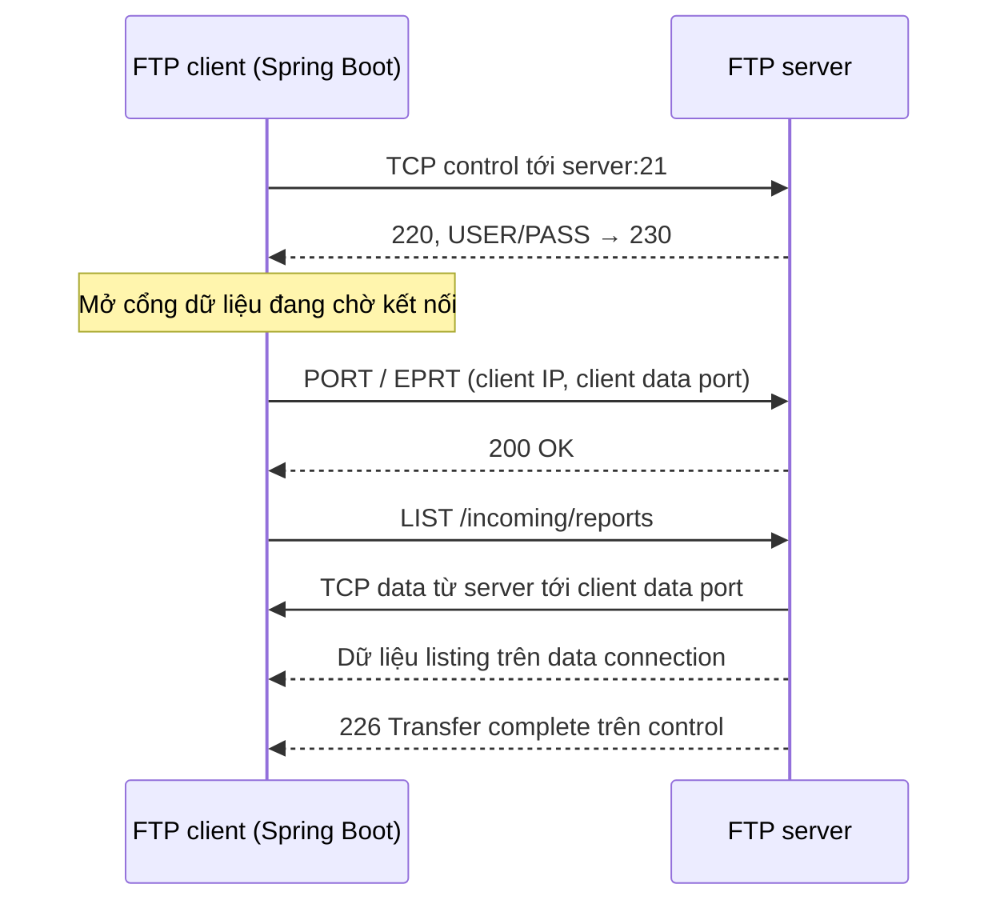
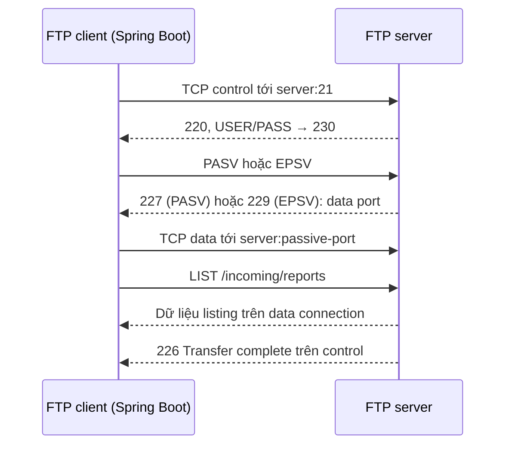
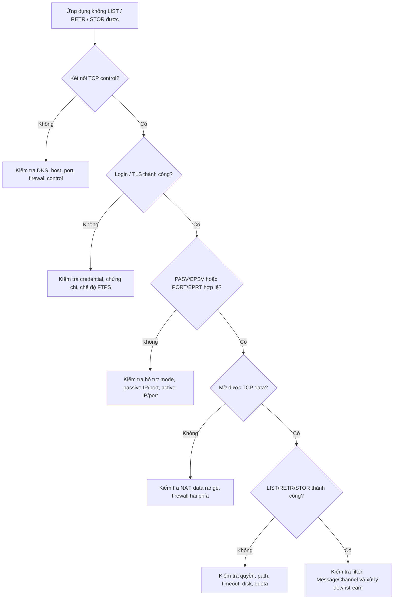

# Chế độ active, passive và yêu cầu mạng khi sử dụng FTP Adapter

## 1. Bối cảnh: đăng nhập FTP thành công nhưng không tải được file

Một ứng dụng Spring Boot dùng FTP inbound adapter để lấy báo cáo CSV ở `/incoming/reports`. Ứng dụng kết nối được đến `ftp.partner.example:21`, đăng nhập thành công, nhưng tới bước liệt kê (`LIST`) hoặc tải file (`RETR`) thì chờ rất lâu rồi báo lỗi `425 Can't open data connection`. Đội vận hành đã kiểm tra TCP tới cổng 21 và thấy thông, nên thắc mắc tại sao FTP vẫn không hoạt động.

Nguyên nhân thường nằm ở cách FTP tạo **kết nối dữ liệu (data connection)**. FTP truyền lệnh và truyền nội dung qua những kết nối khác nhau. Chế độ **active** hay **passive** quyết định **bên nào chủ động mở kết nối TCP dữ liệu**. Lựa chọn sai có thể làm FTP thất bại khi client nằm sau NAT, firewall, proxy, load balancer hoặc chạy trong container.

Đây là bài thuộc chương **Adapter FTP** của module **SPRING_INTEGRATION_ADAPTERS**. Module nghiên cứu cách kết nối hệ thống ngoài với Spring Integration bằng inbound/outbound adapter, gateway, poller và `MessageChannel`, từ file, SFTP, HTTP, JMS, AMQP, Kafka đến cơ sở dữ liệu; đồng thời xử lý hợp đồng message, lỗi và vòng đời kết nối. Bài này tập trung vào **active/passive và điều kiện hạ tầng mạng** để các endpoint FTP hoạt động ổn định.

Kết thúc bài, bạn có thể:

1. Phân biệt **control connection** và **data connection** trong FTP.
2. Vẽ được trình tự lệnh `PORT/EPRT` (active) và `PASV/EPSV` (passive).
3. Xác định chiều mở kết nối và yêu cầu firewall/NAT ở từng chế độ.
4. Cấu hình `DefaultFtpSessionFactory` và `CachingSessionFactory` theo môi trường mạng trong Spring Integration.
5. Chẩn đoán vì sao login được nhưng `LIST`, `RETR`, `STOR` lỗi; phân biệt FTP thuần, FTPS và SFTP.

## 2. Nền tảng: FTP có hai loại kết nối TCP

Không giống HTTP thông thường, FTP dùng một **kênh điều khiển** riêng và tạo **kênh dữ liệu** khi thực hiện các thao tác cần truyền danh sách/file.

| Kết nối | Nhiệm vụ | Ai chủ động mở? | Cổng thường gặp |
| --- | --- | --- | --- |
| **Control connection** | Đăng nhập `USER/PASS`, chuyển thư mục `CWD`, gửi `LIST`, `RETR`, `STOR`, `RNFR/RNTO` và nhận mã FTP reply | **Client** kết nối đến server | Server thường nghe TCP **21** với FTP và FTPS explicit |
| **Data connection** | Truyền listing, byte file download/upload | **Client** trong passive; **server** trong active | Passive: một cổng server chỉ định; active: một cổng client quảng bá |

Với FTP thuần trên cổng điều khiển 21, quá trình có thể là:

```text
Client → Server: TCP connect :21
Server → Client: 220 Service ready
Client → Server: USER my-user
Server → Client: 331 Password required
Client → Server: PASS ********
Server → Client: 230 User logged in

Client → Server: PASV hoặc EPSV (nếu passive)
              hoặc PORT/EPRT (nếu active)
Client → Server: LIST /incoming/reports
              hoặc RETR report.csv / STOR upload.csv

Client ↔ Server: data connection được mở để chuyển dữ liệu
Server → Client: 226 Closing data connection (khi hoàn tất)
```

Đây là mô tả logic. Thứ tự chính xác của một vài lệnh và mã reply phụ thuộc server, client và loại thao tác. **Login thành công chỉ xác minh đường control**. Ngay cả `PWD` hoặc `NOOP` thành công cũng chưa chứng minh có thể mở data connection.

### 2.1. Các thao tác nào cần data connection?

| Thao tác | Có cần data connection? | Ý nghĩa kiểm thử |
| --- | --- | --- |
| `USER`, `PASS`, `PWD`, `CWD`, `NOOP` | Thông thường không | Thử được control channel, xác thực hoặc điều hướng |
| `LIST`, `NLST`, `MLSD` | Có | Thử được khả năng truyền danh sách thư mục |
| `RETR` | Có | Thử được download qua FTP data channel |
| `STOR`, `APPE` | Có | Thử được upload qua FTP data channel |
| `RNFR`, `RNTO`, `DELE` | Thông thường không cần data connection riêng | Vẫn phụ thuộc quyền, đường dẫn và trạng thái server |

Chính vì vậy, phép kiểm tra sức khỏe kết nối hữu ích phải thử ít nhất một **lệnh cần truyền dữ liệu**, ví dụ `LIST`, và với tác vụ gửi file thì nên kiểm tra một lần `STOR` vào vùng test được phép.

## 3. Active mode: server kết nối ngược về client

Trong **active FTP**, client báo cho server địa chỉ IP và cổng mà client đang chờ nhận kết nối dữ liệu. Với IPv4 truyền thống, client dùng lệnh `PORT`; phiên bản mở rộng có `EPRT`. Khi client yêu cầu `LIST` hoặc `RETR`, server **chủ động mở kết nối TCP từ phía server đến địa chỉ/cổng client đã công bố**.



Ví dụ minh họa:

```text
Control:  client:ephemeral   ------> server:21
Data:     server:data-source ------> client:41025

Client thông báo địa chỉ và cổng 41025 bằng PORT/EPRT.
Server cần kết nối được tới client:41025 từ mạng phía server.
```

FTP active truyền thống thường liên quan **TCP 20** ở phía nguồn data connection của server, nhưng không được mặc định mọi server và mọi phiên đều sử dụng cổng nguồn 20. Luật firewall nên dựa trên cấu hình thực tế của server và luồng kết nối, không chỉ vào giả định “mở cổng 20 là đủ”.

### 3.1. Vì sao active thường khó qua NAT/firewall?

1. **Client cần cổng TCP inbound.** Khi ứng dụng nằm sau firewall mặc định chặn kết nối vào, server không thể kết nối tới cổng mà client vừa quảng bá.
2. **Địa chỉ được công bố có thể là IP riêng.** Client trong container có IP `10.x.x.x`; server ở Internet không thể trực tiếp truy cập IP này.
3. **NAT cần ánh xạ tới cổng dữ liệu động.** Nếu không có xử lý FTP-aware và quy tắc định tuyến/port forwarding thích hợp, packet trả về không đến đúng socket.
4. **Chính sách inbound của Kubernetes/cloud** có thể không cho server bên ngoài truy cập trực tiếp đến pod, ngay cả khi pod truy cập Internet được.

Active mode vẫn có thể phù hợp trong mạng riêng đã định tuyến hai chiều, có firewall cho phép server kết nối về client và yêu cầu giao thức cụ thể từ đối tác. Khi dùng active, đội mạng phải thống nhất **IP client mà server có thể tới**, dải cổng client dùng để lắng nghe và luật inbound tương ứng.

## 4. Passive mode: client chủ động mở cả hai kết nối

Trong **passive FTP**, client chủ động mở kết nối control đến server và cũng **chủ động mở data connection từ client đến server**. Trước khi truyền, client gửi `PASV` hoặc `EPSV`. Server trả về cổng đang lắng nghe, sau đó client kết nối đến cổng ấy.



Ví dụ minh họa nếu FTP server cấu hình dải passive **50000–50100**:

```text
Control:  client:ephemeral1 ------> server:21
Data:     client:ephemeral2 ------> server:50023

Server cấp cổng 50023 từ dải 50000–50100.
Client phải truy cập được cả :21 và :50023 trên địa chỉ server.
```

Dải `50000–50100` chỉ là **ví dụ**, không phải dải tiêu chuẩn bắt buộc của FTP. Hạ tầng phải thống nhất dải do **server thực tế cấu hình**, mở đúng luật firewall và bảo đảm các cổng được route tới đúng FTP server.

### 4.1. Lệnh `PASV`: server trả IP và cổng

Ví dụ trả lời:

```text
227 Entering Passive Mode (203,0,113,20,195,103)
```

Thông thường, sáu số biểu diễn địa chỉ IPv4 `203.0.113.20` và cổng:

```text
port = p1 * 256 + p2
     = 195 * 256 + 103
     = 50023
```

Nếu server nằm sau NAT nhưng trả về **IP nội bộ** như `10.0.1.20`, client bên ngoài có thể không kết nối được vào địa chỉ đó. Đây là lỗi cấu hình FTP passive phổ biến: control connection tới public IP chạy được nhưng `LIST` hoặc `RETR` thất bại.

Lúc này cần cấu hình FTP server thông báo địa chỉ có thể truy cập từ client, đồng thời ánh xạ dải passive port qua NAT/load balancer. Một số FTP client có cơ chế phòng vệ khi `PASV` trả địa chỉ khác với control endpoint; không nên mặc định các client/phiên bản sẽ bỏ qua IP server trả về theo cùng cách.

### 4.2. Lệnh `EPSV`: thường đơn giản hơn khi qua NAT và IPv6

`EPSV` (extended passive mode, RFC 2428) thường chỉ trả **cổng**; client kết nối tới **cùng địa chỉ máy chủ** đã dùng cho control connection:

```text
229 Entering Extended Passive Mode (|||50023|)
```

Điều này tránh phụ thuộc vào địa chỉ IP IPv4 được nhúng trong reply `PASV`, giúp sử dụng với IPv6 và thường đơn giản hơn khi server nằm sau NAT. Tuy nhiên, không phải mọi FTP server hoặc FTP proxy đều hỗ trợ và cấu hình `EPSV` giống nhau. Cần kiểm tra với server thực tế và hành vi của phiên bản Apache Commons Net dùng trong ứng dụng.

### 4.3. Passive không có nghĩa là không cần cấu hình firewall

Trong passive mode, phía client thường chỉ cần **mở kết nối TCP outbound** đến control port và passive range của FTP server; với firewall stateful, chiều traffic trả về được cho phép theo state. Phía server phải chấp nhận **TCP inbound** tới cả control port và passive data range, và đảm bảo server thực sự lắng nghe dải đã công bố.

Nếu tổ chức dùng egress firewall theo allowlist, mở cổng 21 thôi là **không đủ**. Egress client cũng phải cho phép kết nối đến các passive ports. Nếu FTP server nằm sau load balancer, NAT hoặc proxy, luồng data phải đến đúng backend đang quản lý phiên FTP tương ứng.

## 5. So sánh active và passive theo chiều kết nối

| Tiêu chí | Active mode | Passive mode |
| --- | --- | --- |
| Control connection | Client → server | Client → server |
| Data connection | **Server → client** | **Client → server** |
| Ai lắng nghe cho data? | Client | Server |
| Lệnh đàm phán | `PORT` (IPv4), `EPRT` | `PASV`, `EPSV` |
| Client sau NAT/firewall | Cần xử lý inbound/port mapping, thường khó hơn | Thường dễ vận hành hơn |
| Server sau NAT | Cần định tuyến server → client | Cần passive IP và dải cổng được công bố đúng |
| Luật thường cần ở phía client | Inbound từ server tới cổng data của client; outbound tới control server | Outbound đến control port **và** passive range của server |
| Luật thường cần ở phía server | Outbound đến client data port, inbound control | Inbound control **và** dải passive data port |
| Trường hợp phù hợp | Mạng riêng có định tuyến hai chiều, yêu cầu đặc thù | Phần lớn ứng dụng server-side/cloud sau NAT |

**Khuyến nghị thực hành:** với Spring Integration chạy trong Docker/Kubernetes hoặc mạng cloud doanh nghiệp, thường ưu tiên **local passive mode**. Nếu đối tác yêu cầu active, cần có thiết kế mạng cụ thể từ đội hạ tầng, không chỉ đổi một hằng số trong Java.

## 6. Yêu cầu mạng cho từng môi trường

### 6.1. Khi ứng dụng Spring Boot là FTP client

Đây là trường hợp của **FTP inbound adapter, outbound adapter và outbound gateway**. Mặc dù inbound nhận file còn outbound gửi file, **ứng dụng vẫn là FTP client trong cả hai trường hợp**.

| Thao tác Spring Integration | Lệnh FTP cần data | Chế độ data phụ thuộc vào chiều upload/download? |
| --- | --- | --- |
| FTP inbound adapter tải file | `LIST`, `RETR` | **Không**; active/passive phụ thuộc bên mở TCP data |
| FTP outbound adapter gửi file | `STOR` | **Không**; vẫn dùng chế độ của FTP client |
| FTP outbound gateway liệt kê | `LIST`/`NLST` | **Không**; request–reply không thay đổi kết nối |
| FTP outbound gateway `get`/`put` | `RETR`/`STOR` | **Không** |

Một nhầm lẫn thường gặp là “download phải dùng passive, upload phải dùng active”. Điều này **sai**: active/passive nói về **đầu khởi tạo TCP data**, không phải chiều byte của nội dung file. Cả `RETR` lẫn `STOR` đều có thể chạy ở cả hai chế độ khi server và mạng cho phép.

### 6.2. Ứng dụng trong Docker hoặc Kubernetes

Pod có thể chỉ có địa chỉ IP nội bộ, đường egress ra Internet đi qua NAT gateway hoặc proxy. Với active mode, server cần kết nối tới cổng đang lắng nghe trong pod; việc này thường không có đường inbound mặc định. Với passive mode, pod chủ động kết nối ra server và phù hợp hơn với egress NAT.

Nhưng vẫn cần xem xét:

1. **NetworkPolicy/egress firewall** của namespace cho phép TCP đến host/cổng control và passive data range.
2. **NAT gateway và security group** cho phép traffic trả lời qua stateful connection và không giới hạn session quá mức.
3. **DNS/địa chỉ server** phải nhất quán giữa control và data; các thiết bị kiểm soát egress cần biết cả dải cổng passive.
4. **Load balancer phía FTP server** phải route control/data nhất quán. Một HTTP Ingress Controller thông thường không tự động xử lý được FTP control/data.
5. **Dải passive** phải đủ cho số lượt truyền file đồng thời, và các port thực sự được server lắng nghe/mở trên thiết bị bảo vệ.

Ví dụ một thỏa thuận firewall cho **passive FTP** (giả định server dùng cổng 21, dải 50000–50100):

```text
Từ application subnet/pod egress:
    TCP outbound -> ftp.partner.example:21          (control)
    TCP outbound -> ftp.partner.example:50000-50100 (passive data)

Từ phía FTP server:
    TCP inbound  -> server:21
    TCP inbound  -> server:50000-50100

Chiều phản hồi: cho phép theo state của kết nối đã thiết lập.
```

Nếu server dùng FTPS explicit, control port thường vẫn là 21 và vẫn cần dải passive. Với FTPS implicit, control port thường là 990; phải xác nhận bằng tài liệu vận hành của đối tác. **Không giả định mọi FTPS server đều dùng cùng dải data ports**.

### 6.3. Ứng dụng và FTP server trong cùng mạng nội bộ

Active mode có thể vận hành nếu server route được về địa chỉ client và firewall cho phép kết nối ngược. Tuy nhiên, nếu client là một VM hoặc pod có địa chỉ thay đổi, phạm vi cổng active trở nên khó quản trị. Passive vẫn thường dễ theo dõi và tách luật firewall giữa ứng dụng và FTP server.

Đối với môi trường có NAT hai phía, hãy ghi rõ **IP được quảng bá**, **port range**, cách NAT ánh xạ và bên khởi tạo. Hai phía cần kiểm thử thực tế; sơ đồ kiến trúc chỉ nói “mở FTP cổng 21” chưa đủ để triển khai.

## 7. Cấu hình Spring Integration: passive và active

### 7.1. Dependency và cấu hình external

Ví dụ Maven với Spring Boot BOM hoặc Spring Integration BOM quản lý phiên bản tương thích:

```xml
<dependencies>
    <dependency>
        <groupId>org.springframework.boot</groupId>
        <artifactId>spring-boot-starter-integration</artifactId>
    </dependency>
    <dependency>
        <groupId>org.springframework.integration</groupId>
        <artifactId>spring-integration-ftp</artifactId>
    </dependency>
</dependencies>
```

```yaml
# application.yml
partner:
  ftp:
    host: ${PARTNER_FTP_HOST}
    port: ${PARTNER_FTP_PORT:21}
    username: ${PARTNER_FTP_USER}
    password: ${PARTNER_FTP_PASSWORD}
    remote-inbox: /incoming/reports
    local-inbox: /data/ftp/reports
```

`PARTNER_FTP_*` được cấp từ môi trường triển khai/secret manager. Không ghi credential trong Git hoặc log. Đường dẫn `remote-inbox` nằm trên **FTP server**, còn `local-inbox` nằm trên **máy/container chạy Spring Boot**.

### 7.2. Cấu hình passive mode thường dùng

```java
import org.apache.commons.net.ftp.FTP;
import org.apache.commons.net.ftp.FTPClient;
import org.apache.commons.net.ftp.FTPFile;
import org.springframework.beans.factory.annotation.Value;
import org.springframework.context.annotation.Bean;
import org.springframework.context.annotation.Configuration;
import org.springframework.integration.file.remote.session.CachingSessionFactory;
import org.springframework.integration.file.remote.session.SessionFactory;
import org.springframework.integration.ftp.session.DefaultFtpSessionFactory;

@Configuration
public class PartnerFtpConfiguration {

    @Bean("partnerFtpSessionFactory")
    public SessionFactory<FTPFile> partnerFtpSessionFactory(
            @Value("${partner.ftp.host}") String host,
            @Value("${partner.ftp.port}") int port,
            @Value("${partner.ftp.username}") String username,
            @Value("${partner.ftp.password}") String password) {

        DefaultFtpSessionFactory target = new DefaultFtpSessionFactory();
        target.setHost(host);
        target.setPort(port);
        target.setUsername(username);
        target.setPassword(password);

        // Client chủ động mở data connection đến cổng passive trên FTP server.
        target.setClientMode(FTPClient.PASSIVE_LOCAL_DATA_CONNECTION_MODE);
        target.setFileType(FTP.BINARY_FILE_TYPE);

        // Timeout kết nối control, control socket và data socket (ms).
        target.setConnectTimeout(10_000);
        target.setDefaultTimeout(10_000);
        target.setDataTimeout(30_000);

        // Tối đa bốn session được quản lý/cho mượn đồng thời.
        CachingSessionFactory<FTPFile> cache =
                new CachingSessionFactory<>(target, 4);
        cache.setSessionWaitTimeout(5_000);
        cache.setTestSession(true);
        return cache;
    }
}
```

Hằng số `FTPClient.PASSIVE_LOCAL_DATA_CONNECTION_MODE` nghĩa là **client cục bộ ở passive mode**, không liên quan tới việc adapter đang nhận (*inbound*) hay gửi (*outbound*) message.

Chọn `FTP.BINARY_FILE_TYPE` để truyền byte nguyên vẹn, kể cả CSV, PDF, ZIP hoặc ảnh. Với ASCII mode, client/server có thể chuyển đổi kết thúc dòng theo giao thức, không phù hợp nếu ứng dụng cần bảo toàn byte.

`CachingSessionFactory` giảm chi phí tạo lại session nhưng **không sửa được firewall**. `setTestSession(true)` kiểm tra session cache trước khi tái sử dụng; vẫn có thể mất mạng ngay trong lúc `LIST`, `RETR` hoặc `STOR`.

### 7.3. Khi buộc phải dùng active mode

Nếu đối tác chỉ hỗ trợ active và đội mạng đã cấu hình đường inbound về client, thay lựa chọn mode trong factory:

```java
// Thay đúng dòng cấu hình client mode ở factory phía trên:
target.setClientMode(FTPClient.ACTIVE_LOCAL_DATA_CONNECTION_MODE);
```

**Chỉ thay hằng số này là chưa đủ**. Đội hạ tầng cần giải quyết địa chỉ client mà FTP server có thể truy cập, cổng data client dùng để lắng nghe và quy tắc inbound. Trong các phiên bản Apache Commons Net, việc kiểm soát IP/port được công bố cho active mode có API riêng; cần thiết kế và kiểm tra theo phiên bản `FTPClient`, cấu hình adapter và cơ chế NAT đang sử dụng.

Không nhầm `ACTIVE_LOCAL_DATA_CONNECTION_MODE` với những mode dành cho thao tác FTP server-to-server; ứng dụng Spring Boot ở đây đóng vai trò **local FTP client**.

### 7.4. Một session factory dùng cho các endpoint FTP

```java
import java.io.File;
import java.time.Duration;
import org.apache.commons.net.ftp.FTPFile;
import org.springframework.beans.factory.annotation.Qualifier;
import org.springframework.beans.factory.annotation.Value;
import org.springframework.context.annotation.Bean;
import org.springframework.context.annotation.Configuration;
import org.springframework.integration.dsl.IntegrationFlow;
import org.springframework.integration.dsl.Pollers;
import org.springframework.integration.file.remote.session.SessionFactory;
import org.springframework.integration.ftp.dsl.Ftp;
import org.springframework.integration.ftp.filters.FtpSimplePatternFileListFilter;

@Configuration
public class PartnerFtpInboundFlow {

    @Bean
    public IntegrationFlow ftpReportsInbound(
            @Qualifier("partnerFtpSessionFactory")
            SessionFactory<FTPFile> sessionFactory,
            @Value("${partner.ftp.remote-inbox}") String remoteInbox,
            @Value("${partner.ftp.local-inbox}") String localInbox) {

        return IntegrationFlow.from(
                Ftp.inboundAdapter(sessionFactory)
                        .remoteDirectory(remoteInbox)
                        .localDirectory(new File(localInbox))
                        .autoCreateLocalDirectory(true)
                        .temporaryFileSuffix(".downloading")
                        .filter(new FtpSimplePatternFileListFilter("*.csv")),
                endpoint -> endpoint.poller(
                        Pollers.fixedDelay(Duration.ofSeconds(20))
                                .maxMessagesPerPoll(5)))
                .channel("ftpReportFiles")
                .get();
    }
}
```

Poller định kỳ gọi inbound adapter; adapter dùng session factory để gửi lệnh `LIST`/`RETR`, tải file về local rồi phát `Message<File>` vào `ftpReportFiles`. Chọn active hay passive **không làm thay đổi hợp đồng payload**. Với outbound adapter hoặc outbound gateway, cấu hình factory tương tự, chỉ khác lệnh truyền (`STOR`, `LIST`, `RETR`, v.v.).

Lưu ý: bộ lọc tên `*.csv` trong ví dụ chỉ là bước chọn file ban đầu, **không bảo đảm chống tải trùng hoặc khôi phục bền vững**. Với production, cần remote/local persistent accept-once filter, metadata store và idempotency nghiệp vụ phù hợp; đây là vấn đề độc lập với active/passive.

## 8. FTPS: TLS không loại bỏ yêu cầu về data connection

**FTPS** là FTP được bảo vệ bằng TLS. FTPS có hai cách bắt đầu phổ biến:

| Hình thức | Control port thường gặp | Điểm cần biết |
| --- | --- | --- |
| **Explicit FTPS** | TCP 21 | Bắt đầu giống FTP, sau đó dùng `AUTH TLS` để chuyển control channel sang TLS |
| **Implicit FTPS** | TCP 990 | Bắt đầu TLS ngay khi thiết lập control connection |

FTPS vẫn có **control channel** và **data channel**; passive range hoặc active inbound ports vẫn phải được cấp quyền. Khi dùng `PROT P`, data channel cũng được mã hóa bằng TLS. Một ví dụ rút gọn về factory FTPS explicit:

```java
import org.apache.commons.net.ftp.FTP;
import org.apache.commons.net.ftp.FTPClient;
import org.springframework.integration.ftp.session.DefaultFtpsSessionFactory;

DefaultFtpsSessionFactory ftps = new DefaultFtpsSessionFactory();
ftps.setHost("ftps.partner.example");
ftps.setPort(21);
ftps.setUsername(System.getenv("FTPS_USER"));
ftps.setPassword(System.getenv("FTPS_PASSWORD"));
ftps.setImplicit(false);
ftps.setProtocol("TLS");
ftps.setProt("P"); // Yêu cầu bảo vệ kênh dữ liệu.
ftps.setEndpointCheckingEnabled(true);
ftps.setClientMode(FTPClient.PASSIVE_LOCAL_DATA_CONNECTION_MODE);
ftps.setFileType(FTP.BINARY_FILE_TYPE);
```

Đây là phần cấu hình minh họa; triển khai thật phải kiểm tra CA/truststore, hostname trong chứng chỉ, policy TLS và cấu hình server. **Không tắt xác thực chứng chỉ để xử lý lỗi mạng hoặc handshake**.

### 8.1. Vì sao FTPS thường làm FTP ALG mất tác dụng?

Một số firewall/NAT truyền thống dùng **FTP application layer gateway (ALG)** để đọc lệnh `PORT` hoặc phản hồi `PASV` trên control channel rồi tự mở cổng động hoặc chỉnh địa chỉ IP. Với FTPS, control channel được mã hóa, nên thiết bị trung gian **không thể dễ dàng phân tích những lệnh bên trong TLS**.

Kết quả là hệ thống “FTP thường chạy được nhờ ALG” có thể thất bại khi chuyển sang FTPS, dù TCP 21 vẫn mở. Phương án đáng tin cậy hơn là cấu hình rõ:

- Dải passive port cố định trên FTPS server, ánh xạ và firewall tương ứng.
- IP/data endpoint có thể truy cập từ client, cơ chế `EPSV` khi khả dụng.
- Chính sách TLS và chứng chỉ hợp lệ, tránh phụ thuộc vào việc đọc control traffic đã mã hóa.

Không suy rằng lỗi `425` luôn là TLS hoặc luôn là firewall; cần kiểm tra chính xác **bước nào** của phiên thất bại.

### 8.2. SFTP là giao thức khác

**SFTP** truyền file qua SSH (cổng thường gặp TCP 22) và **không dùng** cặp control/data connection kiểu FTP. Trong Spring Integration, SFTP sử dụng dependency `spring-integration-sftp` và `DefaultSftpSessionFactory`, đồng thời kiểm tra host key SSH. **Không dùng `DefaultFtpSessionFactory` với port 22** để nói chuyện SFTP.

| Giao thức | Kết nối truyền file | Liên quan active/passive FTP? |
| --- | --- | --- |
| FTP | FTP control + data TCP | **Có** |
| FTPS | FTP control + data được bảo vệ TLS theo cấu hình | **Có** |
| SFTP | SSH connection với các request SFTP bên trong | **Không** |

## 9. Chẩn đoán theo từng bước thay vì chỉ thử TCP port 21

### 9.1. Quy trình kiểm tra



Đi từ control → xác thực/TLS → đàm phán mode → mở data socket → quyền/file giúp tránh kết luận sai. Nếu kết nối đến cổng 21 thành công nhưng `LIST` lỗi, hãy tập trung vào mode và data channel trước khi thay đổi logic nghiệp vụ.

### 9.2. Bảng triệu chứng và nguyên nhân thường gặp

| Triệu chứng | Điểm cần kiểm tra | Cách khoanh vùng |
| --- | --- | --- |
| `Connection refused` khi connect | Server/cổng control không nghe, firewall chặn, host sai | Kiểm tra host, DNS, TCP control port từ đúng runtime |
| `connect timed out` | Đường mạng, firewall, route, server không phản hồi | Phân biệt DNS lỗi với TCP handshake |
| FTP `530 Login incorrect` | Account hoặc password; server yêu cầu FTPS | Xác nhận giao thức, secret và log server |
| Login thành công, `LIST` treo | Data port bị chặn, active client không nhận được inbound, passive server trả IP sai | Xem command `PASV/EPSV` hoặc `PORT/EPRT`, thử một lệnh `LIST` thật |
| FTP `425 Can't open data connection` | Không tạo được data socket | Đối chiếu chiều kết nối, dải cổng, NAT và firewall |
| FTP `426 Connection closed; transfer aborted` | Kênh dữ liệu đã mở nhưng truyền bị ngắt | Kiểm tra timeout, reset TCP, kích thước file và server log |
| FTP `550 File unavailable` | Remote path sai, không có quyền hoặc file không tồn tại | Kiểm tra `PWD`, `CWD`, quyền và tên file |
| Passive trả IP riêng không tới được | NAT quảng bá sai địa chỉ ở `PASV` | Kiểm tra public/passive advertised address, thử `EPSV` nếu phù hợp |
| FTP chạy, FTPS lại lỗi `425` | ALG không đọc được control TLS; passive range chưa mở | Kiểm tra FTPS TLS, `PROT P`, passive IP/ports và firewall |
| Lúc được lúc không, nhiều file đồng thời | Thiếu passive ports, quá nhiều session hoặc NAT state cạn | Đo concurrency, pool/session usage, port range, firewall logs |
| `LIST` ổn, `RETR`/ `STOR` lỗi | Quyền file, file đang thay đổi, quota, data transfer timeout | Kiểm tra các file/đường dẫn cụ thể và transfer log |
| File đã tải nhưng không có message | Remote/local filter hoặc downstream, không phải data connection | Xem metadata accept-once, local directory, message handling |

### 9.3. Kiểm tra control TCP khác kiểm tra FTP thật

Ví dụ PowerShell trên máy Windows:

```powershell
Test-NetConnection -ComputerName ftp.partner.example -Port 21
```

Kết quả `TcpTestSucceeded: True` chỉ cho biết **đường TCP đến cổng 21**. Nó không đăng nhập FTP, không gửi `PASV/EPSV` và không mở data connection. Vẫn phải kiểm tra bằng một FTP client hoặc chương trình chạy thực sự từ môi trường của ứng dụng.

Một phép kiểm tra qua chính session factory của Spring Integration:

```java
import org.apache.commons.net.ftp.FTPFile;
import org.springframework.beans.factory.annotation.Qualifier;
import org.springframework.integration.file.remote.session.SessionFactory;
import org.springframework.integration.ftp.session.FtpRemoteFileTemplate;
import org.springframework.stereotype.Service;

@Service
public class FtpNetworkProbe {

    private final FtpRemoteFileTemplate ftp;

    public FtpNetworkProbe(
            @Qualifier("partnerFtpSessionFactory")
            SessionFactory<FTPFile> sessionFactory) {
        this.ftp = new FtpRemoteFileTemplate(sessionFactory);
    }

    // Gọi khi chẩn đoán, không cần chạy lặp vô hạn tại startup.
    public int countRemoteEntries() {
        Integer count = ftp.execute(session -> {
            FTPFile[] entries = session.list("/incoming/reports");
            return entries.length;
        });
        if (count == null) {
            throw new IllegalStateException("Không nhận được kết quả LIST");
        }
        return count;
    }
}
```

Đoạn trên thực sự đòi hỏi phiên FTP truyền dữ liệu danh sách file, nên kiểm tra được **cả control lẫn data channel ở mức lệnh `LIST`**. Nó không chứng minh ứng dụng có quyền `RETR` hoặc `STOR` ở mọi thư mục. Để kiểm thử upload, dùng file nhỏ và thư mục test do đối tác cấp quyền; không upload file thử vào vùng nghiệp vụ thật.

Trong FTPS, phép thử này cũng đòi hỏi TLS và quy tắc data channel hoạt động thực tế. Nếu có lỗi, ghi nhận mã FTP reply, địa chỉ/port đã được client sử dụng, mode hiện tại và log ở **cả hai phía**.

## 10. Quan sát, timeout và hiệu năng

### 10.1. Timeout khác nhau giải quyết vấn đề khác nhau

| Tham số | Ý nghĩa | Lỗi gợi ý |
| --- | --- | --- |
| `connectTimeout` | Thời gian chờ thiết lập TCP đến control endpoint | DNS/route, firewall, server không trả lời |
| `defaultTimeout` | Timeout socket control | Server chậm phản hồi lệnh hoặc vấn đề control |
| `dataTimeout` | Timeout socket dữ liệu khi `LIST/RETR/STOR` | Kết nối dữ liệu chậm/đứt hoặc server không gửi byte đúng hạn |
| `sessionWaitTimeout` | Thời gian chờ mượn session từ `CachingSessionFactory` | Hết pool vì nhiều request đồng thời, stream chưa đóng |
| Poller interval | Khoảng thời gian kiểm tra file theo lịch | Không giới hạn thời gian một data transfer |

Nâng timeout có thể hữu ích nếu mạng trễ hợp lệ hoặc file lớn, nhưng **không thay thế việc mở đúng dải cổng dữ liệu**. Nếu data connection bị firewall chặn hoàn toàn, tăng timeout chỉ khiến lần thử thất bại muộn hơn.

### 10.2. Một session có thể tạo nhiều data connection theo thao tác

Session FTP có thể giữ **control connection** qua nhiều lệnh, trong khi mỗi lần `LIST`, `RETR` hoặc `STOR` có thể mở/đóng **data connection** riêng. Do đó một pool có bốn session đang hoạt động không đồng nghĩa chỉ có bốn socket data cố định suốt đời ứng dụng.

Khi tính passive range, cần xét số lệnh truyền đồng thời thực tế, giới hạn server, tình trạng cổng đang trong `TIME_WAIT` và tài nguyên của NAT/firewall. Một dải quá hẹp có thể gây lỗi ngẫu nhiên khi tải nhiều tệp song song. Không nên tự suy cổng cần mở chỉ từ `maxMessagesPerPoll`: đó là giới hạn **message** của poller, không trực tiếp xác định số data connections.

### 10.3. Số liệu cần theo dõi

Các chỉ số hữu ích cho hệ thống production:

- Tỷ lệ connect/login thành công; số lỗi FTP reply `425`, `426`, `530`, `550`.
- Số lần `LIST` và `RETR/STOR` thành công, thời gian truyền, byte đã chuyển.
- Active/passive mode đang dùng, passive port range được cấu hình ở server, số data sockets đang hoạt động.
- Thời gian chờ session cache và số session bị server đóng khi nhàn rỗi.
- Số file đang chờ xử lý ở local, số file `.downloading`/`.uploading` còn tồn đọng.

Không đưa credential, toàn bộ dữ liệu CSV hay chuỗi điều khiển chứa password vào log. Khi bật debug FTP, cần lọc thông tin nhạy cảm và giới hạn thời gian thu thập.

## 11. Thực hành: so sánh passive và active trong cùng môi trường

Chuẩn bị một FTP server **thử nghiệm** cho phép quan sát log và một thư mục `/test-data` chứa file nhỏ `hello.csv`. Trên client chạy Spring Boot, chuẩn bị cùng host/user/password cho hai cấu hình; chỉ thay mode. Với hạ tầng có NAT, đội mạng có thể hỗ trợ kiểm tra luồng TCP.

| Bước | Passive mode | Active mode |
| --- | --- | --- |
| 1. Kết nối control/login | Client mở TCP tới server:21 | Client mở TCP tới server:21 |
| 2. Chuẩn bị data | Client gửi `PASV/EPSV`; server trả cổng | Client gửi `PORT/EPRT`; client lắng nghe cổng |
| 3. Gọi `LIST /test-data` | Client mở TCP đến server passive port | Server mở TCP đến client advertised port |
| 4. Gọi `RETR hello.csv` | Dùng cơ chế passive để tải file | Dùng cơ chế active để tải file |
| 5. Quan sát lỗi | Server passive IP/range, client egress | Client inbound, NAT mapping, server egress |
| 6. Đánh giá thực tế | Phù hợp với cloud NAT nếu mở đủ egress/data range | Cần cấu hình inbound về client, thường khó hơn |

Kịch bản bổ sung:

1. **Mở control port nhưng chặn passive range:** login thành công, `LIST` thường thất bại. Đối chiếu với code FTP probe.
2. **Server quảng bá IP private trong `PASV`:** xem client có cố kết nối IP không truy cập được hay không; nếu có, sửa cấu hình server hoặc kiểm thử `EPSV`.
3. **Client sau NAT với active mode:** quan sát server cố kết nối tới địa chỉ client công bố; nếu không route được, lệnh data thất bại.
4. **Chuyển FTP sang FTPS explicit:** xác minh chứng chỉ và `PROT P`; kiểm tra passive ports vẫn được mở khi ALG không đọc được control TLS.
5. **Thay dải passive rồi cập nhật firewall không đồng bộ:** xác nhận khi server chọn một cổng ngoài luật firewall, lỗi có thể xảy ra không liên tục.
6. **Tải nhiều file đồng thời:** quan sát giới hạn session, số data sockets và tải của NAT/firewall.

Các mục này là **bài thực hành đề xuất**, không phải kết quả test đã chạy. Chỉ thay luật firewall hay bật FTPS trong môi trường kiểm thử được cấp phép; không tự ngắt kết nối hoặc thay đổi security rule của FTP server production.

## 12. Bài tập tình huống

**Đề bài:** Ứng dụng `SPRING_INTEGRATION_ADAPTERS` chạy trong Kubernetes, dùng FTP inbound adapter poll mỗi 30 giây và FTP outbound adapter gửi ACK. FTP server của đối tác ở sau NAT, control port 21, dải passive 51000–51100. Hiện tại:

- Pod kết nối TCP cổng 21 và login thành công.
- `LIST /incoming/orders` lỗi `425`.
- Egress firewall của pod chỉ cho TCP 21 ra Internet.
- FTP server đôi khi trả `PASV` với IP `10.10.0.5`, trong khi public IP là `203.0.113.50`.
- Một thành viên đề nghị chuyển sang active mode vì “adapter đang inbound”.

**Câu hỏi:**

1. Tại sao mở TCP 21 vẫn không đủ để `LIST` hoạt động?
2. Trong passive mode, cần bổ sung quy tắc nào vào egress firewall và phía FTP server?
3. IP `10.10.0.5` trong reply `PASV` có thể gây ra điều gì? `EPSV` giúp trong tình huống nào?
4. Chuyển sang active vì adapter là inbound có đúng về mặt giao thức không?
5. Nếu chuyển sang FTPS explicit, có thể bỏ dải passive ports không?
6. Khi `LIST` đã chạy, làm sao xác minh tiếp quyền tải file và gửi ACK?
7. Đặt `dataTimeout` rất lớn có giải quyết được việc firewall chặn hoàn toàn dải 51000–51100 không?

**Đáp án gợi ý:** (1) `LIST` dùng data connection riêng; control login chỉ kiểm tra cổng 21. (2) Cho client mở TCP outbound tới 51000–51100, cho server nhận TCP inbound cùng dải và route/NAT đúng. (3) Client ngoài NAT có thể không truy cập được private IP; `EPSV` chỉ trả cổng và dùng cùng địa chỉ control nên có thể giảm lỗi IP nhúng khi cả hai phía hỗ trợ. (4) Không; inbound/outbound chỉ chiều message của Spring Integration, còn active/passive là bên mở TCP data. (5) Không, FTPS vẫn có data connection. (6) Test `RETR` ở thư mục đọc và `STOR` trong thư mục test có quyền ghi, kiểm tra byte cuối cùng. (7) Không, chỉ khiến việc chờ lỗi lâu hơn.

## Ghi nhớ

**Active FTP:** client mở control connection nhưng **server mở data connection về client** qua địa chỉ/cổng client công bố (`PORT/EPRT`). **Passive FTP:** client mở cả control và data connection, còn server công bố passive data port (`PASV/EPSV`). Với ứng dụng Spring Integration phía sau NAT/firewall, passive thường dễ vận hành hơn.

Chọn active/passive hoàn toàn **độc lập** với inbound/outbound adapter, gateway hay poller. Kết nối được tới control port **không** có nghĩa `LIST`, `RETR`, `STOR` sẽ hoạt động. Kiểm tra cần đi tới data connection thật, xét địa chỉ server công bố, hướng firewall, dải port, quyền file, TLS nếu là FTPS và vòng đời session.

## Tài liệu tham khảo

- [Spring Integration — FTP Session Factory](https://docs.spring.io/spring-integration/reference/ftp/session-factory.html)
- [Spring Integration — FTP Inbound Channel Adapter](https://docs.spring.io/spring-integration/reference/ftp/inbound.html)
- [Spring Integration — FTP Outbound Channel Adapter](https://docs.spring.io/spring-integration/reference/ftp/outbound.html)
- [Spring Integration — FTP Session Caching](https://docs.spring.io/spring-integration/reference/ftp/session-caching.html)
- [RFC 959 — File Transfer Protocol (FTP)](https://www.rfc-editor.org/rfc/rfc959)
- [RFC 2428 — FTP Extensions for IPv6 and NATs (EPRT/EPSV)](https://www.rfc-editor.org/rfc/rfc2428)
- [RFC 4217 — Securing FTP with TLS](https://www.rfc-editor.org/rfc/rfc4217)
