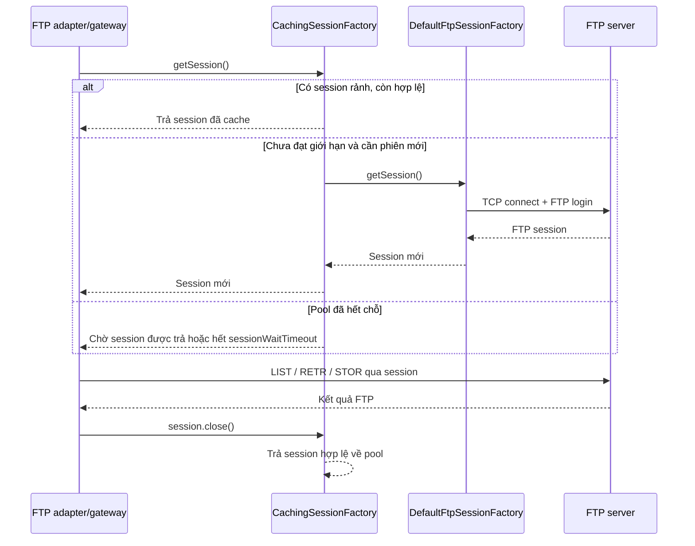
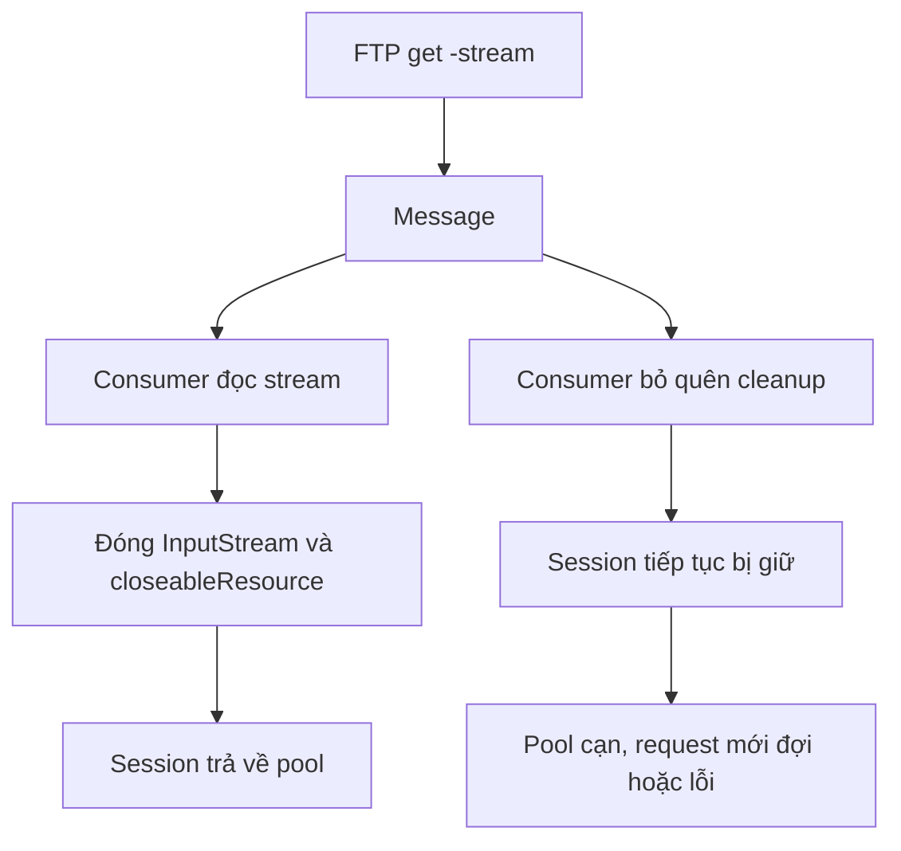

# Cache session và quản lý vòng đời kết nối trong Spring Integration FTP

## 1. Bối cảnh và mục tiêu

Một ứng dụng Spring Boot cứ 15 giây kiểm tra FTP server để lấy báo cáo CSV. Cùng lúc, một luồng khác gửi file xác nhận đã nhận dữ liệu qua FTP outbound adapter; một API nội bộ còn dùng FTP outbound gateway để truy vấn tên file theo yêu cầu. Nếu mỗi thao tác đều đăng nhập lại, ứng dụng phát sinh nhiều lần bắt tay TCP và xác thực. Nếu tái sử dụng session không đúng cách, một kết nối FTP cũ có thể bị server đóng, pool bị cạn hoặc file transfer mắc kẹt khi có nhiều lời gọi đồng thời.

**Caching session** là kỹ thuật tái sử dụng phiên kết nối FTP giữa các thao tác nhưng vẫn giới hạn tài nguyên, kiểm tra tính hợp lệ và trả phiên đúng thời điểm. Đây là chủ đề **“Cache session và quản lý vòng đời kết nối”** thuộc chương **Adapter FTP** của module **SPRING_INTEGRATION_ADAPTERS**. Module kết nối các hệ thống ngoài bằng inbound/outbound adapter, gateway, poller và `MessageChannel`, thực hành trao đổi qua file, SFTP, HTTP, JMS, AMQP, Kafka và cơ sở dữ liệu, đồng thời kiểm soát hợp đồng message, lỗi và vòng đời kết nối. Bài này đào sâu riêng vòng đời **FTP/FTPS session** mà các endpoint chia sẻ.

Sau bài học, bạn có thể:

- Giải thích vai trò của `DefaultFtpSessionFactory` và `CachingSessionFactory<FTPFile>`.
- Phân biệt **tạo session**, **mượn session**, **trả về cache**, **đóng kết nối vật lý** và **làm mới cache**.
- Cấu hình `sessionCacheSize`, `sessionWaitTimeout`, `testSession` cùng các timeout FTP.
- Tích hợp một session pool với inbound adapter, outbound adapter, outbound gateway hoặc `FtpRemoteFileTemplate`.
- Tránh rò rỉ session khi thao tác thủ công hoặc trả `InputStream` cho downstream.
- Chẩn đoán tình trạng session cũ, pool cạn, server giới hạn kết nối và nhiều luồng cạnh tranh.

## 2. Session factory, session và cache là ba khái niệm khác nhau

| Thành phần | Nhiệm vụ | Trách nhiệm chính |
| --- | --- | --- |
| `DefaultFtpSessionFactory` | Tạo FTP session mới từ cấu hình host, port, credential, mode, timeout | Thiết lập phiên và tạo FTP client thích hợp |
| `Session<FTPFile>` | Đại diện phiên làm việc đã mở tới FTP server | Thực hiện `list`, `read`, `write`, `remove`, `rename`, `close` theo hợp đồng `Session` |
| `CachingSessionFactory<FTPFile>` | Bọc `SessionFactory<FTPFile>` để quản lý các session được mượn và tái sử dụng | Giới hạn số session, chờ khi cạn, kiểm tra và tái cấp phiên |
| FTP adapter/gateway/template | Dùng session để thực thi lệnh FTP | Mượn và hoàn trả session qua factory theo vòng đời endpoint |
| `MessageChannel` / poller | Điều phối message và lịch thực thi | Quyết định khi nào thao tác FTP phát sinh; không tự quản lý TCP session |

Kể từ Spring Integration 3.0, **FTP session không được cache mặc định**. Muốn tái sử dụng session, ứng dụng phải bọc factory gốc trong `CachingSessionFactory`. Cấu hình `cache-sessions` cũ ở endpoint không còn được hỗ trợ trong các phiên bản hiện đại.

### 2.1. Luồng mượn và hoàn trả session



Điểm dễ nhầm là `session.close()` **không nhất thiết đóng TCP connection vật lý** khi session được bọc bởi `CachingSessionFactory`: thao tác đó thường là **trả phiên về pool** để lần gọi khác dùng lại. Nếu không dùng cache, việc `close()` thường đóng phiên thật. Caller vẫn phải **luôn gọi `close()`** sau khi sử dụng, dù session là loại được cache hay không.

### 2.2. FTP control connection khác data connection

FTP có **control connection** dùng cho các lệnh `USER`, `PASS`, `CWD`, `NOOP`, `LIST`, `RETR`, `STOR`; khi truyền danh sách/file, nó thường tạo thêm **data connection**. Session cache chủ yếu giúp tái sử dụng phiên FTP và kênh điều khiển đã đăng nhập; nó **không biến tất cả lần truyền thành một data socket cố định**.

Trong passive mode, client kết nối tới cổng dữ liệu do server công bố qua `PASV` hoặc `EPSV`. Vì thế login và kiểm tra session bằng `NOOP` thành công **không bảo đảm** `LIST`/`RETR`/`STOR` sẽ thành công nếu dải passive ports bị firewall chặn. Trong active mode, server phải mở data connection ngược về client. **Cache không sửa được cấu hình NAT/firewall sai.**

## 3. Khi nào nên dùng session cache?

Cache thường có ích khi ứng dụng poll FTP liên tục, gọi FTP gateway nhiều lần trong một nghiệp vụ hoặc đồng thời tải và gửi nhiều file tới cùng một server. Nếu tác vụ chỉ chạy rất hiếm, chi phí tạo session mới có thể chấp nhận được; cache làm tăng yêu cầu quan sát session idle và giới hạn kết nối.

| Tình huống | Không dùng cache | Dùng cache có giới hạn |
| --- | --- | --- |
| Poller kiểm tra mỗi 15 giây | Mỗi lượt có thể cần mở/login/đóng session mới | Có thể tái dùng phiên đang rảnh |
| 30 request gateway cùng lúc | Có thể tạo nhiều kết nối đồng thời nếu không giới hạn riêng | Chỉ mượn tối đa số session đã cấu hình; request dư chờ |
| Server giới hạn 5 phiên/user | Dễ gặp lỗi khi lưu lượng tăng | Có thể chọn cache size dưới hạn mức và chia tài nguyên hợp lý |
| Server đóng phiên sau thời gian idle | Lần thao tác mới thường tạo phiên mới | Có thể gặp session cũ; dùng `testSession(true)` để sàng lọc |
| Server thay credential/quy tắc | Lần tạo session mới dùng cấu hình đã triển khai | Cần làm mới cache để không tiếp tục tái dùng phiên cũ |

**Không nên hiểu cache size là tốc độ xử lý.** Cache 4 session không có nghĩa 4 file chắc chắn truyền song song: tính đồng thời còn phụ thuộc poller, scheduler, channel, executor, giới hạn FTP server, băng thông và CPU/disk. Ngược lại, một file lớn giữ session lâu có thể làm các request khác đợi pool.

## 4. Các tham số quan trọng của CachingSessionFactory

| Tham số | Ý nghĩa | Ghi chú vận hành |
| --- | --- | --- |
| `sessionCacheSize` | Giới hạn số session hoạt động được cache/factory quản lý đồng thời | Nếu không đặt giới hạn, mặc định có thể là **không giới hạn**; nên đặt tường minh |
| `sessionWaitTimeout` | Thời gian tối đa chờ session khi đã đạt giới hạn | Đơn vị **mili giây**, mặc định rất lớn (`Integer.MAX_VALUE` ms) nếu không cấu hình |
| `testSession` | Kiểm tra một session trước khi tái sử dụng | Với FTP, framework dùng **lệnh `NOOP`** để kiểm tra; mặc định cần bật tường minh nếu muốn dùng |
| `resetCache()` | Làm mới cache: loại các session idle và đánh dấu phiên đang mượn để đóng khi trả | Dùng có kiểm soát khi làm mới kết nối hoặc bảo trì |

### 4.1. `sessionCacheSize` là giới hạn tài nguyên, không chỉ dung lượng danh sách rảnh

Giả sử cấu hình pool size là **3**. Hai session đã được mượn để tải file, một session đang rảnh:

```text
Pool size = 3
  [Session A: đang RETR]  [Session B: đang STOR]  [Session C: rảnh]
                                           |
                              Gateway có thể mượn C

Khi A, B, C đều đang được mượn:
  request thứ tư -> CHỜ tối đa sessionWaitTimeout
  nếu không session nào được trả -> lỗi do không lấy được session đúng hạn
```

Không cấu hình cache size cao hơn giới hạn server theo tài khoản mà không có lý do. Nếu một tài khoản được server cho tối đa 10 session nhưng nhiều **JVM/pod** dùng chung tài khoản, `sessionCacheSize = 10` ở **mỗi pod** có thể vượt giới hạn tổng của server.

### 4.2. `sessionWaitTimeout` khác TCP timeout

`sessionWaitTimeout` chỉ bắt đầu có ý nghĩa khi caller phải **đợi pool cấp session**. Nó không giới hạn thời gian FTP server phản hồi lệnh và không tự ngắt một upload đang chạy. Phân biệt:

| Timeout | Nơi cấu hình | Cần chẩn đoán khi |
| --- | --- | --- |
| `connectTimeout` | `DefaultFtpSessionFactory` | Không thiết lập được TCP control connection |
| `defaultTimeout` | FTP client/socket control | Server không phản hồi lệnh control đúng hạn |
| `dataTimeout` | FTP client/data socket | Kênh dữ liệu đứng, mất kết nối giữa `RETR`/`STOR` |
| `sessionWaitTimeout` | `CachingSessionFactory` | Có nhiều tác vụ đang mượn session, request mới bị chặn ở pool |
| `replyTimeout` | `@MessagingGateway` khi có request–reply | Caller chờ reply message; không nhất thiết giới hạn tổng thời gian tác vụ FTP đồng bộ |

Nếu `sessionWaitTimeout` là 3 giây và cả ba phiên đều bận hơn 3 giây, request mới có thể lỗi **dù host, credential và FTP server vẫn khỏe**. Khi đó tăng `connectTimeout` sẽ không giải quyết nguyên nhân cạn pool.

### 4.3. `testSession(true)` kiểm tra được gì?

FTP server có thể đóng control connection sau khoảng idle, nhưng phía client chưa nhận ra. `CachingSessionFactory` với `testSession(true)` gửi `NOOP` khi lấy lại session để kiểm tra phiên còn dùng được; nếu không, session lỗi bị loại và factory tạo một phiên mới khi cần.

Tuy nhiên:

- `NOOP` thành công không kiểm tra được toàn bộ quyền đọc/ghi thư mục remote.
- Nó không mở FTP data connection, nên không kiểm tra được passive port hoặc hiệu năng truyền file.
- Kết nối vẫn có thể đứt **sau** bước test và **trong** lúc truyền file.
- Kiểm tra thêm `NOOP` có chi phí một round-trip; cân nhắc nếu độ trễ lớn hoặc server giới hạn số lệnh.

Cache giúp **giảm số lần tạo session**; `testSession` giúp **giảm nguy cơ mượn phiên đã chết**; retry có kiểm soát và idempotency vẫn cần ở tầng file/nghiệp vụ.

## 5. Ví dụ Java: cấu hình FTP session pool

### 5.1. Dependency và tham số cấu hình

Ví dụ Maven cho Spring Boot có BOM quản lý phiên bản Spring Integration tương thích:

```xml
<dependencies>
    <dependency>
        <groupId>org.springframework.boot</groupId>
        <artifactId>spring-boot-starter-integration</artifactId>
    </dependency>
    <dependency>
        <groupId>org.springframework.integration</groupId>
        <artifactId>spring-integration-ftp</artifactId>
    </dependency>
</dependencies>
```

Các cấu hình thực tế nên đến từ môi trường thay vì hardcode mật khẩu hoặc địa chỉ production:

```yaml
# application.yml
partner:
  ftp:
    host: ${PARTNER_FTP_HOST}
    port: ${PARTNER_FTP_PORT:21}
    username: ${PARTNER_FTP_USERNAME}
    password: ${PARTNER_FTP_PASSWORD}
    remote-inbox: /incoming/reports
    local-inbox: /data/ftp/reports
    remote-outbox: /outgoing/ack
    cache-size: ${PARTNER_FTP_CACHE_SIZE:4}
    session-wait-ms: ${PARTNER_FTP_SESSION_WAIT_MS:5000}
```

Các biến môi trường cần được cấp qua secret manager hoặc cơ chế bảo mật của nền tảng. `remote-inbox` và `remote-outbox` là đường dẫn **FTP server**; `local-inbox` là đường dẫn **filesystem của ứng dụng/container**.

### 5.2. Factory gốc và pool dùng chung

```java
import org.apache.commons.net.ftp.FTP;
import org.apache.commons.net.ftp.FTPClient;
import org.apache.commons.net.ftp.FTPFile;
import org.springframework.beans.factory.annotation.Qualifier;
import org.springframework.beans.factory.annotation.Value;
import org.springframework.context.annotation.Bean;
import org.springframework.context.annotation.Configuration;
import org.springframework.integration.file.remote.session.CachingSessionFactory;
import org.springframework.integration.ftp.session.DefaultFtpSessionFactory;

@Configuration
public class PartnerFtpSessionConfiguration {

    @Bean("partnerFtpDelegate")
    public DefaultFtpSessionFactory partnerFtpDelegate(
            @Value("${partner.ftp.host}") String host,
            @Value("${partner.ftp.port}") int port,
            @Value("${partner.ftp.username}") String username,
            @Value("${partner.ftp.password}") String password) {

        DefaultFtpSessionFactory factory = new DefaultFtpSessionFactory();
        factory.setHost(host);
        factory.setPort(port);
        factory.setUsername(username);
        factory.setPassword(password);
        factory.setClientMode(FTPClient.PASSIVE_LOCAL_DATA_CONNECTION_MODE);
        factory.setFileType(FTP.BINARY_FILE_TYPE);
        factory.setConnectTimeout(10_000); // ms
        factory.setDefaultTimeout(10_000); // ms
        factory.setDataTimeout(30_000);    // ms
        return factory;
    }

    @Bean("partnerFtpSessionPool")
    public CachingSessionFactory<FTPFile> partnerFtpSessionPool(
            @Qualifier("partnerFtpDelegate") DefaultFtpSessionFactory delegate,
            @Value("${partner.ftp.cache-size}") int cacheSize,
            @Value("${partner.ftp.session-wait-ms}") long sessionWaitMs) {

        if (cacheSize < 1 || sessionWaitMs < 1) {
            throw new IllegalArgumentException("Giới hạn cache/wait phải dương");
        }
        CachingSessionFactory<FTPFile> pool =
                new CachingSessionFactory<>(delegate, cacheSize);
        pool.setSessionWaitTimeout(sessionWaitMs);
        pool.setTestSession(true);
        return pool;
    }
}
```

Ở ví dụ trên, `partnerFtpDelegate` chỉ tạo FTP session mới, còn `partnerFtpSessionPool` là **factory mà các endpoint phải thực sự sử dụng** nếu muốn cache. Nếu vô tình inject `partnerFtpDelegate` trực tiếp vào inbound/outbound flow, các endpoint đó sẽ **không hưởng cơ chế cache**.

Hai bean được đặt tên rõ ràng để tránh nhập nhằng khi ứng dụng có nhiều `SessionFactory<FTPFile>`. Kích thước pool 4 và thời gian đợi 5 giây chỉ là **giá trị mẫu**, không phải giá trị tối ưu mặc định cho mọi FTP server.

### 5.3. Tại sao chọn passive và binary mode?

`PASSIVE_LOCAL_DATA_CONNECTION_MODE` phù hợp với client sau NAT/firewall vì ứng dụng chủ động mở kênh dữ liệu. `BINARY_FILE_TYPE` bảo toàn byte dữ liệu. Cả hai là **cấu hình của session FTP**, không phải cấu hình riêng cho inbound hoặc outbound adapter: khi hai endpoint dùng chung pool, chúng thừa hưởng các thiết lập đó.

Với FTPS, thay delegate bằng `DefaultFtpsSessionFactory` và kiểm tra TLS certificate/hostname cũng như bảo vệ data channel. Với SFTP, dùng `DefaultSftpSessionFactory` thuộc `spring-integration-sftp`; không thể dùng `DefaultFtpSessionFactory` trên cổng 22 để nói giao thức SSH. Khái niệm cache và trả session tương tự, nhưng cách kiểm tra session, tài nguyên và các giao thức ở tầng dưới khác nhau.

## 6. Sử dụng cùng pool trong các endpoint FTP

Session pool là **tài nguyên hạ tầng**. Inbound adapter, outbound adapter, outbound gateway và template có thể mượn phiên từ cùng factory nếu chúng dùng **cùng cấu hình máy chủ/tài khoản** và đã được tính toán giới hạn đồng thời.

### 6.1. FTP inbound adapter + poller

```java
import java.io.File;
import java.time.Duration;
import org.apache.commons.net.ftp.FTPFile;
import org.springframework.beans.factory.annotation.Qualifier;
import org.springframework.beans.factory.annotation.Value;
import org.springframework.context.annotation.Bean;
import org.springframework.context.annotation.Configuration;
import org.springframework.integration.dsl.IntegrationFlow;
import org.springframework.integration.dsl.Pollers;
import org.springframework.integration.file.remote.session.SessionFactory;
import org.springframework.integration.ftp.dsl.Ftp;
import org.springframework.integration.ftp.filters.FtpSimplePatternFileListFilter;

@Configuration
public class PartnerFtpInboundConfiguration {

    @Bean
    public IntegrationFlow partnerFtpInboundFlow(
            @Qualifier("partnerFtpSessionPool") SessionFactory<FTPFile> ftp,
            @Value("${partner.ftp.remote-inbox}") String remoteInbox,
            @Value("${partner.ftp.local-inbox}") String localInbox) {

        return IntegrationFlow.from(
                Ftp.inboundAdapter(ftp)
                        .remoteDirectory(remoteInbox)
                        .localDirectory(new File(localInbox))
                        .autoCreateLocalDirectory(true)
                        .temporaryFileSuffix(".downloading")
                        .filter(new FtpSimplePatternFileListFilter("*.csv")),
                endpoint -> endpoint.poller(
                        Pollers.fixedDelay(Duration.ofSeconds(15))
                                .maxMessagesPerPoll(3)))
                .channel("ftpReceivedReports")
                .get();
    }
}
```

Poller kích hoạt kiểm tra FTP. Khi tới bước `LIST` hoặc `RETR`, inbound adapter mượn session từ `partnerFtpSessionPool`; sau khi đồng bộ xong, adapter trả session về pool để lần poll sau có thể dùng lại. Flow phát `Message<File>` tới `ftpReceivedReports` **sau khi file được tải xuống local**.

**Lưu ý độc lập:** ví dụ `.filter(..."*.csv")` tập trung vào kết nối, **không** thể thay cho bộ lọc remote/local persistent accept-once và metadata store bền vững trong production. Cache session **không lưu trạng thái file đã xử lý**. Hai cơ chế này có trách nhiệm khác nhau:

| Cache session | File accept-once filter |
| --- | --- |
| Tái sử dụng **kết nối FTP** | Ghi nhận **file đã tải hoặc đã phát message** |
| Giới hạn session đồng thời | Giảm tải/phát trùng file |
| `CachingSessionFactory` | `FtpPersistentAcceptOnceFileListFilter`, local persistent filter |
| Không biết DB đã commit hay chưa | Cũng không thay được idempotency nghiệp vụ |

### 6.2. FTP outbound adapter

```java
import org.apache.commons.net.ftp.FTPFile;
import org.springframework.beans.factory.annotation.Qualifier;
import org.springframework.beans.factory.annotation.Value;
import org.springframework.context.annotation.Bean;
import org.springframework.context.annotation.Configuration;
import org.springframework.integration.dsl.IntegrationFlow;
import org.springframework.integration.file.remote.session.SessionFactory;
import org.springframework.integration.file.support.FileExistsMode;
import org.springframework.integration.ftp.dsl.Ftp;

@Configuration
public class PartnerFtpOutboundConfiguration {

    @Bean
    public IntegrationFlow partnerFtpOutboundFlow(
            @Qualifier("partnerFtpSessionPool") SessionFactory<FTPFile> ftp,
            @Value("${partner.ftp.remote-outbox}") String outbox) {

        return IntegrationFlow.from("ftpReportsToSend")
                .handle(Ftp.outboundAdapter(ftp)
                        .remoteDirectory(outbox)
                        .fileExistsMode(FileExistsMode.FAIL)
                        .useTemporaryFileName(true)
                        .temporaryFileSuffix(".uploading"))
                .get();
    }
}
```

Outbound adapter nhận `Message<File>` từ `ftpReportsToSend`, dùng **cùng session pool** để truyền file lên FTP. `FileExistsMode.FAIL` tránh ghi đè im lặng; tên tạm `.uploading` giúp đối tác tránh đọc file chưa truyền đủ trước khi rename.

Nếu inbound và outbound dùng chung pool 4 session, bốn upload dài có thể làm inbound poller phải đợi session, ngay cả khi FTP server vẫn sẵn sàng. Vì vậy cần định lượng **ưu tiên nghiệp vụ** và **mức đồng thời**, hoặc tách pool cho hai loại công việc nếu thực sự cần cách ly tài nguyên. Hai pool khác nhau vẫn có thể cùng tiêu thụ **hạn mức kết nối của cùng một tài khoản FTP trên server**.

### 6.3. FTP outbound gateway và API request–reply

Một outbound gateway dùng `ls`, `get`, `put`, `mv`, `rm` cũng mượn session theo mỗi thao tác. Khi service gọi `@MessagingGateway` trên `DirectChannel`, lệnh FTP thường thực thi ngay trên thread của caller và **chiếm session cho tới khi thao tác kết thúc**. Nếu đổi thành luồng async, cần phân biệt việc request đã vào channel với việc truyền FTP đã hoàn tất và gửi reply.

Đặc biệt với `get -stream`, stream trả về vẫn có thể **giữ session đang mượn** cho đến khi consumer đóng tài nguyên gắn kèm. Đây là một nguyên nhân thường gặp khiến pool bị cạn dù log ứng dụng không còn request đang xử lý theo cách quan sát thông thường.

## 7. Khi dùng FtpRemoteFileTemplate: không giữ session ngoài vòng đời

`FtpRemoteFileTemplate` là lớp thuận tiện cho trường hợp ứng dụng cần chủ động thực thi một số thao tác FTP mà không tự xây dựng toàn bộ flow. Template quản lý việc mượn và trả session khi dùng các API callback phù hợp.

### 7.1. Mượn và trả qua callback `execute`

```java
import org.apache.commons.net.ftp.FTPFile;
import org.springframework.beans.factory.annotation.Qualifier;
import org.springframework.integration.file.remote.session.SessionFactory;
import org.springframework.integration.ftp.session.FtpRemoteFileTemplate;
import org.springframework.stereotype.Service;

@Service
public class PartnerFtpDirectoryService {

    private final FtpRemoteFileTemplate template;

    public PartnerFtpDirectoryService(
            @Qualifier("partnerFtpSessionPool")
            SessionFactory<FTPFile> sessionFactory) {
        this.template = new FtpRemoteFileTemplate(sessionFactory);
    }

    public int countEntries(String remoteDirectory) {
        Integer count = template.execute(session -> {
            FTPFile[] entries = session.list(remoteDirectory);
            return entries.length;
        });
        if (count == null) {
            throw new IllegalStateException("Không có kết quả LIST");
        }
        return count;
    }
}
```

`execute` cho phép nhiều lệnh trên **cùng session trong một callback**, và template chịu trách nhiệm giải phóng phiên ở cuối callback, kể cả khi thao tác ném exception theo hợp đồng API. Không lưu `session` hoặc một đối tượng phụ thuộc session ra field singleton để dùng tiếp sau khi callback đã kết thúc.

### 7.2. Nếu tự gọi `getSession()`, phải `close()` trong mọi nhánh

```java
import org.apache.commons.net.ftp.FTPFile;
import org.springframework.integration.file.remote.session.Session;
import org.springframework.integration.file.remote.session.SessionFactory;

public int countFiles(SessionFactory<FTPFile> factory) throws Exception {
    try (Session<FTPFile> session = factory.getSession()) {
        FTPFile[] entries = session.list("/incoming/reports");
        return entries.length;
    }
}
```

`Session<FTPFile>` hỗ trợ đóng qua giao diện closeable, nên `try-with-resources` là cách hợp lý khi phải quản lý thủ công. Với cached session, `close()` nghĩa là **trả về pool**, không phải tự động phá hủy cache. Nếu phiên đã hỏng và framework nhận diện được, không nên giữ lại nó để tái sử dụng.

**Phản ví dụ gây cạn pool:**

```java
// KHÔNG LÀM: lấy session mà không close.
Session<FTPFile> session = factory.getSession();
session.list("/incoming/reports");
// Thiếu session.close(): sau vài lần gọi, pool có thể bị giữ hết.
```

Chỉ cần một luồng xử lý ngoại lệ và quên `finally` là lỗi có thể xảy ra ngẫu nhiên ở tải cao. `sessionWaitTimeout` không sửa được việc rò rỉ này: nó chỉ khiến caller mới **báo lỗi sớm hơn**, thay vì chờ rất lâu.

## 8. Quản lý vòng đời của stream và phiên FTP

### 8.1. Vì sao `InputStream` khó hơn `File`?

Với FTP inbound adapter thông thường, framework tải file về local rồi phát `Message<File>`. Session FTP có thể được trả về sau khi thao tác đồng bộ hoàn tất; downstream đọc file **từ disk**, không cần giữ kết nối FTP.

Ngược lại, FTP streaming inbound adapter hoặc outbound gateway `get -stream` cho downstream một **stream đang đọc từ FTP session**. Khi downstream chưa đọc xong, không được trả/đóng session sớm. Nếu consumer bỏ quên việc đóng stream hoặc resource, phiên có thể tiếp tục bị chiếm, khiến request khác không có session.



Đối với `get -stream`, Spring Integration cung cấp một **closeable resource** trong header message để hoàn trả session sau khi stream được tiêu thụ. Ví dụ minh họa khi handler trực tiếp quản lý stream:

```java
import java.io.Closeable;
import java.io.IOException;
import java.io.InputStream;
import org.springframework.integration.IntegrationMessageHeaderAccessor;
import org.springframework.messaging.Message;

public void processFtpStream(Message<InputStream> message) throws IOException {
    Closeable resource =
            new IntegrationMessageHeaderAccessor(message).getCloseableResource();
    try (InputStream input = message.getPayload()) {
        // Đọc, validate và xử lý input theo hợp đồng encoding/file.
    } finally {
        if (resource != null) {
            resource.close();
        }
    }
}
```

Một số component Spring Integration có xử lý đóng resource theo hợp đồng riêng. Khi **tự viết consumer** nhận `Message<InputStream>`, hãy hiểu rõ trách nhiệm đóng resource trước khi triển khai. Không chỉ đóng stream theo suy đoán, không trả stream cho tác vụ async rồi kết thúc xử lý mà không có cơ chế quản lý vòng đời tương ứng.

### 8.2. Giữ session quá lâu làm giảm khả năng đáp ứng

Ví dụ cache size 3, mỗi `get -stream` đọc một file 1 GB rất chậm. Ba consumer giữ ba session trong 2 phút; lời gọi thứ tư bị chặn ở `getSession()` và có thể vượt `sessionWaitTimeout`. **Tăng cache size** có thể che bớt biểu hiện, nhưng nếu consumer bị treo hoặc không đóng resource, pool vẫn cạn về lâu dài. Hãy cân nhắc đọc stream trong thời gian giới hạn, dùng timeout, xử lý cancel và đóng resource ngay sau khi đọc.

## 9. Session bị server đóng và làm mới cache

### 9.1. Lỗi stale session sau thời gian idle

Một FTP server thường có chính sách đóng kết nối không hoạt động sau một thời gian. Cache vẫn có thể giữ tham chiếu tới session đó, dẫn đến tình huống:

```text
10:00  Ứng dụng mượn Session A, LIST thành công rồi close() → trả cache
10:15  FTP server tự đóng kết nối idle của A
10:20  Ứng dụng mượn lại Session A
       Không test: lệnh kế tiếp có thể lỗi do socket đã chết
       Có testSession: NOOP thất bại → loại A, tạo session mới nếu cần
```

`testSession(true)` nên được cân nhắc khi server có idle timeout hoặc đường mạng không ổn định. Không xem NOOP là cam kết mọi thao tác sẽ thành công: server vẫn có thể đóng phiên ngay sau NOOP hoặc data connection có thể bị firewall chặn.

### 9.2. `resetCache()` để làm mới các session

Spring Integration cung cấp `CachingSessionFactory.resetCache()` để **đóng các session idle ngay** và **đánh dấu session đang được mượn để đóng khi chúng được trả về**. Các request mượn session mới sau đó sẽ tạo kết nối mới theo nhu cầu.

Ví dụ một phương thức nội bộ để quản trị cache (chỉ gọi theo quy trình được kiểm soát):

```java
import org.apache.commons.net.ftp.FTPFile;
import org.springframework.beans.factory.annotation.Qualifier;
import org.springframework.integration.file.remote.session.CachingSessionFactory;
import org.springframework.stereotype.Service;

@Service
public class PartnerFtpPoolMaintenance {
    private final CachingSessionFactory<FTPFile> pool;

    public PartnerFtpPoolMaintenance(
            @Qualifier("partnerFtpSessionPool")
            CachingSessionFactory<FTPFile> pool) {
        this.pool = pool;
    }

    public void refreshSessions() {
        pool.resetCache();
    }
}
```

**Không gọi `resetCache()` sau mỗi poll.** Làm vậy mất lợi ích tái sử dụng kết nối. Cũng không công khai phương thức này như API không xác thực: nó có thể tạo thêm kết nối mới, gây ảnh hưởng đến tải của FTP server. Các trường hợp cân nhắc reset: phiên cũ trở nên không hợp lệ, thay đổi cấu hình/credential theo một đợt triển khai đã được áp dụng, hoặc bảo trì có kiểm soát sau khi đánh giá các thao tác FTP đang chạy.

`resetCache()` **không phải lệnh ngắt ngay một session đang truyền file**, cũng không tự cập nhật credential đã nằm trong cấu hình của factory. Nếu thay user/password/host, cần đảm bảo bean factory/config được cập nhật đúng theo cơ chế triển khai; khi chỉ reset mà delegate vẫn giữ thông số cũ, phiên mới vẫn dùng thông số cũ.

### 9.3. Phân biệt việc làm mới cache với xử lý file trùng

```text
CachingSessionFactory.resetCache()   -> làm mới FTP sessions
MetadataStore / AcceptOnce filters   -> quyết định file đã thấy/tải/phát chưa
Business database                    -> biết batch đã xử lý/commit chưa
```

Reset session cache **không xóa metadata file filter**; ngược lại, xóa metadata filter **không khắc phục socket FTP hỏng**. Các lớp trạng thái này cần được quản trị độc lập.

## 10. Chọn kích thước pool theo tải thực tế

### 10.1. Một mô hình ước lượng đơn giản

Giả sử đồng thời có tối đa 2 lượt tải inbound, 2 lượt gửi outbound và 1 lời gọi gateway kiểm tra danh sách. Nếu mỗi thao tác giữ một session trong lúc chạy, nhu cầu cực đại theo thiết kế có thể là **5 session**. Tuy nhiên, còn phải xét giới hạn server, số replica và thời gian giữ session của từng thao tác.

Các bước định cỡ:

1. **Đo** số phiên FTP thực sự được mượn đồng thời ở tải đỉnh, thời gian mỗi lệnh và tỷ lệ lỗi.
2. Xác định **giới hạn kết nối** server theo user/IP, rồi phân bổ cho tất cả ứng dụng và replica dùng chung tài khoản.
3. Chọn **pool size** đủ cho mức đồng thời cần thiết nhưng có khoảng dự phòng dưới quota; tránh mặc định không giới hạn.
4. Chọn **sessionWaitTimeout** phù hợp mức trễ tối đa caller chấp nhận, đồng thời cấu hình connect/data timeout và giới hạn thời gian xử lý ở tầng nghiệp vụ.
5. Kiểm thử các kịch bản **file lớn, mất mạng, server reset idle, nhiều pod** và consumer quên đóng stream.

Ví dụ hai pod có mỗi pod pool size 4 có thể tạo **tối đa 8 session** trong điều kiện đang sử dụng tối đa; nếu FTP server giới hạn 6 session cho cùng user, cấu hình này có rủi ro. Pool không phải khoá phân tán xuyên JVM.

### 10.2. Một session không có nghĩa một file và ngược lại

- Một session có thể được dùng tuần tự cho **nhiều lệnh FTP** qua các lượt mượn/trả.
- Một file được tải qua một thao tác có thể tạo **data connection** riêng dù control session đã được cache.
- `maxMessagesPerPoll(5)` chỉ giới hạn số message phát ra trong lượt poll, **không nói rằng pool phải có 5 session**.
- Đặt pool size lớn không làm một `DirectChannel` đồng bộ tự chạy song song.
- Một session **không nên** được mượn rồi chia sẻ đồng thời giữa các thread do code ứng dụng tự quản lý.

### 10.3. Một hay nhiều pool?

**Dùng chung pool** giúp đơn giản quản lý và giới hạn tổng kết nối đến một endpoint/tài khoản. **Tách pool** có ích khi cần cách ly tải inbound khỏi outbound hoặc khi mỗi luồng có server/credential khác nhau. Nhưng nếu hai pool cùng đến một server, quota phía server áp dụng trên **tổng số kết nối**, không quan tâm ứng dụng chia bean như thế nào.

Hãy ưu tiên bảo đảm session luôn được trả, giới hạn tác vụ đồng thời và quan sát thời gian mượn session trước khi tăng hàng loạt kích thước pool.

## 11. Lỗi thường gặp và cách phân biệt

| Triệu chứng | Nguyên nhân khả dĩ | Hướng điều tra |
| --- | --- | --- |
| Lần poll đầu ổn, poll sau lâu không có hoạt động thì lỗi | FTP server đóng session idle; cache giữ session cũ | Bật `testSession`, xem FTP reply/NOOP và idle timeout server |
| Request chờ rồi lỗi đúng khoảng `sessionWaitTimeout` | Pool đã đạt giới hạn, session chưa được trả | Kiểm tra số tác vụ đồng thời, stream còn mở và đoạn code thiếu `close()` |
| FTP server báo quá nhiều kết nối/user | Pool size tổng across pods vượt quota, session leak | Tính tổng các pod/pool cùng dùng tài khoản, kiểm tra tài nguyên |
| `Connection refused` ngay lúc tạo session mới | Sai host/port, server không nghe, firewall control | Kiểm tra TCP tới control port từ runtime |
| `530 Login incorrect` | Credential/permission; delegate còn cấu hình cũ | Xác minh secret/deployment và refresh factory/cache đúng thứ tự |
| Login và `NOOP` được nhưng `LIST`/`RETR` lỗi `425` | Passive data ports bị chặn hoặc NAT/IP sai | Thử data command thật, kiểm tra active/passive và firewall |
| Upload dở rồi timeout | Data connection đứt hoặc server/quota/disk lỗi | Đối chiếu file tạm remote, server log, xác minh trước retry |
| Stream `get -stream` làm pool bị kẹt | Consumer giữ `InputStream` hoặc quên đóng `closeableResource` | Theo dõi vòng đời stream, đảm bảo cleanup ở `finally` |
| Gọi `resetCache()` nhưng lỗi vẫn tái diễn | Delegate còn cấu hình sai; kết nối mới cũng lỗi | Kiểm tra DNS, credential, TLS, passive range; không reset lặp vô hạn |
| Tăng cache size nhưng throughput không tăng | Băng thông/server chậm, poller xử lý tuần tự, DB nghẽn | Đo thời gian FTP transfer và downstream trước khi chỉnh pool |
| File bị xử lý lại sau restart | File metadata filter không bền, không liên quan session cache | Dùng persistent accept-once metadata, idempotency nghiệp vụ |
| File không được retry sau lỗi DB | File đã được remote/local filter đánh dấu | Xây quy trình retry/quarantine nghiệp vụ; không reset session để xử lý |

### 11.1. Không nhầm bốn loại lỗi

```text
Không tạo được session?    → connect / TLS / login / firewall control
Không mượn được session?   → cache size / wait / leak / concurrency
Có session nhưng lệnh lỗi? → server permission / data port / timeout / stale
FTP xong nhưng DB lỗi?     → downstream retry / idempotency, không phải cache
```

Phân lớp lỗi giúp tránh các biện pháp khắc phục sai như tăng pool size để chữa lỗi data port, hoặc reset cache để chữa lỗi CSV sai định dạng.

## 12. Kiểm thử vòng đời session

Nên kiểm thử với FTP server dành riêng cho tích hợp (và/hoặc container FTP có cấu hình thời gian idle/giới hạn kết nối rõ ràng). Chỉ mock `SessionFactory` không đủ để xác nhận hành vi socket, logout, timeout và khả năng tái sử dụng session thật.

| Kịch bản | Cách thực hiện | Điều cần xác minh |
| --- | --- | --- |
| Tái sử dụng phiên | Liên tiếp gọi `LIST`, trả session rồi mượn lại | Số lần kết nối/login có thể giảm khi cache hoạt động |
| Pool size = 2 | Cho hai tác vụ giữ session, gọi tác vụ thứ ba | Tác vụ thứ ba chờ, không tự tạo phiên thứ ba vượt giới hạn |
| Session wait timeout = 1 giây | Giữ hai session lâu hơn thời gian đợi | Tác vụ thứ ba báo lỗi khi chờ quá hạn |
| Trả session trong `finally` | Làm cho một thao tác ném exception sau khi mượn | Pool vẫn có thể phục vụ request tiếp theo |
| Server đóng idle session | Cho session nghỉ lâu hơn idle timeout | `testSession(true)` phát hiện và loại phiên cũ khi mượn |
| Mạng ngắt giữa `RETR` | Ngắt kết nối trong môi trường test | Lỗi được ghi nhận, file dở không bị coi là thành công |
| `resetCache()` khi có session idle | Gọi phương thức quản trị theo quy trình test | Session idle bị đóng, lần mượn sau mở mới |
| `resetCache()` khi một session đang bận | Reset khi đang chuyển file thử nghiệm | Session đang dùng được xử lý theo hợp đồng khi trả về, không giả định bị cắt ngay |
| Stream không đóng | Mô phỏng consumer quên đóng resource trong test giới hạn thời gian | Phát hiện session leak và `sessionWaitTimeout` hoạt động |
| Nhiều replica | Chạy hai instance cùng credential, pool riêng | Tổng session không vượt quota FTP server |
| FTP login được nhưng `LIST` lỗi | Chặn passive range trong lab | Nhận diện đây là data connection, không phải cache |

**Không thực hiện thử nghiệm ngắt mạng hay reset pool trên production** khi đang có file chuyển thật. Với việc thử session leak, dùng thời gian thực thi giới hạn, đóng tất cả resource cuối bài thử và bảo đảm môi trường test có cách khôi phục trạng thái.

### 12.1. Chỉ số nên quan sát

Vì `CachingSessionFactory` không phải nơi lưu lịch sử nghiệp vụ, cần bổ sung giám sát ở tầng ứng dụng hoặc instrument phù hợp:

- Số session đang mượn/rảnh, thời gian đợi có session và số lần chờ quá hạn (nếu được instrument).
- Số kết nối/login mới và tỷ lệ NOOP thất bại, phiên bị server đóng khi idle.
- Số lần `LIST`, `RETR`, `STOR` thành công/thất bại, thời gian và byte truyền.
- Tỷ lệ lỗi control/data connection, quota server và số session/user nhìn từ FTP server.
- Số file local/remote đang chờ, số upload/download lỗi và số batch đang chờ ACK nghiệp vụ.

Khi logging, sử dụng correlation ID theo file/batch, thời gian và tên endpoint; **không log mật khẩu hay toàn bộ payload nhạy cảm**. Phân biệt việc session được trả về pool với việc file được đối tác xử lý thành công.

## 13. Bài tập tình huống

**Đề bài:** Một ứng dụng có hai replica trên Kubernetes. Mỗi replica cấu hình `CachingSessionFactory<>(delegate, 4)` và `sessionWaitTimeout = 3000 ms`. FTP server giới hạn tối đa 6 kết nối cho một tài khoản. Mỗi pod có một inbound poller lấy file 600 MB và một API dùng FTP outbound gateway `get -stream`. Thỉnh thoảng ba lời gọi API giữ stream mà không đóng; server đóng các session idle sau 10 phút.

Hãy trả lời:

1. Vì sao tổng cấu hình hai pod có thể vượt quota 6 kết nối của FTP server?
2. Nếu `get -stream` không đóng resource, điều gì xảy ra với các request khác dù cache size đã đặt là 4?
3. `sessionWaitTimeout = 3000 ms` có bảo đảm một lệnh `RETR` chỉ chạy tối đa 3 giây không?
4. Nếu server đóng idle session, `testSession(true)` giúp điều gì và không giúp điều gì?
5. Vì sao không nên gọi `resetCache()` ở cuối mọi lượt poll?
6. Nếu reset cache khi một file đang truyền, có nên mặc định TCP truyền file đó bị ngắt ngay không?
7. Khi login/NOOP được nhưng `LIST` báo `425`, cần điều tra thành phần nào?
8. Nếu file FTP đã tải thành công nhưng ghi DB thất bại, có nên reset session cache để tải lại không?

**Đáp án gợi ý:** (1) Mỗi pod có pool riêng, tổng mức tối đa có thể là 8 session, không có giới hạn tập trung giữa pod. (2) Những stream giữ session đang mượn khiến pool cạn; request khác chờ rồi timeout. (3) Không, đó là thời gian chờ **mượn** session, không phải timeout truyền dữ liệu. (4) Nó dùng NOOP để loại một số session chết trước khi tái sử dụng, nhưng không đảm bảo data connection hoặc một file transfer về sau không lỗi. (5) Reset liên tục làm mất lợi ích cache và tăng số lần login. (6) Không; session đang mượn được đánh dấu đóng **khi trả về** theo hợp đồng cache. (7) Data channel, firewall/NAT, chế độ active/passive, quyền và server log. (8) Không; cần dùng trạng thái nghiệp vụ, retry và idempotency, vì cache không lưu dấu file đã xử lý.

## Ghi nhớ

- `DefaultFtpSessionFactory` **tạo kết nối**; `CachingSessionFactory` **giới hạn, cấp và tái sử dụng phiên** cho inbound/outbound adapter, gateway hoặc template.
- **Luôn trả session** bằng `close()` hoặc dùng callback template. Với cached session, `close()` thường trả phiên về pool; với streaming, còn phải đóng tài nguyên gắn với message.
- `sessionCacheSize`, `sessionWaitTimeout`, `testSession` và `resetCache` xử lý **những vấn đề khác nhau**. Không thay thế timeout socket/data bằng timeout pool.
- `testSession` chỉ kiểm tra phiên đang sống bằng `NOOP`, không đảm bảo FTP data channel hoặc kết quả nghiệp vụ.
- Cache là **trạng thái kết nối**, khác với metadata accept-once của file và trạng thái commit trong database.
- Khi chạy nhiều replica, tính tổng kết nối trên **mọi instance** và tuân thủ quota của FTP server; theo dõi resource leak trước khi tăng kích thước pool.

## Tài liệu tham khảo

- [Spring Integration Reference — FTP Session Caching](https://docs.spring.io/spring-integration/reference/ftp/session-caching.html)
- [Spring Integration Reference — FTP Session Factory](https://docs.spring.io/spring-integration/reference/ftp/session-factory.html)
- [Spring Integration Reference — FTP Inbound Channel Adapter](https://docs.spring.io/spring-integration/reference/ftp/inbound.html)
- [Spring Integration Reference — FTP Outbound Channel Adapter](https://docs.spring.io/spring-integration/reference/ftp/outbound.html)
- [Spring Integration Reference — FTP Outbound Gateway](https://docs.spring.io/spring-integration/reference/ftp/outbound-gateway.html)
- [Spring Integration API — CachingSessionFactory](https://docs.spring.io/spring-integration/api/org/springframework/integration/file/remote/session/CachingSessionFactory.html)
