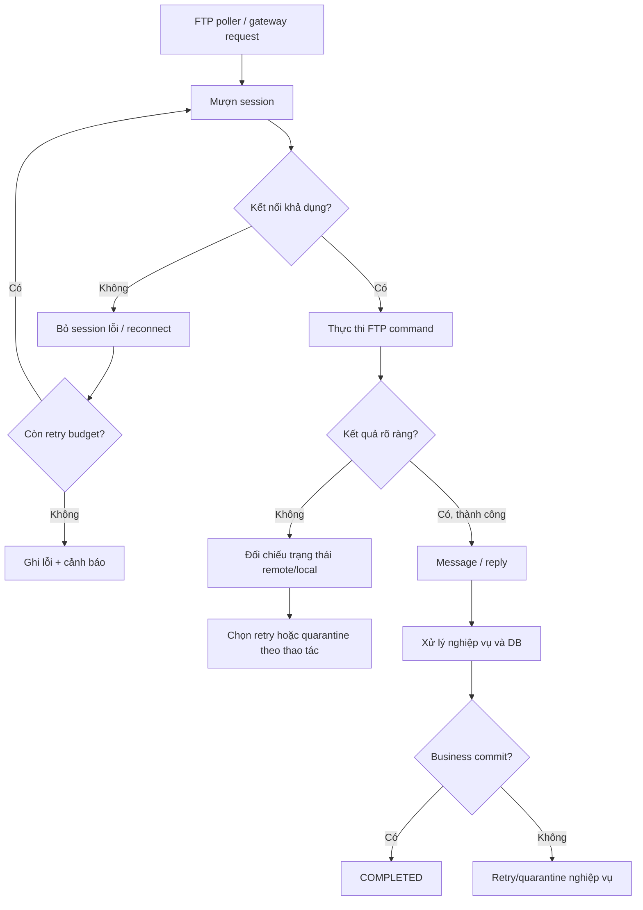
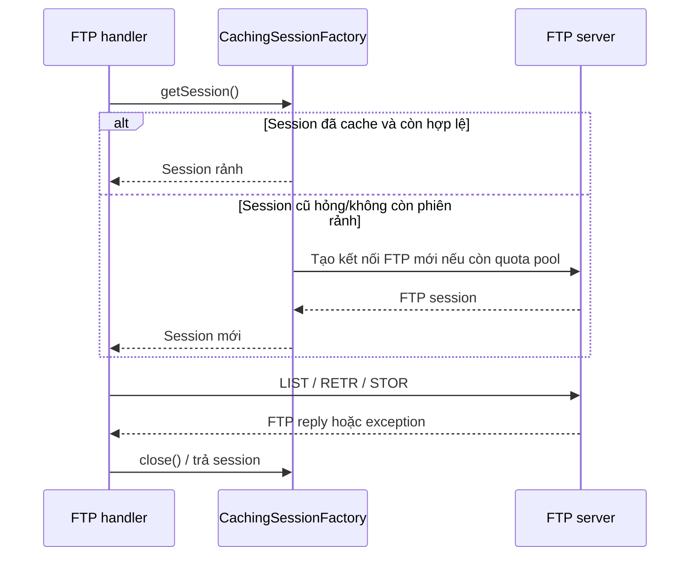
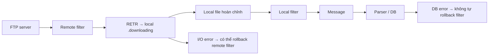
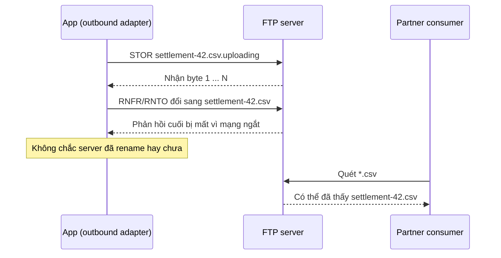

# Retry, reconnect và xử lý lỗi FTP trong Spring Integration

## 1. Bài toán và mục tiêu

Một hệ thống nhận các tệp đơn hàng từ FTP server của đối tác mỗi phút, xử lý dữ liệu rồi gửi file xác nhận ngược lại. Trong thực tế, nhiều tình huống có thể xảy ra:

- Máy chủ FTP khởi động lại trong khi poller đang liệt kê thư mục.
- Một kết nối nhàn rỗi trong session cache bị server đóng.
- Kênh dữ liệu bị ngắt khi tải tệp 500 MB về local.
- Tệp ACK đã được upload đầy đủ nhưng ứng dụng mất kết nối trước khi nhận phản hồi cuối cùng.
- Một tệp CSV đã tải thành công nhưng quá trình ghi cơ sở dữ liệu thất bại.

Nếu mọi lỗi đều được “sửa” bằng cách gọi lại lệnh FTP ngay lập tức, hệ thống có thể tải trùng dữ liệu, ghi đè tệp đã giao, xóa nhầm file hoặc tạo hàng nghìn yêu cầu khi server đang quá tải. **Retry chỉ an toàn khi hiểu rõ thao tác, trạng thái của tệp và ranh giới thất bại.**

Bài học thuộc chương **Adapter FTP** của module **SPRING_INTEGRATION_ADAPTERS**. Module hướng dẫn tích hợp hệ thống ngoài bằng inbound/outbound adapter, gateway, poller và `MessageChannel`; các nguồn đích gồm file, SFTP, HTTP, JMS, AMQP, Kafka và cơ sở dữ liệu. Trong bối cảnh đó, bài này tập trung vào **retry, reconnect và xử lý lỗi FTP**, đồng thời liên hệ hợp đồng message, khôi phục file và vòng đời kết nối.

Sau bài học, bạn có thể:

1. Phân loại lỗi FTP thành lỗi kết nối, đăng nhập, data connection, quyền, file và nghiệp vụ.
2. Phân biệt **tạo session mới** với **lặp lại lệnh FTP** và **xử lý lại một message**.
3. Cấu hình `CachingSessionFactory`, `testSession`, timeout và làm mới các session lỗi.
4. Áp dụng retry có giới hạn, exponential backoff và điều kiện retry cho những thao tác phù hợp.
5. Hiểu vì sao `put/mput/mv/rm` không nên được retry mù quáng sau timeout.
6. Phân biệt lỗi lúc fetch FTP với lỗi downstream, thiết kế error channel, retry/quarantine và idempotency.

## 2. Phân loại lỗi trước khi quyết định retry

FTP có hai kết nối: **control connection** cho lệnh và **data connection** để truyền listing hoặc nội dung file. Lỗi có thể xảy ra khi bắt tay TCP, xác thực, mở kênh dữ liệu, truyền file, đổi tên hoặc ghi kết quả nghiệp vụ.

| Giai đoạn | Triệu chứng thường gặp | Cách xử lý ban đầu |
| --- | --- | --- |
| DNS/TCP control | `UnknownHostException`, `ConnectException`, connect timeout | Xác minh host/cổng, DNS, firewall; có thể thử lại có giới hạn nếu dịch vụ tạm thời không khả dụng |
| Đăng nhập | FTP `530`, lỗi TLS handshake | Kiểm tra credential, account, chứng chỉ; thường **không** thử lại cùng cấu hình liên tục |
| Tạo data connection | FTP `425`, treo ở `LIST/RETR/STOR` | Kiểm tra active/passive, NAT và dải cổng dữ liệu; retry không thay thế sửa firewall |
| Truyền dữ liệu | `426`, `SocketTimeoutException`, reset TCP | Kiểm tra liệu file local/remote đã được ghi một phần hay toàn bộ trước khi retry |
| Quyền và đường dẫn | FTP `550` hoặc `553` | Kiểm tra file path, quyền đọc/ghi/rename, tên hợp lệ; tránh retry vô ích |
| Giới hạn tài nguyên | Server quá nhiều phiên, disk/quota hết | Giảm concurrency, giải phóng session, cảnh báo; thử lại chỉ khi nguyên nhân tạm thời được xử lý |
| Sau FTP transfer | Parser/DB lỗi, đối tác từ chối CSV | Retry **nghiệp vụ**, không đánh đồng với retry kết nối FTP |

### 2.1. Mã phản hồi FTP: 4xx và 5xx

Theo FTP, mã bắt đầu bằng **4** thường là *negative completion tạm thời*, còn mã bắt đầu bằng **5** thường là *negative completion vĩnh viễn* đối với yêu cầu hiện tại.

| Mã | Ý nghĩa thường gặp | Quyết định phù hợp |
| --- | --- | --- |
| `421` | Dịch vụ không khả dụng, server đóng control connection | Thử tạo phiên mới sau backoff; kiểm tra server quá tải |
| `425` | Không thể mở data connection | Sửa passive/active, firewall, NAT; không retry vô hạn |
| `426` | Data connection đóng, transfer bị hủy | Xác minh trạng thái file đích, sau đó mới thử lại |
| `450` | File không khả dụng tạm thời | Có thể thử lại nếu server đang khóa file; giới hạn số lần |
| `451` | Lỗi cục bộ trong lúc xử lý | Kiểm tra log server và trạng thái tệp |
| `452` | Thiếu dung lượng lưu trữ | Kiểm tra quota/disk; retry liên tục thường không có ích |
| `530` | Chưa đăng nhập hoặc đăng nhập bị từ chối | Kiểm tra account/secret/giao thức, không lặp credential sai |
| `550` | File không khả dụng, thường do quyền/path | Kiểm tra file, thư mục, policy server |
| `553` | Tên file không được chấp nhận | Sửa quy tắc đặt tên thay vì retry |

Mã reply **không đủ** để quyết định một thao tác đã thay đổi trạng thái server hay chưa. Ví dụ, ứng dụng có thể đã gửi toàn bộ byte của `STOR` nhưng mất phản hồi `226`. Về phía caller, kết quả lúc đó là **không xác định** chứ không chắc chắn thất bại.

### 2.2. Hai khái niệm thường bị nhầm

**Lỗi có thể khôi phục** không đồng nghĩa **có thể chạy lại thao tác ngay**. Lỗi mạng tạm thời có thể phục hồi sau khi kết nối lại, nhưng nếu lệnh trước là `STOR`, `DELE` hoặc `RNTO`, ứng dụng phải xác minh tác động đã xảy ra trên server trước khi chạy lại.

**Lỗi FTP** khác **lỗi xử lý sau FTP**. Tải một tệp về local thành công không đồng nghĩa đã nhập dữ liệu vào database; thử tải lại không tự giải quyết được lỗi parser hoặc giao dịch.

## 3. Ba tầng retry cần tách biệt

`Retry` thường bị dùng như một từ chung cho ba hành động khác nhau:

| Tầng | Thao tác lặp lại | Mục tiêu | Rủi ro |
| --- | --- | --- | --- |
| **Reconnect/session** | Tạo FTP session mới sau phiên lỗi/đứt kết nối | Khôi phục đường giao tiếp | Nếu session cũ vẫn bị giữ, pool có thể cạn |
| **Command/file transfer** | Chạy lại `LIST`, `RETR`, `STOR` hoặc lệnh khác | Hoàn tất yêu cầu FTP | Có thể gặp file dở hoặc kết quả chưa xác định |
| **Message/business** | Xử lý lại file/đơn hàng/ACK ở downstream | Hoàn tất transaction, đối soát | Có thể tạo đơn hàng hoặc file trùng nếu thiếu idempotency |



Một chính sách retry tốt cần xác định **điểm bắt đầu/kết thúc thao tác**, số lần thử, lỗi nào được thử lại, thời gian chờ, khả năng kiểm tra trạng thái đích và cách báo cáo khi hết retry.

## 4. Reconnect và vòng đời session FTP

### 4.1. Factory gốc và session cache

`DefaultFtpSessionFactory` tạo session FTP mới. `CachingSessionFactory<FTPFile>` bọc factory gốc, cho adapter/gateway mượn những session rảnh và hạn chế số kết nối đồng thời.

FTP session không được cache mặc định trong các phiên bản Spring Integration hiện đại. Nếu muốn tái sử dụng, cần cấu hình cache tường minh. Khi một endpoint hoàn thành, nó phải **trả session** bằng `close()`; với session được cache, việc này thường có nghĩa trả lại pool chứ không nhất thiết đóng TCP vật lý.



Nếu server đã đóng một phiên rảnh do idle timeout, `testSession(true)` giúp kiểm tra session trước khi tái sử dụng bằng lệnh FTP `NOOP`. Nếu không còn hoạt động, phiên bị loại khỏi cache, factory tạo phiên mới khi cần. Nhưng `NOOP` thành công **không** chứng minh data connection có thể mở hoặc TCP sẽ không ngắt ngay sau đó.

### 4.2. Khi nào dùng `resetCache()`?

`CachingSessionFactory.resetCache()` đóng các phiên idle và đánh dấu phiên đang mượn để **đóng khi trả về**. Nó hữu ích khi cần làm mới kết nối theo một quy trình có kiểm soát.

**Không gọi `resetCache()` sau mỗi lần FTP exception hoặc mỗi lượt poll.** Điều đó tạo bão login, làm tăng tải server, mất lợi ích cache và không giải quyết được credential sai, quyền bị từ chối hay firewall chặn data port. Ngoài ra, reset cache **không tự cập nhật** thông số host/username/password đã được cấp cho delegate factory.

### 4.3. Mượn session thủ công phải hoàn trả

```java
import org.apache.commons.net.ftp.FTPFile;
import org.springframework.integration.file.remote.session.Session;
import org.springframework.integration.file.remote.session.SessionFactory;

public int countRemoteEntries(SessionFactory<FTPFile> factory) throws Exception {
    try (Session<FTPFile> session = factory.getSession()) {
        return session.list("/incoming/reports").length;
    }
}
```

Với `try-with-resources`, session được hoàn trả ngay cả khi `list` ném exception. Nếu quên `close()`, toàn bộ session cache có thể bị chiếm và request mới mắc kẹt ở `sessionWaitTimeout`. Việc tăng pool size chỉ làm biểu hiện xuất hiện muộn hơn, không chữa được rò rỉ.

### 4.4. Đặc biệt với streaming

Nếu dùng FTP streaming inbound adapter hoặc FTP outbound gateway `get -stream`, reply có thể chứa `InputStream` gắn với FTP session còn mở. Handler phải xử lý header `closeableResource` và đóng nó theo hợp đồng framework khi đọc xong stream; không được bỏ quên tài nguyên hoặc chuyển sang công việc bất đồng bộ mà không quản lý vòng đời session.

## 5. Cấu hình kết nối FTP và timeout

Ví dụ một ứng dụng Spring Boot có BOM quản lý các phiên bản Spring Integration và Spring Retry tương thích:

```xml
<dependencies>
    <dependency>
        <groupId>org.springframework.boot</groupId>
        <artifactId>spring-boot-starter-integration</artifactId>
    </dependency>
    <dependency>
        <groupId>org.springframework.integration</groupId>
        <artifactId>spring-integration-ftp</artifactId>
    </dependency>
    <dependency>
        <groupId>org.springframework.retry</groupId>
        <artifactId>spring-retry</artifactId>
    </dependency>
</dependencies>
```

```yaml
# application.yml
partner:
  ftp:
    host: ${PARTNER_FTP_HOST}
    port: ${PARTNER_FTP_PORT:21}
    username: ${PARTNER_FTP_USER}
    password: ${PARTNER_FTP_PASSWORD}
    remote-inbox: /incoming/reports
    local-inbox: /data/ftp/reports
    remote-outbox: /outgoing/ack
```

Đường dẫn `remote-inbox` và `remote-outbox` nằm trên FTP server; `local-inbox` nằm trên filesystem của ứng dụng/container. Credential phải được cấp từ secret manager/môi trường, không hardcode hay đưa vào log.

### 5.1. Factory và cache

```java
import org.apache.commons.net.ftp.FTP;
import org.apache.commons.net.ftp.FTPClient;
import org.apache.commons.net.ftp.FTPFile;
import org.springframework.beans.factory.annotation.Value;
import org.springframework.context.annotation.Bean;
import org.springframework.context.annotation.Configuration;
import org.springframework.integration.file.remote.session.CachingSessionFactory;
import org.springframework.integration.file.remote.session.SessionFactory;
import org.springframework.integration.ftp.session.DefaultFtpSessionFactory;

@Configuration
public class PartnerFtpConnections {

    @Bean("partnerFtpSessionFactory")
    public SessionFactory<FTPFile> ftpSessionFactory(
            @Value("${partner.ftp.host}") String host,
            @Value("${partner.ftp.port}") int port,
            @Value("${partner.ftp.username}") String user,
            @Value("${partner.ftp.password}") String password) {

        DefaultFtpSessionFactory target = new DefaultFtpSessionFactory();
        target.setHost(host);
        target.setPort(port);
        target.setUsername(user);
        target.setPassword(password);

        target.setClientMode(FTPClient.PASSIVE_LOCAL_DATA_CONNECTION_MODE);
        target.setFileType(FTP.BINARY_FILE_TYPE);
        target.setConnectTimeout(10_000); // TCP control connect
        target.setDefaultTimeout(10_000); // control socket
        target.setDataTimeout(30_000);    // data socket

        CachingSessionFactory<FTPFile> pool =
                new CachingSessionFactory<>(target, 4);
        pool.setSessionWaitTimeout(5_000); // chờ mượn phiên
        pool.setTestSession(true);         // kiểm tra bằng FTP NOOP
        return pool;
    }
}
```

Đây là cấu hình minh họa, **không phải mức timeout/pool tối ưu cho mọi server**. Kết nối FTP passive thường phù hợp khi client nằm sau NAT/firewall, nhưng cả control port và dải passive data port của server phải được phép truy cập.

### 5.2. Timeout không thay thế nhau

| Tham số | Giới hạn điều gì? | Không giải quyết được |
| --- | --- | --- |
| `connectTimeout` | Chờ thiết lập TCP control connection | Không sửa DNS/route/firewall sai |
| `defaultTimeout` | Chờ trên control socket | Không kiểm soát toàn bộ request–reply nghiệp vụ |
| `dataTimeout` | Chờ trên socket truyền file/listing | Không bảo đảm file đích chưa bị ghi |
| `sessionWaitTimeout` | Chờ lấy một session từ pool đã cạn | Không ngắt upload đang chạy |
| `@Gateway(replyTimeout)` | Chờ reply message trong mô hình messaging | Với `DirectChannel`, không nhất thiết chặn được lời gọi FTP đồng bộ đang chạy |
| Poller `fixedDelay` | Khoảng trễ giữa các lượt poll | Không phải timeout cho `RETR` |

Nếu server chặn data connection, tăng `dataTimeout` có thể chỉ khiến ứng dụng **đợi lâu hơn** trước khi lỗi. Nếu mọi session đang bị chiếm bởi stream chưa đóng, tăng `connectTimeout` cũng không giúp có thêm session.

## 6. Phân loại thao tác để chọn retry an toàn

Một retry có thể **làm lại cả hành động**. Vì vậy chính sách nên phụ thuộc bản chất lệnh FTP, không chỉ phụ thuộc loại exception.

| Lệnh | Tác động chính | Retry sau timeout? | Điều kiện an toàn |
| --- | --- | --- | --- |
| `PWD`, `NOOP` | Kiểm tra trạng thái/phiên | Thường có thể | Tạo phiên hợp lệ và backoff có giới hạn |
| `LIST`, `NLST` | Đọc danh sách | Thường có thể | Không tạo tác dụng phụ; vẫn cần kiểm tra quyền và path |
| `RETR` / gateway `get` | Tải file về local | Có điều kiện | Kiểm tra file local tạm/dở, overwrite policy và remote version |
| `mget` | Tải nhiều file | Không retry cả batch mù quáng | Kiểm tra `partialResults` và file local đã nhận |
| `STOR` / gateway `put` | Ghi file remote | **Không tự động retry mù quáng** | Kiểm tra tên cuối/tên tạm/kích thước/checksum, quy tắc tên bất biến |
| `mput` | Gửi nhiều file | Không retry cả thư mục mù quáng | Đối chiếu file đã ghi, file thiếu và trạng thái từng batch |
| `RNFR/RNTO` / `mv` | Đổi tên/di chuyển remote | Không mặc định an toàn | Kiểm tra trạng thái đường dẫn nguồn và đích |
| `DELE` / `rm` | Xóa file remote | Không mặc định an toàn | Yêu cầu quyền hạn, audit và xác minh kết quả |

**Đối với `RETR`**, thao tác FTP là đọc remote nhưng **kết quả phía local là ghi file**. Nếu retry khi bản tải cũ mới có một phần, phải dựa vào cơ chế tên tạm/đổi tên và chính sách `FileExistsMode`, tránh parser mở nhầm bản thiếu byte.

**Đối với `STOR`**, có thể xảy ra trường hợp toàn bộ byte đã lên server nhưng client mất `226 Transfer complete`. Khi đó lặp ngay `STOR` với `REPLACE` có thể ghi đè dữ liệu mà đối tác đã bắt đầu đọc, còn `APPEND` có thể nhân đôi byte.

## 7. Ví dụ retry có giới hạn cho lệnh đọc `ls`

Ví dụ này cố ý gắn retry advice **chỉ vào FTP outbound gateway chạy lệnh đọc `ls`**, vì lệnh đọc thường không làm thay đổi trạng thái file. Đây **không phải** cấu hình nên sao chép nguyên xi sang `put/mput/mv/rm`.

`RequestHandlerRetryAdvice` của Spring Integration bọc lời gọi handler bằng chính sách retry. Ví dụ Spring Integration 6.x sử dụng `RetryTemplate` từ Spring Retry 2.x để:

- Thực thi **tối đa ba lần tổng cộng**: lần đầu và tối đa hai lần thử lại.
- Chỉ thử lại khi chuỗi nguyên nhân chứa lỗi socket/kết nối thuộc danh sách cho phép.
- Áp dụng exponential backoff, tránh gọi lại server tức thời.
- Ném exception về phía caller sau khi hết retry để tầng điều phối ghi nhận/giám sát.

### 7.1. Khai báo retry advice

```java
import java.net.ConnectException;
import java.net.SocketException;
import java.net.SocketTimeoutException;
import java.util.HashMap;
import java.util.Map;
import org.springframework.context.annotation.Bean;
import org.springframework.context.annotation.Configuration;
import org.springframework.integration.handler.advice.RequestHandlerRetryAdvice;
import org.springframework.retry.backoff.ExponentialBackOffPolicy;
import org.springframework.retry.policy.SimpleRetryPolicy;
import org.springframework.retry.support.RetryTemplate;

@Configuration
public class FtpReadRetryConfiguration {

    @Bean("ftpListRetryAdvice")
    public RequestHandlerRetryAdvice ftpListRetryAdvice() {
        Map<Class<? extends Throwable>, Boolean> retryable = new HashMap<>();
        retryable.put(ConnectException.class, true);
        retryable.put(SocketTimeoutException.class, true);
        retryable.put(SocketException.class, true);

        // true: xét các nguyên nhân bên trong MessagingException, nếu có.
        SimpleRetryPolicy policy =
                new SimpleRetryPolicy(3, retryable, true, false);

        ExponentialBackOffPolicy backoff = new ExponentialBackOffPolicy();
        backoff.setInitialInterval(500); // ms
        backoff.setMultiplier(2.0);
        backoff.setMaxInterval(2_000);    // ms

        RetryTemplate template = new RetryTemplate();
        template.setRetryPolicy(policy);
        template.setBackOffPolicy(backoff);

        RequestHandlerRetryAdvice advice = new RequestHandlerRetryAdvice();
        advice.setRetryTemplate(template);
        return advice;
    }
}
```

`SimpleRetryPolicy` ở đây đặt `defaultValue=false` để **không retry các exception nằm ngoài danh sách**. Bật `traverseCauses` vì Spring Integration có thể bọc lỗi thực trong `MessagingException`. Một số giao thức/phiên bản thư viện còn dùng exception wrapper khác, nên cần kiểm thử lớp exception thực tế từ server trước khi chốt bộ phân loại.

Lưu ý: `SocketTimeoutException` có thể xuất hiện **sau** khi một lệnh ghi đã tác động lên server; ví dụ này an toàn hơn vì giới hạn ở lệnh đọc `ls`, chứ bản thân loại exception đó không bảo đảm retry an toàn cho mọi lệnh.

### 7.2. Gắn advice vào request–reply flow

```java
import java.util.List;
import org.apache.commons.net.ftp.FTPFile;
import org.springframework.beans.factory.annotation.Qualifier;
import org.springframework.context.annotation.Bean;
import org.springframework.context.annotation.Configuration;
import org.springframework.integration.annotation.Gateway;
import org.springframework.integration.annotation.IntegrationComponentScan;
import org.springframework.integration.annotation.MessagingGateway;
import org.springframework.integration.dsl.IntegrationFlow;
import org.springframework.integration.file.remote.session.SessionFactory;
import org.springframework.integration.ftp.dsl.Ftp;
import org.springframework.integration.handler.advice.RequestHandlerRetryAdvice;

@Configuration
@IntegrationComponentScan
public class FtpListFlowConfiguration {

    @Bean
    public IntegrationFlow ftpListFlow(
            @Qualifier("partnerFtpSessionFactory")
            SessionFactory<FTPFile> sessionFactory,
            @Qualifier("ftpListRetryAdvice")
            RequestHandlerRetryAdvice retryAdvice) {

        return IntegrationFlow.from("ftpListRequests")
                .handle(Ftp.outboundGateway(sessionFactory, "ls", "payload")
                                .options("-1"),
                        endpoint -> endpoint.advice(retryAdvice))
                .get();
    }
}

@MessagingGateway
interface PartnerFtpReadClient {
    @Gateway(requestChannel = "ftpListRequests", replyTimeout = 30_000)
    List<String> listNames(String remoteDirectory);
}
```

Ví dụ service gọi `client.listNames("/incoming/reports")` nhận `List<String>` khi lệnh thành công. Nếu retry hết mà chưa có kết quả, exception phải được xử lý ở caller hoặc error channel tùy mô hình channel/executor. `replyTimeout` của `@Gateway` không phải timeout tổng của toàn bộ kết nối FTP khi handler chạy đồng bộ qua `DirectChannel`.

Trong một ứng dụng thật, hãy chọn **bộ phân loại lỗi có tính ngữ cảnh**. Những lỗi như sai mật khẩu, thư mục không tồn tại, thiếu quyền, chứng chỉ không đáng tin cậy không nên được retry nhiều lần chỉ vì đã bị framework bọc lại dưới một exception chung.

## 8. Inbound adapter: lỗi đồng bộ tệp và lỗi xử lý downstream

FTP inbound adapter loại đồng bộ file có hai bước: **remote synchronizer tải về local**, sau đó **local file source phát `Message<File>`**. Tương ứng có **remote filter** và **local filter**.



### 8.1. Khi `RETR` lỗi

Nếu file remote đã được remote filter chấp nhận, nhưng xảy ra lỗi I/O trong lúc synchronizer tải, framework có thể **hoàn tác dấu nhận remote** để file được tải lại ở lượt poll tiếp theo, **nếu filter triển khai `ReversibleFileListFilter`**. Chức năng này không phải giao dịch phân tán: mất điện hoặc JVM chết đột ngột có thể xảy ra trước khi rollback hoàn tất.

Thiết kế tốt nên dùng:

- Tên file tạm ở local (ví dụ `.downloading`), chỉ phát file sau khi tải xong và đổi tên.
- Remote/local persistent accept-once filter với `ConcurrentMetadataStore` phù hợp.
- `maxFetchSize` để kiểm soát số file tải mỗi đợt; `maxMessagesPerPoll` chỉ giới hạn số message phát trong lượt poll, không thay thế `maxFetchSize`.
- Một cơ chế đối chiếu khi metadata báo “đã nhận” nhưng file local không còn do pod/volume bị mất.

### 8.2. Khi handler downstream lỗi

Giả sử `order-42.csv` đã được tải hoàn chỉnh và phát vào `MessageChannel`, nhưng service ghi database lỗi. **Không có rollback filter tự động chỉ vì handler downstream thất bại.** Poller chạy lại có thể không phát file đó nữa, đặc biệt nếu persistent local filter đã đánh dấu “đã phát”.

Ứng dụng phải thiết kế **retry nghiệp vụ riêng**, ví dụ:

1. Ghi trạng thái batch `RECEIVED / PROCESSING / COMPLETED / FAILED` vào DB.
2. Khi lỗi, giữ hoặc lưu trữ an toàn bản file local; không tự xóa remote.
3. Gửi batch vào retry queue có backoff, hoặc quarantine nếu lỗi dữ liệu không thể tự sửa.
4. Trước mỗi lần ghi DB, kiểm tra khóa idempotency (ví dụ `partnerId + batchId + orderId`).
5. Chỉ đánh dấu `COMPLETED` khi transaction đã commit thành công.

Việc xóa một khóa metadata của filter để phát lại file cần được thực hiện **theo đối tượng cụ thể và có giám sát**; không xóa toàn bộ metadata store như một cách retry phổ thông.

### 8.3. Poller và error channel

Lỗi phát sinh từ **scheduled poller task** có thể được đưa vào `ErrorMessage` và gửi tới error channel. Có thể cấu hình một kênh riêng cho lỗi FTP polling để ghi nhận và cảnh báo.

```java
import java.io.File;
import java.time.Duration;
import org.apache.commons.net.ftp.FTPFile;
import org.springframework.beans.factory.annotation.Qualifier;
import org.springframework.beans.factory.annotation.Value;
import org.springframework.context.annotation.Bean;
import org.springframework.context.annotation.Configuration;
import org.springframework.integration.channel.DirectChannel;
import org.springframework.integration.dsl.IntegrationFlow;
import org.springframework.integration.dsl.Pollers;
import org.springframework.integration.ftp.dsl.Ftp;
import org.springframework.integration.ftp.filters.FtpSimplePatternFileListFilter;
import org.springframework.integration.file.remote.session.SessionFactory;
import org.springframework.messaging.MessageChannel;

@Configuration
public class FtpInboundErrorHandlingConfiguration {

    @Bean("ftpPollErrors")
    public MessageChannel ftpPollErrors() {
        return new DirectChannel();
    }

    @Bean
    public IntegrationFlow ftpInboundFlow(
            @Qualifier("partnerFtpSessionFactory")
            SessionFactory<FTPFile> sessionFactory,
            @Value("${partner.ftp.remote-inbox}") String remoteInbox,
            @Value("${partner.ftp.local-inbox}") String localInbox) {

        return IntegrationFlow.from(
                Ftp.inboundAdapter(sessionFactory)
                        .remoteDirectory(remoteInbox)
                        .localDirectory(new File(localInbox))
                        .autoCreateLocalDirectory(true)
                        .temporaryFileSuffix(".downloading")
                        .maxFetchSize(5)
                        .filter(new FtpSimplePatternFileListFilter("*.csv")),
                endpoint -> endpoint.poller(
                        Pollers.fixedDelay(Duration.ofSeconds(20))
                                .maxMessagesPerPoll(3)
                                .errorChannel("ftpPollErrors")))
                .channel("ftpFiles")
                .get();
    }
}
```

Ví dụ handler nhận `ErrorMessage`:

```java
import org.springframework.integration.annotation.ServiceActivator;
import org.springframework.messaging.support.ErrorMessage;
import org.springframework.stereotype.Component;

@Component
public class FtpPollErrorConsumer {

    @ServiceActivator(inputChannel = "ftpPollErrors")
    public void onError(ErrorMessage error) {
        Throwable cause = error.getPayload();
        // Production: log có cấu trúc + metric + alert theo nhóm lỗi.
        // Không log credential hoặc nội dung file nhạy cảm.
        System.err.println("FTP poll failed: " +
                cause.getClass().getSimpleName());
    }
}
```

Đoạn code minh họa **đường chuyển lỗi**, không tự retry ngay trong `onError`. Error handler thực tế phải phân loại lỗi, tránh tự ném exception liên tục và ghi lại đủ context (đối tác, flow, command, path đã kiểm tra, correlation ID). Filter chỉ theo `*.csv` trong ví dụ cũng **chưa cung cấp chính sách persistent accept-once production**.

Nếu có custom `TaskScheduler`, cần bảo đảm cơ chế `MessagePublishingErrorHandler` tương thích; không giả định mọi lỗi bất đồng bộ đều tự xuất hiện ở một channel chưa được cấu hình.

## 9. Outbound upload: retry khi kết quả không chắc chắn

### 9.1. Giả thiết lỗi giữa `STOR` và phản hồi cuối

Xem trình tự:



Nếu app retry ngay từ đầu, nó có thể gặp file đích đã tồn tại hoặc ghi đè lên file đang được partner xử lý. Do đó, **network timeout không đồng nghĩa remote upload chưa xảy ra**.

### 9.2. Quy trình giao tệp có khả năng phục hồi

| Bước | Trạng thái đề xuất | Việc cần làm |
| --- | --- | --- |
| Tạo báo cáo local | `CREATED` | Đóng stream, validate file, tính checksum và lưu batch ID |
| Chuẩn bị gửi | `UPLOADING` | Chọn tên remote bất biến theo `batchId/version` |
| Truyền file | `UPLOADING` | Ghi remote dưới tên tạm `.uploading` nếu server hỗ trợ rename |
| FTP kết thúc rõ ràng | `UPLOADED` | Ghi nhận đường dẫn cuối, kích thước và thời điểm |
| Timeout/connection reset | `UNKNOWN` | Đối chiếu tên cuối/tên tạm, kích thước/checksum/manifest trước khi quyết định gửi lại |
| Partner xác nhận | `ACKNOWLEDGED` | Chỉ khi có ACK nghiệp vụ đáng tin cậy |
| Lỗi không khôi phục được | `FAILED` / `QUARANTINED` | Giữ file nguồn, log và cảnh báo, có thể cần người xử lý |

Với báo cáo có tên bất biến, `FileExistsMode.FAIL` thường giúp ngăn việc ghi đè vô tình; nhưng nếu lần gửi trước đã thành công còn app mất ACK kỹ thuật, retry có thể gặp “file already exists”. Đó là **tín hiệu cần đối chiếu**, không tự động là lỗi dữ liệu.

Ví dụ cấu hình outbound adapter chủ động **không gắn retry advice mù quáng**:

```java
import org.apache.commons.net.ftp.FTPFile;
import org.springframework.beans.factory.annotation.Qualifier;
import org.springframework.context.annotation.Bean;
import org.springframework.context.annotation.Configuration;
import org.springframework.integration.dsl.IntegrationFlow;
import org.springframework.integration.file.remote.session.SessionFactory;
import org.springframework.integration.file.support.FileExistsMode;
import org.springframework.integration.ftp.dsl.Ftp;

@Configuration
public class FtpUploadFlowConfiguration {

    @Bean
    public IntegrationFlow ftpUploadFlow(
            @Qualifier("partnerFtpSessionFactory")
            SessionFactory<FTPFile> sessionFactory) {
        return IntegrationFlow.from("ftpFilesToUpload")
                .handle(Ftp.outboundAdapter(sessionFactory)
                        .remoteDirectory("/outgoing/ack")
                        .fileExistsMode(FileExistsMode.FAIL)
                        .useTemporaryFileName(true)
                        .temporaryFileSuffix(".uploading"))
                .get();
    }
}
```

Khi dùng `DirectChannel`, exception trong outbound handler thường có thể lan về sender. Với `ExecutorChannel` hoặc queue/broker, `send() == true` chỉ có thể có nghĩa message đã được tiếp nhận/chuyển đi, **không** bảo đảm upload đã xong. Tầng phát sinh report phải lưu trạng thái bền vững và thiết kế retry theo kết quả thực tế.

### 9.3. Không dùng `APPEND` để khôi phục file dở nếu chưa có giao thức tương ứng

FTP có hỗ trợ tiếp tục truyền trong một số tình huống khi client/server thỏa thuận vị trí byte, nhưng `APPEND` không đồng nghĩa “resumable upload an toàn”. Nếu nối nhầm offset, chuyển lại từ đầu hoặc file remote đã bị thay đổi, byte có thể bị nhân đôi hoặc sai nội dung.

Chỉ triển khai resume khi cả hai phía thống nhất rõ offset, kích thước, checksum, trạng thái file tạm và cơ chế phát hành tên cuối; cần kiểm thử trực tiếp trên FTP server của đối tác.

## 10. Gateway `mget/mput`: thành công một phần và retry theo file

Trong một lệnh `mput`, hai file đầu có thể đã đến server trước khi file thứ ba gặp lỗi. Spring Integration có thể ném `PartialSuccessException`, chứa:

- `partialResults`: các kết quả chuyển file **đã thành công**.
- `derivedInput`: đầu vào được suy ra từ request ban đầu, như danh sách file trong thư mục.
- `failedMessage` và `cause`: bối cảnh lỗi. Với thư mục đệ quy, `PartialSuccessException` có thể **lồng nhau**.

Ví dụ:

```text
Batch upload gồm:
    a.csv  -> thành công
    b.csv  -> thành công
    c.csv  -> mất mạng

partialResults = [remotePath(a.csv), remotePath(b.csv)]
derivedInput  = [a.csv, b.csv, c.csv]
cause         = lỗi truyền c.csv

Không nên retry ngay toàn bộ [a,b,c] bằng REPLACE/APPEND.
Thay vào đó: đối chiếu trạng thái từng tệp và xử lý c.csv.
```

`mget` cũng có trường hợp tương tự nhưng phải đối chiếu kết quả **local**. Nếu xuất hiện lỗi trước khi một file hoàn tất, bản local tạm cần được kiểm tra và cleanup an toàn. Hãy dùng transaction/manifest/checksum ở cấp batch nếu nghiệp vụ yêu cầu nhận đủ tập file như một đơn vị; FTP không cung cấp transaction đa file.

### 10.1. `mv` và `rm` cũng không được retry bằng suy đoán

- Với `mv`, nếu phiên bị ngắt sau khi server đổi tên, retry từ **đường dẫn cũ** có thể trả `550` vì file nguồn đã biến mất; cần kiểm tra cả **đích** trước khi kết luận thất bại.
- Với `rm`, nếu server đã xóa file nhưng phản hồi bị mất, retry có thể trả “file not found”; không được coi việc mất file là lý do xóa file khác thay thế.
- Các lệnh phá hủy hoặc thay đổi đường dẫn phải có quyền tối thiểu, audit log, batch ID và kế hoạch khôi phục. Không bật `-D` (xóa remote sau tải) chỉ để tránh duplicate mà chưa có hợp đồng xác nhận dữ liệu.

## 11. Retry budget, backoff, jitter và chống bão yêu cầu

Nếu FTP server mất kết nối trong 5 phút và 20 pod cùng retry ba lần mỗi giây, tình trạng quá tải sẽ nặng thêm. Dù mỗi pod có giới hạn riêng, **tổng số lần thử toàn hệ thống** vẫn có thể rất lớn.

Thiết kế thực tế nên bao gồm:

1. **Số lần thử tối đa**: ví dụ ba lần tổng cộng cho lệnh `ls` hoặc reconnect ngắn hạn.
2. **Exponential backoff**: thời gian chờ tăng dần, có giới hạn trên.
3. **Jitter**: thêm dao động ngẫu nhiên có kiểm soát để các pod không retry cùng thời điểm.
4. **Timeout theo từng lớp**: TCP control, data socket, pool wait, caller deadline, tổng thời gian xử lý batch.
5. **Concurrency limit/bulkhead**: giới hạn số session và tác vụ đồng thời thay vì tạo thêm request vô hạn.
6. **Circuit breaker** khi cần: tạm dừng gọi server đang lỗi liên tục, thử lại thăm dò có kiểm soát.
7. **Dead-letter/quarantine** cho file hoặc batch lỗi sau khi đã hết retry, có thể replay thủ công theo quyền được cấp.

Ví dụ backoff ban đầu 500 ms, multiplier 2 và tối đa 2 giây cho ba lần thử tổng cộng:

| Lần thực thi | Thời điểm tương đối nếu không tính thời gian lệnh | Ghi chú |
| --- | --- | --- |
| Lần 1 | 0 ms | Thao tác ban đầu |
| Lần 2 | Sau khoảng 500 ms | Chỉ nếu lỗi thuộc chính sách retry |
| Lần 3 | Sau thêm khoảng 1.000 ms | Sau đó hết retry, exception được đưa ra ngoài |

`RequestHandlerRetryAdvice` thông thường chạy kiểu **stateless retry trên thread hiện tại** và có thể giữ thread ngủ trong lúc backoff. Khi tải lớn, cần tính ảnh hưởng đến thread pool và khả năng đáp ứng. `Stateful retry` chỉ thích hợp khi upstream (ví dụ JMS/Kafka) có cơ chế phát lại và nhận diện message nhất quán; không tự bật nó cho poller FTP chỉ vì muốn “retry thông minh hơn”.

## 12. Xử lý lỗi trong các mô hình messaging

| Điểm phát sinh lỗi | Ai nhận lỗi thường thấy? | Cách thiết kế |
| --- | --- | --- |
| Outbound adapter qua `DirectChannel` | Caller đang gửi message nhận exception đồng bộ | Catch tại boundary, lưu trạng thái gửi, kiểm tra remote nếu kết quả mơ hồ |
| FTP outbound gateway request–reply đồng bộ | Caller của `@MessagingGateway` nhận exception/timeout | Phân biệt reply timeout và network timeout; retry riêng theo lệnh |
| Handler chạy trên executor/queue | Error handler / error channel tùy cấu hình | Đảm bảo có subscriber, metric và lưu request context |
| FTP inbound polling | Poller error channel hoặc error handler của scheduler | Không chặn vô hạn scheduler; báo lỗi theo loại và số lần |
| Downstream service/DB sau `Message<File>` | Handler/ngữ cảnh transaction | Dùng retry/quarantine nghiệp vụ; filter không tự rollback |

**Điểm quan trọng:** không giả định tất cả exception tự xuất hiện ở `errorChannel` toàn cục. Với `DirectChannel`, exception thường lan ngay trên thread gọi. Với scheduled poller, error publishing thuộc trách nhiệm poller/scheduler. Khi tự cấu hình `TaskScheduler`, hãy kiểm tra `MessagePublishingErrorHandler` tương ứng.

Khi ghi lỗi, lưu **đủ context để replay có kiểm soát**:

```text
partnerId, batchId, fileName, remotePath, localPath
ftpCommand, ftpReplyCode, exceptionClass, rootCause
attemptCount, nextRetryAt, podId, correlationId
remoteFileExists?, tempFileExists?, observedFileSize?, checksum?
businessStatus: CREATED / UPLOADING / UNKNOWN / UPLOADED / FAILED
```

Không log mật khẩu, dữ liệu nhạy cảm trong file, token hoặc raw command chứa credential. Những trường `remoteFileExists`, `observedFileSize` và checksum là dữ liệu **quan sát tại thời điểm kiểm tra**, không được giả định từ lỗi client.

## 13. FTPS, mạng và những lỗi không thể chữa bằng retry

**FTP passive** yêu cầu client có thể truy cập cả control port lẫn dải passive data ports của server. Nếu chỉ mở cổng 21, đăng nhập có thể chạy nhưng `LIST`, `RETR` hoặc `STOR` lỗi `425`. Chuyển sang active mode cũng không đồng nghĩa giải quyết lỗi nếu server không thể kết nối ngược về client sau NAT/firewall.

**FTPS** sử dụng TLS bảo vệ control/data channels nhưng vẫn cần data connection; lỗi chứng chỉ/hostname phải được xử lý bằng cấu hình truststore và xác thực hợp lệ, **không tắt certificate verification** để cho retry chạy. FTP ALG thường không đọc được control traffic khi đã mã hóa, vì vậy FTPS passive thường cần dải cổng tường minh trên server.

**SFTP** là giao thức SSH khác với FTP/FTPS; nếu server chỉ hỗ trợ SFTP, phải dùng Spring Integration SFTP adapter và session factory SFTP phù hợp. Đổi cổng từ 21 sang 22 trong `DefaultFtpSessionFactory` không tạo ra SFTP.

Một nguyên tắc vận hành: **sửa lỗi cấu hình trước, retry sau**. Credential sai, certificate không đáng tin, quyền thư mục thiếu, đường dẫn không tồn tại hoặc firewall chặn hoàn toàn là các vấn đề cấu hình. Retry quá nhiều chỉ tạo thêm log, tải và nguy cơ khóa tài khoản.

## 14. Chiến lược phục hồi khi ứng dụng restart hoặc nhiều replica

### 14.1. Một pod chết giữa lúc download

Giả sử remote filter dùng metadata store bền vững, còn file local nằm trên filesystem tạm của pod:

1. Pod A chấp nhận `order-42.csv` và ghi dấu remote.
2. Pod A chết trong khi tải, để lại file `.downloading` chưa hoàn chỉnh.
3. Pod B/pod mới không có bản local đầy đủ, nhưng metadata store vẫn có thể giữ dấu đã nhận.
4. Nếu không có đối soát, file có thể bị bỏ sót thay vì tự tải lại.

Cần phối hợp **persistent metadata**, **durable local/object storage**, cơ chế rollback khi transfer lỗi và job reconcile các batch chưa `COMPLETED`. Crash đột ngột không bảo đảm filter đã hoàn tác thành công.

### 14.2. Nhiều replica cùng dùng FTP server

Mỗi JVM có session pool riêng, vì vậy `CachingSessionFactory<>(target, 4)` trên ba pod có thể tạo tối đa 12 session nếu tất cả bận. Nếu server chỉ cho phép sáu session cho cùng tài khoản, phải phân chia quota và giới hạn concurrency tổng.

Một metadata store chia sẻ giúp giảm việc các replica cùng claim file, nhưng không biến các bước **claim → download → parse → commit DB** thành một giao dịch. Khóa idempotency ở database, queue bền vững, hoặc cơ chế leader/partition vẫn cần được cân nhắc.

### 14.3. Trạng thái gửi ACK chưa chắc chắn

Sau một timeout khi upload, không đánh dấu batch `FAILED` theo nghĩa “server chưa nhận file” ngay. Tạm ghi trạng thái `UNKNOWN`, kiểm tra đường dẫn cuối/tạm và bằng chứng từ server, sau đó chuyển sang `UPLOADED` hoặc lập kế hoạch retry/quarantine. Nếu phía đối tác có ACK nghiệp vụ, trạng thái `ACKNOWLEDGED` chỉ xuất hiện sau khi có xác nhận đó.

## 15. Kịch bản kiểm thử tích hợp

Chỉ chạy các bài thử sau trên FTP/FTPS server thử nghiệm và thư mục giả lập được cấp quyền. Mock `SessionFactory` có ích cho unit test nhưng không thể chứng minh hành vi data connection, reply FTP hoặc timeout thực tế.

| Kịch bản | Điều cần kiểm chứng |
| --- | --- |
| Server tạm ngừng rồi hoạt động lại | `ls` thử lại có giới hạn và hồi phục, không tạo retry vô hạn |
| Sai username/password | `530` được phân loại; không thử mật khẩu sai liên tục |
| Login được nhưng chặn passive data range | `425` được phân biệt với connect/login; không xem tăng timeout là cách sửa |
| Idle FTP session bị server đóng | `testSession(true)` kiểm tra session cache và tạo mới khi cần |
| Pool size = 2 và ba request cùng mượn | Request thứ ba đợi hoặc hết `sessionWaitTimeout`, không tự vượt giới hạn |
| Mất mạng giữa `RETR` | File local thiếu byte không được phát như file hoàn chỉnh; kiểm tra rollback filter |
| JVM bị kill giữa lúc tải | Có cách đối chiếu metadata và bản file local còn lại |
| Upload `put` xong nhưng mất reply | Không retry ghi đè mù quáng; xác minh tên cuối/tạm và nội dung |
| `mput` thành công 2/3 tệp rồi lỗi | Thu thập `partialResults`; chỉ xử lý phần thiếu theo quy tắc |
| `mv` đã đổi tên nhưng client timeout | Kiểm tra nguồn/đích trước khi gọi lại |
| Handler DB lỗi sau khi đã nhận file | Có retry/quarantine nghiệp vụ, không dựa vào remote filter tự phát lại |
| 10 replica cùng retry sau downtime | Backoff/jitter/bulkhead hạn chế bão kết nối |
| FTPS chứng chỉ không tin cậy | Không bypass TLS, báo lỗi cấu hình rõ ràng |

**Tiêu chí thành công** không chỉ là “lần sau kết nối được”: cần xác minh **byte file**, trạng thái remote/local, số message được xử lý, không phát sinh đơn hàng trùng và không mất dấu các batch chưa hoàn tất.

## 16. Bài tập tình huống

**Đề bài:** Hệ thống chạy ba pod Kubernetes. Mỗi pod có FTP session pool tối đa bốn session. Đối tác gửi tệp `orders-<batchId>.csv` lớn 300 MB qua FTP passive. Ứng dụng tải về local, ghi database rồi gửi file `ack-<batchId>.csv` lên server. Một ngày có sự cố: server đóng session cũ, `RETR` đứt ở 70%, handler DB lỗi cho một batch khác, `STOR` ACK đã ghi đủ byte nhưng caller bị timeout trước `226`.

Hãy trả lời:

1. `testSession(true)` giải quyết phần nào? Nó có kiểm tra cổng passive data không?
2. Vì sao phải tính **tổng** số session của ba pod thay vì chỉ nhìn một cache?
3. Với `RETR` lỗi ở 70%, cần kiểm tra file local và remote filter ra sao?
4. Nếu remote filter hỗ trợ rollback nhưng pod chết tức thời, có đảm bảo metadata đã được hoàn tác không?
5. Khi DB lỗi sau khi `Message<File>` đã được phát, có thể chỉ chờ poller phát lại file không?
6. Nếu `STOR` có thể đã hoàn tất, vì sao `REPLACE` hoặc `APPEND` không phải cách retry mặc định?
7. `RequestHandlerRetryAdvice` cấu hình cho `ls` có nên gắn luôn cho `rm/mv` không?
8. Khi nhiều pod cùng retry, nên dùng những biện pháp nào ngoài tăng timeout?
9. Phân biệt `UPLOAD_SUCCESS` và `PARTNER_ACKNOWLEDGED` theo hợp đồng nghiệp vụ.

**Gợi ý đáp án:** (1) Kiểm tra control session cũ qua `NOOP`, không đảm bảo data channel. (2) Mỗi pod có pool riêng; ba pool size 4 có thể dùng tổng 12 session. (3) Không phát file tạm, xét khả năng rollback `ReversibleFileListFilter` và retry tải có kiểm soát. (4) Không; crash có thể xảy ra trước khi rollback. (5) Không; phải có retry/quarantine nghiệp vụ và idempotency DB. (6) Kết quả remote chưa chắc chắn, ghi lại có thể ghi đè hoặc nối trùng byte. (7) Không; lệnh thay đổi/xóa file cần đối chiếu trạng thái trước retry. (8) Backoff, jitter, giới hạn concurrency, circuit breaker, quota và cảnh báo. (9) Upload thành công chỉ nói FTP transfer xong; đối tác đã xử lý cần ACK nghiệp vụ riêng.

## Tổng kết

- **Reconnect** tạo phiên FTP mới khi phiên cũ hỏng; **retry command** chạy lại lệnh FTP; **retry nghiệp vụ** xử lý lại dữ liệu sau khi đã phát message. Đây là ba ranh giới khác nhau.
- `CachingSessionFactory`, `testSession`, timeout và `resetCache` hỗ trợ quản lý kết nối, nhưng **không tự đảm bảo file chỉ được xử lý một lần**.
- Chọn retry theo **loại lệnh và tác động**. `ls/nlst` thường thuận lợi để thử lại, còn `put/mput/mv/rm` cần kiểm tra kết quả remote nếu timeout làm trạng thái không chắc chắn.
- Với inbound, lỗi transfer có thể rollback remote filter khi filter hỗ trợ; **lỗi downstream không tự rollback**. Cần metadata, kho file bền vững, retry/quarantine và idempotency.
- Luôn giới hạn số lần thử, dùng backoff/jitter, theo dõi lỗi và tách **thành công FTP** khỏi **ACK nghiệp vụ của đối tác**.

## Tài liệu tham khảo

- [Spring Integration Reference — FTP Session Caching](https://docs.spring.io/spring-integration/reference/ftp/session-caching.html)
- [Spring Integration Reference — FTP Inbound Channel Adapter / Recovering from Failures](https://docs.spring.io/spring-integration/reference/ftp/inbound.html)
- [Spring Integration Reference — FTP Outbound Channel Adapter](https://docs.spring.io/spring-integration/reference/ftp/outbound.html)
- [Spring Integration Reference — FTP Outbound Gateway](https://docs.spring.io/spring-integration/reference/ftp/outbound-gateway.html)
- [Spring Integration Reference — Provided Advice Classes / Retry Advice](https://docs.spring.io/spring-integration/reference/handler-advice/classes.html)
- [Spring Integration Reference — Error Handling](https://docs.spring.io/spring-integration/reference/error-handling.html)
- [Spring Retry API — SimpleRetryPolicy](https://docs.spring.io/spring-retry/docs/current/apidocs/spring.retry/org/springframework/retry/policy/SimpleRetryPolicy.html)
- [RFC 959 — File Transfer Protocol](https://www.rfc-editor.org/rfc/rfc959)
