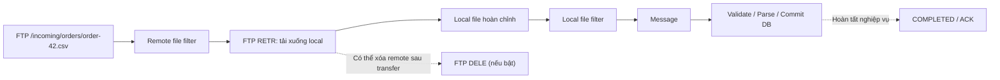
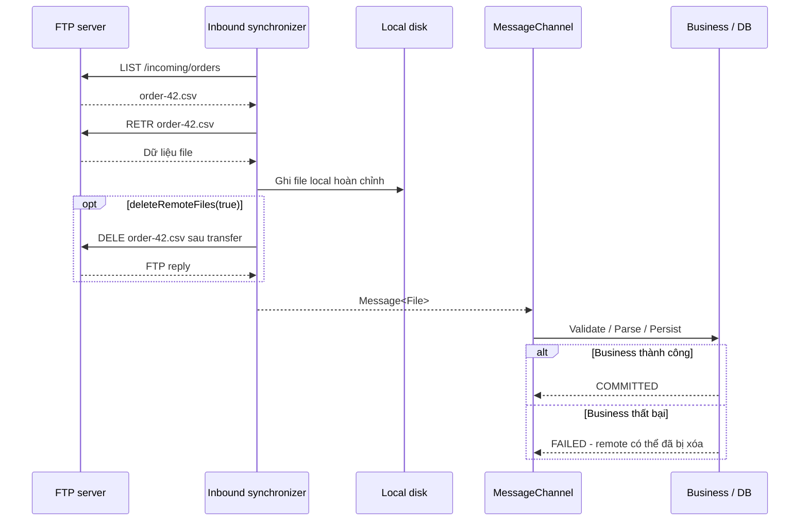
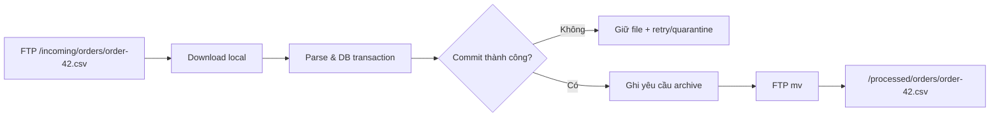
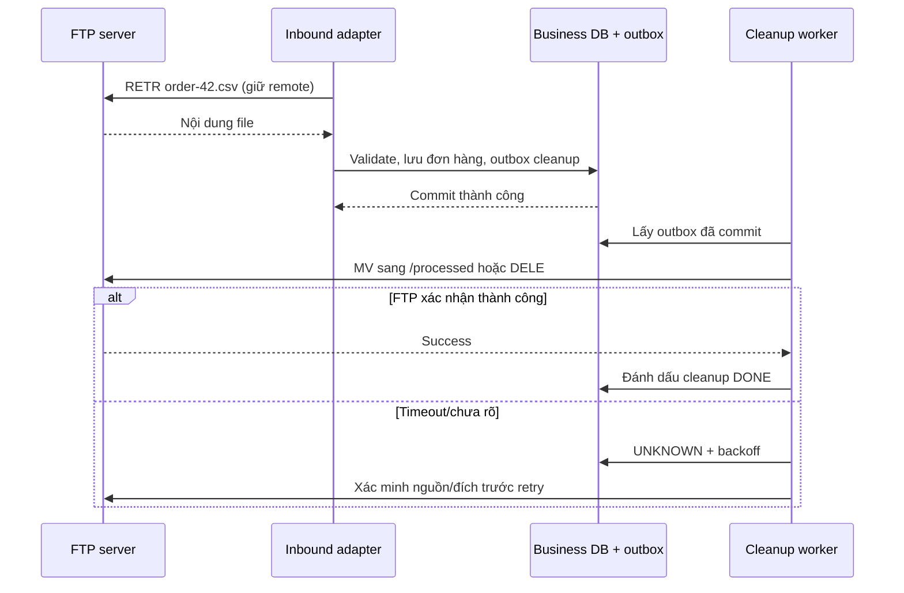

# Xóa hoặc giữ tệp từ xa sau khi lấy trong Spring Integration FTP

## 1. Bài toán: tải thành công rồi có nên xóa file trên FTP?

Một đối tác đưa file `orders-2026-11-23.csv` vào thư mục `/incoming/orders` của FTP server. Ứng dụng Spring Boot dùng FTP inbound adapter để tải file về `/data/ftp/orders`, phát `Message<File>` vào `MessageChannel`, phân tích CSV và ghi đơn hàng vào database. Sau mỗi lần chạy, nhóm vận hành đặt câu hỏi: **có nên xóa file remote ngay sau khi tải để tránh nhận trùng và giảm dung lượng server?**

Câu trả lời phụ thuộc **ý nghĩa của việc “nhận thành công”**:

- Nếu nhận thành công chỉ có nghĩa **bản sao local đã được tải đầy đủ**, Spring Integration có cơ chế xóa file remote sau khi transfer thành công.
- Nếu nhận thành công nghĩa là **đã parse, kiểm tra và commit dữ liệu nghiệp vụ**, việc xóa ngay sau transfer có thể quá sớm.
- Nếu yêu cầu **đối soát, replay, audit hoặc lưu trữ theo thời hạn**, giữ lại hoặc chuyển file sang thư mục archive thường phù hợp hơn xóa ngay.

Đây là bài **“Xóa hoặc giữ tệp từ xa sau khi lấy”** thuộc chương **Adapter FTP** của module **SPRING_INTEGRATION_ADAPTERS**. Module thực hành kết nối hệ thống ngoài bằng inbound/outbound adapter, gateway, poller và `MessageChannel`, với file, SFTP, HTTP, JMS, AMQP, Kafka và cơ sở dữ liệu; đồng thời nhấn mạnh hợp đồng message, xử lý lỗi và vòng đời kết nối. Bài này tập trung vào **quyền sở hữu file nguồn, thời điểm xóa, giữ file, đổi tên/archive và khả năng khôi phục sau lỗi**.

Sau bài học, bạn có thể:

1. Giải thích sự khác nhau giữa **tải thành công**, **phát message thành công** và **xử lý nghiệp vụ thành công**.
2. Cấu hình `deleteRemoteFiles(false/true)` cho FTP inbound adapter và hiểu thời điểm tác dụng.
3. Hiểu tùy chọn `-D` của FTP outbound gateway `get` và `mget`.
4. So sánh chiến lược **giữ nguyên, đổi tên/di chuyển, xóa sau commit, xóa ngay sau transfer**.
5. Xây dựng quy trình idempotency, replay, retention, audit và cleanup khi mất kết nối.
6. Chẩn đoán các trường hợp file remote bị xóa nhưng DB chưa commit, file bị tải lặp hoặc xóa không thành công.

## 2. Ba mốc thành công không đồng nhất

FTP inbound adapter kiểu đồng bộ về local thực hiện hai công đoạn: **synchronizer tải file từ server** và **local file source phát message**. Service phía sau mới thực hiện nghiệp vụ.



| Mốc | Đã chứng minh được điều gì? | Chưa chứng minh điều gì? |
| --- | --- | --- |
| **Transfer thành công** | FTP client đã nhận và ghi bản sao local theo hợp đồng đồng bộ | Chưa chắc message được phát hoặc handler đã chạy |
| **Message được phát** | File local đã được local source gửi đến channel/consumer | Chưa chắc DB transaction đã commit; xử lý async còn có thể chưa bắt đầu |
| **Business commit thành công** | Những bản ghi và trạng thái nghiệp vụ đã commit theo thiết kế | Chưa chắc đối tác đã nhận ACK cuối cùng hoặc file remote đã được dọn |

**Điểm mấu chốt:** `deleteRemoteFiles(true)` của inbound synchronizer và `get/mget -D` của outbound gateway được định nghĩa theo **kết quả transfer**, không theo transaction database ở downstream. Chúng không biến FTP và database thành một giao dịch nguyên tử.

Ví dụ nếu file đã tải thành công lúc 10:00:00, bị xóa trên FTP lúc 10:00:01 nhưng service parse lỗi lúc 10:00:05, thì file nguồn trên server đã không còn. Khả năng thử lại phụ thuộc vào bản local, nơi lưu trữ bền vững hoặc bản sao/backup do đối tác cung cấp.

## 3. Những lựa chọn vòng đời file remote

| Chiến lược | Điều xảy ra với file nguồn | Ưu điểm | Rủi ro và điều kiện |
| --- | --- | --- | --- |
| **Giữ nguyên remote** | File tiếp tục nằm ở inbox sau khi tải | Replay và đối soát dễ; không cần quyền xóa | Cần filter/metadata, chính sách retention; server có thể đầy |
| **Đổi tên hoặc chuyển sang `/processed`** | File rời khỏi inbox nhưng vẫn còn trên server | Dễ tách hàng chờ và archive | Cần quyền rename; hai bước commit DB và rename không nguyên tử |
| **Xóa sau khi DB commit** | File nguồn chỉ được xóa sau khi nghiệp vụ xác nhận | Giảm rủi ro xóa trước khi xử lý | Cần cleanup worker/retry/audit; kết quả xóa có thể không chắc chắn |
| **Xóa ngay sau transfer** | Inbound/gateway xóa file khi truyền thành công | Giảm tồn đọng remote, đơn giản với dropbox “nhận là đủ” | Mất nguồn replay nếu downstream lỗi hoặc pod mất local file |
| **Giữ trong thời hạn rồi xóa** | File được archive/giữ N ngày trước cleanup | Có cửa sổ phục hồi và audit | Cần job quản lý tuổi file, dung lượng, quyền và chính sách tuân thủ |

Không có lựa chọn nào đúng cho mọi hệ thống. Với dữ liệu giao dịch, một lựa chọn thường an toàn hơn là **giữ nguồn hoặc chuyển vào archive có thời hạn**, dùng persistent filter để tránh nhận lặp, chỉ dọn sau khi đã có bằng chứng nghiệp vụ.

### 3.1. Hai câu hỏi cần ký kết với đối tác

**Ai sở hữu file sau khi giao?** Đối tác có thể xem file trong `/incoming` là tài sản của họ và không cho client xóa; hoặc dùng mô hình “FTP dropbox” nơi client phải nhận rồi tự dọn. Việc có quyền `DELE` về mặt kỹ thuật **không đồng nghĩa có quyền nghiệp vụ để xóa**.

**Xác nhận nhận file dựa trên điều kiện nào?** Có đối tác coi một lần tải FTP thành công là đã bàn giao. Có đối tác đòi file `.ack`, API callback, bảng đối soát hoặc xác nhận số bản ghi. Hãy ghi rõ ACK nào cho phép archive hoặc xóa.

## 4. Cấu hình mặc định an toàn: giữ file remote

Trong FTP inbound adapter, thuộc tính `deleteRemoteFiles` mặc định là **false**: file remote **không bị xóa chỉ vì đã tải**. Bạn có thể khai báo tường minh để thể hiện chính sách.

### 4.1. Dependency và thông số ứng dụng

Ví dụ Maven trong dự án Spring Boot sử dụng BOM tương thích:

```xml
<dependencies>
    <dependency>
        <groupId>org.springframework.boot</groupId>
        <artifactId>spring-boot-starter-integration</artifactId>
    </dependency>
    <dependency>
        <groupId>org.springframework.integration</groupId>
        <artifactId>spring-integration-ftp</artifactId>
    </dependency>
</dependencies>
```

```yaml
# application.yml
partner:
  ftp:
    host: ${PARTNER_FTP_HOST}
    port: ${PARTNER_FTP_PORT:21}
    username: ${PARTNER_FTP_USER}
    password: ${PARTNER_FTP_PASSWORD}
    remote-inbox: /incoming/orders
    local-inbox: /data/ftp/orders
```

Đường dẫn remote nằm **trên FTP server**; local nằm trên máy hoặc container chạy Spring Boot. Cần bảo đảm local directory có quyền ghi, đủ dung lượng và lưu trữ bền vững nếu có yêu cầu replay. Không hardcode credential; dùng secret manager hoặc biến môi trường.

### 4.2. SessionFactory cho FTP

```java
import org.apache.commons.net.ftp.FTP;
import org.apache.commons.net.ftp.FTPClient;
import org.apache.commons.net.ftp.FTPFile;
import org.springframework.beans.factory.annotation.Value;
import org.springframework.context.annotation.Bean;
import org.springframework.context.annotation.Configuration;
import org.springframework.integration.file.remote.session.CachingSessionFactory;
import org.springframework.integration.file.remote.session.SessionFactory;
import org.springframework.integration.ftp.session.DefaultFtpSessionFactory;

@Configuration
public class PartnerFtpConnectionConfiguration {

    @Bean("ordersFtpSessionFactory")
    public SessionFactory<FTPFile> ordersFtpSessionFactory(
            @Value("${partner.ftp.host}") String host,
            @Value("${partner.ftp.port}") int port,
            @Value("${partner.ftp.username}") String user,
            @Value("${partner.ftp.password}") String password) {

        DefaultFtpSessionFactory target = new DefaultFtpSessionFactory();
        target.setHost(host);
        target.setPort(port);
        target.setUsername(user);
        target.setPassword(password);
        target.setClientMode(FTPClient.PASSIVE_LOCAL_DATA_CONNECTION_MODE);
        target.setFileType(FTP.BINARY_FILE_TYPE);
        target.setConnectTimeout(10_000);
        target.setDefaultTimeout(10_000);
        target.setDataTimeout(30_000);

        CachingSessionFactory<FTPFile> cache =
                new CachingSessionFactory<>(target, 4);
        cache.setSessionWaitTimeout(5_000);
        cache.setTestSession(true);
        return cache;
    }
}
```

`PASSIVE_LOCAL_DATA_CONNECTION_MODE` phù hợp với nhiều client sau NAT/firewall; server vẫn cần mở dải cổng dữ liệu passive. `BINARY_FILE_TYPE` giúp giữ nguyên byte. Session cache tái sử dụng kết nối và giới hạn số phiên, **không** lưu trạng thái file đã được tải/đã commit.

### 4.3. Inbound flow giữ remote và chống tải/phát lặp

```java
import java.io.File;
import java.time.Duration;
import org.apache.commons.net.ftp.FTPFile;
import org.springframework.beans.factory.annotation.Qualifier;
import org.springframework.beans.factory.annotation.Value;
import org.springframework.context.annotation.Bean;
import org.springframework.context.annotation.Configuration;
import org.springframework.integration.dsl.IntegrationFlow;
import org.springframework.integration.dsl.Pollers;
import org.springframework.integration.file.filters.ChainFileListFilter;
import org.springframework.integration.file.filters.FileSystemPersistentAcceptOnceFileListFilter;
import org.springframework.integration.file.remote.session.SessionFactory;
import org.springframework.integration.ftp.dsl.Ftp;
import org.springframework.integration.ftp.filters.FtpPersistentAcceptOnceFileListFilter;
import org.springframework.integration.ftp.filters.FtpSimplePatternFileListFilter;
import org.springframework.integration.metadata.ConcurrentMetadataStore;
import org.springframework.integration.metadata.SimpleMetadataStore;

@Configuration
public class OrdersFtpKeepRemoteConfiguration {

    // Để demo: trạng thái mất khi ứng dụng restart.
    // Production: thay bằng ConcurrentMetadataStore bền vững/chia sẻ phù hợp.
    @Bean("ordersMetadataStore")
    public ConcurrentMetadataStore ordersMetadataStore() {
        return new SimpleMetadataStore();
    }

    @Bean
    public IntegrationFlow ordersFtpInboundFlow(
            @Qualifier("ordersFtpSessionFactory")
            SessionFactory<FTPFile> sessionFactory,
            @Qualifier("ordersMetadataStore")
            ConcurrentMetadataStore metadataStore,
            @Value("${partner.ftp.remote-inbox}") String remoteInbox,
            @Value("${partner.ftp.local-inbox}") String localInbox) {

        ChainFileListFilter<FTPFile> remoteFilters = new ChainFileListFilter<>();
        remoteFilters.addFilter(new FtpSimplePatternFileListFilter("*.csv"));
        remoteFilters.addFilter(
                new FtpPersistentAcceptOnceFileListFilter(
                        metadataStore, "orders-remote:"));

        return IntegrationFlow.from(
                Ftp.inboundAdapter(sessionFactory)
                        .remoteDirectory(remoteInbox)
                        .localDirectory(new File(localInbox))
                        .autoCreateLocalDirectory(true)
                        .temporaryFileSuffix(".downloading")
                        .preserveTimestamp(true)
                        .deleteRemoteFiles(false) // CHÍNH SÁCH GIỮ REMOTE
                        .maxFetchSize(5)
                        .filter(remoteFilters)
                        .localFilter(
                                new FileSystemPersistentAcceptOnceFileListFilter(
                                        metadataStore, "orders-local:")),
                endpoint -> endpoint.poller(
                        Pollers.fixedDelay(Duration.ofSeconds(20))
                                .maxMessagesPerPoll(3)))
                .channel("ftpOrdersReceived")
                .get();
    }
}
```

**Giải thích các điểm liên quan đến giữ file:**

| Thành phần | Tác dụng |
| --- | --- |
| `deleteRemoteFiles(false)` | Không yêu cầu xóa tệp nguồn trên FTP khi transfer xong |
| `FtpPersistentAcceptOnceFileListFilter` | Ghi dấu file remote đã chọn/tải theo tên và timestamp, tránh fetch lặp không cần thiết |
| `FileSystemPersistentAcceptOnceFileListFilter` | Ghi dấu file local đã được phát message, tránh phát đi phát lại |
| `temporaryFileSuffix(".downloading")` | Dùng tên tạm **ở local** trong lúc tải; chỉ công bố tên cuối sau khi hoàn tất |
| `maxFetchSize(5)` | Giới hạn số file remote được lấy trong một đợt fetch |
| `maxMessagesPerPoll(3)` | Giới hạn số message phát ở một lượt poll; khác với giới hạn fetch |

**Lưu ý:** `SimpleMetadataStore` trong ví dụ nằm trong RAM; việc dùng lớp filter có chữ “Persistent” không làm dữ liệu tự tồn tại qua restart. Hệ thống vận hành cần metadata store bền vững/chia sẻ nếu cần, cùng chính sách idempotency ở tầng database. Giữ file remote **không tự ngăn tải lặp** nếu cấu hình filter hoặc metadata sai.

Khi remote file có cùng tên nhưng timestamp thay đổi, remote persistent filter có thể xem là bản mới. Nếu đối tác thay đổi nội dung mà vẫn giữ nguyên timestamp, filter có thể không phát hiện. Để quản lý phiên bản chặt chẽ, hãy dùng tên file/batch ID bất biến, checksum hoặc manifest theo hợp đồng.

## 5. Bật xóa sau khi đồng bộ: `deleteRemoteFiles(true)`

Spring Integration cung cấp cấu hình:

```java
// Chỉ minh họa phần thay đổi trong Ftp.inboundAdapter(...).
// Không bật khi chưa thống nhất chính sách xóa với đối tác.
Ftp.inboundAdapter(sessionFactory)
        .remoteDirectory("/incoming/orders")
        .localDirectory(new File("/data/ftp/orders"))
        .autoCreateLocalDirectory(true)
        .temporaryFileSuffix(".downloading")
        .deleteRemoteFiles(true);
```

`deleteRemoteFiles(true)` yêu cầu inbound synchronizer **xóa remote file sau khi transfer thành công**. Đây là cấu hình có thể phá hủy dữ liệu nguồn, dù code chỉ là một dòng boolean.

### 5.1. “Sau khi transfer thành công” cụ thể là khi nào?

Theo hợp đồng của inbound synchronizer:

1. Lấy danh sách file remote và chọn qua filter.
2. Thực hiện FTP transfer về local, thường dùng tên tạm ở local.
3. Khi transfer thành công, synchronizer có thể yêu cầu FTP server **xóa file remote** bằng thao tác tương ứng.
4. Local file source phát `Message<File>` từ bản local theo poller/local filter.
5. Consumer tiếp tục xử lý CSV, gọi HTTP/JMS/Kafka hoặc ghi database.

Vì công đoạn xóa remote nằm trong **tầng synchronizer**, không được hiểu `deleteRemoteFiles(true)` là “chỉ xóa sau khi bước 5 thành công”. Không có database transaction tự động bao trùm bước FTP `DELE` và bước ghi DB.



Sơ đồ thể hiện **thứ tự logic**, không cam kết mọi server đều trả mã reply giống nhau hoặc các thao tác thuộc cùng một giao dịch. Nếu lệnh xóa không hoàn tất hoặc mất phản hồi, trạng thái remote có thể không chắc chắn và cần quan sát lại.

### 5.2. Khi nào xóa ngay có thể chấp nhận được?

Một số hệ thống dùng FTP như **hộp thư nhận tạm thời**. Cam kết với đối tác là: sau khi file đã được chuyển tới **kho landing bền vững**, bên nhận có quyền xóa nguồn; bước xử lý nghiệp vụ có thể làm lại hoàn toàn từ landing zone.

Chỉ cân nhắc chế độ này khi đồng thời có:

- **Hợp đồng rõ ràng** rằng quyền sở hữu file chuyển sang bên nhận sau transfer.
- **Kho bản sao local/durable** có backup, kiểm tra được tính toàn vẹn và không mất khi pod restart.
- **Idempotency và khả năng replay** từ bản sao, độc lập với file remote.
- **Quy trình xử lý lỗi** nếu download thành công nhưng xóa thất bại, hoặc đã xóa nhưng handler tiếp tục lỗi.
- **Quyền FTP tối thiểu** cho thao tác xóa và logging/audit đầy đủ.

Nếu file local chỉ nằm trong filesystem tạm của container, bật `deleteRemoteFiles(true)` có thể khiến hệ thống **mất cả remote lẫn local** khi pod bị thay thế. Đây là lý do quan trọng để không bật cấu hình này theo thói quen.

## 6. FTP outbound gateway `get/mget -D`

Ngoài inbound adapter, FTP outbound gateway hỗ trợ các lệnh **request–reply** để chủ động lấy file theo tên/thư mục.

| Lệnh | Không có `-D` | Có `-D` |
| --- | --- | --- |
| `get` | Tải một file remote về local và trả `File` | Tải thành công rồi xóa **file remote** |
| `mget` | Tải nhiều file phù hợp và trả `List<File>` | Xóa **từng file remote sau khi file đó được transfer thành công** |

Nếu dùng `FileExistsMode.IGNORE` và file local đích đã tồn tại nên **không thực sự tải**, gateway **không xóa remote file đó** chỉ vì có tùy chọn `-D`. Đây là chi tiết quan trọng khi bạn kiểm thử hoặc muốn tránh xóa nhầm.

### 6.1. Ví dụ `get -D` có chủ đích

```java
import java.io.File;
import org.apache.commons.net.ftp.FTPFile;
import org.springframework.beans.factory.annotation.Qualifier;
import org.springframework.context.annotation.Bean;
import org.springframework.context.annotation.Configuration;
import org.springframework.integration.dsl.IntegrationFlow;
import org.springframework.integration.file.remote.session.SessionFactory;
import org.springframework.integration.file.support.FileExistsMode;
import org.springframework.integration.ftp.dsl.Ftp;

@Configuration
public class DeleteOnGetGatewayConfiguration {

    @Bean
    public IntegrationFlow deleteAfterGetFlow(
            @Qualifier("ordersFtpSessionFactory")
            SessionFactory<FTPFile> sessionFactory) {

        return IntegrationFlow.from("ftpGetAndDeleteRequests")
                .handle(Ftp.outboundGateway(sessionFactory, "get", "payload")
                        .options("-D")
                        .localDirectory(new File("/data/ftp/landing"))
                        .autoCreateLocalDirectory(true)
                        .fileExistsMode(FileExistsMode.FAIL))
                .get();
    }
}
```

Request payload của gateway là đường dẫn file remote, ví dụ `"/incoming/orders/order-42.csv"`. Khi transfer thành công, reply payload thông thường là `File` local. Tùy chọn `-D` khiến gateway cố xóa **remote file** sau transfer, **không chờ business handler xử lý file reply**. Đoạn code chỉ minh họa cách hoạt động; không nên dùng nguyên xi cho inbox chứa dữ liệu chưa có bản sao bền vững.

Với `mget -D`, nhiều file có thể được tải/xóa một phần trước khi lỗi xảy ra. Không mặc định retry cả batch là an toàn: cần xem kết quả từng file, file local, trạng thái remote và thông tin `PartialSuccessException` của gateway.

### 6.2. Không đánh đồng `-D` với lệnh `rm`

`get -D` / `mget -D` mang ý nghĩa “**tải rồi xóa**” ngay trong command workflow của gateway. Trong khi đó, `rm` là một **lệnh xóa remote độc lập** và có reply Boolean:

```java
// Một outbound gateway chuyên xóa remote.
// Chỉ triển khai sau bước phê duyệt/commit nghiệp vụ phù hợp.
IntegrationFlow.from("ftpDeleteRequests")
        .handle(Ftp.outboundGateway(sessionFactory, "rm", "payload"))
        .get();
```

Một lời gọi `rm` có thể được thực hiện **sau khi** database commit và sau khi cleanup worker nhận một yêu cầu hợp lệ. Cách này tạo cơ hội kiểm soát nghiệp vụ tốt hơn `-D`, nhưng vẫn không biến hai bước DB và FTP thành transaction nguyên tử.

## 7. Giữ file + filter: tránh trùng mà không xóa nguồn

Một hiểu nhầm phổ biến là phải xóa remote để inbound poller không tải lại file. Thực tế, **remote file filter** có thể chặn fetch lại file chưa thay đổi, còn **local file filter** có thể chặn phát lại bản local đã xử lý.

```text
REMOTE FTP                           LOCAL DISK
order-42.csv                         order-42.csv
     |                                    |
     v                                    v
FtpPersistentAcceptOnce...        FileSystemPersistentAcceptOnce...
     |                                    |
     +-- Có được tải nữa?                 +-- Có phát Message<File> nữa?
```

| Vấn đề | Cơ chế giải quyết | Không được nhầm với |
| --- | --- | --- |
| Không tải lại file remote đã thấy | `FtpPersistentAcceptOnceFileListFilter` | Xóa remote |
| Không phát lại file local cùng phiên bản | `FileSystemPersistentAcceptOnceFileListFilter` | Commit DB |
| Giữ trạng thái qua restart | `ConcurrentMetadataStore` bền vững phù hợp | File local tự trở nên bền vững |
| Ngăn ghi đơn hàng trùng | Unique key/idempotency ở DB hoặc consumer | Accept-once filter |
| Giải phóng dung lượng FTP server | Archive/retention/cleanup theo policy | Reset session cache |

**Metadata không phải bằng chứng hoàn tất nghiệp vụ.** Remote filter có thể đánh dấu file đã chấp nhận trước khi tải; local filter có thể đánh dấu file đã phát trước khi DB commit. Nếu business handler lỗi, poller không tự biết cần phát lại file. Vì vậy retention và retry phải được thiết kế độc lập với filter.

### 7.1. Điều gì xảy ra sau restart?

Nếu dùng `SimpleMetadataStore` trong RAM, trạng thái filter có thể mất sau khi JVM khởi động lại. File remote vẫn còn nên có thể được tải lại; file local còn đó nên cũng có thể được phát lại. Ngược lại, nếu dùng store bền vững nhưng local disk bị xóa khi pod restart, hệ thống có thể còn metadata “đã tải” mà không còn bản local. Vì thế:

1. Dùng **lưu trữ local bền vững hoặc object storage** khi khả năng replay là yêu cầu bắt buộc.
2. Tách trạng thái `RECEIVED / PROCESSING / COMPLETED / FAILED` ở tầng nghiệp vụ.
3. Thiết kế job **reconcile** metadata, file local, file remote và trạng thái DB.
4. Khi buộc phải phát lại, chỉ điều chỉnh trạng thái của **đúng batch/file** theo quy trình được kiểm soát.

Không xóa toàn bộ key metadata để “đọc lại một file”, cũng không bật `deleteRemoteFiles(true)` chỉ vì gặp duplicate.

## 8. Di chuyển file remote sang archive thay vì xóa

Một chiến lược cân bằng là giữ file nguồn cho đến khi database commit, rồi **đổi tên hoặc di chuyển remote** sang `/processed`. FTP outbound gateway cung cấp lệnh `mv`; nó thực hiện thao tác rename/di chuyển qua FTP.



Ví dụ flow `mv`:

```java
import org.apache.commons.net.ftp.FTPFile;
import org.springframework.beans.factory.annotation.Qualifier;
import org.springframework.context.annotation.Bean;
import org.springframework.context.annotation.Configuration;
import org.springframework.integration.dsl.IntegrationFlow;
import org.springframework.integration.file.remote.session.SessionFactory;
import org.springframework.integration.ftp.dsl.Ftp;

@Configuration
public class FtpArchiveGatewayConfiguration {

    @Bean
    public IntegrationFlow moveAfterCommitFlow(
            @Qualifier("ordersFtpSessionFactory")
            SessionFactory<FTPFile> sessionFactory) {

        return IntegrationFlow.from("ftpMoveAfterCommitRequests")
                .handle(Ftp.outboundGateway(sessionFactory, "mv", "payload")
                        .renameExpression("headers['file_renameTo']"))
                .get();
    }
}
```

Một request cần chứa **đường dẫn nguồn** trong payload, ví dụ `/incoming/orders/order-42.csv`, và **đường dẫn đích** qua header `file_renameTo`, ví dụ `/processed/orders/order-42.csv`. Reply thành công là kết quả thao tác rename ở mức FTP.

**Cẩn trọng:**

- Account FTP cần quyền rename/di chuyển và quyền phù hợp trên thư mục đích.
- Không phải mọi server đều hỗ trợ rename xuyên filesystem hoặc bảo đảm tính nguyên tử tuyệt đối.
- Nếu rename thành công nhưng caller timeout, retry từ tên cũ có thể trả “file not found”; cần kiểm tra cả **nguồn và đích**.
- Một file trong `/processed` vẫn chiếm dung lượng server: cần retention/cleanup tiếp theo nếu muốn giới hạn storage.
- Không tự động coi `mv` thành công là ACK từ đối tác nếu hợp đồng yêu cầu xác nhận riêng.

## 9. Mô hình an toàn hơn: commit DB rồi mới cleanup

Một kiến trúc thực tế thường có **hai giai đoạn độc lập**, tránh xóa remote trong inbound synchronizer:

**Giai đoạn A — nhận và xử lý:**

1. Đối tác upload `order-42.csv.uploading` rồi rename thành `order-42.csv` khi hoàn tất.
2. Inbound adapter dùng `deleteRemoteFiles(false)`, tải file về local/durable landing.
3. Service validate tên/nội dung, so khớp checksum/manifest nếu có.
4. Ghi dữ liệu vào DB với khóa idempotency, đồng thời lưu trạng thái batch `COMPLETED`.
5. Trong cùng transaction DB, ghi một **yêu cầu cleanup** (outbox record) với đường dẫn remote đã xác minh, batch ID và hành động `ARCHIVE` hoặc `DELETE`.

**Giai đoạn B — cleanup có kiểm soát:**

6. Worker đọc outbox sau commit, xác nhận chính sách retention và quyền thao tác.
7. Worker kiểm tra đúng file remote theo tên/đường dẫn/batch, trạng thái version/checksum nếu cần.
8. Worker gửi lệnh FTP `mv` hoặc `rm`, ghi lại kết quả và thời điểm.
9. Nếu mạng đứt/timeout, worker đánh dấu kết quả `UNKNOWN`, đối chiếu remote rồi mới quyết định retry.
10. Khi archive/delete đã xác minh, cập nhật outbox `DONE`; giữ audit record theo thời hạn.



**Không gọi FTP `rm` bên trong một DB transaction rồi hy vọng `@Transactional` tự rollback được lệnh FTP.** FTP server không tham gia transaction của database. Sử dụng outbox giúp ghi “đã commit dữ liệu” và “cần cleanup” cùng một transaction DB; cleanup là tác vụ riêng có trạng thái và khả năng thử lại.

### 9.1. Minh họa cleanup thủ công bằng session callback

Nếu ứng dụng đã có một yêu cầu cleanup được phê duyệt, có thể dùng `FtpRemoteFileTemplate`:

```java
import org.apache.commons.net.ftp.FTPFile;
import org.springframework.beans.factory.annotation.Qualifier;
import org.springframework.integration.file.remote.session.SessionFactory;
import org.springframework.integration.ftp.session.FtpRemoteFileTemplate;
import org.springframework.stereotype.Service;

@Service
public class ApprovedFtpCleanup {

    private final FtpRemoteFileTemplate template;

    public ApprovedFtpCleanup(
            @Qualifier("ordersFtpSessionFactory")
            SessionFactory<FTPFile> factory) {
        this.template = new FtpRemoteFileTemplate(factory);
    }

    // Chỉ gọi sau khi quyền và điều kiện nghiệp vụ đã được kiểm tra.
    public boolean removeApprovedFile(String remotePath) {
        Boolean removed = template.execute(
                session -> session.remove(remotePath));
        return Boolean.TRUE.equals(removed);
    }
}
```

Đoạn code **không phải một hệ thống cleanup production hoàn chỉnh**: caller phải xác thực quyền, giới hạn remote path trong inbox/đúng đối tác, ghi audit, đối chiếu version và xử lý trường hợp kết quả không chắc chắn. `false` hoặc exception không tự chứng minh file chưa bị xóa; timeout có thể xảy ra sau khi server đã thực hiện lệnh.

### 9.2. Xóa idempotent không phải “xóa lại vô hạn”

Giả sử `DELE order-42.csv` đã thành công nhưng mạng đứt trước khi client nhận phản hồi. Lần retry có thể thấy file không tồn tại. Khi đó cần:

- Xác minh batch đã `COMPLETED` và cleanup request trỏ đúng file.
- Xác minh file đúng tên không còn trong vùng nguồn; nếu đã archive, kiểm tra vùng đích.
- Ghi trạng thái `DONE` nếu đủ bằng chứng **đã đạt trạng thái đích mong muốn**.
- Không xóa file khác chỉ vì file dự kiến không còn.

Đây là **idempotency ở cấp workflow**: một thao tác lặp lại không được làm thay đổi dữ liệu ngoài phạm vi của batch đã xác minh.

## 10. Những cửa sổ lỗi cần phân tích trước khi bật delete

| Thời điểm lỗi | Nếu giữ remote | Nếu xóa ngay sau transfer | Hướng phục hồi |
| --- | --- | --- | --- |
| Trước khi tải | Nguồn còn nguyên | Thường chưa có lệnh xóa | Poll lại khi kết nối hoạt động |
| Giữa lúc `RETR` | Nguồn thường vẫn còn | Chưa được coi là transfer hoàn tất; cần xác minh trạng thái | Dọn file local tạm, retry có kiểm soát |
| Transfer xong, trước khi phát message | File remote còn để replay | Remote có thể đã bị xóa | Kiểm tra bản local/durable landing, metadata và khả năng replay |
| Message đã phát, DB lỗi | Có thể đọc lại nguồn | Remote có thể đã mất | Retry từ local/durable copy hoặc yêu cầu đối tác gửi lại |
| DB commit, chưa archive/delete | File còn trên FTP | Không áp dụng nếu đã xóa sớm | Cleanup worker xử lý theo outbox |
| Đã xóa trên FTP nhưng response mất | Có thể xảy ra nếu cleanup tách biệt | Có thể xảy ra ngay trong synchronizer/gateway | Đối chiếu tình trạng file thay vì retry mù |
| Pod mất local filesystem, metadata vẫn bền | Có thể lấy lại nếu policy cho phép | Không còn nguồn nếu remote đã xóa | Cần persistent volume/object storage/backup |
| Hai replica cùng quét inbox | Nguồn còn và có nguy cơ tranh claim | Một replica có thể xóa trước replica kia | Metadata chia sẻ, partition/leader và idempotency |

FTP **không cung cấp transaction phân tán** để bảo đảm đồng thời “tải xong, xóa nguồn, phát message, ghi DB” là một hành động nguyên tử. Vì vậy cần thiết kế các trạng thái trung gian và cơ chế kiểm tra thực tế sau sự cố.

## 11. Retention, quota, compliance và quyền FTP

Quy tắc giữ/xóa file không chỉ là cấu hình kỹ thuật mà còn liên quan trách nhiệm lưu trữ và khả năng kiểm toán.

### 11.1. Chính sách vòng đời được khuyến nghị ghi bằng hợp đồng

| Nội dung | Câu hỏi cần trả lời |
| --- | --- |
| Ownership | Ai sở hữu file nguồn sau khi transfer? Ai có quyền xóa? |
| Retention | Giữ bản gốc bao nhiêu ngày? Theo ngày tạo hay ngày xử lý thành công? |
| Replay | Khi downstream lỗi, có thể gửi lại file từ đâu và trong bao lâu? |
| Audit | Lưu batch ID, đường dẫn, tên file, checksum, thời điểm tải/đổi tên/xóa ở đâu? |
| Bảo mật | File chứa dữ liệu nhạy cảm không, cần FTPS/SFTP hay mã hóa lưu trữ không? |
| Quota | Ai theo dõi dung lượng FTP server và vùng local/archive? |
| Đồng thời | Nhiều replica có thể cùng nhận hoặc xóa file hay không? |
| Cleanup failure | Nếu rename/delete thất bại, ai chịu trách nhiệm và quy trình xử lý ra sao? |

Ví dụ hợp đồng rõ ràng hơn là: “Tệp được giữ trong `/processed` **7 ngày sau khi trạng thái batch đạt `COMPLETED`**, sau đó cleanup worker xóa nếu không có yêu cầu giữ phục vụ đối soát.” Đây chỉ là **mẫu chính sách**; thời hạn thực tế phải do nghiệp vụ, bảo mật và quy định áp dụng quyết định.

### 11.2. Cấp quyền tối thiểu

- **Ingest reader:** được `LIST` và `RETR` tại `/incoming`; không nhất thiết có `DELE`.
- **Archive worker:** được `RNFR/RNTO` đến vùng `/processed` nếu thiết kế dùng rename.
- **Cleanup worker:** chỉ được `DELE` trong vùng retention đã phê duyệt; không được xóa ngoài phạm vi.
- **Uploader của đối tác:** có quyền đưa file lên và rename tên tạm sang tên cuối theo hợp đồng.

Không sử dụng một tài khoản toàn quyền cho mọi công đoạn chỉ để tránh lỗi permission. Tách credential cũng giúp kiểm soát và audit thao tác phá hủy dữ liệu.

### 11.3. Bảo vệ đường dẫn trước khi xóa

Lệnh `rm` hoặc `DELE` không được nhận đường dẫn tùy ý từ HTTP request hoặc message header chưa xác thực. Nên:

1. Dùng **base remote directory tin cậy** được cấu hình theo đối tác.
2. Chỉ nhận **file name** đã qua whitelist, ví dụ batch ID chỉ chứa `[A-Za-z0-9_-]` và hậu tố `.csv`.
3. Từ chối `..`, separator ngoài mong muốn, path tuyệt đối ngoài vùng, tên rỗng hoặc ký tự điều khiển.
4. Đối chiếu remote path với trạng thái batch và identity của partner.
5. Áp dụng tài khoản FTP với quyền tối thiểu để phòng trường hợp code vẫn có lỗi.

Nếu hệ thống dùng FTPS, cần xác minh chứng chỉ TLS và hostname. Nếu đối tác dùng SFTP, phải dùng Spring Integration SFTP adapter/session factory tương ứng; chỉ đổi port FTP sang 22 không phải SFTP. Cả hai giao thức vẫn cần có chính sách retention/cleanup độc lập với thành công nghiệp vụ.

## 12. Chẩn đoán khi file bị xóa, không bị xóa hoặc xuất hiện lại

| Triệu chứng | Nguyên nhân đáng xem | Cách kiểm tra |
| --- | --- | --- |
| Remote file biến mất ngay sau download nhưng DB chưa có dữ liệu | Inbound `deleteRemoteFiles(true)` hoặc gateway `-D` | Kiểm tra cấu hình synchronizer/gateway và thời điểm business handler chạy |
| File remote vẫn còn dù kỳ vọng bị xóa | `deleteRemoteFiles(false)`, thiếu quyền `DELE`, server từ chối, transfer không hoàn tất | Kiểm tra cấu hình, FTP reply và log server |
| `get -D` không xóa file đã tồn tại ở local | `FileExistsMode.IGNORE` khiến transfer bị bỏ qua | Phân biệt “đã có local” với “vừa tải thành công” |
| `mget -D` chỉ xóa một phần file | Transfer batch thành công một phần, mất mạng hoặc file bị skip | Xem `PartialSuccessException` và đối chiếu từng file |
| Sau restart cùng file được tải lại | Metadata store chỉ ở RAM, filter prefix thay đổi | Kiểm tra remote/local persistent accept-once filter và store |
| Không tải lại được file cần retry | Metadata đã chấp nhận nhưng local/durable copy bị mất | Chạy reconcile có kiểm soát; không xóa tất cả metadata |
| Xóa trả timeout nhưng file không còn | Server có thể đã hoàn tất `DELE` trước khi reply mất | Kiểm tra remote path và audit, đánh dấu kết quả theo bằng chứng |
| `mv` trả lỗi vì không thấy file nguồn | Lần trước có thể đã rename thành công | Kiểm tra cả đường nguồn và đích, không retry vô hạn |
| Folder FTP đầy dù inbound đang chạy | Chính sách giữ nguồn không có retention/cleanup | Cân đối dung lượng, archive và lịch dọn có kiểm soát |
| Pod restart mất cả file đã tải | Local directory nằm trên filesystem tạm | Dùng volume/object storage và kiểm tra metadata |
| Một file được xử lý hai lần | Filter/metadata không bền hoặc thiếu idempotency | Kiểm tra trạng thái file và unique key nghiệp vụ |

### 12.1. Quy trình điều tra một batch bị mất

```text
1. Xác định batchId, partnerId, remotePath và thời điểm file được phát hành.
2. Kiểm tra FTP server: file còn trong inbox, đã vào processed hay đã bị xóa?
3. Kiểm tra cấu hình: deleteRemoteFiles, gateway -D, rm/mv cleanup.
4. Kiểm tra local/durable landing: file hoàn chỉnh, kích thước và checksum.
5. Kiểm tra metadata remote/local filter và thời điểm claim/phát message.
6. Kiểm tra DB: RECEIVED / PROCESSING / COMPLETED / FAILED.
7. Kiểm tra outbox/cleanup job và kết quả từng lệnh FTP.
8. Quyết định replay, khôi phục backup hoặc yêu cầu đối tác gửi lại.
```

Không dựa duy nhất vào sự tồn tại của tên file: có thể file đã bị ghi thiếu byte, thay phiên bản hoặc bị một pod khác xử lý. Quan sát log nên có correlation ID theo batch, nhưng **không ghi mật khẩu hay nội dung file nhạy cảm**.

## 13. Kịch bản kiểm thử tích hợp

Các kiểm thử dưới đây nên chạy với FTP server **riêng cho test**, các thư mục dữ liệu giả lập và tài khoản có quyền cụ thể. Không thử `deleteRemoteFiles(true)` hoặc `rm` với dữ liệu production.

| Kịch bản | Kỳ vọng |
| --- | --- |
| Inbound có `deleteRemoteFiles(false)` | Sau download, file remote vẫn tồn tại |
| Inbound có `deleteRemoteFiles(true)` | Sau transfer thành công, remote được yêu cầu xóa; downstream DB chưa phải điều kiện |
| Mất kết nối giữa `RETR` | Không xóa file chỉ vì đã nhận được một phần byte; kiểm tra file tạm/rollback |
| Download xong nhưng handler ném exception | Nếu xóa sau transfer, remote có thể đã mất; phải còn khả năng retry từ bản copy bền vững |
| `get -D` với file local chưa tồn tại | Transfer hoàn tất và remote được xóa theo quyền/quy tắc gateway |
| `get -D` + `FileExistsMode.IGNORE` khi local đã có | Không transfer và **không xóa remote** chỉ vì bị ignore |
| `mget -D`, file thứ ba lỗi | Kiểm tra file nào đã được tải/xóa; không retry cả batch mù |
| Xóa không có quyền FTP `DELE` | Lỗi được quan sát, remote không bị coi là đã dọn |
| `mv` sang `/processed` sau commit | File rời inbox và xuất hiện ở archive khi server cho phép |
| `mv` timeout sau rename | Cleanup worker xác minh source/target thay vì gọi lại vô hạn |
| DB commit rồi worker crash trước cleanup | Outbox còn yêu cầu chưa xử lý; worker khác tiếp tục được |
| Pod chết sau transfer, trước DB commit | Có thể khôi phục từ durable landing hoặc file remote còn lại theo policy |
| Hai replica cùng poll inbox | Không tạo bản ghi nghiệp vụ trùng; cleanup không xóa nhầm file của replica khác |
| Retention hết hạn | Chỉ xóa file đúng chính sách và lưu lại audit |

Các dòng trên là **kịch bản đề xuất**, không phải kết quả test đã chạy. Khi thực hiện, kiểm tra **nội dung byte hoặc checksum**, không chỉ kiểm tra tên file còn/không còn. Với kịch bản mất mạng, giới hạn thời gian thử và bảo đảm cleanup môi trường test.

## 14. Bài tập tình huống

**Bối cảnh:** Đối tác gửi `payments-<batchId>.csv` tới `/incoming/payments`. Ứng dụng có hai replica trong Kubernetes, dùng FTP inbound adapter poll 30 giây một lần. Thời gian xử lý một file có thể là 20 phút. File local hiện nằm trên filesystem tạm của pod. Đối tác muốn dọn file ngay để tiết kiệm quota FTP, nhưng nghiệp vụ yêu cầu có thể đối soát hoặc replay trong 14 ngày.

Hãy trả lời:

1. Có nên bật `deleteRemoteFiles(true)` ngay trong thiết kế hiện tại không? Vì sao?
2. `deleteRemoteFiles(true)` thực sự chờ **transfer** hay chờ **DB commit**?
3. Nếu chọn giữ remote, dùng những bộ lọc nào để giảm tải/phát message trùng?
4. Vì sao persistent metadata store chưa đủ nếu local filesystem của pod có thể mất?
5. Nếu chọn archive sau commit, cần thành phần nào nhận yêu cầu cleanup?
6. Với gateway `get -D` và `FileExistsMode.IGNORE`, file local đã tồn tại thì file remote có bị xóa không?
7. Nếu xóa remote thành công nhưng mất reply, nên làm gì trước khi retry?
8. Nếu `mget -D` đã tải và xóa 2/3 file trước khi lỗi, có an toàn để chạy lại cả batch không?
9. Cần những quyền FTP nào cho service chỉ nhận file và service dọn file?
10. Phải thiết kế retention 14 ngày thế nào để vừa giảm quota inbox, vừa đáp ứng replay?

**Gợi ý đáp án:** (1) Chưa; local storage tạm có nguy cơ mất file sau khi remote đã bị xóa. (2) Chờ transfer thành công, **không** chờ DB commit. (3) Remote `FtpPersistentAcceptOnceFileListFilter` và local `FileSystemPersistentAcceptOnceFileListFilter` với metadata bền vững; vẫn cần DB idempotency. (4) Metadata có thể còn dấu “đã nhận” nhưng bản local đã mất. (5) Outbox DB + cleanup worker có retry/audit, gọi `mv` hoặc `rm` khi điều kiện thỏa. (6) Không, vì transfer bị ignore. (7) Xác minh remote có còn hay đã vào archive trước khi quyết định. (8) Không; cần đối chiếu kết quả từng file. (9) Tài khoản ingest chỉ cần list/read; cleanup được cấp rename/delete đúng vùng. (10) Có thể chuyển sang `/processed` sau commit, giữ 14 ngày rồi dọn bằng job theo policy với lưu trữ và audit phù hợp.

## Tổng kết

- **Giữ file remote** là mặc định an toàn của FTP inbound adapter; cấu hình `deleteRemoteFiles(false)` giúp thể hiện chính sách rõ ràng.
- `deleteRemoteFiles(true)` và gateway `get/mget -D` xóa sau **transfer thành công**, không chờ database commit ở downstream. Với `FileExistsMode.IGNORE`, file bị bỏ qua không bị xóa bởi `-D`.
- **Không xóa remote chỉ để ngăn duplicate.** Dùng remote/local persistent filter, metadata store phù hợp và khóa idempotency nghiệp vụ.
- Nếu phải xóa sau xử lý, ưu tiên **DB commit → outbox → cleanup worker** hoặc archive/retention với audit. FTP và database không có transaction phân tán mặc định.
- Khi mạng đứt sau lệnh xóa/rename, trạng thái remote có thể không chắc chắn: cần đối chiếu source/target trước khi retry.
- Quyết định retention phải tính đến quyền sở hữu dữ liệu, bảo mật, quota, thời hạn replay, backup và nhiều replica.

## Tài liệu tham khảo

- [Spring Integration Reference — FTP Inbound Channel Adapter](https://docs.spring.io/spring-integration/reference/ftp/inbound.html)
- [Spring Integration API — RemoteFileInboundChannelAdapterSpec.deleteRemoteFiles](https://docs.spring.io/spring-integration/api/org/springframework/integration/file/dsl/RemoteFileInboundChannelAdapterSpec.html)
- [Spring Integration Reference — FTP Outbound Gateway (get/mget/rm/mv)](https://docs.spring.io/spring-integration/reference/ftp/outbound-gateway.html)
- [Spring Integration Reference — FTP Session Factory](https://docs.spring.io/spring-integration/reference/ftp/session-factory.html)
- [Spring Integration Reference — Remote Persistent File List Filters](https://docs.spring.io/spring-integration/reference/file/remote-persistent-flf.html)
- [Spring Integration Reference — Error Handling](https://docs.spring.io/spring-integration/reference/error-handling.html)
- [RFC 959 — File Transfer Protocol](https://www.rfc-editor.org/rfc/rfc959)
