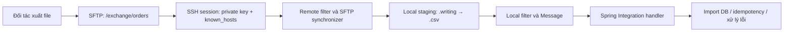

# SFTP inbound adapter với khóa SSH

## 1. Bài toán và mục tiêu

Giả sử một đối tác gửi file `orders-2026-11-23.csv` vào thư mục `/exchange/orders` trên máy chủ SFTP. Ứng dụng Spring Boot cần định kỳ phát hiện file mới, tải file về thư mục nội bộ rồi chuyển cho dịch vụ nhập đơn hàng. Đối tác không cung cấp mật khẩu tài khoản; hệ thống phải **xác thực bằng cặp khóa SSH**, đồng thời kiểm tra danh tính máy chủ trước khi truyền dữ liệu.

Đó là bài toán của **SFTP inbound channel adapter** trong Spring Integration: một thành phần đầu vào kết nối đến hệ thống ngoài, đồng bộ file từ SFTP về máy cục bộ và tạo `Message<File>` cho các bước xử lý tiếp theo. Nó kết hợp `SessionFactory`, bộ lọc file, `poller` và `MessageChannel`/handler trong một integration flow. Không nên nhầm inbound (nhận file), outbound adapter (gửi file) và outbound gateway (thực hiện thao tác theo yêu cầu).

Sau bài này, bạn có thể:

- Phân biệt **private key của ứng dụng**, **public key được cấp quyền trên server** và **host key của server**.
- Cấu hình `DefaultSftpSessionFactory` với private key, passphrase và `known_hosts`.
- Tạo Java DSL flow dùng SFTP inbound adapter, poller và bộ lọc file.
- Giải thích vòng đời tải file, các lần poll, chống xử lý trùng và giới hạn của cơ chế retry.
- Đề xuất cách vận hành an toàn khi file lớn, nhiều instance hoặc kết nối bị gián đoạn.

> **Phạm vi phiên bản:** ví dụ dùng API của **Spring Integration 6.x trở lên** (SFTP client dựa trên Apache MINA SSHD). Với Spring Integration 5.x, một số lớp/kiểu của SFTP dựa trên JSch khác với ví dụ này. Hãy để Spring Boot BOM quản lý phiên bản thư viện tương thích với dự án.

## 2. Kiến trúc: từ SFTP đến MessageChannel



Luồng thực tế diễn ra như sau:

1. **Poller** kích hoạt adapter theo chu kỳ, ví dụ 10 giây. SFTP inbound không tự nhận push event từ server; nó chủ động thăm dò thư mục từ xa.
2. **Session factory** mở/lấy phiên SFTP qua SSH. Client chứng minh quyền truy cập bằng private key; client cũng xác minh host key của server từ `known_hosts`.
3. **Remote filter** quyết định file nào đủ điều kiện tải (đuôi `.csv`, chưa thấy trước đó, file đã ghi xong...). Synchronizer tải file phù hợp về ổ đĩa cục bộ.
4. File đang tải thường mang hậu tố tạm `.writing`; sau khi tải xong, nó được đổi sang tên thật. **Local filter** ngăn file tạm hoặc file đã được phát message bị lấy lại không mong muốn.
5. `FileReadingMessageSource` phát `Message` với **payload là `java.io.File` ở máy ứng dụng**. Handler đọc/kiểm tra nội dung, lưu kết quả và quản lý lỗi nghiệp vụ.

Điểm quan trọng: **"đã tải xong" khác với "đã xử lý nghiệp vụ thành công"**. Adapter không tự bảo đảm giao dịch xuyên suốt từ server SFTP đến cơ sở dữ liệu. Điều này quyết định cách thiết kế retry và idempotency.

## 3. Khóa SSH: ai xác thực ai?

| Thành phần | Vị trí | Chức năng |
| --- | --- | --- |
| Client **private key** | Ứng dụng, secret mount hoặc secret manager | Chứng minh danh tính tài khoản SFTP; phải giữ bí mật |
| Client **public key** | `authorized_keys` của tài khoản trên SFTP server | Cho server biết khóa nào được phép đăng nhập |
| Server **host key** | Server SFTP | Chứng minh máy chủ đang kết nối là máy đã được tin cậy |
| File **`known_hosts`** | Phía ứng dụng | Lưu host public key đã xác minh để phát hiện server giả mạo hoặc key bị thay đổi |
| **Passphrase** | Secret của ứng dụng, nếu private key được mã hóa | Mở khóa private key; không phải mật khẩu đăng nhập SFTP |

Quy trình cấp khóa minh họa (Linux/macOS; với Windows có thể dùng OpenSSH):

```bash
# Chạy ở môi trường quản lý khóa an toàn, không commit khóa vào Git.
ssh-keygen -t ed25519 -a 100 -f ~/.ssh/sftp_orders -C "orders-import-client"

# Chỉ gửi public key cho quản trị viên SFTP để thêm vào authorized_keys.
cat ~/.ssh/sftp_orders.pub

# Xem fingerprint của public key để đối chiếu khi cấp quyền.
ssh-keygen -lf ~/.ssh/sftp_orders.pub
```

Quản trị viên phía SFTP cài **public key** vào tài khoản của ứng dụng. Ứng dụng giữ **private key** trong secret volume, ví dụ `/run/secrets/sftp_orders_key`, và chỉ cấp quyền đọc cho tiến trình cần sử dụng. Khi dùng Linux, có thể giới hạn quyền file bằng `chmod 600` cho private key. Không chép private key vào source code, container image, log hay cấu hình được commit.

Với host key, lấy bản ghi `known_hosts` từ hạ tầng tin cậy; nếu dùng `ssh-keyscan`, **phải xác minh fingerprint qua kênh độc lập** trước khi tin tưởng kết quả, vì riêng `ssh-keyscan` không xác thực máy chủ:

```bash
# Ví dụ lấy bản ghi cho server; kiểm tra fingerprint với quản trị viên trước khi sử dụng.
ssh-keyscan -p 22 -t ed25519 sftp.partner.example > sftp_known_hosts

# Thử đăng nhập bằng cùng key và known_hosts (thay hostname/user cho môi trường thật).
sftp -i ~/.ssh/sftp_orders \
  -o UserKnownHostsFile=./sftp_known_hosts \
  -P 22 orders_app@sftp.partner.example
```

**Không bật `allowUnknownKeys=true` trên production.** Thuộc tính này bỏ qua bước xác minh danh tính server và khiến kết nối dễ bị tấn công giả mạo. Trong trường hợp server luân chuyển host key, hãy xác nhận và cập nhật `known_hosts` theo quy trình thay khóa được quản lý.

## 4. Khai báo dependency và cấu hình

Nếu dùng Spring Boot với quản lý phiên bản dependency, chỉ cần thêm module SFTP. Ví dụ Gradle:

```groovy
dependencies {
    implementation 'org.springframework.integration:spring-integration-sftp'
}
```

Hoặc Maven (khi đã import Spring Boot BOM):

```xml
<dependency>
    <groupId>org.springframework.integration</groupId>
    <artifactId>spring-integration-sftp</artifactId>
</dependency>
```

Ví dụ `application.yml` dùng **placeholder môi trường**, không chứa khóa hay passphrase thật:

```yaml
app:
  sftp:
    host: ${SFTP_HOST:sftp.partner.example}
    port: ${SFTP_PORT:22}
    username: ${SFTP_USERNAME:orders_app}
    private-key: file:${SFTP_PRIVATE_KEY_FILE}
    private-key-passphrase: ${SFTP_PRIVATE_KEY_PASSPHRASE:}
    known-hosts: file:${SFTP_KNOWN_HOSTS_FILE}
    remote-directory: ${SFTP_REMOTE_DIRECTORY:/exchange/orders}
    local-directory: ${SFTP_LOCAL_DIRECTORY:./data/sftp-inbox}
```

`SFTP_PRIVATE_KEY_FILE` và `SFTP_KNOWN_HOSTS_FILE` phải là đường dẫn **đã được mount vào runtime**; hai biến này cần được cung cấp khi chạy ứng dụng. Nếu key không có passphrase, có thể để `SFTP_PRIVATE_KEY_PASSPHRASE` rỗng. Ứng dụng cần quyền **đọc** private key/known_hosts và quyền **ghi** thư mục `local-directory`.

## 5. Cấu hình SFTP session bằng private key

Trong Spring Integration 6.x+, kiểu file từ xa là `org.apache.sshd.sftp.client.SftpClient.DirEntry`. Tạo session factory riêng, đồng thời đặt giới hạn số session được cache:

```java
import org.apache.sshd.sftp.client.SftpClient;
import org.springframework.beans.factory.annotation.Value;
import org.springframework.context.annotation.Bean;
import org.springframework.context.annotation.Configuration;
import org.springframework.core.io.Resource;
import org.springframework.integration.file.remote.session.CachingSessionFactory;
import org.springframework.integration.file.remote.session.SessionFactory;
import org.springframework.integration.sftp.session.DefaultSftpSessionFactory;

@Configuration
public class SftpSessionConfig {

    @Bean
    public SessionFactory<SftpClient.DirEntry> sftpSessionFactory(
            @Value("${app.sftp.host}") String host,
            @Value("${app.sftp.port}") int port,
            @Value("${app.sftp.username}") String username,
            @Value("${app.sftp.private-key}") Resource privateKey,
            @Value("${app.sftp.private-key-passphrase:}") String passphrase,
            @Value("${app.sftp.known-hosts}") Resource knownHosts) {

        DefaultSftpSessionFactory delegate = new DefaultSftpSessionFactory(false);
        delegate.setHost(host);
        delegate.setPort(port);
        delegate.setUser(username);
        delegate.setPrivateKey(privateKey);
        if (!passphrase.isBlank()) {
            delegate.setPrivateKeyPassphrase(passphrase);
        }
        delegate.setKnownHostsResource(knownHosts);
        delegate.setAllowUnknownKeys(false);
        delegate.setTimeout(30_000);

        // Giới hạn số phiên có thể giữ trong pool; điều chỉnh theo tải thực tế.
        return new CachingSessionFactory<>(delegate, 4);
    }
}
```

Giải thích những lựa chọn có ảnh hưởng trực tiếp:

| Cấu hình | Ý nghĩa |
| --- | --- |
| `setPrivateKey(Resource)` | Tải private key cho xác thực SSH, thay vì cấu hình mật khẩu tài khoản |
| `setPrivateKeyPassphrase(...)` | Chỉ đặt khi private key đã mã hóa bằng passphrase |
| `setKnownHostsResource(...)` và `setAllowUnknownKeys(false)` | Xác minh host key của SFTP server dựa trên danh sách tin cậy |
| `setTimeout(30_000)` | Đặt thời hạn kết nối/I/O ở mức phù hợp; thời gian tính bằng mili giây |
| `DefaultSftpSessionFactory(false)` | Mặc định dùng kết nối SSH riêng cho session/channel; tránh giả định một kết nối dùng chung |
| `CachingSessionFactory<>(delegate, 4)` | Tái sử dụng session có giới hạn; session không được cache tự động nếu chỉ dùng factory gốc |

Khi cần chế độ chia sẻ một kết nối SSH giữa nhiều kênh (`new DefaultSftpSessionFactory(true)`), phải hiểu rõ vòng đời kết nối và **kết hợp với caching session factory**. Cấu hình `false` ở trên thường đơn giản hơn để bắt đầu. Với kết nối nhàn rỗi dài ngày, có thể xem xét `CachingSessionFactory#setTestSession(true)` và theo dõi giới hạn pool.

## 6. Tạo inbound integration flow bằng Java DSL

Giả sử chỉ nhận file CSV. Flow dưới đây giới hạn mỗi lần cần tải tối đa **5 file**, đồng thời phát tối đa **5 message/poll**. Handler đang in tên file để minh họa; trong ứng dụng thật, hãy thay bằng dịch vụ kiểm tra và import dữ liệu.

```java
import java.io.File;

import org.apache.sshd.sftp.client.SftpClient;
import org.springframework.beans.factory.annotation.Value;
import org.springframework.context.annotation.Bean;
import org.springframework.context.annotation.Configuration;
import org.springframework.integration.dsl.IntegrationFlow;
import org.springframework.integration.dsl.Pollers;
import org.springframework.integration.file.remote.session.SessionFactory;
import org.springframework.integration.sftp.dsl.Sftp;

@Configuration
public class SftpInboundFlowConfig {

    @Bean
    public IntegrationFlow sftpInboundFlow(
            SessionFactory<SftpClient.DirEntry> sftpSessionFactory,
            @Value("${app.sftp.remote-directory}") String remoteDirectory,
            @Value("${app.sftp.local-directory}") String localDirectory) {

        return IntegrationFlow
                .from(Sftp.inboundAdapter(sftpSessionFactory)
                                .remoteDirectory(remoteDirectory)
                                .regexFilter(".*\\.csv$")
                                .localDirectory(new File(localDirectory))
                                .autoCreateLocalDirectory(true)
                                .preserveTimestamp(true)
                                .deleteRemoteFiles(false)
                                .maxFetchSize(5),
                        endpoint -> endpoint.id("sftpCsvInbound")
                                .poller(Pollers.fixedDelay(10_000)
                                        .maxMessagesPerPoll(5)))
                .handle(message -> {
                    File localFile = (File) message.getPayload();
                    // Demo: thay bằng service import CSV có kiểm tra và idempotency.
                    System.out.println("Đã nhận file: " + localFile.getAbsolutePath());
                })
                .get();
    }
}
```

Trong ví dụ, `IntegrationFlow.from(...)` tạo inbound endpoint đọc file từ SFTP; `.handle(...)` là consumer cuối. Khi cần xử lý qua `MessageChannel` riêng, có thể thêm `.channel("sftpFilesChannel")` và đăng ký handler nhận từ kênh đó. `poller` có thể dùng fixed delay, fixed rate hoặc cấu hình động tùy tốc độ server và nhu cầu tiêu thụ.

Các tham số cần hiểu:

| Tùy chọn | Tác dụng và lưu ý |
| --- | --- |
| `remoteDirectory(...)` | Thư mục nguồn trên server; tài khoản phải có quyền liệt kê/đọc file |
| `regexFilter(".*\\.csv$")` | Lọc tên file từ xa theo regex. Với wildcard, có thể dùng `patternFilter("*.csv")` |
| `localDirectory(...)` | Thư mục staging nội bộ; đây là nơi `File` payload trỏ đến |
| `autoCreateLocalDirectory(true)` | Tạo thư mục local khi thiếu, nếu tiến trình có quyền |
| `preserveTimestamp(true)` | Giữ thời gian sửa đổi của file từ server; giúp một số chính sách lọc theo timestamp |
| `deleteRemoteFiles(false)` | Giữ file trên server sau khi tải. Nếu đặt `true`, file có thể bị xóa **sau transfer**, trước khi nghiệp vụ xử lý thành công |
| `maxFetchSize(5)` | Số file tối đa lấy từ server trong một lượt fetch; `-1` là không giới hạn |
| `maxMessagesPerPoll(5)` | Số message tối đa phát trong một lượt poll; khác với số file tải về |
| `temporaryFileSuffix(".writing")` | Mặc định dùng đuôi `.writing` khi đang tải để tránh phát file chưa hoàn chỉnh |

**Phân biệt giới hạn tải và giới hạn phát:** nếu `maxFetchSize=4` nhưng `maxMessagesPerPoll=2`, adapter có thể tải bốn file trong một lượt fetch, phát hai message ở poll hiện tại và phát các file cục bộ còn lại trong poll sau. Vì vậy hãy chọn hai giá trị theo dung lượng file, tốc độ xử lý và dung lượng ổ đĩa.

### Hai loại filter giải quyết hai bài toán

- **Remote filter** hoạt động trên file ở SFTP, trước khi tải. Nó có thể lọc theo tên, thời gian sửa đổi hoặc metadata đã tải.
- **Local filter** hoạt động trên file đã có trong `localDirectory`, trước khi phát message cho handler. Nó giúp tránh phát lặp file cục bộ và bỏ qua file `.writing`.

Theo mặc định, Spring Integration có các bộ lọc kiểu accept-once/persistent nhưng metadata mặc định được lưu **trong bộ nhớ**. Tên "persistent" mô tả thuật toán dùng `MetadataStore`; độ bền qua restart phụ thuộc **loại store** đang cấu hình. Trong triển khai nhiều instance, nên sử dụng `ConcurrentMetadataStore` dùng chung (ví dụ `RedisMetadataStore`) và chiến lược khóa/idempotency tương ứng. Khi thay filter bằng filter tùy chỉnh, hãy kết hợp rõ cả điều kiện tên file và điều kiện đã lấy trước đó, tránh vô tình bỏ mất một trong hai.

Ví dụ cách ghép điều kiện ở phía **remote** khi đã có một `ConcurrentMetadataStore` bền vững dùng chung:

```java
import org.apache.sshd.sftp.client.SftpClient;
import org.springframework.integration.file.filters.CompositeFileListFilter;
import org.springframework.integration.metadata.ConcurrentMetadataStore;
import org.springframework.integration.sftp.filters.SftpPersistentAcceptOnceFileListFilter;
import org.springframework.integration.sftp.filters.SftpRegexPatternFileListFilter;

CompositeFileListFilter<SftpClient.DirEntry> remoteFilter =
        new CompositeFileListFilter<SftpClient.DirEntry>()
                .addFilter(new SftpRegexPatternFileListFilter(".*\\.csv$"))
                .addFilter(new SftpPersistentAcceptOnceFileListFilter(
                        metadataStore, "orders-sftp-"));

// Dùng .filter(remoteFilter) trên Sftp.inboundAdapter(...) thay cho .regexFilter(...).
// metadataStore là bean ConcurrentMetadataStore đã cấu hình, chẳng hạn Redis.
```

Đối với hệ thống thực tế, đồng bộ thêm chính sách local filter và key idempotency nghiệp vụ. Metadata lọc file **không thay thế** giao dịch lưu dữ liệu: một file đã phát ra nhưng handler thất bại có thể không được tự phát lại, và một file đã xử lý thành công có thể xuất hiện lại khi trạng thái lọc thay đổi.

## 7. Chống nhận file đang ghi dở

SFTP server có thể hiển thị một file ngay khi đối tác mới bắt đầu upload. Nếu adapter tải quá sớm, file CSV có thể bị thiếu dòng hoặc header/trailer. Hậu tố `.writing` chỉ bảo vệ **lúc ứng dụng của bạn đang tải về local**, không chứng minh rằng **file trên server đã upload xong**.

Ba cách phối hợp với đối tác:

1. **Upload sang tên tạm rồi rename trên server**: đối tác ghi `orders.csv.part` và đổi thành `orders.csv` khi hoàn tất; adapter chỉ chọn `*.csv`. Đây thường là hợp đồng dễ kiểm soát nhất khi server hỗ trợ rename phù hợp.
2. **Marker file**: đối tác chỉ tạo `orders.csv.done` khi file dữ liệu đã hoàn thành; sử dụng `SftpSystemMarkerFilePresentFileListFilter` hoặc quy tắc tương đương để chỉ nhận file có marker.
3. **Độ tuổi file**: nếu không kiểm soát được bên gửi, cân nhắc `SftpLastModifiedFileListFilter` (Spring Integration 6.2+) để chỉ lấy file có thời điểm sửa đổi đủ cũ. Cần hiểu rằng độ tuổi chỉ là heuristic, không mạnh bằng giao thức rename/marker.

Nên thống nhất thêm encoding (UTF-8), định dạng CSV, dấu phân cách, múi giờ trong tên file, checksum nếu cần và cách báo một lô dữ liệu đã hoàn thành. Đây là **hợp đồng message ở ranh giới file**, dù cơ chế vận chuyển là SFTP.

## 8. Xử lý lỗi, retry và bảo đảm dữ liệu

Hãy chia lỗi thành hai giai đoạn thay vì giả định tất cả đều được adapter tự động retry:

| Giai đoạn | Ví dụ lỗi | Hành vi/định hướng xử lý |
| --- | --- | --- |
| Kết nối và xác thực | Không tới host, host key khác, private key sai, hết session | Poll sẽ gặp lỗi; phát hiện qua log/metrics, khắc phục nguyên nhân, dùng timeout và retry/backoff có kiểm soát |
| Liệt kê và tải file | Permission denied, SFTP ngắt khi tải, thiếu dung lượng local | Synchronizer có thể hoàn nguyên trạng thái remote filter cho file tải lỗi nếu filter hỗ trợ `ReversibleFileListFilter`; file có thể được thử lại ở poll sau |
| Xử lý sau khi có `File` payload | CSV hỏng, DB lỗi, validation thất bại | **Không tự động rollback remote/local filter** chỉ vì handler ném exception; cần cơ chế retry/recovery nghiệp vụ |
| Nhiều tiến trình/instance | Hai node thấy cùng file, restart khiến metadata mất | Dùng metadata store chung phù hợp, giới hạn fetch và idempotency ở DB |

Ví dụ quy trình import có khả năng chạy lại an toàn:

1. Ghi nhận file theo khóa nghiệp vụ bền vững, ví dụ `(partner_id, batch_id)` hoặc checksum đã được đối tác thống nhất. Tạo unique constraint ở DB.
2. Kiểm tra tên, định dạng, số dòng, checksum trước khi thực hiện cập nhật nghiệp vụ.
3. Chỉ đánh dấu batch **COMPLETED** cùng transaction ghi dữ liệu (hoặc thiết kế trạng thái bền vững tương đương). Nếu đã hoàn tất, lần retry phải trở thành no-op có kiểm soát.
4. Với lỗi tạm thời, ghi nhận trạng thái retry và điều phối tác vụ đọc lại bản local hoặc tải lại theo cơ chế được thiết kế. Với lỗi dữ liệu, chuyển vào vùng cách ly và thông báo phía gửi.
5. Khi đã xử lý và lưu dấu thành công, mới cân nhắc archive/xóa file theo thỏa thuận lưu trữ. **`deleteRemoteFiles(true)` không phải lời xác nhận nghiệp vụ đã commit**.

Trong hệ thống cần độ tin cậy cao, cân nhắc pipeline staging local → kiểm tra → import transaction → archive hoặc quarantine; gắn correlation ID (tên file/batch ID) vào log. Nếu xóa file local để kích hoạt xử lý lại, phải hiểu và đặt lại **local filter** phù hợp; nếu metadata remote vẫn nói đã nhận rồi thì xóa local một mình không chắc giúp tải lại từ SFTP.

## 9. Vận hành và bảo mật

**Tài nguyên và throughput.** Ước lượng dung lượng local theo kích thước file tối đa, số file mỗi lượt fetch và thời gian handler giữ file. Với file lớn, giảm `maxFetchSize` (thường 1–5 là điểm khởi đầu), theo dõi disk pressure và không poll nhanh hơn khả năng xử lý. Khi có nhiều node cùng đọc một nguồn, dùng kho metadata dùng chung và cân nhắc giảm `maxFetchSize` để tránh một node chiếm phần lớn file.

**Kết nối.** Giới hạn `CachingSessionFactory`, đặt timeout, theo dõi số session còn hoạt động; tránh tạo session vô hạn. Sau khi đổi mật khẩu khóa, đổi host key hoặc lỗi kết nối kéo dài, kiểm tra cách reset/refresh cache. Không log private key, passphrase hay toàn bộ nội dung file nhạy cảm.

**Giám sát.** Theo dõi số lần poll, số file phát hiện/tải/xử lý, thời gian từ lúc đối tác xuất file đến lúc import xong, số file ở staging, dung lượng đĩa, lỗi SSH, lỗi đọc CSV, backlog và số lần retry. Đặt cảnh báo nếu quá khoảng thời gian SLA không có file khi lẽ ra phải có; không thể suy ra "không có file" luôn là lỗi khi chưa có lịch giao nhận.

**Quản lý bí mật.** Secret manager hoặc volume có kiểm soát tốt hơn để private key trong `resources/`. Đặt quyền tối thiểu cho tài khoản trên SFTP: chỉ liệt kê/đọc vùng dữ liệu cần nhận, tránh quyền xóa nếu chưa có yêu cầu. Ghi lại quy trình luân chuyển client key, thay đổi host key và xác nhận fingerprint qua kênh độc lập.

## 10. Thực hành kiểm chứng đầu cuối

**Chuẩn bị:** có một server SFTP thử nghiệm, tài khoản được gắn public key, `known_hosts` đã được xác minh, ứng dụng đọc được hai file cấu hình bí mật và ghi được `local-directory`. Đặt `remote-directory=/exchange/orders` hoặc đường dẫn phù hợp với server.

**Kịch bản:**

1. Dùng lệnh `sftp -i ...` thử đăng nhập và `ls` đúng thư mục từ xa. Điều này giúp tách lỗi SSH/SFTP khỏi lỗi Spring Integration.
2. Upload `orders-001.csv.part` chứa dữ liệu hợp lệ. Chạy ứng dụng và xác nhận file `.part` **chưa** được nhận.
3. Rename file thành `orders-001.csv` trên server. Chờ một chu kỳ poll: mong đợi một file hoàn chỉnh trong local staging và một lần handler nhận `File` payload.
4. Để nguyên tên và timestamp, chờ thêm các poll: không nên phát message lặp trong cùng runtime theo bộ lọc mặc định.
5. Thử ngắt kết nối ngắn hạn, sửa sai quyền đọc thư mục, dùng private key không khớp và đổi host key trong môi trường test: xác nhận có log lỗi hữu ích, adapter không âm thầm bỏ qua host-key verification.
6. Thử handler ném exception **sau khi đã tải thành công**: kiểm tra cách ứng dụng ghi nhận thất bại và phục hồi; đừng giả định adapter sẽ tự phát lại file.
7. Restart ứng dụng và nếu có nhiều instance, thử cùng một file ở hai node để kiểm chứng **metadata bền vững và idempotency nghiệp vụ** theo thiết kế của bạn.

| Hiện tượng | Nơi kiểm tra đầu tiên |
| --- | --- |
| `Auth fail` hoặc `Permission denied` lúc đăng nhập | Username, public key trong `authorized_keys`, private key, passphrase, quyền truy cập |
| `UnknownHostKey` hoặc host key mismatch | Nội dung `known_hosts`, host/port, fingerprint chính thức, sự kiện thay khóa |
| Đăng nhập được nhưng không có file | `remoteDirectory`, quyền list/read, regex `*.csv`, thời điểm rename, trạng thái remote/local filter |
| File đang tải bị đứng hoặc lỗi I/O | Timeout, network, session cache, dung lượng đĩa, file còn ghi dở trên server |
| File bị nhận lại sau restart | Metadata store in-memory, timestamp/name thay đổi, cơ chế idempotency chưa bền vững |
| File đã tải nhưng không import | Handler, lỗi DB/validation, queue retry, trạng thái file local, filter không tự rollback sau xử lý lỗi |

## 11. Những sai lầm dễ gặp

- **Đặt `allowUnknownKeys(true)` để "sửa" lỗi kết nối:** bỏ qua host verification; cần sửa `known_hosts` sau khi đối chiếu fingerprint.
- **Nhầm public key đăng nhập với host key của server:** `authorized_keys` và `known_hosts` nằm ở hai phía, giải quyết hai hướng xác thực khác nhau.
- **Để `deleteRemoteFiles(true)` ngay từ đầu:** file có thể mất khỏi nguồn khi handler chưa import xong; quyết định xóa phải theo hợp đồng khôi phục và lưu trữ.
- **Chỉ dựa vào filter để bảo đảm exactly-once:** trạng thái filter không bao trùm transaction DB, restart và thay đổi timestamp; nghiệp vụ vẫn cần idempotency.
- **Chỉ lọc `.csv` và tin rằng file đã hoàn tất:** cần thỏa thuận rename, marker hoặc độ tuổi file để tránh tải file còn đang được ghi.
- **Bỏ qua giới hạn fetch:** một poll có thể kéo về nhiều file lớn, làm đầy ổ đĩa staging trước khi handler xử lý xong.

## 12. Câu hỏi tự kiểm tra

1. Vì sao cần cả `privateKey` **và** `knownHostsResource`, dù hai thành phần cùng thuộc SSH?
2. Điều gì xảy ra nếu `maxFetchSize=10` nhưng `maxMessagesPerPoll=2`?
3. Vì sao `temporaryFileSuffix=.writing` chưa đủ để tránh nhận file đối tác đang upload?
4. Nếu handler import DB thất bại sau khi adapter đã tải file, thành phần nào chịu trách nhiệm replay? Vì sao không thể chỉ dựa vào remote filter?
5. Với hai instance chạy song song, bạn cần những thành phần nào để giảm tải trùng và bảo đảm một batch không được commit hai lần?

## Tài liệu tham khảo

- [Spring Integration – SFTP Session Factory](https://docs.spring.io/spring-integration/reference/sftp/session-factory.html)
- [Spring Integration – SFTP Inbound Channel Adapter](https://docs.spring.io/spring-integration/reference/sftp/inbound.html)
- [Spring Integration – SFTP Session Caching](https://docs.spring.io/spring-integration/reference/sftp/session-caching.html)
- [Spring Integration – Remote Persistent File List Filters](https://docs.spring.io/spring-integration/reference/file/remote-persistent-flf.html)
- [Spring Integration – Controlling Remote File Fetching](https://docs.spring.io/spring-integration/reference/sftp/max-fetch.html)
- [Spring Integration – Remote File Information](https://docs.spring.io/spring-integration/reference/sftp/remote-file-info.html)
