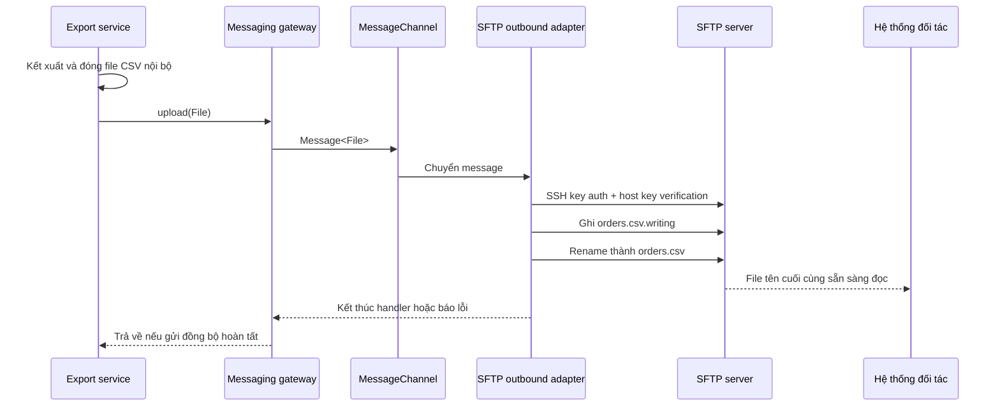
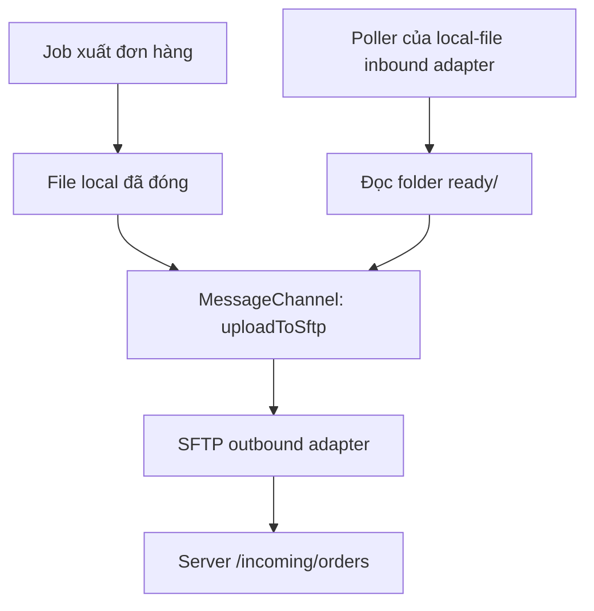

# SFTP outbound adapter tải tệp lên

## 1. Bài toán và mục tiêu

Một hệ thống bán hàng tổng hợp đơn hằng ngày thành `orders-2026-11-23.csv`. Đối tác yêu cầu nhận file qua **SFTP**, trong thư mục `/incoming/orders`, bằng tài khoản đăng nhập với **khóa SSH**. Hệ thống phải gửi đúng tệp đã hoàn tất, tránh ghi đè dữ liệu của kỳ trước, hạn chế để đối tác đọc file đang tải dở, và biết cách phục hồi khi mạng ngắt giữa chừng.

**SFTP outbound channel adapter** của Spring Integration là thành phần giải quyết thao tác truyền file **từ ứng dụng ra server SFTP**. Nó nhận một Spring `Message` (trong bài này là `Message<File>`), dùng `SessionFactory` mở phiên SSH/SFTP, rồi ghi payload thành file từ xa. Adapter thường là **điểm cuối một chiều** của integration flow: ứng dụng gọi gửi file, adapter thực hiện side effect, nhưng không tự phát ra một message phản hồi mang kết quả nghiệp vụ của đối tác.

Trong module `SPRING_INTEGRATION_ADAPTERS`, đây là ví dụ điển hình về **outbound adapter**, kết hợp với `MessageChannel`, Java DSL và gateway để nối ứng dụng với một hệ thống ngoài. Không nhầm nó với:

| Thành phần | Vai trò |
| --- | --- |
| **SFTP inbound adapter** | Poll thư mục server, tải file **về** máy ứng dụng và phát `Message<File>` |
| **SFTP outbound adapter** | Nhận message từ ứng dụng rồi **gửi** file lên server; luồng một chiều |
| **SFTP outbound gateway** | Thực hiện một lệnh SFTP theo mô hình request/reply, phù hợp khi cần kết quả từ thao tác như `ls`, `get`, `put`, `rm`, `mv` |
| **Poller** | Kích hoạt đầu vào được thăm dò theo chu kỳ; không bắt buộc đối với flow outbound bắt đầu từ `DirectChannel` và một lời gọi gateway |

Sau bài này, bạn có thể cấu hình session SFTP bằng SSH private key và `known_hosts`, triển khai outbound adapter bằng Java DSL, điều khiển cách đặt tên/ghi đè/publish file, gọi flow qua gateway và thiết kế retry có kiểm soát.

## 2. Kiến trúc luồng tải lên



Hai điểm cần nhớ:

1. **Nguồn dữ liệu đã sẵn sàng trước khi gửi.** Ứng dụng phải hoàn tất ghi và đóng file local, rồi mới phát `Message<File>`; adapter không biết một tiến trình khác còn đang ghi file nguồn hay không.
2. **Gửi file xong chưa có nghĩa đối tác đã nhập dữ liệu thành công.** Ghi và rename thành công qua SFTP chỉ xác nhận thao tác ở lớp truyền file. Nếu cần đối tác chấp nhận nghiệp vụ, phải có thêm acknowledgment (ACK), marker xác nhận, API callback hoặc quy trình đối soát.

`DirectChannel` thường khiến handler chạy trên luồng gọi hiện tại, vì vậy ngoại lệ có thể quay về nơi gọi gateway. Nếu thay bằng `ExecutorChannel` hoặc hàng đợi bất đồng bộ, người gọi có thể trả về trước khi tải lên hoàn tất. Việc chọn kênh quyết định cách báo lỗi và đánh dấu trạng thái.

## 3. Điều kiện tiên quyết và cấu hình SSH

Giả sử dự án Spring Boot dùng Spring Integration **6.x trở lên**, với client SFTP dựa trên Apache MINA SSHD. Nếu dự án dùng Spring Integration 5.x, một số lớp/kiểu SFTP có thể khác vì thư viện SSH bên dưới thay đổi.

Đối tác cần cấp hostname, port, tên người dùng, thư mục đích và chấp nhận **public key của ứng dụng** trong `authorized_keys` trên server. Ứng dụng giữ **private key** để chứng thực. Ngoài ra, ứng dụng phải có bản ghi **host public key của server** đã xác minh trong `known_hosts`, nhằm phát hiện kết nối đến sai máy chủ.

| Bí mật hoặc danh tính | Ai giữ? | Mục đích |
| --- | --- | --- |
| Private key của ứng dụng | Ứng dụng, qua secret mount/secret manager | Chứng thực client khi đăng nhập |
| Public key của ứng dụng | Tài khoản SFTP trên server | Cho phép client có private key tương ứng đăng nhập |
| Host key của server | Server và bản ghi `known_hosts` phía ứng dụng | Chứng thực server, phòng kết nối giả mạo |
| Passphrase (nếu có) | Secret của ứng dụng | Giải mã private key của client |

Tạo cặp khóa thử nghiệm bằng OpenSSH:

```bash
ssh-keygen -t ed25519 -a 100 -f ~/.ssh/partner_outbound -C "sales-export"

# Chuyển riêng file .pub cho quản trị viên server SFTP.
cat ~/.ssh/partner_outbound.pub
```

Lấy fingerprint host key từ quản trị viên qua kênh độc lập. Có thể dùng lệnh sau để **thu thập** bản ghi, nhưng **không được tin bản ghi chỉ vì `ssh-keyscan` chạy thành công**:

```bash
ssh-keyscan -p 22 -t ed25519 sftp.partner.example > partner_known_hosts

# So sánh fingerprint của bản ghi đã nhận với fingerprint được xác nhận.
ssh-keygen -lf partner_known_hosts

# Kiểm tra quyền login và ghi đúng thư mục bằng client SFTP trước khi chạy app.
sftp -i ~/.ssh/partner_outbound \
  -o UserKnownHostsFile=./partner_known_hosts \
  -P 22 exports_app@sftp.partner.example
```

Không lưu private key hoặc passphrase trong Git, Docker image hay log. Không bật `allowUnknownKeys(true)` để lách lỗi xác minh host key trên môi trường thực. Khi đối tác đổi host key, phải xác nhận fingerprint mới và cập nhật `known_hosts` theo quy trình kiểm soát thay đổi.

## 4. Dependency và application configuration

Khi dùng Spring Boot BOM để quản lý version, thêm module SFTP:

```groovy
// build.gradle
dependencies {
    implementation 'org.springframework.integration:spring-integration-sftp'
}
```

Hoặc Maven:

```xml
<dependency>
    <groupId>org.springframework.integration</groupId>
    <artifactId>spring-integration-sftp</artifactId>
</dependency>
```

Ví dụ `application.yml` không chứa credential trực tiếp:

```yaml
app:
  sftp:
    host: ${SFTP_HOST:sftp.partner.example}
    port: ${SFTP_PORT:22}
    username: ${SFTP_USERNAME:exports_app}
    private-key: file:${SFTP_PRIVATE_KEY_FILE}
    private-key-passphrase: ${SFTP_PRIVATE_KEY_PASSPHRASE:}
    known-hosts: file:${SFTP_KNOWN_HOSTS_FILE}
    remote-directory: ${SFTP_REMOTE_DIRECTORY:/incoming/orders}
```

`SFTP_PRIVATE_KEY_FILE` và `SFTP_KNOWN_HOSTS_FILE` là biến môi trường bắt buộc trong ví dụ này, trỏ đến file **có thật bên trong runtime**. Cấp quyền đọc tối thiểu cho các file đó; cấp quyền ghi cho tài khoản đối tác trên thư mục từ xa. Nếu private key không được bảo vệ bằng passphrase, có thể để biến `SFTP_PRIVATE_KEY_PASSPHRASE` rỗng.

## 5. Khai báo `SessionFactory` với SSH key

Trong Spring Integration 6.x+, kiểu phần tử SFTP từ xa là `SftpClient.DirEntry`. Dù bài này chỉ **upload** file, `SessionFactory<SftpClient.DirEntry>` vẫn là đối tượng adapter dùng để tạo phiên SFTP.

```java
import org.apache.sshd.sftp.client.SftpClient;
import org.springframework.beans.factory.annotation.Value;
import org.springframework.context.annotation.Bean;
import org.springframework.context.annotation.Configuration;
import org.springframework.core.io.Resource;
import org.springframework.integration.file.remote.session.CachingSessionFactory;
import org.springframework.integration.file.remote.session.SessionFactory;
import org.springframework.integration.sftp.session.DefaultSftpSessionFactory;

@Configuration
public class SftpConnectionConfig {

    @Bean
    public SessionFactory<SftpClient.DirEntry> outboundSftpSessionFactory(
            @Value("${app.sftp.host}") String host,
            @Value("${app.sftp.port}") int port,
            @Value("${app.sftp.username}") String username,
            @Value("${app.sftp.private-key}") Resource privateKey,
            @Value("${app.sftp.private-key-passphrase:}") String passphrase,
            @Value("${app.sftp.known-hosts}") Resource knownHosts) {

        DefaultSftpSessionFactory delegate = new DefaultSftpSessionFactory(false);
        delegate.setHost(host);
        delegate.setPort(port);
        delegate.setUser(username);
        delegate.setPrivateKey(privateKey);

        if (!passphrase.isBlank()) {
            delegate.setPrivateKeyPassphrase(passphrase);
        }

        delegate.setKnownHostsResource(knownHosts);
        delegate.setAllowUnknownKeys(false);
        delegate.setTimeout(30_000);

        // Giới hạn số session được giữ để tái sử dụng.
        return new CachingSessionFactory<>(delegate, 4);
    }
}
```

**Vì sao cache?** Mỗi lần tạo một kết nối SSH mới có chi phí thiết lập kết nối và xác thực. `CachingSessionFactory` giúp tái sử dụng session và giới hạn số session được cache. Chọn cỡ pool theo số upload song song và giới hạn kết nối từ đối tác; khi gặp lỗi phiên chết, cân nhắc kiểm tra session lúc lấy từ cache và cơ chế reset cache theo tài liệu phiên bản đang dùng.

`DefaultSftpSessionFactory(false)` chọn cách không chia sẻ một kết nối SSH dùng chung giữa các session. Có tùy chọn `true` cho chế độ shared session, nhưng cần đánh giá vòng đời kết nối và kết hợp cache đúng cách; không thay đổi tùy chọn này chỉ vì muốn tăng throughput.

## 6. Viết outbound adapter bằng Java DSL

Flow sau lắng nghe channel `uploadToSftp`; mỗi message mang một `java.io.File` hoàn chỉnh. Adapter ghi tệp vào `/incoming/orders`, upload qua tên tạm `.writing`, rồi rename thành tên cuối. Nếu đích đã có file cùng tên, ví dụ dùng `FileExistsMode.FAIL` để báo xung đột cho ứng dụng quyết định cách xử lý.

```java
import java.io.File;

import org.apache.sshd.sftp.client.SftpClient;
import org.springframework.beans.factory.annotation.Value;
import org.springframework.context.annotation.Bean;
import org.springframework.context.annotation.Configuration;
import org.springframework.integration.annotation.IntegrationComponentScan;
import org.springframework.integration.dsl.IntegrationFlow;
import org.springframework.integration.file.remote.session.SessionFactory;
import org.springframework.integration.file.support.FileExistsMode;
import org.springframework.integration.sftp.dsl.Sftp;

@Configuration
@IntegrationComponentScan(basePackageClasses = SftpUploadGateway.class)
public class SftpOutboundFlowConfig {

    @Bean
    public IntegrationFlow sftpOutboundFlow(
            SessionFactory<SftpClient.DirEntry> outboundSftpSessionFactory,
            @Value("${app.sftp.remote-directory}") String remoteDirectory) {

        return IntegrationFlow.from("uploadToSftp")
                .handle(Sftp.outboundAdapter(
                                outboundSftpSessionFactory, FileExistsMode.FAIL)
                        .remoteDirectory(remoteDirectory)
                        .autoCreateDirectory(false)
                        .useTemporaryFileName(true)
                        .temporaryFileSuffix(".writing")
                        .fileNameGenerator(message ->
                                ((File) message.getPayload()).getName()))
                .get();
    }
}
```

Trong dự án thực tế, đặt `SftpUploadGateway` cùng package được `@IntegrationComponentScan` quét (hoặc điều chỉnh package scan); ví dụ bên dưới là một interface độc lập:

```java
import java.io.File;
import org.springframework.integration.annotation.Gateway;
import org.springframework.integration.annotation.MessagingGateway;

@MessagingGateway
public interface SftpUploadGateway {

    @Gateway(requestChannel = "uploadToSftp")
    void upload(File localFile);
}
```

Một service đã tạo xong CSV có thể gọi:

```java
import java.nio.file.Files;
import java.nio.file.Path;
import org.springframework.stereotype.Service;

@Service
public class OrdersExportService {
    private final SftpUploadGateway sftpUploadGateway;

    public OrdersExportService(SftpUploadGateway sftpUploadGateway) {
        this.sftpUploadGateway = sftpUploadGateway;
    }

    public void publish(Path completedCsv) {
        if (!Files.isRegularFile(completedCsv) || !Files.isReadable(completedCsv)) {
            throw new IllegalArgumentException("File CSV chưa sẵn sàng: " + completedCsv);
        }

        // Chỉ truyền file sau khi tiến trình kết xuất đã đóng stream ghi.
        sftpUploadGateway.upload(completedCsv.toFile());
    }
}
```

`@MessagingGateway` biến lời gọi Java thông thường thành `Message<File>` đi vào `uploadToSftp`. Khi channel mặc định là đồng bộ và handler báo lỗi, lời gọi `upload()` có thể ném exception. Vì method trả `void`, **không có response payload chứa xác nhận nghiệp vụ**. Nếu cần điều tra file nào được gửi thành công, hãy tự lưu batch ID, tên file, trạng thái gửi, thời điểm và correlation ID trong kho dữ liệu nghiệp vụ.

### Ý nghĩa của các tùy chọn adapter

| API/tùy chọn | Ý nghĩa |
| --- | --- |
| `Sftp.outboundAdapter(sessionFactory, FileExistsMode.FAIL)` | Tạo message handler outbound với quy tắc xử lý file đích đã tồn tại |
| `remoteDirectory(...)` | Thư mục **trên server SFTP**, không phải local path |
| `autoCreateDirectory(false)` | Không tự tạo thư mục đích; yêu cầu thư mục được provision trước để giới hạn quyền ghi |
| `useTemporaryFileName(true)` | Ghi trước qua tên tạm rồi rename sau khi transfer hoàn thành |
| `temporaryFileSuffix(".writing")` | Hậu tố file đang truyền; đối tác nên bỏ qua các file mang hậu tố này |
| `fileNameGenerator(...)` | Quyết định tên file đích bằng tên của payload `File`; cần kiểm soát input để tránh tên nguy hiểm |
| `IntegrationFlow.from("uploadToSftp")` | Điểm vào của message channel; không cần poller khi gửi trực tiếp qua gateway |

**Tại sao `autoCreateDirectory(false)`?** Trong môi trường tích hợp với đối tác, thư mục đích thường được bên vận hành cấp sẵn và giới hạn quyền. Nếu hợp đồng cho phép ứng dụng tự tạo thư mục động, có thể chọn `true`, nhưng chỉ sau khi thiết kế rõ danh sách thư mục được phép.

## 7. Tên file đích và chính sách file đã tồn tại

Tên file là một phần của **hợp đồng tích hợp**. Ví dụ `orders-2026-11-23.csv` mang thông tin kỳ dữ liệu; nếu xuất lại cùng kỳ, ứng dụng cần chính sách rõ ràng đối với dữ liệu cũ.

| `FileExistsMode` | Khi tên đích đã tồn tại | Khi phù hợp |
| --- | --- | --- |
| `FAIL` | Báo lỗi thay vì âm thầm ghi đè | Mỗi batch có một tên duy nhất; sự trùng tên phải được điều tra |
| `IGNORE` | Không thay thế file đã có | Nguồn gửi chấp nhận bỏ qua file trùng và có cơ chế đối soát riêng |
| `REPLACE` | Ghi đè nội dung file đích | Hợp đồng cho phép publish phiên bản mới đè lên bản cũ |
| `APPEND` | Ghi thêm vào file hiện có | Chỉ khi đối tác chủ động dùng hợp đồng append và kiểm soát retry |

**Lưu ý về retry:** `APPEND` đặc biệt dễ nhân đôi dữ liệu nếu upload đã ghi được một phần nhưng kết nối bị ngắt. `REPLACE` cũng có nguy cơ thay đổi file đối tác đã xử lý. Với batch immutable, nên sử dụng `FAIL` và tên file duy nhất, chẳng hạn `orders-20261123-batch-0042.csv`.

Ví dụ quy ước tên:

```text
orders-20261123-batch-0042.csv      # Tên cuối cùng, công bố cho đối tác
orders-20261123-batch-0042.csv.writing  # Tên tạm trong lúc tải
```

Không để một client khác cùng upload vào **cùng tên cuối/tên tạm**. Nếu nhiều luồng cùng tạo tên giống nhau, vẫn có thể va chạm dù `FileExistsMode.FAIL`; nên cấp batch ID duy nhất, dùng cơ chế điều phối hoặc chia thư mục theo đối tác/ngày. Nếu tên file được rút từ message header, HTTP input hay dữ liệu người dùng, phải xác thực theo allowlist (ví dụ chỉ ký tự chữ, số, dấu chấm, gạch ngang, gạch dưới; không chứa `..`, `/` hoặc `\\`).

### Hậu tố `.writing` có tác dụng gì?

Khi `useTemporaryFileName(true)`, adapter truyền nội dung tới đường dẫn tạm, ví dụ `orders.csv.writing`, rồi đổi tên sang `orders.csv` khi truyền xong. Đối tác chỉ quan sát và xử lý tên cuối, nhờ đó giảm nguy cơ mở file thiếu byte.

Tuy nhiên, **rename không phải cam kết transaction nghiệp vụ xuyên hệ thống**. Hành vi nguyên tử và khả năng rename có thể phụ thuộc server SFTP, filesystem và quyền truy cập. Nếu transfer đứt giữa chừng, file `.writing` có thể còn lại; cần quy trình dọn file tạm đủ cũ sau khi xác nhận không có upload đang chạy. Nếu server không hỗ trợ rename theo cách yêu cầu, thử nghiệm trên server thực tế và thỏa thuận marker file riêng, hoặc dùng protocol khác thích hợp.

## 8. Từ producer đến `MessageChannel`: khi nào cần poller?

Ví dụ trên là luồng **push nội bộ**: service gọi `sftpUploadGateway.upload()` sau khi kết xuất xong, gateway phát message vào channel, outbound adapter tải lên. Không cần poller vì có một lời gọi trực tiếp kích hoạt luồng.

Trong thực tế có hai kiểu khởi phát thường gặp:

1. **Event-driven:** sau khi nghiệp vụ commit và file được sinh xong, một job/service gửi message hoặc ghi outbox event để worker truyền file.
2. **Scheduled/polling:** một flow khác dùng file inbound adapter để thăm dò thư mục local `ready/`; mỗi file mới được đưa vào `MessageChannel`, sau đó chuyển tiếp đến SFTP outbound adapter. Poller nằm ở **nguồn phát hiện file**, không phải phần tải file ra SFTP.



Nếu producer phát message bất đồng bộ, cần hàng đợi bền vững hoặc cơ chế ghi nhận trạng thái để không mất yêu cầu sau khi tiến trình chết. `DirectChannel` phù hợp với ví dụ đơn giản và phản hồi lỗi trực tiếp; `ExecutorChannel` tăng khả năng tách luồng nhưng khiến việc xác định kết quả upload cần thêm trạng thái/giám sát.

## 9. Xử lý lỗi và retry an toàn

Hãy phân biệt **lỗi chắc chắn chưa gửi được** và **lỗi không biết server đã nhận đủ chưa**. Ví dụ mất kết nối ngay sau rename: client có thể nhận timeout, trong khi file cuối cùng đã có trên server. Retry mù với `REPLACE` hoặc `APPEND` có thể gây mất hoặc nhân đôi dữ liệu.

| Tình huống | Cách xử lý đề xuất |
| --- | --- |
| Sai private key/passphrase, host key mismatch | Dừng và báo lỗi cấu hình/bảo mật; không retry liên tục để che lỗi |
| Thư mục đích không tồn tại hoặc không có quyền ghi | Kiểm tra `remoteDirectory`, account permission và `autoCreateDirectory` |
| Mạng ngắt trước hoặc trong transfer | Retry có backoff sau khi kiểm tra trạng thái đích, quản lý file `.writing` còn sót |
| Timeout gần lúc rename thành công | Đối soát remote filename/kích thước hoặc xác nhận của đối tác trước khi gửi lại |
| `FileExistsMode.FAIL` vì tên đã có | Xác định file là batch đã gửi hay va chạm tên; không tự chuyển sang `REPLACE` |
| Đĩa local thiếu file/đang bị ghi | Hoàn tất và cố định file nguồn, kiểm tra path/permission trước khi phát message |
| Server đầy dung lượng hoặc hạn chế quota | Báo vận hành, chờ giải phóng tài nguyên; không retry dồn dập |

Quy trình upload bền vững thường có một bảng/outbox lưu `(partner_id, batch_id, filename, checksum, status, attempt_count, last_error)`. Đặt **unique constraint** cho `(partner_id, batch_id)` để một batch không được công bố hai lần do sự kiện lặp.

```text
PREPARED  --file đã kết xuất, checksum cố định-->
SENDING   --thực hiện upload + rename-->
UPLOADED  --xác minh thao tác truyền file xong-->
CONFIRMED --đối tác đã gửi ACK/đối soát thành công-->
ARCHIVED

Khi lỗi: SENDING -> RETRY_PENDING hoặc NEEDS_RECONCILIATION
```

Với retry tạm thời, giới hạn số lần, dùng backoff tăng dần và thêm jitter khi nhiều worker. Spring Integration có `RequestHandlerRetryAdvice` để bao quanh outbound handler khi cần, nhưng phải **chỉ retry các lỗi có thể thử lại**, ghi nhận số lần thử và giải quyết trạng thái không chắc chắn trước khi retry một upload có thể đã hoàn tất. Tránh dùng retry vô hạn khi key/permission sai.

Để phòng gửi trùng, có thể kết hợp:

- Tên file bất biến theo batch ID, nội dung cố định và checksum để đối soát.
- Record trạng thái bền vững; khi process restart, tiếp tục các bản ghi `RETRY_PENDING` thay vì chỉ dựa vào message in-memory.
- Idempotency ở phía đối tác hoặc hợp đồng ACK. SFTP đơn thuần không cung cấp exactly-once nghiệp vụ.
- Phân biệt upload đã thành công với import của đối tác đã thành công; ACK ở lớp nghiệp vụ mới đủ để đánh dấu `CONFIRMED`.

## 10. Bảo mật và vận hành

**Phân quyền.** Tài khoản SFTP nên chỉ được ghi vào `/incoming/orders` và liệt kê/rename trong phạm vi cần thiết. Nếu ứng dụng không xóa hoặc đọc file cũ, tránh cấp các quyền đó. Không cho phép người dùng cuối trực tiếp quyết định remote path.

**Cấu trúc file.** Hai bên thống nhất encoding, CSV delimiter, schema, timezone, tên batch, quy tắc nén/mã hóa nếu cần và thời điểm được phép đọc file. Với dữ liệu nhạy cảm, SFTP mã hóa đường truyền nhưng không tự mã hóa file nằm trên server; cân nhắc mã hóa nội dung ở tầng ứng dụng theo yêu cầu bảo mật.

**Quản lý khóa.** Dùng secret manager/volume thay vì bundle khóa trong JAR; giới hạn quyền đọc, theo dõi thời hạn/luân chuyển key, xác minh thay đổi host key. Khi hết quyền hoặc host key thay đổi bất ngờ, cảnh báo để kiểm tra thay vì tự động chấp nhận mọi máy chủ.

**Thông lượng.** Khi file lớn hoặc có nhiều batch, theo dõi dung lượng local còn lại, kết nối SFTP đồng thời, độ trễ gửi file, tỷ lệ lỗi và số batch chờ ACK. Điều chỉnh `CachingSessionFactory` và số worker theo quota của SFTP server. Không mở vô hạn các upload song song vào cùng thư mục chỉ vì mạng nội bộ nhanh.

**Quan sát.** Ghi log có cấu trúc với `partner_id`, `batch_id`, `filename`, `bytes`, trạng thái, `attempt` và thời gian xử lý; che credential và thông tin nhạy cảm. Đo thời gian upload, backlog, stale `.writing` và số batch `NEEDS_RECONCILIATION`. Đặt cảnh báo theo thời hạn giao file đã thỏa thuận, không dựa riêng vào việc có log "send".

## 11. Thực hành xác minh đầu cuối

Chuẩn bị một server SFTP **thử nghiệm** với tài khoản chấp nhận public key của ứng dụng, `known_hosts` đã xác minh, thư mục `/incoming/orders` có quyền ghi và một CSV hoàn chỉnh trên ổ đĩa local. Bật log tích hợp ở mức phù hợp nhưng không in secret.

1. **Đường thành công:** gọi `gateway.upload(file)`, xác minh xuất hiện `orders.csv.writing` khi đang truyền (đối với file đủ lớn để quan sát), cuối cùng là `orders.csv` đúng kích thước và checksum mong đợi.
2. **Trùng tên:** gửi lại cùng file với `FileExistsMode.FAIL`, xác nhận lỗi được báo cho ứng dụng và không âm thầm ghi đè file từ xa.
3. **Host key sai:** dùng `known_hosts` không khớp trong test, xác nhận kết nối bị từ chối; không sửa bằng `allowUnknownKeys(true)`.
4. **Lỗi quyền:** bỏ quyền ghi/rename ở thư mục test; quan sát lỗi và quyết định khôi phục thay vì retry liên tục.
5. **Mất mạng:** ngắt truyền giữa chừng; kiểm tra tên tạm còn sót và quy trình retry/cleanup.
6. **Timeout không chắc trạng thái:** mô phỏng sự cố sau khi rename; kiểm tra remote state trước khi cho phép job gửi lại cùng batch.
7. **Restart:** dừng và khởi chạy lại ứng dụng với batch đang chờ; kiểm tra hệ thống tiếp tục từ kho trạng thái bền vững nếu đã triển khai retry.
8. **ACK nghiệp vụ:** mô phỏng upload thành công nhưng đối tác trả lỗi import; batch phải được ghi nhận chưa `CONFIRMED`, dù outbound handler không báo lỗi.

| Triệu chứng | Cần kiểm tra |
| --- | --- |
| `Auth fail` | Username, public key trong `authorized_keys`, private key, passphrase |
| Host key verification failure | Host/port, fingerprint được xác minh, `known_hosts`, sự kiện rotate key |
| `No such file` hoặc không tạo được remote folder | `remoteDirectory`, account permissions, `autoCreateDirectory` |
| Gặp `file already exists` | `FileExistsMode`, quy ước batch ID và tên cuối, batch đã gửi trước |
| Có `.writing` lâu nhưng không có file cuối | Network/session timeout, quota, quyền rename, job bị ngắt |
| Đã có file từ xa nhưng client báo timeout | Trạng thái không chắc chắn sau rename; đối soát trước retry |
| Đối tác không import file dù upload thành công | Schema/encoding CSV, tên file, hợp đồng ACK và lịch xử lý đối tác |

## 12. Những sai lầm thường gặp

1. **Gọi outbound adapter khi file local còn đang được ghi:** adapter có thể đọc bản chưa hoàn tất. Cần kết xuất xong và đóng stream trước khi gửi.
2. **Tin rằng `void upload(...)` là xác nhận đối tác đã nhập dữ liệu:** đó chỉ là một lệnh vận chuyển trong flow; ACK nghiệp vụ cần thiết kế riêng.
3. **Dùng `REPLACE`/`APPEND` với retry vô điều kiện:** có thể ghi đè hoặc nhân bản nội dung nếu client không biết server đã hoàn tất tới đâu.
4. **Để lộ SSH private key hoặc bật `allowUnknownKeys(true)`:** làm mất tính bí mật và khả năng xác minh server.
5. **Cho nhiều worker dùng chung tên `.writing`:** race condition có thể làm hỏng file hoặc khiến rename thất bại. Cần tên duy nhất và điều phối tải lên.
6. **Giả định `.writing` luôn tự biến mất sau lỗi:** phải có chiến lược làm sạch có kiểm soát và tránh xóa file của một upload đang diễn ra.
7. **Thêm poller vào outbound flow đơn giản mà không có nguồn cần polling:** gateway/DirectChannel có thể kích hoạt adapter ngay; poller chỉ cần khi thành phần nguồn thực sự được thăm dò.

## 13. Câu hỏi tự kiểm tra

1. Khác biệt giữa `Sftp.inboundAdapter` và `Sftp.outboundAdapter` là gì? Khi nào cần outbound gateway?
2. Vì sao cần **cả client private key lẫn `known_hosts`** để có một kết nối SSH/SFTP đáng tin cậy?
3. `useTemporaryFileName(true)` giúp giảm rủi ro gì, và vì sao nó không thay thế ACK của đối tác?
4. Với batch `orders-20261123-batch-0042.csv`, bạn chọn `FAIL`, `IGNORE`, `REPLACE` hay `APPEND`? Tiêu chí quyết định?
5. Nếu client nhận timeout ngay sau khi server rename file, bạn thiết kế retry thế nào để hạn chế gửi trùng?
6. Nếu thay `DirectChannel` bằng một kênh xử lý bất đồng bộ, việc trả về của `gateway.upload()` có ý nghĩa gì đối với trạng thái upload?

## Tài liệu tham khảo

- [Spring Integration Reference – SFTP Outbound Channel Adapter](https://docs.spring.io/spring-integration/reference/sftp/outbound.html)
- [Spring Integration Reference – SFTP Session Factory](https://docs.spring.io/spring-integration/reference/sftp/session-factory.html)
- [Spring Integration Reference – SFTP Session Caching](https://docs.spring.io/spring-integration/reference/sftp/session-caching.html)
- [Spring Integration Reference – SFTP Outbound Gateway](https://docs.spring.io/spring-integration/reference/sftp/using-the-gateway.html)
- [Spring Integration Reference – Messaging Gateways](https://docs.spring.io/spring-integration/reference/gateway.html)
