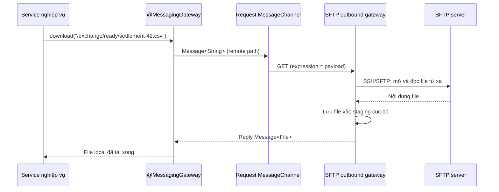
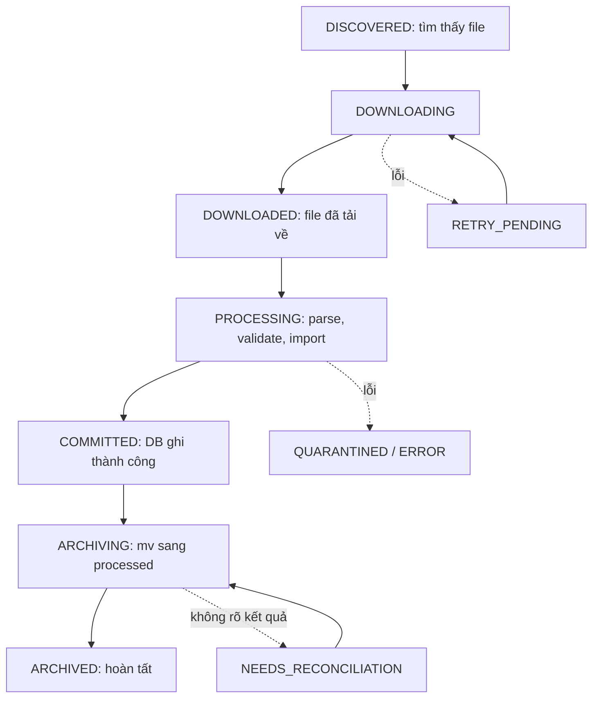

# SFTP outbound gateway cho thao tác từ xa

## 1. Bài toán: ứng dụng cần yêu cầu server SFTP thực hiện một thao tác

Một hệ thống đối soát cần thực hiện nhiều bước với server SFTP của đối tác:

1. Liệt kê các file đối tác đã gửi trong `/exchange/settlement/ready`.
2. Tải một file được chỉ định về vùng staging cục bộ để kiểm tra chữ ký, schema và dữ liệu.
3. Chỉ sau khi xử lý thành công, chuyển file từ thư mục `ready` sang `archive`, hoặc yêu cầu xóa file theo hợp đồng với đối tác.
4. Khi ứng dụng gửi file kết quả lên server, cần nhận về thông tin từ thao tác truyền để lưu trạng thái.

Các bước này cần một **lời gọi có kết quả trả về**. Trong Spring Integration, **SFTP outbound gateway** là một message handler thực hiện một lệnh SFTP rồi tạo **reply message**. Ứng dụng có thể gọi nó qua `@MessagingGateway`, hoặc một flow khác có thể gửi request vào `MessageChannel` và nhận reply.

Trong module `SPRING_INTEGRATION_ADAPTERS`, gateway là một mảnh ghép của luồng kết nối hệ thống ngoài bên cạnh inbound/outbound adapter, poller và `MessageChannel`. Mục tiêu của bài là hiểu rõ **hợp đồng request/reply**, lệnh từ xa, xử lý lỗi, vòng đời session SSH và giới hạn bảo đảm dữ liệu.

Sau bài này, bạn có thể:

- Phân biệt outbound gateway với inbound adapter và outbound adapter của SFTP.
- Cấu hình phiên SFTP xác thực bằng SSH key và xác minh server qua `known_hosts`.
- Viết Java DSL flow cho `ls` và `get`, sau đó gọi từ Java bằng `@MessagingGateway`.
- Hiểu mục đích của `put`, `mget`, `mput`, `mv`, `rm` và các lựa chọn phù hợp với từng lệnh.
- Thiết kế hợp đồng đường dẫn, idempotency, retry, xác nhận thành công và quyền thao tác từ xa.

> **Phạm vi:** mã ví dụ hướng đến Spring Integration **6.x trở lên**, khi SFTP dùng Apache MINA SSHD và phần tử từ xa có kiểu `SftpClient.DirEntry`. Ở Spring Integration 5.x, thư viện SSH và một số generic type khác; nếu đang dùng phiên bản cũ, đối chiếu JavaDoc tương ứng. Các ví dụ mô tả một ứng dụng Spring Boot đã cấu hình Spring Integration.

## 2. Gateway khác adapter ở đâu?

| Endpoint | Hướng dữ liệu | Kết quả ở phía Spring Integration | Tình huống thường gặp |
| --- | --- | --- | --- |
| **SFTP inbound adapter** | SFTP → ứng dụng | Poll server, phát `Message<File>` của file tải về | Tự động nhận lô file mới |
| **SFTP outbound adapter** | Ứng dụng → SFTP | Thực hiện upload như một consumer một chiều | Đẩy file xuất báo cáo sang đối tác |
| **SFTP outbound gateway** | Ứng dụng → SFTP → ứng dụng | Nhận message yêu cầu, thực hiện lệnh rồi gửi **reply message** | Liệt kê, tải theo yêu cầu, rename, xóa hoặc upload cần kết quả |

Hãy xem sơ đồ của một thao tác `get`:



Ở gateway, **payload của request** thường là đường dẫn file hoặc thư mục từ xa; nhưng kết quả phụ thuộc lệnh, có thể là danh sách entry, `File` cục bộ, một đường dẫn hoặc trạng thái thao tác. Không giả định mọi lệnh có cùng kiểu trả về. `@MessagingGateway` là **Java-facing proxy** để gọi các message flow, còn `Sftp.outboundGateway(...)` là **handler thực hiện lệnh SFTP**; dù tên giống nhau, chúng là hai lớp đảm nhiệm hai vai trò khác nhau.

**Poller có bắt buộc không?** Không. Luồng request/reply bắt đầu từ `DirectChannel` có thể chạy đồng bộ ngay lúc gọi phương thức Java. Poller chỉ cần khi **nguồn yêu cầu** được thăm dò, ví dụ cron job quét các batch trong DB rồi gửi lệnh `get`, hoặc file inbound adapter theo dõi file điều khiển.

## 3. Danh mục lệnh của SFTP outbound gateway

Tập lệnh thường gặp của `AbstractRemoteFileOutboundGateway` được hiện thực cho SFTP gồm:

| Lệnh | Ý định | Request thường chứa | Reply mang ý nghĩa |
| --- | --- | --- | --- |
| `ls` | Liệt kê nội dung thư mục | Đường dẫn thư mục từ xa | Danh sách `FileInfo` (hoặc tên nếu dùng tùy chọn tương ứng) |
| `nlst` | Liệt kê tên file | Đường dẫn hoặc mẫu tên từ xa | Danh sách tên thay vì thông tin file đầy đủ |
| `get` | Tải một file về local | Đường dẫn file từ xa | `File` cục bộ sau khi tải thành công |
| `mget` | Tải nhiều file phù hợp điều kiện | Đường dẫn/mẫu file từ xa | Tập hợp file cục bộ đã tải |
| `put` | Tải một file **lên** server | Payload file/dữ liệu local và thư mục đích | Thông tin đích/đường dẫn sau thao tác |
| `mput` | Tải nhiều file lên server | Tập file local/biểu thức chọn file | Kết quả cho nhiều file được gửi |
| `mv` | Đổi tên hoặc chuyển file từ xa | Đường dẫn nguồn và đích | Kết quả thao tác rename/move |
| `rm` | Xóa file từ xa | Đường dẫn file cần xóa | Kết quả thao tác xóa |

Các option và hình dạng reply chính xác có thể khác theo **lệnh, option và phiên bản**. Khi định nghĩa `@MessagingGateway`, kiểm tra chúng bằng JavaDoc hoặc một bài kiểm thử integration phù hợp, nhất là khi thêm cờ như `-1` cho liệt kê tên, `-R` cho thao tác đệ quy hoặc các tùy chọn xử lý file đích đã tồn tại.

**Chọn lệnh thế nào?** Với một file cụ thể cần tải về, dùng `get`; chỉ dùng `mget` khi thật sự cần nhiều file và kiểm soát được giới hạn số lượng/kích thước. Dùng `ls` để xem metadata và chọn file trước khi tải; không dùng `ls` trên cả cây thư mục lớn nếu chỉ cần một file. `rm` và `mv` là các lệnh có tác dụng thay đổi trạng thái server, nên yêu cầu kiểm soát chặt hơn so với `ls`.

## 4. Kết nối SSH an toàn và dependency

SFTP hoạt động qua SSH. Có **hai hướng xác thực độc lập**: server xác thực **client private key** dựa vào public key trong `authorized_keys`, và client xác thực **server host key** dựa vào file `known_hosts` đã được kiểm chứng. Passphrase của private key (nếu có) chỉ dùng để mở khóa private key.

Với Spring Boot, dùng BOM để quản lý phiên bản và khai báo module:

```groovy
dependencies {
    implementation 'org.springframework.boot:spring-boot-starter-integration'
    implementation 'org.springframework.integration:spring-integration-sftp'
}
```

Ví dụ `application.yml`:

```yaml
app:
  sftp:
    host: ${SFTP_HOST:sftp.partner.example}
    port: ${SFTP_PORT:22}
    username: ${SFTP_USERNAME:settlement_app}
    private-key: file:${SFTP_PRIVATE_KEY_FILE}
    private-key-passphrase: ${SFTP_PRIVATE_KEY_PASSPHRASE:}
    known-hosts: file:${SFTP_KNOWN_HOSTS_FILE}
    remote-root: ${SFTP_REMOTE_ROOT:/exchange/settlement}
    local-download-dir: ${SFTP_DOWNLOAD_DIR:./data/sftp-staging}
```

Hai biến `SFTP_PRIVATE_KEY_FILE` và `SFTP_KNOWN_HOSTS_FILE` phải trỏ tới file đã mount vào **runtime**, không phải tên file tùy ý trong source tree. Không đưa private key, passphrase vào repository hoặc log. Nếu thu thập host key bằng `ssh-keyscan`, phải **đối chiếu fingerprint với quản trị viên qua một kênh tin cậy** trước khi sử dụng `known_hosts`; `ssh-keyscan` không tự xác thực máy chủ.

Phiên SFTP dùng chung cho các flow:

```java
import org.apache.sshd.sftp.client.SftpClient;
import org.springframework.beans.factory.annotation.Value;
import org.springframework.context.annotation.Bean;
import org.springframework.context.annotation.Configuration;
import org.springframework.core.io.Resource;
import org.springframework.integration.file.remote.session.CachingSessionFactory;
import org.springframework.integration.file.remote.session.SessionFactory;
import org.springframework.integration.sftp.session.DefaultSftpSessionFactory;

@Configuration
public class PartnerSftpSessionConfig {

    @Bean
    public SessionFactory<SftpClient.DirEntry> partnerSftpSessionFactory(
            @Value("${app.sftp.host}") String host,
            @Value("${app.sftp.port}") int port,
            @Value("${app.sftp.username}") String username,
            @Value("${app.sftp.private-key}") Resource privateKey,
            @Value("${app.sftp.private-key-passphrase:}") String passphrase,
            @Value("${app.sftp.known-hosts}") Resource knownHosts) {

        DefaultSftpSessionFactory delegate = new DefaultSftpSessionFactory(false);
        delegate.setHost(host);
        delegate.setPort(port);
        delegate.setUser(username);
        delegate.setPrivateKey(privateKey);
        if (!passphrase.isBlank()) {
            delegate.setPrivateKeyPassphrase(passphrase);
        }

        delegate.setKnownHostsResource(knownHosts);
        delegate.setAllowUnknownKeys(false);
        delegate.setTimeout(30_000);

        return new CachingSessionFactory<>(delegate, 4);
    }
}
```

`CachingSessionFactory` giúp tái sử dụng phiên và giới hạn số kết nối được giữ trong cache. Kích thước cache phải phù hợp số thao tác song song và giới hạn của server. `DefaultSftpSessionFactory(false)` tránh dùng chung một kết nối SSH giữa các session trong ví dụ cơ bản. Với kết nối sống lâu, cần quan sát lỗi phiên cũ, timeout và cơ chế kiểm tra/đặt lại cache.

## 5. Ví dụ hoàn chỉnh: `ls` và `get` bằng Java DSL

Giả sử người gọi đã có **đường dẫn được kiểm tra**. Ta tạo hai inbound channel nội bộ, mỗi channel dẫn tới một outbound gateway với lệnh cụ thể:

```java
import java.io.File;

import org.apache.sshd.sftp.client.SftpClient;
import org.springframework.beans.factory.annotation.Value;
import org.springframework.context.annotation.Bean;
import org.springframework.context.annotation.Configuration;
import org.springframework.integration.annotation.IntegrationComponentScan;
import org.springframework.integration.dsl.IntegrationFlow;
import org.springframework.integration.file.remote.session.SessionFactory;
import org.springframework.integration.sftp.dsl.Sftp;

@Configuration
@IntegrationComponentScan(basePackageClasses = PartnerSftpOperations.class)
public class PartnerSftpGatewayFlows {

    @Bean
    public IntegrationFlow sftpListFlow(
            SessionFactory<SftpClient.DirEntry> partnerSftpSessionFactory) {

        return IntegrationFlow.from("sftpListRequests")
                .handle(Sftp.outboundGateway(
                        partnerSftpSessionFactory, "ls", "payload"))
                .get();
    }

    @Bean
    public IntegrationFlow sftpGetFlow(
            SessionFactory<SftpClient.DirEntry> partnerSftpSessionFactory,
            @Value("${app.sftp.local-download-dir}") String localDirectory) {

        return IntegrationFlow.from("sftpGetRequests")
                .handle(Sftp.outboundGateway(
                                partnerSftpSessionFactory, "get", "payload")
                        .localDirectory(new File(localDirectory))
                        .autoCreateLocalDirectory(true))
                .get();
    }
}
```

`"payload"` là một biểu thức **SpEL**: giá trị trong message đầu vào được dùng làm remote path. Ở flow `ls`, payload thường là thư mục; ở `get`, là đường dẫn file. Không ghép đường dẫn được nhập tự do từ client HTTP vào biểu thức rồi gọi SFTP ngay, vì như vậy người gọi có thể truy cập file ngoài phạm vi được phép.

Tạo Java proxy làm cổng gọi cho service:

```java
import java.io.File;
import java.util.List;

import org.springframework.integration.annotation.Gateway;
import org.springframework.integration.annotation.MessagingGateway;

@MessagingGateway
public interface PartnerSftpOperations {

    // Với ls mặc định, các phần tử reply biểu diễn metadata file từ xa.
    @Gateway(requestChannel = "sftpListRequests")
    List<?> list(String remoteDirectory);

    // get trả về File trên ổ đĩa local sau khi copy hoàn tất.
    @Gateway(requestChannel = "sftpGetRequests")
    File download(String remoteFile);
}
```

`List<?>` trong ví dụ giữ phần interface độc lập với kiểu metadata cụ thể. Khi xử lý danh sách thật, có thể khai báo phần tử là `org.springframework.integration.file.remote.FileInfo<?>` phù hợp với reply của phiên bản đang dùng, rồi đọc `getFilename()`, `isDirectory()`, `getSize()` và metadata liên quan. Không ép `ls` thành `List<String>` nếu chưa bật tùy chọn trả tên file tương ứng.

Một service nghiệp vụ nên tự kiểm tra tên file và gắn root cố định:

```java
import java.io.File;
import java.util.List;

import org.springframework.beans.factory.annotation.Value;
import org.springframework.stereotype.Service;

@Service
public class SettlementImportService {

    private final PartnerSftpOperations sftp;
    private final String remoteRoot;

    public SettlementImportService(
            PartnerSftpOperations sftp,
            @Value("${app.sftp.remote-root}") String remoteRoot) {
        this.sftp = sftp;
        this.remoteRoot = remoteRoot.replaceAll("/+$", "");
    }

    public List<?> listReady() {
        return sftp.list(remoteRoot + "/ready");
    }

    public File downloadReady(String fileName) {
        // Tên file do người gọi cung cấp chỉ được là một basename.
        if (!fileName.matches("[A-Za-z0-9][A-Za-z0-9._-]{0,127}")
                || fileName.equals(".") || fileName.equals("..")) {
            throw new IllegalArgumentException("Tên file không hợp lệ");
        }
        return sftp.download(remoteRoot + "/ready/" + fileName);
    }
}
```

Ở hệ thống thật, giới hạn thêm đuôi file hợp lệ (`.csv`, `.xml`...), kiểm tra file được phép tải theo danh sách batch đã được phê duyệt, và giới hạn kích thước file trước khi xử lý. Remote path được chuẩn hóa và kiểm tra ở **business service** giúp adapter không trở thành một phương tiện đọc file SFTP tùy ý.

### Phân tích hợp đồng request/reply

| Điểm quan sát | Luồng `ls` | Luồng `get` |
| --- | --- | --- |
| Request channel | `sftpListRequests` | `sftpGetRequests` |
| Request payload | Đường dẫn thư mục, ví dụ `/exchange/settlement/ready` | Đường dẫn file, ví dụ `/exchange/settlement/ready/a.csv` |
| Lệnh | `ls` | `get` |
| Reply payload | Danh sách entry/metadata | `File` trong staging local |
| Side effect | Chủ yếu đọc trạng thái server | Truyền dữ liệu và tạo/ghi file local |
| Lỗi quan trọng | Không có quyền liệt kê, timeout | Không có quyền đọc, file bị đổi/xóa, đĩa local đầy, kết nối đứt |

Với `DirectChannel` đồng bộ, khi gateway trả về `File`, hoạt động truyền file ở tầng SFTP đã kết thúc. Điều đó **không** đồng nghĩa file đã được parse hoặc dữ liệu đã commit vào DB. Nếu service chỉ lưu đường dẫn `File` mà xóa staging sớm, các bước bất đồng bộ phía sau có thể không đọc được nữa.

## 6. `mv` và `rm`: thao tác thay đổi dữ liệu trên server

Đổi tên (`mv`) và xóa (`rm`) thường là bước sau của quy trình xử lý file. Ví dụ: sau khi nhập thành công một batch, chuyển file từ `ready` sang `processed`; sau thời hạn lưu trữ, xóa file trong `processed` theo chính sách đã ký kết.

Trong cấu hình outbound gateway, lệnh `mv` cần **nguồn** và **đích**; nguồn có thể được lấy từ `payload`, còn đích do `rename-expression` (trên Java DSL là `renameExpression(...)`) xác định. Với `rm`, cần đường dẫn đúng file cần xóa. Ví dụ mẫu:

```java
import org.apache.sshd.sftp.client.SftpClient;
import org.springframework.context.annotation.Bean;
import org.springframework.context.annotation.Configuration;
import org.springframework.integration.dsl.IntegrationFlow;
import org.springframework.integration.file.remote.session.SessionFactory;
import org.springframework.integration.sftp.dsl.Sftp;

@Configuration
public class SftpRemoteMutationFlows {

    @Bean
    public IntegrationFlow sftpMoveFlow(
            SessionFactory<SftpClient.DirEntry> partnerSftpSessionFactory) {

        return IntegrationFlow.from("sftpMoveRequests")
                .handle(Sftp.outboundGateway(
                                partnerSftpSessionFactory, "mv", "payload")
                        .renameExpression("headers['remoteTarget']"))
                .get();
    }

    @Bean
    public IntegrationFlow sftpRemoveFlow(
            SessionFactory<SftpClient.DirEntry> partnerSftpSessionFactory) {

        return IntegrationFlow.from("sftpRemoveRequests")
                .handle(Sftp.outboundGateway(
                        partnerSftpSessionFactory, "rm", "payload"))
                .get();
    }
}
```

Trước khi sử dụng các flow có tác dụng **ghi/xóa**, thiết kế một service chặn lệnh ngoài root và xác thực trạng thái batch. Với `mv`, message đầu vào phải cung cấp cả **source path** và header `remoteTarget`; với `rm`, payload là file path. Chỉ gọi `rm` sau khi đã có bằng chứng nghiệp vụ về việc hoàn tất xử lý và quyền xóa theo chính sách lưu trữ. Không tạo HTTP endpoint cho phép nhận mọi `remoteTarget`/`payload` từ người dùng mà không có kiểm tra.

### Vì sao `mv` không tự tạo ra exactly-once?

Giả sử ứng dụng `get` được file rồi ghi dữ liệu vào DB. Ngay sau DB commit nhưng trước khi gọi `mv`, tiến trình bị tắt. Khi khởi động lại, file vẫn nằm trong `ready` và có thể bị lấy lại. **Chỉ chuyển file sau commit** giúp giữ bản gốc để phục hồi, nhưng không ngăn xử lý lặp khi crash. Cần idempotency trong DB, ví dụ unique key `(partner_id, batch_id)` hoặc checksum được đối tác định nghĩa.

Ngược lại, nếu chuyển/xóa file **trước** DB commit, lỗi DB có thể làm mất file nguồn chưa xử lý. Vì SFTP và DB không chia sẻ một transaction atomically, luôn có một khoảng trống cần phục hồi bằng trạng thái bền vững, retry và đối soát.

## 7. `put`, `mget`, `mput`: khi cần nhiều hơn một file

Ngoài `ls`, `get`, `mv`, `rm`, outbound gateway hỗ trợ các thao tác truyền file có reply:

**`put`**: gửi một payload file/dữ liệu local tới thư mục từ xa. Khi nghiệp vụ phải biết đường dẫn hoặc kết quả thao tác, `put` qua outbound gateway phù hợp hơn outbound adapter một chiều. Cấu hình quy tắc tên file, chế độ file đích đã tồn tại (`FileExistsMode`) và cách dùng tên tạm/rename như ở outbound adapter; tùy chọn chính xác được hỗ trợ phụ thuộc phiên bản API và lệnh.

**`mget`**: tải một nhóm file dựa trên biểu thức/mẫu điều kiện từ xa. Nên giới hạn theo thư mục đã được phép, quy tắc tên và khoảng thời gian; tránh tải cả cây thư mục trong một lần gọi nếu khối lượng không xác định. Cần lập kế hoạch dung lượng staging local và xử lý lỗi giữa chừng, khi một số file đã tải xong còn các file khác chưa tải.

**`mput`**: gửi nhiều file từ nguồn local lên server. Chỉ dùng khi ứng dụng xác định rõ tập file đã hoàn tất và kiểm soát được số file/bytes; nếu truyền một tập lớn, chia batch và ghi nhận thành công/thất bại theo từng file để có thể phục hồi.

| Quyết định | Khi dùng một file | Khi dùng nhiều file |
| --- | --- | --- |
| Lấy từ server | `get` | `mget` |
| Gửi lên server | `put` | `mput` |
| Xác định tên | Đường dẫn chính xác | Pattern/filter hoặc tập file rõ ràng |
| Xử lý lỗi | Retry/đối soát một file | Có thể thành công một phần; theo dõi từng file |
| Cấp phát tài nguyên | Một file staging | Giới hạn tổng dung lượng và số file |

SFTP không cung cấp một giao dịch all-or-nothing cho một lô `mget`/`mput`: nếu lệnh thất bại khi xử lý file thứ ba, hai file trước đó có thể đã được truyền. Thiết kế downstream phải xem **từng file là một đơn vị có trạng thái**, kèm khả năng phát hiện trùng và retry có kiểm soát.

## 8. Kênh reply, timeout và vòng đời kết nối

Một method `@Gateway` thường chờ reply qua một temporary reply channel do Spring Integration gắn vào message. Nếu dùng `DirectChannel` và handler đồng bộ, lỗi SFTP có thể nổi lên ngay trong lời gọi. Nếu một flow có channel bất đồng bộ ở giữa, method có thể phải chờ kết quả qua reply channel và `replyTimeout` trở nên quan trọng.

Nên phân biệt ít nhất ba nhóm timeout:

| Timeout | Phạm vi | Khi vượt ngưỡng |
| --- | --- | --- |
| Kết nối/IO SSH | `DefaultSftpSessionFactory` và network | Kết nối hoặc thao tác SFTP thất bại/đóng theo trạng thái client |
| Chờ reply của Messaging Gateway | Giao tiếp giữa method Java và Spring Integration flow | Method có thể hết hạn chờ ngay cả khi thao tác bất đồng bộ tiếp tục chạy |
| SLA nghiệp vụ | Thời hạn nhận/xử lý/ACK batch | Cần giám sát và cảnh báo; không được suy ra từ mỗi lần gọi SFTP |

Trong một flow đồng bộ, không cần thêm hàng đợi nếu chỉ thực hiện `ls` hoặc `get` ngắn. Với `mget` nhiều file lớn, cân nhắc xử lý bất đồng bộ có trạng thái bền vững; một request đang chờ không nên giữ luồng HTTP quá lâu. Khi dùng `CachingSessionFactory`, theo dõi số session đang dùng, timeout và quota phía server; cache hỗ trợ tái sử dụng, **không** bảo đảm phiên mạng luôn còn hiệu lực.

**Message headers** có thể mang correlation ID, tenant/partner ID, batch ID và đích rename. Các header này cần được tin cậy hoặc kiểm tra trước khi handler xử lý. Reply message cũng có thể chứa metadata/headers tùy lệnh; ứng dụng nên định nghĩa rõ kiểu trả về và ánh xạ sang DTO nghiệp vụ, tránh phụ thuộc trực tiếp vào mọi chi tiết nội bộ SFTP ở API công khai.

## 9. Lỗi, retry và idempotency: các góc khuất quan trọng

SFTP gateway có thể báo lỗi do đường dẫn sai, host key mismatch, sai private key, thiếu quyền truy cập, timeout hoặc file bị thay đổi giữa lúc `ls` và `get`. Với lệnh tác động từ xa, lỗi còn có thể đến **sau khi thao tác đã thực sự hoàn tất trên server**: ví dụ server rename thành công nhưng client mất kết nối trước khi nhận phản hồi.

| Giai đoạn | Rủi ro | Hướng giải quyết |
| --- | --- | --- |
| SSH authentication | Sai key, passphrase, hostname, host key | Dừng và báo cấu hình; không tự tắt host verification hay retry liên tục |
| `ls`/`get` | File mất, bị sửa giữa lúc đọc, lỗi mạng, local disk đầy | Ghi nhận lỗi; kiểm tra lại danh sách/metadata trước retry |
| `put`/`mput` | Upload đã thành công nhưng reply timeout | Đối soát tên/size/checksum, tránh append hoặc replace mù |
| `mv` | Server đã rename nhưng reply bị mất | Kiểm tra cả source lẫn target trước khi quyết định retry |
| `rm` | Server đã xóa nhưng reply bị mất | Kiểm tra trạng thái file, không coi "không tồn tại" luôn là lỗi mới |
| DB commit và SFTP | Một bên thành công, bên còn lại thất bại | Lưu batch state bền vững và thực hiện reconciliation |

Đặc biệt với `rm`, **không tự retry vô điều kiện** nếu không xác định được lệnh trước đó có chạy thành công hay chưa. Xóa một file đã mất có thể trả lỗi; nếu mục tiêu nghiệp vụ là "file không còn", thì việc xác minh file không còn có thể được coi là **trạng thái đích đạt được** theo chính sách, thay vì buộc phải thành công đúng một lệnh `rm`.

Để giảm xử lý lặp, lưu một record bền vững với `partner_id`, `batch_id`, `remote_path`, `checksum`, `status`, `attempt_count`, `last_error` và thời gian thao tác. Đặt unique constraint theo batch ID đã được xác minh. Ví dụ state machine:



State machine trên là **mẫu thiết kế nghiệp vụ**, không phải trạng thái mà SFTP gateway tự lưu. Muốn đạt hành vi gần exactly-once ở DB, mỗi lần tiếp nhận batch phải kiểm tra trạng thái trước đó; lưu kết quả import cùng marker hoàn thành trong transaction DB phù hợp, rồi mới yêu cầu `mv`. Nếu `mv` thất bại, job đối soát có thể hoàn thiện bước archive mà không import lại.

## 10. An toàn đường dẫn và quyền thao tác từ xa

Một outbound gateway có thể thực hiện `get`, `rm` hoặc `mv` với path truyền từ message. Vì vậy **kiểm soát đường dẫn là một phần của bảo mật ứng dụng**, không chỉ là chuyện đặt tên file cho dễ đọc.

Nên triển khai các nguyên tắc sau:

1. **Cố định remote root** theo đối tác, chẳng hạn `/exchange/settlement`; service chỉ tạo đường dẫn trong các thư mục `ready`, `processed`, `outgoing` được phép.
2. **Chỉ nhận basename hợp lệ** từ client; từ chối ký tự `/`, `\\`, chuỗi `..`, tên rỗng, ký tự điều khiển và giá trị dài bất thường.
3. **Phân quyền SFTP tối thiểu**: tài khoản dùng để liệt kê và tải file có thể chỉ cần read/list; tài khoản có thể `mv`/`rm` cần quyền tương ứng và nên được tách nếu rủi ro cao.
4. **Không tin phép nối chuỗi path là hàng rào tuyệt đối**: server có thể cho phép symlink hoặc các tình huống đặc biệt; kiểm tra chính sách phía server và giới hạn account ở mức filesystem/chroot nếu có thể.
5. **Dùng file staging riêng theo batch** khi tải về; tránh hai worker cùng ghi một basename vào một thư mục, làm hỏng hoặc thay thế kết quả của nhau.
6. **Giám sát hành động thay đổi dữ liệu**: log batch ID, source, target, actor, thời điểm, kết quả; không log private key, passphrase hoặc nội dung file nhạy cảm.

Với dữ liệu nhạy cảm, SFTP mã hóa **đường truyền** nhưng không tự mã hóa nội dung nằm trên ổ đĩa server hoặc local staging. Thiết kế chính sách lưu/xóa staging và mã hóa ở tầng ứng dụng nếu thỏa thuận yêu cầu.

## 11. Thực hành end-to-end

**Chuẩn bị:** server SFTP thử nghiệm, tài khoản có public key tương ứng với private key của ứng dụng; bản `known_hosts` đã xác minh; thư mục `ready` có ít nhất hai file CSV, thư mục `processed` tồn tại và ứng dụng ghi được thư mục staging. Dùng dữ liệu giả lập, không dùng file sản xuất cho các phép thử `rm`/`mv`.

1. **Kết nối:** thử `sftp -i ...` bằng cùng tài khoản và `known_hosts`. Xác nhận liệt kê được thư mục đích và chỉ có các quyền mong đợi.
2. **`ls`:** gọi `listReady()`. Xác minh reply là danh sách metadata/tên theo tùy chọn; xử lý riêng entry thư mục, file tạm và file không thuộc hợp đồng.
3. **`get`:** gọi `downloadReady("settlement-42.csv")`. Xác minh có file local đã hoàn tất, đúng số byte/checksum so với bản nguồn; parser chỉ bắt đầu sau khi tải xong.
4. **Validation:** đưa một file CSV hỏng schema. Ứng dụng phải ghi lỗi nghiệp vụ và giữ dữ liệu gốc để có thể xử lý lại hoặc quarantine theo quy trình.
5. **`mv`:** sau khi DB commit cho `settlement-42.csv`, chuyển file từ `ready` sang `processed`. Xác minh file không còn ở nguồn và xuất hiện tại đích trước khi đánh dấu `ARCHIVED`.
6. **`rm`:** chỉ trên file thử nghiệm đã được xác nhận cho phép xóa; kiểm tra quyền và trạng thái sau thao tác. Không đặt `rm` vào flow mặc định chỉ để xóa file sau download.
7. **Timeout:** mô phỏng ngắt kết nối sau `mv`. Chạy reconciliation để xác nhận server đã đổi tên hay chưa trước khi retry.
8. **Đồng thời:** hai worker cùng yêu cầu `get` một batch. Kiểm tra idempotency DB và vùng staging riêng, đồng thời xác nhận không xảy ra hai lần commit cùng batch.
9. **Security:** thử basename `../private.txt`, tên chứa `/` và chuỗi rỗng; service phải từ chối trước khi gọi SFTP.

### Bảng tra lỗi nhanh

| Hiện tượng | Kiểm tra trước |
| --- | --- |
| `Auth fail` / permission denied ngay lúc login | Username, authorized public key phía server, private key, passphrase |
| Host key verification failure | Host/port và `known_hosts`; đối chiếu fingerprint từ nguồn tin cậy |
| `ls` trả về rỗng | Remote path, quyền list, file ẩn, filter/option, việc đối tác đã publish file chưa |
| `get` lỗi dù `ls` thấy file | File bị rename/xóa sau khi liệt kê, quyền read, local disk, network |
| File local bị trùng tên | Nhiều worker cùng staging directory, `get` file exists mode, quy ước basename |
| `mv` thất bại | Source/target path, quyền rename, target đã tồn tại, khả năng server hỗ trợ rename |
| `rm` không xóa được | Quyền xóa, file bị di chuyển, đúng account, chính sách retention |
| Gateway timeout nhưng server đã đổi tên | Reply bị mất; đối soát trạng thái trước khi retry |
| DB đã import nhưng file vẫn trong `ready` | Khoảng trống giữa commit và `mv`; kiểm tra state `COMMITTED` để archive lại |

## 12. Sai lầm thường gặp

- **Xem gateway như một inbound poller**: outbound gateway chạy khi có request message; tự nó không liên tục theo dõi server.
- **Mong `ls`, `get`, `rm` trả cùng kiểu payload**: cần xác định contract theo từng command và option.
- **Truyền đường dẫn người dùng trực tiếp vào `payload` mà không kiểm tra**: có thể cho phép đọc, đổi tên hoặc xóa file ngoài phạm vi nghiệp vụ.
- **Dùng `mget` cho hàng nghìn file mà không giới hạn**: gây đầy staging, giữ session lâu và khó phục hồi khi thành công một phần.
- **Tin rằng `mv` sau download bảo đảm exactly-once**: crash ở giữa DB commit và rename vẫn khiến file nguồn xuất hiện lại.
- **Dùng `rm` như xác nhận nghiệp vụ đã import**: thao tác xóa là side effect ở server SFTP, không liên kết transaction với DB.
- **Tắt host verification để kết nối nhanh hơn**: bỏ qua `known_hosts` khiến client khó phát hiện server giả mạo.
- **Retry mọi exception như nhau**: lỗi xác thực cần sửa cấu hình; lỗi mạng có thể retry; lỗi không rõ kết quả của `mv`/`rm` cần đối soát trước.

## 13. Câu hỏi tự kiểm tra

1. Khi cần liệt kê file để quyết định tải một file cụ thể, vì sao `ls` rồi `get` phù hợp hơn việc dùng inbound adapter tự poll tất cả?
2. Điểm khác nhau giữa `@MessagingGateway` và `Sftp.outboundGateway(...)` là gì? Mỗi thành phần tham gia flow ở đâu?
3. Vì sao `get` thường trả `File` local, còn `ls` trả danh sách metadata hoặc tên?
4. Với `mv`, vì sao cần định nghĩa cả đường dẫn nguồn và đích? Bạn sẽ kiểm tra điều gì trước khi retry sau timeout?
5. Điều gì có thể xảy ra nếu hai worker gọi `get` cùng một basename vào cùng thư mục staging?
6. Sau khi DB đã commit thành công nhưng `mv` chưa chạy, làm sao restart mà không nhập trùng batch?
7. Để cho một service được phép `ls/get` nhưng không được `rm`, bạn cần kiểm soát ở những tầng nào?

## Tài liệu tham khảo

- [Spring Integration Reference – SFTP Outbound Gateway](https://docs.spring.io/spring-integration/reference/sftp/using-the-gateway.html)
- [Spring Integration Reference – SFTP Outbound Channel Adapter](https://docs.spring.io/spring-integration/reference/sftp/outbound.html)
- [Spring Integration Reference – SFTP Session Factory](https://docs.spring.io/spring-integration/reference/sftp/session-factory.html)
- [Spring Integration Reference – SFTP Session Caching](https://docs.spring.io/spring-integration/reference/sftp/session-caching.html)
- [Spring Integration Reference – Messaging Gateways](https://docs.spring.io/spring-integration/reference/gateway.html)
- [Spring Integration Reference – Message Channels](https://docs.spring.io/spring-integration/reference/channel.html)
