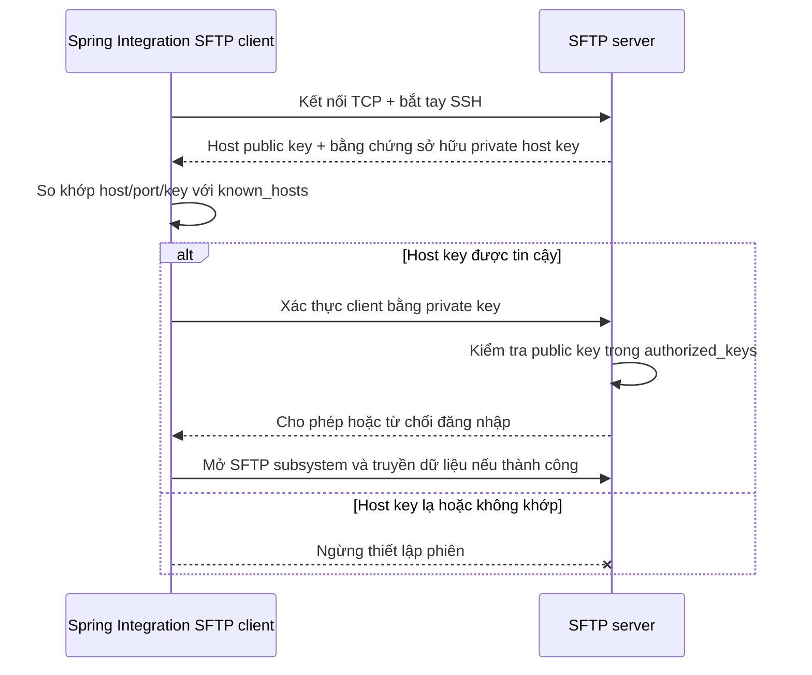
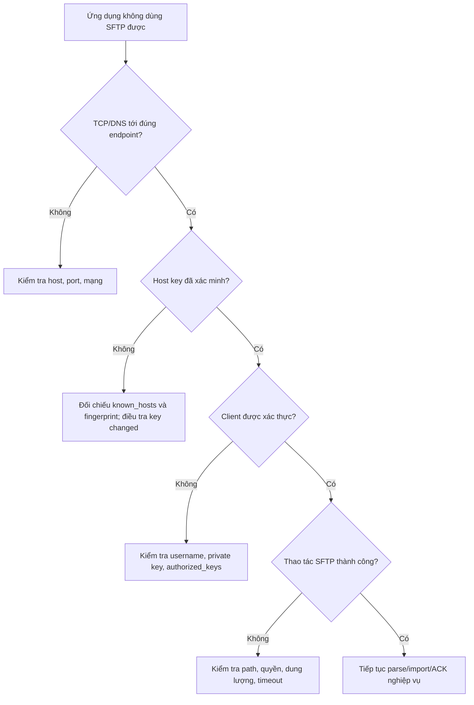

# Known hosts và xác minh máy chủ

## 1. Vì sao kết nối SFTP cần xác minh máy chủ?

Giả sử dịch vụ Spring Boot mỗi đêm gửi file đối soát lên `sftp.partner.example:2222`. Ứng dụng đã có private key hợp lệ và tài khoản SFTP được cấp quyền. Một ngày, DNS hoặc đường mạng bị can thiệp khiến tên miền này trỏ tới một máy chủ khác. Nếu client chỉ biết cách **chứng minh danh tính của mình** mà không kiểm tra **danh tính máy chủ**, dữ liệu có thể bị gửi sang nơi không đúng chủ đích.

SSH giải quyết bài toán này bằng **host key verification**. Máy chủ sở hữu một cặp khóa SSH dành cho danh tính máy chủ; trong quá trình bắt tay, nó chứng minh quyền sở hữu private host key tương ứng với public host key đã công bố. Client phải kiểm tra public host key đó có thuộc danh sách máy chủ đã được tin cậy hay không. Trong ứng dụng Spring Integration, danh sách tin cậy được cung cấp bằng file **`known_hosts`**.

Đây là chủ đề nền tảng của chương **Adapter SFTP** thuộc module `SPRING_INTEGRATION_ADAPTERS`: dù dùng inbound adapter, outbound adapter hay outbound gateway, tất cả đều cần phiên SSH/SFTP an toàn trước khi trao đổi file và message. `MessageChannel`, poller hay gateway chỉ định cách luồng xử lý vận hành; chúng không thay thế được việc xác minh máy chủ ở lớp kết nối.

Sau bài này, bạn sẽ có thể:

- Phân biệt **client authentication** bằng private key với **server authentication** bằng host key.
- Hiểu cấu trúc OpenSSH `known_hosts`, hostname, port, thuật toán và fingerprint.
- Thu thập và xác minh host key theo một kênh độc lập, tránh tin nhầm khóa do kẻ tấn công cung cấp.
- Cấu hình `DefaultSftpSessionFactory` với `knownHostsResource` và `allowUnknownKeys=false`.
- Chẩn đoán lỗi host key chưa biết, host key thay đổi, sai hostname/port và sai thuật toán.
- Tổ chức luân chuyển host key, kiểm thử kết nối và vận hành an toàn.

> **Phạm vi API:** ví dụ Java dùng Spring Integration **6.x trở lên**, trong đó SFTP client dựa trên Apache MINA SSHD. Spring Integration 5.x sử dụng nền tảng SSH khác nên cần đối chiếu tài liệu/Javadoc theo phiên bản đang chạy.

## 2. Hai hướng xác thực khác nhau trong SSH

SSH thực hiện các bước trao đổi khóa và xác thực trước khi chạy các thao tác SFTP. Hãy phân biệt hai cặp khóa:

| Thành phần | Ai sở hữu private key? | Public key nằm ở đâu? | Câu hỏi được trả lời |
| --- | --- | --- | --- |
| **Client identity key** | Ứng dụng Spring Boot | `authorized_keys` của tài khoản trên SFTP server | "Ứng dụng này có quyền đăng nhập không?" |
| **Server host key** | Server SFTP | `known_hosts` của ứng dụng | "Đây có đúng là máy chủ đối tác đã được phê duyệt không?" |

Hai cặp khóa này **không dùng thay cho nhau**. File `authorized_keys` ở phía server quyết định ai được đăng nhập. File `known_hosts` ở phía client lưu public host key dùng để kiểm tra server mà client đang kết nối. Passphrase bảo vệ **private key của client** nếu khóa được mã hóa; passphrase không phải host key và cũng không phải thông tin để xác minh server.



Trong mô hình đe dọa, kiểm tra host key giúp chống **giả mạo máy chủ / man-in-the-middle**. Nó không thay thế phân quyền thư mục từ xa, mã hóa dữ liệu lưu trên đĩa, kiểm tra nội dung CSV hoặc xác minh thành công của giao dịch nghiệp vụ. Một kết nối SSH hợp lệ xác nhận danh tính máy chủ theo chính sách tin cậy của client; nó không bảo đảm file đối tác gửi luôn hợp lệ về nội dung.

## 3. `known_hosts` lưu những gì?

OpenSSH `known_hosts` là một tập hợp bản ghi liên kết **định danh server** với **public host key** được tin cậy. Một dòng thông thường có dạng:

```text
<hostname-or-host-pattern> <host-key-algorithm> <base64-encoded-public-host-key> [comment]
```

Ví dụ minh họa hình thức (chuỗi `<...>` chỉ là placeholder, **không phải host key thật**):

```text
sftp.partner.example ssh-ed25519 <PUBLIC_HOST_KEY_BASE64>
[sftp.partner.example]:2222 ssh-ed25519 <PUBLIC_HOST_KEY_BASE64>
```

Các thành phần quan trọng:

| Phần | Ví dụ | Ý nghĩa |
| --- | --- | --- |
| Host / host pattern | `sftp.partner.example` | Định danh máy chủ theo tên mà client sử dụng |
| Host và port không mặc định | `[sftp.partner.example]:2222` | Với cổng khác 22, OpenSSH thường dùng cú pháp ngoặc vuông và dấu hai chấm |
| Thuật toán public host key | `ssh-ed25519`, `ecdsa-sha2-nistp256`, `ssh-rsa` | Loại khóa server công bố; cần tương thích chính sách và thư viện SSH |
| Dữ liệu khóa công khai | Chuỗi Base64 dài | Giá trị public key thực tế cần so khớp, không phải private key |
| Fingerprint | `SHA256:...` | Giá trị băm tóm tắt public key để con người đối chiếu qua kênh độc lập |

**Fingerprint không phải toàn bộ host key.** Người vận hành có thể trao đổi SHA-256 fingerprint ngắn gọn để xác minh, nhưng file `known_hosts` cần bản ghi **public key đầy đủ** đúng định dạng. Đừng dán chuỗi `SHA256:...` vào cột Base64 của file rồi kỳ vọng SSH đọc được.

Một máy chủ có thể công bố **nhiều host key** thuộc các thuật toán khác nhau, chẳng hạn Ed25519 và ECDSA. Khi client và server thỏa thuận thuật toán, key được chọn phải khớp với bản ghi đáng tin cậy của định danh server tương ứng. Sự hiện diện của một key đã biết không đồng nghĩa có thể chấp nhận một key khác chưa được xác minh một cách tự động.

OpenSSH còn hỗ trợ host patterns, danh sách hostname, hostname được băm (hashed hostnames), và một số marker đặc biệt như `@cert-authority`. Với Spring Integration dựa trên Apache MINA SSHD, cấu hình cơ bản nên dùng **bản ghi host public key thông thường** và kiểm thử định dạng nâng cao trên phiên bản thư viện thực tế trước khi dựa vào nó. Đừng mặc định mọi mở rộng OpenSSH đều có cùng hành vi ở tất cả SSH client.

### Hostname, IP và cổng có thể gây nhầm lẫn

Một server vật lý có thể được truy cập bằng `sftp.partner.example`, `10.20.30.40`, hoặc một alias DNS. Định danh dùng để so khớp trong `known_hosts` liên quan tới **host/port mà client thực sự kết nối**. Nếu ứng dụng dùng hostname nhưng file chỉ ghi địa chỉ IP, hoặc chuyển cổng từ `22` sang `2222` mà không có bản ghi phù hợp, xác minh có thể thất bại dù private host key của server không đổi.

Ví dụ, `sftp.partner.example` và `[sftp.partner.example]:2222` là **hai định danh khác nhau** trong cú pháp OpenSSH. Khi gặp lỗi xác minh, kiểm tra host và port trong cấu hình ứng dụng trước khi kết luận server đã bị tấn công hoặc đã thay key.

## 4. Thiết lập sự tin cậy lần đầu: xác minh fingerprint ngoài băng

Để client biết khóa nào được tin cậy, phải có **quy trình lấy host public key ban đầu** (trust bootstrap). Chỉ có kết nối TCP tới server chưa đủ để xác minh danh tính server: nếu mạng đang bị can thiệp, client có thể nhận host key của kẻ tấn công.

Quy trình nên được thống nhất với quản trị viên đối tác:

1. Nhận **hostname, port, loại host key và SHA-256 fingerprint chính thức** qua kênh đã xác thực độc lập với kết nối SFTP đang thiết lập, chẳng hạn ticket bảo mật có nguồn xác định hoặc kênh trao đổi đã thỏa thuận.
2. Dùng `ssh-keyscan` để thu thập **public host key** mà server trình bày tại host/port cần kết nối. Đây chỉ là bước thu thập dữ liệu.
3. Tính fingerprint từ bản ghi thu được, rồi **so sánh chính xác** với fingerprint chính thức. Nếu khác, dừng quy trình và điều tra. Không tự động chấp nhận chỉ vì DNS trả lời hoặc kết nối thành công.
4. Sau khi đối chiếu thành công, phát hành bản ghi `known_hosts` đã được xác minh vào cấu hình runtime của ứng dụng.
5. Thử kết nối với chế độ bắt buộc kiểm tra host key, sau đó mới cấu hình `DefaultSftpSessionFactory`.

Ví dụ OpenSSH trên Linux/macOS (Windows có thể chạy các tiện ích OpenSSH tương đương). Đường dẫn và host được dùng chỉ để minh họa:

```bash
# Cổng 2222; lấy bản ghi host key đang được server công bố.
ssh-keyscan -p 2222 -t ed25519 sftp.partner.example > partner_known_hosts.pending

# Hiển thị fingerprint SHA-256 của public key vừa thu thập.
ssh-keygen -lf partner_known_hosts.pending -E sha256

# Chỉ khi fingerprint khớp với giá trị đối tác xác nhận qua kênh độc lập:
cp partner_known_hosts.pending partner_known_hosts

# Kiểm tra file chứa bản ghi cho hostname và cổng cần dùng.
ssh-keygen -F '[sftp.partner.example]:2222' -f partner_known_hosts
```

Nếu server không có Ed25519 host key, lệnh `ssh-keyscan -t ed25519` có thể không trả bản ghi. Khi đó cần hỏi đối tác thuật toán thực tế và đối chiếu fingerprint tương ứng (ví dụ ECDSA). Không ép client tin một khóa bất kỳ để "qua" bước kiểm tra. Hãy giữ kênh xác minh và định danh server nhất quán, đặc biệt khi môi trường test/staging/production có host key khác nhau.

Thử đăng nhập bằng OpenSSH với known_hosts vừa xác minh:

```bash
sftp -P 2222 \
  -i ~/.ssh/settlement_client \
  -o IdentitiesOnly=yes \
  -o StrictHostKeyChecking=yes \
  -o UserKnownHostsFile=./partner_known_hosts \
  settlement_app@sftp.partner.example
```

`StrictHostKeyChecking=yes` làm client **từ chối host key chưa tin cậy hoặc không khớp**. Nếu lệnh OpenSSH thành công nhưng ứng dụng Java thất bại, hãy kiểm tra cách Java runtime đọc file `known_hosts`, phiên bản SSH library, hostname/port thực tế và chính sách thuật toán trước khi thay đổi security setting.

### Những cách làm không đủ an toàn

- **`ssh-keyscan host >> known_hosts` rồi dùng ngay**, không đối chiếu fingerprint: lệnh scan không xác thực server.
- **Chấp nhận fingerprint được đọc từ chính kết nối vừa báo key lạ** như một bằng chứng độc lập: nếu kết nối bị giả mạo, fingerprint hiển thị cũng là của máy giả mạo.
- **Xóa toàn bộ `known_hosts` khi thấy cảnh báo key changed**: làm mất các bản ghi tin cậy cũ và thường chỉ che giấu nguyên nhân.
- **Bật `allowUnknownKeys=true` trong ứng dụng để tránh cảnh báo**: cho phép kết nối tới host lạ hoặc có key thay đổi, vô hiệu hóa mục tiêu bảo vệ.

## 5. Cấu hình Spring Integration xác minh host key

Với ứng dụng Spring Boot sử dụng dependency management/BOM, thêm thư viện:

```groovy
dependencies {
    implementation 'org.springframework.boot:spring-boot-starter-integration'
    implementation 'org.springframework.integration:spring-integration-sftp'
}
```

Tạo `application.yml` bằng placeholder môi trường để secret không nằm trong mã nguồn:

```yaml
app:
  sftp:
    host: ${SFTP_HOST:sftp.partner.example}
    port: ${SFTP_PORT:2222}
    username: ${SFTP_USERNAME:settlement_app}
    private-key: file:${SFTP_PRIVATE_KEY_FILE}
    private-key-passphrase: ${SFTP_PRIVATE_KEY_PASSPHRASE:}
    known-hosts: file:${SFTP_KNOWN_HOSTS_FILE}
    remote-directory: ${SFTP_REMOTE_DIRECTORY:/exchange/settlement/ready}
```

Các biến `SFTP_PRIVATE_KEY_FILE`, `SFTP_KNOWN_HOSTS_FILE` phải trỏ đến đường dẫn file thực sự được mount vào runtime. `SFTP_PRIVATE_KEY_PASSPHRASE` chỉ cần khi private key có mã hóa. `known_hosts` chứa **public** host key nên không phải bí mật cùng loại với private key; tuy vậy vẫn cần bảo vệ **tính toàn vẹn** của nó vì thay đổi sai bản ghi có thể thay đổi server mà ứng dụng tin cậy.

Ví dụ Java cấu hình session factory:

```java
import org.apache.sshd.sftp.client.SftpClient;
import org.springframework.beans.factory.annotation.Value;
import org.springframework.context.annotation.Bean;
import org.springframework.context.annotation.Configuration;
import org.springframework.core.io.Resource;
import org.springframework.integration.file.remote.session.CachingSessionFactory;
import org.springframework.integration.file.remote.session.SessionFactory;
import org.springframework.integration.sftp.session.DefaultSftpSessionFactory;

@Configuration
public class VerifiedSftpSessionConfig {

    @Bean
    public SessionFactory<SftpClient.DirEntry> verifiedSftpSessionFactory(
            @Value("${app.sftp.host}") String host,
            @Value("${app.sftp.port}") int port,
            @Value("${app.sftp.username}") String username,
            @Value("${app.sftp.private-key}") Resource clientPrivateKey,
            @Value("${app.sftp.private-key-passphrase:}") String passphrase,
            @Value("${app.sftp.known-hosts}") Resource verifiedKnownHosts) {

        DefaultSftpSessionFactory factory = new DefaultSftpSessionFactory(false);
        factory.setHost(host);
        factory.setPort(port);
        factory.setUser(username);

        // Danh tính CLIENT để server xác thực.
        factory.setPrivateKey(clientPrivateKey);
        if (!passphrase.isBlank()) {
            factory.setPrivateKeyPassphrase(passphrase);
        }

        // Danh tính SERVER để client xác thực.
        factory.setKnownHostsResource(verifiedKnownHosts);
        factory.setAllowUnknownKeys(false);
        factory.setTimeout(30_000);

        return new CachingSessionFactory<>(factory, 4);
    }
}
```

Hai dòng trọng tâm:

```java
factory.setKnownHostsResource(verifiedKnownHosts);
factory.setAllowUnknownKeys(false);
```

Theo Spring Integration Reference, `knownHostsResource` nhận một `org.springframework.core.io.Resource` chứa nội dung định dạng OpenSSH `known_hosts`. Khi `allowUnknownKeys=false` (giá trị mặc định), cần có repository host key đã được điền trước. Việc đặt rõ `false` khiến chính sách bảo mật dễ kiểm tra khi review cấu hình. `setPrivateKey(...)` đáp ứng **xác thực client**, còn hai cấu hình trên đáp ứng **xác thực server**.

`CachingSessionFactory` có thể tái sử dụng session, nhưng các session **đang mở** không nhất thiết xác minh host key lại ngay khi file `known_hosts` trên đĩa đổi. Với thay đổi khóa có kiểm soát hoặc nghi ngờ bị giả mạo, cần quản lý vòng đời session: dừng/tái tạo session bị ảnh hưởng, triển khai lại cấu hình tin cậy và kiểm chứng rằng **kết nối mới** sử dụng danh sách đã cập nhật. Không giả định file thay đổi là đủ để mọi session đang hoạt động tự áp dụng ngay.

## 6. Xác minh thực tế trên một integration flow

Để biết cấu hình hoạt động, phải thực sự **mở phiên SFTP**. Chỉ tạo bean `DefaultSftpSessionFactory` chưa chứng minh host key đã được kiểm tra, vì nhiều kết nối chỉ mở khi handler nhận message đầu tiên.

Ví dụ một outbound gateway `ls` tối thiểu giúp kiểm tra quyền kết nối/đọc thư mục sau khi đã cài known_hosts:

```java
import org.apache.sshd.sftp.client.SftpClient;
import org.springframework.context.annotation.Bean;
import org.springframework.context.annotation.Configuration;
import org.springframework.integration.annotation.IntegrationComponentScan;
import org.springframework.integration.dsl.IntegrationFlow;
import org.springframework.integration.file.remote.session.SessionFactory;
import org.springframework.integration.sftp.dsl.Sftp;

@Configuration
@IntegrationComponentScan(basePackageClasses = VerifiedSftpOperations.class)
public class VerifiedSftpFlowConfig {

    @Bean
    public IntegrationFlow inspectRemoteDirectory(
            SessionFactory<SftpClient.DirEntry> verifiedSftpSessionFactory) {

        return IntegrationFlow.from("inspectSftpRequest")
                .handle(Sftp.outboundGateway(
                        verifiedSftpSessionFactory, "ls", "payload"))
                .get();
    }
}
```

Gateway Java đưa message vào channel; ví dụ method trả `List<?>` để tập trung vào thao tác xác minh kết nối, chưa cố định kiểu metadata chi tiết của `ls`:

```java
import java.util.List;
import org.springframework.integration.annotation.Gateway;
import org.springframework.integration.annotation.MessagingGateway;

@MessagingGateway
public interface VerifiedSftpOperations {

    @Gateway(requestChannel = "inspectSftpRequest")
    List<?> list(String verifiedRemoteDirectory);
}
```

Ví dụ service chỉ chuyển một thư mục đã cấu hình, tránh nhận remote path tùy ý từ request bên ngoài:

```java
import java.util.List;
import org.springframework.beans.factory.annotation.Value;
import org.springframework.stereotype.Service;

@Service
public class SftpDirectoryCheckService {

    private final VerifiedSftpOperations sftp;
    private final String directory;

    public SftpDirectoryCheckService(
            VerifiedSftpOperations sftp,
            @Value("${app.sftp.remote-directory}") String directory) {
        this.sftp = sftp;
        this.directory = directory;
    }

    public List<?> listConfiguredDirectory() {
        return sftp.list(directory);
    }
}
```

Khi gọi `listConfiguredDirectory()`, thứ tự logic là: `Message<String>` đi qua request channel → SFTP gateway yêu cầu session → SSH kiểm tra host key và xác thực client → SFTP thực hiện `ls` → reply trở về người gọi. Nếu host key không khớp, flow sẽ **không** đi tiếp đến bước đọc file. Nếu `ls` báo lỗi permission sau khi host key đã được xác minh và login thành công, đó là lỗi **quyền thao tác**, cần chẩn đoán riêng.

Trong một hệ thống thực tế, một session factory có thể cấp kết nối cho inbound adapter, outbound adapter, outbound gateway và poller. Nếu tất cả dùng cùng chính sách `known_hosts`, các luồng đó nhất quán về trust. Nếu kết nối tới nhiều đối tác, tách cấu hình `SessionFactory` theo **host/port/tài khoản và trust source** để tránh dùng nhầm file tin cậy hoặc secret giữa các đối tác.

## 7. Chẩn đoán lỗi: host chưa biết, host key thay đổi hay client key sai?

Các lỗi đều có thể xuất hiện khi app "không kết nối SFTP được", nhưng nguyên nhân và cách xử lý khác nhau:

| Triệu chứng | Nguyên nhân cần xét | Hành động phù hợp |
| --- | --- | --- |
| Unknown host key / host not in known_hosts | Chưa có bản ghi cho hostname/port hoặc file không được đọc đúng | Xác minh fingerprint độc lập; bổ sung bản ghi đúng, kiểm tra path `knownHostsResource` |
| Host key changed / verification failed | Server đổi khóa hợp lệ hoặc đường kết nối bị can thiệp | **Dừng**, đối chiếu fingerprint mới với quản trị viên, không tự chấp nhận |
| Host key mismatch chỉ trên cổng `2222` | Dùng bản ghi `host` cho cổng `22` thay vì `[host]:2222` | Kiểm tra host/port thực tế và bản ghi tương ứng |
| Đăng nhập bằng IP thành công nhưng FQDN thất bại | `known_hosts` chỉ có IP hoặc hostname khác; alias/load balancer | Kiểm tra định danh dùng để kết nối và host key tại từng endpoint |
| No matching host key algorithm / unsupported key | Client và server không có thuật toán chung hoặc key format không hỗ trợ | Kiểm tra phiên bản JDK/MINA SSHD và chính sách thuật toán; ưu tiên cấu hình tương thích an toàn |
| Authentication failed sau khi host verification đạt | Private key client, passphrase, username hoặc `authorized_keys` sai | Kiểm tra danh tính **client**; không chỉnh `known_hosts` để xử lý lỗi login |
| Permission denied khi `ls`/`put` | Xác thực SSH thành công nhưng account thiếu quyền với thư mục/file | Kiểm tra quyền SFTP và hợp đồng thư mục, không thay host key |
| Lỗi chỉ xảy ra sau một đợt triển khai | Secret/known_hosts mount sai, hostname hoặc port đã đổi, session cache cũ | So sánh cấu hình runtime, fingerprint, vòng đời session và release trước |

Thông báo lỗi cụ thể phụ thuộc thư viện và phiên bản; không cần phụ thuộc chính xác vào một câu chữ exception duy nhất. Phân tích theo **giai đoạn**: DNS/TCP → SSH key exchange/host verification → client authentication → SFTP command → xử lý nghiệp vụ.



## 8. Host key rotation không làm mất khả năng phát hiện giả mạo

Server có thể cần thay host key vì hết vòng đời theo chính sách, chuyển nền tảng, khôi phục máy hoặc ứng phó sự cố bảo mật. Một cảnh báo **host key changed** không tự chứng minh có tấn công, nhưng cũng không được coi là lỗi vô hại để bỏ qua.

Kế hoạch luân chuyển có kiểm soát:

1. **Thông báo trước:** đối tác cung cấp thời điểm, host/port bị ảnh hưởng, thuật toán và fingerprint của public host key mới qua kênh tin cậy.
2. **Xác minh:** đội vận hành đối chiếu danh tính người cung cấp, xác nhận fingerprint độc lập và ghi nhận sự kiện thay đổi.
3. **Chuẩn bị:** nếu server cho phép giai đoạn chuyển tiếp, cấu hình các bản ghi host key cũ và mới đã được xác minh theo khả năng hỗ trợ của server/client. Không cho phép key lạ bất kỳ.
4. **Chuyển đổi:** đối tác đổi host key; ứng dụng tạo **kết nối mới** tới server và kiểm thử host verification, client authentication, một thao tác `ls` an toàn.
5. **Dọn dẹp:** sau khi xác nhận key mới hoạt động và cửa sổ rollback kết thúc, loại bỏ key cũ theo quy trình, triển khai lại và kiểm tra kết nối.
6. **Audit:** lưu bằng chứng fingerprint, người duyệt, thời điểm, các môi trường liên quan và kết quả thử nghiệm; không ghi private host key của server vào ticket hay source code.

Với file `known_hosts` do hệ thống cấu hình quản lý, cần sửa **đúng bản ghi**. Có thể dùng tiện ích `ssh-keygen -F` để tra và `ssh-keygen -R` để loại bỏ định danh cũ trong một bản sao làm việc, rồi thêm key mới **sau khi đã xác minh**:

```bash
# Tìm bản ghi cho host/port, kể cả khi hostname được băm.
ssh-keygen -F '[sftp.partner.example]:2222' -f partner_known_hosts

# Chỉ trong change đã được duyệt: bỏ bản ghi cũ của đúng định danh.
ssh-keygen -R '[sftp.partner.example]:2222' -f partner_known_hosts

# Thêm bản ghi mới đã xác minh fingerprint theo quy trình quản lý cấu hình.
# Sau đó kiểm tra lại bằng ssh-keygen -F và thử sftp StrictHostKeyChecking=yes.
```

**Không chạy `ssh-keygen -R` một cách tự động khi thấy mismatch** và không dùng lệnh này thay cho bước xác nhận danh tính server. `ssh-keygen -R` chỉ thay đổi dữ liệu tin cậy trong file, nó không chứng minh khóa mới là đúng. Với deployment dùng secret volume hoặc ConfigMap immutable, cập nhật nguồn cấu hình chính thức rồi triển khai lại thay vì sửa thủ công một container ngắn hạn.

### Load balancer và nhiều máy chủ cùng tên

Nếu `sftp.partner.example` trỏ tới nhiều backend, từng backend có thể công bố host key khác nhau. Hãy yêu cầu đối tác cung cấp **tập host key hợp lệ đã xác minh** hoặc thiết kế endpoint có host identity nhất quán. Việc hai lần kết nối liên tiếp nhìn thấy fingerprint khác nhau phải được giải thích bằng kiến trúc đã xác nhận; đừng tự chấp nhận mọi fingerprint chỉ vì có load balancer.

## 9. Kiểm thử tích cực và tiêu cực

Một bài kiểm thử tốt không chỉ kiểm tra ứng dụng kết nối được với server chuẩn, mà còn phải chứng minh **kết nối sai danh tính sẽ bị từ chối**. Chạy các phép thử trên môi trường test có quyền kiểm soát host key, tránh cố ý thay host key của production.

| Kịch bản | Thao tác | Kết quả kỳ vọng |
| --- | --- | --- |
| Đúng host key | `known_hosts` chứa key đã xác minh cho đúng hostname/port | SSH xác minh server thành công, tiếp tục tới client authentication và thao tác SFTP |
| Chưa biết host | File `known_hosts` không có key cho host/port | Kết nối bị từ chối khi `allowUnknownKeys=false` |
| Host key sai | Server test công bố key khác bản ghi tin cậy | Kết nối bị từ chối; không tải lên/tải xuống file |
| Đổi port | App kết nối cổng khác nhưng không có bản ghi phù hợp | Xác minh không đạt đến khi có đúng định danh/host key đã xác minh |
| Client key sai | Host key đúng, private key client không được server chấp nhận | Host verification đạt nhưng authentication thất bại |
| Sai quyền thư mục | SSH và client authentication đều đạt | Lệnh SFTP báo lỗi quyền; không nhầm với host key mismatch |
| Luân chuyển key hợp lệ | Thay key trên server test theo kế hoạch rồi cập nhật `known_hosts` | Kết nối mới chỉ thành công sau khi key mới được xác minh và triển khai |

Một quy trình thử nghiệm thủ công:

1. Kiểm tra file `known_hosts` thật trong runtime; xác minh owner, quyền đọc và nội dung khớp hostname/port.
2. Dùng OpenSSH với `StrictHostKeyChecking=yes` để xác nhận host key và private key trước khi chạy ứng dụng.
3. Gọi `VerifiedSftpOperations.list(...)` với thư mục đọc được. Xem log chỉ đủ nhận biết kết quả/exception, không in key, passphrase hay toàn bộ nội dung file.
4. Trên server test, đổi host key thành một key chưa được trust. Chạy **kết nối mới** của ứng dụng và xác nhận không thể thực hiện `ls`.
5. Hoàn nguyên server và `known_hosts` về bản ghi đã duyệt; thử lại để xác nhận kết nối phục hồi.

Trong môi trường có caching, để thử đúng hành vi handshake phải bảo đảm không tái sử dụng SSH session đã được tạo trước khi thay khóa. Có thể restart ứng dụng test hoặc reset/khởi tạo lại session cache bằng cơ chế được hỗ trợ trong phiên bản đang dùng. Nếu chỉ gửi thêm request qua session cũ, một bài thử đổi host key có thể cho kết quả gây hiểu nhầm.

## 10. Vận hành và kiểm soát rủi ro

**Bảo vệ tính toàn vẹn của `known_hosts`.** Dù đây là tập hợp public key, ai sửa được nó đều có khả năng thay đổi máy chủ mà client sẽ tin cậy. Mount file ở chế độ chỉ đọc khi có thể, quản lý thay đổi bằng review và phân quyền triển khai. Với nhiều đối tác/môi trường, phân chia nguồn cấu hình theo hệ thống thay vì trộn tất cả file vào một biến không kiểm soát.

**Bảo vệ private key client.** Private key dùng để **đăng nhập** phải được lưu trong secret manager hoặc volume có quyền tối thiểu, không commit và không log. Đổi private key client là một quy trình khác với đổi host key server; quá trình thay client key liên quan đến `authorized_keys` phía server, còn thay server host key liên quan đến `known_hosts` phía client.

**Theo dõi lỗi phân loại.** Nên có log/metric cho: kết nối mạng, host key verification failure, authentication failure, permission denied, timeout, số session hoạt động, số lần poll và độ trễ truyền file. Phân biệt lỗi xác thực server với lỗi nghiệp vụ. Khi có host key mismatch bất thường, ưu tiên cảnh báo tới người vận hành vì đây có thể là tín hiệu bảo mật quan trọng.

**Đặt timeout và giới hạn session.** `CachingSessionFactory` giúp giảm chi phí kết nối nhưng cũng ảnh hưởng khi luân chuyển key. Theo dõi phiên cũ, chỉ dùng cache kích thước phù hợp và có kế hoạch tái tạo kết nối khi trust configuration đổi. Không kết luận danh tính server vẫn đúng chỉ vì một session cũ đang truyền file thành công.

**Không bỏ qua hợp đồng dữ liệu.** Host verification xác nhận bên nhận/gửi SFTP theo khóa đã cấp. Sau đó ứng dụng vẫn phải kiểm tra tên file, schema, checksum, dữ liệu trùng, retry và quy trình ACK. Một `Message<File>` xuất hiện sau inbound adapter hoặc một outbound adapter trả về thành công chưa nói rằng xử lý nghiệp vụ phía đối tác đã commit.

## 11. Câu hỏi tự kiểm tra

1. Vì sao `authorized_keys` không thể thay thế `known_hosts`, dù cả hai đều chứa SSH public key?
2. Vì sao có private key client đúng vẫn chưa đủ để bảo đảm ứng dụng gửi file tới đúng server SFTP?
3. `ssh-keyscan` có thể giúp thu thập host key như thế nào? Vì sao cần thêm một nguồn fingerprint độc lập?
4. Khi cổng server đổi từ `22` sang `2222`, thông tin nào trong bản ghi `known_hosts` có thể cần cập nhật?
5. `DefaultSftpSessionFactory#setKnownHostsResource` và `setAllowUnknownKeys(false)` đóng vai trò gì? Tại sao không chọn `true` để giải quyết lỗi kết nối?
6. Sau khi thay file `known_hosts` trên đĩa, vì sao một SSH session đang mở chưa chắc đã kiểm tra host key mới?
7. Khi kết nối báo host key mismatch, bạn cần kiểm tra những giả thuyết nào trước khi thay khóa tin cậy?
8. Trong triển khai nhiều backend sau load balancer, bạn sẽ thỏa thuận host identity và quy trình luân chuyển host key với đối tác như thế nào?

## Tài liệu tham khảo

- [Spring Integration Reference — SFTP Session Factory](https://docs.spring.io/spring-integration/reference/sftp/session-factory.html)
- [Spring Integration API — DefaultSftpSessionFactory](https://docs.spring.io/spring-integration/docs/6.5.0/api/org/springframework/integration/sftp/session/DefaultSftpSessionFactory.html)
- [Spring Integration Reference — SFTP Session Caching](https://docs.spring.io/spring-integration/reference/sftp/session-caching.html)
- [OpenBSD Manual — ssh-keyscan(1)](https://man.openbsd.org/ssh-keyscan.1)
- [OpenBSD Manual — ssh-keygen(1)](https://man.openbsd.org/ssh-keygen.1)
- [OpenBSD Manual — ssh(1)](https://man.openbsd.org/ssh.1)
