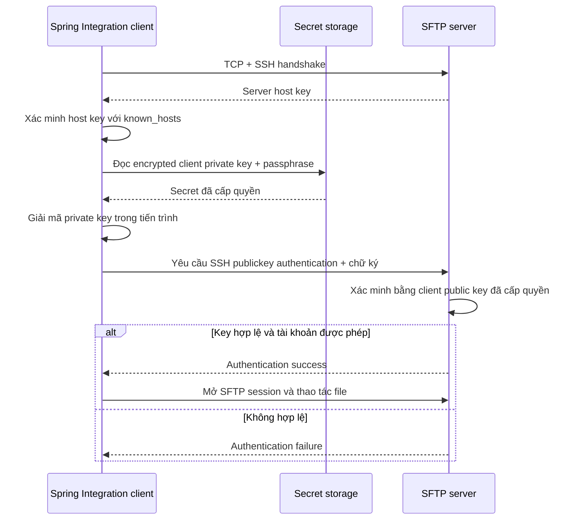

# Private key passphrase và xác thực

## 1. Bài toán: đăng nhập SFTP bằng private key có passphrase

Một ứng dụng Spring Boot gửi báo cáo giao dịch tới SFTP của đối tác mỗi đêm. Đối tác cấp tài khoản `reporting_app` và yêu cầu xác thực bằng **SSH public key**, không dùng mật khẩu đăng nhập. Đội vận hành tạo một cặp khóa cho ứng dụng, đăng ký public key ở phía đối tác, rồi mã hóa private key bằng một **passphrase**. Khi triển khai, ứng dụng cần được cấp cả private key và passphrase để có thể kết nối tự động, kể cả khi không có người nhập mật khẩu trên terminal.

Trong Spring Integration, cùng một `SessionFactory` có thể được dùng bởi SFTP **inbound adapter** (poll và nhận file), **outbound adapter** (gửi file) và **outbound gateway** (thực hiện các lệnh `ls`, `get`, `put`, `mv`, `rm` có phản hồi). Vì vậy, việc cấu hình private key và passphrase đúng cách là điều kiện chung để các luồng `MessageChannel`, gateway và poller trao đổi dữ liệu với hệ thống ngoài.

Sau bài này, bạn có thể:

- Phân biệt **mật khẩu tài khoản SFTP**, **SSH private key**, **passphrase của private key**, **public key** và **server host key**.
- Tạo private key có passphrase bằng OpenSSH, nhận diện đúng những gì cần đưa cho quản trị viên SFTP.
- Cấu hình `DefaultSftpSessionFactory#setPrivateKey(...)` và `setPrivateKeyPassphrase(...)` trong Spring Integration 6.x trở lên.
- Lưu passphrase trong secret manager hoặc môi trường được quản lý, không ghi trực tiếp vào source code.
- Phân tích lỗi giải mã key, lỗi xác thực, lỗi host verification và lỗi quyền truy cập thư mục.
- Thiết kế quy trình luân chuyển passphrase/khóa và cách kiểm thử kết nối không làm lộ bí mật.

> **Giới hạn phiên bản:** ví dụ dùng Spring Integration **6.x trở lên**, khi module SFTP dựa trên Apache MINA SSHD. Ở Spring Integration 5.x, một số API và loại SSH key có thể khác vì triển khai SFTP dựa trên thư viện khác. Đối chiếu BOM Spring Boot, Spring Integration và thư viện SSH thực tế khi sử dụng mã trong dự án.

## 2. Passphrase không phải mật khẩu tài khoản

Nhiều lỗi cấu hình xuất phát từ việc dùng từ "password" để gọi chung mọi bí mật. Thực tế, chúng có vai trò khác nhau:

| Thành phần | Được dùng ở đâu? | Mục đích | Có chuyển nguyên văn qua kết nối SSH không? |
| --- | --- | --- | --- |
| **Private key của client** | Ứng dụng, được đọc từ file/secret | Chứng minh ứng dụng sở hữu khóa bí mật của tài khoản | Không gửi private key sang server |
| **Public key của client** | `authorized_keys` của account trên SFTP server | Cho server biết khóa nào được cho phép đăng nhập | Server dùng để kiểm tra chữ ký xác thực |
| **Passphrase của private key** | Phía ứng dụng, trước khi sử dụng private key đã mã hóa | Giải mã private key đang được bảo vệ khi lưu trữ | **Không** gửi như mật khẩu đăng nhập |
| **Mật khẩu tài khoản SFTP** | Server quản lý nếu bật password authentication | Xác thực theo phương thức `password`, khác với `publickey` | Được dùng trong giao thức xác thực SSH qua kênh mã hóa khi chọn phương thức mật khẩu |
| **Host public key của server** | `known_hosts` phía ứng dụng | Xác minh server đích trước khi trao đổi dữ liệu | Server chứng minh quyền sở hữu private host key trong bắt tay SSH |

Một private key có passphrase trải qua **hai bước**: ứng dụng dùng passphrase để giải mã private key ở phía client; sau đó SSH sử dụng private key để thực hiện xác thực public-key với server. Server chỉ cần public key được cấp quyền và kiểm tra được chữ ký, **không cần biết passphrase của client**.



**Passphrase bảo vệ private key khi lưu trữ**: nếu một bản sao file key bị lộ nhưng passphrase vẫn được giữ kín, kẻ tấn công phải vượt qua lớp mã hóa để sử dụng key. Dù vậy, ứng dụng cần cả hai để chạy tự động, nên nếu kẻ tấn công lấy được **cả private key và passphrase**, lớp bảo vệ này không còn đủ. Cần tách quyền truy cập và theo dõi secret ở cả hai nơi.

### Ví dụ ba tình huống thường bị nhầm

**Tình huống A: private key không mã hóa.** Ứng dụng có thể dùng key mà không cần passphrase, nhưng file key bị sao chép có thể bị sử dụng ngay. Đây là lựa chọn cần đánh giá kỹ về cách bảo vệ ổ đĩa, container image và secret mount.

**Tình huống B: private key có passphrase.** Ứng dụng phải nhận đúng passphrase và sử dụng bộ giải mã key tương thích. Nếu không có passphrase, các thao tác SFTP thường thất bại trước hoặc trong quá trình xác thực.

**Tình huống C: server chỉ cho phép password authentication.** Dù private key và passphrase đúng, server không chấp nhận `publickey` thì đăng nhập vẫn thất bại. Đổi passphrase sẽ không mở được một phương thức xác thực mà server không cho phép.

## 3. Tạo cặp khóa và đặt passphrase an toàn

Ví dụ với OpenSSH trên máy được quản lý. Lệnh dưới đây tạo một cặp khóa **Ed25519** và hỏi passphrase tương tác. Không đặt passphrase vào tham số CLI để tránh xuất hiện trong lịch sử shell, danh sách tiến trình hoặc log:

```bash
# Chạy ở máy quản trị an toàn; nhập passphrase mạnh khi được hỏi.
ssh-keygen -t ed25519 -a 100 -f ~/.ssh/partner_reporting -C "reporting-app"

# Xem fingerprint của PUBLIC KEY phía client.
ssh-keygen -lf ~/.ssh/partner_reporting.pub -E sha256

# Unix/Linux: giới hạn quyền đọc private key.
chmod 600 ~/.ssh/partner_reporting
```

Sau thao tác, có hai file:

```text
~/.ssh/partner_reporting       # Private key, được mã hóa khi đã nhập passphrase
~/.ssh/partner_reporting.pub   # Public key, gửi cho quản trị viên server
```

Đối tác cần thêm **nội dung của file `.pub`** vào `authorized_keys` của đúng tài khoản `reporting_app` và đặt quyền truy cập SSH/SFTP tương ứng. Không gửi private key hoặc passphrase cho đối tác. Fingerprint tạo từ `partner_reporting.pub` dùng để kiểm tra **client public key** đã đăng ký; nó **khác** fingerprint server host key dùng để kiểm tra `known_hosts`.

`-a 100` yêu cầu 100 vòng của cơ chế dẫn xuất khóa khi lưu private key ở định dạng OpenSSH, giúp tăng chi phí đoán passphrase khi file bị đánh cắp; giá trị hợp lý cần cân đối hiệu năng và chính sách của tổ chức. Không có tham số nào trong lệnh này làm private key được an toàn nếu người vận hành vẫn chia sẻ passphrase qua kênh không bảo vệ.

Nếu đối tác không hỗ trợ Ed25519 hoặc hạ tầng có yêu cầu riêng (chẳng hạn chính sách FIPS), hỏi danh sách thuật toán được phép và chọn loại key được hỗ trợ an toàn, ví dụ RSA với kích thước phù hợp. Không tự bật các thuật toán chữ ký cũ/yếu chỉ để vượt lỗi tương thích.

### Hợp đồng cấp quyền với đối tác

Để tránh lỗi cấu hình lặp lại, bên ứng dụng và đối tác nên thống nhất bằng văn bản:

| Thuộc tính | Ví dụ | Người quản lý |
| --- | --- | --- |
| SFTP endpoint | `sftp.partner.example:2222` | Đối tác |
| SFTP username | `reporting_app` | Đối tác |
| Client public key | Nội dung `.pub`, fingerprint SHA-256 | Ứng dụng cung cấp; đối tác cấp quyền |
| Phương thức xác thực | SSH `publickey` | Đối tác cấu hình server |
| Remote directory | `/incoming/reports` | Đối tác cấp quyền |
| Server host key fingerprint | Fingerprint của host key server | Đối tác xác nhận qua kênh độc lập |
| Quy trình key rotation | Thời điểm chuyển khóa, cửa sổ song song | Hai bên phối hợp |

Đừng dùng `ssh-keyscan` rồi tin ngay host key chỉ vì nó được trả về: công cụ này **thu thập**, không tự xác thực. Cần so sánh fingerprint server qua một kênh độc lập rồi mới đưa bản ghi đầy đủ vào `known_hosts`.

## 4. Dependency và cấu hình theo môi trường

Trong dự án Spring Boot sử dụng BOM để quản lý phiên bản, khai báo module Spring Integration và SFTP:

```groovy
// build.gradle
dependencies {
    implementation 'org.springframework.boot:spring-boot-starter-integration'
    implementation 'org.springframework.integration:spring-integration-sftp'
}
```

Hoặc nếu đã quản lý dependency cho module Integration ở nơi khác, chỉ thêm `spring-integration-sftp` phù hợp với phiên bản hiện có. Ví dụ `application.yml`:

```yaml
app:
  sftp:
    host: ${SFTP_HOST:sftp.partner.example}
    port: ${SFTP_PORT:2222}
    username: ${SFTP_USERNAME:reporting_app}
    private-key: file:${SFTP_PRIVATE_KEY_FILE}
    private-key-passphrase: ${SFTP_PRIVATE_KEY_PASSPHRASE:}
    known-hosts: file:${SFTP_KNOWN_HOSTS_FILE}
    remote-directory: ${SFTP_REMOTE_DIRECTORY:/incoming/reports}
```

Trong ví dụ:

- `SFTP_PRIVATE_KEY_FILE`: đường dẫn đến private key **đã mã hóa**, được mount vào môi trường chạy ứng dụng.
- `SFTP_PRIVATE_KEY_PASSPHRASE`: secret cung cấp passphrase; không có giá trị mặc định thật. Nếu key không có passphrase, biến có thể rỗng.
- `SFTP_KNOWN_HOSTS_FILE`: đường dẫn đến danh sách host key đáng tin cậy; cần bảo vệ tính toàn vẹn của file.
- `SFTP_USERNAME`: tài khoản server được cấp quyền dùng client public key; username không phải passphrase.

Không commit file chứa private key, giá trị passphrase hoặc cấu hình production có bí mật vào Git. Với Docker/Kubernetes hoặc máy ảo, nên cấp private key qua secret volume có quyền đọc hạn chế, và cấp passphrase qua hệ thống quản lý secret được kiểm soát. Dùng biến môi trường cho passphrase là ví dụ dễ hiểu, nhưng ở một số môi trường biến môi trường có thể bị đọc qua quyền quản trị, chẩn đoán tiến trình hoặc crash dump; production cần đánh giá lựa chọn secret injection phù hợp. Có thể sử dụng Spring Boot config tree hoặc secret manager để cung cấp cùng property mà không truyền qua environment variable.

## 5. `DefaultSftpSessionFactory` với private key và passphrase

Từ Spring Integration 6.x, `DefaultSftpSessionFactory` cung cấp cấu hình private key dạng Spring `Resource`. Để xác thực client theo SSH public key, chỉ định **cả key và passphrase nếu key được mã hóa**; đồng thời đặt chính sách kiểm tra host key:

```java
import org.apache.sshd.sftp.client.SftpClient;
import org.springframework.beans.factory.annotation.Value;
import org.springframework.context.annotation.Bean;
import org.springframework.context.annotation.Configuration;
import org.springframework.core.io.Resource;
import org.springframework.integration.file.remote.session.CachingSessionFactory;
import org.springframework.integration.file.remote.session.SessionFactory;
import org.springframework.integration.sftp.session.DefaultSftpSessionFactory;

@Configuration
public class ReportingSftpSessionConfig {

    @Bean
    public SessionFactory<SftpClient.DirEntry> reportingSftpSessionFactory(
            @Value("${app.sftp.host}") String host,
            @Value("${app.sftp.port}") int port,
            @Value("${app.sftp.username}") String username,
            @Value("${app.sftp.private-key}") Resource privateKey,
            @Value("${app.sftp.private-key-passphrase:}") String passphrase,
            @Value("${app.sftp.known-hosts}") Resource knownHosts) {

        DefaultSftpSessionFactory delegate = new DefaultSftpSessionFactory(false);
        delegate.setHost(host);
        delegate.setPort(port);
        delegate.setUser(username);

        // Client authentication: private key được đọc từ secret mount.
        delegate.setPrivateKey(privateKey);
        if (!passphrase.isBlank()) {
            delegate.setPrivateKeyPassphrase(passphrase);
        }

        // Server authentication: chỉ kết nối host key đã xác minh.
        delegate.setKnownHostsResource(knownHosts);
        delegate.setAllowUnknownKeys(false);
        delegate.setTimeout(30_000);

        // Tái sử dụng session, có giới hạn số phiên được cache.
        return new CachingSessionFactory<>(delegate, 4);
    }
}
```

Hai dòng sau có vai trò khác nhau:

```java
delegate.setPrivateKey(privateKey);                  // Khóa để xác thực CLIENT
delegate.setPrivateKeyPassphrase(passphrase);         // Mở khóa private key nếu được mã hóa

delegate.setKnownHostsResource(knownHosts);           // Kiểm tra SERVER
delegate.setAllowUnknownKeys(false);                  // Không tin host key lạ
```

`setPrivateKeyPassphrase(...)` không tương đương `setPassword(...)`. Phương thức `setPassword(...)`, nếu dùng, cấu hình một credential phục vụ **password authentication** của tài khoản SFTP; nó không tự giải mã một private key đã được mã hóa. Khi hợp đồng chỉ cho phép `publickey`, không nên tùy tiện thêm password authentication làm phương án dự phòng ngoài thỏa thuận.

**Khi không có passphrase:** ví dụ đặt `passphrase` rỗng và không gọi `setPrivateKeyPassphrase`. Khi có passphrase nhưng secret bị thiếu, ứng dụng có thể khởi động được bean nhưng **sẽ lỗi khi mở phiên hoặc sử dụng key**. Vì kết nối thường thiết lập khi endpoint hoạt động, không được suy từ việc Spring context khởi tạo thành công rằng xác thực SFTP đã được kiểm chứng.

**Khi có nhiều kết nối:** `CachingSessionFactory` tối ưu chi phí handshake và hạn chế mở quá nhiều session. Với secret bị thay đổi, session đang dùng có thể giữ trạng thái xác thực cũ. Quản lý vòng đời cấu hình/bean và khởi tạo các kết nối mới khi luân chuyển key; không giả định đổi secret file trên đĩa là đủ cho các session đã mở.

## 6. Kiểm chứng cấu hình bằng outbound gateway `ls`

Để thử xác thực mà chưa ghi/xóa dữ liệu của đối tác, có thể gọi một lệnh `ls` vào thư mục đã được cấp quyền. Đây là một **SFTP outbound gateway** theo kiểu request/reply; nó dùng cùng session factory mà inbound/outbound adapter sẽ dùng.

```java
import org.apache.sshd.sftp.client.SftpClient;
import org.springframework.context.annotation.Bean;
import org.springframework.context.annotation.Configuration;
import org.springframework.integration.annotation.IntegrationComponentScan;
import org.springframework.integration.dsl.IntegrationFlow;
import org.springframework.integration.file.remote.session.SessionFactory;
import org.springframework.integration.sftp.dsl.Sftp;

@Configuration
@IntegrationComponentScan(basePackageClasses = ReportingSftpGateway.class)
public class ReportingSftpVerificationFlow {

    @Bean
    public IntegrationFlow listReportsFlow(
            SessionFactory<SftpClient.DirEntry> reportingSftpSessionFactory) {

        return IntegrationFlow.from("listReportsRequests")
                .handle(Sftp.outboundGateway(
                        reportingSftpSessionFactory, "ls", "payload"))
                .get();
    }
}
```

Interface Java dùng `@MessagingGateway` để gọi flow:

```java
import java.util.List;
import org.springframework.integration.annotation.Gateway;
import org.springframework.integration.annotation.MessagingGateway;

@MessagingGateway
public interface ReportingSftpGateway {

    @Gateway(requestChannel = "listReportsRequests")
    List<?> list(String remoteDirectory);
}
```

Service gọi một đường dẫn cố định đã cấu hình, tránh trao quyền nhập path tùy ý cho client HTTP:

```java
import java.util.List;
import org.springframework.beans.factory.annotation.Value;
import org.springframework.stereotype.Service;

@Service
public class ReportingSftpConnectivityCheck {

    private final ReportingSftpGateway sftpGateway;
    private final String directory;

    public ReportingSftpConnectivityCheck(
            ReportingSftpGateway sftpGateway,
            @Value("${app.sftp.remote-directory}") String directory) {
        this.sftpGateway = sftpGateway;
        this.directory = directory;
    }

    public List<?> listConfiguredDirectory() {
        return sftpGateway.list(directory);
    }
}
```

Khi gọi `listConfiguredDirectory()`, message đi vào channel `listReportsRequests`, outbound gateway mở/lấy session, xác minh host key, dùng private key đã giải mã để xác thực và thực hiện `ls`. Reply trả về danh sách metadata file tùy options của gateway. Nếu sử dụng `DirectChannel` đồng bộ mặc định, ngoại lệ có thể đi ngược về caller; nếu chuyển sang channel bất đồng bộ, cần quản lý reply timeout và error channel.

Đây là **connectivity check có tác dụng đọc**: thành công chứng minh ứng dụng đã xác thực và có quyền `ls` trên thư mục cụ thể tại thời điểm kiểm tra. Nó không chứng minh tài khoản có quyền `put`, `rename` hoặc `delete`, và cũng không bảo đảm các file đối tác gửi có nội dung hợp lệ. Đừng nhúng một lệnh `ls` gây kết nối SFTP vào liveness probe gọi quá dày; dùng kiểm tra có tần suất và timeout phù hợp.

## 7. Cách biết private key và passphrase đã đúng

Không cần mở nội dung private key ra log hoặc gửi passphrase đến một website để kiểm tra. Có thể kiểm thử theo lớp:

1. **Kiểm tra đường dẫn:** xác minh runtime có thể đọc `SFTP_PRIVATE_KEY_FILE`, `SFTP_KNOWN_HOSTS_FILE`, và có quyền truy cập nguồn secret của passphrase.
2. **Kiểm tra cặp khóa:** xác nhận public key đã giao cho đối tác tương ứng với private key ứng dụng đang dùng, so sánh fingerprint client key với phía quản trị SFTP.
3. **Thử từ máy quản trị:** dùng OpenSSH với private key tương ứng; nếu được hỏi passphrase, nhập tương tác trong terminal đáng tin cậy. Không lưu passphrase vào shell history hay script.
4. **Thử trong ứng dụng:** gọi outbound gateway `ls` để kiểm tra cùng cơ chế đọc key và giải mã mà Spring Integration dùng. Thành công trong OpenSSH không tự chứng minh runtime Java có đúng secret hoặc hỗ trợ cùng định dạng key.
5. **Ghi nhận kết quả:** log hostname/port, tài khoản, tên bean, loại lỗi và correlation ID; không log passphrase, raw private key hay toàn bộ secret configuration.

Ví dụ dùng OpenSSH; `partner_known_hosts` phải được đối chiếu host fingerprint độc lập trước đó:

```bash
sftp -P 2222 \
  -i ~/.ssh/partner_reporting \
  -o IdentitiesOnly=yes \
  -o StrictHostKeyChecking=yes \
  -o UserKnownHostsFile=./partner_known_hosts \
  reporting_app@sftp.partner.example
```

OpenSSH có thể dùng tương tác người dùng hoặc SSH agent để mở khóa/sử dụng key. `DefaultSftpSessionFactory#setPrivateKey(Resource)` của Spring Integration đọc private key theo cấu hình **trong tiến trình Java**; không nên giả định ứng dụng tự động dùng đúng trạng thái `ssh-agent` của terminal nơi bạn thử `sftp`. Vì vậy, việc CLI đăng nhập thành công nhưng ứng dụng thất bại thường cần kiểm tra riêng đường dẫn file, passphrase và hỗ trợ định dạng key phía Java.

### Kiểm tra fingerprint của client public key

```bash
# Fingerprint này dùng để đối chiếu key đã cấp quyền ở SFTP server.
ssh-keygen -lf ~/.ssh/partner_reporting.pub -E sha256
```

Đừng nhầm với:

```bash
# Fingerprint HOST KEY của server, phục vụ xác minh known_hosts.
ssh-keygen -lf partner_known_hosts -E sha256
```

Hai fingerprint mô tả **hai danh tính khác nhau**, nên việc chúng không giống nhau là hoàn toàn bình thường.

## 8. Bảng chẩn đoán lỗi xác thực

Không nên sửa lỗi bằng cách thay ngẫu nhiên passphrase, key hay `known_hosts`. Hãy xác định lỗi xảy ra ở giai đoạn nào:

| Giai đoạn | Biểu hiện thường gặp | Nguyên nhân có thể | Cách kiểm tra |
| --- | --- | --- | --- |
| Đọc tài nguyên | File không tồn tại, không đọc được, resource không hợp lệ | Biến môi trường sai, secret chưa mount, quyền file sai | Kiểm tra đường dẫn trong runtime và quyền đọc |
| Parse/decrypt private key | Không giải mã được key, lỗi định dạng hoặc passphrase | Passphrase thiếu/sai, file key hỏng, thư viện không hỗ trợ định dạng | Kiểm tra nguồn key, secret và phiên bản thư viện SSH |
| SSH host verification | Unknown host key, host key mismatch | `known_hosts` sai, endpoint/port đổi, server rotate key hoặc rủi ro giả mạo | Xác minh host fingerprint qua kênh độc lập; không bật `allowUnknownKeys=true` |
| SSH user authentication | Authentication failed, public key rejected | Public key chưa đăng ký, username sai, server không bật publickey, key khác với key được cấp | Kiểm tra `authorized_keys`, account, chính sách `publickey`, fingerprint client key |
| Thao tác SFTP | Permission denied lúc `ls`/`put` | Đăng nhập được nhưng thiếu quyền read/write/rename tại thư mục | Kiểm tra quyền và remote path cụ thể |
| Kết nối/số phiên | Timeout, connection reset, session refused | Network, firewall, quota, session cache cũ, server từ chối kết nối mới | Kiểm tra host/port/network, timeout, số session đồng thời |

Lỗi có thể được bọc trong exception của Spring Integration hoặc Apache MINA SSHD; chuỗi thông báo cụ thể phụ thuộc version. Hữu ích hơn là phân loại theo thứ tự **TCP → host verification → private key/decryption → client authentication → SFTP command**. Một lỗi `Permission denied` khi ghi file **không tự chứng minh private key hoặc passphrase sai**, vì phiên có thể đã được xác thực thành công.

### Lỗi passphrase sai có khác key chưa cấp quyền không?

Có. Nếu passphrase không giải mã được private key, client chưa thể dùng key đó để tạo chữ ký xác thực hợp lệ. Nếu giải mã được nhưng server không tin public key tương ứng, quá trình xác thực vẫn bị từ chối. Cả hai có thể xuất hiện gần nhau trong log tổng quát `Auth fail`, nhưng cách sửa khác nhau. Hỏi quản trị viên SFTP kiểm tra public key fingerprint đã cấp thay vì yêu cầu họ biết hoặc thử passphrase của ứng dụng.

### Khi key được tạo bởi công cụ khác

Một số nơi xuất khóa theo định dạng OpenSSH, PEM/PKCS#8 hoặc định dạng riêng như PuTTY `.ppk`. Không đổi tên đuôi file và giả định định dạng đã được chuyển. Nếu Java báo không thể parse key, cần kiểm tra file thực, thuật toán và khả năng hỗ trợ của Apache MINA SSHD phiên bản chạy. Việc chuyển đổi định dạng khóa phải thực hiện trên máy an toàn, xác minh public key sau chuyển đổi và không dán private key vào dịch vụ chuyển đổi trực tuyến.

## 9. Quản lý secret và quyền truy cập trong production

Với một luồng tự động không có người nhập passphrase, ứng dụng bắt buộc phải truy cập secret tại runtime. Thiết kế nên tập trung vào quyền tối thiểu, phân tách môi trường và giám sát thay đổi:

- **Private key:** mount từ secret manager/volume, read-only nếu được, chỉ tiến trình ứng dụng cần thiết có quyền đọc. Không đóng gói vào JAR hoặc container image.
- **Passphrase:** lưu trong kho secret có ACL riêng; tránh `application.yml` chứa giá trị thật, tránh log và dump cấu hình. Không gửi qua message header/payload.
- **`known_hosts`:** là public host key nhưng cần bảo vệ **tính toàn vẹn**. Bản ghi sai có thể khiến ứng dụng tin nhầm server.
- **Tài khoản:** mỗi môi trường hoặc đối tác nên có identity key/quyền truy cập phù hợp; không dùng một cặp khóa cho mọi môi trường mà không có lý do vận hành rõ ràng.
- **Quyền server:** tài khoản nhận báo cáo có thể chỉ cần ghi/rename trong `/incoming/reports`; không cấp quyền xóa hoặc đọc thư mục khác nếu không cần.
- **Audit:** ghi sự kiện cấp, đọc, đổi, thu hồi secret ở hệ thống quản lý, có người sở hữu và quy trình khôi phục khi khóa bị lộ.

Nếu ứng dụng có nhiều replica dùng cùng tài khoản/khóa, server sẽ thấy các kết nối cùng danh tính. Cần giới hạn số session (`CachingSessionFactory` và điều phối concurrency), theo dõi quota và idempotency nghiệp vụ khi nhiều instance cùng gửi một file. **Passphrase không giải quyết gửi trùng**: nó chỉ bảo vệ private key khi lưu trữ.

## 10. Luân chuyển passphrase và luân chuyển cặp khóa là hai việc khác nhau

Có ít nhất ba hoạt động vận hành dễ bị nhầm:

| Hoạt động | Cái gì thay đổi? | Có cần đối tác đổi `authorized_keys`? | Cần cập nhật ở phía ứng dụng |
| --- | --- | --- | --- |
| **Đổi passphrase** | Cách mã hóa private key ở phía client | Thông thường **không** nếu vẫn cùng cặp khóa | File private key đã mã hóa lại và secret passphrase mới |
| **Đổi client key pair** | Private/public key của tài khoản ứng dụng | **Có**, phải thêm public key mới rồi gỡ key cũ theo kế hoạch | Private key mới, passphrase mới nếu dùng, và secret references |
| **Đổi server host key** | Danh tính SSH của server SFTP | Không, đây là khóa ở phía server | Bản ghi host key đã xác minh trong `known_hosts` |

### Đổi passphrase, giữ nguyên cặp khóa

Trên máy quản trị an toàn, sao lưu file key bằng phương thức được kiểm soát trước khi thay đổi. Lệnh `ssh-keygen -p` yêu cầu nhập passphrase cũ và passphrase mới theo tương tác; không truyền chúng trên command line:

```bash
# Thao tác trên private key thuộc quyền quản trị; không chạy tùy tiện ở container production.
ssh-keygen -p -f ~/.ssh/partner_reporting

# Đối chiếu public key fingerprint sau thay đổi.
ssh-keygen -lf ~/.ssh/partner_reporting.pub -E sha256
```

Thay passphrase chỉ mã hóa lại vật liệu private key. Nếu cùng key pair, public key phía đối tác vẫn sử dụng được. Cần **phát hành đồng bộ** file private key đã mã hóa lại và secret passphrase mới cho ứng dụng, kiểm tra đăng nhập thử qua kết nối mới, rồi thu hồi phiên bản secret cũ theo quy trình. Nếu chỉ thay passphrase trong secret manager mà file private key vẫn mã hóa bằng passphrase cũ, ứng dụng sẽ thất bại.

### Đổi cả cặp khóa client

Đây là lựa chọn khi key đã quá vòng đời, nghi bị lộ hoặc cần đổi thuật toán. Quy trình an toàn thường gồm:

1. Tạo cặp khóa mới có passphrase riêng trong môi trường bảo mật.
2. Gửi **public key mới** cho đối tác và yêu cầu thêm nó vào `authorized_keys` trước khi ngắt quyền khóa cũ.
3. Triển khai private key/passphrase mới vào môi trường staging hoặc một nhóm canary, xác minh `ls`/`put` theo quyền đã cấp.
4. Chuyển các phiên/instance còn lại sang key mới; khởi tạo kết nối mới thay vì chỉ dựa vào session cache cũ.
5. Sau khi xác nhận không còn producer nào dùng key cũ, phối hợp gỡ public key cũ và thu hồi secret cũ.

Vì SSH/SFTP không tham gia transaction DB, việc đổi key giữa lúc đang upload file phải phối hợp với trạng thái job: file đang truyền có thể bị gián đoạn và cần đối soát trước retry. Đừng đánh dấu một batch đã giao thành công chỉ vì key mới đăng nhập được.

### Khi nào cần reset session cache?

Mỗi phiên SSH đã xác thực không nhất thiết đọc lại private key hoặc passphrase trên mọi lệnh SFTP. Khi thay secret, các kết nối cũ có thể vẫn chạy cho đến khi đóng, còn kết nối mới có thể dùng cấu hình đã được tạo lúc khởi động. Cách kiểm soát đơn giản là **tái tạo session factory và kết nối mới bằng cấu hình mới**, chẳng hạn rollout/restart có kế hoạch sau khi secret đã cập nhật. Với hệ thống cần chuyển nóng, xác định rõ API reset cache và hành vi reload property ở phiên bản đang dùng trước khi triển khai.

## 11. Kiểm thử theo kịch bản

Thực hành trên **SFTP test server** có tài khoản được cấp public key và host key đã xác minh; dùng dữ liệu giả, tránh thay credential production chỉ để kiểm tra lỗi.

1. **Đúng key và passphrase:** mount key được mã hóa, cung cấp secret đúng, thử `ls` và xác nhận thao tác thành công.
2. **Thiếu passphrase:** bỏ secret trong bản triển khai test, dùng key vẫn được mã hóa; quan sát lỗi giải mã hoặc xác thực theo phiên bản. Không giả định ứng dụng tự đọc passphrase từ terminal/SSH agent.
3. **Sai passphrase:** đổi giá trị secret trên test; xác nhận không thể dùng key, log không hiển thị nội dung passphrase.
4. **Sai client key:** dùng một key hợp lệ khác không được đăng ký; xác nhận host verification vẫn có thể đạt nhưng user authentication thất bại.
5. **Sai username:** dùng key đúng nhưng tài khoản khác không có public key được cấp; xác nhận bị từ chối.
6. **Sai server host key:** thay server test bằng host key chưa có trong `known_hosts`; xác nhận client từ chối trước khi trao đổi file.
7. **Sai quyền thư mục:** đăng nhập thành công nhưng thử `ls` một folder bị hạn chế; xác nhận lỗi quyền được phân biệt với lỗi passphrase.
8. **Đổi passphrase:** mã hóa lại cùng key trên test, cập nhật cả key file lẫn passphrase secret, khởi tạo kết nối mới và xác nhận public key fingerprint không đổi.
9. **Đổi key pair:** thử chuyển tiếp hai public key được phép, xác nhận key mới hoạt động và key cũ bị thu hồi sau cửa sổ chuyển đổi.
10. **Nhiều replica:** kiểm tra session limit, mức tải và khi thay secret có instance còn dùng phiên cũ hay không.

Một bảng kết quả kiểm thử giúp tránh kết luận sai:

| Private key | Passphrase | `authorized_keys` phía server | `known_hosts` | Kết quả dự kiến |
| --- | --- | --- | --- | --- |
| Đã mã hóa, hợp lệ | Đúng | Có public key tương ứng | Server đúng | Có thể xác thực và chạy lệnh nếu đủ quyền |
| Đã mã hóa, hợp lệ | Sai/thiếu | Có public key tương ứng | Server đúng | Không dùng được private key để xác thực |
| Đã mã hóa, hợp lệ | Đúng | Không có public key tương ứng | Server đúng | Server từ chối public-key authentication |
| Đã mã hóa, hợp lệ | Đúng | Có public key tương ứng | Host key lạ/không khớp | Client từ chối server trước khi thao tác |
| Không mã hóa, hợp lệ | Không cần | Có public key tương ứng | Server đúng | Có thể xác thực, nhưng file key lưu trữ không có lớp mã hóa passphrase |

Các kết quả dự kiến còn phụ thuộc server có bật phương thức `publickey`, tính tương thích thuật toán, account status và quyền filesystem. Không xem một login thành công là bằng chứng chắc chắn rằng giao dịch xuất/nhập file nghiệp vụ đã hoàn tất.

## 12. Những sai lầm thường gặp

- **Nhập passphrase vào `setPassword` và nghĩ đã cấu hình encrypted key:** hai phương thức phục vụ mục đích khác nhau.
- **Gửi passphrase cho quản trị viên SFTP:** phía server chỉ cần public key; không nên nhận passphrase/private key của client.
- **Cho private key vào `src/main/resources` hoặc Docker image:** nguồn mã và image có thể được sao chép hoặc lưu trữ lâu dài, làm lộ secret.
- **Đặt passphrase trực tiếp vào lệnh CLI hoặc commit YAML thật:** dữ liệu có thể lọt vào history, log, backup hoặc quy trình CI.
- **Thấy `Auth fail` là đổi passphrase ngay:** lỗi có thể do username, public key chưa cấp, server không bật publickey, host key verification hoặc permission.
- **Bật `allowUnknownKeys(true)` để sửa lỗi client auth:** cấu hình này bỏ qua xác minh server và không giúp giải mã private key.
- **Cho rằng `ssh-agent` của máy lập trình là secret source mặc định của ứng dụng Java:** phải xác nhận cách `SessionFactory` thực sự đọc key/passphrase trong runtime.
- **Thay một mình passphrase secret mà không mã hóa lại key:** file key cũ và secret mới không còn khớp.
- **Thay key pair rồi quên cấp public key mới:** server tiếp tục từ chối dù ứng dụng có private key và passphrase đúng.
- **Chỉ kiểm tra startup của Spring Boot:** nhiều session được mở lúc có message đầu tiên, nên cần một lần thử SFTP an toàn để xác minh xác thực.

## 13. Câu hỏi tự kiểm tra

1. Mật khẩu tài khoản SFTP và passphrase của private key khác nhau ở bước nào trong luồng SSH?
2. Vì sao server SFTP không cần biết passphrase dù client dùng key có passphrase?
3. Bạn sẽ cấp những thông tin nào cho đối tác để bật `publickey` authentication, và tuyệt đối không gửi gì?
4. Nếu `ssh -i key` chạy được từ terminal nhưng Spring Integration thất bại, những khác biệt nào về runtime/secret/định dạng key cần kiểm tra?
5. Tại sao có `setPrivateKeyPassphrase` vẫn phải cấu hình `setKnownHostsResource` và `setAllowUnknownKeys(false)`?
6. Khi thay passphrase nhưng giữ nguyên key pair, `authorized_keys` ở server có cần thay không? Những bí mật nào ở client phải đồng bộ?
7. Khi thay toàn bộ key pair, bạn sẽ thiết kế cửa sổ chuyển đổi và thu hồi key cũ như thế nào để giảm gián đoạn?
8. Vì sao kết nối `ls` thành công không chứng minh tài khoản có quyền `put`, và không xác nhận đối tác đã xử lý file nghiệp vụ?

## Tài liệu tham khảo

- [Spring Integration Reference — SFTP Session Factory](https://docs.spring.io/spring-integration/reference/sftp/session-factory.html)
- [Spring Integration Reference — SFTP Session Caching](https://docs.spring.io/spring-integration/reference/sftp/session-caching.html)
- [Spring Integration Reference — SFTP Outbound Gateway](https://docs.spring.io/spring-integration/reference/sftp/using-the-gateway.html)
- [Spring Integration API — DefaultSftpSessionFactory](https://docs.spring.io/spring-integration/docs/current/api/org/springframework/integration/sftp/session/DefaultSftpSessionFactory.html)
- [OpenBSD Manual — ssh-keygen(1)](https://man.openbsd.org/ssh-keygen.1)
- [OpenBSD Manual — ssh(1)](https://man.openbsd.org/ssh.1)
