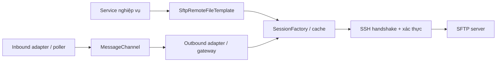
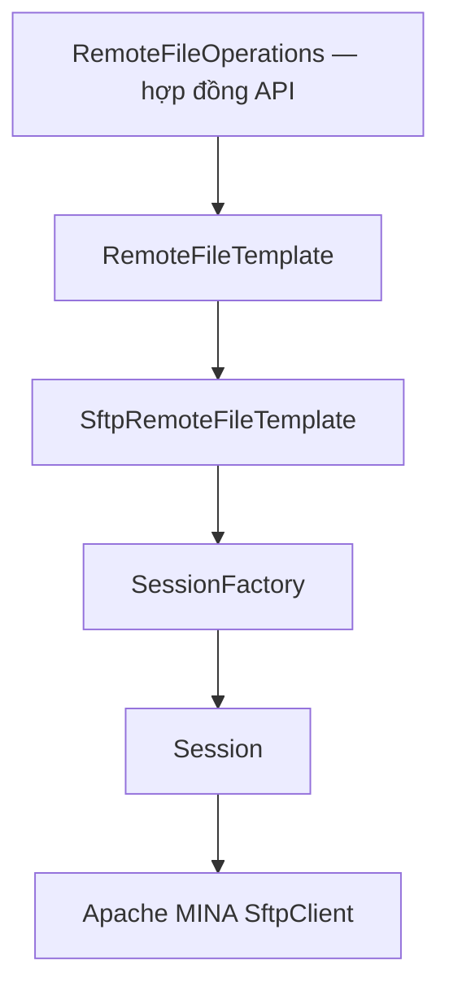
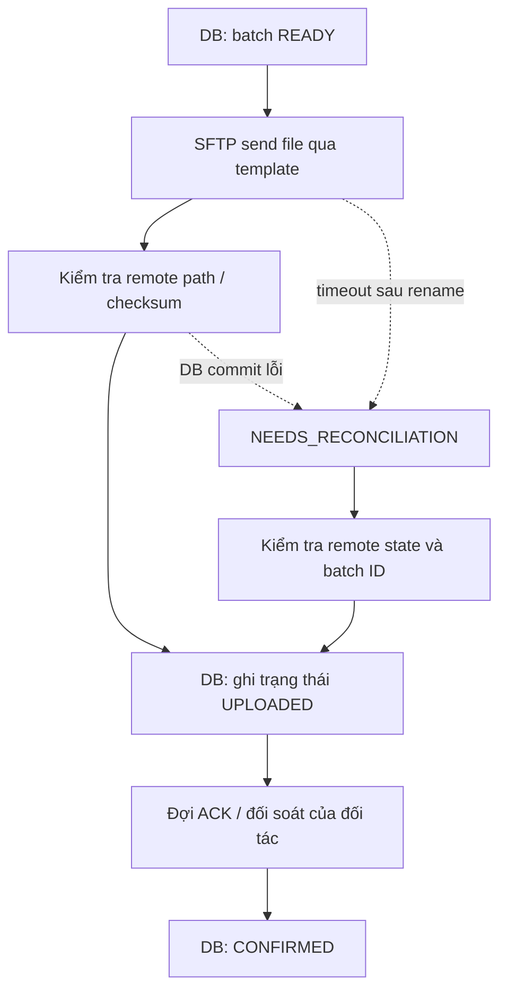

# `RemoteFileTemplate` thực hiện thao tác SFTP

## 1. Khi nào ứng dụng cần thao tác SFTP trực tiếp?

Một hệ thống kế toán cần gửi `settlement-20261123-0042.csv` sang máy chủ SFTP của đối tác. Sau khi gửi, ứng dụng phải kiểm tra file có tồn tại, thỉnh thoảng liệt kê thư mục `ready`, tải một file phản hồi và chuyển file đã đối soát sang `archive`. Quyết định thực hiện mỗi thao tác đến từ service nghiệp vụ, chẳng hạn sau khi một batch trong cơ sở dữ liệu được chuyển sang trạng thái `READY_TO_SEND`.

Trong **Spring Integration**, `SftpRemoteFileTemplate` cung cấp API Java để thực hiện trực tiếp các thao tác file từ xa: **`send`, `get`, `list`, `exists`, `rename`, `remove`**. Nó kế thừa `RemoteFileTemplate<SftpClient.DirEntry>` và sử dụng `SessionFactory` để quản lý phiên SSH/SFTP. Đối tượng này thích hợp khi lập trình viên muốn gọi một thao tác từ **service Java**, hoặc cần kết hợp vài thao tác trong một quy trình có trạng thái do ứng dụng quản lý.

Bài học thuộc chương **Adapter SFTP** của module `SPRING_INTEGRATION_ADAPTERS`. Trong toàn module, inbound/outbound adapter, gateway, poller và `MessageChannel` giúp tạo luồng tích hợp giữa các hệ thống; `RemoteFileTemplate` là một API cấp thấp hơn để **điều khiển thao tác file theo nhu cầu**. Nó không tự tạo một polling endpoint hoặc message flow.

Sau bài này, bạn có thể:

- Giải thích quan hệ giữa `SftpRemoteFileTemplate`, `RemoteFileOperations`, `SessionFactory` và `Session`.
- Cấu hình một template dùng private key, passphrase và file `known_hosts` đã xác minh.
- Sử dụng `send`, `get`, `list`, `exists`, `rename`, `remove` với hợp đồng đường dẫn rõ ràng.
- Phân biệt `execute(SessionCallback)` và `invoke(OperationsCallback)`, đồng thời hiểu vòng đời session.
- Thiết kế retry, idempotency và đối soát khi kết quả thao tác từ xa không chắc chắn.

> **Phiên bản:** các đoạn Java dùng API của Spring Integration **6.x**, với SFTP client dựa trên **Apache MINA SSHD** và phần tử file từ xa là `org.apache.sshd.sftp.client.SftpClient.DirEntry`. Ở Spring Integration 5.x, một số generic type/SFTP client sử dụng JSch; hãy đối chiếu tài liệu đúng phiên bản của dự án. Các ví dụ giả định một ứng dụng Spring Boot đã bật cấu hình Spring Integration.

## 2. `RemoteFileTemplate` nằm ở đâu trong kiến trúc?



`RemoteFileTemplate` và các adapter/gateway có thể **dùng chung `SessionFactory`**. Điểm khác nhau nằm ở cách chúng được gọi và cách trả kết quả:

| Cách tích hợp | Cách kích hoạt | Giao diện với ứng dụng | Tình huống phù hợp |
| --- | --- | --- | --- |
| SFTP **inbound adapter** | Poller chạy định kỳ | Tạo `Message<File>` từ file tải về | Nhận nhiều file mới tự động |
| SFTP **outbound adapter** | Nhận message từ `MessageChannel` | Handler một chiều, gửi file lên server | Publish file trong một integration flow |
| SFTP **outbound gateway** | Nhận request message | Request/reply, trả kết quả lệnh `ls/get/put/mv/rm` | Service nghiệp vụ tương tác qua messaging gateway |
| **`SftpRemoteFileTemplate`** | Gọi method Java trực tiếp | Return value/callback/exception theo API | Service chủ động thực hiện một hoặc vài thao tác SFTP |

Ví dụ, một job đã có danh sách batch trong DB có thể gọi `template.send(...)` và lưu đường dẫn được trả về. Nếu thay vào đó kiến trúc của bạn đã dựa vào `MessageChannel`, việc đặt một SFTP outbound gateway vào flow thường giúp định nghĩa rõ request/reply, retry advice và error channel.

**Không cần poller để dùng template.** Poller có thể định kỳ gọi service sử dụng template, nhưng bản thân `SftpRemoteFileTemplate` không quét SFTP server hoặc tự lên lịch thực thi. Tương tự, lời gọi `template.get()` không tự phát `Message<File>` vào một channel khác.

## 3. Các lớp và phương thức cần biết

Sơ đồ phụ thuộc đơn giản:



`SftpRemoteFileTemplate` là một **lớp cụ thể**, kế thừa template generic. Các phương thức phổ biến được kế thừa từ `RemoteFileTemplate` và `RemoteFileOperations`:

| Phương thức | Kiểu kết quả | Ý nghĩa |
| --- | --- | --- |
| `send(Message<?>, FileExistsMode...)` | `String` | Gửi payload file/dữ liệu; trả đường dẫn remote hoặc `null` nếu không tìm được file nguồn theo contract của API |
| `get(String, InputStreamCallback)` | `boolean` | Lấy dữ liệu từ remote qua `InputStream` trong callback; template quản lý stream/session |
| `list(String)` | `SftpClient.DirEntry[]` | Liệt kê entry trong thư mục remote |
| `exists(String)` | `boolean` | Kiểm tra đường dẫn từ xa có tồn tại |
| `rename(String, String)` | `void` | Đổi tên/chuyển đường dẫn từ xa; lỗi có thể được báo qua exception |
| `remove(String)` | `boolean` | Xóa file từ xa và báo kết quả theo contract SFTP |
| `execute(SessionCallback<F,T>)` | `T` | Cho phép gọi trực tiếp một hoặc nhiều phương thức trên **cùng `Session`** trong callback |
| `invoke(OperationsCallback<F,T>)` | `T` | Gọi nhiều API cấp template trong phạm vi **một session gắn với thread** |
| `executeWithClient(ClientCallback<C,T>)` | `T` | Dùng client giao thức ở mức thấp khi API template không đủ |
| `getSession()` | `Session<F>` | Lấy session thô; **người gọi phải đóng session** khi xong |

Phân biệt hai chữ "get": `get(remotePath, callback)` nhận dữ liệu file qua stream, còn `getSession()` lấy một kết nối/session để thao tác. Với `get(remotePath, callback)`, callback cần sử dụng stream **ngay trong thời gian callback chạy**; không giữ `InputStream` để đọc ở một thread khác sau khi method đã trả về.

`send(...)` cần một Spring `Message<?>`, ví dụ `MessageBuilder.withPayload(file).build()`, vì template dùng payload và có thể dùng header khi tính tên/thư mục từ xa. Các phương thức khác nhận đường dẫn là chuỗi. Đường dẫn như `/exchange/settlement/ready/a.csv` là **đường dẫn server SFTP**, khác với `Path` trên ổ đĩa của ứng dụng.

## 4. Xác thực SSH và cấu hình Spring Boot

`SessionFactory` chịu trách nhiệm kết nối và xác thực; template chỉ yêu cầu một session để thực thi. Khi đăng nhập bằng key, cần phân biệt:

- **Private key của ứng dụng**: giữ trong secret mount để chứng minh danh tính client.
- **Public key của ứng dụng**: đối tác thêm vào `authorized_keys` của account được cấp.
- **Passphrase của private key**: giải mã private key ở phía client nếu key được mã hóa; không phải mật khẩu đăng nhập.
- **Host key của server**: bản public host key đã được xác minh và ghi vào `known_hosts`, để bảo đảm ứng dụng kết nối đúng server.

**Không tắt xác minh host key** để vượt lỗi kết nối. Nếu dùng `ssh-keyscan` để thu thập host key lần đầu, phải so sánh fingerprint với giá trị do quản trị viên đối tác cung cấp qua kênh xác thực độc lập. Chỉ sau khi xác minh mới sử dụng file `known_hosts`.

Với Spring Boot BOM, khai báo dependency:

```groovy
dependencies {
    implementation 'org.springframework.boot:spring-boot-starter-integration'
    implementation 'org.springframework.integration:spring-integration-sftp'
}
```

Một `application.yml` chỉ chứa placeholder:

```yaml
app:
  sftp:
    host: ${SFTP_HOST:sftp.partner.example}
    port: ${SFTP_PORT:22}
    username: ${SFTP_USERNAME:settlement_app}
    private-key: file:${SFTP_PRIVATE_KEY_FILE}
    private-key-passphrase: ${SFTP_PRIVATE_KEY_PASSPHRASE:}
    known-hosts: file:${SFTP_KNOWN_HOSTS_FILE}
    outgoing-dir: ${SFTP_OUTGOING_DIR:/exchange/settlement/outgoing}
    ready-dir: ${SFTP_READY_DIR:/exchange/settlement/ready}
    archive-dir: ${SFTP_ARCHIVE_DIR:/exchange/settlement/archive}
```

`SFTP_PRIVATE_KEY_FILE` và `SFTP_KNOWN_HOSTS_FILE` phải là đường dẫn file được mount **trong runtime**; private key không nằm trong Git hoặc container image. `SFTP_PRIVATE_KEY_PASSPHRASE` là secret, không ghi giá trị thật trong YAML hay log. Nếu private key không có passphrase, có thể để giá trị rỗng; trên production, cân nhắc kho secret/config tree thay vì chỉ dựa vào biến môi trường.

Tạo `SessionFactory` để dùng chung với template:

```java
import org.apache.sshd.sftp.client.SftpClient;
import org.springframework.beans.factory.annotation.Value;
import org.springframework.context.annotation.Bean;
import org.springframework.context.annotation.Configuration;
import org.springframework.core.io.Resource;
import org.springframework.integration.file.remote.session.CachingSessionFactory;
import org.springframework.integration.file.remote.session.SessionFactory;
import org.springframework.integration.sftp.session.DefaultSftpSessionFactory;

@Configuration
public class SftpSessionConfiguration {

    @Bean
    public SessionFactory<SftpClient.DirEntry> sftpSessionFactory(
            @Value("${app.sftp.host}") String host,
            @Value("${app.sftp.port}") int port,
            @Value("${app.sftp.username}") String username,
            @Value("${app.sftp.private-key}") Resource privateKey,
            @Value("${app.sftp.private-key-passphrase:}") String passphrase,
            @Value("${app.sftp.known-hosts}") Resource knownHosts) {

        DefaultSftpSessionFactory factory = new DefaultSftpSessionFactory(false);
        factory.setHost(host);
        factory.setPort(port);
        factory.setUser(username);
        factory.setPrivateKey(privateKey);
        if (!passphrase.isBlank()) {
            factory.setPrivateKeyPassphrase(passphrase);
        }
        factory.setKnownHostsResource(knownHosts);
        factory.setAllowUnknownKeys(false);
        factory.setTimeout(30_000);

        // Cache tối đa bốn session; điều chỉnh theo quota của SFTP server.
        return new CachingSessionFactory<>(factory, 4);
    }
}
```

`CachingSessionFactory` giúp giảm chi phí mở kết nối mới. Khi template kết thúc callback và "đóng" một session qua wrapper cache, session có thể được **trả lại pool** để tái sử dụng. Không đồng nhất điều này với việc kết nối TCP/SSH luôn bị đóng vật lý sau mỗi lệnh. Khi thay key/`known_hosts`, cần quản lý reset/recreate session và xác minh rằng **kết nối mới** đã dùng cấu hình vừa thay.

## 5. Khởi tạo `SftpRemoteFileTemplate`

`SftpRemoteFileTemplate` có constructor nhận `SessionFactory<SftpClient.DirEntry>`. Dùng một bean để inject vào service, đặt thư mục gửi cố định và quy tắc tên file:

```java
import java.io.File;

import org.apache.sshd.sftp.client.SftpClient;
import org.springframework.beans.factory.annotation.Value;
import org.springframework.context.annotation.Bean;
import org.springframework.context.annotation.Configuration;
import org.springframework.expression.common.LiteralExpression;
import org.springframework.integration.file.remote.session.SessionFactory;
import org.springframework.integration.sftp.session.SftpRemoteFileTemplate;

@Configuration
public class SftpTemplateConfiguration {

    @Bean
    public SftpRemoteFileTemplate sftpRemoteFileTemplate(
            SessionFactory<SftpClient.DirEntry> sftpSessionFactory,
            @Value("${app.sftp.outgoing-dir}") String outgoingDir) {

        SftpRemoteFileTemplate template =
                new SftpRemoteFileTemplate(sftpSessionFactory);

        // Chỉ dùng với những Message<File> do service nghiệp vụ kiểm tra.
        template.setRemoteDirectoryExpression(new LiteralExpression(outgoingDir));
        template.setFileNameGenerator(message ->
                ((File) message.getPayload()).getName());

        // Đối tác chỉ xử lý tên cuối sau khi upload + rename hoàn tất.
        template.setUseTemporaryFileName(true);
        template.setTemporaryFileSuffix(".writing");
        template.setAutoCreateDirectory(false);  // Thư mục được provision sẵn.
        return template;
    }
}
```

Khi là Spring bean, template được container gọi lifecycle callback `afterPropertiesSet()` theo hợp đồng `InitializingBean`. Nếu tạo template thủ công ngoài Spring, hãy tham khảo lifecycle của phiên bản sử dụng và bảo đảm đã cấu hình đầy đủ trước lần `send` đầu tiên.

`setRemoteDirectoryExpression(...)` xác định remote directory **khi gửi file**; nó không tự giới hạn mọi đường dẫn đi vào các method như `get("/...")`, `rename` hoặc `remove`. Vì vậy, khi truyền path tới những method này, service cần kiểm soát root và tên file độc lập.

### Những tùy chọn dễ gây tác động ngoài ý muốn

| Cấu hình | Ý nghĩa | Lưu ý |
| --- | --- | --- |
| `setRemoteDirectoryExpression(...)` | Chọn remote directory cho thao tác upload | Dùng thư mục cố định hoặc biểu thức chỉ lấy input đáng tin cậy |
| `setFileNameGenerator(...)` | Chọn tên file đích khi `send` | Kiểm tra basename; không cho client quyết định path tự do |
| `setUseTemporaryFileName(true)` | Upload qua tên tạm trước khi đổi sang tên chính thức | Đối tác cần bỏ qua hậu tố file tạm; rename phụ thuộc server |
| `setTemporaryFileSuffix(".writing")` | Định nghĩa hậu tố khi gửi | File tạm có thể còn lại nếu mất mạng |
| `setAutoCreateDirectory(false)` | Không tự tạo thư mục remote cho upload | Thư mục cần có sẵn và tài khoản cần quyền ghi/rename |
| `FileExistsMode.FAIL` tại `send` | Báo xung đột khi file đích tồn tại | Hữu ích khi mỗi batch phải có tên duy nhất |

`FileExistsMode` còn có `REPLACE`, `IGNORE`, `APPEND`; lựa chọn phụ thuộc hợp đồng nghiệp vụ. Mặc định của `send` khi không chỉ định mode là **`REPLACE`** ở Spring Integration 6.x. Vì điều này có thể ghi đè file đối tác đang sử dụng, ví dụ dưới đây **đặt rõ `FAIL`**.

## 6. Gửi file bằng `send(Message, FileExistsMode)`

Ứng dụng phải kết xuất xong và **đóng stream local** trước khi gửi. Ví dụ service nhận một file CSV hoàn chỉnh, kiểm tra tên và trạng thái nguồn, sau đó gọi `send`:

```java
import java.io.File;
import java.nio.file.Files;

import org.springframework.integration.file.support.FileExistsMode;
import org.springframework.integration.sftp.session.SftpRemoteFileTemplate;
import org.springframework.messaging.support.MessageBuilder;
import org.springframework.stereotype.Service;

@Service
public class SettlementUploadService {

    private final SftpRemoteFileTemplate sftp;

    public SettlementUploadService(SftpRemoteFileTemplate sftp) {
        this.sftp = sftp;
    }

    public String uploadCompletedCsv(File csv) {
        if (!Files.isRegularFile(csv.toPath()) || !Files.isReadable(csv.toPath())) {
            throw new IllegalArgumentException("File nguồn chưa sẵn sàng: " + csv);
        }

        String name = csv.getName();
        if (!name.matches("[A-Za-z0-9][A-Za-z0-9._-]{0,127}\\.csv")
                || name.contains("..")) {
            throw new IllegalArgumentException("Tên CSV không hợp lệ");
        }

        String remotePath = sftp.send(
                MessageBuilder.withPayload(csv).build(), FileExistsMode.FAIL);

        if (remotePath == null) {
            throw new IllegalStateException("Không tìm thấy file nguồn để gửi");
        }
        // Lưu remotePath + batchId + checksum vào trạng thái nghiệp vụ.
        return remotePath;
    }
}
```

Giả sử thư mục đã cấu hình là `/exchange/settlement/outgoing` và file local mang tên `settlement-20261123-0042.csv`, template sẽ gửi tới đường dẫn remote tương ứng. Khi bật tên tạm, quá trình chuyển có thể quan sát được như sau:

```text
/exchange/settlement/outgoing/settlement-20261123-0042.csv.writing
    -- ghi xong, sau đó rename -->
/exchange/settlement/outgoing/settlement-20261123-0042.csv
```

`send(...)` trả về một **đường dẫn remote**, không phải `ACK` về việc đối tác đã nhập dữ liệu. Nó cũng không cam kết transaction giữa server SFTP và database của ứng dụng. Lưu `remotePath`, `batchId` và checksum giúp đối soát khi có timeout hoặc khi job chạy lại.

### Nếu upload báo lỗi sau khi server đã nhận file thì sao?

Một kết nối có thể đứt **ngay sau khi server rename hoàn tất** nhưng trước khi client nhận xác nhận. Lúc đó `send` có thể ném exception dù tên cuối đã tồn tại trên server. Retry ngay với `REPLACE` có thể thay đổi file đã được đối tác đọc; retry với `FAIL` có thể báo trùng tên. Cần kiểm tra trạng thái đích và đối chiếu batch/checksum qua một quy trình reconciliation thay vì xem mọi exception là bằng chứng file chưa được gửi.

## 7. Đọc file qua `get(String, InputStreamCallback)`

Khác với SFTP inbound adapter tạo `Message<File>`, `SftpRemoteFileTemplate#get` trao cho callback một **`InputStream` chứa nội dung file từ xa**. Template chịu trách nhiệm đóng stream sau callback. Ta cần chủ động quyết định sẽ lưu file xuống đâu, validate thế nào và khi nào cho downstream nhìn thấy tên cuối.

Ví dụ tải một file vào staging bằng tên tạm, sau khi tải xong mới chuyển thành file cuối:

```java
import java.io.IOException;
import java.nio.file.FileAlreadyExistsException;
import java.nio.file.Files;
import java.nio.file.Path;

import org.springframework.beans.factory.annotation.Value;
import org.springframework.integration.sftp.session.SftpRemoteFileTemplate;
import org.springframework.stereotype.Service;

@Service
public class SettlementDownloadService {

    private final SftpRemoteFileTemplate sftp;
    private final String readyDir;

    public SettlementDownloadService(SftpRemoteFileTemplate sftp,
            @Value("${app.sftp.ready-dir}") String readyDir) {
        this.sftp = sftp;
        this.readyDir = readyDir.replaceAll("/+$", "");
    }

    public Path download(String fileName, Path stagingDir) throws IOException {
        if (!fileName.matches("[A-Za-z0-9][A-Za-z0-9._-]{0,127}\\.csv")
                || fileName.contains("..")) {
            throw new IllegalArgumentException("Tên file không hợp lệ");
        }

        Files.createDirectories(stagingDir);
        Path localTarget = stagingDir.resolve(fileName);
        Path partial = Files.createTempFile(stagingDir, "sftp-download-", ".part");
        try {
            String remotePath = readyDir + "/" + fileName;
            boolean downloaded = sftp.get(remotePath, input -> {
                // Callback phải đọc hết stream trước khi trả về.
                Files.copy(input, partial, java.nio.file.StandardCopyOption.REPLACE_EXISTING);
            });
            if (!downloaded) {
                throw new IOException("SFTP không tải được: " + remotePath);
            }
            if (Files.exists(localTarget)) {
                throw new FileAlreadyExistsException(localTarget.toString());
            }
            Files.move(partial, localTarget);
            return localTarget;
        }
        finally {
            Files.deleteIfExists(partial);
        }
    }
}
```

File `.part` và file đích nằm trong cùng một staging directory; khi tải lỗi, khối `finally` sẽ xóa file tạm nếu vẫn còn. `Files.move` ở ví dụ **không dùng `REPLACE_EXISTING`**, nhờ đó tránh chủ ý ghi đè một file đã có. Nếu cần bảo đảm rename nguyên tử, đánh giá hỗ trợ `ATOMIC_MOVE` của filesystem và xử lý `AtomicMoveNotSupportedException` theo chính sách hệ thống; không giả định mọi storage driver đều hỗ trợ.

Đoạn code thể hiện luồng đơn giản; trong production cần thêm quota dung lượng, timeout, checksum, staging riêng theo batch, xử lý race khi nhiều worker tải cùng basename và cơ chế dọn file tạm còn sót sau process crash. Khi downstream đọc file bất đồng bộ, giữ file local tới khi xử lý/commit hoàn tất.

**Không giữ `InputStream` sau callback.** Trong `get(remotePath, input -> ...)`, `input` chỉ hợp lệ trong thời gian callback chạy; nếu đưa `input` vào queue và callback trả về, template có thể đóng stream và khiến consumer đọc lỗi.

## 8. `list`, `exists`, `rename`, `remove`: thao tác quản lý file

`list` trả các entry của remote directory. Ở Spring Integration 6.x, mỗi entry thường là một `SftpClient.DirEntry`, có tên file và attributes từ Apache MINA SSHD:

```java
import java.util.Arrays;
import java.util.List;
import org.apache.sshd.sftp.client.SftpClient;
import org.springframework.integration.sftp.session.SftpRemoteFileTemplate;

public List<String> listNames(SftpRemoteFileTemplate sftp, String readyDir) {
    SftpClient.DirEntry[] entries = sftp.list(readyDir);
    return Arrays.stream(entries)
            .map(SftpClient.DirEntry::getFilename)
            .filter(name -> !name.equals(".") && !name.equals(".."))
            .toList();
}
```

Đừng coi một kết quả `list` như **ảnh chụp bất biến** của server: đối tác có thể upload, rename hoặc xóa file ngay sau lần liệt kê. Trước thao tác quan trọng, kiểm tra metadata cần thiết, rồi xử lý trường hợp file biến mất hoặc thay đổi tại thời điểm thao tác.

Với `exists`, `rename` và `remove`, service nên xác thực trạng thái batch và quyền thao tác:

```java
import org.springframework.integration.sftp.session.SftpRemoteFileTemplate;

public boolean archiveIfPresent(SftpRemoteFileTemplate sftp,
        String source, String archiveTarget) {

    // source và archiveTarget phải do ứng dụng tạo từ root + basename đã kiểm tra.
    if (!sftp.exists(source)) {
        return false;
    }
    if (sftp.exists(archiveTarget)) {
        throw new IllegalStateException("Đã có file trong archive");
    }

    sftp.rename(source, archiveTarget);
    return sftp.exists(archiveTarget);
}

public boolean removeArchivedFile(SftpRemoteFileTemplate sftp,
        String authorizedArchivedPath) {

    // Chỉ gọi sau khi có quyết định xóa theo chính sách retention.
    return sftp.remove(authorizedArchivedPath);
}
```

Đây là mã minh họa **ý định nghiệp vụ**. Các lệnh `exists` rồi `rename` không tạo một thao tác kiểm tra-và-đổi tên nguyên tử: một tiến trình khác có thể thay đổi file giữa hai lệnh. `rename` cũng có thể thất bại nếu thiếu quyền hoặc server không hỗ trợ hành vi rename mong muốn. Với `remove`, không coi việc xóa thành công là xác nhận DB đã import xong, bởi SFTP và DB không chia sẻ transaction.

## 9. `execute` và `invoke`: tái sử dụng session như thế nào?

Đây là phần quan trọng nhất khi dùng `RemoteFileTemplate` cho một quy trình có nhiều thao tác liên tiếp.

### 9.1 `execute(SessionCallback)`: thao tác trên API `Session`

`execute` lấy một session từ `SessionFactory`, chạy callback **trên session đó**, sau đó xử lý đóng/trả session khi callback kết thúc, kể cả khi xảy ra exception. Callback có thể dùng các thao tác như `session.exists`, `session.rename`, `session.listNames`:

```java
import org.springframework.integration.sftp.session.SftpRemoteFileTemplate;

public boolean moveWithinOneSession(SftpRemoteFileTemplate sftp,
        String source, String target) {

    return sftp.execute(session -> {
        if (!session.exists(source)) {
            return false;
        }

        session.rename(source, target);
        return session.exists(target);
    });
}
```

`execute` hữu ích khi cần dùng trực tiếp `Session<DirEntry>` và gom nhiều câu lệnh trong **một lần mượn session**. Nếu `session.rename` ném lỗi, template xử lý vòng đời session thông qua callback. Với lỗi giao thức nghiêm trọng, implementation có thể đánh dấu session là không nên tái sử dụng.

### 9.2 `invoke(OperationsCallback)`: dùng nhiều method cấp template

`invoke` dùng khi muốn gọi nhiều API của `RemoteFileOperations` như `send` và `exists` trong phạm vi một **session gắn với thread hiện tại**. Đây là khác biệt so với việc gọi `sftp.send(...)` rồi `sftp.exists(...)` bên ngoài `invoke`, vốn có thể mượn hai session khác nhau.

```java
import java.io.File;
import org.springframework.integration.file.support.FileExistsMode;
import org.springframework.integration.sftp.session.SftpRemoteFileTemplate;
import org.springframework.messaging.Message;
import org.springframework.messaging.support.MessageBuilder;

public boolean uploadAndCheck(SftpRemoteFileTemplate sftp, File csv) {
    Message<File> request = MessageBuilder.withPayload(csv).build();

    return sftp.invoke(ops -> {
        String remotePath = ops.send(request, FileExistsMode.FAIL);
        if (remotePath == null) {
            return false;
        }
        return ops.exists(remotePath);
    });
}
```

`invoke` cung cấp **phạm vi session**, không phải **SFTP transaction**. Nếu `send` thành công nhưng `exists` gặp timeout, file có thể đã tồn tại trên server dù method trả exception. Cần đối soát trạng thái và không retry mù, đặc biệt khi file có thể được ghi đè hay append.

### 9.3 Chọn API nào?

| Nhu cầu | API nên bắt đầu từ | Vòng đời session |
| --- | --- | --- |
| Gửi hoặc kiểm tra một file độc lập | `send`, `exists`, `get` | Template tự lấy và trả session |
| Kết hợp trực tiếp `session.exists`/`session.rename`/`session.list` | `execute` | Một callback trên một session |
| Kết hợp `send`, `get`, `exists` của template trong một unit of work | `invoke` | Các API trong callback dùng cùng thread-bound session |
| Cần API riêng của Apache MINA SSHD | `executeWithClient` | Callback nhận low-level client; phải hiểu API thư viện cụ thể |
| Tự lấy session thô để sử dụng ngoài callback | `getSession` | **Caller phải đóng** hoặc trả session đúng cách |

Với nhu cầu thông thường, ưu tiên các method cấp template hoặc `execute`/`invoke` vì chúng bao bọc việc quản lý session. Nếu dùng `getSession()` mà quên đóng trong `finally`/try-with-resources phù hợp, pool có thể cạn và các lệnh tiếp theo bị chờ hoặc timeout.

## 10. Sở hữu phiên không có nghĩa sở hữu giao dịch

Một tích hợp file thường gồm nhiều hệ thống: SFTP server, ứng dụng Spring Boot, thư mục local, database và có thể cả queue. Không có transaction phân tán tự động bao trùm các lời gọi `RemoteFileTemplate` và việc `commit` dữ liệu trong DB.



Giả sử ứng dụng gọi `send`, server ghi file hoàn chỉnh, nhưng tiến trình chết trước khi DB ghi `UPLOADED`. Sau restart, batch vẫn là `READY`. Nếu gửi lại vô điều kiện, file có thể bị trùng hoặc bị ghi đè. Một cơ chế bền vững nên lưu `(partner_id, batch_id, remote_path, checksum, status, attempts, last_error)` với unique key theo batch và quy định xử lý trạng thái không chắc chắn.

**Gợi ý hợp đồng gửi file bất biến:** mỗi batch có một tên file duy nhất, ví dụ `settlement-20261123-0042.csv`; dùng `FileExistsMode.FAIL`; khi nhận lỗi hoặc file đã tồn tại, xác minh tên, kích thước và checksum theo khả năng hỗ trợ của đối tác trước khi quyết định là đã gửi đúng hay phải can thiệp. Nếu hai worker có thể gửi cùng batch, cần một cơ chế claim/lock ở tầng ứng dụng hoặc DB; `exists` trước `send` không đủ để loại bỏ race condition.

**Gợi ý hợp đồng nhận file:** tải về staging có tên tạm, xác minh checksum/schema, commit dữ liệu với unique batch key, rồi mới yêu cầu `rename` file nguồn sang archive nếu hợp đồng cho phép. Nếu DB đã commit nhưng rename chưa hoàn tất, lần chạy lại cần thực hiện **archive/reconciliation** mà không nhập lại cùng batch.

### Tên tạm `.writing` và tính nhất quán

`setUseTemporaryFileName(true)` giúp tránh lộ **tên cuối** khi file còn đang upload: server thấy `report.csv.writing` trong khi đang truyền, rồi thấy `report.csv` sau rename. Điều này chỉ hỗ trợ hợp đồng publish file; nó không bảo đảm server rename luôn nguyên tử trong mọi backend, không chứng minh đối tác đã parse file, và không tự dọn `.writing` sau khi client chết. Đối tác phải thống nhất chỉ xử lý file tên cuối hoặc dùng marker hoàn tất.

## 11. Bảo vệ đường dẫn, dữ liệu và kết nối

`template.get("/some/path", callback)`, `rename`, `remove` nhận remote path trực tiếp. Nếu path được lấy từ HTTP request, message header hoặc dữ liệu bên ngoài mà không kiểm tra, ứng dụng có thể vô tình cho phép đọc/xóa file ngoài phạm vi nghiệp vụ. Nên thực hiện các bước sau:

1. Cố định **remote root** theo đối tác và môi trường; đường dẫn trong các ví dụ chỉ được tạo từ `root + basename` đã xác thực.
2. Chỉ cho phép basename theo quy tắc rõ ràng: loại bỏ tên trống, dấu phân cách `/` và `\\`, dấu chấm dẫn đường, `..`, ký tự điều khiển; giới hạn chiều dài và loại file.
3. Cấp quyền SFTP tối thiểu: service chỉ đọc/list không cần quyền xóa; tài khoản gửi file cần quyền ghi/rename đúng vùng thư mục.
4. Nếu server hỗ trợ symlink, chroot hoặc các chính sách filesystem riêng, phải kiểm tra **phạm vi thực tế** của tài khoản; regex basename chưa phải hàng rào bảo mật duy nhất.
5. Mount private key chỉ đọc, giữ passphrase trong secret manager, xác minh fingerprint server qua kênh tin cậy và bật `allowUnknownKeys(false)`.
6. Theo dõi kích thước file, disk quota, số session đang dùng và backlog; một lệnh `get` file quá lớn có thể làm đầy staging, còn một `list` trên thư mục rất lớn có thể tốn nhiều tài nguyên.

SFTP mã hóa dữ liệu **trên đường truyền**. Khi dữ liệu nhạy cảm được lưu trong thư mục local staging hoặc trên SFTP server, cần quản lý mã hóa lưu trữ, phân quyền, retention và dọn dẹp theo hợp đồng dữ liệu. `RemoteFileTemplate` không tự xác thực nội dung CSV hay kiểm tra lô dữ liệu đã được bên nhận import.

## 12. Retry, timeout và giám sát

| Trường hợp lỗi | Nguyên nhân thường gặp | Hướng xử lý |
| --- | --- | --- |
| Host key mismatch | `known_hosts` sai, server đổi key hoặc bị giả mạo | Dừng, xác minh fingerprint độc lập; không tự bật `allowUnknownKeys(true)` |
| Authentication failed | Public key chưa được server cấp quyền, private key/passphrase/username sai | Kiểm tra `authorized_keys`, fingerprint client key, secret và policy của server |
| `send` báo thiếu quyền | Account không được ghi/rename trong remote directory | Kiểm tra thư mục, quota, permission và chính sách tài khoản |
| `get` lỗi sau khi đã tải một phần | Network reset, file bị đổi, local disk đầy | Xóa/quarantine partial file, thử lại có kiểm soát |
| `rename` báo timeout | Server có thể đã rename dù mất reply | Kiểm tra cả source và target trước khi retry |
| `remove` báo timeout | File có thể đã bị xóa | Xác minh trạng thái cuối theo chính sách retention |
| Pool không còn session | Session chưa được đóng hoặc quá nhiều yêu cầu song song | Ưu tiên callback quản lý session, giới hạn concurrency và kiểm tra cache |
| `send` đã thành công nhưng DB chưa cập nhật | Crash giữa SFTP và DB commit | Reconciliation theo batch ID, remote path và checksum |

Không retry mọi exception giống nhau. Lỗi thiếu quyền, sai host key hay sai passphrase cần sửa cấu hình; retry nhiều lần không giải quyết. Lỗi mạng tạm thời có thể thử lại sau backoff và jitter, nhưng với `send`, `rename`, `remove` phải tính đến trường hợp **side effect ở server đã xảy ra** trước khi client nhận exception.

Log/metric nên có `partner_id`, `batch_id`, `operation`, `remote_path` (đã loại bỏ thông tin nhạy cảm), thời gian thực hiện, số bytes, số lần retry, loại lỗi và trạng thái reconciliation. Không đưa private key, passphrase hay nội dung file nhạy cảm vào log. Đừng nhầm **`send` thành công** với **đối tác xác nhận nghiệp vụ**, vì hai sự kiện thường được phân cách bằng một giao thức ACK khác.

## 13. Thực hành kiểm chứng đầu cuối

Chuẩn bị server SFTP **thử nghiệm** có public key của ứng dụng trong `authorized_keys`, `known_hosts` đã xác minh, thư mục `outgoing`, `ready`, `archive` có quyền tương ứng và một CSV mẫu không chứa dữ liệu thật.

1. **Kiểm tra kết nối:** dùng OpenSSH `sftp -i ...` với host key verification bật; xác nhận account có quyền cần thiết.
2. **`list`/`exists`:** tạo hai file mẫu trong `ready`, gọi `template.list(readyDir)` và `template.exists(path)`. Kiểm tra kiểu `DirEntry[]` và tên file trả về.
3. **`send`:** gửi CSV đã đóng stream bằng `FileExistsMode.FAIL`. Xác nhận có file cuối đúng tên/size/checksum sau khi rename, đồng thời đối tác bỏ qua file `.writing`.
4. **Trùng tên:** gọi `send` lần hai với cùng tên. Xác nhận lỗi/xung đột được ghi nhận và file đích không bị âm thầm thay thế.
5. **`get`:** tải một file từ `ready` qua `InputStreamCallback` vào file `.part`; khi hoàn tất mới chuyển sang tên cuối và đối chiếu checksum.
6. **`execute`:** gọi callback gồm `exists` và `rename` trên một file thử; xác minh session được trả về cache sau khi method kết thúc.
7. **`invoke`:** dùng `send` rồi `exists` trong cùng callback. Quan sát kết quả và giải thích vì sao đây vẫn chưa phải transaction.
8. **Mất kết nối:** mô phỏng lỗi ngay sau upload/rename; thực hiện reconciliation trước retry, tránh gửi trùng.
9. **Lỗi quyền:** bỏ quyền ghi/rename trên thư mục test; xác nhận lỗi phân biệt với lỗi authentication.
10. **Nhiều worker:** cho hai worker cùng yêu cầu gửi một batch ID. Kiểm tra claim/unique constraint và cách ứng dụng xử lý xung đột từ SFTP.

### Bảng đánh giá nhanh

| Quan sát | Kết quả kỳ vọng | Điểm cần hiểu |
| --- | --- | --- |
| `send` trả remote path | File đã được truyền theo contract và có thể kiểm tra từ xa | Không phải ACK nghiệp vụ của đối tác |
| `get` gọi callback | Callback đọc stream trong phạm vi method | Template quản lý đóng stream, không chuyển quyền sở hữu ra ngoài |
| `execute` chạy ba lệnh | Một session được dùng trong callback | Không rollback tự động ba lệnh nếu lệnh cuối lỗi |
| `invoke` dùng `send` + `exists` | Cùng thread-bound session trong callback | Không tạo transaction phân tán |
| `getSession()` gọi thủ công | Caller tự quản lý `close` | Quên đóng gây rò rỉ pool/session |
| `exists(path)` trả `true` | Path tồn tại tại thời điểm hỏi | Không khóa file trước `rename`/`remove` |

## 14. Những sai lầm thường gặp

- **Dùng `RemoteFileTemplate` như một poller tự động:** đây là API chủ động; không tự chạy theo lịch hay phát `Message<File>`.
- **Nhầm `get` với `getSession`:** `get` cấp stream file cho callback; `getSession` giao phiên thô cho caller tự đóng.
- **Cho rằng `execute`/`invoke` là transaction:** cùng session không đồng nghĩa rollback đồng loạt các lệnh SFTP khi một lệnh thất bại.
- **Không chỉ định `FileExistsMode` cho `send`:** ở phiên bản API được minh họa, default là `REPLACE`; có thể ghi đè file đang được đối tác dùng.
- **Đọc `InputStream` sau khi callback kết thúc:** stream có thể đã đóng; phải copy/process dữ liệu trong callback.
- **Bỏ qua kiểm tra tên và đường dẫn:** `get`, `remove`, `rename` có thể truy cập path ngoài phạm vi nếu nhận input trực tiếp từ client.
- **Dùng `exists` rồi tin rằng `rename` chắc chắn thành công:** có race nếu một process khác thay đổi file giữa hai lệnh.
- **Retry `send` hoặc `remove` ngay sau timeout:** side effect có thể đã xảy ra dù reply bị mất.
- **Mở `getSession` mà quên đóng:** cache có thể cạn, các yêu cầu khác bị treo hoặc timeout.
- **Cho phép host key lạ để sửa lỗi kết nối:** loại bỏ khả năng xác minh server; phải sửa `known_hosts` sau khi xác nhận fingerprint.

## 15. Câu hỏi tự kiểm tra

1. Vì sao `SftpRemoteFileTemplate` có thể dùng trong service Java mà không cần `IntegrationFlow` hay poller?
2. `send(Message<File>, FileExistsMode.FAIL)` trả về gì? Vì sao kết quả đó chưa chứng minh đối tác đã import dữ liệu?
3. Khác biệt giữa `get(remotePath, InputStreamCallback)` và inbound adapter trả `Message<File>` là gì?
4. Khi muốn gọi `session.exists` và `session.rename` trên một session, bạn chọn `execute` hay `invoke`? Khi nào chọn cách còn lại?
5. Vì sao việc gọi ba lệnh trong cùng `execute` không bảo đảm tính nguyên tử hay rollback?
6. Nếu `rename(source, target)` thành công trên server nhưng client timeout, cách retry an toàn sẽ khác retry vô điều kiện như thế nào?
7. Nếu application chạy nhiều instance, `exists(path)` có đủ để ngăn hai process cùng gửi một batch không? Cần bổ sung điều gì?
8. Khi gọi `getSession()` thủ công, trách nhiệm nào thuộc về caller? `CachingSessionFactory` thay đổi cách hiểu về `close` như thế nào?

## Tài liệu tham khảo

- [Spring Integration Reference — Using RemoteFileTemplate (SFTP)](https://docs.spring.io/spring-integration/reference/sftp/rft.html)
- [Spring Integration 6.5 API — SftpRemoteFileTemplate](https://docs.spring.io/spring-integration/docs/6.5.x/api/org/springframework/integration/sftp/session/SftpRemoteFileTemplate.html)
- [Spring Integration 6.5 API — RemoteFileTemplate](https://docs.spring.io/spring-integration/docs/6.5.x/api/org/springframework/integration/file/remote/RemoteFileTemplate.html)
- [Spring Integration 6.5 API — RemoteFileOperations](https://docs.spring.io/spring-integration/docs/6.5.x/api/org/springframework/integration/file/remote/RemoteFileOperations.html)
- [Spring Integration 6.5 API — InputStreamCallback](https://docs.spring.io/spring-integration/docs/6.5.x/api/org/springframework/integration/file/remote/InputStreamCallback.html)
- [Spring Integration Reference — SFTP Session Factory](https://docs.spring.io/spring-integration/reference/sftp/session-factory.html)
- [Spring Integration Reference — SFTP Session Caching](https://docs.spring.io/spring-integration/reference/sftp/session-caching.html)
