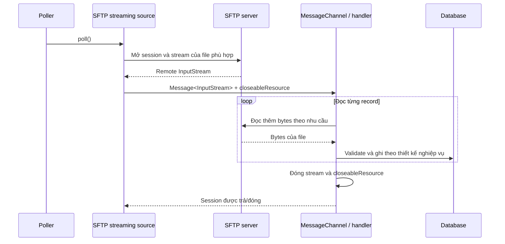
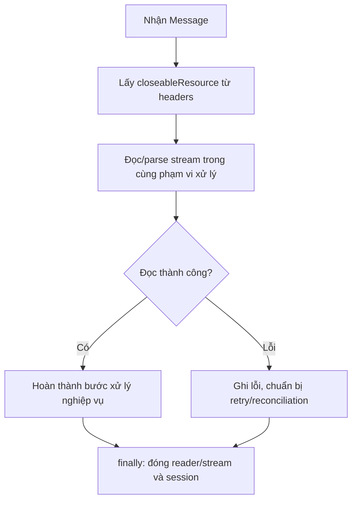
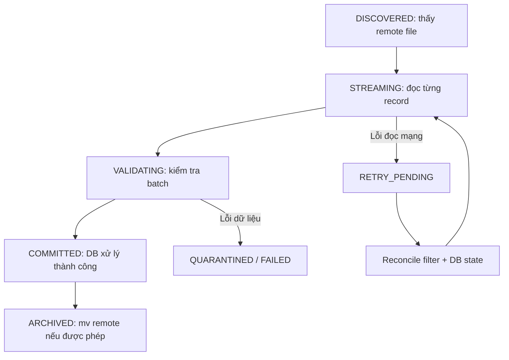

# SFTP streaming để xử lý không lưu tệp

## 1. Bài toán: đọc file lớn mà không tạo bản sao trên ổ đĩa

Một đối tác đặt báo cáo giao dịch hằng ngày trong `/exchange/settlements/ready` trên SFTP server. Mỗi file CSV có thể chứa hàng triệu dòng. Hệ thống Spring Boot phải đọc từng bản ghi, kiểm tra dữ liệu và ghi kết quả vào cơ sở dữ liệu. Nếu sử dụng SFTP inbound adapter thông thường, ứng dụng sẽ **tải toàn bộ file về thư mục local** trước khi phát `Message<File>`. Điều này tạo thêm nhu cầu về dung lượng staging, quy trình dọn file và thời gian chờ trước khi bắt đầu phân tích.

**SFTP streaming inbound channel adapter** giải quyết trường hợp ứng dụng muốn đọc trực tiếp qua luồng: nó phát `Message<InputStream>` trỏ tới nội dung của file trên SFTP. Consumer có thể đọc từng dòng hoặc từng record **trong khi dữ liệu được truyền qua mạng**, không cần có bản sao file hoàn chỉnh trên local disk.

Trong chương **Adapter SFTP** của module `SPRING_INTEGRATION_ADAPTERS`, streaming là một biến thể của **inbound adapter**. Nó vẫn được kích hoạt bởi **poller**, nhận dữ liệu vào **MessageChannel**, và có thể tiếp tục qua transformer, splitter hoặc service activator. Các loại adapter/gateway HTTP, JMS, Kafka và cơ sở dữ liệu trong module sử dụng mô hình message tương tự, nhưng **hợp đồng sở hữu tài nguyên `InputStream` và SSH session là điểm cần chú ý riêng** của SFTP streaming.

Sau bài này, bạn có thể:

- Phân biệt SFTP inbound kiểu `File`, inbound streaming kiểu `InputStream` và outbound gateway lấy stream theo yêu cầu.
- Tạo `SftpStreamingMessageSource`, gắn poller và xử lý CSV theo từng dòng bằng Java DSL.
- Đóng đúng `InputStream` và `closeableResource` để trả phiên SSH/SFTP về pool, kể cả khi xử lý lỗi.
- Hiểu header remote file, bộ lọc accept-once, `maxFetchSize` và `maxMessagesPerPoll`.
- Xử lý retry, idempotency, file đang upload dở và lỗi giữa chừng mà không cần local staging file.
- Đánh giá khi nào streaming phù hợp và khi nào nên tải file về staging trước.

> **Phạm vi API:** ví dụ hướng đến Spring Integration **6.x trở lên** với SFTP client Apache MINA SSHD. Trong Spring Integration 5.x, các kiểu SFTP ở tầng client có thể khác. Đối chiếu phiên bản Spring Boot BOM/Spring Integration đang chạy nếu chuyển ví dụ sang dự án thật.

## 2. Khác biệt giữa file inbound và streaming inbound

| Đặc điểm | SFTP inbound adapter thông thường | SFTP streaming inbound adapter |
| --- | --- | --- |
| Payload của message | `java.io.File` ở máy ứng dụng | `java.io.InputStream` đang đọc từ remote file |
| Local staging | Adapter đồng bộ file về local directory | Không yêu cầu lưu bản sao file xuống local disk |
| Thời điểm xử lý | Sau khi file hoàn tất tải về | Có thể đọc trong lúc dữ liệu tiếp tục được truyền |
| Vòng đời kết nối | Synchronizer quản lý phiên tải file | **Session phải còn mở** cho tới khi consumer đọc xong stream |
| Có thể đọc lại payload? | File local có thể mở lại nếu chưa xóa | `InputStream` chỉ đọc tiến; muốn đọc lại cần mở phiên/stream mới |
| Retry sau khi xử lý lỗi | Có thể đọc lại bản local nếu thiết kế cho phép | Cần khởi tạo yêu cầu đọc lại từ server và điều chỉnh metadata/filter |
| Dung lượng đĩa | Cần tính kích thước file, số file staging | Không cần staging file, nhưng vẫn cần buffer RAM/DB hoặc lưu trữ khác |
| Rủi ro chính | File local trùng, đầy đĩa, dọn staging | Rò rỉ session, giữ stream quá lâu, hỏng dữ liệu khi mạng ngắt |

Sơ đồ vòng đời của một streaming message:



**Streaming không đồng nghĩa file không dùng bộ nhớ.** `BufferedReader`, parser CSV và thư viện SSH vẫn dùng buffer. Cách làm đúng là giữ lượng dữ liệu đang xử lý **có giới hạn**, ví dụ từng record hoặc batch nhỏ, thay vì gọi `readAllBytes()`, thu toàn bộ file thành `String` hoặc lưu mọi dòng vào một `List` lớn.

## 3. Hợp đồng `Message<InputStream>` và header quan trọng

SFTP streaming source tạo message với payload là `InputStream`. Các header giúp consumer biết file nào được chọn và cách giải phóng kết nối:

| Header / constant | Nội dung | Mục đích |
| --- | --- | --- |
| `FileHeaders.REMOTE_DIRECTORY` | Thư mục file nằm trên SFTP server | Ghi log, đối soát remote path |
| `FileHeaders.REMOTE_FILE` | Tên file được chọn | Tạo batch ID, áp dụng quy tắc parse |
| `FileHeaders.REMOTE_FILE_INFO` | Thông tin bổ sung về remote file, mặc định ở dạng JSON | Theo dõi size/metadata theo phiên bản |
| `IntegrationMessageHeaderAccessor.CLOSEABLE_RESOURCE` | `Closeable` liên quan đến SFTP session/stream | **Consumer phải đóng sau khi đã đọc xong** |

Điểm dễ sai nhất là nghĩ rằng chỉ cần đọc hết payload rồi kết thúc handler. Theo Spring Integration Reference, **SFTP session vẫn cần được đóng khi file đã tiêu thụ xong**. Header `closeableResource` cung cấp đối tượng giúp consumer hoàn thành trách nhiệm đó. Có thể truy cập bằng:

```java
import java.io.Closeable;
import org.springframework.integration.IntegrationMessageHeaderAccessor;
import org.springframework.messaging.Message;

Closeable resource =
        new IntegrationMessageHeaderAccessor(message).getCloseableResource();

// Trong code xử lý thực tế, đóng resource trong finally/try-with-resources.
// Không đóng ngay trước khi đọc hết InputStream.
```

Nếu dùng các component chuẩn như `FileSplitter` hoặc `StreamTransformer` theo cách chúng hỗ trợ streaming, framework có cơ chế **tự đóng session** sau khi tiêu thụ stream. Với **handler tùy chỉnh**, trách nhiệm đóng vẫn thuộc về ứng dụng. Đừng đóng `closeableResource` ở giữa lúc một thread khác đang đọc stream, cũng đừng chuyển raw `InputStream` vào queue để một worker bất đồng bộ đọc sau khi phiên hiện tại đã bị trả về pool.

Thời điểm close nên được hiểu như sau:



## 4. Cấu hình SSH, dependency và `SessionFactory`

Streaming không bỏ qua yêu cầu bảo mật SSH. Server xác thực client bằng public key được đăng ký trong `authorized_keys`; ứng dụng dùng private key tương ứng để đăng nhập. Ứng dụng cũng phải xác minh **server host key** bằng một `known_hosts` đã được đối chiếu fingerprint qua kênh độc lập. Passphrase, nếu có, chỉ dùng để giải mã **client private key** ở phía ứng dụng.

Với Spring Boot quản lý phiên bản qua BOM:

```groovy
dependencies {
    implementation 'org.springframework.boot:spring-boot-starter-integration'
    implementation 'org.springframework.integration:spring-integration-sftp'
}
```

Ví dụ cấu hình không đưa secret thật vào repository:

```yaml
app:
  sftp:
    host: ${SFTP_HOST:sftp.partner.example}
    port: ${SFTP_PORT:22}
    username: ${SFTP_USERNAME:streaming_reader}
    private-key: file:${SFTP_PRIVATE_KEY_FILE}
    private-key-passphrase: ${SFTP_PRIVATE_KEY_PASSPHRASE:}
    known-hosts: file:${SFTP_KNOWN_HOSTS_FILE}
    remote-directory: ${SFTP_REMOTE_DIR:/exchange/settlements/ready}
```

`SFTP_PRIVATE_KEY_FILE` và `SFTP_KNOWN_HOSTS_FILE` là các đường dẫn **có thật trong runtime**, thường được mount qua secret/config volume. Không commit private key hoặc passphrase vào Git/container image. Dữ liệu trong `known_hosts` là public host key nhưng cần bảo vệ **tính toàn vẹn**, vì chỉnh sửa sai file này có thể thay đổi máy chủ mà client tin cậy.

```java
import org.apache.sshd.sftp.client.SftpClient;
import org.springframework.beans.factory.annotation.Value;
import org.springframework.context.annotation.Bean;
import org.springframework.context.annotation.Configuration;
import org.springframework.core.io.Resource;
import org.springframework.integration.file.remote.session.CachingSessionFactory;
import org.springframework.integration.file.remote.session.SessionFactory;
import org.springframework.integration.sftp.session.DefaultSftpSessionFactory;

@Configuration
public class SftpConnectionConfiguration {

    @Bean
    public SessionFactory<SftpClient.DirEntry> sftpSessionFactory(
            @Value("${app.sftp.host}") String host,
            @Value("${app.sftp.port}") int port,
            @Value("${app.sftp.username}") String user,
            @Value("${app.sftp.private-key}") Resource privateKey,
            @Value("${app.sftp.private-key-passphrase:}") String passphrase,
            @Value("${app.sftp.known-hosts}") Resource knownHosts) {

        DefaultSftpSessionFactory delegate = new DefaultSftpSessionFactory(false);
        delegate.setHost(host);
        delegate.setPort(port);
        delegate.setUser(user);
        delegate.setPrivateKey(privateKey);
        if (!passphrase.isBlank()) {
            delegate.setPrivateKeyPassphrase(passphrase);
        }
        delegate.setKnownHostsResource(knownHosts);
        delegate.setAllowUnknownKeys(false);
        delegate.setTimeout(30_000);

        // Hạn chế số session được giữ trong cache.
        return new CachingSessionFactory<>(delegate, 4);
    }
}
```

Với streaming, cache cần được cấu hình theo **thời gian consumer giữ stream** và số file xử lý song song. Một stream đọc trong 10 phút có thể giữ session suốt 10 phút. Nếu mở bốn stream và giới hạn cache/pool phù hợp chỉ bốn phiên, các yêu cầu khác có thể phải đợi session được trả về. Cache giúp tái sử dụng kết nối, **không giải quyết rò rỉ session** nếu consumer quên close.

## 5. Tạo `SftpStreamingMessageSource` và poller

Java DSL có thể sử dụng `SftpStreamingMessageSource` làm nguồn của `IntegrationFlow`. Source này lấy file từ xa qua `SftpRemoteFileTemplate`; không cần khai báo `localDirectory`, vì payload là `InputStream`.

```java
import org.apache.sshd.sftp.client.SftpClient;
import org.springframework.beans.factory.annotation.Value;
import org.springframework.context.annotation.Bean;
import org.springframework.context.annotation.Configuration;
import org.springframework.integration.dsl.IntegrationFlow;
import org.springframework.integration.dsl.Pollers;
import org.springframework.integration.file.remote.session.SessionFactory;
import org.springframework.integration.sftp.inbound.SftpStreamingMessageSource;
import org.springframework.integration.sftp.session.SftpRemoteFileTemplate;

@Configuration
public class SftpStreamingFlowConfiguration {

    @Bean
    public SftpRemoteFileTemplate streamingTemplate(
            SessionFactory<SftpClient.DirEntry> sftpSessionFactory) {
        return new SftpRemoteFileTemplate(sftpSessionFactory);
    }

    @Bean
    public IntegrationFlow sftpStreamingFlow(
            SftpRemoteFileTemplate streamingTemplate,
            StreamingCsvHandler streamingCsvHandler,
            @Value("${app.sftp.remote-directory}") String remoteDirectory) {

        SftpStreamingMessageSource source =
                new SftpStreamingMessageSource(streamingTemplate);
        source.setRemoteDirectory(remoteDirectory);
        source.setMaxFetchSize(1);

        return IntegrationFlow.from(source,
                        endpoint -> endpoint.id("sftpStreamInbound")
                                .poller(Pollers.fixedDelay(10_000)
                                        .maxMessagesPerPoll(1)))
                .handle(streamingCsvHandler)
                .get();
    }
}
```

`StreamingCsvHandler` là consumer tùy chỉnh sẽ được định nghĩa ở mục tiếp theo. Bean `SftpRemoteFileTemplate` được Spring quản lý để sử dụng đúng vòng đời khởi tạo. `IntegrationFlow.from(source, endpoint -> ...)` biến một `MessageSource<InputStream>` thành **polling endpoint**; `.handle(...)` nhận message có payload là stream và các remote-file headers. `DirectChannel` đồng bộ mặc định phù hợp để minh họa consumer đọc hết stream trước khi poller kết thúc lượt xử lý.

Các thông số quan trọng:

| Thuộc tính | Vai trò | Lưu ý |
| --- | --- | --- |
| `setRemoteDirectory(...)` | Chọn thư mục file trên SFTP server | Account cần quyền liệt kê/đọc |
| `setMaxFetchSize(1)` | Giới hạn số entry mới source lấy vào danh sách nội bộ khi cần fetch | Hữu ích khi nhiều instance và cần phân phối công việc |
| `Pollers.fixedDelay(10_000)` | Thời gian chờ giữa các lượt poll theo fixed delay | Tần suất tùy SLA và tải của server |
| `maxMessagesPerPoll(1)` | Giới hạn số message được phát trong một lượt poll | Khác với `maxFetchSize` |
| `.handle(streamingCsvHandler)` | Tiêu thụ `InputStream` và giải phóng tài nguyên | Nếu handler tùy chỉnh, phải close session trong mọi nhánh |

**`maxFetchSize` khác `maxMessagesPerPoll`:** cái đầu giới hạn số file được **lấy vào danh sách nguồn**, cái sau giới hạn số message **được phát ra mỗi lần poll**. Việc đặt cả hai bằng 1 giúp hành vi dễ quan sát và tránh mở nhiều stream cùng lúc khi mới triển khai. Khi tăng thông lượng, phải đánh giá đồng thời số stream mở, thời gian parse và quota SFTP server.

### Bộ lọc file mặc định

Từ Spring Integration 5.0, `SftpStreamingMessageSource` mặc định dùng cơ chế **persistent accept-once filter** với `SimpleMetadataStore` **trong bộ nhớ**, nhằm hạn chế phát trùng một remote file trong cùng runtime. Tên "persistent" ở đây mô tả cách lưu metadata bằng `MetadataStore`; **nó không bảo đảm bền vững qua restart nếu store vẫn ở trong bộ nhớ**.

Trong ví dụ Java DSL trên, ta chưa ghi đè filter để giữ cơ chế mặc định. Khi nghiệp vụ chỉ nhận CSV hoặc cần chia sẻ trạng thái qua nhiều instance, phải cấu hình **filter kết hợp** chứ không thay toàn bộ filter bằng một pattern filter đơn lẻ và vô tình bỏ cơ chế accept-once.

Ví dụ hướng xây dựng `ChainFileListFilter` với một `ConcurrentMetadataStore` được cấu hình riêng:

```java
import org.apache.sshd.sftp.client.SftpClient;
import org.springframework.integration.file.filters.ChainFileListFilter;
import org.springframework.integration.metadata.ConcurrentMetadataStore;
import org.springframework.integration.sftp.filters.SftpPersistentAcceptOnceFileListFilter;
import org.springframework.integration.sftp.filters.SftpSimplePatternFileListFilter;

// metadataStore là một bean ConcurrentMetadataStore, ví dụ RedisMetadataStore.
ChainFileListFilter<SftpClient.DirEntry> filters = new ChainFileListFilter<>();
filters.addFilter(new SftpSimplePatternFileListFilter("*.csv"));
filters.addFilter(new SftpPersistentAcceptOnceFileListFilter(
        metadataStore, "settlement-stream-"));

// Đặt trước khi IntegrationFlow bắt đầu chạy:
source.setFilter(filters);
```

Đây là đoạn cấu hình minh họa riêng, bổ sung vào bước tạo source. `ChainFileListFilter` áp dụng các filter theo thứ tự để chỉ đánh dấu file đã đạt điều kiện tên. Cần chọn metadata store chung cho nhiều replica, quy ước prefix phân biệt đối tác và thư mục, đồng thời đánh giá lại cách reset/rollback filter khi file đọc lỗi.

## 6. Viết consumer đọc từng dòng và đóng session

Consumer sau đây minh họa đọc một CSV theo dòng **không ghi file vào local disk**. Để tập trung vào vòng đời stream, ví dụ chỉ đếm dòng và kiểm tra giới hạn số dòng; ứng dụng thật nên dùng thư viện CSV có parser streaming hỗ trợ dấu nháy kép, dấu phẩy bên trong ô, encoding và validation theo schema.

```java
import java.io.BufferedReader;
import java.io.Closeable;
import java.io.IOException;
import java.io.InputStream;
import java.io.InputStreamReader;
import java.nio.charset.StandardCharsets;

import org.springframework.integration.IntegrationMessageHeaderAccessor;
import org.springframework.integration.file.FileHeaders;
import org.springframework.messaging.Message;
import org.springframework.messaging.MessageHandler;
import org.springframework.messaging.MessagingException;
import org.springframework.stereotype.Component;

@Component
public class StreamingCsvHandler implements MessageHandler {

    @Override
    public void handleMessage(Message<?> message) throws MessagingException {
        InputStream input = (InputStream) message.getPayload();
        Closeable resource = new IntegrationMessageHeaderAccessor(message)
                .getCloseableResource();

        // Đóng reader -> InputStream trước, sau đó đóng session resource.
        try (Closeable session = resource;
             BufferedReader reader = new BufferedReader(
                     new InputStreamReader(input, StandardCharsets.UTF_8))) {

            long lineCount = 0;
            String line;
            while ((line = reader.readLine()) != null) {
                // Demo: thay bằng validate và xử lý từng record/batch nhỏ.
                lineCount++;
                if (lineCount > 2_000_000) {
                    throw new IllegalStateException("Vượt giới hạn dòng cho batch");
                }
            }

            String remoteName = (String) message.getHeaders()
                    .get(FileHeaders.REMOTE_FILE);
            System.out.println("Đã đọc " + remoteName + ": " + lineCount + " dòng");

        } catch (IOException e) {
            throw new MessagingException(message, "Đọc SFTP stream thất bại", e);
        }
    }
}
```

Trong `try-with-resources`, `BufferedReader` được đóng trước rồi tới `Closeable session`, giúp giải phóng stream và session ngay cả khi có `IOException`, validation error hoặc exception từ logic nghiệp vụ. Nếu parser ném runtime exception, `try-with-resources` vẫn gọi `close`. `MessagingException` giữ lại context của message để log/error flow có thể phân loại lỗi.

**Lưu ý về tài nguyên:** đóng stream không được xem là thao tác thay thế chắc chắn cho việc đóng `closeableResource`. Header này là cơ chế framework thiết kế để hoàn tất vòng đời SFTP session. Với handler tự viết, hãy kiểm tra nó và đóng đúng một lần ở cuối xử lý; các component như `StreamTransformer`/`FileSplitter` có thể quản lý đóng tự động, nên không thêm một handler đóng trùng khi framework đã sở hữu tài nguyên.

**Giới hạn của ví dụ:** `BufferedReader.readLine()` vẫn có thể cấp phát bộ nhớ lớn nếu remote file có **một dòng cực dài**. Production nên dùng parser có giới hạn độ dài record, kích thước field, số cột và tổng số bản ghi; tránh đọc vô hạn dữ liệu do bên gửi không tuân thủ hợp đồng.

## 7. `FileSplitter` và `StreamTransformer`: chọn đúng cách tiêu thụ stream

Spring Integration có sẵn component biết cách tiêu thụ `InputStream` và đóng session:

| Component | Cách xử lý | Phù hợp | Rủi ro cần lưu ý |
| --- | --- | --- | --- |
| `FileSplitter` | Đọc văn bản theo dòng, có thể phát từng message dòng | File text phân tách theo dòng | Dòng có thể không tương đương record CSV nếu CSV hỗ trợ newline trong quoted field |
| `StreamTransformer` | Đọc stream và biến thành `String`/`byte[]` tùy cấu hình | File đủ nhỏ cần toàn bộ nội dung | **Có thể nạp toàn bộ file vào bộ nhớ**, dù không ghi disk |
| Handler custom với parser streaming | Đọc từng record hoặc từng batch nhỏ | CSV lớn, validate và ghi DB theo contract | Phải tự quản lý `closeableResource` và lỗi parse |

**Không đánh đồng tên `StreamTransformer` với giải pháp memory streaming.** Transformer này có thể chuyển toàn bộ stream thành một payload lớn; nó có ích khi muốn bỏ local disk cho file nhỏ, nhưng không tối ưu cho file hàng GB. Với file lớn, ưu tiên parser tiêu thụ tuần tự và giữ backpressure ở tầng ứng dụng.

`FileSplitter` là lựa chọn tự nhiên cho các file log hoặc một-record-mỗi-dòng. Nếu dòng đầu là header CSV và các dòng sau là dữ liệu, có thể tách message từng dòng và downstream parse. Nhưng với chuẩn CSV cho phép xuống dòng bên trong dấu nháy, `readLine`/FileSplitter sẽ phân tách sai record; khi đó phải dùng thư viện CSV streaming như Apache Commons CSV hoặc parser tương đương.

Khi một splitter tạo nhiều message từ một stream, phải theo dõi **thời điểm stream đã được tiêu thụ hoàn toàn**. Việc chuyển một phần dữ liệu tới queue hoặc subscriber bất đồng bộ không tự bảo đảm session được giữ đủ lâu; cần thiết kế theo semantics của splitter và hạn chế buffering vô hạn.

## 8. Một phương án khác: `SftpRemoteFileTemplate#get` không tạo `Message<InputStream>`

Không phải mọi nhu cầu streaming đều phải bắt đầu từ poller. Nếu service **đã biết chính xác remote path** cần đọc, `SftpRemoteFileTemplate#get(remotePath, InputStreamCallback)` có thể tiêu thụ stream trực tiếp trong callback, cũng không cần tạo file local:

```java
import java.io.BufferedReader;
import java.io.IOException;
import java.io.InputStreamReader;
import java.nio.charset.StandardCharsets;

import org.springframework.integration.sftp.session.SftpRemoteFileTemplate;
import org.springframework.stereotype.Service;

@Service
public class RequestedSftpReader {

    private final SftpRemoteFileTemplate template;

    public RequestedSftpReader(SftpRemoteFileTemplate template) {
        this.template = template;
    }

    public void readKnownFile(String safeRemotePath) {
        boolean downloaded = template.get(safeRemotePath, input -> {
            // Không giữ InputStream để đọc sau khi callback trả về.
            BufferedReader reader = new BufferedReader(
                    new InputStreamReader(input, StandardCharsets.UTF_8));
            String line;
            while ((line = reader.readLine()) != null) {
                // Parse/validate từng dòng; không gom toàn bộ file vào RAM.
            }
        });

        if (!downloaded) {
            throw new IllegalStateException("Không đọc được remote file: " + safeRemotePath);
        }
    }
}
```

Trong trường hợp này, `RemoteFileTemplate` quản lý phiên và vòng đời stream theo callback. Người viết callback phải **tiêu thụ stream trước khi trả về** và không giữ reference để một thread khác đọc sau. Hãy kiểm tra/chuẩn hóa remote path theo một root được phép, đặc biệt khi path xuất phát từ HTTP request hoặc message header.

### So sánh các cách lấy stream

| Nhu cầu | API phù hợp | Ai kích hoạt? | Ai đóng session? |
| --- | --- | --- | --- |
| Tự động nhận file mới theo lịch | `SftpStreamingMessageSource` | Poller | Consumer hoặc component streaming-aware |
| Service đã có remote path cần đọc | `SftpRemoteFileTemplate#get` | Java service | Template sau callback |
| Request/reply qua messaging, muốn lấy stream | SFTP outbound gateway `get` với tùy chọn stream | Request message | Consumer theo `closeableResource` hoặc component hỗ trợ |
| Muốn bản sao local để xử lý lại | Inbound adapter thông thường | Poller | Synchronizer quản lý sau khi tải |

Streaming là một quyết định về **cách tiêu thụ dữ liệu và quản lý tài nguyên**; `MessageChannel` hay callback là hai cách tổ chức logic xung quanh cùng một kênh truyền SFTP.

## 9. Bộ lọc trùng, retry và idempotency nghiệp vụ

Một rủi ro lớn của inbound streaming là **trạng thái đã chọn file** có thể được ghi lại trước khi **xử lý nghiệp vụ thành công**. Persistent accept-once filter giúp giảm phát trùng một remote file, nhưng không giao dịch đồng bộ với DB hoặc parser. Ví dụ:

1. Poller thấy `settlement-0042.csv` và source chọn file; metadata filter đánh dấu file đã được nhận.
2. Handler đọc 70% stream rồi mạng ngắt; code đóng session và phát lỗi.
3. Poll tiếp theo có thể không phát lại file vì metadata vẫn cho rằng file đã được chấp nhận.
4. Nếu khởi động lại với metadata in-memory, dấu lọc có thể mất và file lại được phát, bất kể 70% dữ liệu trước đó đã commit tới DB hay chưa.

Vì vậy cần thiết kế **khôi phục ở tầng nghiệp vụ**:

- Đặt khóa duy nhất `(partner_id, batch_id)` hoặc một định danh file bất biến/ checksum trong DB; ghi trạng thái `DISCOVERED`, `PROCESSING`, `COMPLETED`, `RETRY_PENDING`, `FAILED`.
- Nếu import theo từng batch DB, dùng transaction và checkpoint phù hợp; tránh commit từng record mà không có idempotency vì stream có thể được đọc lại từ đầu.
- Khi thất bại, quyết định rõ cách đặt lại metadata/filter hoặc dùng cơ chế điều phối riêng để retry lại file; chỉ xóa dấu metadata khi biết rằng lần chạy lại an toàn.
- Không xóa hoặc rename remote file cho tới khi có bằng chứng toàn bộ dữ liệu đã được xử lý theo hợp đồng, trừ khi quy trình đối tác được thiết kế khác.
- Với nhiều instance, dùng `ConcurrentMetadataStore` bền vững, chia sẻ được; kết hợp giới hạn `maxFetchSize=1`, cơ chế claim/lock và idempotency DB.

Một trạng thái xử lý mẫu:



**SFTP không phải transaction coordinator của database.** Nếu DB commit xong nhưng rename file từ `ready` sang `archive` thất bại, file có thể còn ở nguồn và được nhìn thấy lần nữa. Khi đó phải **tiếp tục bước archive** dựa trên trạng thái batch đã hoàn tất, không nhập lại dữ liệu. Khi DB chưa commit nhưng file đã bị xóa, việc phục hồi có thể khó khăn hơn; vì thế không bật chính sách xóa remote file theo kiểu "đã đọc stream là xóa" nếu chưa có cơ chế phục hồi.

## 10. Tránh đọc file khi đối tác chưa upload xong

Streaming có một vấn đề khác với tải file local: **client mở stream khi file từ xa vẫn đang được bên gửi ghi**. SFTP server có thể cho đọc file ngay khi tên cuối mới xuất hiện, dẫn tới thiếu record, dữ liệu cuối chưa đến hoặc checksum không khớp. Việc không lưu file local **không tạo ra tín hiệu xác nhận remote file đã hoàn thành**.

Các giao thức phối hợp thường dùng:

| Cách bên gửi công bố | Cách consumer nhận biết | Độ tin cậy |
| --- | --- | --- |
| Upload `file.csv.part`, xong mới rename thành `file.csv` | Filter chỉ nhận `*.csv` | Tốt khi server rename có semantics phù hợp |
| Upload `file.csv`, rồi tạo marker `file.csv.done` | Chỉ xử lý khi marker có mặt | Tốt nếu hai bên thống nhất marker được tạo sau khi đóng upload |
| Chờ file có thời điểm sửa đổi đủ cũ | Filter theo last-modified/age | Heuristic; file lớn có thể dừng ghi lâu giữa chừng |
| Bên gửi cung cấp manifest/checksum | Đọc khi đã có manifest và kiểm tra dữ liệu | Có thể kiểm chứng nội dung, nhưng cần xử lý thiếu/mismatch |

`SftpSystemMarkerFilePresentFileListFilter` hỗ trợ kiểu marker file trong Spring Integration. Khi dùng marker hoặc bộ lọc theo tuổi, hãy kết hợp với filter tên/accept-once phù hợp và kiểm chứng hành vi ở phiên bản đang dùng. Cách rename tạm rồi công bố tên cuối thường dễ hiểu và dễ kiểm thử nhất khi đối tác có thể thay đổi bên gửi.

Sau khi stream đã mở, nếu đối tác **thay đổi file trong lúc đang đọc**, dữ liệu có thể không nhất quán. Hãy thống nhất rằng file đã publish là **immutable**: không sửa nội dung dưới cùng tên; nếu cần sửa, công bố tên/version mới. Có thể xác minh size/checksum trước và sau theo giao thức nếu cung cấp, nhưng đọc được EOF chỉ chứng minh **luồng hiện tại kết thúc**, chưa chắc bảo đảm hợp đồng dữ liệu đầy đủ.

## 11. Backpressure, RAM, session pool và throughput

Không lưu file local giúp giảm áp lực ổ đĩa, nhưng chuyển áp lực sang **thời gian kết nối mạng, session và tốc độ consumer**.

| Tài nguyên | Khi streaming | Biện pháp vận hành |
| --- | --- | --- |
| SSH/SFTP session | Giữ mở cho tới khi `InputStream` được tiêu thụ/đóng | Theo dõi session đang dùng, cấu hình cache pool và timeout |
| TCP/network | Consumer đọc chậm khiến kết nối sống lâu | Đo bytes/giây, giám sát nghẽn và reconnect |
| RAM | Parser/reader/buffer có thể tăng theo record hoặc batch | Giới hạn record, field, batch; tránh `readAllBytes` |
| DB connections | Ghi record trực tiếp có thể làm transaction quá dài | Tách batch/transaction theo chiến lược idempotency |
| Poller threads | Handler đồng bộ chiếm thread cho tới khi xong | Điều chỉnh scheduler và `maxMessagesPerPoll` |
| Metadata store | Cần nhớ file đã chọn, kể cả sau restart nếu cấu hình bền vững | Dùng store phù hợp và cơ chế recovery rõ ràng |

**Backpressure** ở đây có thể rất đơn giản: poll một file, đọc từng record rồi lưu theo batch vừa đủ trước khi nhận file tiếp theo. Nếu thêm `ExecutorChannel` hoặc queue giữa source và handler, phải đánh giá việc các `InputStream` còn mở trong queue, thời điểm message được tiêu thụ và ai đóng session khi message bị drop. Đối với inbound streaming, cấu hình đồng bộ thường dễ giữ đúng vòng đời tài nguyên hơn trong bước đầu.

Không nên giữ transaction DB mở trong toàn bộ thời gian đọc một file hàng GB. Một chiến lược có thể ghi record vào **staging table** theo batch nhỏ, gắn batch ID, rồi công bố/commit trạng thái hoàn thành khi đã xác nhận file được đọc hết; khi retry có thể xóa/merge dữ liệu staging của batch theo idempotency contract. Đó là lựa chọn thiết kế riêng của ứng dụng, không phải tính năng tự động của streaming adapter.

### Khi nào nên quay lại dùng local staging?

Streaming không phải lúc nào cũng là lựa chọn tối ưu. Nếu cần replay cùng file nhiều lần, các bước xử lý độc lập đều phải đọc cùng dữ liệu, hoặc quy định kiểm toán yêu cầu giữ bản gốc, **tải file về staging có checksum** có thể giúp hệ thống phục hồi đơn giản hơn. Tương tự, nếu network SFTP thiếu ổn định còn import DB tốn nhiều phút, lưu bản sao local hoặc object storage có thể tách phụ thuộc mạng khỏi thời gian xử lý.

## 12. Chẩn đoán lỗi thường gặp

| Triệu chứng | Nguyên nhân có thể | Hướng kiểm tra |
| --- | --- | --- |
| Source không phát message | Sai thư mục, filter đã nhận file, chưa có file publish, poller dừng | `remoteDirectory`, metadata store, poller và hợp đồng tên |
| `ClassCastException` ở handler | Code chờ `File` nhưng streaming payload là `InputStream` | Kiểu message và handler signature |
| `Stream closed` giữa khi parse | Session/stream đã đóng trước khi consumer đọc hết, xử lý bất đồng bộ sai lifecycle | `closeableResource`, channel, thread, splitter |
| Session cache cạn, poller timeout | Handler giữ stream quá lâu hoặc quên close | Metrics phiên mở, thời gian đọc và `finally` |
| CSV thiếu dòng cuối | Đối tác còn upload hoặc mạng ngắt, đọc không đầy đủ | Publish bằng rename/marker; checksum/manifest |
| File bị đọc lại sau restart | Metadata store mặc định trong bộ nhớ | Shared persistent metadata store, batch idempotency |
| File không được thử lại sau lỗi | Accept-once filter đã đánh dấu | Chính sách rollback/reset metadata và retry nghiệp vụ |
| `UnknownHostKey` hoặc host key mismatch | `known_hosts` sai, host/port đổi, server rotate host key | Xác minh fingerprint qua kênh độc lập |
| `Auth fail` | Sai user/private key/passphrase, public key chưa cấp quyền | SSH client identity và `authorized_keys` |
| Permission denied | SSH login thành công nhưng không có quyền đọc/list | Server path/permission |

### Lỗi giữa chừng và close trong `finally`

Khi network ngắt ở 70% file, việc đóng stream/session là **bắt buộc ngay cả khi importer không thể tiếp tục**. Nếu không, hệ thống có thể vừa thất bại nghiệp vụ vừa rò rỉ session, khiến những poll tiếp theo cũng thất bại vì không còn tài nguyên. Lỗi đó phải được ghi thành trạng thái retry/đối soát rõ ràng, không được nuốt exception rồi đánh dấu batch `COMPLETED`.

## 13. Thực hành kiểm thử đầu cuối

Chuẩn bị SFTP server **test**, public key client được cấp quyền, host key đã xác minh trong `known_hosts`, thư mục `ready` có quyền list/read, và một CSV giả lập khoảng vài nghìn dòng. Hãy đặt mức log vừa đủ để thấy tên file, kích thước, poll count và lỗi; không in private key, passphrase hay toàn bộ dữ liệu nhạy cảm.

1. **Đường thành công:** đối tác upload `settlement-001.csv.part`, rename thành `.csv` sau khi hoàn tất. Poller nhận `Message<InputStream>`; handler đếm đúng số dòng và đóng session.
2. **Không local file:** kiểm tra ứng dụng không tạo file staging vì adapter; chỉ có log/DB state do handler chủ động ghi. Quan sát bộ nhớ để xác nhận không đọc toàn bộ file vào một `String`.
3. **Kiểu payload:** log tên class của payload trong môi trường test, xác nhận là `InputStream` thay vì `File`; xem các remote-file headers.
4. **Filter trùng:** giữ nguyên file và timestamp, tiếp tục poll; xác nhận không phát trùng theo filter đã cấu hình. Restart rồi so sánh hành vi khi metadata ở memory và khi dùng store bền vững.
5. **Đọc lỗi:** mô phỏng network reset giữa file; xác nhận handler báo lỗi, phiên được đóng và batch được ghi trạng thái cần retry.
6. **Parser lỗi:** đưa file dữ liệu không hợp lệ, xác nhận validation error vẫn giải phóng stream/session; không đánh dấu import thành công.
7. **Nhiều instance:** cho hai node cùng đọc thư mục và dùng metadata store chung; kiểm tra hành vi claim/idempotency khi cùng thấy một file.
8. **File đang upload:** giữ file `.part` chưa rename; xác nhận không nhận nhầm. Kiểm thử marker hoặc manifest nếu đó là hợp đồng của đối tác.
9. **File lớn:** đọc file lớn hơn nhiều lần memory limit đã dành cho batch parse; theo dõi heap, session occupancy, throughput và thời gian poll.
10. **Kết nối dài hạn:** giảm tốc độ consumer trong test để xác nhận timeout/pool được quan sát, không để session treo vô hạn.

## 14. Sai lầm cần tránh

- **Đưa `InputStream` vào một queue rồi handler hiện tại kết thúc:** session có thể bị đóng hoặc giữ mở quá lâu; phải có mô hình sở hữu tài nguyên được xác định.
- **Chỉ đóng `InputStream` và quên `closeableResource`:** rủi ro rò rỉ SSH session khiến pool bị cạn.
- **Dùng `StreamTransformer` để biến file nhiều GB thành `String`:** không có bản sao local nhưng vẫn có thể gây `OutOfMemoryError`.
- **Nghĩ `maxFetchSize=1` nghĩa là exactly-once:** đây là giới hạn fetch; tính đúng một lần còn phụ thuộc metadata, retry và DB idempotency.
- **Dùng `AcceptAllFileListFilter` trên production mà không có lý do:** có thể đọc lại các file cũ mỗi poll.
- **Ghi đè filter mặc định bằng pattern filter đơn lẻ:** vô tình mất cơ chế accept-once.
- **Đọc remote file khi bên gửi vẫn upload:** stream có thể kết thúc trước khi file hoàn chỉnh; cần rename/marker/manifest.
- **Xóa file từ xa ngay khi stream được mở:** đọc xong không tương đương DB đã commit thành công.
- **Xem `Message<InputStream>` là payload có thể replay vô hạn:** stream đã tiêu thụ không quay lại vị trí đầu theo mặc định.
- **Bỏ qua lỗi `close()` trong mọi trường hợp:** phải giữ khả năng quan sát lỗi tài nguyên và ảnh hưởng tới cache/session.

## 15. Câu hỏi tự kiểm tra

1. Vì sao SFTP streaming inbound adapter trả `InputStream` thay vì `File`, và lợi ích đối với file lớn là gì?
2. Header `IntegrationMessageHeaderAccessor.CLOSEABLE_RESOURCE` giải quyết vấn đề gì? Điều gì có thể xảy ra nếu quên đóng?
3. Khi nào `FileSplitter` phù hợp hơn `StreamTransformer`? Vì sao CSV có newline bên trong quoted field cần được xử lý khác?
4. `maxFetchSize` và `maxMessagesPerPoll` khác nhau như thế nào?
5. Vì sao bộ lọc "persistent accept once" với `SimpleMetadataStore` không bảo đảm chống trùng sau restart?
6. Nếu handler lỗi sau khi đọc 70% file, làm sao phát lại an toàn mà không import trùng dữ liệu đã commit?
7. Cần thỏa thuận gì với đối tác để chắc chắn stream chỉ được mở trên file đã upload xong?
8. Khi nào nên dùng `SftpRemoteFileTemplate#get(...)` thay vì `SftpStreamingMessageSource`?
9. Vì sao streaming vẫn có thể gặp OOM hoặc làm cạn session pool?
10. Với hai replica Spring Boot, bạn sẽ thiết kế filter/claim và idempotency ở DB như thế nào?

## Tài liệu tham khảo

- [Spring Integration Reference — SFTP Streaming Inbound Channel Adapter](https://docs.spring.io/spring-integration/reference/sftp/streaming.html)
- [Spring Integration Reference — SFTP Inbound Channel Adapter](https://docs.spring.io/spring-integration/reference/sftp/inbound.html)
- [Spring Integration Reference — SFTP Outbound Gateway](https://docs.spring.io/spring-integration/reference/sftp/using-the-gateway.html)
- [Spring Integration Reference — File Splitter](https://docs.spring.io/spring-integration/reference/file/splitter.html)
- [Spring Integration Reference — Remote Persistent File List Filters](https://docs.spring.io/spring-integration/reference/file/remote-persistent-flf.html)
- [Spring Integration Reference — SFTP Session Factory](https://docs.spring.io/spring-integration/reference/sftp/session-factory.html)
- [Spring Integration Reference — SFTP Session Caching](https://docs.spring.io/spring-integration/reference/sftp/session-caching.html)
