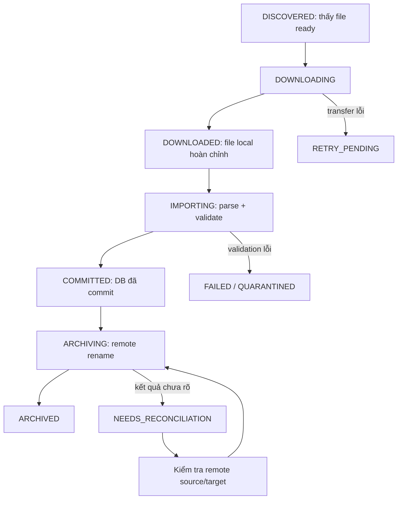

# Rename tệp từ xa sau khi tải thành công

## 1. Bài toán: chuyển file khỏi thư mục chờ sau khi nhận được dữ liệu

Đối tác đặt file `settlement-20261123-0042.csv` trong thư mục SFTP `/exchange/settlement/ready`. Ứng dụng Spring Boot thăm dò thư mục này, tải file về `/var/app/sftp/staging`, kiểm tra và nhập dữ liệu vào cơ sở dữ liệu. Sau khi hoàn tất, ứng dụng muốn **đổi tên hoặc chuyển file từ xa** sang `/exchange/settlement/archive` để thư mục `ready` không tiếp tục chứa các batch đã xử lý.

Điểm khó không nằm ở lệnh rename mà ở chữ **"thành công"**. File đã được tải đủ byte có thể vẫn chứa CSV lỗi; dữ liệu đã import vào DB có thể chưa được commit; thao tác rename trên SFTP có thể thành công nhưng client mất kết nối trước khi nhận phản hồi. Vì thế, cần xác định **mốc nghiệp vụ** trước khi quyết định khi nào đổi tên.

Bài thuộc chương **Adapter SFTP** của module `SPRING_INTEGRATION_ADAPTERS`. Chúng ta kết hợp **inbound adapter**, **poller**, **MessageChannel** và API **`SftpRemoteFileTemplate`** hoặc **outbound gateway** để điều phối luồng file; đồng thời áp dụng các nguyên tắc hợp đồng message, retry, lỗi và vòng đời kết nối được dùng xuyên suốt module khi tích hợp với HTTP, JMS, AMQP, Kafka và cơ sở dữ liệu.

Sau bài này, bạn có thể:

- Phân biệt **tải về thành công**, **xử lý nghiệp vụ thành công** và **đổi tên từ xa thành công**.
- Dùng `SftpRemoteFileTemplate#get(...)` rồi `rename(...)` khi cần một quy trình Java chủ động.
- Dùng SFTP inbound adapter tải thành `Message<File>` và thực hiện rename ở handler **sau** khi import commit.
- Hiểu vì sao `deleteRemoteFiles(true)` **không** tương đương rename sang archive.
- Xử lý trùng file, lỗi timeout sau rename, kết nối SSH, race condition và idempotency sau restart.
- Kiểm thử các tình huống thành công và thất bại mà không xóa mất file nguồn.

> **Phạm vi:** các ví dụ Java hướng đến **Spring Integration 6.x trở lên**, khi SFTP dùng Apache MINA SSHD và kiểu phần tử remote là `SftpClient.DirEntry`. Các phiên bản cũ hơn có thể khác về generic type và cấu hình. Đường dẫn, hostname và dữ liệu dưới đây chỉ là ví dụ, không phải tài khoản hay endpoint thật.

## 2. Xác định đúng thời điểm rename

Có ba sự kiện khác nhau:

| Sự kiện | Điều đã được xác nhận | Điều **chưa** được bảo đảm |
| --- | --- | --- |
| **Downloaded** | Nội dung file đã được copy hết về local và stream tải về kết thúc bình thường | File hợp lệ theo schema, DB đã commit hoặc đối tác đã nhận ACK |
| **Processed/Committed** | Ứng dụng đã validate và hoàn thành transaction import theo hợp đồng | File từ xa đã được archive thành công |
| **Archived** | Server đã xử lý yêu cầu `rename`/`mv` và trạng thái đích đã được xác minh | Không tự đồng nghĩa toàn bộ quy trình liên hệ đối tác đã có ACK cuối |

Nếu yêu cầu chỉ là *"nhận được một bản sao đầy đủ thì chuyển khỏi `ready`"*, có thể rename sau bước **Downloaded**. Nếu `ready` được xem là **hàng đợi các batch chưa nhập dữ liệu**, an toàn hơn là rename sau **Processed/Committed**. Trường hợp thứ hai sẽ được dùng làm luồng chính trong bài.

```mermaid
sequenceDiagram
    participant P as Poller
    participant I as SFTP inbound adapter
    participant S as SFTP server
    participant H as Downloaded-file handler
    participant DB as Database
    participant R as SftpRemoteFileTemplate
    P->>I: Poll thư mục ready
    I->>S: Download file thành local .writing
    S-->>I: Đủ bytes; stream đóng
    I->>I: Đổi tên local .writing thành .csv
    I-->>H: Message<File> + remote headers
    H->>DB: Validate và import idempotent
    DB-->>H: DB transaction commit thành công
    H->>R: rename(remoteReady, remoteArchive)
    R->>S: SFTP RENAME
    S-->>R: Kết quả rename
    H->>DB: Ghi archived hoặc cần đối soát
```

**Chú ý hai lần rename khác nhau:** inbound adapter có thể tải vào file **local** tạm như `report.csv.writing` rồi rename thành `report.csv` ở local sau khi truyền xong. Đây **không phải** thao tác đổi tên **remote** trên server. Để archive file trên server, chúng ta phải thực hiện thêm `rename`/`mv` sau khi đã xác định điều kiện thành công.

## 3. Chọn công cụ: adapter, template hay gateway?

| Thành phần | Vai trò | Lúc nào dùng trong bài |
| --- | --- | --- |
| `Sftp.inboundAdapter(...)` | Poll remote, tải file về local và phát `Message<File>` | Nguồn tự động lấy file mới |
| `SftpRemoteFileTemplate#get(...)` | Tải file theo remote path đã biết, dùng stream callback | Quy trình Java chủ động, cần quyết định rename ngay sau copy |
| `SftpRemoteFileTemplate#rename(src, dest)` | Đổi tên/chuyển đường dẫn remote trực tiếp | Handler muốn archive sau khi DB commit |
| `Sftp.outboundGateway(..., "mv", ...)` | Gửi request `mv` và nhận reply qua message flow | Kiến trúc cần request/reply, correlation và error channel |
| `deleteRemoteFiles(true)` ở inbound adapter | Xóa file remote theo chính sách sau transfer | **Không phù hợp** nếu cần giữ file trong archive hoặc chờ import/commit |

**Không dùng `deleteRemoteFiles(true)` để giả lập archive.** Khi xóa, file gốc có thể không còn trên server. Nếu lần parse/import sau đó thất bại, ứng dụng phải dựa vào local staging hoặc backup để phục hồi; thậm chí có thể mất khả năng đối soát với đối tác. Đổi tên sang `archive` là một **hành động chủ động, có điều kiện**, không phải cấu hình mặc định của inbound adapter.

## 4. Chuẩn bị dependency, đường dẫn và xác thực SSH

SFTP dùng SSH. Server phải có **public key của ứng dụng** được cấp quyền trong `authorized_keys`; ứng dụng giữ private key và passphrase nếu private key có mã hóa. Ngoài ra, ứng dụng phải xác minh **server host key** qua `known_hosts` đã kiểm chứng fingerprint bằng một kênh độc lập. Không bật `allowUnknownKeys(true)` để vượt lỗi xác minh host key trong production.

Nếu Spring Boot đã quản lý version bằng BOM, dependency Gradle có thể là:

```groovy
dependencies {
    implementation 'org.springframework.boot:spring-boot-starter-integration'
    implementation 'org.springframework.integration:spring-integration-sftp'
}
```

Ví dụ `application.yml` (không chứa secret thật):

```yaml
app:
  sftp:
    host: ${SFTP_HOST:sftp.partner.example}
    port: ${SFTP_PORT:22}
    username: ${SFTP_USERNAME:settlement_reader}
    private-key: file:${SFTP_PRIVATE_KEY_FILE}
    private-key-passphrase: ${SFTP_PRIVATE_KEY_PASSPHRASE:}
    known-hosts: file:${SFTP_KNOWN_HOSTS_FILE}
    incoming-directory: ${SFTP_INCOMING_DIR:/exchange/settlement/ready}
    archive-directory: ${SFTP_ARCHIVE_DIR:/exchange/settlement/archive}
    local-staging-directory: ${SFTP_STAGING_DIR:./data/sftp-staging}
```

`SFTP_PRIVATE_KEY_FILE` và `SFTP_KNOWN_HOSTS_FILE` phải trỏ đến file đã mount **trong runtime**, không phải tên file chỉ tồn tại trên laptop phát triển. Cấp quyền đọc tối thiểu cho private key; bảo vệ tính toàn vẹn của `known_hosts`. Hai remote directory phải được tạo và tài khoản phải có đủ quyền **list/read** ở `ready`, **rename/move** từ `ready` và quyền phù hợp trên `archive`. Tùy server và filesystem, rename giữa hai vùng có thể bị hạn chế; cần kiểm thử với máy chủ thật.

Session factory được dùng chung cho thao tác tải xuống và rename:

```java
import org.apache.sshd.sftp.client.SftpClient;
import org.springframework.beans.factory.annotation.Value;
import org.springframework.context.annotation.Bean;
import org.springframework.context.annotation.Configuration;
import org.springframework.core.io.Resource;
import org.springframework.integration.file.remote.session.CachingSessionFactory;
import org.springframework.integration.file.remote.session.SessionFactory;
import org.springframework.integration.sftp.session.DefaultSftpSessionFactory;

@Configuration
public class PartnerSftpConnectionConfiguration {

    @Bean
    public SessionFactory<SftpClient.DirEntry> partnerSftpSessionFactory(
            @Value("${app.sftp.host}") String host,
            @Value("${app.sftp.port}") int port,
            @Value("${app.sftp.username}") String username,
            @Value("${app.sftp.private-key}") Resource privateKey,
            @Value("${app.sftp.private-key-passphrase:}") String passphrase,
            @Value("${app.sftp.known-hosts}") Resource knownHosts) {

        DefaultSftpSessionFactory delegate = new DefaultSftpSessionFactory(false);
        delegate.setHost(host);
        delegate.setPort(port);
        delegate.setUser(username);
        delegate.setPrivateKey(privateKey);
        if (!passphrase.isBlank()) {
            delegate.setPrivateKeyPassphrase(passphrase);
        }
        delegate.setKnownHostsResource(knownHosts);
        delegate.setAllowUnknownKeys(false);
        delegate.setTimeout(30_000);

        return new CachingSessionFactory<>(delegate, 4);
    }
}
```

Cache giúp tái sử dụng session SSH, nhưng `CachingSessionFactory` **không làm hai thao tác `get` và `rename` trở thành transaction**. Chúng vẫn là các lệnh có tác dụng từ xa riêng biệt. Nếu kết nối gián đoạn giữa hai lệnh, cần dựa vào trạng thái bền vững để quyết định hành động tiếp theo.

## 5. Cách A: tải file bằng `RemoteFileTemplate#get`, rồi rename remote

Đây là lựa chọn dễ hiểu nhất khi service đã có **đường dẫn remote chính xác** và yêu cầu chỉ là *"tải thành công rồi di chuyển nguồn sang archive"*. Chúng ta dùng `InputStreamCallback` để copy từ SFTP vào một **file local tạm**, sau khi copy hoàn tất mới đổi thành tên local cuối, rồi mới gọi `template.rename(...)` trên remote.

Trước hết khai báo template:

```java
import org.apache.sshd.sftp.client.SftpClient;
import org.springframework.context.annotation.Bean;
import org.springframework.context.annotation.Configuration;
import org.springframework.integration.file.remote.session.SessionFactory;
import org.springframework.integration.sftp.session.SftpRemoteFileTemplate;

@Configuration
public class SftpFileOperationsConfiguration {

    @Bean
    public SftpRemoteFileTemplate partnerRemoteFileTemplate(
            SessionFactory<SftpClient.DirEntry> partnerSftpSessionFactory) {
        return new SftpRemoteFileTemplate(partnerSftpSessionFactory);
    }
}
```

Service sau minh họa trình tự tải, hoàn tất file local và đổi tên remote. Tên file chỉ được nhận dưới dạng **basename**; remote path được tạo từ hai root cố định. Dùng file tạm cùng thư mục staging để tránh cho consumer đọc trúng file đang copy.

```java
import java.io.IOException;
import java.nio.file.Files;
import java.nio.file.Path;
import java.nio.file.StandardCopyOption;

import org.springframework.beans.factory.annotation.Value;
import org.springframework.integration.sftp.session.SftpRemoteFileTemplate;
import org.springframework.stereotype.Service;

@Service
public class SftpDownloadAndArchiveService {

    private final SftpRemoteFileTemplate sftp;
    private final String incoming;
    private final String archive;

    public SftpDownloadAndArchiveService(
            SftpRemoteFileTemplate sftp,
            @Value("${app.sftp.incoming-directory}") String incoming,
            @Value("${app.sftp.archive-directory}") String archive) {
        this.sftp = sftp;
        this.incoming = incoming.replaceAll("/+$", "");
        this.archive = archive.replaceAll("/+$", "");
    }

    public Path downloadThenArchive(String fileName, Path stagingDir)
            throws IOException {

        validateCsvName(fileName);
        Files.createDirectories(stagingDir);

        String remoteSource = incoming + "/" + fileName;
        String remoteArchive = archive + "/" + fileName;
        Path localTarget = stagingDir.resolve(fileName);
        Path partial = Files.createTempFile(stagingDir, "sftp-in-", ".part");

        try {
            boolean downloaded = sftp.get(remoteSource, input ->
                    Files.copy(input, partial,
                            StandardCopyOption.REPLACE_EXISTING));

            if (!downloaded) {
                throw new IOException("Không tải được file: " + remoteSource);
            }

            // Chỉ công bố tên local cuối sau khi stream tải đã kết thúc.
            Files.move(partial, localTarget); // Không chủ ý ghi đè file đã có.

            // Tại đây chỉ có bảo đảm TRANSPORT. Nếu cần import DB trước,
            // đặt validate/import và commit ngay trước lệnh rename bên dưới.
            if (sftp.exists(remoteArchive)) {
                throw new IllegalStateException(
                        "Archive đã có file cùng tên, cần đối soát: " + remoteArchive);
            }

            sftp.rename(remoteSource, remoteArchive);
            return localTarget;
        }
        finally {
            Files.deleteIfExists(partial);
        }
    }

    private static void validateCsvName(String name) {
        if (name == null
                || !name.matches("[A-Za-z0-9][A-Za-z0-9._-]{0,127}\\.csv")
                || name.contains("..")) {
            throw new IllegalArgumentException("Tên CSV không hợp lệ");
        }
    }
}
```

Lưu ý đây là ví dụ **rename sau khi copy**, không phải import dữ liệu. `Files.move` không dùng `REPLACE_EXISTING` để tránh chủ ý ghi đè; nhưng trong hệ thống có nhiều worker vẫn cần **staging riêng theo batch** và cơ chế claim/lock chống race. Với yêu cầu publish file local nguyên tử, đánh giá `StandardCopyOption.ATOMIC_MOVE` và xử lý filesystem không hỗ trợ thay vì giả định rename luôn nguyên tử.

### Nếu `get()` trả `false` hoặc đang copy mà lỗi?

Remote file **không được rename**. File `.part` được xóa bởi `finally`; file nguồn vẫn nằm trong `ready` để có thể retry. Vì `InputStreamCallback` chạy trong phạm vi `get`, template quản lý đóng stream/session sau callback; không giữ `InputStream` ra ngoài method.

### Nếu `get()` thành công nhưng `rename()` lỗi?

File local cuối đã tồn tại. Nguồn remote có thể vẫn ở `ready`, **hoặc đã được đổi tên nhưng phản hồi bị mất**. Không xem exception của `rename` là bằng chứng chắc chắn thao tác chưa xảy ra. Cần lưu trạng thái **Downloaded / Needs reconciliation** và kiểm tra cả nguồn lẫn đích trước khi retry. Ví dụ trên cố ý ném exception để caller quyết định chính sách thay vì lặng lẽ xóa file local.

### Khi nào không nên áp dụng Cách A?

Nếu file cần được validate hoặc import vào DB trước khi archive, chuyển lệnh `rename` xuống **sau transaction nghiệp vụ**. Nếu file tải xong nhưng parse thất bại mà đã archive, quy trình quét `ready` sẽ không còn thấy file để thử lại. Cách B dưới đây làm rõ ranh giới đó.

## 6. Cách B: SFTP inbound adapter → xử lý thành công → remote rename

Khi server được thăm dò định kỳ, kết hợp inbound adapter và downstream handler là cách tổ chức tự nhiên. Adapter dùng `SessionFactory` tải file về local; khi có một `Message<File>`, nghĩa là transfer của **file local tương ứng** đã hoàn tất. Ta để `deleteRemoteFiles(false)` nhằm giữ nguồn cho đến khi downstream xác nhận kết quả.

```java
import java.io.File;

import org.apache.sshd.sftp.client.SftpClient;
import org.springframework.beans.factory.annotation.Value;
import org.springframework.context.annotation.Bean;
import org.springframework.context.annotation.Configuration;
import org.springframework.integration.dsl.IntegrationFlow;
import org.springframework.integration.dsl.Pollers;
import org.springframework.integration.file.remote.session.SessionFactory;
import org.springframework.integration.sftp.dsl.Sftp;

@Configuration
public class SettlementInboundFlowConfiguration {

    @Bean
    public IntegrationFlow settlementInboundFlow(
            SessionFactory<SftpClient.DirEntry> partnerSftpSessionFactory,
            DownloadedAndArchiveHandler downloadedAndArchiveHandler,
            @Value("${app.sftp.incoming-directory}") String incoming,
            @Value("${app.sftp.local-staging-directory}") String staging) {

        return IntegrationFlow.from(
                        Sftp.inboundAdapter(partnerSftpSessionFactory)
                                .remoteDirectory(incoming)
                                .localDirectory(new File(staging))
                                .autoCreateLocalDirectory(true)
                                .temporaryFileSuffix(".writing")
                                .deleteRemoteFiles(false)
                                .patternFilter("*.csv")
                                .maxFetchSize(1),
                        endpoint -> endpoint.poller(
                                Pollers.fixedDelay(10_000)
                                        .maxMessagesPerPoll(1)))
                .handle(downloadedAndArchiveHandler)
                .get();
    }
}
```

`patternFilter("*.csv")` loại các tên như `.part` hoặc `.writing`, **nếu đối tác công bố file hoàn chỉnh bằng cách đổi tên sang `.csv`**. Tùy hợp đồng có thể cần marker `.done`, age filter hoặc manifest/checksum; chỉ kiểm tra phần mở rộng chưa đủ nếu bên gửi trực tiếp ghi vào tên `.csv`.

Spring Integration sử dụng **hai giai đoạn lọc**: remote filter quyết định file nào được fetch, local filter quyết định file đã tải nào được phát thành message. Từ các phiên bản 5.x, remote persistent accept-once filter với store trong bộ nhớ thường được dùng theo mặc định và được kết hợp với pattern filter; dữ liệu store **không bền qua restart** nếu chỉ dùng `SimpleMetadataStore`. Để chạy nhiều replica hoặc phục hồi chính xác, cần lựa chọn `ConcurrentMetadataStore` dùng chung và chính sách idempotency riêng.

### Handler thực hiện import rồi archive

`FileHeaders.REMOTE_DIRECTORY` và `FileHeaders.REMOTE_FILE` được adapter đưa vào message để nhận diện file từ xa. Ví dụ sau dùng cả hai header, **không đoán đường dẫn remote từ local path** (vì local filename có thể bị biến đổi khi cấu hình adapter).

```java
import java.io.File;
import java.nio.file.Files;

import org.springframework.beans.factory.annotation.Value;
import org.springframework.integration.file.FileHeaders;
import org.springframework.integration.sftp.session.SftpRemoteFileTemplate;
import org.springframework.messaging.Message;
import org.springframework.messaging.MessageHandler;
import org.springframework.stereotype.Component;

@Component
public class DownloadedAndArchiveHandler implements MessageHandler {

    private final SftpRemoteFileTemplate sftp;
    private final BatchImportService importer;
    private final String incoming;
    private final String archive;

    public DownloadedAndArchiveHandler(
            SftpRemoteFileTemplate sftp,
            BatchImportService importer,
            @Value("${app.sftp.incoming-directory}") String incoming,
            @Value("${app.sftp.archive-directory}") String archive) {
        this.sftp = sftp;
        this.importer = importer;
        this.incoming = incoming.replaceAll("/+$", "");
        this.archive = archive.replaceAll("/+$", "");
    }

    @Override
    public void handleMessage(Message<?> message) {
        File local = (File) message.getPayload();
        String directory = (String) message.getHeaders()
                .get(FileHeaders.REMOTE_DIRECTORY);
        String fileName = (String) message.getHeaders()
                .get(FileHeaders.REMOTE_FILE);

        if (!Files.isRegularFile(local.toPath())) {
            throw new IllegalStateException("Không có file local hoàn chỉnh");
        }
        String normalizedDirectory = directory == null
                ? null : directory.replaceAll("/+$", "");
        if (!incoming.equals(normalizedDirectory) || !isValidCsvName(fileName)) {
            throw new SecurityException("Remote source không hợp lệ");
        }

        String source = incoming + "/" + fileName;
        String target = archive + "/" + fileName;
        String batchId = fileName; // Ví dụ; production cần batch ID theo hợp đồng.

        // Contract: method chỉ trả về sau khi import/DB transaction COMMIT.
        // Implementation phải có unique key theo (partner, batchId).
        importer.importCommitted(local, batchId);

        // Nếu đích đã tồn tại, không tự overwrite hoặc tự coi là thành công.
        if (sftp.exists(target)) {
            throw new IllegalStateException(
                    "Archive đụng tên, cần đối soát: " + target);
        }

        sftp.rename(source, target);
        // Ở đây chỉ xác nhận remote rename; lưu trạng thái ARCHIVED
        // qua một bước ghi trạng thái bền vững có retry/reconciliation.
    }

    private static boolean isValidCsvName(String name) {
        return name != null
                && name.matches("[A-Za-z0-9][A-Za-z0-9._-]{0,127}\\.csv")
                && !name.contains("..");
    }
}
```

Hợp đồng import được tách riêng, vì mỗi dự án có schema/database khác nhau:

```java
import java.io.File;

public interface BatchImportService {
    /**
     * Validate và import file một cách idempotent.
     * Chỉ trả về sau khi transaction nghiệp vụ đã commit thành công;
     * ném exception nếu import hoặc commit thất bại.
     */
    void importCommitted(File localFile, String batchId);
}
```

Trong triển khai thực tế, dùng một **bean Spring khác** với phương thức public `@Transactional` (hoặc `TransactionTemplate`) để hoàn tất transaction **trước khi `importCommitted` trả về**. Đừng đặt `sftp.rename` trong cùng method gắn `@Transactional` rồi tưởng rằng lệnh SFTP sẽ rollback cùng DB: SSH/SFTP không tham gia transaction database. Sau commit, nếu rename lỗi, DB vẫn đã có dữ liệu; trạng thái cần được tiếp tục bằng reconciliation.

### Vì sao phải kiểm tra header và tên file?

`FileHeaders.REMOTE_DIRECTORY`/`REMOTE_FILE` giúp gắn file local với nguồn remote, nhưng **header cũng là dữ liệu**: đừng tin header từ một kênh bên ngoài hoặc HTTP request có thể tự tạo message giả. Trong ví dụ, flow chỉ nhận file từ inbound source nội bộ và handler kiểm tra đúng root. Với multitenancy, còn phải kiểm tra partner ID, quyền truy cập và cấu trúc path. Nếu sử dụng `localFilenameExpression` hoặc thư mục remote động, đừng tự suy ra remote path bằng `local.getName()`.

## 7. Một lựa chọn khác: SFTP outbound gateway với lệnh `mv`

Nếu kiến trúc dùng `MessageChannel` cho mọi thao tác từ xa và cần **request/reply**, outbound gateway có lệnh `mv`. `expression` chọn đường dẫn nguồn; `renameExpression` chọn đường dẫn đích. Ví dụ tạo flow nhận một message với payload là **source path** và header `remoteTarget`:

```java
import org.apache.sshd.sftp.client.SftpClient;
import org.springframework.context.annotation.Bean;
import org.springframework.context.annotation.Configuration;
import org.springframework.integration.dsl.IntegrationFlow;
import org.springframework.integration.file.remote.session.SessionFactory;
import org.springframework.integration.sftp.dsl.Sftp;

@Configuration
public class SftpArchiveGatewayFlow {

    @Bean
    public IntegrationFlow renameRemoteFileFlow(
            SessionFactory<SftpClient.DirEntry> partnerSftpSessionFactory) {
        return IntegrationFlow.from("sftpArchiveRequests")
                .handle(Sftp.outboundGateway(
                                partnerSftpSessionFactory, "mv", "payload")
                        .renameExpression("headers['remoteTarget']"))
                .get();
    }
}
```

Ở lệnh `mv`, reply biểu diễn kết quả thao tác đổi tên (thường là `Boolean.TRUE` khi thành công). Gateway **không tự biết** việc import DB đã thành công hay chưa; chỉ phát request `mv` **sau** khi service nghiệp vụ xác nhận mốc phù hợp. Đích rename phải được tạo từ root và basename đáng tin cậy; không nối trực tiếp input HTTP vào header `remoteTarget`.

So với `SftpRemoteFileTemplate#rename`, outbound gateway cho phép gắn correlation ID, error channel, advice và timeout theo thiết kế messaging. Chọn một cách chính, tránh vừa gọi `template.rename` vừa gửi gateway `mv` cho **cùng một batch** khiến thao tác bị lặp.

## 8. Không nhầm rename remote với cơ chế publish file tạm

Có hai quy ước tên tạm độc lập:

| Bên thực hiện | File tạm | File cuối | Tác dụng |
| --- | --- | --- | --- |
| **Đối tác upload lên SFTP** | `report.csv.part` ở **remote** | `report.csv` ở **remote** | Báo cho ứng dụng rằng đối tác đã gửi xong |
| **Inbound adapter tải xuống** | `report.csv.writing` ở **local** | `report.csv` ở **local** | Tránh phát file local chưa tải xong |
| **Ứng dụng archive sau xử lý** | `ready/report.csv` ở **remote** | `archive/report.csv` ở **remote** | Phân biệt file chưa xử lý với file đã hoàn tất |

Ba lần đổi tên xảy ra ở các thời điểm khác nhau. Không được suy luận rằng việc thấy local `report.csv` đã tồn tại thì có thể bỏ qua validation của dữ liệu từ xa. Và nếu đối tác vẫn đang ghi file remote `report.csv` dưới tên cuối, bộ lọc `*.csv` không tự ngăn việc tải **file dở**.

Để tránh đọc file dở, thỏa thuận với đối tác cơ chế `upload .part` rồi rename, marker `.done`, manifest/checksum hoặc age filter đủ an toàn. Một file remote đã publish nên được xem là **immutable**; nếu đối tác cần gửi lại dữ liệu sửa, hãy công bố tên/version/batch mới.

## 9. `rename` không phải transaction: trạng thái và lỗi không chắc chắn

Một lệnh SFTP `rename(source, target)` có thể thất bại vì không có quyền, target đã có, khác filesystem, lỗi server, hoặc network timeout. Đặc biệt, timeout **sau khi server thực hiện rename** khiến client không chắc đã thành công. Đừng retry vô điều kiện.

| Hiện trạng từ xa | Trạng thái DB | Hướng xử lý gợi ý |
| --- | --- | --- |
| Source tồn tại, target chưa có | `COMMITTED` | Có thể thử `rename` với backoff và giám sát |
| Source không còn, target tồn tại | `COMMITTED` | Kiểm tra danh tính/size/checksum; nếu đúng batch thì đánh dấu `ARCHIVED` |
| Cả source và target đều tồn tại | Bất kỳ | Khả năng trùng tên hoặc producer khác; **không overwrite**, chuyển đối soát |
| Cả source và target đều không có | `COMMITTED` | Có thể file đã bị dời/xóa bởi tác nhân khác; điều tra, không tự đánh dấu thành công |
| Source tồn tại | `FAILED_IMPORT` | Giữ file ở `ready` hoặc chuyển **quarantine** theo chính sách, chưa đánh dấu archive thành công |
| Target tồn tại | `NOT_IMPORTED` | Rủi ro archive quá sớm; cần quy trình phục hồi dữ liệu và kiểm toán |

Một state machine mẫu:



Để trạng thái có ý nghĩa, nên lưu một record bền vững như:

```text
partner_id, batch_id, remote_source, remote_archive,
local_path, checksum, processing_status, archive_status,
attempt_count, last_error, updated_at
```

Đặt **unique constraint** theo `(partner_id, batch_id)` hoặc khóa nghiệp vụ đáng tin cậy. Sau khi DB import thành công, lưu `COMMITTED`; nếu rename thất bại, một job reconciliation xử lý lại bước `ARCHIVING` **mà không import dữ liệu lần hai**. Với retry request, chỉ retry các lỗi mạng tạm thời; lỗi xác thực, quyền hoặc host key phải sửa cấu hình thay vì retry vô hạn.

### Rename và tính nguyên tử

Một số SFTP server/filesystem thực hiện rename trong cùng filesystem như một thao tác nguyên tử đối với entry tên; nhưng **không thể giả định mọi server đều hỗ trợ cùng ngữ nghĩa**, nhất là khi chuyển giữa những mount/chroot khác nhau hoặc khi target đã có. `exists(target)` trước `rename` **không tạo khóa** và vẫn có race condition nếu worker khác tạo target ngay sau khi kiểm tra.

Nếu yêu cầu không được overwrite, định nghĩa rõ hợp đồng **tên đích duy nhất** (ví dụ thư mục theo ngày và batch ID), quyền sở hữu batch và chính sách xử lý collision. Thử nghiệm trên đúng server/phiên bản production, không dựa chỉ vào thử nghiệm trên local filesystem.

## 10. Lỗi downstream và hai bộ lọc của inbound adapter

Inbound adapter có remote file filter và local file filter. Remote filter hạn chế fetch trùng; local filter hạn chế phát lại một local file đã được nhận. Khi lỗi **trong quá trình copy SFTP → local**, một số filter có thể được reset để file được fetch lại (đặc biệt với `ReversibleFileListFilter`). Nhưng khi lỗi xảy ra **sau khi local file đã hoàn tất và message đã tới downstream**, metadata filter không tự rollback theo transaction DB.

Ví dụ tình huống:

1. File đã tải thành `staging/settlement-0042.csv`, remote filter đánh dấu đã fetch.
2. Handler bắt đầu import rồi lỗi ở record cuối, **chưa** rename remote.
3. Các poll tiếp theo có thể không phát lại file vì local/remote accept-once filter đã ghi nhận file.
4. Nếu chỉ xóa file local mà không có chính sách reset/retry, batch có thể **mắc kẹt** mặc dù nguồn vẫn ở `ready`.

Cần có cơ chế **retry nghiệp vụ**, chẳng hạn lưu file local cho một queue xử lý bền vững, dùng state DB và job retry đọc lại file local, hoặc reset filter đúng phạm vi theo tài liệu khi muốn fetch lại từ SFTP. Không tự thay `localFilter` thành `AcceptAllFileListFilter` để "sửa" mọi lỗi vì nó có thể phát file trùng liên tục.

Đặc biệt với nhiều instance, `maxFetchSize(1)` giới hạn lượng file một lần fetch, **không đảm bảo exactly-once**. Dùng `ConcurrentMetadataStore` chia sẻ giữa các instance, claim/lock theo batch và unique key DB. Nếu inbound adapter cho phép rename remote từ nhiều worker độc lập, cần xác định một worker **sở hữu** batch để tránh hai lệnh `mv` tranh nhau trên cùng nguồn.

## 11. Các nguyên tắc vận hành an toàn

- **Bảo vệ danh tính SFTP:** dùng client private key từ secret manager, xác minh host key bằng `known_hosts` đã kiểm chứng, không đưa passphrase vào log hoặc source code.
- **Hạn chế quyền:** tài khoản có quyền read/list ở `ready`, rename/move theo hợp đồng và quyền cần thiết ở `archive`; không cấp quyền xóa ngoài phạm vi.
- **Chốt hợp đồng tên file:** tên immutable theo partner/batch, đường dẫn được tạo từ root cố định; từ chối `/`, `\\`, `..`, ký tự điều khiển hoặc tên không thuộc allowlist.
- **Phân biệt hai mốc:** file local đã copy xong khác với import DB đã commit. Nếu có yêu cầu compliance, rename chỉ sau commit.
- **Quan sát:** log `partner_id`, `batch_id`, `remoteSource`, `remoteTarget`, `localPath`, kích thước, checksum, số lần retry, kết quả rename và trạng thái đối soát.
- **Quản lý file local:** giới hạn disk quota, bảo vệ quyền thư mục staging, dọn file khi hoàn tất; giữ file còn cần để retry và không xóa local trước khi đã ghi trạng thái bền vững.
- **Quản lý session:** không giữ SSH session lâu hơn cần thiết; theo dõi cache/session errors, timeout và quota server.

Không giả định một thành công của `rename` tương đương ACK nghiệp vụ từ đối tác. Nếu ứng dụng phải **gửi lại kết quả** hoặc đối tác phải xác nhận đã nhập file, cần cơ chế ACK/manifest/callback riêng trong hợp đồng tích hợp.

## 12. Kịch bản kiểm thử end-to-end

Chuẩn bị SFTP server **test** với thư mục `/exchange/settlement/ready` và `/exchange/settlement/archive`, một public key client đã được cấp quyền, `known_hosts` đã xác minh, thư mục local staging và database test. Không chạy `rename`/`rm` trên file production để minh họa.

1. **Đường thành công:** đối tác upload `settlement-0042.csv.part`, hoàn tất rồi rename thành `.csv`. Adapter tải về local, handler import/commit và gọi remote rename. Xác minh `ready` không còn file, `archive` có file đúng tên và DB ở trạng thái `ARCHIVED`.
2. **Transfer lỗi giữa chừng:** ngắt network khi local `.writing` đang được tải. Xác nhận không phát `Message<File>` thành công, remote vẫn ở `ready`, local partial được xử lý theo chính sách.
3. **Validation thất bại:** dùng CSV sai schema. Handler không gọi rename; trạng thái ghi `FAILED_IMPORT`, file remote còn lại hoặc được đưa vào quarantine theo hợp đồng.
4. **DB commit thất bại:** giả lập lỗi DB sau parse. Xác nhận remote chưa archive và retry không nhân đôi dữ liệu đã ghi dở.
5. **Rename bị từ chối:** bỏ quyền rename trên SFTP test. Xác nhận DB có thể đã `COMMITTED`, remote vẫn ở `ready`, trạng thái là `NEEDS_RECONCILIATION`.
6. **Mất reply sau rename:** mô phỏng timeout sát lúc server đổi tên. Kiểm tra cả `source` và `target`, đối chiếu batch trước khi đánh dấu `ARCHIVED` hoặc thử lại.
7. **Trùng file đích:** tạo sẵn file khác ở `archive` với cùng tên. Ứng dụng phải báo collision và không tự ghi đè.
8. **Restart:** tắt ứng dụng khi DB đã commit nhưng remote vẫn ở `ready`, khởi động lại. Job đối soát phải hoàn tất archive mà không import lại.
9. **Hai replica:** cho hai worker cùng nhìn thấy một batch. Kiểm tra `ConcurrentMetadataStore`, claim/unique key DB và số lần gọi remote rename.
10. **Security/path traversal:** gửi message giả có remote directory khác `incoming` hoặc filename `../secret.csv`. Handler phải từ chối trước khi thực hiện thao tác SFTP có thể gây hại.

### Bảng chẩn đoán nhanh

| Hiện tượng | Khả năng | Cách xử lý đầu tiên |
| --- | --- | --- |
| File local có rồi, remote vẫn trong `ready` | Import chưa commit hoặc rename lỗi | Kiểm tra batch status và lỗi handler |
| Không có `Message<File>` | File bị filter, chưa publish hoặc transfer lỗi | Kiểm tra poller, remote/local filter, file `.writing` |
| `Permission denied` khi rename | Thiếu quyền tại source/target | Kiểm tra tài khoản, ACL, remote path |
| `No such file` khi rename | File đã bị worker khác chuyển hoặc đường dẫn sai | Kiểm tra cả source và target, không retry mù |
| `Target already exists` | Batch trùng hoặc file cũ cùng tên | Đối soát batch ID/checksum, không overwrite |
| Server đổi tên nhưng app báo timeout | Reply bị mất sau side effect | Kiểm tra remote state trước retry |
| File được nhập hai lần | Thiếu idempotency DB hoặc filter reset sai | Unique key theo batch, state và claim/lock |
| Host key mismatch | Host/port/key đổi hoặc rủi ro giả mạo | Dừng và xác minh fingerprint độc lập |

## 13. Sai lầm thường gặp

1. **Tưởng inbound adapter tự archive remote sau khi copy:** mặc định nó chỉ đồng bộ file về local; cần thiết kế lệnh `rename`/`mv` riêng.
2. **Bật `deleteRemoteFiles(true)` để "chuyển" file:** đây là xóa, không phải rename; có thể làm mất nguồn trước khi import thành công.
3. **Nhầm local `.writing` rename với remote archive:** đó là hai việc khác hệ thống và khác thời điểm.
4. **Rename ngay sau khi parse nhưng trước DB commit:** DB lỗi khiến file đã rời `ready`, làm phục hồi khó hơn.
5. **Nhận timeout rồi lặp lại `mv` vô điều kiện:** server có thể đã đổi tên thành công trước khi phản hồi bị mất.
6. **Tin `exists(target)` là cơ chế khóa:** không tránh race giữa hai worker hoặc hai tiến trình.
7. **Lấy remote path từ `local.getAbsolutePath()` hoặc tên local đã được đổi:** local path không phải đường dẫn trên SFTP; dùng remote headers và root đã xác thực.
8. **Dùng một metadata store trong bộ nhớ rồi kỳ vọng chống trùng qua restart:** cần store bền vững hoặc cơ chế state/claim khác.
9. **Tắt xác minh host key khi rename lỗi:** lỗi permission/đường dẫn không liên quan tới việc client có tin đúng SFTP server hay không.
10. **Không có quy trình reconciliation:** khoảng trống giữa DB commit và SFTP rename không thể bị loại bỏ chỉ bằng một `try/catch`.

## 14. Câu hỏi tự kiểm tra

1. Vì sao "downloaded", "committed" và "archived" là ba mốc khác nhau?
2. `deleteRemoteFiles(true)` khác `SftpRemoteFileTemplate#rename(...)` ở hậu quả đối với dữ liệu gốc như thế nào?
3. Khi nào nên chọn `RemoteFileTemplate#get` để tự tải và đổi tên, khi nào nên chọn SFTP inbound adapter + poller?
4. Inbound adapter dùng tên local `.writing` để làm gì? Nó có tác động gì tới tên remote trên server không?
5. Vì sao handler nên đọc `FileHeaders.REMOTE_DIRECTORY` và `REMOTE_FILE` thay vì suy remote path từ đường dẫn local?
6. Nếu DB đã commit nhưng SFTP rename báo timeout, những trạng thái remote nào cần kiểm tra trước khi quyết định retry?
7. Vì sao `maxFetchSize=1` và persistent accept-once filter vẫn chưa đủ để bảo đảm exactly-once nghiệp vụ?
8. Nếu một CSV lỗi schema nhưng đã được copy đầy đủ, có nên archive hay không? Yếu tố hợp đồng nào quyết định?
9. Với hai worker song song, cần những cơ chế nào để ngăn trùng xử lý và va chạm rename?
10. Bạn sẽ ghi những trường dữ liệu nào vào bảng reconciliation để tiếp tục archive sau process crash?

## Tài liệu tham khảo

- [Spring Integration Reference — SFTP Inbound Channel Adapter](https://docs.spring.io/spring-integration/reference/6.5/sftp/inbound.html)
- [Spring Integration Reference — SFTP Outbound Gateway (`mv`)](https://docs.spring.io/spring-integration/reference/6.5/sftp/outbound-gateway.html)
- [Spring Integration Reference — Using `RemoteFileTemplate`](https://docs.spring.io/spring-integration/reference/6.5/sftp/rft.html)
- [Spring Integration Reference — Controlling Remote File Fetching](https://docs.spring.io/spring-integration/reference/6.5/sftp/max-fetch.html)
- [Spring Integration Reference — Remote Persistent File List Filters](https://docs.spring.io/spring-integration/reference/file/remote-persistent-flf.html)
- [Spring Integration Reference — SFTP Session Factory](https://docs.spring.io/spring-integration/reference/sftp/session-factory.html)
