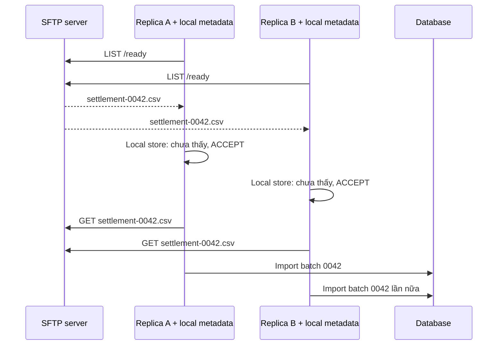
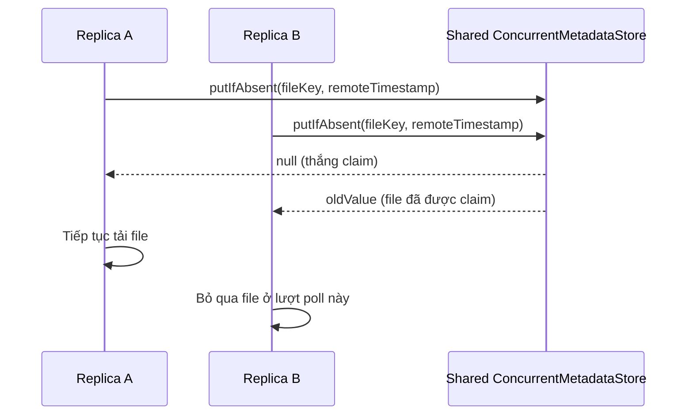
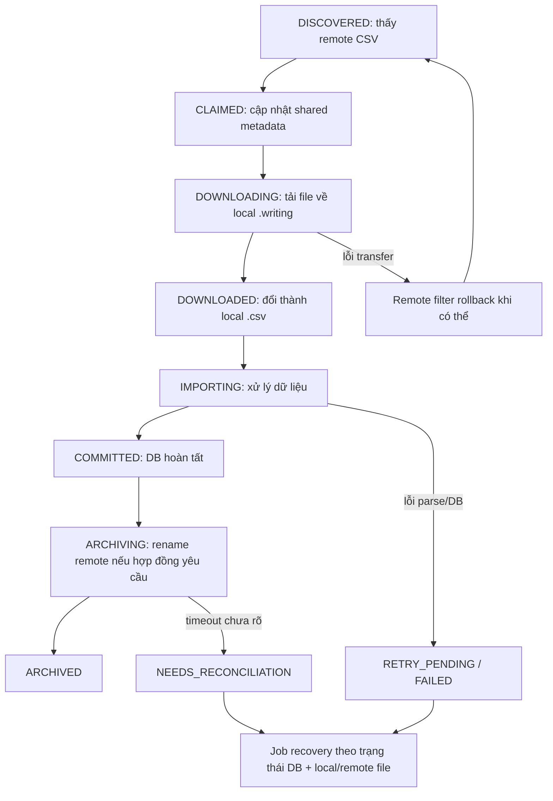

# ConcurrentMetadataStore cho nhiều consumer

## 1. Bài toán: hai instance cùng nhìn thấy một file SFTP

Ứng dụng Spring Boot có hai replica `settlement-worker-a` và `settlement-worker-b`. Cả hai chạy SFTP inbound adapter với poller 10 giây một lần, cùng kết nối tới thư mục `/exchange/settlement/ready`. Khi đối tác công bố `settlement-0042.csv`, **cả hai replica đều có thể nhìn thấy tên file** trong kết quả liệt kê. Nếu mỗi replica dùng một bộ nhớ riêng để ghi nhận file đã nhận, cả hai có thể tải file, phát `Message<File>` và nhập cùng một batch vào cơ sở dữ liệu.

Để phối hợp giữa nhiều consumer, Spring Integration cung cấp **`ConcurrentMetadataStore`** kết hợp với **`SftpPersistentAcceptOnceFileListFilter`**. Filter dùng một kho metadata chia sẻ để quyết định file từ xa nào đã được chọn; các thao tác cập nhật có điều kiện giúp nhiều instance cạnh tranh mà không cùng ghi nhận một file mới. Đây là thành phần quan trọng khi mở rộng số worker hoặc triển khai high availability.

Bài học thuộc chương **Adapter SFTP** của module `SPRING_INTEGRATION_ADAPTERS`. Giống những phần khác của module kết nối hệ thống ngoài qua inbound/outbound adapter, gateway, poller và `MessageChannel`, ta phải xác định **hợp đồng message, cơ chế lỗi, vòng đời kết nối và trạng thái xử lý**. Điểm nhấn ở đây là **chia sẻ trạng thái nhận file** giữa các replica; điều đó vẫn khác với việc bảo đảm một transaction nghiệp vụ chạy đúng một lần.

Sau bài này, bạn có thể:

- Phân biệt `MetadataStore`, `ConcurrentMetadataStore`, `SimpleMetadataStore` và `RedisMetadataStore`.
- Hiểu cách `SftpPersistentAcceptOnceFileListFilter` phối hợp nhiều consumer khi file mới xuất hiện hoặc bị thay đổi.
- Viết Java DSL cho SFTP inbound adapter với **remote filter chia sẻ**, `maxFetchSize` và poller.
- Thiết kế namespace key, thư mục staging, metadata retention, khả năng phục hồi và quan sát trạng thái.
- Giải thích vì sao shared filter **không** thay thế idempotency ở DB, retry nghiệp vụ hoặc distributed lock dài hạn.
- Kiểm thử hai replica, crash sau khi claim, sự cố metadata store và upload chưa hoàn tất.

> **Phiên bản:** ví dụ code tập trung vào **Spring Integration 6.5.x** trên Spring Boot, SFTP dùng Apache MINA SSHD với kiểu `SftpClient.DirEntry`. Từ Spring Integration 7.0, cách xây dựng key của một số persistent file filter đã thay đổi để đưa cả thư mục remote vào tên key; nếu nâng cấp, cần kiểm tra tương thích metadata đã lưu. Các ví dụ là cấu hình học tập, chưa phải sản phẩm đã được tích hợp/kiểm thử trên server production.

## 2. Điều gì xảy ra nếu chỉ dùng bộ nhớ cục bộ?

Theo mặc định, SFTP inbound adapter ở các phiên bản hiện đại dùng `SftpPersistentAcceptOnceFileListFilter` với một `SimpleMetadataStore` **trong tiến trình**. Filter có khả năng ghi nhận filename và thời gian sửa đổi, nhưng store của replica A **không liên lạc** với store của replica B.



Sử dụng cùng tên bean `metadataStore` ở hai JVM **không biến chúng thành một kho chia sẻ**. Cả hai vẫn có thể chứa hai đối tượng trong bộ nhớ khác nhau. Một store có các thao tác cập nhật an toàn giữa thread **trong cùng JVM** cũng chưa chắc an toàn giữa **hai máy**.

| Thiết kế | Chống trùng giữa thread cùng JVM | Chống trùng giữa replica | Còn trạng thái sau restart |
| --- | --- | --- | --- |
| `AcceptOnceFileListFilter` giữ trạng thái trong RAM | Có trong phạm vi filter | Không nếu mỗi replica có filter riêng | Không |
| `SftpPersistentAcceptOnceFileListFilter` + `SimpleMetadataStore` | Có trong phạm vi một store | **Không**, nếu store không được chia sẻ | Không |
| Persistent filter + `RedisMetadataStore` dùng cùng Redis | Có | Có thể phối hợp bằng thao tác metadata nguyên tử | Có, tùy độ bền Redis và chính sách lưu trữ |
| Persistent filter + `JdbcMetadataStore` dùng cùng DB | Có | Có thể phối hợp qua kho dữ liệu chung | Có, tùy độ bền DB và cấu hình |

Từ **"persistent"** trong tên filter nói về cơ chế dùng `MetadataStore`, không đồng nghĩa mọi implementation đều lưu dữ liệu bền vững trên đĩa. `SimpleMetadataStore` là ví dụ rõ nhất: có giao diện store, nhưng dữ liệu vẫn mất khi JVM dừng.

## 3. `ConcurrentMetadataStore` là hợp đồng gì?

`ConcurrentMetadataStore` mở rộng `MetadataStore` với các thao tác quan trọng:

| Phương thức | Ngữ nghĩa | Ý nghĩa trong nhiều consumer |
| --- | --- | --- |
| `get(key)` | Đọc giá trị hiện có | Kiểm tra trạng thái metadata |
| `putIfAbsent(key, value)` | Ghi **nếu key chưa tồn tại**, trả giá trị cũ nếu có | Giúp chỉ một instance ghi nhận key mới |
| `replace(key, oldValue, newValue)` | So sánh giá trị cũ rồi thay **có điều kiện** | Phối hợp khi file được coi là phiên bản mới vì timestamp đổi |
| `remove(key)` | Xóa key | Có thể dùng trong recovery có kiểm soát; cần chống race |

**Điểm cốt lõi:** `get` rồi `put` bằng hai lệnh độc lập là một kiểm tra-và-ghi có race. Cả hai worker có thể cùng đọc "chưa có" trước khi một worker ghi. `putIfAbsent` là một thao tác có điều kiện **nguyên tử trong implementation store**. `replace` cũng phải có ngữ nghĩa so sánh-và-thay nguyên tử để nhiều instance không cùng nhận một phiên bản mới của file.



Sơ đồ trên diễn giải **nguyên lý cạnh tranh trên một key mới**, không phải code bạn cần tự viết quanh SFTP adapter. Trong ứng dụng, hãy để `SftpPersistentAcceptOnceFileListFilter` quản lý key và giá trị của nó. **Đừng tự tạo key theo suy đoán rồi gọi `putIfAbsent` trong service**, vì filter cần xử lý cả timestamp, rollback và namespace.

### Giá trị store có phải trạng thái `PROCESSED` không?

**Không.** Trong Spring Integration 6.x, persistent remote file filter xác định file dựa trên tên và mốc sửa đổi của file từ xa. Metadata đánh dấu file đã được **chấp nhận để fetch**, không chứa bằng chứng transaction DB đã commit. Mặc định, việc file từ xa thay đổi thời gian sửa đổi có thể làm filter xem nó là phiên bản mới và chấp nhận lại. Nếu đối tác ghi đè nội dung với cùng tên, filter không thay thế được hợp đồng immutable file, batch ID và checksum.

Theo tài liệu Spring Integration, từ phiên bản 5.2, remote file được đánh dấu ngay trước khi fetch và dấu có thể được **rollback khi fetch thất bại**. Nhưng nếu fetch xong rồi **downstream handler lỗi**, rollback filter và transaction nghiệp vụ không tự động gắn với nhau. Đây là ranh giới cần nhớ khi chạy cluster.

## 4. Ba lớp trạng thái cần phân biệt

Khi nhận SFTP file vào ứng dụng, có ít nhất ba loại trạng thái:

| Lớp | Thành phần | Trả lời câu hỏi | Không trả lời được |
| --- | --- | --- | --- |
| **Remote filter** | `SftpPersistentAcceptOnceFileListFilter` + shared store | File từ xa đã được chọn để fetch chưa? | DB đã import xong chưa? |
| **Local filter** | Bộ lọc local directory của inbound adapter | File local hoàn tất nào đã được phát thành message? | Replica khác đã commit dữ liệu chưa? |
| **Business state** | DB/outbox/ledger của ứng dụng | Batch đang import, đã commit, đang retry hay đã archive? | Mạng SFTP vẫn luôn hoạt động không? |

Tại sao tách như vậy? Vì remote filter hoạt động **trước khi tải file**; local filter hoạt động **sau khi tải file về máy**; còn consumer có thể mất hàng phút để validate/import DB. Chỉ có business state đủ thông tin để quyết định có nên import lại, trả file vào hàng đợi, archive hay mở cảnh báo.

Một cách diễn đạt an toàn:

> Shared `ConcurrentMetadataStore` giúp điều phối **nhận file giữa nhiều instance**. Để đạt hành vi xử lý gần exactly-once ở DB, còn cần khóa nghiệp vụ, unique constraint, transaction và một quy trình khôi phục trạng thái khi lỗi.

## 5. Phụ thuộc và cấu hình môi trường

Ví dụ dùng Redis làm metadata store được chia sẻ. Redis **không phải kho lưu nội dung CSV**: store chỉ lưu các entry nhỏ phục vụ lọc. Nếu sử dụng Spring Boot BOM, khai báo:

```groovy
dependencies {
    implementation 'org.springframework.boot:spring-boot-starter-integration'
    implementation 'org.springframework.integration:spring-integration-sftp'

    // RedisMetadataStore và RedisConnectionFactory.
    implementation 'org.springframework.integration:spring-integration-redis'
    implementation 'org.springframework.boot:spring-boot-starter-data-redis'
}
```

Ví dụ cấu hình **không chứa bí mật thực**:

```yaml
spring:
  data:
    redis:
      host: ${REDIS_HOST:redis.internal.example}
      port: ${REDIS_PORT:6379}

app:
  sftp:
    host: ${SFTP_HOST:sftp.partner.example}
    port: ${SFTP_PORT:22}
    username: ${SFTP_USERNAME:settlement_reader}
    private-key: file:${SFTP_PRIVATE_KEY_FILE}
    private-key-passphrase: ${SFTP_PRIVATE_KEY_PASSPHRASE:}
    known-hosts: file:${SFTP_KNOWN_HOSTS_FILE}
    remote-directory: ${SFTP_REMOTE_DIR:/exchange/settlement/ready}
    local-directory: ${SFTP_LOCAL_DIR:./data/sftp-inbox}
```

**Tất cả replica phải trỏ vào cùng kho metadata** cho cùng một luồng nhận file: cùng Redis database/endpoint, Redis hash region và prefix của filter. Ngược lại, `app.sftp.local-directory` nên là **vùng local riêng cho từng replica**, ví dụ mỗi pod có volume riêng; nếu nhiều pod dùng shared filesystem, phải đánh giá thêm quyền ghi, tên file tạm và đồng bộ hóa truy cập.

Ở production, Redis cần cấu hình authentication, TLS/network ACL, lưu trữ bền vững phù hợp và giám sát availability. Không mặc định dùng Redis không mật khẩu chỉ vì ví dụ `application.yml` không biểu diễn secret. SFTP vẫn cần client private key, passphrase nếu có và `known_hosts` đã xác minh fingerprint bằng một kênh độc lập; tuyệt đối không tắt host verification để giảm lỗi triển khai.

### Tạo SFTP `SessionFactory` với SSH key

```java
import org.apache.sshd.sftp.client.SftpClient;
import org.springframework.beans.factory.annotation.Value;
import org.springframework.context.annotation.Bean;
import org.springframework.context.annotation.Configuration;
import org.springframework.core.io.Resource;
import org.springframework.integration.file.remote.session.CachingSessionFactory;
import org.springframework.integration.file.remote.session.SessionFactory;
import org.springframework.integration.sftp.session.DefaultSftpSessionFactory;

@Configuration
public class PartnerSftpSessionConfig {

    @Bean
    SessionFactory<SftpClient.DirEntry> partnerSftpSessionFactory(
            @Value("${app.sftp.host}") String host,
            @Value("${app.sftp.port}") int port,
            @Value("${app.sftp.username}") String username,
            @Value("${app.sftp.private-key}") Resource clientKey,
            @Value("${app.sftp.private-key-passphrase:}") String passphrase,
            @Value("${app.sftp.known-hosts}") Resource knownHosts) {

        DefaultSftpSessionFactory delegate = new DefaultSftpSessionFactory(false);
        delegate.setHost(host);
        delegate.setPort(port);
        delegate.setUser(username);
        delegate.setPrivateKey(clientKey);
        if (!passphrase.isBlank()) {
            delegate.setPrivateKeyPassphrase(passphrase);
        }
        delegate.setKnownHostsResource(knownHosts);
        delegate.setAllowUnknownKeys(false);
        delegate.setTimeout(30_000);

        return new CachingSessionFactory<>(delegate, 4);
    }
}
```

SFTP connection/session cache **khác** với Redis metadata store. Cái trước tái sử dụng phiên SSH của **mỗi instance**; cái sau phối hợp việc **nhận file** giữa nhiều instance. Không cần dùng chung `SessionFactory` object qua JVM; mỗi JVM có session factory riêng, nhưng remote filter tham chiếu đến metadata store chung.

## 6. Cấu hình `RedisMetadataStore` và namespace

`RedisMetadataStore` triển khai `ConcurrentMetadataStore`. Constructor nhận `RedisConnectionFactory` và một **Redis hash key** làm vùng lưu trữ. Mỗi filter còn nhận `prefix` để tạo key metadata bên trong vùng đó:

```java
import org.springframework.context.annotation.Bean;
import org.springframework.context.annotation.Configuration;
import org.springframework.data.redis.connection.RedisConnectionFactory;
import org.springframework.integration.metadata.ConcurrentMetadataStore;
import org.springframework.integration.redis.metadata.RedisMetadataStore;

@Configuration
public class DistributedFileMetadataConfig {

    @Bean("sftpRemoteMetadataStore")
    public ConcurrentMetadataStore sftpRemoteMetadataStore(
            RedisConnectionFactory redisConnectionFactory) {

        // Cùng giá trị region cho MỌI replica cùng nhận /ready.
        return new RedisMetadataStore(
                redisConnectionFactory, "si:sftp:settlement:metadata");
    }
}
```

Hai phạm vi khác nhau cần được giữ ổn định:

| Phạm vi | Giá trị ví dụ | Hệ quả khi thay |
| --- | --- | --- |
| Redis connection/DB | Redis chung cho các worker settlement | Nếu khác nhau, các worker **không** phối hợp |
| Redis **hash region** | `si:sftp:settlement:metadata` | Vùng khác tương đương danh sách key mới trống |
| Prefix của SFTP filter | `partner-a:ready:` | Prefix khác tương đương namespace file khác |
| Remote directory | `/exchange/settlement/ready` | Cần rà soát trùng tên và chiến lược key theo phiên bản |
| Local directory | Volume local riêng theo pod | Không phải nơi chia sẻ claim giữa replica |

**Không thêm pod ID, hostname hoặc random UUID vào prefix của remote filter.** Làm vậy khiến mỗi instance ghi những key khác nhau và mất cơ chế phối hợp. Ngược lại, nếu hai đối tác có cùng tên file `report.csv`, không để chúng vô tình chia sẻ một namespace nếu đó là **hai nguồn độc lập**. Hãy đặt prefix phân biệt theo partner/remote directory/luồng nghiệp vụ.

> **Lưu ý tương thích:** trong Spring Integration **6.x**, kiểm tra cách filter xây dựng metadata key nếu một filter được dùng trên nhiều thư mục có **cùng basename**. Từ **7.0**, tài liệu nêu việc dùng tên file dài bao gồm fetching directory; vì vậy khi nâng cấp cần có kế hoạch đọc/di chuyển hoặc khởi tạo lại metadata, không thay namespace một cách âm thầm trong production.

### Redis Cluster có một giới hạn quan trọng

Theo tài liệu Spring Integration 6.5, `RedisMetadataStore.replace(...)` dùng cơ chế liên quan `WATCH` để có tính nguyên tử và **không được hỗ trợ đầy đủ với Redis Cluster** trong implementation được mô tả. Filter có thể cần `replace` khi timestamp file thay đổi. Do đó, **không suy luận chỉ vì Redis có tính HA thì mọi deployment Redis Cluster đều dùng an toàn**; xác minh topology, phiên bản thư viện và semantics atomic CAS trước khi triển khai. Có thể cân nhắc `JdbcMetadataStore` hoặc backend khác hỗ trợ `ConcurrentMetadataStore` và yêu cầu HA hiện tại.

## 7. Remote filter phối hợp nhiều consumer

Ta dùng `ChainFileListFilter` để ghép **pattern trước**, **persistent accept-once sau**. Điều này cho phép chỉ những file `*.csv` hợp lệ về tên mới được đánh dấu trong shared store; không để những file đang upload dở như `.part` chiếm metadata.

```java
import org.apache.sshd.sftp.client.SftpClient;
import org.springframework.beans.factory.annotation.Qualifier;
import org.springframework.context.annotation.Bean;
import org.springframework.context.annotation.Configuration;
import org.springframework.integration.file.filters.ChainFileListFilter;
import org.springframework.integration.file.filters.FileListFilter;
import org.springframework.integration.metadata.ConcurrentMetadataStore;
import org.springframework.integration.sftp.filters.SftpPersistentAcceptOnceFileListFilter;
import org.springframework.integration.sftp.filters.SftpSimplePatternFileListFilter;

@Configuration
public class SftpClusteredFilterConfiguration {

    @Bean("settlementRemoteFileFilter")
    public FileListFilter<SftpClient.DirEntry> settlementRemoteFileFilter(
            @Qualifier("sftpRemoteMetadataStore")
            ConcurrentMetadataStore store) {

        ChainFileListFilter<SftpClient.DirEntry> filters =
                new ChainFileListFilter<>();

        // Chỉ file đã publish theo hợp đồng CSV mới đi tới accept-once.
        filters.addFilter(new SftpSimplePatternFileListFilter("*.csv"));
        filters.addFilter(new SftpPersistentAcceptOnceFileListFilter(
                store, "partner-a:ready:"));
        return filters;
    }
}
```

`SftpPersistentAcceptOnceFileListFilter` so sánh tên file và **remote modified time**, không tính SHA-256 nội dung từ xa. Khi đối tác upload bằng tên tạm rồi rename thành `.csv`, pattern filter sẽ không nhận file tạm; sau khi công bố tên cuối, file mới đủ điều kiện được claim. Nếu đối tác **ghi trực tiếp dưới tên `.csv` khi chưa xong**, bản thân pattern và metadata store không biết file đã hoàn thành; cần marker, age filter hoặc hợp đồng publish khác.

**Tại sao dùng `ChainFileListFilter` mà không chỉ `SftpSimplePatternFileListFilter`?** Vì nếu đặt riêng pattern filter lên adapter, có thể làm mất persistent accept-once filter mặc định của framework. Khi khai báo **custom filter**, ta phải ghép đầy đủ cả điều kiện về tên và shared claim trong một filter chain. Trong một số kiến trúc, `CompositeFileListFilter` cũng phù hợp, nhưng `ChainFileListFilter` thể hiện rõ thứ tự kiểm tra và tránh đánh dấu những file đã bị điều kiện đầu loại.

## 8. Gắn filter vào SFTP inbound adapter với Java DSL

Mỗi replica dùng cùng cấu hình code và Redis store, nhưng có **local staging** riêng. Đoạn code dưới đây hoàn chỉnh phần wiring từ poller đến `MessageHandler`:

```java
import java.io.File;

import org.apache.sshd.sftp.client.SftpClient;
import org.springframework.beans.factory.annotation.Qualifier;
import org.springframework.beans.factory.annotation.Value;
import org.springframework.context.annotation.Bean;
import org.springframework.context.annotation.Configuration;
import org.springframework.integration.dsl.IntegrationFlow;
import org.springframework.integration.dsl.Pollers;
import org.springframework.integration.file.filters.FileListFilter;
import org.springframework.integration.file.remote.session.SessionFactory;
import org.springframework.integration.sftp.dsl.Sftp;

@Configuration
public class ClusteredSftpInboundFlow {

    @Bean
    public IntegrationFlow settlementInbound(
            SessionFactory<SftpClient.DirEntry> partnerSftpSessionFactory,
            @Qualifier("settlementRemoteFileFilter")
            FileListFilter<SftpClient.DirEntry> remoteFilter,
            SettlementBatchHandler handler,
            @Value("${app.sftp.remote-directory}") String remoteDirectory,
            @Value("${app.sftp.local-directory}") String localDirectory) {

        return IntegrationFlow.from(
                        Sftp.inboundAdapter(partnerSftpSessionFactory)
                                .remoteDirectory(remoteDirectory)
                                .localDirectory(new File(localDirectory))
                                .autoCreateLocalDirectory(true)
                                .temporaryFileSuffix(".writing")
                                .deleteRemoteFiles(false)
                                .filter(remoteFilter)
                                .maxFetchSize(1),
                        endpoint -> endpoint.poller(
                                Pollers.fixedDelay(10_000)
                                        .maxMessagesPerPoll(1)))
                .handle(handler)
                .get();
    }
}
```

`maxFetchSize(1)` giới hạn lượng file **mới được fetch từ SFTP vào local** trong một đợt lấy file; `maxMessagesPerPoll(1)` giới hạn số **message local được phát** trong một lượt poll. Hai giá trị **không đồng nghĩa**, và không phải distributed lock. Theo khuyến nghị của Spring Integration, dùng `maxFetchSize` nhỏ khi chạy nhiều instance để tránh một replica lấy trước toàn bộ backlog khiến các replica khác thiếu việc.

Với `DirectChannel` mặc định, consumer `.handle(handler)` chạy trên luồng xử lý message của flow; nếu handler cần nhiều thời gian, poller bị giữ theo thời gian xử lý đó. Có thể thêm queue hoặc asynchronous processing nhưng cần xác định rõ **kho lưu việc bền vững**, quyền sở hữu batch và cách retry, thay vì chỉ đặt `ExecutorChannel` rồi cho rằng accept-once filter tự giải quyết mọi vấn đề.

### Hai bộ lọc remote và local không thể dùng lẫn nhau

Trong inbound adapter thông thường, **remote filter** ở ví dụ trên quyết định file nào được tải từ SFTP. Sau khi tải thành local `*.writing` và đổi sang tên cuối, **local filter** quyết định file local nào được phát thành `Message<File>`. Local filter mặc định cũng có thể giữ trạng thái bằng store trong bộ nhớ.

Do đó, sau một restart, một file đã có sẵn trong local inbox có thể được phát lại; hoặc sau khi nội dung remote đổi timestamp và được tải lại, local filter không cho phát nếu metadata local chưa được thiết kế phù hợp. **Shared remote filter không thay thế local filter và càng không thay thế business state.** Nếu cần thay local filter, làm riêng và kiểm thử với cơ chế dọn local, timestamp, retry và filesystem thực tế.

## 9. Handler cần idempotency ở cơ sở dữ liệu

Một consumer nhận `Message<File>` chỉ nên coi đó là bằng chứng **file đã hoàn tất bước truyền về local**, không phải batch đã được import. Ví dụ handler đọc remote header và gọi một service có hợp đồng idempotent:

```java
import java.io.File;
import java.nio.file.Files;

import org.springframework.integration.file.FileHeaders;
import org.springframework.messaging.Message;
import org.springframework.messaging.MessageHandler;
import org.springframework.stereotype.Component;

@Component
public class SettlementBatchHandler implements MessageHandler {

    private final SettlementImportService importer;

    public SettlementBatchHandler(SettlementImportService importer) {
        this.importer = importer;
    }

    @Override
    public void handleMessage(Message<?> message) {
        File local = (File) message.getPayload();
        String remoteName = (String) message.getHeaders()
                .get(FileHeaders.REMOTE_FILE);
        String remoteDirectory = (String) message.getHeaders()
                .get(FileHeaders.REMOTE_DIRECTORY);

        if (!Files.isRegularFile(local.toPath())) {
            throw new IllegalStateException("File local không còn tồn tại");
        }
        if (remoteName == null || !remoteName.matches("settlement-[0-9]+\\.csv")) {
            throw new IllegalArgumentException("Tên batch không hợp lệ");
        }

        // Chỉ chuyển dữ liệu đã được adapter lấy từ source nội bộ,
        // không dùng remote headers từ HTTP request không tin cậy.
        importer.importOnce(remoteDirectory, remoteName, local);
    }
}
```

Service import phải quản lý transaction và unique key. Phần này thuộc **business layer**, không nên gắn vào internals của `SftpPersistentAcceptOnceFileListFilter`:

```java
import java.io.File;

public interface SettlementImportService {
    /**
     * Khóa nghiệp vụ có thể là (partnerId, batchId) hoặc một ID bất biến.
     * Nếu batch đã COMMITTED, không ghi dữ liệu lần hai.
     * Nếu thất bại, ném exception và để lại trạng thái có thể recovery.
     */
    void importOnce(String remoteDirectory, String remoteFile, File localFile);
}
```

Một hướng triển khai là unique constraint trên `(partner_id, batch_id)`, lưu trạng thái batch, rồi validate/import trong transaction DB có kiểm soát. Nếu import theo từng chunk, phải thiết kế checkpoint/idempotency từng record và một cách **chỉ công bố batch hoàn tất khi toàn bộ dữ liệu hợp lệ**. Không giữ transaction DB lớn vô hạn cho file vài GB.

## 10. Crash ở từng giai đoạn: shared store giúp được bao nhiêu?

Giả sử replica A đã thắng quyền accept-once cho `settlement-0042.csv`. Trình tự có thể như sau:



| Thời điểm lỗi | Remote metadata store | Hành vi cần bổ sung |
| --- | --- | --- |
| Trước khi filter claim | Chưa có dấu của file | Replica khác có thể nhận ở lần poll sau |
| Trong lúc tải file | Có thể được **rollback nếu fetch thất bại** theo cơ chế filter/synchronizer | Xử lý local `.writing`, kiểm tra log và thử lại có kiểm soát |
| Tải xong, **trước khi consumer import** | File có thể đã được đánh dấu remote là accepted | Job recovery phải thấy local file hoặc reset claim đúng cách |
| Consumer parse/DB lỗi | Remote metadata vẫn có thể là accepted | Lưu trạng thái `RETRY_PENDING` hoặc `FAILED`, không kỳ vọng poller tự gửi lại |
| DB commit xong, app chết trước archive | Batch đã commit nhưng remote vẫn ở `ready` | Chỉ hoàn tất archive, **không import lại** |
| Redis state mất sau restart | Dấu accepted có thể biến mất | File có thể được tải lại; unique key DB phải ngăn double import |

Đặc biệt, đừng xóa hàng loạt key Redis khi thấy lỗi downstream. Nếu key bị xóa trong lúc replica A vẫn đang tải, replica B có thể được nhận file đó và tạo **hai bản sao đang xử lý đồng thời**. Reset metadata phải gắn với batch cụ thể và cần xác nhận không còn worker đang giữ quyền xử lý (ví dụ qua lease/claim ledger riêng của ứng dụng).

**Thao tác metadata không phải giao dịch hai pha.** Filter không biết câu lệnh SQL đã commit hay chưa. Một bản ghi trong Redis là điều kiện để điều phối polling, **không phải bằng chứng xử lý thành công** và không thay thế giao dịch giữa SFTP và DB.

## 11. Chọn namespace và quản lý vòng đời metadata

Metadata bền vững cần **quy tắc quản trị** giống dữ liệu nghiệp vụ, dù bản thân giá trị chỉ là tên và timestamp file.

1. **Định danh file ổn định:** đối tác nên công bố file theo tên batch duy nhất; tránh ghi đè cùng tên mà không đổi version. Nếu bắt buộc có bản sửa, quy định rõ cách phân biệt batch mới.
2. **Prefix nhất quán:** cùng partner, remote directory, luồng nghiệp vụ phải dùng cùng prefix trên mọi replica. Đổi prefix đồng nghĩa có nguy cơ xử lý lại toàn bộ file cũ.
3. **Không trộn môi trường:** dev, staging, production nên có Redis namespace/database tách biệt; không dùng chung trạng thái accept-once giữa môi trường test và production.
4. **Bảo vệ quyền sửa metadata:** một tài khoản được phép xóa/sửa key có thể làm file được nhận lại hoặc bị bỏ qua. Giới hạn Redis ACL, log hoạt động quản trị và backup.
5. **Retention có kiểm soát:** không đặt TTL ngắn tùy tiện trên toàn bộ region; khi key hết hạn, file remote còn tồn tại có thể được xử lý lại. Xác định chính sách dọn key sau khi batch đã kết thúc và dữ liệu nguồn đã archive/xóa theo hợp đồng.
6. **Đổi phiên bản framework:** khi thuật toán key thay đổi, lên kế hoạch migration hoặc reprocess có kiểm soát; không chỉ triển khai code mới và giả định metadata cũ vẫn tương thích.

`RedisMetadataStore` dùng một Redis hash region; expiration của cả hash **không tương đương TTL an toàn cho từng batch**. Muốn dọn các entry đã cũ, cần có quy trình reconciliation từ business ledger. Không tự tạo cron xóa key theo thời gian lưu file mà không biết file còn ở remote hay không.

### Lưu ý về file cùng tên ở hai thư mục

Ở Spring Integration **6.x**, cách ghép key của remote persistent filter phụ thuộc phiên bản và có rủi ro khi **cùng basename** xuất hiện ở nhiều remote directory mà filter/namespace được dùng chung. Phân biệt prefix theo thư mục hoặc dành mỗi flow một filter đúng phạm vi để tránh một file vô tình chặn file khác. Spring Integration **7.0** đã công bố thay đổi dùng tên file dài gồm cả fetching directory; rà soát tác động khi nâng cấp.

## 12. `maxFetchSize`, load balancing và số phiên SFTP

Trong cluster, `maxFetchSize(1)` là một **biện pháp công bằng**, không phải cơ chế bảo đảm một file được xử lý chính xác một lần. Nếu replica A có khả năng tải 100 file một lượt còn replica B chỉ tải một file, A có thể liên tục giành phần lớn backlog. Giới hạn fetch nhỏ giúp phân phối cơ hội claim giữa các worker; tuy nhiên tốc độ cuối còn tùy poller, băng thông, local staging, thời gian import và Redis latency.

Ví dụ với mỗi poller `maxMessagesPerPoll(2)`:

| `maxFetchSize` | Một lượt lấy remote file | Message phát trong lượt poll | Ý nghĩa |
| --- | --- | --- | --- |
| `1` | Lần lấy mới giới hạn 1 file | Có thể fetch tiếp khi còn khả năng phát message | Phân phối dần, phù hợp cluster |
| `2` | Có thể lấy tối đa 2 file một đợt | Phát tối đa 2 message | Đơn giản để quan sát |
| `4` | Có thể tải 4 file dù chỉ phát 2 | File local còn lại được phát ở poll sau | Tăng prefetch nhưng tăng local backlog |
| Mặc định không giới hạn | Có thể tải rất nhiều file | Vẫn bị giới hạn bởi poller | Một instance có thể chiếm nhiều file và tài nguyên |

Không tăng `maxMessagesPerPoll` mà quên hạn mức session SSH, số request Redis và dung lượng local disk. Với file lớn, transfer về local chiếm thời gian và connection; với consumer DB chậm, local backlog có thể tích tụ. Theo dõi `pollDuration`, `fetchCount`, `processDuration`, `sessionActive`, `diskBytes`, `acceptedCount`, `duplicateSkippedCount`, và `retryPendingCount` theo mỗi replica.

## 13. Mất Redis, Redis Cluster và lựa chọn backend

Khi metadata store không thể truy cập, **không tự động chuyển về `SimpleMetadataStore`** để "duy trì service" nếu mục tiêu là phối hợp cluster. Mỗi replica khi đó sẽ hoạt động độc lập và dễ nhận cùng file. Phù hợp hơn là chuyển nguồn nhận file vào trạng thái **degraded/paused**, cảnh báo và retry kết nối metadata với backoff.

| Sự cố | Nguy cơ | Cách xử lý |
| --- | --- | --- |
| Redis timeout giữa lúc filter đánh dấu | Không rõ claim đã được ghi thành công hay chưa | Không xử lý mù; quan sát key, retry theo idempotency và business state |
| Redis restart mất dữ liệu chưa persist | File cũ có thể được nhận lại | Cần Redis durability phù hợp, unique batch key ở DB |
| Redis Cluster không hỗ trợ CAS cần thiết | `replace` thiếu ngữ nghĩa kỳ vọng | Kiểm tra implementation/version; cân nhắc backend khác |
| Hai instance trỏ vào hai Redis DB | Không có chia sẻ claim thực sự | Kiểm tra cấu hình runtime của từng replica |
| Người vận hành xóa nhầm region | Có thể phát lại tất cả file còn trên server | Khôi phục có kiểm soát, kiểm tra ledger và backup |
| Metadata store chậm | Poller trễ, có thể gây tồn backlog | Theo dõi latency, timeout và công suất backend |

Ngoài Redis, Spring Integration cung cấp `JdbcMetadataStore` và các implementation khác của `ConcurrentMetadataStore`. Việc chọn backend tùy yêu cầu transaction/CAS, topology cluster, SLA, quyền vận hành và độ bền. Đừng chỉ chọn vì hệ thống "đã có Redis" mà không xác minh semantics `putIfAbsent`/`replace` trong topology thực tế.

## 14. Streaming inbound adapter có dùng cùng cơ chế không?

Có. `SftpStreamingMessageSource` cũng có thể dùng `SftpPersistentAcceptOnceFileListFilter` với **shared `ConcurrentMetadataStore`**, nhưng payload của message là **`InputStream`** chứ không phải `File`. Không có local download filter theo cùng cách của file-based inbound adapter; consumer phải đóng `closeableResource` trong header để giải phóng SFTP session sau khi đọc.

```java
import org.apache.sshd.sftp.client.SftpClient;
import org.springframework.integration.file.filters.FileListFilter;
import org.springframework.integration.sftp.inbound.SftpStreamingMessageSource;
import org.springframework.integration.sftp.session.SftpRemoteFileTemplate;

// Dùng shared filter được định nghĩa ở mục 7 và cùng session factory.
SftpRemoteFileTemplate remoteTemplate = new SftpRemoteFileTemplate(sessionFactory);
SftpStreamingMessageSource source =
        new SftpStreamingMessageSource(remoteTemplate);
source.setRemoteDirectory("/exchange/settlement/ready");
source.setFilter(remoteFileFilter);
source.setMaxFetchSize(1);
```

Đoạn trên minh họa cách cấu hình source, **chưa** là một flow hoàn chỉnh. Trong Java DSL, cần gắn source vào poller và một handler đọc `InputStream`, đóng stream/session đúng cách. Nếu cùng ứng dụng đồng thời chạy **file-based inbound** và **streaming inbound** trên cùng thư mục, hãy xác định rõ chúng cạnh tranh hay độc lập: dùng cùng namespace khiến một phía có thể chiếm file của phía kia; tách namespace có thể khiến cả hai cùng nhận. Đừng để hai pipeline cùng nhận một batch chỉ vì dùng hai kiểu adapter khác nhau.

## 15. Kịch bản kiểm thử cluster và phục hồi

Chuẩn bị **hai Spring Boot instance thật** (A, B), một Redis chung, SFTP server test có `known_hosts` đã xác minh, local volume riêng từng instance và database test có unique key cho batch. Dùng file giả, không phá metadata production trong các phép thử.

1. **Cùng poll một file:** đưa một CSV đã publish vào `ready`, bật A và B cùng lúc. Quan sát chỉ một instance thắng filter claim và fetch file trong lần đầu. Kiểm tra cả DB chỉ commit một batch.
2. **Nhiều file:** đưa 20 file có batch ID khác nhau, giữ `maxFetchSize(1)`, quan sát việc phân bổ claim giữa hai replica và không bỏ sót file.
3. **Restart:** xử lý xong một file, restart cả A/B mà giữ Redis metadata. Xác minh file chưa đổi timestamp không bị remote filter nhận lại, đồng thời kiểm tra local filter/retention.
4. **Crash trong transfer:** ngắt mạng SFTP khi A đang tải file `.writing`. Xác nhận không phát file local dở; quan sát việc rollback claim theo hành vi thực tế và thử lại bằng instance còn sống.
5. **Crash sau transfer trước DB:** cho A tải xong rồi chết trước import. B có thể chưa được phép fetch vì remote metadata đã accepted. Chạy job recovery từ business ledger và local/remote trạng thái để xác định cách tiếp tục.
6. **Lỗi parse:** đưa CSV hỏng schema, xác nhận job lưu `FAILED`/`QUARANTINED`; không xóa cả Redis namespace để ép retry.
7. **File sửa timestamp:** thay mtime của cùng tên file trên SFTP test. Kiểm tra filter có thể chấp nhận phiên bản mới; xác nhận business layer không nhập trùng batch ID.
8. **Mất Redis:** ngắt kết nối Redis. Xác nhận các worker **không** fallback sang in-memory accept-once để tiếp tục tải trùng; giám sát báo lỗi rõ ràng.
9. **Sai cấu hình namespace:** cố ý đổi prefix hoặc Redis DB **trong test**; xác nhận hành vi duplicate để thấy vì sao mọi replica phải dùng cùng cấu hình.
10. **Hai thư mục cùng basename:** đặt `report.csv` ở hai remote directory thuộc hai đối tác, xác nhận prefix/phạm vi filter không chặn nhầm nhau.
11. **Producer upload dở:** upload `batch.csv.part`, sau khi hoàn tất rename thành `.csv`; filter chỉ claim file tên cuối.
12. **Reconciliation:** sau khi DB commit nhưng rename archive bị timeout, restart và chạy lại bước archive dựa trên trạng thái bền vững, không import lại.

### Ma trận kỳ vọng

| Tình huống | Kết quả filter/metadata mong đợi | Kết quả nghiệp vụ cần bảo đảm |
| --- | --- | --- |
| Hai replica cùng thấy một file mới | Một claim thắng khi cùng key/phiên bản | Một batch được commit |
| Fetch lỗi trước khi hoàn tất | Có cơ chế rollback claim khi phù hợp | Không nhập file local dở |
| Handler lỗi sau fetch | Metadata có thể vẫn ở trạng thái accepted | Recovery riêng, không mất batch |
| Restart giữ Redis store | Không tự coi mọi file là mới | Không nhập trùng, vẫn xử lý backlog còn lại |
| Redis metadata mất | File có thể được chọn lại | Unique constraint DB ngăn double commit |
| File remote thay đổi mtime | Filter có thể xem là phiên bản mới | So sánh batch ID/version/checksum |

## 16. Các sai lầm thường gặp

- **Mỗi pod có một `SimpleMetadataStore` và nghĩ đã cấu hình cluster:** các store không chia sẻ state.
- **Đặt prefix theo pod ID:** mỗi replica ghi key riêng, khiến cùng file được chọn nhiều lần.
- **Chỉ thêm `SftpSimplePatternFileListFilter("*.csv")`:** nếu thay filter mặc định, bạn có thể đã bỏ accept-once.
- **Dùng `get` rồi `put` thay vì thao tác CAS:** không đảm bảo nguyên tử khi hai replica cạnh tranh.
- **Nhầm accepted với committed:** filter đánh dấu trước hoặc trong fetch, không theo transaction DB.
- **Tin `maxFetchSize(1)` là distributed lock:** nó chỉ giới hạn số file được lấy mỗi đợt.
- **Dùng TTL ngắn trên metadata region để dọn dữ liệu:** sau TTL, file remote cũ có thể được nhận lại.
- **Xóa key Redis trong khi worker khác đang chạy:** có thể phá khả năng loại trừ trùng lặp.
- **Bỏ qua local file filter:** có thể phát lại file local hoặc bỏ lỡ file đã tải mới theo thay đổi timestamp.
- **Fallback Redis sang bộ nhớ khi Redis timeout:** làm mất khả năng phối hợp giữa các JVM.
- **Dùng Redis Cluster mà không kiểm tra CAS của `RedisMetadataStore`:** `replace` có giới hạn được tài liệu phiên bản 6.5 nêu rõ.
- **Không dùng idempotency DB:** dù không có duplicate fetch trong trạng thái bình thường, crash/restart/rollback vẫn có thể đưa cùng batch tới consumer nhiều lần.

## 17. Câu hỏi tự kiểm tra

1. Vì sao `SimpleMetadataStore` không chống được việc hai replica cùng nhận một file SFTP dù filter của mỗi replica là `SftpPersistentAcceptOnceFileListFilter`?
2. `ConcurrentMetadataStore#putIfAbsent` giải quyết race nào mà một cặp `get`/`put` không giải quyết được?
3. Khi mtime của remote file thay đổi, filter có thể làm gì và vì sao không thể thay checksum/batch version?
4. Vì sao thứ tự pattern filter rồi persistent accept-once filter quan trọng?
5. Có gì khác nhau giữa **remote filter**, **local filter** và **business state**?
6. `maxFetchSize=1` khác `maxMessagesPerPoll=1` như thế nào? Vì sao nên giảm prefetch ở cluster?
7. Nếu pod A chết sau khi tải xong nhưng chưa import, pod B có tự động nhận lại file nhờ shared store không? Làm sao recovery?
8. Tại sao không đặt prefix theo instance ID? Khi nào cần prefix khác nhau?
9. Nếu Redis restart và làm mất metadata, tầng nào phải ngăn import cùng batch hai lần?
10. Bạn sẽ kiểm tra những gì trước khi triển khai `RedisMetadataStore` lên Redis Cluster?
11. Vì sao thay đổi từ Spring Integration 6.x sang 7.x cần rà soát định dạng metadata key?
12. Những metric nào giúp phát hiện một replica chiếm gần hết file, metadata store lỗi hoặc backlog tăng nhanh?

## Tài liệu tham khảo

- [Spring Integration 6.5 — SFTP Inbound Channel Adapter](https://docs.spring.io/spring-integration/reference/6.5/sftp/inbound.html)
- [Spring Integration — Remote Persistent File List Filters](https://docs.spring.io/spring-integration/reference/file/remote-persistent-flf.html)
- [Spring Integration — Controlling Remote File Fetching](https://docs.spring.io/spring-integration/reference/sftp/max-fetch.html)
- [Spring Integration 6.5 — SFTP Streaming Inbound Channel Adapter](https://docs.spring.io/spring-integration/reference/6.5/sftp/streaming.html)
- [Spring Integration 6.5 — Redis Support and `RedisMetadataStore`](https://docs.spring.io/spring-integration/reference/6.5/redis.html)
- [Spring Integration 6.5 API — `SftpPersistentAcceptOnceFileListFilter`](https://docs.spring.io/spring-integration/docs/6.5.0/api/org/springframework/integration/sftp/filters/SftpPersistentAcceptOnceFileListFilter.html)
- [Spring Integration 6.5 API — `ConcurrentMetadataStore`](https://docs.spring.io/spring-integration/docs/6.5.0/api/org/springframework/integration/metadata/ConcurrentMetadataStore.html)
- [Spring Integration 6.5 API — `RedisMetadataStore`](https://docs.spring.io/spring-integration/docs/6.5.0/api/org/springframework/integration/redis/metadata/RedisMetadataStore.html)
