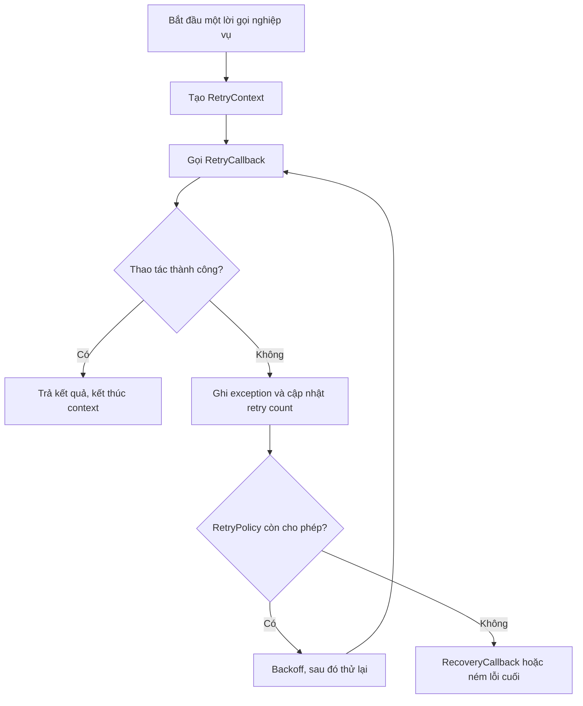
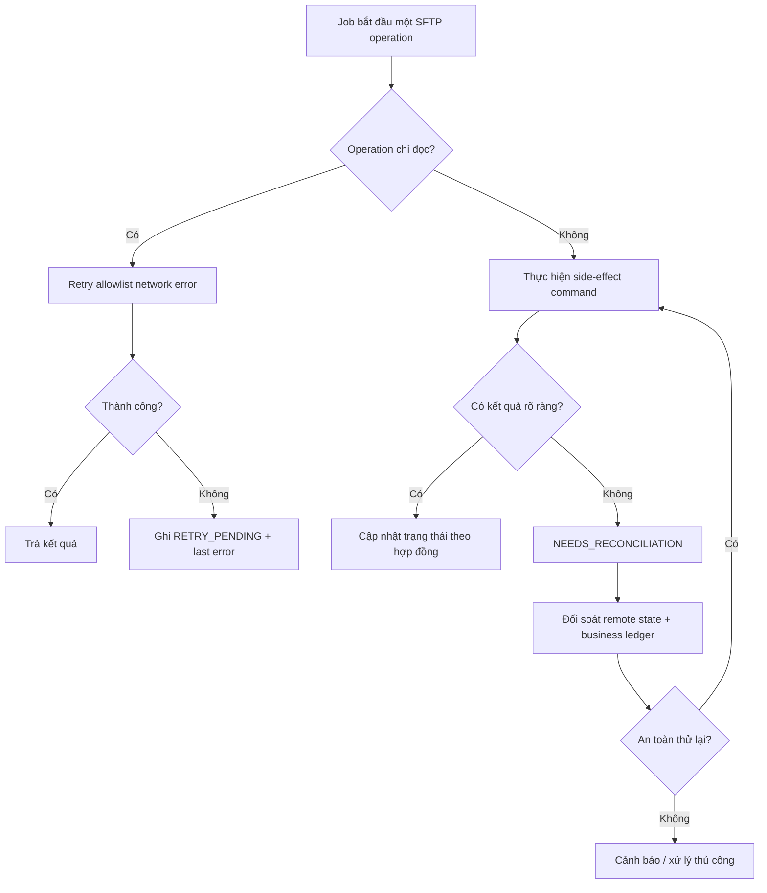
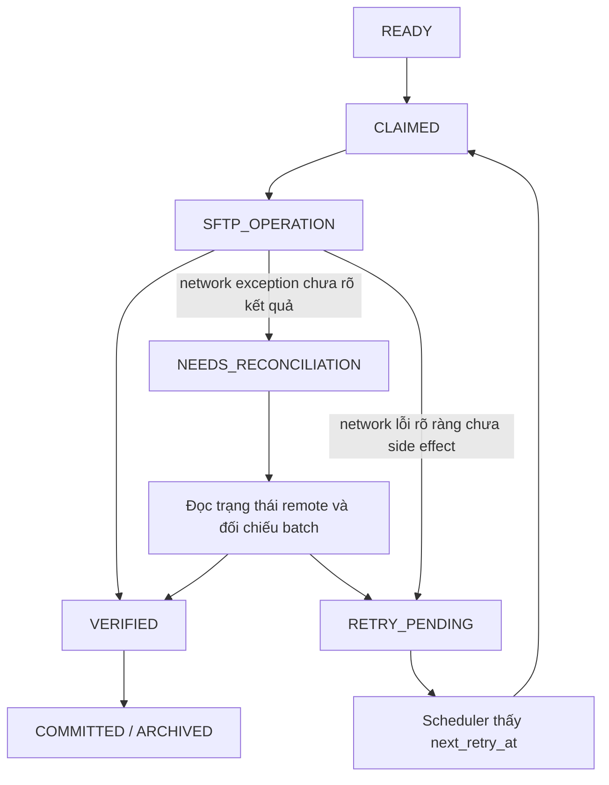

# Retry context khi kết nối SFTP gián đoạn

## 1. Bài toán: lệnh SFTP gặp lỗi đúng lúc đang truyền file

Hệ thống Spring Boot cần đọc các file CSV từ SFTP của đối tác, nhập dữ liệu vào database và gửi file kết quả trở lại. Trong một lượt chạy, kết nối SSH đột ngột bị reset: lệnh `ls` có thể chưa trả danh sách, lệnh `get` có thể mới tải 60% nội dung hoặc lệnh `put` có thể đã upload xong nhưng client chưa nhận phản hồi cuối.

Nếu ứng dụng **không retry**, một lỗi mạng thoáng qua có thể khiến công việc bị bỏ dở. Nếu ứng dụng **retry mọi exception**, nó có thể tải trùng, ghi đè file đã giao, xóa nhầm file hoặc lặp lại import DB. Trong Spring Integration, cơ chế retry cần được đặt đúng **lớp xử lý** và gắn với ngữ nghĩa của từng thao tác SFTP.

`RetryContext` là đối tượng Spring Retry ghi lại trạng thái của **một phiên thực thi retry**: số lần thất bại/đã retry, exception gần nhất và các thuộc tính do ứng dụng gắn vào. Nó giúp code và callback biết **đang ở lần thử nào**, **lỗi trước đó là gì**, và **khi nào phải chuyển sang recovery**. Nhưng `RetryContext` **không phải** bản ghi nghiệp vụ bền vững, không thay được `ConcurrentMetadataStore`, database hay một message queue.

Bài này thuộc chương **Adapter SFTP** của module `SPRING_INTEGRATION_ADAPTERS`, trong phạm vi kết nối hệ thống ngoài qua inbound/outbound adapter, gateway, poller và `MessageChannel`. Cùng các nguyên tắc được dùng với HTTP, JMS, AMQP, Kafka và database, chúng ta cần quản lý **hợp đồng message, retry, timeout, idempotency và vòng đời kết nối**; SFTP bổ sung một rủi ro đặc thù: kết quả thao tác file trên server có thể **không xác định** khi mạng đứt sau side effect.

Sau bài này, bạn có thể:

- Phân biệt retry ở `RetryTemplate`, `RequestHandlerRetryAdvice`, poller/message source và business job.
- Đọc `RetryContext#getRetryCount()`, `getLastThrowable()` và dùng `setAttribute()` để theo dõi một lượt xử lý.
- Tạo retry policy **có phân loại lỗi**, exponential backoff và giới hạn số lần thử.
- Áp dụng retry cho thao tác `ls`/`get` và nhận biết khi nào `put`/`mv`/`rm` cần reconciliation trước khi thử lại.
- Bảo vệ các luồng inbound SFTP khỏi mất file, xử lý trùng, stale SSH session và retry chồng tầng.
- Viết bộ kiểm thử mô phỏng lỗi mạng và các tình huống hồi phục sau crash.

> **Phạm vi API:** ví dụ hướng đến Spring Boot dùng **Spring Integration 6.x** và **Spring Retry 2.x**, SFTP dựa trên Apache MINA SSHD (`SftpClient.DirEntry`). Hãy đối chiếu API theo phiên bản dependency thực tế. Các đoạn code tập trung vào mẫu tích hợp và không đại diện cho việc đã thử kết nối server thật.

## 2. Bốn câu hỏi trước khi bật retry

Trước một exception SFTP, hãy xác định:

1. **Lỗi xảy ra ở lớp nào?** DNS/TCP, bắt tay SSH, xác minh host key, đăng nhập, thực hiện lệnh SFTP, đọc stream, ghi file local hay xử lý database?
2. **Có side effect chưa?** `ls` gần như chỉ đọc, nhưng `put` có thể tạo file, `mv` có thể đổi tên và `rm` có thể xóa file trước khi client nhận exception.
3. **Có dữ liệu để thử lại không?** Payload `InputStream` đã đọc 60% không thể tự quay về đầu; file local hoàn chỉnh hoặc remote path bất biến có thể được đọc lại từ đầu.
4. **Ai sở hữu trạng thái bền vững?** `RetryContext` tồn tại trong một lượt thử; tiến trình chết hay worker khác tiếp nhận công việc cần DB/outbox/metadata store để biết bước tiếp theo.

| Thao tác | Ngữ nghĩa thông thường | Nếu mất kết nối | Cách tiếp cận retry |
| --- | --- | --- | --- |
| `ls`, `nlst`, `exists` | Đọc trạng thái server | Có thể thực hiện lại nhưng kết quả có thể thay đổi theo thời gian | Retry có giới hạn cho lỗi mạng tạm thời |
| `get` | Đọc file remote và tạo dữ liệu local/stream | File local có thể chỉ tải một phần | Đóng stream, xóa/quarantine file tạm, mở **lượt đọc mới** từ đầu |
| `put` | Ghi file mới/lên server | Upload có thể đã hoàn tất hoặc còn file tạm | Đối chiếu remote target, batch ID/checksum trước retry |
| `mv`/`rename` | Đổi tên/chuyển file remote | Server có thể đã rename dù client báo timeout | Kiểm tra source **và** target trước retry |
| `rm` | Xóa file remote | File có thể đã bị xóa dù reply thất lạc | Xác minh trạng thái đích và quyền xóa trước quyết định |
| Import DB sau `get` | Ghi dữ liệu nghiệp vụ | Một phần dữ liệu có thể đã commit | Transaction/unique key/checkpoint, không dựa vào retry của SFTP |

**Nguyên tắc:** không phải mọi thao tác có thể gọi lại đều **idempotent**. Retry mang nghĩa "gọi lại", còn idempotency mang nghĩa "gọi lại không gây thêm tác dụng sai". Hai vấn đề phải được giải quyết cùng nhau.

## 3. `RetryContext` là gì và sống trong bao lâu?

Trong Spring Retry, `RetryTemplate.execute(...)` tạo hoặc sử dụng một `RetryContext` cho **một lượt thực thi retry**. Callback có thể nhận tham số `context`, đọc `getRetryCount()`, `getLastThrowable()`, gắn dữ liệu bằng `setAttribute(key, value)` rồi trả kết quả hoặc ném exception. Khi retry policy còn cho phép, Spring Retry gọi lại callback sau khoảng backoff; khi hết giới hạn, exception được ném ra hoặc một `RecoveryCallback` được gọi nếu được cấu hình.



Các thành phần trong context:

| API | Ý nghĩa | Cách sử dụng đúng |
| --- | --- | --- |
| `getRetryCount()` | Số retry/failure mà context đã ghi nhận | Log/metric; không nhầm với một ID bền vững |
| `getLastThrowable()` | Exception gần nhất từ callback bị lỗi | Phân tích nguyên nhân, phân loại khi recovery |
| `setAttribute(key, value)` | Gắn metadata trong phạm vi context hiện tại | `partnerId`, `batchId`, `operation`, `remotePath` **đã loại bỏ bí mật** |
| `getAttribute(key)` | Đọc metadata đã lưu | Correlation/logging giữa các lần thử của cùng invocation |
| `RetrySynchronizationManager.getContext()` | Truy cập context gắn với thread khi đang nằm trong retry | Chỉ dùng khi cần; **không coi là context liên luồng bất đồng bộ** |

`RetryContext` của một **stateless retry execution** không tự tồn tại sau khi JVM restart, không tự được chia sẻ giữa hai pod và không tự lưu vào Redis. Spring Retry có khái niệm **stateful retry** với `RetryState`/cache cho các trường hợp đặc biệt, nhưng đó không phải giải pháp mặc định thay thế bảng trạng thái batch; phải hiểu rõ semantics key, cache và transaction trước khi dùng. Phần lớn lời gọi SFTP nên bắt đầu bằng retry stateless có giới hạn, cộng **business ledger** bền vững.

### Phân biệt `RetryContext` và message headers

`RetryContext` được tạo bởi cơ chế retry, còn Spring Integration `MessageHeaders` nằm trên message gửi qua `MessageChannel`. Một message có `batchId` không đồng nghĩa Spring Retry đã có context. Trong callback, có thể gắn `batchId` vào context để thuận tiện log, nhưng **không đưa passphrase, private key hay nội dung file nhạy cảm** vào đó; chúng có nguy cơ xuất hiện qua logging/debugging.

Nếu dùng `ExecutorChannel`, queue hoặc một worker bất đồng bộ, thread thực thi handler có thể khác thread tạo retry. Không dựa vào `RetrySynchronizationManager.getContext()` để truyền ngầm thông tin qua message channel; hãy đưa **correlation ID và business identifiers** vào message headers/DB theo hợp đồng rõ ràng.

## 4. Phân loại lỗi: lỗi nào nên retry?

Một lỗi "SFTP connection failed" có thể che nhiều nguyên nhân. Không nên `retryOn(Exception.class)` để áp dụng cùng một chính sách cho tất cả:

| Nhóm lỗi | Ví dụ | Retry tự động? | Vì sao? |
| --- | --- | --- | --- |
| Kết nối mạng thoáng qua | `SocketTimeoutException`, `ConnectException`, `SocketException` có dấu hiệu tạm thời | **Có điều kiện**, giới hạn số lần và backoff | Server/network có thể phục hồi |
| SSH session bị reset giữa phiên | I/O exception, SSH exception với nguyên nhân mạng | Có thể retry **sau khi session hỏng được đóng/thay** | Không reuse stream cũ hoặc phiên đã chết |
| DNS/cấu hình endpoint sai | Hostname không hợp lệ, port sai | Thường không | Retry không sửa được cấu hình |
| Host key mismatch | `known_hosts` không khớp, server key đổi | **Không** | Cần xác minh fingerprint qua kênh tin cậy; có thể là rủi ro giả mạo |
| Client authentication failed | Sai user, private key, passphrase hoặc public key chưa cấp | **Không** | Cần sửa secret/quyền, không login lặp vô hạn |
| SFTP permission denied | Không được read/write/rename/xóa | **Không** | Retry không cấp thêm quyền |
| Remote file not found | File bị đổi tên/xóa trước lần đọc | Tùy hợp đồng; thường đối soát trước | Có thể file đã được worker khác xử lý |
| Local disk full / schema error | Không ghi được staging hoặc CSV không hợp lệ | **Không** theo retry mạng | Sửa tài nguyên hoặc dữ liệu |

Spring Integration có thể bọc nguyên nhân trong `MessageHandlingException`, `MessagingException` hoặc exception của SSH library. Khi cấu hình retry policy, cần quyết định có **duyệt chuỗi nguyên nhân (`traverseCauses`)** hay không và có thực sự nhận diện được loại lỗi mạng mong muốn. Không đưa mọi `IOException` vào danh sách retry một cách vô điều kiện, vì nó còn bao gồm lỗi file local/permission.

**Thận trọng với `ConnectException` và `SocketException`:** cùng một loại exception có thể xuất phát từ sự cố thoáng qua hoặc lỗi cấu hình lâu dài. Retry chỉ nên là vài lần có giới hạn, đi kèm alert nếu liên tục thất bại; không diễn giải danh sách loại exception như một chứng minh rằng lỗi luôn tạm thời.

## 5. Dependency và cấu hình SSH an toàn

Với một dự án Spring Boot dùng BOM quản lý phiên bản, khai báo các module cần thiết:

```groovy
dependencies {
    implementation 'org.springframework.boot:spring-boot-starter-integration'
    implementation 'org.springframework.integration:spring-integration-sftp'
    implementation 'org.springframework.retry:spring-retry'
}
```

Ví dụ `application.yml` chỉ chứa placeholder:

```yaml
app:
  sftp:
    host: ${SFTP_HOST:sftp.partner.example}
    port: ${SFTP_PORT:22}
    username: ${SFTP_USERNAME:settlement_reader}
    private-key: file:${SFTP_PRIVATE_KEY_FILE}
    private-key-passphrase: ${SFTP_PRIVATE_KEY_PASSPHRASE:}
    known-hosts: file:${SFTP_KNOWN_HOSTS_FILE}
    ready-directory: ${SFTP_READY_DIR:/exchange/settlement/ready}
```

Ứng dụng giữ **client private key** trong secret mount và passphrase trong secret manager; đối tác đăng ký public key tương ứng vào `authorized_keys`. Để ngăn kết nối nhầm server, `known_hosts` phải chứa public **server host key** đã xác minh fingerprint qua một kênh độc lập. Khi gặp host key mismatch, **không đặt `allowUnknownKeys(true)` để mong retry thành công**.

```java
import org.apache.sshd.sftp.client.SftpClient;
import org.springframework.beans.factory.annotation.Value;
import org.springframework.context.annotation.Bean;
import org.springframework.context.annotation.Configuration;
import org.springframework.core.io.Resource;
import org.springframework.integration.file.remote.session.CachingSessionFactory;
import org.springframework.integration.file.remote.session.SessionFactory;
import org.springframework.integration.sftp.session.DefaultSftpSessionFactory;

@Configuration
public class SftpSessionConfiguration {

    @Bean
    public SessionFactory<SftpClient.DirEntry> sftpSessionFactory(
            @Value("${app.sftp.host}") String host,
            @Value("${app.sftp.port}") int port,
            @Value("${app.sftp.username}") String user,
            @Value("${app.sftp.private-key}") Resource privateKey,
            @Value("${app.sftp.private-key-passphrase:}") String passphrase,
            @Value("${app.sftp.known-hosts}") Resource knownHosts) {

        DefaultSftpSessionFactory delegate = new DefaultSftpSessionFactory(false);
        delegate.setHost(host);
        delegate.setPort(port);
        delegate.setUser(user);
        delegate.setPrivateKey(privateKey);
        if (!passphrase.isBlank()) {
            delegate.setPrivateKeyPassphrase(passphrase);
        }
        delegate.setKnownHostsResource(knownHosts);
        delegate.setAllowUnknownKeys(false);
        delegate.setTimeout(30_000);

        return new CachingSessionFactory<>(delegate, 4);
    }
}
```

`CachingSessionFactory` giúp tái sử dụng phiên SSH nhưng không bảo đảm session luôn sống. Khi stream SFTP bị ngắt, cần **đóng hoặc loại bỏ phiên hỏng theo cơ chế của factory/client** trước lần mở lại; không gửi tiếp lệnh qua `InputStream` đã hỏng. Không gọi reset toàn bộ cache trên mọi exception vì có thể ảnh hưởng các công việc khác còn hoạt động.

## 6. Tạo `RetryTemplate` với backoff và allowlist exception

Một policy đơn giản, có giới hạn **ba lần thực thi tổng cộng** và exponential backoff giữa các lần thất bại:

```java
import java.net.ConnectException;
import java.net.SocketException;
import java.net.SocketTimeoutException;
import java.util.Map;

import org.springframework.context.annotation.Bean;
import org.springframework.context.annotation.Configuration;
import org.springframework.retry.backoff.ExponentialBackOffPolicy;
import org.springframework.retry.policy.SimpleRetryPolicy;
import org.springframework.retry.support.RetryTemplate;

@Configuration
public class SftpRetryConfiguration {

    @Bean("sftpReadRetryTemplate")
    public RetryTemplate sftpReadRetryTemplate() {
        // traverseCauses=true: có thể tìm lỗi mạng nằm dưới wrapper exception.
        SimpleRetryPolicy policy = new SimpleRetryPolicy(
                3,
                Map.of(
                        SocketTimeoutException.class, true,
                        ConnectException.class, true,
                        SocketException.class, true),
                true);

        ExponentialBackOffPolicy backOff = new ExponentialBackOffPolicy();
        backOff.setInitialInterval(500L); // 0,5 giây
        backOff.setMultiplier(2.0);
        backOff.setMaxInterval(5_000L);

        RetryTemplate template = new RetryTemplate();
        template.setRetryPolicy(policy);
        template.setBackOffPolicy(backOff);
        return template;
    }
}
```

Với ba lần gọi tổng cộng và hai lần chờ, khoảng backoff có thể là **500 ms và 1.000 ms** (chưa tính thời gian mỗi thao tác mạng). `maxAttempts=3` nghĩa là **lần đầu + tối đa hai lần thử lại**, không phải ba lần retry thêm. Nếu một lỗi không thuộc policy, callback sẽ không được thử lại và đi thẳng tới nhánh xử lý kết thúc.

`traverseCauses=true` có ích vì một `SocketTimeoutException` có thể bị bọc bên trong exception do Spring Integration ném ra. Tuy nhiên policy ở trên **chỉ là allowlist ban đầu**: một số lỗi session SSH bị reset xuất hiện dưới loại exception khác, hoặc không có `SocketException` trong cause chain. Muốn bổ sung loại lỗi SSH cụ thể, hãy dựa trên exception quan sát được trong bài kiểm thử và loại bỏ các mã lỗi **permission/authentication/host-key** khỏi tập retry.

### Những con số cần cấu hình theo SLA

| Tham số | Ví dụ | Tác động |
| --- | --- | --- |
| Số lần thử | `3` tổng cộng | Giảm tải và giới hạn latency khi server gặp sự cố |
| Initial interval | `500 ms` | Tránh retry tức thì cùng một lỗi |
| Multiplier | `2.0` | Mỗi lần chờ tăng theo cấp số nhân |
| Maximum interval | `5.000 ms` | Giới hạn thời gian backoff của policy |
| SSH/network timeout | `30.000 ms` | Giới hạn thời gian kết nối hoặc I/O tùy tầng thư viện |
| Poll interval | `10 s` hoặc theo SLA | Không nhầm với backoff **trong một lượt retry** |

Với nhiều worker, có thể cân nhắc **jitter** để tránh tất cả đồng loạt retry khi SFTP server phục hồi, đặc biệt nếu dùng backoff đồng bộ. Jitter không phải tính năng tự xuất hiện từ `ExponentialBackOffPolicy` ở ví dụ trên; nếu cần, chọn chính sách backoff/hàm chờ hỗ trợ jitter ở phiên bản Spring Retry đang dùng.

## 7. `RetryContext` thực tế trong thao tác `ls`

`ls` là ví dụ tốt để bắt đầu vì nó chỉ đọc thông tin từ server. `SftpRemoteFileTemplate` có thể được dùng trực tiếp từ service Java; `RetryTemplate` bao quanh **mỗi lời gọi nghiệp vụ** và tạo context mới cho lượt thử đó.

```java
import java.util.Arrays;
import java.util.List;

import org.apache.sshd.sftp.client.SftpClient;
import org.springframework.beans.factory.annotation.Qualifier;
import org.springframework.beans.factory.annotation.Value;
import org.springframework.retry.support.RetryTemplate;
import org.springframework.integration.sftp.session.SftpRemoteFileTemplate;
import org.springframework.stereotype.Service;

@Service
public class RemoteListWithRetryService {

    private final SftpRemoteFileTemplate sftp;
    private final RetryTemplate retry;
    private final String readyDirectory;

    public RemoteListWithRetryService(
            SftpRemoteFileTemplate sftp,
            @Qualifier("sftpReadRetryTemplate") RetryTemplate retry,
            @Value("${app.sftp.ready-directory}") String readyDirectory) {
        this.sftp = sftp;
        this.retry = retry;
        this.readyDirectory = readyDirectory;
    }

    public List<String> listReady(String batchId) {
        // Một lần gọi listReady() tạo một RetryContext của lần gọi đó.
        return retry.execute(context -> {
            context.setAttribute("batchId", batchId);
            context.setAttribute("operation", "ls");
            context.setAttribute("remoteDirectory", readyDirectory);

            // getRetryCount() phản ánh các lỗi đã xảy ra trong context.
            int failedAttempts = context.getRetryCount();
            // Log failedAttempts + batchId bằng logger của dự án;
            // không log secret, private key hay file contents.

            SftpClient.DirEntry[] entries = sftp.list(readyDirectory);
            return Arrays.stream(entries)
                    .map(SftpClient.DirEntry::getFilename)
                    .filter(name -> !name.equals(".") && !name.equals(".."))
                    .toList();

        }, context -> {
            // Chỉ chạy khi policy hết lượt và có RecoveryCallback.
            throw new IllegalStateException(
                    "SFTP ls thất bại cho batch " + batchId
                    + ", failed attempts=" + context.getRetryCount(),
                    context.getLastThrowable());
        });
    }
}
```

**Hành vi của ví dụ:** Nếu `sftp.list()` trả về kết quả, retry kết thúc ngay. Nếu lỗi mạng thuộc allowlist, callback được gọi lại sau backoff với **cùng một `RetryContext`** của lượt `execute()`. Nếu hết lượt, recovery callback tạo một exception có ngữ cảnh phục vụ điều tra. Lời gọi service ở lần sau nhận **context mới**; `failedAttempts` trong context cũ không tự được lưu.

Việc gắn `batchId` qua `setAttribute(...)` có ích nếu thêm `RetryListener` hoặc log chung. Ở đây không dùng thuộc tính đó để đưa ra quyết định ghi DB; trạng thái nghiệp vụ vẫn cần nằm ở một kho bền vững. Với `ls`, kết quả có thể thay đổi giữa lần thử thứ nhất và thứ ba vì file trên server vừa được publish/rename; retry chỉ đảm bảo **thực hiện lại lệnh**, không cung cấp snapshot nhất quán.

### `RetrySynchronizationManager`: khi callback nằm sâu trong call stack

Nếu một helper được gọi bên trong retry callback cần biết số lần retry mà không muốn truyền `RetryContext` qua mọi method, có thể truy cập context gắn với thread hiện tại:

```java
import org.springframework.retry.RetryContext;
import org.springframework.retry.support.RetrySynchronizationManager;

public int currentRetryCount() {
    RetryContext context = RetrySynchronizationManager.getContext();
    return context == null ? 0 : context.getRetryCount();
}
```

Chỉ dùng cơ chế này khi biết helper đang chạy **trong cùng ngữ cảnh execution của Spring Retry**. Không giả định context sẽ theo message qua một `ExecutorChannel`, thread pool hay hệ thống khác; những ranh giới đó phải truyền correlation ID rõ ràng. Nếu helper chạy ngoài retry, `getContext()` có thể là `null`.

## 8. `RequestHandlerRetryAdvice` cho SFTP outbound gateway

Nếu ứng dụng đã tổ chức xử lý qua `MessageChannel`, có thể gắn `RequestHandlerRetryAdvice` vào **endpoint handler** thay vì tự gọi `RetryTemplate` trong service. Advice giúp retry lời gọi tới SFTP outbound gateway hoặc outbound adapter ở đúng điểm thực hiện I/O.

```java
import org.apache.sshd.sftp.client.SftpClient;
import org.springframework.beans.factory.annotation.Qualifier;
import org.springframework.context.annotation.Bean;
import org.springframework.context.annotation.Configuration;
import org.springframework.integration.dsl.IntegrationFlow;
import org.springframework.integration.file.remote.session.SessionFactory;
import org.springframework.integration.handler.advice.RequestHandlerRetryAdvice;
import org.springframework.integration.sftp.dsl.Sftp;
import org.springframework.retry.support.RetryTemplate;

@Configuration
public class RetryableSftpGatewayFlow {

    @Bean
    public RequestHandlerRetryAdvice sftpGatewayRetryAdvice(
            @Qualifier("sftpReadRetryTemplate") RetryTemplate retryTemplate) {
        RequestHandlerRetryAdvice advice = new RequestHandlerRetryAdvice();
        advice.setRetryTemplate(retryTemplate);
        // Chưa cài recovery: khi hết retry, lỗi được ném về caller/error flow.
        return advice;
    }

    @Bean
    public IntegrationFlow retryableListFlow(
            SessionFactory<SftpClient.DirEntry> sftpSessionFactory,
            RequestHandlerRetryAdvice sftpGatewayRetryAdvice) {

        return IntegrationFlow.from("sftpListWithRetryRequests")
                .handle(Sftp.outboundGateway(
                                sftpSessionFactory, "ls", "payload"),
                        endpoint -> endpoint.advice(sftpGatewayRetryAdvice))
                .get();
    }
}
```

`"payload"` là biểu thức SpEL chọn đường dẫn thư mục từ message đầu vào. Chỉ cho phép những thư mục mà service nghiệp vụ đã xác thực; không truyền nguyên remote path do client HTTP tự do cung cấp. `RequestHandlerRetryAdvice` phải được gắn vào **đúng endpoint** có SFTP I/O; đặt advice trên một transformer chỉ sửa header thì không retry lệnh SFTP bị lỗi.

Khi advice hết retry, có thể để lỗi trả về caller hoặc cấu hình `RecoveryCallback`/error channel để chuyển sang quy trình xử lý lỗi. Chẳng hạn `ErrorMessageSendingRecoverer` có thể xuất `ErrorMessage` tới một channel phục vụ alert hoặc lưu `RETRY_PENDING`. Tuy nhiên **gửi lỗi sang channel không tự làm cho batch được xử lý lại**: cần có consumer xử lý error và một business ledger bền vững. Không nuốt exception rồi đánh dấu message đã thành công nếu còn một file chưa được gửi/nhận đúng.

### Advice trên handler không giải quyết mọi lỗi của inbound poller

SFTP inbound adapter gồm hai giai đoạn: **source/poller** liên hệ server, liệt kê/tải file; sau khi hoàn tất mới phát `Message<File>` tới downstream handler. Nếu lỗi xảy ra **trong source trước khi message được tạo**, `RequestHandlerRetryAdvice` gắn trên downstream `.handle(...)` sẽ **không bắt được lỗi đó**.

Với inbound source, phải thiết kế retry/lỗi ở tầng **polling source**, hoặc có cơ chế scheduling/recovery dựa trên trạng thái job cùng việc poll lại. Spring Integration cung cấp cơ chế advice cho polling endpoint và error channel, nhưng **không dùng `RequestHandlerRetryAdvice` của message handler một cách mặc định để bọc cả remote fetch**. Nếu cần retry ngay trong một lượt poll, hãy dùng advice/callback được hỗ trợ bởi poller ở phiên bản đang sử dụng và kiểm thử cụ thể nơi exception phát sinh.

| Nơi lỗi xảy ra | Retry đặt ở đâu? | Cần quan sát thêm |
| --- | --- | --- |
| `SftpRemoteFileTemplate#list/get` do service gọi | `RetryTemplate` bao quanh service operation | Context, stream, session lifecycle |
| SFTP outbound gateway `ls` | `RequestHandlerRetryAdvice` trên gateway handler | Reply timeout, error channel |
| SFTP outbound adapter `put` | Advice trên handler **chỉ khi idempotency đã rõ** | FileExistsMode, tên tạm, trạng thái remote chưa chắc chắn |
| SFTP inbound source `LIST/GET` trong poll | Retry ở polling/source layer hoặc recovery job | Remote/local filter, metadata store, local `.writing` |
| CSV/DB processing sau download | Retry nghiệp vụ hoặc transaction-aware service | Unique key, checkpoint, batch status |

## 9. Không nhân số lượt retry bằng cách chồng nhiều lớp

Một lỗi SFTP có thể đi qua nhiều tầng: SSH client, `RemoteFileTemplate`, `RequestHandlerRetryAdvice`, một message retry queue và job scheduler. Nếu mỗi tầng đều retry 3 lần, một batch có thể gây **nhiều lệnh thực tế hơn dự kiến**. Ví dụ 3 lượt retry ở handler nhân với 3 lượt xử lý lại message là **tối đa 9 lời gọi SFTP**, chưa kể poller quét lại file theo lịch.

Hãy chọn **một retry ngắn cho lỗi I/O tạm thời** ở tầng gần thao tác SFTP, còn **retry dài hạn / phục hồi sau crash** nên là một job có trạng thái bền vững. Xác định rõ giới hạn tổng thể theo SLA: mỗi lần retry trong request không kéo dài vô hạn và không được che lấp lỗi host key/permission cần con người xử lý.

Ví dụ kế hoạch:

| Tầng | Mục đích | Giới hạn điển hình |
| --- | --- | --- |
| SFTP operation retry | Vượt lỗi mạng thoáng qua | Vài lần, exponential backoff trong giây |
| Scheduler/poller | Quét file hoặc batch mới | Theo lịch, không tự ghi đè trạng thái lỗi |
| Recovery job | Xử lý những batch `RETRY_PENDING` qua restart | Theo số lần và SLA nghiệp vụ, lưu attempts trong DB |
| Manual remediation | Sai key, host key, permission, file dữ liệu sai | Dừng tự động, cảnh báo kèm hướng khắc phục |

`RetryContext#getRetryCount()` chỉ ghi nhận **lượt retry hiện tại**, không phải tổng mọi lần job đã chạy trong nhiều ngày. Muốn biết `attempt_count` trên toàn vòng đời batch, hãy **lưu trong database**, độc lập với context của mỗi lời gọi `RetryTemplate.execute(...)`.

## 10. `get`: retry phải bắt đầu từ một stream mới

Với `SftpRemoteFileTemplate#get(remotePath, InputStreamCallback)`, callback đọc bytes từ server trong phạm vi phiên hiện tại. Nếu mạng ngắt giữa file, `InputStream` đó không thể được giả định là có thể resume trên một kết nối mới. Retry phải bao quanh **toàn bộ một lần tải**, và mỗi lần thử phải tạo file tạm **mới** hoặc dọn sạch file cũ trước khi đọc lại.

Một mẫu thiết kế an toàn là:

```text
businessJob(batchId, remotePath)
  -> RetryTemplate.execute(context)
      -> tạo unique local .part file của lần thử này
      -> template.get(remotePath, callbackCopyStreamToPart)
      -> nếu không đủ bytes / lỗi đọc: xóa .part; callback ném lỗi
      -> nếu thành công: verify size/checksum nếu hợp đồng hỗ trợ
      -> rename local .part -> tên cuối (không ghi đè)
      -> trả localPath
  -> validate/import idempotent theo batchId
  -> ghi DB COMMITTED
```

Để tránh hai worker ghi lên cùng một tên local, file `.part` nên được tạo với hậu tố duy nhất theo attempt hoặc UUID trong staging directory riêng theo batch. Khi retry, **không mở `FileOutputStream(..., append=true)` lên file cũ** trừ khi đã thiết kế rõ cơ chế resume byte-range và xác nhận server hỗ trợ tương ứng.

Tránh đặt **parse/import DB** trực tiếp bên trong callback retry tải file nếu không có checkpoint và transaction idempotent: sau lỗi mạng, `RetryTemplate` chạy lại callback từ đầu, có thể ghi trùng những record đã commit trước đó. Nếu cần xử lý streaming từ SFTP không lưu file local, hãy dùng staging table theo batch với cơ chế chỉ công bố dữ liệu khi xử lý đủ toàn bộ file, hoặc một chiến lược idempotency theo record.

### SFTP streaming inbound còn có thêm trách nhiệm đóng session

`SftpStreamingMessageSource` phát `Message<InputStream>`; session liên quan được truyền qua header `IntegrationMessageHeaderAccessor.CLOSEABLE_RESOURCE`. Handler tự viết phải **đóng stream và closeableResource trong mọi nhánh**, kể cả khi ném exception và khi quyết định retry. Không giữ một message mang raw `InputStream` đã lỗi rồi chuyển sang queue retry mà kỳ vọng stream lần sau sẽ tự chạy lại từ byte 0. Retry ở tầng nghiệp vụ phải tạo **lượt mở stream mới** theo remote path, đồng thời đối soát trạng thái bộ lọc nếu file đã được đánh dấu accepted.

## 11. `put`, `mv`, `rm`: timeout có thể đến sau side effect

Giả sử `put` sử dụng tên tạm `.writing`, truyền xong rồi server đổi thành tên cuối. Ngay khi server đã hoàn tất rename, đường mạng ngắt nên client ném `SocketTimeoutException`. Nếu retry một cách mù quáng với `FileExistsMode.REPLACE`, ứng dụng có thể ghi đè file mà đối tác đã nhìn thấy. Nếu `FileExistsMode.FAIL`, lần thử sau có thể báo trùng mặc dù lần trước **đã thành công**.

Đối với `mv`, source có thể không còn và target đã xuất hiện; với `rm`, file có thể đã biến mất. Trong cả ba trường hợp, **exception không chứng minh thao tác chưa xảy ra**.

| Quan sát sau lỗi | Khả năng | Hành động |
| --- | --- | --- |
| `put`: file cuối tồn tại, size/checksum/batch ID đúng | Lần gửi trước có thể đã hoàn tất | Ghi nhận verified upload, không gửi lại mù |
| `put`: chỉ còn `.writing` | Upload có thể dở | Theo hợp đồng: quarantine/dọn file tạm an toàn rồi mới retry |
| `mv`: source còn, target chưa có | Rename có thể chưa chạy | Retry có kiểm soát sau kiểm tra quyền/đường dẫn |
| `mv`: source không còn, target đúng batch | Rename có thể đã chạy thành công | Đánh dấu archived sau đối soát |
| `mv`: source và target cùng có hoặc đều mất | Có thể có worker khác/collision/trạng thái sai | Chuyển `NEEDS_RECONCILIATION`, không tự overwrite |
| `rm`: file không còn, trước đó đã được phép xóa | Trạng thái đích đạt được | Có thể coi là đã xóa theo policy và audit |
| `rm`: file vẫn còn | Lệnh có thể chưa thực hiện | Kiểm tra quyền và retention rồi retry nếu được phép |

Với những thao tác có side effect, một `RetryContext` chỉ biết **exception**, không biết server đã thực thi lệnh hay chưa. Dù callback có gắn `operation=mv` và `retryCount=2`, nó vẫn không thể thay một lệnh đối soát source/target. Cần business state như `READY`, `UPLOADING`, `UPLOADED`, `COMMITTED`, `ARCHIVING`, `ARCHIVED`, `NEEDS_RECONCILIATION`.



**Không chỉ đơn giản thêm `RequestHandlerRetryAdvice` vào `put`, `mv`, `rm` rồi dùng cùng retry policy của `ls`**. Advice sẽ gọi lại handler khi exception phù hợp, không mặc nhiên hiểu side effect đã thành công hay chưa. Một policy dùng cho thao tác ghi phải dựa trên idempotency contract rõ ràng và thường cần phục hồi ở cấp job thay vì immediate replay.

## 12. Inbound adapter: filter, retry và dữ liệu đã tải về

SFTP file inbound adapter thăm dò server, áp dụng remote filter, copy file về local (có thể qua hậu tố tạm), rồi dùng local filter để phát `Message<File>`. Khi kết nối mất **trong lúc transfer**, framework có khả năng xử lý partial local file và rollback dấu nhận trong một số trường hợp nếu filter hỗ trợ. Nhưng khi transfer **đã hoàn tất** rồi downstream import lỗi, remote filter/local filter có thể đã đánh dấu file được nhận; retry ở downstream handler không tự làm file được fetch lại từ server.

Điều đó dẫn đến ba phạm vi recovery:

1. **Lỗi trong poller/source:** xử lý session, backoff và retry/đợi lần poll tiếp; xác định filter đã claim file ở thời điểm nào.
2. **Lỗi khi đang đọc file local hoặc parse:** dùng trạng thái DB và bản local để retry processing, hoặc reset filter có kiểm soát nếu cần download lại.
3. **DB đã commit nhưng remote archive chưa xong:** chỉ retry bước archive sau reconciliation, không import lại cả batch.

Với nhiều consumer, `SftpPersistentAcceptOnceFileListFilter` kết hợp `ConcurrentMetadataStore` chia sẻ có thể giảm duplicate fetch. Nhưng dấu trong store chỉ mô tả **file đã được chấp nhận để fetch**, không phải **DB đã commit**. Đừng xóa key metadata của cả thư mục khi một handler lỗi: worker khác có thể đang giữ một stream hoặc đang import batch liên quan. Cần checkpoint/claim ledger riêng và chính sách reset đúng file, đúng phiên bản.

### Không dùng poller như một vòng retry vô hạn

Poller có thể tiếp tục chạy mỗi 10 giây kể cả khi SFTP server down. Nếu mỗi poll lại làm ba lượt network retry 30 giây, hệ thống dễ gây backlog và chiếm thread. Nên giới hạn số lần thử trong một poll, thiết lập error handling rõ ràng, theo dõi số poll liên tiếp thất bại và cân nhắc tạm dừng/circuit breaker khi endpoint không sẵn sàng. Circuit breaker **không được Spring Retry tự tạo** từ đoạn config ở mục 6; đó là chính sách vận hành bổ sung nếu cần.

## 13. Business ledger: nơi lưu trạng thái vượt qua restart

Hãy lưu thông tin retry nghiệp vụ thành bản ghi bền vững trong database, chẳng hạn:

```text
partner_id
batch_id
remote_source
remote_target
operation
status                // READY, IN_PROGRESS, RETRY_PENDING, ...
attempt_count         // tổng số lần job đã thử, khác RetryContext count
last_error_code
last_error_at
next_retry_at
checksum
updated_at
```

Một mô hình trạng thái điển hình:



`attempt_count` trong DB tăng khi một **business job attempt** bắt đầu, còn `RetryContext.getRetryCount()` tăng trong **một lần `RetryTemplate.execute`**. Đặt tên metric/log rõ hai cấp này để không nhầm rằng `retryCount=0` có nghĩa batch chưa từng thất bại trước đây. Nếu nghiệp vụ có giới hạn 20 lần thử trong một ngày, điều kiện đó phải được đánh giá từ DB hoặc queue state, không dựa vào context tồn tại trong RAM.

Một cơ chế claim DB bằng unique key `(partner_id, batch_id)` và cập nhật trạng thái có điều kiện giúp ngăn hai replica cùng import batch. Sau commit DB nhưng trước SFTP rename, nếu process chết, recovery job đọc `COMMITTED` rồi thực hiện **chỉ bước archive**, không ghi dữ liệu lần hai.

## 14. Logging, metric và cảnh báo với retry context

`RetryContext` giúp tạo log theo từng attempt, nhưng cần tránh làm log nhiễu và lộ dữ liệu. Những trường hữu ích:

| Trường | Ví dụ | Ý nghĩa |
| --- | --- | --- |
| `partnerId` | `partner-a` | Xác định endpoint/đối tác |
| `batchId` | `settlement-0042` | Liên kết retry với business ledger |
| `operation` | `ls`, `get`, `put`, `mv`, `rm` | Phân loại tác dụng và chính sách retry |
| `retryCount` | `0`, `1`, `2` | Số lỗi ghi nhận trong một retry execution |
| `exceptionType` | `SocketTimeoutException` | Chẩn đoán nguyên nhân tầng mạng |
| `durationMs` | Thời gian mỗi attempt và tổng | Phát hiện nguy cơ vượt SLA |
| `outcome` | `SUCCESS`, `RETRY_EXHAUSTED`, `UNKNOWN_RESULT` | Phân biệt phục hồi và lỗi không chắc chắn |

Không ghi giá trị private key, passphrase, raw credential, nội dung CSV nhạy cảm hay thông tin cá nhân vào `RetryContext`/log. Remote path đôi khi chứa mã khách hàng; cân nhắc chỉ log basename/batch ID đã chuẩn hóa và hạn chế retention. Metric nên theo dõi `retry_attempt_total`, `retry_exhausted_total`, `sftp_operation_duration`, `session_active`, `source_poll_failure`, `reconciliation_pending` và backlog.

Lỗi cần cảnh báo ngay: host key mismatch, authentication thất bại liên tục, permission denied sau deployment, nhiều job `NEEDS_RECONCILIATION` tăng, Redis/metadata store không truy cập được trong cluster. Không tăng backoff tới mức che giấu sự cố cấu hình cần người vận hành sửa.

## 15. Kiểm thử cả kết quả thành công lẫn kết quả không chắc chắn

Thực hành trên SFTP server **test**, tài khoản thử với public key đã đăng ký, `known_hosts` đã xác minh và những file CSV giả. Giả lập lỗi network/SSH bằng test double hoặc môi trường chaos test; không dùng file production để thử `mv`/`rm`.

1. **`ls` thành công lần đầu:** `RetryContext#getRetryCount()` ban đầu là 0, `RetryTemplate` trả kết quả ngay, không chờ backoff.
2. **`ls` timeout hai lần rồi thành công:** giả lập hai `SocketTimeoutException`, xác nhận tối đa ba lần thực thi và backoff tăng; callback thứ ba thành công.
3. **`ls` luôn timeout:** xác nhận `RecoveryCallback` nhận `getLastThrowable()` và lỗi cuối được đưa tới job/monitoring.
4. **Host key mismatch:** xác nhận không retry theo allowlist network, không bật `allowUnknownKeys(true)`; yêu cầu xác minh fingerprint độc lập.
5. **Sai private key hoặc passphrase:** không retry như lỗi mạng; fail có cảnh báo cấu hình.
6. **`get` ngắt ở 60%:** xác nhận `.part` được xóa/quarantine, session/stream đóng và lần sau mở stream **mới** từ đầu; không parse dữ liệu dở.
7. **`put` hoàn tất nhưng mất reply:** xác minh remote file cuối và checksum; không ghi đè mù, không đánh dấu thất bại khi dữ liệu đã đúng.
8. **`mv` đã chạy nhưng timeout:** source biến mất, target đúng batch; reconciliation hoàn tất `ARCHIVED` mà không chạy lại import.
9. **Handler import lỗi sau download:** inbound source không tự replay file đã được accept; business state đưa batch vào `RETRY_PENDING` hoặc `FAILED` theo policy.
10. **Hai replica cùng restart:** `RetryContext` cũ mất, business ledger vẫn nhận biết batch; chỉ một instance claim được bước recovery nếu được thiết kế đúng.
11. **Retry chồng tầng:** cấu hình hai lớp retry trong test, đếm số SFTP calls để chứng minh khả năng nhân số attempt; sau đó giữ một chính sách retry I/O chính.
12. **Đứt kết nối dài hạn:** đo tổng thời gian retry, poll lag và số session; bảo đảm job không giữ tài nguyên vô hạn.

### Bảng kỳ vọng tối thiểu

| Thử nghiệm | Kỳ vọng retry | Kỳ vọng trạng thái nghiệp vụ |
| --- | --- | --- |
| Lỗi mạng thoáng qua ở `ls` | Callback được gọi lại có backoff | Không phát sinh side effect sai |
| Lỗi xác thực hoặc host key | Không gọi lại mù | Cảnh báo/cần sửa cấu hình |
| `get` lỗi giữa stream | Lần sau tạo stream và `.part` mới | Không commit dữ liệu không đầy đủ |
| `put` timeout sau remote rename | Không auto replace | Reconciliation xác nhận file thực tế |
| DB đã commit nhưng `mv` lỗi | Retry bước archive sau đối soát | Không import batch thêm lần nữa |
| Process restart | Context in-memory không còn | DB/outbox vẫn có attempt và trạng thái cần phục hồi |

## 16. Các sai lầm thường gặp

- **Retry mọi `Exception` với cùng policy:** lỗi auth/permission/schema sẽ bị lặp vô ích; thao tác ghi có thể bị gọi lại nguy hiểm.
- **Hiểu `maxAttempts(3)` thành ba lần retry cộng lần đầu:** tổng số lần thực thi của ví dụ là ba.
- **Tin `RetryContext` là một distributed state store:** context stateless không lưu qua restart và không đồng bộ giữa replica.
- **Gắn `RequestHandlerRetryAdvice` vào downstream handler rồi tưởng đã retry lỗi inbound source:** lỗi trước khi phát message nằm ở giai đoạn khác.
- **Retry raw `InputStream` đã bị đứt:** phải mở stream và file tạm mới theo remote path.
- **Tự reset mọi session cache sau mỗi exception:** có thể làm gián đoạn các job khác; cần chính sách quản lý phiên hỏng theo factory.
- **Auto-retry `put`/`mv`/`rm` vì nhìn thấy `SocketTimeoutException`:** side effect có thể đã thành công trên server.
- **Ghi `RetryContext` là trạng thái `PROCESSED`:** số lần thử không chứng minh DB đã commit.
- **Gộp retry I/O và retry nghiệp vụ thành nhiều lớp mà không tính tổng attempt:** dễ gây retry storm khi đối tác down.
- **Nuốt lỗi trong recoverer và trả thành công giả:** cần lưu `RETRY_PENDING`/`NEEDS_RECONCILIATION` có thể quan sát.
- **Bỏ qua idempotency trong DB:** poller, metadata filter và retry đều không tự bảo đảm exactly-once nghiệp vụ.

## 17. Câu hỏi tự kiểm tra

1. `RetryContext` chứa những thông tin nào và vì sao không thể dùng nó thay bảng trạng thái batch trong DB?
2. `getRetryCount()` có giống `attempt_count` của một job chạy qua nhiều lần restart không?
3. Vì sao retry một lệnh `ls` nhìn chung ít rủi ro hơn retry `put`, `mv` hoặc `rm`?
4. Vai trò của `SimpleRetryPolicy` và `ExponentialBackOffPolicy` khác nhau ra sao?
5. Vì sao `traverseCauses=true` giúp nhận diện lỗi mạng khi Spring Integration bọc exception? Rủi ro của việc retry mọi `IOException` là gì?
6. `RequestHandlerRetryAdvice` gắn lên một SFTP outbound gateway có bắt được lỗi remote listing khi inbound source chưa tạo message không?
7. Nếu stream `get` bị ngắt ở 60%, bạn phải làm gì với file `.part`, session, stream và dữ liệu đã import dở?
8. Khi `mv` báo timeout nhưng source không còn và target đã có, bước tiếp theo là gì?
9. Nếu mỗi tầng có ba lần thử và có hai tầng retry lồng nhau, tổng lệnh thực thi trong trường hợp xấu nhất có thể là bao nhiêu?
10. Một recovery job cần những trường nào để tiếp tục từ sau khi DB commit mà không import lại cả batch?

## Tài liệu tham khảo

- [Spring Integration Reference — Retry Advice](https://docs.spring.io/spring-integration/reference/handler-advice.html)
- [Spring Integration API — RequestHandlerRetryAdvice](https://docs.spring.io/spring-integration/docs/current/api/org/springframework/integration/handler/advice/RequestHandlerRetryAdvice.html)
- [Spring Retry Reference](https://docs.spring.io/spring-retry/reference/)
- [Spring Retry API — RetryContext](https://docs.spring.io/spring-retry/docs/current/apidocs/org/springframework/retry/RetryContext.html)
- [Spring Integration Reference — SFTP Inbound Adapter](https://docs.spring.io/spring-integration/reference/sftp/inbound.html)
- [Spring Integration Reference — SFTP Outbound Adapter](https://docs.spring.io/spring-integration/reference/sftp/outbound.html)
- [Spring Integration Reference — SFTP Outbound Gateway](https://docs.spring.io/spring-integration/reference/sftp/using-the-gateway.html)
- [Spring Integration Reference — SFTP Session Factory](https://docs.spring.io/spring-integration/reference/sftp/session-factory.html)
- [Spring Integration Reference — SFTP Session Caching](https://docs.spring.io/spring-integration/reference/sftp/session-caching.html)
