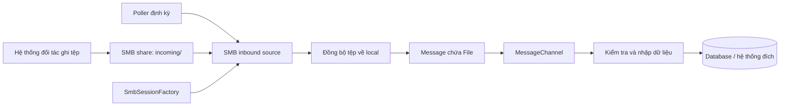
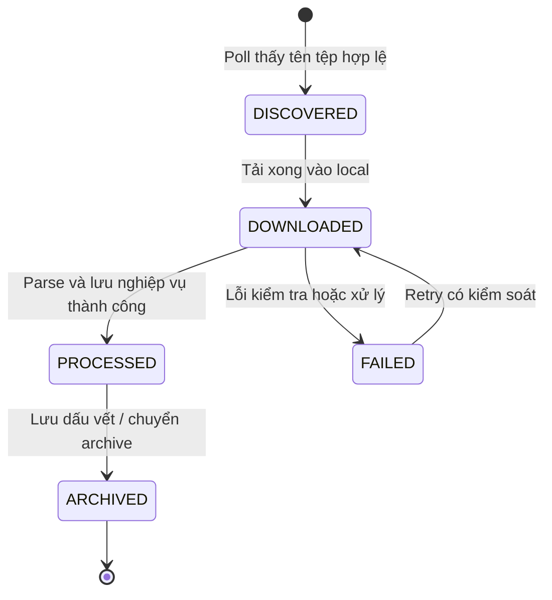

# SMB inbound adapter đọc thư mục chia sẻ

## 1. Bài toán và mục tiêu

Một hệ thống kế toán đặt các tệp `invoice-2026-11-23.csv` vào thư mục được chia sẻ qua SMB (Server Message Block). Ứng dụng Spring Boot phải định kỳ phát hiện tệp mới, tải về vùng lưu trữ cục bộ và chuyển tệp cho dịch vụ nhập hóa đơn. Hệ thống nguồn không gọi HTTP API và cũng không gửi message qua broker; điểm tích hợp duy nhất là **thư mục chia sẻ**.

**SMB inbound channel adapter** giải quyết phần *nhận tệp*: nó kết nối đến máy chủ SMB, liệt kê và đồng bộ tệp về máy ứng dụng, sau đó phát thông điệp để Spring Integration xử lý. Đây là một ví dụ cụ thể của việc kết nối hệ thống ngoài với Spring Integration thông qua **inbound adapter + poller + MessageChannel**. Những cơ chế như định tuyến, chuyển đổi payload, xử lý lỗi và quản lý vòng đời kết nối có thể tái sử dụng khi tích hợp file, SFTP, HTTP, JMS, AMQP, Kafka hoặc cơ sở dữ liệu; riêng cách lấy dữ liệu và hợp đồng message của mỗi adapter sẽ khác nhau.

Sau bài này, người học có thể:

- Phân biệt SMB inbound adapter dạng tải tệp về local với streaming inbound adapter.
- Cấu hình `SmbSessionFactory`, thư mục chia sẻ, bộ lọc tệp và poller bằng Java DSL.
- Giải thích lúc nào một `Message<File>` được phát ra và vai trò của `MessageChannel`.
- Chọn giới hạn tải, cơ chế chống trùng và quy tắc công bố tệp để tránh đọc tệp chưa ghi xong.
- Thiết kế cách quan sát, thử nghiệm và xử lý lỗi mà không làm mất tệp nguồn.

## 2. Hiểu đúng về SMB inbound

SMB là giao thức truy cập tài nguyên chia sẻ trên mạng, thường gặp với Windows File Server, NAS hoặc Samba. Ví dụ đường dẫn nhìn từ phía người dùng Windows là `\\fileserver\partners\incoming`. Trong chương trình, cấu hình thường được tách thành **host** (`fileserver`), **share** (`partners`) và **thư mục bên trong share** (`incoming`). Ứng dụng phải có kết nối mạng đến máy chủ (cổng thông dụng: TCP 445) và tài khoản có quyền đọc.

SMB inbound adapter là một **nguồn thông điệp (message source)** được kích hoạt bởi poller; nó không phải dịch vụ SMB server và cũng không tự nhận sự kiện mỗi khi một tệp xuất hiện. Nếu ứng dụng ngừng chạy, máy chủ vẫn có thể giữ các tệp để ứng dụng lấy sau khi khởi động lại, tùy chính sách giữ tệp của đối tác.

### Các thành phần và trách nhiệm

| Thành phần | Vai trò | Điều cần lưu ý |
|---|---|---|
| `SmbSessionFactory` | Tạo phiên truy cập SMB bằng host, share, tài khoản và phiên bản giao thức | Kết nối, xác thực, phân quyền và vòng đời session |
| `SmbInboundFileSynchronizer` | Liệt kê, lọc và chép tệp từ SMB về thư mục cục bộ | Remote filter, thư mục từ xa, chính sách xóa tệp nguồn |
| `SmbInboundFileSynchronizingMessageSource` | Đọc tệp cục bộ đã đồng bộ và tạo message | Local directory, local filter và `File` payload |
| `Smb.inboundAdapter(...)` | Cấu hình các thành phần trên qua Java DSL | Cách viết gọn khi khai báo `IntegrationFlow` |
| `Poller` | Định kỳ yêu cầu nguồn lấy message | Chu kỳ quét, số message mỗi lần poll, lỗi trong tác vụ poll |
| `MessageChannel` | Chuyển thông điệp cho các bước phía sau | Có thể là `DirectChannel`, `QueueChannel` hoặc kênh khác tùy nhu cầu |
| Handler/transformer | Kiểm tra, đọc CSV, ghi database hoặc gọi hệ thống khác | Chịu trách nhiệm nghiệp vụ, retry và tính idempotent |



Ví dụ: lần poll lúc 10:00 nhìn thấy `invoice-001.csv` đáp ứng bộ lọc. Adapter tải tệp về `./data/smb-inbox/invoice-001.csv`, rồi phát thông điệp có `payload` là một đối tượng `java.io.File` chỉ đến tệp cục bộ. Handler có thể mở tệp đó để đọc nội dung CSV. Nếu không có tệp phù hợp hoặc chưa có dữ liệu để phát, lần poll có thể không tạo message nào.

### Tải về local khác với streaming

| Tiêu chí | Inbound đồng bộ về local | Streaming inbound |
|---|---|---|
| Payload điển hình | `File` | `InputStream` |
| Lưu tệp cục bộ trước xử lý | Có | Không bắt buộc |
| Lợi ích | Đọc lại tệp, kiểm tra bằng công cụ khác, tách tải và xử lý | Giảm nhu cầu lưu tệp xuống ổ đĩa |
| Đánh đổi | Cần dung lượng ổ đĩa và quy trình dọn dẹp | Phải quản lý vòng đời stream/session đúng cách |
| Phù hợp | Nhập dữ liệu theo lô, cần lưu bằng chứng hoặc xử lý lại | Đọc tuần tự tệp lớn hoặc luồng không muốn lưu local |

`SmbStreamingMessageSource` là thành phần khác. Với streaming, session liên quan phải được đóng sau khi đọc; các thành phần chuẩn như `StreamTransformer`/`FileSplitter` hỗ trợ đóng tài nguyên, còn handler tự viết phải bảo đảm việc đó. Phần thực hành chính dưới đây dùng **đồng bộ về local**.

## 3. Thiết lập bài thực hành

Giả sử hệ thống có một share tên `exchange`, thư mục con `incoming` và một tài khoản `integration_reader` được phép liệt kê, đọc tệp. Ứng dụng sẽ tải mọi tệp `.csv` đã được đối tác công bố vào `./data/smb-inbox` và xử lý thông qua một `DirectChannel`.

**Gradle** (để Spring Boot quản lý phiên bản các thư viện tương thích):

```gradle
dependencies {
    implementation 'org.springframework.boot:spring-boot-starter-integration'
    implementation 'org.springframework.integration:spring-integration-smb'
}
```

Nếu không sử dụng dependency management của Spring Boot, cần chọn phiên bản `spring-integration-smb` tương thích với các artifact Spring Integration còn lại. API minh họa dưới đây theo dòng Spring Integration 6.x.

**`application.yml`:**

```yaml
demo:
  smb:
    host: ${SMB_HOST}
    port: ${SMB_PORT:445}
    domain: ${SMB_DOMAIN:}
    username: ${SMB_USERNAME}
    password: ${SMB_PASSWORD}
    share: ${SMB_SHARE:exchange}
    remote-directory: ${SMB_REMOTE_DIRECTORY:incoming}
    local-directory: ${SMB_LOCAL_DIRECTORY:./data/smb-inbox}
```

Các biến `SMB_HOST`, `SMB_USERNAME`, `SMB_PASSWORD` được cấp từ môi trường chạy hoặc secret manager; không đưa mật khẩu thật vào Git, mã nguồn, log hay ví dụ chia sẻ. `domain` có thể để trống nếu server và phương thức xác thực cho phép. Trên Windows có thể đổi `local-directory` thành đường dẫn như `C:/app/data/smb-inbox`; trên Linux cần thư mục mà tiến trình có quyền ghi.

### Ví dụ Java DSL

```java
import java.io.File;

import jcifs.DialectVersion;
import org.springframework.beans.factory.annotation.Value;
import org.springframework.context.annotation.Bean;
import org.springframework.context.annotation.Configuration;
import org.springframework.integration.channel.DirectChannel;
import org.springframework.integration.config.EnableIntegration;
import org.springframework.integration.dsl.IntegrationFlow;
import org.springframework.integration.dsl.Pollers;
import org.springframework.integration.smb.dsl.Smb;
import org.springframework.integration.smb.session.SmbSessionFactory;
import org.springframework.messaging.MessageChannel;

@Configuration
@EnableIntegration
public class SmbInboundConfig {

    @Bean
    SmbSessionFactory smbSessionFactory(
            @Value("${demo.smb.host}") String host,
            @Value("${demo.smb.port}") int port,
            @Value("${demo.smb.domain}") String domain,
            @Value("${demo.smb.username}") String username,
            @Value("${demo.smb.password}") String password,
            @Value("${demo.smb.share}") String share) {

        SmbSessionFactory factory = new SmbSessionFactory();
        factory.setHost(host);
        factory.setPort(port);
        factory.setDomain(domain);
        factory.setUsername(username);
        factory.setPassword(password);
        factory.setShareAndDir(share);
        factory.setSmbMinVersion(DialectVersion.SMB210);
        factory.setSmbMaxVersion(DialectVersion.SMB311);
        return factory;
    }

    @Bean
    MessageChannel smbReadyFiles() {
        return new DirectChannel();
    }

    @Bean
    IntegrationFlow smbInboundFlow(
            SmbSessionFactory factory,
            @Value("${demo.smb.remote-directory}") String remoteDirectory,
            @Value("${demo.smb.local-directory}") String localDirectory) {

        return IntegrationFlow
            .from(Smb.inboundAdapter(factory)
                    .remoteDirectory(remoteDirectory)
                    .regexFilter("(?i).*\\.csv$")
                    .localDirectory(new File(localDirectory))
                    .autoCreateLocalDirectory(true)
                    .preserveTimestamp(true)
                    .maxFetchSize(5),
                endpoint -> endpoint.id("smbInboundEndpoint")
                    .autoStartup(true)
                    .poller(Pollers.fixedDelay(10_000)
                        .maxMessagesPerPoll(5)))
            .channel("smbReadyFiles")
            .handle(message -> {
                File localFile = (File) message.getPayload();
                // Thay bằng service kiểm tra, nhập dữ liệu và ghi nhận kết quả.
                System.out.println("Nhận tệp SMB: " + localFile.getAbsolutePath());
            })
            .get();
    }
}
```

Điểm quan trọng khi đọc cấu hình:

1. `setShareAndDir(share)` xác định share gốc (`exchange`); `remoteDirectory("incoming")` chọn thư mục tương đối bên trong share. Cần kiểm tra đường dẫn thực trên server để tránh ghép lặp tên share.
2. `regexFilter("(?i).*\\.csv$")` chỉ chấp nhận tên kết thúc bằng `.csv`, không phân biệt hoa thường. Bộ lọc được dùng khi chọn tệp từ xa, trước khi tải.
3. `localDirectory(...)` và `autoCreateLocalDirectory(true)` tạo vùng chứa tệp đã tải. `preserveTimestamp(true)` giữ thời gian sửa đổi được chuyển từ tệp nguồn, hữu ích cho đối chiếu.
4. `maxFetchSize(5)` giới hạn số tệp tải từ server trong một đợt lấy tệp; `maxMessagesPerPoll(5)` giới hạn số message poller phát trong mỗi chu kỳ. Đây là **hai giới hạn khác nhau**.
5. `smbReadyFiles` là `DirectChannel`: handler chạy đồng bộ trên luồng chuyển message, nên handler chậm có thể kéo dài thời gian xử lý của tác vụ poll. Khi chuyển sang xử lý bất đồng bộ phải xem lại thứ tự, tải hệ thống và tính an toàn của vòng đời tệp.
6. Handler mẫu chỉ in đường dẫn để người học quan sát, **chưa phải logic nhập dữ liệu và ghi nhận thành công**. Ở hệ thống thực cần thay bằng bước kiểm tra tệp, parse CSV và ghi dữ liệu có cơ chế chống trùng.

Trong Java DSL, `Smb.inboundAdapter(...)` dựng thành phần tương đương mô hình truyền thống `SmbInboundFileSynchronizer` + `SmbInboundFileSynchronizingMessageSource`. Nếu cần tùy biến sâu bộ lọc hoặc cách đồng bộ, có thể khai báo riêng hai bean này và dùng `@InboundChannelAdapter` để kích hoạt nguồn theo poller.

## 4. Hợp đồng message và ranh giới trách nhiệm

Ở nhánh đồng bộ về local, **payload là `java.io.File`**. Payload chứa thông tin đường dẫn và thuộc tính tệp, không chứa sẵn nội dung CSV. Muốn xử lý dòng dữ liệu phải đọc tệp bằng thư viện parser phù hợp (ví dụ Apache Commons CSV hoặc Jackson CSV), kiểm tra encoding và định dạng.

| Thông tin | Ví dụ | Cách sử dụng |
|---|---|---|
| `payload` | `File("./data/smb-inbox/invoice-001.csv")` | Mở tệp đã tải để kiểm tra/nhập dữ liệu |
| Header chuẩn `id` | UUID của message | Theo dõi một message trong luồng; **không** phải mã nghiệp vụ duy nhất của tệp |
| Header chuẩn `timestamp` | Thời điểm message được tạo | Dùng cho tracing, không thay thế `lastModified` của file nguồn |
| Tên/đường dẫn nguồn | Share `exchange`, thư mục `incoming` | Có thể dùng trong key nghiệp vụ; muốn bảo toàn metadata qua mọi bước nên bổ sung header của ứng dụng một cách rõ ràng |
| Khóa idempotency | `partnerA/invoice-001.csv` kèm version/hash | Do hệ thống tự thiết kế để chống xử lý trùng qua restart/retry |

Ví dụ, adapter có thể phát cùng một đường dẫn local ở hai thời điểm khác nhau khi bộ lọc hoặc metadata được reset. Việc message có `id` khác nhau không chứng minh hai hóa đơn khác nhau. Hãy xây dựng khóa nghiệp vụ từ mã đối tác, mã lô, checksum/nội dung hoặc thông tin định danh đã thỏa thuận trong hợp đồng trao đổi tệp.

### Biên giới xác nhận thành công

Đối với một lần xử lý file, nên tách ba mốc:



`DOWNLOADED` **không có nghĩa là `PROCESSED`**. Việc đồng bộ thành công và việc ghi database thành công thuộc hai bước khác nhau. Vì vậy, không nên xóa tệp nguồn ngay khi tải về nếu yêu cầu nghiệp vụ chỉ cho phép xóa sau khi nhập dữ liệu thành công.

## 5. Poller, lọc tệp và điều tiết tải

### Poller xử lý thế nào?

Với `fixedDelay(10_000)`, lần kích hoạt tiếp theo được lên lịch sau khoảng thời gian trễ tính từ lúc tác vụ poll trước hoàn tất; đây không phải cam kết có message đúng mỗi 10 giây. Kết nối chậm, có nhiều file hoặc handler chạy lâu sẽ làm khoảng cách thực tế lớn hơn.

Với các giới hạn trong ví dụ và giả sử thư mục local ban đầu rỗng:

| `maxFetchSize` | `maxMessagesPerPoll` | Kết quả cần hình dung |
|---:|---:|---|
| 1 | 5 | Một đợt đồng bộ lấy tối đa 1 tệp; poller có thể tiếp tục lấy thêm ở các lần nhận trong cùng chu kỳ đến khi đạt giới hạn message |
| 5 | 2 | Có thể tải đến 5 tệp nhưng chỉ phát tối đa 2 message trong chu kỳ; phần local còn lại chờ lần sau |
| 5 | 5 | Giới hạn số tệp được lấy trong một đợt và số message được phát ở mức tương đương, dễ kiểm soát trong bài lab |

Giới hạn không phải tốc độ xử lý cố định: bộ lọc, tệp đã có ở local, kết nối và thời gian handler đều có thể làm số thực tế thấp hơn. Khi nhiều instance đọc cùng share, nên chọn `maxFetchSize` nhỏ và có cơ chế phối hợp trạng thái để một instance không chiếm hết lượng tệp đang chờ.

### Tệp mới nhưng chưa ghi xong

Một tên `invoice-001.csv` xuất hiện trong SMB không bảo đảm đối tác đã đóng file. Nếu tải khi đối tác còn ghi, ứng dụng có nguy cơ đọc thiếu nội dung. Có hai cách chính:

- **Giao kèo công bố bằng đổi tên:** đối tác tải lên `invoice-001.csv.part`, ghi và đóng xong rồi đổi tên trong cùng share thành `invoice-001.csv`. Adapter chỉ nhận `.csv` cuối cùng. Đây thường là phương án dễ hiểu nhất nếu kiểm soát được hệ thống nguồn.
- **Lọc theo tuổi tệp:** dùng `SmbLastModifiedFileListFilter` (có từ Spring Integration 6.2) để chỉ lấy tệp có thời điểm sửa đổi cách hiện tại một ngưỡng đủ lớn. Ví dụ, cân nhắc một ngưỡng vài phút dựa trên kích thước và cách upload. Tuổi tệp là biện pháp giảm rủi ro, không chứng minh dữ liệu đã ghi hoàn tất trong mọi tình huống.

Ngoài ra, `SmbSimplePatternFileListFilter` và `SmbRegexPatternFileListFilter` hỗ trợ lọc tên. Có thể kết hợp điều kiện với `CompositeFileListFilter`; cần kiểm tra thứ tự và ý nghĩa từng bộ lọc khi phối hợp lọc tên, tuổi và chống trùng.

### Lọc tệp từ xa và tệp local khác nhau

**Remote filter** quyết định tệp nào trên SMB được đồng bộ về máy ứng dụng. **Local filter** quyết định tệp đã tải nào được phát thành message. Điều này ảnh hưởng tới hai tình huống:

- Adapter tải được file nhưng handler chưa xử lý: file local có thể còn đó để poll tiếp theo phát ra, tùy bộ lọc local và trạng thái ghi nhận.
- Restart hoặc triển khai instance khác: bộ lọc chỉ lưu trong bộ nhớ có thể mất lịch sử đã nhìn thấy; file vẫn tồn tại ở SMB có thể bị tải lại.

Muốn tránh xử lý trùng sau restart hoặc giữa nhiều instance, hãy nghiên cứu bộ lọc accept-once có **metadata store bền vững** (ví dụ Redis/JDBC metadata store phù hợp triển khai) và phối hợp khóa idempotency tại tầng nghiệp vụ. Không nên mặc nhiên cho rằng một cấu hình inbound adapter đem lại `exactly-once` từ lúc phát hiện file đến lúc commit dữ liệu.

## 6. Thiết kế an toàn khi đưa vào vận hành

### Quản lý tệp sau khi xử lý

Chiến lược khuyến nghị cho bài toán nhập hóa đơn:

1. Đối tác ghi `.part` rồi công bố tên `.csv` khi hoàn tất.
2. Inbound adapter tải file đến thư mục local; chỉ lọc các file hợp lệ.
3. Handler kiểm tra định dạng, mã đối tác, mã lô và checksum; ghi dữ liệu trong transaction phù hợp.
4. Chỉ sau khi đã ghi nhận xử lý thành công, chuyển tệp đến `archive/` hoặc cập nhật trạng thái nguồn theo quy ước hai bên.
5. Khi lỗi, giữ đủ tệp và metadata để retry hoặc đưa vào khu vực `quarantine/`, tránh xóa bằng chứng đầu vào.

`deleteRemoteFiles(true)` có thể được đặt ở **synchronizer** để xóa file sau khi truyền về local thành công. Tùy chọn này phục vụ chính sách dọn nguồn sau **đồng bộ**, không chờ handler nghiệp vụ hoàn tất. Nếu nghiệp vụ yêu cầu chỉ xóa sau khi commit vào database, không bật tùy chọn đó theo thói quen; hãy xử lý việc xóa/di chuyển sau xác nhận thành công bằng luồng có kiểm soát hoặc gateway phù hợp.

### Xử lý lỗi và retry

| Lỗi | Biểu hiện | Hướng giải quyết |
|---|---|---|
| Không kết nối được TCP 445 | Poller không tải được file, timeout | Kiểm tra DNS, route, firewall, SMB server và cổng |
| Sai tài khoản hoặc thiếu quyền | Xác thực thất bại/không liệt kê được thư mục | Kiểm tra domain, quyền share và quyền thư mục (ACL) |
| Sai share hoặc remote directory | Không thấy tệp dù đối tác báo đã gửi | Kiểm tra thành phần share gốc và thư mục con, quy tắc dấu `/` |
| File đang được ghi | Parse thiếu dòng, checksum sai, dữ liệu bị cắt | Đổi tên công bố hoặc lọc theo thời gian sửa đổi |
| Hết dung lượng local | Đồng bộ thất bại | Theo dõi dung lượng spool, bật cảnh báo, định nghĩa chính sách dọn sau thành công |
| CSV lỗi định dạng | Có message nhưng import thất bại | Lưu file lỗi, log mã lô, gửi vào nhánh xử lý lỗi/quarantine |
| File bị xử lý nhiều lần | Số bản ghi trùng | Persistent filter kết hợp khóa idempotency và ràng buộc dữ liệu |

Với lỗi tại handler chạy đồng bộ qua `DirectChannel`, ngoại lệ có thể quay về tác vụ poll và được xử lý qua cơ chế lỗi của Spring Integration. Khi xây dựng phiên bản production, cần cấu hình retry có giới hạn, backoff, error channel hoặc advice phù hợp **với đúng điểm lỗi**, đồng thời phân biệt lỗi kết nối tạm thời với lỗi nội dung không nên thử vô hạn. Lưu nhật ký gồm tên file, nguồn, lần thử, mã lỗi và correlation ID; che thông tin xác thực.

### Session, bảo mật và triển khai nhiều instance

- Chọn mức SMB được tổ chức cho phép; ví dụ `SMB210` đến `SMB311` trong mẫu. Tránh hạ xuống SMBv1 chỉ để giải quyết lỗi kết nối. Cấu hình thực tế cần tương thích server và chính sách an ninh.
- Tài khoản inbound chỉ nên có quyền cần thiết. Quyền ghi/xóa cần được cấp riêng nếu quy trình thực sự đòi hỏi archive hoặc cleanup từ xa.
- `SmbSessionFactory` tạo session để tương tác SMB; khi số lần poll lớn có thể bọc bằng `CachingSessionFactory` để tái sử dụng session và giới hạn số kết nối. Cấu hình pool phải đi kèm timeout, giới hạn và quan sát số session đang sử dụng.
- Với nhiều pod/instance, không dựa vào metadata store chỉ ở memory để phối hợp. Cần thiết kế khóa chung, khả năng nhận lại tệp khi một node chết và dung lượng local riêng của từng node.
- Dữ liệu local có thể chứa thông tin nhạy cảm. Áp dụng phân quyền thư mục, thời gian lưu, mã hóa ổ đĩa nếu cần và quy tắc xóa sau khi nghiệp vụ xác nhận.

## 7. Thực hành và kiểm chứng

**Chuẩn bị:** một máy chủ SMB/NAS/Samba mà bạn được cấp quyền truy cập, một share `exchange` có thư mục `incoming`, biến môi trường theo cấu hình và ứng dụng Spring Boot chứa flow mẫu. Không cần thay đổi dữ liệu trên môi trường production để làm bài.

**Kịch bản 1 – Nhận tệp mới:**

1. Khởi động ứng dụng, xác nhận thư mục `./data/smb-inbox` được tạo và không có lỗi kết nối.
2. Gửi `invoice-001.csv.part` lên share, nội dung ví dụ:

   ```csv
   invoice_id,customer_id,amount
   INV-001,CUS-17,120000
   INV-002,CUS-18,85000
   ```

3. Quan sát rằng `.part` chưa được chọn; sau khi đóng và đổi tên thành `invoice-001.csv`, chờ một hoặc vài chu kỳ poll.
4. Kiểm tra local có file CSV và log in đường dẫn của `File` payload. Nếu có handler parse CSV, xác minh đúng hai bản ghi và tổng tiền `205000` theo đơn vị của dữ liệu mẫu.

**Kịch bản 2 – Nhiều tệp:** đưa 8 tệp `.csv` vào thư mục và quan sát chúng được đồng bộ/phát thành message qua các chu kỳ. Đối chiếu tốc độ thực tế với `maxFetchSize(5)`, `maxMessagesPerPoll(5)` và thời gian xử lý handler.

**Kịch bản 3 – Lỗi và khôi phục:** tạm ngắt kết nối SMB hoặc đổi thử quyền đọc trong môi trường lab, ghi lại lỗi; khôi phục quyền/kết nối và kiểm tra file còn được lấy. Không giả định mất kết nối sẽ tự động tạo bản sao xử lý thành công hay bị bỏ qua: phải nhìn trạng thái file và bộ lọc thực tế.

**Kịch bản 4 – Restart:** sau khi xử lý `invoice-001.csv`, restart ứng dụng và quan sát file có được phát lại hay không. Thử thay đổi metadata store/bộ lọc trong phạm vi lab để hiểu vì sao một hệ thống nhập tiền hoặc hóa đơn phải có idempotency ở tầng nghiệp vụ.

**Tiêu chí đạt:** biết giải thích sự khác nhau giữa *đã tải* và *đã xử lý*, chỉ ra được đường dẫn share/remote/local, xác nhận `Message<File>` tại handler, biết cách giới hạn polling và đưa ra chính sách retry/chống trùng phù hợp.

## 8. Những nhầm lẫn thường gặp

| Nhầm lẫn | Cách hiểu đúng |
|---|---|
| Inbound adapter tự nhận sự kiện push từ SMB | Adapter chủ động poll; chu kỳ lấy dữ liệu do poller quyết định |
| Payload chính là chuỗi CSV | Với adapter đồng bộ về local, payload là `File`; phải mở file để đọc dữ liệu |
| Tải file thành công đồng nghĩa import thành công | Đồng bộ file và commit nghiệp vụ là hai mốc tách biệt |
| `maxFetchSize` bằng `maxMessagesPerPoll` | Một tham số giới hạn file lấy từ xa, tham số kia giới hạn số message mỗi chu kỳ |
| Đã có accept-once filter thì chắc chắn exactly-once | Bộ lọc có giới hạn theo trạng thái lưu trữ; nghiệp vụ vẫn cần idempotency và chính sách retry |
| Có thể xóa tệp SMB ngay sau khi đồng bộ | Chỉ phù hợp nếu quy trình chấp nhận xác nhận tại mốc đồng bộ, không phải sau xử lý |
| Tệp có đuôi `.csv` chắc chắn đã sẵn sàng | Đối tác có thể đang ghi; cần giao kèo công bố file hoặc quy tắc ổn định |

## 9. Tài liệu tham khảo

- [Spring Integration – SMB Support](https://docs.spring.io/spring-integration/reference/6.5/smb.html): session factory, inbound adapter, streaming adapter và Java DSL.
- [SmbInboundChannelAdapterSpec API](https://docs.spring.io/spring-integration/docs/6.5.0/api/org/springframework/integration/smb/dsl/SmbInboundChannelAdapterSpec.html): các tùy chọn `regexFilter`, `localDirectory`, `maxFetchSize`, `remoteFileMetadataStore`.
- [SmbSessionFactory API](https://docs.spring.io/spring-integration/docs/6.5.x/api/org/springframework/integration/smb/session/SmbSessionFactory.html): cấu hình phiên, thông tin xác thực và SMB dialect.

**Ghi nhớ:** SMB inbound adapter phụ trách đưa tệp từ hệ thống ngoài vào luồng Spring Integration dưới dạng message. Độ tin cậy của toàn bộ tích hợp phụ thuộc thêm vào hợp đồng công bố file, bộ lọc, trạng thái xử lý nghiệp vụ, xử lý lỗi và quản lý kết nối.
