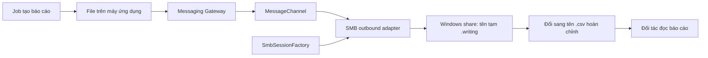
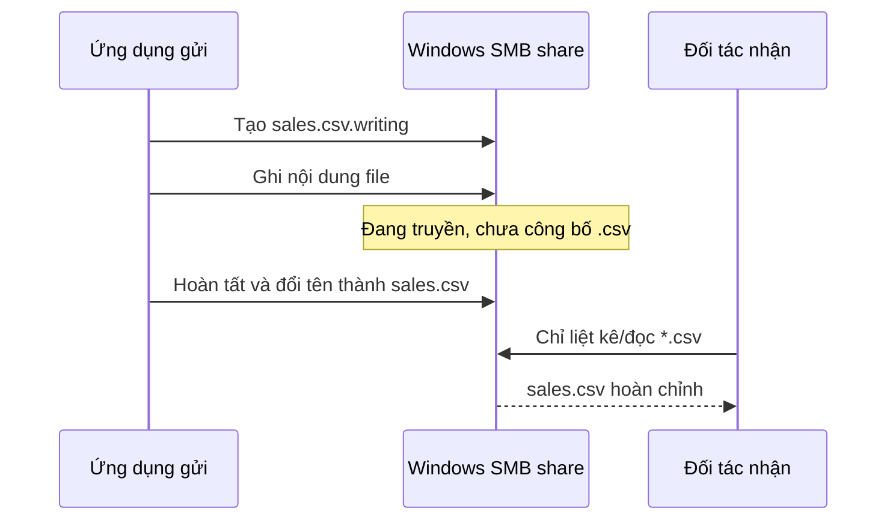
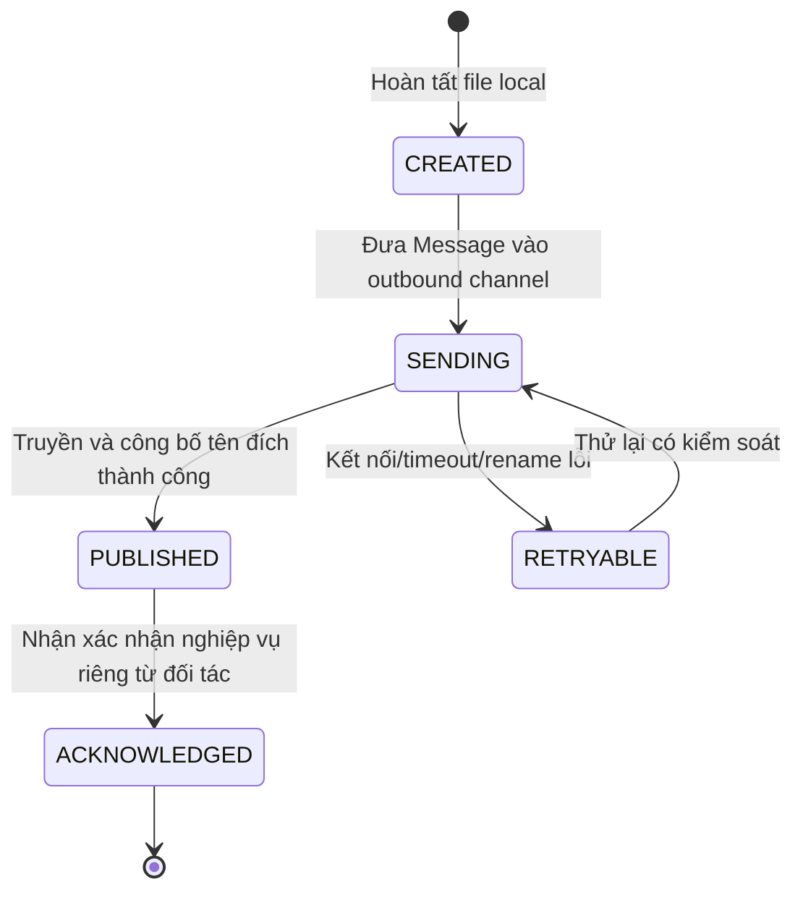

# SMB outbound adapter ghi vào Windows share

## 1. Bài toán và kết quả cần đạt

Một ứng dụng Spring Boot tổng hợp báo cáo doanh thu mỗi ngày. Đối tác chỉ cho phép nhận báo cáo bằng cách đọc một **Windows shared folder** (thư mục chia sẻ qua SMB), chẳng hạn `\\fs01\partner-data\outgoing\daily`. Sau khi tạo `sales-2026-11-23.csv` ở máy ứng dụng, hệ thống cần ghi tệp đó lên share để đối tác nhận và xử lý.

Trong Spring Integration, **SMB outbound channel adapter** đảm nhiệm bước đưa nội dung của một thông điệp từ ứng dụng tới thư mục SMB. Adapter chủ động mở kết nối ra máy chủ SMB, gửi dữ liệu và có thể công bố tên tệp chính thức sau khi truyền xong. Đây là ví dụ về tích hợp hệ thống ngoài bằng **outbound adapter**, **MessageChannel** và hợp đồng **Message**. Cơ chế truyền một chiều này có thể phối hợp với inbound adapter, gateway, bộ định tuyến và bước xử lý lỗi trong luồng lớn hơn; tư duy kết nối tương tự áp dụng cho file, SFTP, HTTP, JMS, AMQP, Kafka hoặc cơ sở dữ liệu, dù API và khả năng xác nhận của từng hệ thống khác nhau.

Sau bài học, bạn có thể:

- Mô tả luồng `Message<File>` → `MessageChannel` → `SmbMessageHandler` → Windows share và phân biệt outbound với inbound/gateway.
- Cấu hình `SmbSessionFactory`, `IntegrationFlow`, `Smb.outboundAdapter(...)` và `@MessagingGateway` bằng Java DSL.
- Xác định cách đặt tên và thư mục đích, hành vi khi tệp trùng tên, cũng như việc tải bằng tên tạm rồi đổi tên.
- Giải thích thời điểm lời gọi gửi hoàn tất, những lỗi có thể xảy ra và giới hạn của bảo đảm giao nhận.
- Thiết kế kiểm thử, giám sát, retry và idempotency để tránh làm hỏng hoặc gửi trùng dữ liệu nghiệp vụ.

## 2. Outbound adapter vận hành như thế nào?

SMB (Server Message Block) là giao thức chia sẻ file qua mạng thường dùng với Windows Server, NAS hoặc Samba. Với đường dẫn Windows:

```text
\\fs01\partner-data\outgoing\daily\sales-2026-11-23.csv
 └host┘  └──share───┘ └remote dir──┘ └──filename──────┘
```

ứng dụng có thể cấu hình thành các giá trị độc lập:

| Giá trị | Ví dụ | Ý nghĩa |
|---|---|---|
| `host` | `fs01` | Tên máy chủ SMB hoặc địa chỉ IP |
| `port` | `445` | Cổng SMB trực tiếp qua TCP phổ biến |
| `share` | `partner-data` | Tên share được cấp cho ứng dụng |
| `remoteDirectory` | `outgoing/daily` | Thư mục con **bên trong share** |
| Tên tệp | `sales-2026-11-23.csv` | Tên đích do chiến lược đặt tên quyết định |
| Tệp local | `./data/outbox/sales-2026-11-23.csv` | Dữ liệu đầu vào trên máy ứng dụng |

`remoteDirectory` thường được diễn đạt bằng dấu `/` trong cấu hình adapter, kể cả khi đối tác truy cập cùng đường dẫn bằng `\` trên Windows. Không đặt lại tên share vào `remoteDirectory` khi `setShareAndDir(...)` đã trỏ đến share gốc; nếu không, ứng dụng có thể ghi nhầm sang thư mục lồng nhau.



Luồng điển hình có các mốc:

1. Bộ phận tạo báo cáo ghi xong và đóng file local.
2. Ứng dụng gửi `Message` có payload là `java.io.File` vào một channel.
3. `SmbMessageHandler` dùng `SmbSessionFactory` mở session, chọn thư mục đích, truyền nội dung và thực hiện các bước hoàn tất tương ứng cấu hình.
4. Nếu mọi thao tác cần thiết thành công, lời gọi gửi đồng bộ trả về; nếu không, exception được phát về đường xử lý lỗi.
5. Hệ thống đối tác tự quyết định lúc nào sẽ mở, xác minh và nhập file.

**Điểm phân biệt:** outbound adapter nhận một message rồi **ghi file ra bên ngoài**; nó không poll SMB để tìm tệp mới. Poller chỉ xuất hiện nếu nguồn *đầu vào của luồng* là một `MessageSource` được lấy theo lịch (chẳng hạn lấy bản ghi chờ xuất từ database). SMB **inbound** là chiều lấy tệp từ share về ứng dụng. **Outbound gateway** hỗ trợ những lệnh có phản hồi như `ls`, `get`, `put`, `rm` và `mv`; outbound adapter được dùng khi chỉ cần thực hiện tác vụ gửi file theo chiều đi.

## 3. Các thành phần cần hiểu

| Thành phần | Trách nhiệm trong ví dụ | Giới hạn cần nhớ |
|---|---|---|
| `SmbSessionFactory` | Cấu hình host, share, thông tin đăng nhập, SMB dialect và tạo phiên làm việc | Không thay thế việc cấp quyền trên Windows share và NTFS |
| `MessageChannel` | Đưa message tới endpoint gửi file | Với `DirectChannel`, xử lý cùng luồng gọi; với channel bất đồng bộ, kết quả và lỗi được quan sát theo cách khác |
| `SmbMessageHandler` | Thực hiện ghi file tới SMB | Không tự xác nhận đối tác đã đọc hay nhập dữ liệu |
| `Smb.outboundAdapter(...)` | Khai báo handler bằng Java DSL | Thường cấu hình remote directory, tên tệp, mode và tên tạm |
| `FileExistsMode` | Quyết định xử lý khi tệp đích đã tồn tại | Cần chọn theo hợp đồng đặt tên và khả năng retry |
| `@MessagingGateway` | Cho mã nghiệp vụ gọi luồng qua một interface Java | Không đồng nghĩa với **SMB outbound gateway** thực thi lệnh `ls/get/put` |
| `SmbRemoteFileTemplate` | API mức thấp hơn để thao tác từ xa khi cần kiểm tra/chuyển/xóa tệp | Các tác vụ nhiều bước phải tự thiết kế điều kiện thành công, lỗi và xử lý lại |

Về kiến trúc, *adapter* là điểm ranh giới giữa mô hình message của Spring Integration và giao thức SMB. Handler nghiệp vụ phía trước chỉ cần tạo file hợp lệ và phát message; nó không phải tự đóng gói kết nối SMB hay mở luồng sao chép đến UNC path.

## 4. Thiết lập ví dụ với Spring Boot và Java DSL

Giả định ứng dụng dùng Spring Boot 3.x và dòng Spring Integration 6.x tương thích; phiên bản cụ thể được quản lý qua dependency management của dự án. Máy chủ là `fs01`, share `partner-data`, thư mục đích `outgoing/daily`. Tài khoản tích hợp có quyền **tạo file, ghi và đổi tên file** trong thư mục đích.

### 4.1. Dependencies

**Gradle:**

```gradle
dependencies {
    implementation 'org.springframework.boot:spring-boot-starter-integration'
    implementation 'org.springframework.integration:spring-integration-smb'
}
```

Nếu không dùng Spring Boot BOM hoặc cơ chế quản lý dependency tương đương, cần chọn các artifact Spring Integration có phiên bản tương thích với nhau. Ví dụ bên dưới sử dụng API đã có trong dòng 6.x.

### 4.2. Cấu hình môi trường

**`application.yml`:**

```yaml
demo:
  smb:
    host: ${SMB_HOST}
    port: ${SMB_PORT:445}
    domain: ${SMB_DOMAIN:}
    username: ${SMB_USERNAME}
    password: ${SMB_PASSWORD}
    share: ${SMB_SHARE:partner-data}
    remote-directory: ${SMB_REMOTE_DIRECTORY:outgoing/daily}
```

Ví dụ biến môi trường trong môi trường lab:

```text
SMB_HOST=fs01
SMB_USERNAME=integration_writer
SMB_PASSWORD=<lấy từ secret manager>
SMB_SHARE=partner-data
SMB_REMOTE_DIRECTORY=outgoing/daily
```

Không ghi mật khẩu thật vào Git, URL chứa credentials, ảnh chụp màn hình hay log. `SMB_DOMAIN` chỉ cần điền nếu chính sách xác thực của server yêu cầu domain; để trống khi phù hợp. Với môi trường production, cấp secrets bằng công cụ quản lý bí mật của tổ chức.

### 4.3. Session factory và outbound flow

**`SmbOutboundConfig.java`:**

```java
import jcifs.DialectVersion;

import org.springframework.beans.factory.annotation.Value;
import org.springframework.context.annotation.Bean;
import org.springframework.context.annotation.Configuration;
import org.springframework.integration.annotation.IntegrationComponentScan;
import org.springframework.integration.config.EnableIntegration;
import org.springframework.integration.dsl.IntegrationFlow;
import org.springframework.integration.file.remote.FileExistsMode;
import org.springframework.integration.smb.dsl.Smb;
import org.springframework.integration.smb.session.SmbSessionFactory;

@Configuration
@EnableIntegration
@IntegrationComponentScan
public class SmbOutboundConfig {

    @Bean
    SmbSessionFactory smbSessionFactory(
            @Value("${demo.smb.host}") String host,
            @Value("${demo.smb.port}") int port,
            @Value("${demo.smb.domain}") String domain,
            @Value("${demo.smb.username}") String username,
            @Value("${demo.smb.password}") String password,
            @Value("${demo.smb.share}") String share) {

        SmbSessionFactory factory = new SmbSessionFactory();
        factory.setHost(host);
        factory.setPort(port);
        factory.setDomain(domain);
        factory.setUsername(username);
        factory.setPassword(password);
        factory.setShareAndDir(share);
        factory.setSmbMinVersion(DialectVersion.SMB210);
        factory.setSmbMaxVersion(DialectVersion.SMB311);
        return factory;
    }

    @Bean
    IntegrationFlow smbOutboundFlow(
            SmbSessionFactory sessionFactory,
            @Value("${demo.smb.remote-directory}") String remoteDirectory) {

        return IntegrationFlow.from("toSmbChannel")
                .handle(Smb.outboundAdapter(sessionFactory, FileExistsMode.FAIL)
                        .remoteDirectory(remoteDirectory)
                        .autoCreateDirectory(true)
                        .fileNameExpression("payload.name")
                        .useTemporaryFileName(true))
                .get();
    }
}
```

Ở cấu hình này:

- `setShareAndDir(share)` đặt điểm gốc của kết nối SMB tại share `partner-data`.
- `.remoteDirectory("outgoing/daily")` xác định thư mục đích bên trong share. `.autoCreateDirectory(true)` yêu cầu tạo thư mục nếu thiếu; tài khoản cần đủ quyền, nếu không thao tác sẽ lỗi.
- `FileExistsMode.FAIL` yêu cầu báo lỗi nếu tên đích đã tồn tại, hữu ích cho bài toán xuất **mỗi lô một tên duy nhất**. Phần 5 giải thích các lựa chọn khác.
- `.fileNameExpression("payload.name")` lấy tên file gốc từ `java.io.File` payload. Cấu hình này **cố ý chỉ dùng File payload**, nên không áp dụng nguyên mẫu cho message có `String`/`byte[]` nếu chưa thay biểu thức.
- `.useTemporaryFileName(true)` cho phép ghi bằng tên tạm trong quá trình truyền rồi đổi sang tên chính thức sau khi hoàn tất, giúp đối tác tránh nhận nhầm file chưa gửi hết. Hành vi cuối cùng phụ thuộc khả năng rename và quyền được cấp trên SMB server.
- `IntegrationFlow.from("toSmbChannel")` tạo/nhận channel theo tên; message gửi vào channel sẽ được xử lý bởi outbound handler.

Để ví dụ dễ quan sát, luồng dùng channel trực tiếp và chỉ có một handler. Adapter outbound là endpoint nhận message, không phải nơi lên lịch. Nếu báo cáo được tạo theo lịch, lịch đó nằm ở job nguồn hoặc flow lấy dữ liệu ban đầu.

### 4.4. Gọi adapter từ nghiệp vụ qua Messaging Gateway

**`PartnerSmbGateway.java`:**

```java
import java.io.File;

import org.springframework.integration.annotation.Gateway;
import org.springframework.integration.annotation.MessagingGateway;

@MessagingGateway
public interface PartnerSmbGateway {

    @Gateway(requestChannel = "toSmbChannel")
    void upload(File localFile);
}
```

Interface cần nằm trong phạm vi component scan của Spring và `@IntegrationComponentScan`. Sau khi ứng dụng đã tạo và đóng một file báo cáo, service có thể gọi:

```java
File report = new File("./data/outbox/sales-2026-11-23.csv");
if (!report.isFile() || !report.canRead()) {
    throw new IllegalStateException("Không đọc được báo cáo local: " + report);
}
partnerSmbGateway.upload(report);
```

`partnerSmbGateway` là bean được inject từ interface trên. Với `DirectChannel` mặc định trong flow mẫu, lệnh `upload(...)` dẫn đến handler chạy đồng bộ; ngoại lệ khi ghi SMB có thể quay về phía gọi dưới dạng messaging exception hoặc nguyên nhân được bọc. Lời gọi không trả về nội dung phản hồi vì đây là **outbound channel adapter một chiều**, không phải thao tác truy vấn xác nhận của đối tác.

Sau khi gửi thành công về mặt truyền file, thư mục đích dự kiến là:

```text
\\fs01\partner-data\outgoing\daily\sales-2026-11-23.csv
```

Đây là đường dẫn **ở phía server**; ứng dụng không cần mount Windows share vào ổ đĩa local. Việc cấp quyền SMB, DNS và đường truyền tới TCP 445 vẫn phải được cấu hình ở hạ tầng.

## 5. Tên file, thư mục đích và chính sách tồn tại

### 5.1. Đặt tên file đúng hợp đồng

Với payload `File`, Spring Integration có chiến lược đặt tên mặc định dựa vào header `FileHeaders.FILENAME` (nếu có) hoặc tên file. Ví dụ đã chỉ định `.fileNameExpression("payload.name")` để tránh phụ thuộc header và làm rõ hợp đồng: **tên tệp trên share bằng tên file local**.

Trong luồng thực tế, có thể muốn tên chứa mã đối tác, mã lô, ngày xuất hoặc phiên bản báo cáo, chẳng hạn:

```text
sales_partnerA_20261123_batch007.csv
```

Khi cần lấy tên từ message header, có thể dùng biểu thức như:

```java
.fileNameExpression("headers['file_name']")
```

`file_name` là giá trị header do `FileHeaders.FILENAME` định nghĩa. Nếu dùng biểu thức này, **message nguồn bắt buộc phải cấp header hợp lệ**; thiếu header có thể dẫn tới lỗi hoặc tên không hợp lệ. Với dữ liệu header đến từ người dùng hay hệ thống ngoài, cần loại bỏ ký tự đường dẫn, `..`, dấu `/`, `\` và các tên không hợp lệ trên Windows. Không cho phép một header tùy ý tự đổi thư mục đích hoặc ghi đè file ngoài vùng được phép.

Đối với Windows share, tránh các ký tự cấm trong tên file như `<`, `>`, `:`, `"`, `/`, `\`, `|`, `?`, `*`, và kiểm tra giới hạn tên/đường dẫn, ký tự kết thúc bằng dấu cách hoặc dấu chấm theo chính sách server. Nên thỏa thuận encoding, timezone, ký tự hoa thường và quy ước thời gian trong tên file với đối tác.

### 5.2. Chọn `FileExistsMode`

Khi ứng dụng gửi lại cùng tên, cần có một quy tắc rõ ràng:

| `FileExistsMode` | Khi tên đích đã tồn tại | Nên dùng khi |
|---|---|---|
| `FAIL` | Không ghi thay; phát sinh lỗi | Mỗi lô phải có tên riêng, không chấp nhận ghi nhầm lên dữ liệu cũ |
| `REPLACE` | Ghi thay nội dung file cũ | Hợp đồng quy định một tên đại diện bản mới nhất và việc ghi đè được chấp thuận |
| `IGNORE` | Bỏ qua việc truyền file trùng tên | Chỉ khi có cơ chế riêng xác nhận file có sẵn đúng nội dung mong muốn |
| `APPEND` | Ghi thêm dữ liệu vào cuối file đã có | Chỉ khi định dạng và đối tác cho phép nối thêm, có quy tắc kiểm soát concurrency |

Mặc định của API hoặc phiên bản có thể khác theo loại lệnh; trong bài học **luôn khai báo `FileExistsMode` tường minh**. Với file CSV theo ngày, `APPEND` thường nguy hiểm vì retry có thể nối trùng dòng hoặc tạo CSV sai cấu trúc. `REPLACE` không phù hợp nếu báo cáo đã được đối tác đọc và việc thay đổi cùng tên tạo ra kết quả không xác định. `IGNORE` không chứng minh hai file có cùng checksum.

Một quy tắc thực tế là: **tên bất biến cho mỗi batch + `FAIL` + lưu trạng thái giao nhận ở ứng dụng**. Nếu file đã tồn tại khi retry, kiểm tra trạng thái lần gửi trước và checksum từ phía đối tác (nếu có cơ chế kiểm tra); đừng vội biến mọi lỗi trùng tên thành “đã gửi thành công”.

### 5.3. Tránh công bố file chưa ghi xong

Nếu adapter truyền thẳng tới `sales.csv`, hệ thống đối tác có thể nhìn thấy file và mở khi mới ghi được một phần. Remote-file outbound adapter hỗ trợ cơ chế **tên tạm**: truyền nội dung bằng tên có hậu tố tạm (thường là `.writing`), sau đó đổi tên khi hoàn tất.



Điều kiện để giải pháp hữu ích:

- Phía đối tác **chỉ quét phần mở rộng chính thức**, chẳng hạn `*.csv`, và bỏ qua `.writing`.
- Tài khoản của ứng dụng có quyền tạo, ghi và **rename** trong thư mục đích.
- File tạm và file chính thức ở cùng vị trí phù hợp để server thực hiện rename; không mặc định việc di chuyển giữa các share có tính nguyên tử.
- Nếu mạng đứt giữa chừng hoặc rename thất bại, file `.writing` có thể còn lại. Cần cách phát hiện và xử lý các file tạm cũ; không xóa bừa các file mà một tiến trình khác đang ghi.

Đổi tên sau upload giúp giảm rủi ro phía nhận đọc file dở, nhưng **không phải giao thức xác nhận nghiệp vụ hai chiều**. Đối tác vẫn cần validate cấu trúc, checksum hoặc marker nếu hợp đồng yêu cầu.

## 6. Hợp đồng message và tính một chiều

Ví dụ mẫu sử dụng `java.io.File`:

| Thành phần message | Ví dụ | Ý nghĩa |
|---|---|---|
| Payload | `File("./data/outbox/sales-2026-11-23.csv")` | Tệp **đã tồn tại và đã ghi xong** ở máy ứng dụng |
| Header `id` | UUID do Spring Message tạo | Dùng tracing, không phải mã lô ổn định qua retry |
| Header `timestamp` | Thời điểm tạo message | Không phải thời điểm đối tác xử lý file |
| Header `file_name` | `sales_partnerA_batch007.csv` (khi có) | Có thể dùng cho chiến lược đặt tên đích nếu flow cấu hình đọc header |
| Metadata nghiệp vụ | `partnerId`, `batchId`, `checksum` | Do ứng dụng quy ước và lưu cùng trạng thái gửi để kiểm tra retry/idempotency |

Adapter có thể hỗ trợ các dạng payload khác theo cơ chế remote file outbound như chuỗi hoặc bytes, nhưng **đừng giả định biểu thức `payload.name` hoạt động với mọi kiểu**. Nếu gửi `byte[]` hoặc `String`, phải đổi chiến lược đặt tên, xử lý encoding, giới hạn kích thước và trách nhiệm sinh file sao cho khớp với payload.

Xét các trạng thái:



`PUBLISHED` nghĩa là tác vụ ghi và công bố file qua SMB đã hoàn thành theo quan sát của ứng dụng. Nó **không bảo đảm** đối tác đã đọc, xác minh hay import file; `ACKNOWLEDGED` chỉ có nếu hai bên có quy trình xác nhận riêng (ví dụ file ACK, bảng trạng thái hay API). Nếu cần phân biệt chắc chắn hai mốc này, outbound adapter một chiều phải được đặt trong một giao thức nghiệp vụ rộng hơn.

Ngoài ra, một lỗi timeout có thể xảy ra sau khi server đã nhận đủ dữ liệu nhưng trước khi ứng dụng đọc được xác nhận. Điều đó tạo trạng thái **không chắc chắn**: việc retry mù quáng với `REPLACE`/`APPEND` có thể gây kết quả sai, còn `FAIL` có thể báo file đã tồn tại. Hãy lưu khóa `batchId` và có cách đối chiếu kết quả, thay vì suy thành công chỉ từ việc không thấy exception trong một lời gọi trước đó.

## 7. Xử lý lỗi, retry và vòng đời kết nối

### 7.1. Một số lỗi có thể gặp

| Tình huống | Triệu chứng | Cách kiểm tra và xử lý |
|---|---|---|
| DNS hoặc mạng không đến được TCP 445 | Timeout, connection refused | Kiểm tra tên server, route, firewall, dịch vụ SMB |
| Sai domain/tài khoản/mật khẩu | Authentication error | Kiểm tra secret và chính sách đăng nhập; tránh in thông tin đăng nhập ra log |
| Có quyền share nhưng thiếu quyền NTFS | Liệt kê được nhưng không ghi/đổi tên được | Kiểm tra đồng thời quyền share, NTFS ACL, quyền rename/delete nếu có |
| `remoteDirectory` sai hoặc thiếu | File nằm nhầm thư mục, lỗi tạo đường dẫn | Đối chiếu host/share/thư mục con; xác minh quyền tạo thư mục |
| Đích đã tồn tại và mode là `FAIL` | Exception khi gửi trùng tên | Đối chiếu `batchId`, checksum và trạng thái lần gửi trước |
| Mạng mất giữa upload | File tạm còn dở, tác vụ lỗi | Kiểm tra file `.writing` cũ; retry có kiểm soát và dọn dẹp có điều kiện |
| Tệp local không tồn tại hoặc còn được ghi | Lỗi đọc source hoặc file không nhất quán | Chỉ gửi sau khi tạo file xong; dùng quy tắc công bố ở phía local |
| Đối tác đọc khi file chưa hoàn tất | CSV thiếu dòng hoặc checksum sai | Bật tên tạm + rename, thỏa thuận chỉ quét đuôi cuối cùng |

Phải phân biệt **lỗi có thể thử lại** (mất mạng ngắn hạn, server tạm quá tải) và **lỗi cấu hình/dữ liệu** (mật khẩu sai, không có quyền, tên file không hợp lệ, file trùng sai batch). Retry nên có giới hạn số lần, khoảng giãn `backoff`, cảnh báo và nơi lưu trạng thái lỗi cuối cùng. Không retry vô hạn trong một request thread đang phục vụ người dùng.

### 7.2. Kịch bản retry gây trùng

Giả sử máy chủ đã nhận `sales_batch007.csv`, nhưng ứng dụng mất kết nối trước khi nhận được kết quả cuối. Job đánh dấu `FAILED` và chạy lại:

1. Nếu mode `REPLACE`, có thể thay file mà đối tác đang xử lý.
2. Nếu mode `APPEND`, có thể nối thêm cùng nội dung một lần nữa.
3. Nếu mode `FAIL`, ứng dụng thấy file tồn tại nhưng chưa thể kết luận đó chính là file do lần gửi trước tạo thành công.

Chiến lược phù hợp: tạo **mã lô bất biến**, đặt tên theo mã lô, tính checksum sau khi file local đóng, ghi trạng thái `PENDING/SENDING/PUBLISHED/ACKNOWLEDGED`, và dùng một cơ chế đối chiếu khi bị lỗi không chắc chắn. Nếu cần kiểm tra file hoặc thực hiện `ls`/`mv`/`rm` trước khi quyết định retry, xem xét **SMB outbound gateway** hoặc `SmbRemoteFileTemplate` cho các thao tác đó. Đừng ghi trạng thái `ACKNOWLEDGED` chỉ vì chuyển file SMB đã hoàn tất.

### 7.3. Session và khả năng mở rộng

`SmbSessionFactory` tạo kết nối/session để thực hiện thao tác SMB. Nếu ứng dụng gửi nhiều file thường xuyên, có thể dùng `CachingSessionFactory` để tái sử dụng session và giới hạn mức song song, ví dụ:

```java
import org.springframework.integration.file.remote.session.CachingSessionFactory;

@Bean
CachingSessionFactory<?> cachingSmbSessions(SmbSessionFactory target) {
    CachingSessionFactory<?> cache = new CachingSessionFactory<>(target, 8);
    cache.setSessionWaitTimeout(5_000);
    return cache;
}
```

Đây là **ví dụ khái niệm về pooling**; để dùng thực tế, thay `SmbSessionFactory` đang inject vào outbound flow bằng bean `SessionFactory` được cache và chọn generic type đúng với phiên bản library (`SmbFile`). Không khai báo cả hai như những session factory cạnh tranh rồi vô tình vẫn inject bản chưa cache. Việc giới hạn số kết nối phải xét tài nguyên file server, timeout, số worker và thông lượng của ứng dụng.

Nếu có nhiều instance cùng xuất file, mỗi instance cần tên batch riêng hoặc một cơ chế chia quyền sở hữu batch. Đặt tên theo đồng hồ mà không có số thứ tự/ID có thể dẫn tới race; `REPLACE` khi nhiều instance chạy song song có nguy cơ thay dữ liệu không mong muốn. Dùng `FileExistsMode.FAIL` và khóa nghiệp vụ trong database giúp biến va chạm tên thành lỗi rõ ràng để điều tra.

### 7.4. Giám sát vận hành

Ghi log và metric ở ranh giới xuất file với những thông tin có ích:

- `partnerId`, `batchId`, tên file đích, số bytes, checksum nếu có, kết quả và thời gian truyền.
- Thời gian tạo file local, bắt đầu gửi, công bố tên chính thức và lúc có ACK nghiệp vụ (nếu có).
- Số lượng báo cáo chờ gửi, retry, thất bại cuối cùng, thời gian chờ kết nối và số file tạm đã quá hạn.
- Tình trạng thư mục local, dung lượng đĩa, kết nối tới SMB và quyền trên share.

Không log password, hash dùng cho xác thực, hoặc nội dung file có thông tin nhạy cảm. Bảo vệ thư mục local và thời hạn lưu trữ vì bản xuất có thể chứa dữ liệu kinh doanh hoặc cá nhân.

## 8. Khi nào dùng outbound adapter, outbound gateway và poller?

| Nhu cầu | Thành phần phù hợp | Vì sao |
|---|---|---|
| Sau khi sinh báo cáo, gửi ngay một file lên share | **SMB outbound channel adapter** | Một message kích hoạt một hành động ghi file |
| Liệt kê file đã có trên share trước khi quyết định gửi | **SMB outbound gateway** với `ls`/`nlst` | Có dữ liệu phản hồi để xử lý tiếp |
| Đổi tên hoặc chuyển file từ xa sau bước xác minh | **SMB outbound gateway** với `mv` hoặc template tương ứng | Cần thao tác từ xa có kết quả |
| Nhận file từ đối tác về local định kỳ | **SMB inbound channel adapter + poller** | Nguồn file nằm ở share và ứng dụng chủ động quét |
| Lấy hàng đợi xuất từ database mỗi phút rồi gửi file SMB | **MessageSource/poller phía đầu vào + outbound adapter phía cuối** | Lịch chạy của tác vụ xuất độc lập với giao thức ghi SMB |
| Gửi báo cáo và chờ xác nhận đã nhập thành công | **Outbound adapter + kênh ACK nghiệp vụ** | Một lần truyền file không thể thay thế xác nhận xử lý |

Ví dụ: job database chọn một bản ghi `EXPORT_READY`, tạo file CSV, chuyển file vào outbound channel, sau đó cập nhật bản ghi thành `PUBLISHED`. Một inbound flow khác có thể nhận `sales_batch007.ack` và chuyển trạng thái thành `ACKNOWLEDGED`. Hai flow độc lập nhưng liên kết qua cùng `batchId`. Poller có thể điều khiển job nguồn nhưng không phải cơ chế bắt buộc bên trong SMB outbound adapter.

## 9. Thực hành theo tình huống

**Chuẩn bị trong môi trường lab:** một Windows share hoặc Samba share tên `partner-data`, thư mục `outgoing/daily`, tài khoản được phép tạo/đổi tên file, ứng dụng Spring Boot có flow ở phần 4. Không nên dùng thư mục dữ liệu thật của đối tác để thực nghiệm việc ghi đè hoặc xóa.

### Lab A — Gửi báo cáo CSV hoàn chỉnh

1. Ở máy ứng dụng, tạo thư mục `./data/outbox` và file `sales-2026-11-23.csv` với nội dung:

   ```csv
   order_id,amount,currency
   ORD-101,150000,VND
   ORD-102,85000,VND
   ```

2. Đóng file local, đảm bảo đọc được, rồi gọi `partnerSmbGateway.upload(report)` như phần 4.4.
3. Kiểm tra share có `outgoing/daily/sales-2026-11-23.csv`, kích thước và nội dung bằng file nguồn. Có thể tính checksum ở cả hai phía trong phạm vi bài lab.
4. Quan sát rằng hệ thống nhận chỉ cần chọn đuôi `.csv`; nếu truyền đủ nhanh có thể không kịp nhìn thấy `.writing`, nhưng không vì thế kết luận cơ chế tên tạm bị vô hiệu.

**Kết quả mong đợi:** một tệp mới trên SMB có đúng hai dòng dữ liệu (không tính dòng header) và tổng `amount = 235000` VND.

### Lab B — Trùng tên khi dùng `FAIL`

1. Giữ nguyên file đã gửi ở Lab A.
2. Gọi `upload(report)` lần thứ hai với cùng tên.
3. Quan sát exception do chính sách `FileExistsMode.FAIL`; kiểm tra file đích ban đầu không bị thay nội dung.
4. Đổi tên file theo batch khác, ví dụ `sales-2026-11-23-batch002.csv`, và thử gửi lại.

**Điều rút ra:** cùng tên không tự động là cùng dữ liệu; hệ thống phải có chính sách đặt tên và đối chiếu batch trước khi diễn giải lỗi trùng.

### Lab C — Quyền share và lỗi kết nối

1. Trong lab, tạm thời rút quyền tạo hoặc rename đối với tài khoản thử nghiệm và gửi một file batch mới.
2. Quan sát ngoại lệ và kiểm tra thư mục SMB xem có tệp tạm hay không.
3. Khôi phục quyền, đổi tên batch nếu cần, rồi gửi lại theo chính sách idempotency.
4. Thử chặn kết nối đến máy chủ SMB trong mạng lab để phân biệt lỗi mạng với lỗi phân quyền.

**Điều rút ra:** có quyền đọc một share không đồng nghĩa có quyền tạo file, overwrite và rename; chính sách retry phải tùy nguyên nhân.

### Lab D — Đứt kết nối giữa chừng

1. Tạo một file CSV lớn hơn nhiều so với Lab A và bắt đầu gửi trong môi trường kiểm soát.
2. Mô phỏng mất mạng khi truyền, quan sát file tạm hoặc lỗi ứng dụng.
3. Kết nối lại và thực hiện quy trình xác minh/khôi phục, thay vì mặc nhiên xóa mọi file `.writing` hoặc retry bằng `APPEND`.
4. Ghi lại trạng thái gửi và thông tin kiểm tra trước/sau khi thử lại.

**Điều rút ra:** lỗi từ phía client không luôn cho biết chính xác trạng thái cuối cùng trên server; khóa batch, tên tệp bất biến và quan sát từ xa quyết định tính an toàn của retry.

### Câu hỏi tự kiểm tra sau lab

1. Nếu `upload(File)` không ném exception, đối tác đã nhập báo cáo vào ERP hay chưa? Vì sao?
2. Tại sao cần `.useTemporaryFileName(true)` và cần thỏa thuận gì với hệ thống quét file của đối tác?
3. Nếu ứng dụng gửi cùng một file hai lần, bốn `FileExistsMode` có hệ quả nào?
4. Khi có nhiều pod cùng xuất file, làm sao tránh hai pod chọn cùng một tên và gây ghi đè?
5. Nếu bên nhận muốn báo đã xử lý xong, cần bổ sung thành phần nào ngoài outbound adapter?

## 10. Các lỗi tư duy phổ biến

| Nhầm lẫn | Cách hiểu đúng |
|---|---|
| Outbound adapter phải có poller để chạy | Adapter xử lý khi nhận message; poller chỉ cần cho những nguồn lấy dữ liệu theo lịch |
| `File` payload chứa toàn bộ nội dung trong message | Payload là đối tượng trỏ tới file local; adapter đọc nội dung khi gửi |
| Truyền file SMB thành công nghĩa là đối tác đã xử lý | Chỉ chứng minh tác vụ gửi theo quan sát của bên xuất; ACK nghiệp vụ là mốc khác |
| `@MessagingGateway` chính là SMB outbound gateway | Annotation là cách gửi message từ code Java; SMB outbound gateway là endpoint lệnh có reply |
| `REPLACE` luôn an toàn khi retry | Có thể thay một file đã được đối tác đọc, hoặc che giấu xung đột batch |
| File `.writing` bị bỏ lại phải xóa ngay | Có thể là file của quá trình truyền đang hoạt động; cần kiểm tra tuổi file, session và quyền sở hữu |
| Chỉ cần quyền ghi trên Windows share | Quyền thực tế còn chịu ảnh hưởng của NTFS ACL và thao tác rename/create/delete |
| Message `id` là mã duy nhất của bản xuất | `id` thay đổi qua lần phát lại; dùng `batchId` và checksum làm metadata nghiệp vụ |

## 11. Tài liệu tham khảo

- [Spring Integration Reference — SMB Support](https://docs.spring.io/spring-integration/reference/6.5/smb.html): outbound channel adapter, session factory, Java DSL, outbound gateway.
- [Spring Integration Reference — FTP Outbound Channel Adapter](https://docs.spring.io/spring-integration/reference/6.5/ftp/outbound.html): các nguyên tắc nền của remote file outbound adapter về payload, đặt tên, chế độ file tồn tại và tên tạm; những nguyên tắc dùng chung cần được đối chiếu với API SMB ở phiên bản đang chạy.
- [Spring Integration API — SmbSessionFactory](https://docs.spring.io/spring-integration/docs/6.5.0/api/org/springframework/integration/smb/session/SmbSessionFactory.html): session để kết nối SMB.

**Ghi nhớ:** SMB outbound adapter là điểm đưa `Message<File>` từ Spring Integration ra Windows share. Một flow đáng tin cậy cần quản lý **tên file, quyền ghi, trạng thái upload, xử lý trùng, retry, file tạm và xác nhận nghiệp vụ** bên cạnh cấu hình kết nối SMB.
