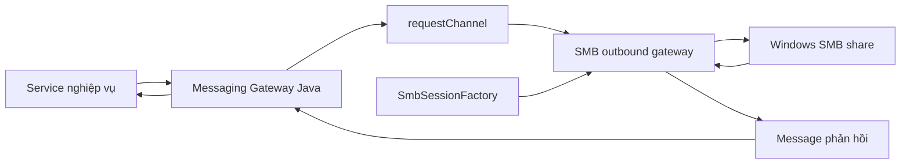
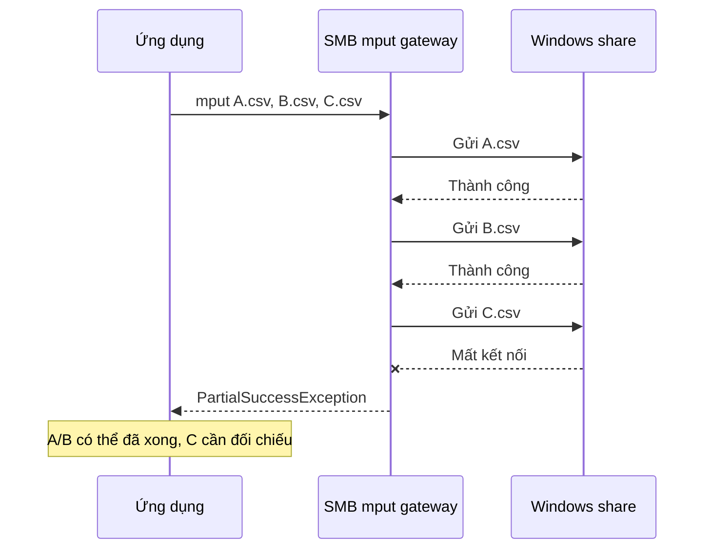
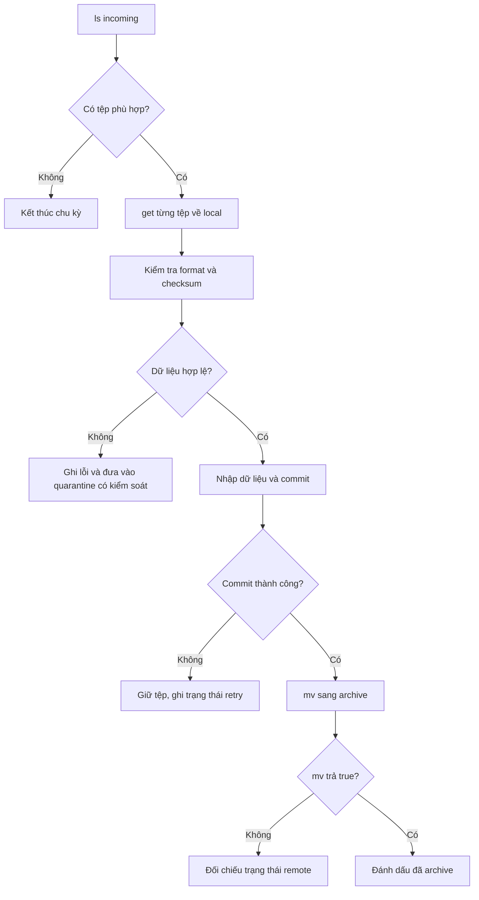

# SMB outbound gateway thao tác tài nguyên

## 1. Vấn đề và mục tiêu bài học

Một ứng dụng nhập báo cáo phải làm việc với thư mục chia sẻ Windows qua giao thức SMB. Bộ phận vận hành muốn biết hôm nay có những tệp nào, tải một tệp xác định để kiểm tra, chuyển tệp đã xử lý sang thư mục `archive`, hoặc xóa tệp không còn cần thiết. Một thao tác gửi file một chiều không đủ cho các nhu cầu đó, bởi ứng dụng cần **biết kết quả trả về** để ra quyết định tiếp theo.

**SMB outbound gateway** trong Spring Integration cho phép gửi yêu cầu thao tác tài nguyên SMB và nhận **message phản hồi**. Gateway hoạt động như một endpoint tích hợp giữa `MessageChannel` và máy chủ SMB, phù hợp với luồng cần liệt kê, đọc, ghi, đổi tên hay xóa tệp có kiểm tra kết quả.

Bài thuộc chương **Adapter SMB** của module `SPRING_INTEGRATION_ADAPTERS`: kết nối hệ thống ngoài bằng inbound/outbound adapter, gateway, poller và `MessageChannel`. Những nguyên lý hợp đồng message, xử lý lỗi, xác nhận kết quả và quản lý kết nối có thể áp dụng cho file, SFTP, HTTP, JMS, AMQP, Kafka hay database; lệnh và payload của từng loại gateway vẫn phải được xem riêng.

Sau bài học, bạn có thể:

- Giải thích sự khác nhau giữa SMB inbound adapter, outbound channel adapter và outbound gateway.
- Chọn đúng một trong tám lệnh `ls`, `nlst`, `get`, `mget`, `rm`, `mv`, `put`, `mput`.
- Hiểu rõ request payload, biểu thức SpEL, option, header và **kiểu dữ liệu trả về**.
- Viết Java DSL với `Smb.outboundGateway(...)`, `SmbSessionFactory` và `@MessagingGateway`.
- Thiết kế các bước kiểm tra, tải, lưu trữ/xóa, retry và xử lý thành công một phần.
- Xây dựng bài kiểm chứng an toàn trên share thử nghiệm có thể đọc/ghi.

## 2. Gateway nằm ở đâu trong luồng?

SMB (Server Message Block) là giao thức truy cập tệp/thư mục qua mạng. Giả sử đường dẫn người dùng Windows nhìn thấy là:

```text
\\fileserver\partner-share\incoming\orders-20261123.csv
  host       share         thư mục        tên tệp
```

Khi dùng client SMB, cấu hình thường được tách thành `host = fileserver`, `share = partner-share`, đường dẫn **bên trong share** như `incoming/orders-20261123.csv`. Ứng dụng cần kết nối đến máy chủ (thông thường qua TCP 445), xác thực và có quyền tương ứng cho từng lệnh. Quyền đọc thư mục không đồng nghĩa có quyền xóa hoặc đổi tên.



Khi service gọi `list("incoming")`, interface Java tạo message có payload `"incoming"`. Một SMB outbound gateway đang lắng nghe channel thực hiện lệnh `ls`, đọc danh sách từ share, tạo reply message rồi gửi kết quả ngược cho caller. Với cấu hình đồng bộ, mã gọi nhận được `List<String>` hoặc một ngoại lệ; không phải tự mở SMB session.

| Thành phần | Điều nó làm | Cần phân biệt |
|---|---|---|
| SMB inbound channel adapter | Chủ động lấy tệp từ share về ứng dụng, thường do poller kích hoạt | Tạo message từ nguồn bên ngoài, không có reply cho mỗi lệnh ứng dụng |
| SMB outbound channel adapter | Nhận message và **ghi tệp** ra share | Một chiều; không tạo reply mang kết quả lệnh |
| **SMB outbound gateway** | Thực hiện lệnh tài nguyên SMB và **trả reply** | Phù hợp khi cần quyết định dựa trên kết quả `ls/get/mv/rm/put` |
| `@MessagingGateway` | Proxy Java để ứng dụng gọi một IntegrationFlow | Đây là cổng vào flow; không phải chính endpoint SMB |
| Poller | Kích hoạt một nguồn lấy dữ liệu theo lịch | Gateway xử lý khi có request; tự nó không cần poller |

Không dùng “gateway” như từ đồng nghĩa với adapter: một bên có hợp đồng request/reply, bên kia thường dùng để đẩy/nhận message một chiều.

## 3. Tám lệnh của SMB outbound gateway

| Lệnh | Request biểu thị | Reply payload | Dùng khi |
|---|---|---|---|
| `ls` | Đường dẫn thư mục từ xa | `List<FileInfo<?>>` mặc định; `List<String>` nếu thêm `-1` | Kiểm kê tệp, đọc metadata |
| `nlst` | Đường dẫn thư mục từ xa | `List<String>` | Chỉ cần danh sách tên |
| `get` | Đường dẫn tệp từ xa | `File` ở local; `InputStream` với `-stream` | Lấy một tệp để xử lý |
| `mget` | Đường dẫn/pattern chọn nhiều tệp | `List<File>` | Lấy một lô tệp |
| `rm` | Đường dẫn tệp cần xóa | `Boolean.TRUE` hoặc `Boolean.FALSE` | Xóa tệp với kết quả rõ ràng |
| `mv` | Đường dẫn cũ; đường dẫn mới qua `rename-expression` | `Boolean.TRUE` khi thành công | Đổi tên, chuyển archive |
| `put` | `File`, `byte[]` hoặc `String` dữ liệu gửi | `String` đường dẫn tệp trên server | Gửi tệp và biết đường dẫn kết quả |
| `mput` | Thư mục local hoặc tập hợp file | `List<String>` đường dẫn đã gửi | Gửi nhiều tệp |

`FileInfo` là kiểu thông tin tệp trong cơ chế remote file của Spring Integration; generic thực tế gắn với loại tệp SMB. Không ép kết quả `ls` mặc định thành `List<String>` nếu chưa dùng `-1`. Với `mget/mput`, danh sách phản hồi thể hiện những tệp đã truyền thành công, nhưng nếu truyền lỗi giữa chừng phải xem **partial success**, không xem cả batch như đã hoàn tất.

### 3.1. Lệnh `ls` và `nlst`

`ls` hỗ trợ các option:

| Option | Tác dụng |
|---|---|
| `-1` | Chỉ trả tên tệp thay cho các đối tượng `FileInfo` |
| `-a` | Gồm cả tên bắt đầu bằng dấu chấm |
| `-f` | Không sắp xếp danh sách |
| `-dirs` | Gồm thư mục (mặc định không gồm) |
| `-links` | Gồm symbolic link nếu server hỗ trợ |
| `-R` | Liệt kê đệ quy qua cây thư mục |

Với `ls -R`, tên tệp chứa đường dẫn tương đối đến thư mục gốc đang liệt kê. Nếu cần phân biệt tệp và thư mục khi đi đệ quy với `-dirs`, nên giữ đối tượng `FileInfo` thay vì dùng `-1`.

`nlst` trả danh sách tên và chỉ hỗ trợ option `-f`. Cả hai lệnh đều đặt thư mục thao tác vào header `file_remoteDirectory`. Kết quả rỗng thường nghĩa là không có file phù hợp; không kết luận ngay server lỗi nếu request trả một danh sách rỗng thành công.

### 3.2. Lệnh `get` và `mget`

`get` đọc một tệp trên SMB và lưu về một thư mục local. Tùy chọn thường gặp:

- `-P`: giữ thời gian sửa đổi từ server.
- `-stream`: trả `InputStream`, không nhất thiết lưu tệp xuống đĩa.
- `-D`: xóa file từ xa **sau khi truyền thành công** theo điều kiện của lệnh; không đồng nghĩa dữ liệu đã được nghiệp vụ xử lý hoàn tất.

Khi dùng `-stream`, **bên đọc phải đóng tài nguyên/session** sau khi tiêu thụ stream. Spring Integration đặt tài nguyên cần đóng vào header `closeableResource`; một số component tiêu thụ chuẩn như `FileSplitter` hoặc `StreamTransformer` có hỗ trợ quản lý tài nguyên. Handler tự viết cần bảo đảm đóng kể cả khi lỗi. Không chuyển `InputStream` sang xử lý bất đồng bộ mà bỏ mặc lifecycle.

`mget` lấy nhiều file và trả `List<File>`. Các option gồm `-P`, `-R` (đệ quy), `-x` (không có file khớp thì ném lỗi), `-D`. Một biểu thức thường dùng là `incoming/*`; khi chọn `-R`, việc quét đệ quy và lọc thư mục cần được thiết kế cẩn thận. Một bộ lọc chặn thư mục trung gian có thể khiến các file trong đó không bao giờ được duyệt.

Nếu cần đồng bộ nhiều tệp theo lịch, `mget` có thể phối hợp `FileExistsMode.REPLACE_IF_MODIFIED` để chỉ ghi local khi file từ xa đã đổi. Đây là chức năng liên quan file tại chỗ, **không thay thế idempotency của import nghiệp vụ**.

### 3.3. Lệnh `put` và `mput`

`put` gửi một file/content tới SMB và phản hồi bằng **đường dẫn đích dưới dạng String**. Tên file được xác định bởi file name generator hoặc biểu thức tên file. Các thuộc tính quan trọng gồm `remoteDirectoryExpression`, `fileNameExpression`, `useTemporaryFileName`, `autoCreateDirectory` và `fileExistsMode`.

`mput` gửi nhiều file: request có thể là thư mục local (`File` hoặc `String`) hay tập hợp các phần tử tương ứng. Option `-R` cho phép đi vào thư mục con. `mput` có thể dùng `patternMputFilter`, `regexMputFilter` hoặc bộ lọc tùy chỉnh để chọn tệp. Nếu cần đệ quy, thư mục con cũng phải được bộ lọc cho qua; chỉ cho phép `*.csv` trên cả file lẫn thư mục có thể vô tình chặn toàn bộ cây con.

Đối với cả `put` và `mput`, việc “trả thành công” xác nhận bước truyền file, **chưa xác nhận hệ thống đối tác đã nhập file**.

### 3.4. Lệnh `rm` và `mv`

`rm` xóa tệp tại đường dẫn xác định. Reply `Boolean.TRUE` nếu xóa thành công, `Boolean.FALSE` nếu không thành công theo kết quả lệnh. Một reply `false` khác với exception do kết nối, xác thực hoặc quy tắc triển khai.

`mv` thực hiện move/rename. Biểu thức `expression` xác định đường dẫn **nguồn**; `rename-expression` xác định đường dẫn **đích**, mặc định lấy từ header `file_renameTo`. Đường dẫn đích phải khác rỗng. Có thể truyền `remoteDirectoryExpression` cho cả nguồn và đích tương đối khi phù hợp, nhưng nên đặt rõ đường dẫn trong cùng phạm vi share đã được cấp quyền.

`rm` và `mv` **thay đổi trạng thái server**, nên cần kiểm tra quyền và điều kiện nghiệp vụ trước khi gọi. Ví dụ, chuyển `incoming/orders-007.csv` sang `archive/orders-007.csv` chỉ hợp lý sau khi đã nhập và ghi nhận thành công; xóa file ngay khi tải về có thể làm mất cơ hội retry.

## 4. Hợp đồng request/reply và đường dẫn

Trong một SMB outbound gateway, biểu thức SpEL `expression` được đánh giá trên request message để tạo đường dẫn/file hoặc pattern mà lệnh tác động. Ví dụ `Smb.outboundGateway(factory, "get", "payload")` dùng chuỗi `payload` làm đường dẫn nguồn, trong khi `Smb.outboundGateway(factory, "ls", "payload")` dùng chuỗi đó làm thư mục cần liệt kê.

| Thuộc tính | Ví dụ | Ý nghĩa |
|---|---|---|
| Request payload cho `ls` | `"incoming"` | Liệt kê thư mục `incoming` bên trong share |
| Request payload cho `get` | `"incoming/orders-007.csv"` | Tệp nguồn trên server |
| Request payload cho `mget` | `"incoming/*"` | Pattern chọn các tệp từ xa |
| Request payload cho `mv` | `"incoming/orders-007.csv"` | Đường dẫn nguồn |
| Header `file_renameTo` | `"archive/orders-007.csv"` | Đường dẫn đích cho `mv` |
| Reply header `file_remoteFile` | `"orders-007.csv"` | Metadata nguồn ở một số lệnh như `get`/`rm`/`mv` |
| Reply header `file_remoteDirectory` | `"incoming"` | Thư mục từ xa tương ứng thao tác |

Với `get/mget`, cần khai báo vị trí lưu local nếu muốn dễ kiểm soát file tải về. Với `put/mput`, cần chỉ định thư mục đích và quy tắc đặt tên trên share.

**Quy tắc an toàn cho đường dẫn:** không nhận trực tiếp đường dẫn hoặc tên file tùy ý từ một request HTTP công khai rồi đưa cho `rm` hoặc `mv`. Hãy ánh xạ một `batchId` được xác thực sang đường dẫn do server tạo, chuẩn hóa đường dẫn, chặn `..`, đường dẫn tuyệt đối trái phép và việc thoát khỏi prefix đã cấp. Đối với một tài khoản có quyền xóa rộng, sai một bước kiểm tra có thể ảnh hưởng các lô dữ liệu khác.

## 5. Cấu hình Java DSL: liệt kê, tải, chuyển và xóa file

Ví dụ sử dụng Spring Boot 3.x + Spring Integration 6.5.x (hoặc tổ hợp tương thích được dependency management của dự án quản lý). Các lớp được minh họa theo API ở dòng 6.5; cần đối chiếu artifact thực tế nếu dự án đang dùng phiên bản khác.

### 5.1. Dependencies và cấu hình kết nối

**Gradle:**

```gradle
dependencies {
    implementation 'org.springframework.boot:spring-boot-starter-integration'
    implementation 'org.springframework.integration:spring-integration-smb'
}
```

**`application.yml`:**

```yaml
demo:
  smb:
    host: ${SMB_HOST}
    port: ${SMB_PORT:445}
    domain: ${SMB_DOMAIN:}
    username: ${SMB_USERNAME}
    password: ${SMB_PASSWORD}
    share: ${SMB_SHARE:partner-share}
    local-download-dir: ${SMB_LOCAL_DOWNLOAD_DIR:./data/smb-downloads}
```

Không để username/password thật trong repository, log hay file được chia sẻ. Nên dùng secret manager và cấp quyền tối thiểu cho nhóm lệnh đang cần. Ví dụ cần `ls/get` chỉ đòi hỏi quyền đọc, trong khi `put/mv/rm` yêu cầu quyền ghi/đổi tên/xóa phù hợp ở cả **share permission** và **NTFS ACL**.

**`SmbGatewayConfig.java`:**

```java
import java.io.File;

import jcifs.DialectVersion;
import org.springframework.beans.factory.annotation.Value;
import org.springframework.context.annotation.Bean;
import org.springframework.context.annotation.Configuration;
import org.springframework.integration.annotation.IntegrationComponentScan;
import org.springframework.integration.config.EnableIntegration;
import org.springframework.integration.dsl.IntegrationFlow;
import org.springframework.integration.file.remote.FileExistsMode;
import org.springframework.integration.smb.dsl.Smb;
import org.springframework.integration.smb.session.SmbSessionFactory;

@Configuration
@EnableIntegration
@IntegrationComponentScan
public class SmbGatewayConfig {

    @Bean
    SmbSessionFactory smbSessionFactory(
            @Value("${demo.smb.host}") String host,
            @Value("${demo.smb.port}") int port,
            @Value("${demo.smb.domain}") String domain,
            @Value("${demo.smb.username}") String username,
            @Value("${demo.smb.password}") String password,
            @Value("${demo.smb.share}") String share) {

        SmbSessionFactory factory = new SmbSessionFactory();
        factory.setHost(host);
        factory.setPort(port);
        factory.setDomain(domain);
        factory.setUsername(username);
        factory.setPassword(password);
        factory.setShareAndDir(share);
        factory.setSmbMinVersion(DialectVersion.SMB210);
        factory.setSmbMaxVersion(DialectVersion.SMB311);
        return factory;
    }

    @Bean
    IntegrationFlow smbListFlow(SmbSessionFactory factory) {
        return IntegrationFlow.from("smbListRequest")
                .handle(Smb.outboundGateway(factory, "ls", "payload")
                        .options("-1"))
                .get();
    }

    @Bean
    IntegrationFlow smbGetFlow(
            SmbSessionFactory factory,
            @Value("${demo.smb.local-download-dir}") String localDir) {

        return IntegrationFlow.from("smbGetRequest")
                .handle(Smb.outboundGateway(factory, "get", "payload")
                        .localDirectory(new File(localDir))
                        .autoCreateLocalDirectory(true)
                        .fileExistsMode(FileExistsMode.FAIL))
                .get();
    }

    @Bean
    IntegrationFlow smbMoveFlow(SmbSessionFactory factory) {
        return IntegrationFlow.from("smbMoveRequest")
                .handle(Smb.outboundGateway(factory, "mv", "payload")
                        .renameExpression("headers['file_renameTo']"))
                .get();
    }

    @Bean
    IntegrationFlow smbRemoveFlow(SmbSessionFactory factory) {
        return IntegrationFlow.from("smbRemoveRequest")
                .handle(Smb.outboundGateway(factory, "rm", "payload"))
                .get();
    }
}
```

Chú ý:

1. `setShareAndDir(share)` đặt **share gốc**; payload như `"incoming"` và `"archive/orders-007.csv"` là đường dẫn tương đối bên trong share. Không lặp `partner-share` trong payload nếu cấu hình gốc đã có tên này.
2. `Smb.outboundGateway(...)` tạo endpoint xử lý request/reply. Ở ví dụ, `"payload"` là **biểu thức SpEL** chọn đường dẫn hoặc pattern.
3. `.options("-1")` khiến `ls` trả tên file dạng `List<String>`, nhờ đó giao diện Java có thể khai báo kiểu rõ ràng.
4. `.fileExistsMode(FileExistsMode.FAIL)` áp dụng cho `get` khi tệp **local** đã tồn tại, nhằm tránh ghi đè không chủ ý. Với `put`, file tồn tại cần kiểm tra lại là ở **remote**.
5. Flow đồng bộ được nối qua channel đặt tên; gateway nhận message rồi tạo reply. Việc gọi từ Java sẽ minh họa ở phần tiếp theo.

### 5.2. Tạo interface request/reply cho ứng dụng

**`SmbOperations.java`:**

```java
import java.io.File;
import java.util.List;

import org.springframework.integration.annotation.Gateway;
import org.springframework.integration.annotation.MessagingGateway;
import org.springframework.messaging.handler.annotation.Header;
import org.springframework.messaging.handler.annotation.Payload;

@MessagingGateway
public interface SmbOperations {

    @Gateway(requestChannel = "smbListRequest")
    List<String> listNames(String remoteDirectory);

    @Gateway(requestChannel = "smbGetRequest")
    File download(String remoteFilePath);

    @Gateway(requestChannel = "smbMoveRequest")
    Boolean move(@Payload String sourcePath,
                 @Header("file_renameTo") String targetPath);

    @Gateway(requestChannel = "smbRemoveRequest")
    Boolean remove(String remoteFilePath);
}
```

Một service có thể inject `SmbOperations` và sử dụng:

```java
List<String> names = smbOperations.listNames("incoming");
File local = smbOperations.download("incoming/orders-007.csv");

// Sau khi kiểm tra, nhập dữ liệu và commit thành công:
Boolean archived = smbOperations.move(
        "incoming/orders-007.csv",
        "archive/orders-007.csv");

if (!Boolean.TRUE.equals(archived)) {
    throw new IllegalStateException("Chuyển archive không thành công");
}
```

`smbOperations` là bean được inject bằng constructor hoặc cơ chế DI của Spring. Dòng `download(...)` chỉ minh họa một bước lấy file; mã vận hành thực cần kiểm tra định dạng, lưu nghiệp vụ và ghi nhận trạng thái **trước** khi move file. Không dùng `remove(...)` trên dữ liệu thật chỉ để thử gateway.

Interface `@MessagingGateway` nhận kết quả phản hồi từ handler qua reply channel tương ứng với request. Các flow đơn giản ở trên sử dụng channel trực tiếp, nên kết quả thường xuất hiện ngay trong lời gọi Java hoặc exception được đưa về caller. Khi dùng `ExecutorChannel`, queue, timeout hoặc giao thức bất đồng bộ, phải thiết kế riêng đường reply và xử lý lỗi.

### 5.3. Thêm các flow `put`, `mget`, `mput`

Các cấu hình sau là **đoạn bổ sung** có thể đặt thành bean `IntegrationFlow` trong cùng lớp cấu hình. Chúng minh họa cách chọn thuộc tính khác nhau theo lệnh:

```java
@Bean
IntegrationFlow smbPutFlow(SmbSessionFactory factory) {
    return IntegrationFlow.from("smbPutRequest")
            .handle(Smb.outboundGateway(factory, "put", "payload")
                    .remoteDirectoryExpression("'outgoing'")
                    .fileNameExpression("payload.name")
                    .autoCreateDirectory(true)
                    .fileExistsMode(FileExistsMode.FAIL)
                    .useTemporaryFileName(true))
            .get();
}

@Bean
IntegrationFlow smbMGetFlow(SmbSessionFactory factory) {
    return IntegrationFlow.from("smbMGetRequest")
            .handle(Smb.outboundGateway(factory, "mget", "payload")
                    .options("-P")
                    .regexFileNameFilter("(?i).*\\.csv$")
                    .localDirectory(new File("./data/smb-batch-downloads"))
                    .autoCreateLocalDirectory(true)
                    .fileExistsMode(FileExistsMode.IGNORE))
            .get();
}

@Bean
IntegrationFlow smbMPutFlow(SmbSessionFactory factory) {
    return IntegrationFlow.from("smbMPutRequest")
            .handle(Smb.outboundGateway(factory, "mput", "payload")
                    .remoteDirectoryExpression("'outgoing'")
                    .autoCreateDirectory(true)
                    .patternMputFilter("*.csv")
                    .fileExistsMode(FileExistsMode.FAIL)
                    .useTemporaryFileName(true))
            .get();
}
```

Để gọi ba flow này từ Java, bổ sung vào interface `SmbOperations`:

```java
@Gateway(requestChannel = "smbPutRequest")
String upload(File localFile);

@Gateway(requestChannel = "smbMGetRequest")
List<File> downloadBatch(String remotePattern);

@Gateway(requestChannel = "smbMPutRequest")
List<String> uploadBatch(File localDirectory);
```

Ví dụ `downloadBatch("incoming/*")` dùng filter chỉ chọn file CSV; vì không yêu cầu `-R`, nó chỉ làm việc theo phạm vi tìm kiếm được chỉ định. Nếu bật `-R`, phải điều chỉnh filter để cho phép duyệt thư mục trung gian. Ví dụ `uploadBatch(new File("./data/outbox"))` chọn các file `*.csv` trực tiếp trong thư mục local; muốn đệ quy cần thêm `-R` và bộ lọc cho phép directory.

`FileExistsMode.IGNORE` trong `mget` có thể khiến file local đã tồn tại không xuất hiện trong kết quả tải lần này. Không lấy một danh sách rỗng để kết luận chắc chắn remote không có file khi chính sách skip đang bật. `FileExistsMode.FAIL` trong `put/mput` giúp phát hiện xung đột tên, nhưng một retry sau timeout có thể cần đối chiếu lại vì lần trước có thể đã ghi thành công.

## 6. Nhận diện lỗi, kết quả rỗng và thành công một phần

### 6.1. Khi nào nhận reply, khi nào nhận exception?

Một lời gọi request/reply có các kết quả khác nhau:

| Tình huống | Quan sát từ caller | Cách diễn giải |
|---|---|---|
| `ls` không có tệp phù hợp | Danh sách rỗng | Lệnh đã chạy; không có item được trả về |
| `get` thành công | Một `File` local | Đã tải xong, chưa có nghĩa parse/import xong |
| `rm` trả `false` | `Boolean.FALSE` | Thao tác xóa không hoàn thành như mong muốn |
| `mv` thành công | `Boolean.TRUE` | Tệp được rename/move trên SMB theo kết quả lệnh |
| Sai mật khẩu, thiếu quyền, mất mạng | Exception khi thực hiện request | Cần phân loại nguyên nhân; không suy diễn file chưa bị tác động |
| `mget/mput` lỗi sau vài file | `PartialSuccessException` | Một số file có thể đã truyền xong; cần đối chiếu từng item |

Các exception có thể được đóng gói qua cơ chế `MessagingException`/exception của gateway. Khi ghi log, giữ `batchId`, đường dẫn tương đối đã chuẩn hóa, command, thời điểm, nguyên nhân gốc và correlation ID. Không log secret hoặc dữ liệu tệp nhạy cảm.

### 6.2. `PartialSuccessException` khi xử lý batch

Với `mget` và `mput`, lệnh có thể thành công trên một phần danh sách rồi thất bại giữa chừng. Spring Integration cung cấp `PartialSuccessException` với các thông tin:

- `partialResults`: các kết quả chuyển file đã **thành công** trước khi xảy ra lỗi;
- `derivedInput`: danh sách đối tượng đầu vào mà gateway đã suy ra từ request (ví dụ các file local cần gửi khi `mput`);
- `failedMessage` và nguyên nhân lỗi theo cơ chế `MessagingException`.

Ví dụ: gửi ba tệp `A.csv`, `B.csv`, `C.csv`, nhưng mạng đứt khi đang gửi `C.csv`. `partialResults` có thể chứa đường dẫn đích cho `A.csv` và `B.csv`. Nếu đơn giản retry nguyên batch bằng `APPEND` hay `REPLACE`, ứng dụng có thể tạo dữ liệu trùng hoặc thay file đã được đối tác đọc.



Quy trình khôi phục nên:

1. Trích xuất và ghi nhận danh sách đã thành công trước lỗi.
2. Kiểm tra kết quả từ xa (tên file, kích thước, checksum nếu có cơ chế đáng tin) và trạng thái nghiệp vụ.
3. Đánh dấu riêng từng file hoặc từng batch có thể retry.
4. Chỉ retry những file chưa được xác minh; chọn `FileExistsMode` theo hợp đồng, không coi retry là thao tác vô hại.

Ở `mget -D`, file trên server có thể đã bị xóa sau khi tải, trong khi xử lý nghiệp vụ local vẫn chưa xong. Hạn chế dùng xóa nguồn ngay sau transfer đối với dữ liệu cần replay.

### 6.3. `FileExistsMode`: nơi được kiểm tra khác nhau

| Mode | `get/mget`: local đã tồn tại | `put/mput`: remote đã tồn tại |
|---|---|---|
| `FAIL` | Báo lỗi thay vì ghi đè local | Báo lỗi thay vì ghi đè remote |
| `IGNORE` | Bỏ qua file local đã có | Bỏ qua file remote đã có |
| `REPLACE` | Ghi thay local | Ghi thay remote |
| `APPEND` | Nối thêm theo khả năng của lệnh/định dạng | Nối thêm vào tệp đích |

Các mode trên phải được kiểm tra với API/phiên bản và kiểu file thực tế. Mặc định lịch sử của `put/mput` là `REPLACE`; `get/mget` là `FAIL`. Vì thế nên **cấu hình mode tường minh**, đặc biệt ở các luồng có thao tác xóa và xử lý lại.

## 7. Một quy trình nghiệp vụ có thể vận hành

Giả sử đối tác đặt tệp trong `incoming/`. Ứng dụng cần tải, kiểm tra CSV, nhập vào database rồi lưu file ở `archive/`:



Tách biệt các trạng thái:

- **DISCOVERED:** tên tệp được thấy qua `ls`; chưa chắc đối tác đã ghi xong. Hai bên nên dùng giao thức công bố như `.part` rồi rename sang `.csv`, hoặc quy tắc tuổi tệp.
- **DOWNLOADED:** `get` đã hoàn tất; file local có thể chưa hợp lệ.
- **IMPORTED:** validate, idempotency và transaction nghiệp vụ đã thành công.
- **ARCHIVED:** `mv` trả thành công và trạng thái được ghi nhận. Nếu move thất bại sau khi nhập đã commit, lần sau cần tránh nhập lặp.

Ví dụ khóa idempotency có thể là `partnerId + batchId + checksum`. Header message `id` do Spring tạo mỗi lần không phải khóa ổn định cho một lô. Với database, lưu kết quả import theo batch và đặt unique constraint phù hợp; retry chỉ tiếp tục từ trạng thái thật đã được commit.

Đối với quy trình **gửi** báo cáo, hướng ngược lại là `put` hoặc `mput` tạo tệp trên share và trả đường dẫn. Để đối tác không đọc file còn truyền dở, dùng tên tạm và rename sau upload (ví dụ `.writing`) rồi yêu cầu đối tác chỉ quét tên chính thức. Muốn biết đối tác đã nhập xong, cần kênh ACK nghiệp vụ riêng, không thể dựa vào reply `String` của `put`.

## 8. Vòng đời session, bảo mật và hiệu năng

### 8.1. Session và pooling

`SmbSessionFactory` quản lý cấu hình kết nối và tạo các session SMB khi gateway thực hiện lệnh. Trong workload có nhiều request, có thể bọc factory bằng `CachingSessionFactory` để tái sử dụng session và giới hạn số kết nối đồng thời. Khi dùng cache, truyền **bean SessionFactory đã bọc** vào các gateway thay vì tiếp tục dùng factory gốc.

Không mở một session mới bên ngoài luồng và để tài nguyên ở trạng thái không đóng. Với `get -stream`, trách nhiệm đóng tài nguyên còn kéo dài sang component đọc stream; với `get` trả `File` thông thường, gateway đã hoàn tất tải tệp trước khi trả file local.

### 8.2. Quyền, an toàn dữ liệu và đường dẫn

- Chia tài khoản hoặc vùng share nếu hệ thống cần thao tác xóa và thao tác đọc với mức phân quyền khác nhau.
- Tránh SMBv1; chọn min/max dialect phù hợp với server và chính sách bảo mật của tổ chức.
- Cấp đúng quyền trên **share** và **NTFS ACL**: `mv` có thể cần quyền rename/delete, không chỉ ghi.
- Giới hạn prefix đường dẫn được phép truy cập theo mã đối tác; chặn traversal và tên file không hợp lệ trên Windows.
- Có retention cho file local; bảo vệ thư mục tải về vì dữ liệu có thể chứa thông tin nhạy cảm.
- Ghi log command, `batchId`, đường dẫn tương đối, kết quả và thời gian; không ghi mật khẩu, secret hay nội dung tệp nếu không cần thiết.

### 8.3. Thông lượng và độ trễ

`ls -R` trên share lớn có thể tạo nhiều I/O và danh sách rất dài. `mget/mput` đệ quy có thể truyền nhiều dữ liệu, làm đầy ổ local hoặc bão hòa đường truyền. Thiết lập giới hạn ở tầng điều phối: số batch đồng thời, timeout, số kết nối cache, dung lượng đĩa dự phòng, kích thước tối đa và số lần retry.

Gateway không tự động có poller; nếu cần chạy theo lịch, đặt poller ở **nguồn phát yêu cầu** (ví dụ job lấy danh sách batch chưa xử lý) và gửi message vào request channel. Trong hệ thống nhiều instance, phải phối hợp quyền sở hữu batch và metadata bền vững để hai node không cùng `rm/mv` một tệp.

## 9. Thực hành trên Windows share hoặc Samba

Chuẩn bị share thử nghiệm `partner-share` với thư mục `incoming`, `archive`, `outgoing`. Đưa một CSV mẫu vào `incoming` bằng công cụ của lab:

```csv
order_id,amount,currency
ORD-001,150000,VND
ORD-002,85000,VND
```

Lưu tên tệp là `orders-007.csv`. Khởi động ứng dụng với các biến môi trường ở phần 5 và xác nhận kết nối.

### Bài tập A — Liệt kê và tải một tệp

1. Gọi `smbOperations.listNames("incoming")`; xác nhận danh sách có `orders-007.csv`.
2. Gọi `smbOperations.download("incoming/orders-007.csv")`.
3. Kiểm tra file trong `./data/smb-downloads` và đọc đúng hai dòng dữ liệu, tổng `amount = 235000` VND.
4. Gọi `download(...)` lần hai với `FileExistsMode.FAIL`; quan sát hành vi khi local đã tồn tại.

**Kết quả cần giải thích:** `ls -1` trả `List<String>`; `get` trả `File`, và lỗi local đã tồn tại được quyết định bởi mode của lệnh download.

### Bài tập B — Đổi tên/chuyển sang archive

1. Sau khi xác nhận đã lưu kết quả import vào cơ sở dữ liệu thử nghiệm, gọi:

   ```java
   Boolean moved = smbOperations.move(
       "incoming/orders-007.csv",
       "archive/orders-007.csv");
   ```

2. Xác minh `moved == true`, thư mục `incoming` không còn tên cũ và `archive` có tên mới.
3. Gửi lại request move tương tự để quan sát hành vi khi nguồn đã đổi vị trí.

**Kết quả cần giải thích:** `mv` trả trạng thái về message; một retry sau khi đã move phải kiểm tra đích và trạng thái đã ghi nhận, không mặc nhiên lỗi vì không tìm thấy nguồn là “chưa xử lý”.

### Bài tập C — Gửi và kiểm tra file

1. Tạo một file local `ack-007.txt`, gọi `upload(file)` (nếu đã khai báo `smbPutFlow`).
2. Kiểm tra reply kiểu `String` chứa đường dẫn từ xa; gọi `listNames("outgoing")` để xác minh tên.
3. Gửi lại tên cũ với `FileExistsMode.FAIL` và giải thích vì sao lỗi trùng tên giúp ngăn ghi đè ngoài ý muốn.

**Kết quả cần giải thích:** `put` có reply khác outbound channel adapter; thành công upload chưa chứng minh người nhận đã đọc ACK.

### Bài tập D — Xử lý một phần batch

1. Tạo 3–5 file CSV trong một thư mục local thử nghiệm và gọi `uploadBatch(localDirectory)`.
2. Trong lab riêng, mô phỏng lỗi mạng khi đang gửi nhiều file; ghi lại file đã thấy ở đích và ngoại lệ trả về.
3. Nếu gặp `PartialSuccessException`, đối chiếu `partialResults` với danh sách thực tế; lập danh sách file cần xác minh và retry.
4. Không lặp toàn bộ batch bằng `APPEND`; giải thích rủi ro dữ liệu trùng.

**Kết quả cần giải thích:** `mput` có thể hoàn thành một số file trước khi lỗi. Trạng thái cuối của từng file và kết quả nghiệp vụ cần được quản lý riêng.

### Bài tập E — Xóa có kiểm soát

1. Tạo một file rác **chỉ dùng cho lab** trong `outgoing`, chẳng hạn `delete-me-lab.txt`.
2. Xác nhận file tồn tại bằng `listNames("outgoing")`.
3. Gọi `smbOperations.remove("outgoing/delete-me-lab.txt")` và kiểm tra `Boolean.TRUE`.
4. Thử xóa lại để quan sát `false` hoặc cách gateway báo lỗi trong môi trường đang dùng.

**Kết quả cần giải thích:** quyền xóa, điều kiện tồn tại và kết quả reply là những yếu tố phải kiểm tra trước khi cho phép nghiệp vụ xóa tài nguyên.

## 10. Những nhầm lẫn thường gặp

| Nhầm lẫn | Cách hiểu đúng |
|---|---|
| SMB outbound gateway giống `@MessagingGateway` | Endpoint SMB thực hiện lệnh; interface annotation là cửa vào flow từ Java |
| `ls` luôn trả `List<String>` | Mặc định là danh sách đối tượng `FileInfo`; cần `-1` để lấy tên |
| `get` trả nội dung CSV dưới dạng `String` | Mặc định trả `File` local, hoặc `InputStream` nếu có `-stream` |
| `get -D` chỉ xóa sau khi import thành công | Nó xóa sau khi transfer theo điều kiện của lệnh; import nghiệp vụ là bước khác |
| `rm` không có reply | `rm` trả `Boolean`; lỗi kết nối có thể gây exception |
| `mv` chỉ cần một đường dẫn | Cần nguồn từ `expression` và đích từ `rename-expression`/header |
| `mget/mput` lỗi thì chưa file nào được xử lý | Có thể có thành công một phần, cần đọc `PartialSuccessException` |
| `FileExistsMode` luôn kiểm tra cùng một vị trí | Với `get` là file local; với `put` là file remote |
| Có reply từ `put` tức đối tác đã nhập file | Reply xác nhận chuyển file, không phải ACK nghiệp vụ |
| Lệnh gateway tự chạy theo lịch | Poller là cơ chế kích hoạt nguồn; gateway chỉ chạy khi nhận request |

## 11. Tài liệu tham khảo

- [Spring Integration 6.5 — SMB Support](https://docs.spring.io/spring-integration/reference/6.5/smb.html): các lệnh của SMB outbound gateway, option, payload phản hồi và thành công một phần.
- [Smb Java DSL API (6.5)](https://docs.spring.io/spring-integration/docs/6.5.0/api/org/springframework/integration/smb/dsl/Smb.html): cách tạo `Smb.outboundGateway(...)`.
- [SmbOutboundGatewaySpec API (6.5)](https://docs.spring.io/spring-integration/docs/6.5.x/api/org/springframework/integration/smb/dsl/SmbOutboundGatewaySpec.html): tùy chọn lệnh, bộ lọc, local directory, file exists mode và rename expression.

**Ghi nhớ:** SMB outbound gateway giúp Spring Integration **gửi một lệnh thao tác tài nguyên SMB và nhận kết quả**, từ liệt kê, tải, gửi đến đổi tên hoặc xóa. Độ tin cậy của quy trình phụ thuộc vào hợp đồng request/reply, trạng thái từng file, idempotency, session và chính sách xử lý lỗi phù hợp.
