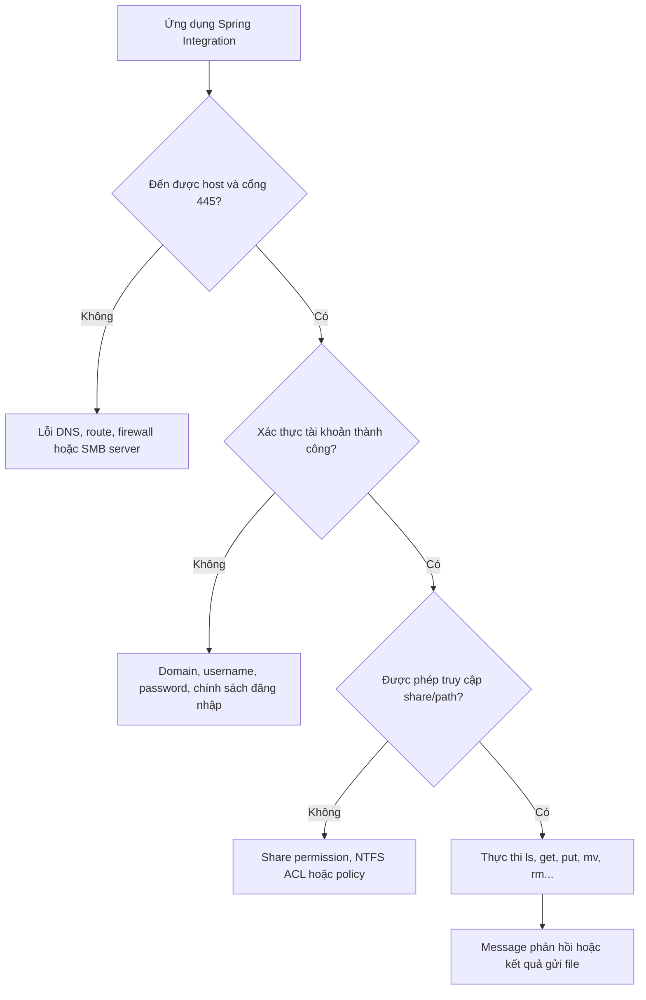

# Xác thực domain user và credential trong Spring Integration SMB

## 1. Bài toán thực tế và mục tiêu

Ứng dụng Spring Boot của một doanh nghiệp cần đọc file đối soát từ Windows File Server ở địa chỉ `\\fs01.corp.example\finance-exchange\incoming` và ghi kết quả sang thư mục `outgoing`. Trên Windows, nhân viên đăng nhập bằng tài khoản Active Directory rồi mở thư mục chia sẻ trong File Explorer. Tuy nhiên, ứng dụng Java chạy trên Linux hoặc trong container **không tự nhiên thừa hưởng phiên đăng nhập Windows của nhân viên**. Nó cần có danh tính và thông tin xác thực riêng được Windows File Server chấp nhận.

Trong Spring Integration, `SmbSessionFactory` kết nối các thông số host, share, domain, username, password và phiên bản SMB thành những session để inbound adapter, outbound adapter hoặc outbound gateway sử dụng. Nếu credential sai, cả ba loại endpoint đều thất bại khi truy cập. Nếu credential đúng nhưng tài khoản thiếu quyền, một lệnh có thể thành công trong khi lệnh khác bị từ chối.

Đây là kiến thức nền của chương **Adapter SMB** thuộc module `SPRING_INTEGRATION_ADAPTERS`: kết nối hệ thống ngoài bằng inbound/outbound adapter, gateway, poller và `MessageChannel`; xử lý hợp đồng message, lỗi và vòng đời kết nối. Trong những hệ thống tích hợp qua file, SFTP, HTTP, JMS, AMQP, Kafka và database, **quản lý identity, secret, quyền truy cập và vòng đời phiên kết nối** cũng là mối quan tâm chung, nhưng phương thức xác thực sẽ khác theo giao thức.

Sau bài này, bạn có thể:

- Phân biệt **domain user**, **local user**, danh tính ứng dụng và credential trong một phiên SMB.
- Cấu hình `setDomain(...)`, `setUsername(...)`, `setPassword(...)` và các thuộc tính liên quan bằng `SmbSessionFactory`.
- Giải thích ba lớp lỗi: kết nối mạng, xác thực và phân quyền thư mục.
- Lưu/đổi mật khẩu theo cách phù hợp vận hành và không rò rỉ qua source code hoặc log.
- Kiểm chứng quyền đọc, ghi, đổi tên và xóa mà không thử nghiệm phá hoại lên share sản xuất.
- Thiết kế retry, session cache, theo dõi lỗi và phản ứng khi tài khoản bị khóa hoặc hết hạn.

## 2. Ba lớp kiểm tra trước khi xử lý file

Một request SMB không đi thẳng từ credential sang dữ liệu. Nó phải vượt qua các lớp:



| Lớp | Câu hỏi cần trả lời | Biểu hiện khi lỗi |
|---|---|---|
| **Transport/SMB negotiation** | DNS đúng? TCP 445 thông? Hai bên hỗ trợ phiên bản SMB tương thích? | Không kết nối, timeout, lỗi thương lượng dialect |
| **Authentication** | File server có chấp nhận danh tính và credential này? | Lỗi đăng nhập, domain không đúng, password sai/hết hạn/tài khoản bị khóa |
| **Authorization** | Danh tính đã được xác thực có quyền trên share và thư mục/file? | Truy cập bị từ chối khi list, đọc, tạo hoặc rename/xóa |
| **Application contract** | Lệnh đang thao tác đúng đường dẫn và loại file? | Không tìm thấy file, file trùng tên, vi phạm quy ước ghi/đọc |

**Xác thực thành công chưa có nghĩa là được phép thao tác mọi file.** Trên Windows File Server, quyền được đánh giá theo các cơ chế truy cập được cấu hình, thường gồm **share permissions** và **NTFS ACL**. Trên Samba/NAS, mô hình mapping user, group và ACL có thể khác nhưng nguyên tắc phân biệt xác thực với phân quyền vẫn giữ nguyên.

Một tài khoản chỉ đọc có thể thực hiện `ls` và `get` nhưng bị từ chối với `put`, `mv` hoặc `rm`. Không nên “sửa” lỗi quyền bằng cách chuyển mọi service account sang quyền quản trị cao nhất.

## 3. Domain user, local user và các cách biểu diễn danh tính

### 3.1. Domain user là gì?

**Domain user** thường được quản lý tập trung bằng Active Directory. Ví dụ doanh nghiệp có domain NetBIOS `CORP` và tài khoản dịch vụ `svc_smb_sync`:

```text
Tên hiển thị ở Windows: CORP\svc_smb_sync
Domain:                 CORP
Username:               svc_smb_sync
Password:               <secret cấp riêng>
```

Khi cấu hình API `SmbSessionFactory` tiêu chuẩn, hãy **truyền domain và username vào hai thuộc tính riêng** để hợp đồng rõ ràng:

```java
factory.setDomain("CORP");
factory.setUsername("svc_smb_sync");
factory.setPassword(passwordFromSecretStore);
```

Tránh vừa đặt `domain = CORP` vừa đặt `username = "CORP\\svc_smb_sync"` khi chưa xác minh client SMB hỗ trợ cách phối hợp đó; một số thư viện có thể xử lý dấu `\`/UPN khác nhau. Tên đăng nhập UPN như `svc_smb_sync@corp.example` là một cách biểu diễn khác trong môi trường Windows; **không mặc nhiên coi UPN tương đương việc tách `setDomain` và `setUsername` trên mọi phiên bản client SMB**. Hãy thống nhất format với người quản trị Active Directory và thử trên môi trường tương ứng.

### 3.2. Local user khác domain user thế nào?

**Local user** được quản lý trên máy chủ SMB hoặc hệ thống NAS/Samba, chẳng hạn một tài khoản chỉ có hiệu lực đối với `fs01`. Nó không nhất thiết xuất hiện trong Active Directory. Cách client phải khai báo domain cho local account phụ thuộc cấu hình máy chủ và thư viện xác thực; có hệ thống dùng tên máy chủ, có hệ thống cho phép domain trống.

Đừng suy luận rằng:

- `domain = ""` luôn tương đương local user;
- tên share là tên domain;
- `host = fs01.corp.example` thì `domain` luôn phải bằng `corp.example`;
- ứng dụng chạy trên máy tham gia domain sẽ tự đăng nhập bằng tài khoản của người đang dùng desktop.

Khi cấp tài khoản, cần lưu lại **authority xác thực**, kiểu tài khoản, domain được yêu cầu, tên ngắn/UPN được chấp nhận và quyền trên thư mục đích. Mẫu dưới đây chủ động chọn **domain user**.

### 3.3. Account nên dùng cho hệ thống tích hợp

Ưu tiên một **service account dành riêng cho ứng dụng**, ví dụ `CORP\svc_smb_sync`, thay vì tài khoản cá nhân của developer hoặc quản trị viên. Đề nghị nhóm vận hành cấp:

| Hạng mục | Ví dụ cho dịch vụ nhập file | Lý do |
|---|---|---|
| Danh tính | `CORP\svc_smb_ingest` | Tách audit và lifecycle khỏi tài khoản người dùng |
| Share | `finance-exchange` | Giới hạn phạm vi truy cập |
| Read/List | `incoming/` | Đọc tệp nguồn |
| Write/Create | Không có nếu chỉ nhập | Giảm tác động khi credential bị lộ |
| Move/Delete | Chỉ cấp nếu có quy trình archive/cleanup từ xa | Đảm bảo quyền phù hợp nghiệp vụ |
| Cơ chế cấp mật khẩu | Secret manager và quy trình rotation | Tránh bí mật cố định trong Git |
| Audit | Theo dõi service account + batch ID | Truy vết hoạt động và xử lý sự cố |

Nếu một luồng cần tải file, luồng khác cần xóa file, có thể tách tài khoản/endpoint hoặc phân tách thư mục theo nguyên tắc quyền tối thiểu. Cần nhớ rằng khi một tài khoản dùng chung cho nhiều service, đổi mật khẩu sẽ ảnh hưởng nhiều ứng dụng hơn.

## 4. Cấu hình credential trong Spring Integration

### 4.1. Dependency và property

Ví dụ sử dụng Spring Boot 3.x và Spring Integration 6.x tương thích, nơi `spring-integration-smb` cung cấp `SmbSessionFactory`. Quản lý phiên bản qua Spring Boot BOM hoặc dependency management đang dùng.

**Gradle:**

```gradle
dependencies {
    implementation 'org.springframework.boot:spring-boot-starter-integration'
    implementation 'org.springframework.integration:spring-integration-smb'
}
```

**`application.yml`:**

```yaml
integration:
  smb:
    host: ${SMB_HOST:fs01.corp.example}
    port: ${SMB_PORT:445}
    domain: ${SMB_DOMAIN:CORP}
    username: ${SMB_USERNAME}
    password: ${SMB_PASSWORD}
    share: ${SMB_SHARE:finance-exchange}
    remote-directory: ${SMB_REMOTE_DIRECTORY:incoming}
```

Trong đoạn mẫu này, địa chỉ host/domain/share chỉ là **giá trị minh họa**; hãy truyền từ cấu hình môi trường thực. Không ghi mật khẩu thật, token hay một chuỗi mã hóa tự chế vào repository. Biến môi trường có thể phù hợp trong lab, nhưng trong production cần tuân thủ yêu cầu cấp/giữ bí mật của nền tảng, chẳng hạn secret manager, phân quyền đọc secret và chính sách xoay vòng.

Những tên `SMB_HOST`, `SMB_DOMAIN`, `SMB_USERNAME`, `SMB_PASSWORD` có chức năng khác nhau. Một giá trị chỉ để đặt tên host **không thay thế** danh tính `domain/username`. Tên share `finance-exchange` cũng không nằm trong username.

### 4.2. Tạo `SmbSessionFactory`

**`SmbSecurityConfig.java`:**

```java
import jcifs.DialectVersion;

import org.springframework.beans.factory.annotation.Value;
import org.springframework.context.annotation.Bean;
import org.springframework.context.annotation.Configuration;
import org.springframework.integration.annotation.IntegrationComponentScan;
import org.springframework.integration.config.EnableIntegration;
import org.springframework.integration.smb.session.SmbSessionFactory;

@Configuration
@EnableIntegration
@IntegrationComponentScan
public class SmbSecurityConfig {

    @Bean
    SmbSessionFactory smbSessionFactory(
            @Value("${integration.smb.host}") String host,
            @Value("${integration.smb.port}") int port,
            @Value("${integration.smb.domain}") String domain,
            @Value("${integration.smb.username}") String username,
            @Value("${integration.smb.password}") String password,
            @Value("${integration.smb.share}") String share) {

        SmbSessionFactory factory = new SmbSessionFactory();
        factory.setHost(host);
        factory.setPort(port);
        factory.setDomain(domain);
        factory.setUsername(username);
        factory.setPassword(password);
        factory.setShareAndDir(share);

        // Chỉ cho phép negotiate SMB 2.1 đến SMB 3.1.1 trong ví dụ.
        factory.setSmbMinVersion(DialectVersion.SMB210);
        factory.setSmbMaxVersion(DialectVersion.SMB311);
        return factory;
    }
}
```

Giải thích:

1. `setHost(...)` là DNS/IP của máy chủ chứa share; `setPort(445)` chọn cổng SMB thường dùng.
2. `setDomain(...)` xác định domain dùng khi xác thực (trong ví dụ là `CORP`).
3. `setUsername(...)` là **tên tài khoản không kèm tiền tố domain** trong cách cấu hình đã chọn.
4. `setPassword(...)` nhận secret lấy từ nguồn cấu hình; không cần và không nên in giá trị này ra log.
5. `setShareAndDir("finance-exchange")` xác định điểm truy cập share. Các endpoint chọn `incoming` hoặc `outgoing` bên trong share theo cấu hình riêng.
6. `setSmbMinVersion/setSmbMaxVersion` chỉ phạm vi SMB dialect được phép thương lượng. Đây **không phải** cấu hình username/password hay cơ chế quyết định quyền NTFS.

Ví dụ phản ánh API của Spring Integration 6.5 với `jcifs.DialectVersion`. Khi nâng lên nhánh mới có thay đổi thư viện SMB nền tảng, hãy kiểm tra import và constructor theo Javadoc của **phiên bản dependency đang dùng**. Nếu tự cấp một `jcifs.CIFSContext` cho factory, tài liệu Spring Integration 6.x yêu cầu thiết lập giới hạn dialect trong chính context tùy chỉnh đó.

### 4.3. Thử xác thực bằng thao tác **chỉ đọc**

Tạo một outbound gateway dùng lệnh `ls -1` để liệt kê tên file trong thư mục remote. Đây là phép thử tốt hơn việc xóa/chuyển file chỉ để “xem tài khoản có đăng nhập được không”.

**`SmbReadProbeConfig.java`:**

```java
import org.springframework.context.annotation.Bean;
import org.springframework.context.annotation.Configuration;
import org.springframework.integration.dsl.IntegrationFlow;
import org.springframework.integration.smb.dsl.Smb;
import org.springframework.integration.smb.session.SmbSessionFactory;

@Configuration
public class SmbReadProbeConfig {

    @Bean
    IntegrationFlow smbReadProbeFlow(SmbSessionFactory sessionFactory) {
        return IntegrationFlow.from("smbReadProbeRequests")
                .handle(Smb.outboundGateway(
                        sessionFactory, "ls", "payload")
                        .options("-1"))
                .get();
    }
}
```

**`SmbReadProbe.java`:**

```java
import java.util.List;

import org.springframework.integration.annotation.Gateway;
import org.springframework.integration.annotation.MessagingGateway;

@MessagingGateway
public interface SmbReadProbe {

    @Gateway(requestChannel = "smbReadProbeRequests")
    List<String> listFileNames(String remoteDirectory);
}
```

Gọi từ service sau khi đã inject `SmbReadProbe`:

```java
List<String> files = smbReadProbe.listFileNames("incoming");
System.out.println("Tìm thấy " + files.size() + " tệp");
```

Luồng này giúp kiểm tra đồng thời: có thể kết nối SMB, server chấp nhận credential, danh tính có quyền liệt kê share và thư mục `incoming` tồn tại. Nếu `files` rỗng, đây có thể là **kết quả thành công** khi không có file; hãy xác nhận bằng log và nội dung thư mục thử nghiệm.

**Giới hạn của phép thử:** `ls` thành công không chứng minh tài khoản có quyền đọc toàn bộ nội dung của từng file, cũng không chứng minh có quyền `put/mv/rm`. Muốn xác minh quyền ghi, hãy thực hiện một phép thử có kiểm soát trên **thư mục lab** được cấp phép, bằng file giả rồi kiểm tra kết quả và cleanup.

### 4.4. Khi nào factory thực sự xác thực?

Việc Spring tạo bean `SmbSessionFactory` không bảo đảm credential đã được máy chủ chấp nhận. Lỗi thường xuất hiện **khi adapter/gateway mở một SMB session và thực hiện thao tác đầu tiên**. Do đó:

- `ApplicationContext` khởi động thành công **không đồng nghĩa** kiểm tra SMB đã qua.
- Inbound adapter có poller có thể chỉ bộc lộ lỗi khi đến chu kỳ poll đầu tiên.
- Outbound adapter/gateway có thể chỉ bộc lộ lỗi khi nhận message đầu tiên.
- Sự cố account hết hạn, bị khóa hoặc xoay mật khẩu có thể xảy ra sau nhiều giờ chạy bình thường.

Không nên đánh dấu hệ thống tích hợp là “ready” chỉ dựa trên việc bean tồn tại. Nếu SMB là phụ thuộc bắt buộc, cần một health/readiness check phù hợp với tần suất và timeout được kiểm soát; tránh mỗi lần health probe lại gây đăng nhập quá mức hoặc liệt kê thư mục quá lớn.

## 5. Xác thực domain không đồng nghĩa tự động dùng Kerberos

Trong môi trường Windows, các cơ chế phổ biến để xác thực SMB gồm **NTLM** và **Kerberos**, tùy server, client library, chính sách và ngữ cảnh xác thực. Việc ứng dụng truyền `domain`, `username` và `password` vào `SmbSessionFactory` chỉ xác định dữ liệu cấu hình cho client; **không đủ để khẳng định phiên đang chạy bằng Kerberos hoặc một cơ chế SSO nào đó**.

| Nội dung | Cần phân biệt |
|---|---|
| AD domain | Nơi quản lý danh tính/tài khoản và policy của tổ chức |
| Username + password | Thông tin được client dùng để chứng minh danh tính trong cơ chế phù hợp |
| NTLM | Cơ chế challenge-response có thể bị policy doanh nghiệp hạn chế |
| Kerberos | Thường phụ thuộc ticket/SPN, DNS, đồng bộ thời gian và hỗ trợ của client |
| SMB dialect | Phiên bản giao thức, ví dụ SMB 2.1/3.1.1; độc lập với tên user |
| SMB signing/encryption | Bảo vệ tính toàn vẹn/bí mật trên đường truyền tùy khả năng, yêu cầu và policy |

Nếu chính sách máy chủ yêu cầu Kerberos, SMB signing hoặc encryption ở một mức cụ thể, phải kiểm tra **khả năng tương thích thực tế của phiên bản SMB client** và cấu hình server. Spring Integration cho phép cấp `CIFSContext` tùy chỉnh để điều khiển một số chi tiết của thư viện client bên dưới; đây là phần mở rộng nâng cao, không nên tự đặt thuộc tính tùy ý rồi mặc định mọi cơ chế sẽ hoạt động.

Đối với Kerberos, việc dùng tên máy chủ theo DNS thay vì IP có thể liên quan đến lựa chọn service principal. Không tự kết luận “đổi IP thành hostname sẽ sửa mọi lỗi Kerberos”; cần kiểm tra SPN, principal và cấu hình liên quan với quản trị viên hệ thống.

**Không hạ xuống SMBv1, không vô hiệu hóa signing hoặc nới lỏng policy xác thực chỉ để làm ví dụ chạy được.** Hãy chẩn đoán lỗi tương thích và dùng giải pháp được nhóm vận hành phê duyệt.

## 6. Phân quyền trên share và NTFS ACL

Một máy chủ Windows có thể dùng cả quyền tại mức **share** và quyền trên **thư mục/file NTFS**. Quyền hiệu lực đối với một thao tác truy cập qua SMB phải thỏa các kiểm tra áp dụng, không chỉ một trong hai.

| Lệnh Spring Integration | Tài nguyên được thao tác | Quyền cần xác minh |
|---|---|---|
| Inbound adapter hoặc `ls` | Thư mục remote | Liệt kê thư mục và quyền đọc tương ứng |
| Outbound gateway `get` | Tệp remote | Mở và đọc tệp |
| Outbound adapter / gateway `put` | Thư mục đích remote | Tạo/ghi tệp, có thể thêm quyền rename tên tạm |
| Outbound gateway `mv` | Nguồn và đích | Quyền đổi tên/chuyển tệp theo ACL và điều kiện đích |
| Outbound gateway `rm` | Tệp nguồn remote | Quyền xóa theo ACL và policy |
| `autoCreateDirectory(true)` | Thư mục cha | Quyền tạo thư mục ở vị trí cần thiết |

Ví dụ tài khoản `CORP\svc_smb_ingest` chỉ có quyền `Read` trên `incoming` và `Modify` trên `archive`. Một lệnh tải file về local có thể thành công; thao tác xóa ngay trong `incoming` có thể bị chặn. Đây là một **kết quả phân quyền hợp lệ**, không có nghĩa sai password.

**Kiến trúc an toàn:** chọn quyền dựa trên hành động cần thiết. Nếu ứng dụng chỉ lấy file rồi nhập vào database, đừng cấp quyền xóa share nguồn. Nếu cần archive, đưa ra một thư mục và quy trình được phép, ghi nhận commit nghiệp vụ trước khi di chuyển file.

## 7. Quản lý và xoay vòng credential

### 7.1. Nguồn cấp credential

| Cách lưu | Khi nào phù hợp | Lưu ý |
|---|---|---|
| Secret manager của nền tảng | Production | Kiểm soát quyền truy cập, audit và rotation |
| Kubernetes Secret hoặc cơ chế inject secret đã kiểm soát | Workload chạy cluster | Giới hạn RBAC, tránh đưa secret vào manifest công khai |
| Biến môi trường | Lab hoặc môi trường có chính sách cho phép | Vẫn là dữ liệu nhạy cảm; hạn chế lộ qua diagnostic, process dump |
| File cấu hình bí mật được mount, phân quyền chặt | Hệ thống có cơ chế mount secret | Không đồng bộ vào Git/artifact/log |
| Hard-code trong `application.yml` hoặc Java | Không dùng | Bí mật có thể đi vào lịch sử Git, artifact và bản sao môi trường |

Trong ví dụ, `SMB_PASSWORD` được Spring đọc rồi truyền vào `setPassword`; không có “mã hóa an toàn” chỉ bằng việc đặt mật khẩu trong dấu ngoặc hoặc Base64. Cần bảo vệ secret cả **khi lưu**, **khi cấp vào runtime** và **trong log/monitoring**.

Không in toàn bộ đối tượng `SmbSessionFactory`/URL cấu hình trong log khi chưa kiểm tra hàm `toString` hoặc các phương thức hiển thị URL: một số API có phiên bản cho phép URL bao gồm password. Chỉ log các giá trị không nhạy cảm như host alias, share, loại tác vụ, mã lỗi đã làm sạch và correlation/batch ID; tránh log cả chuỗi kết nối nếu chưa được che.

### 7.2. Khi password được thay

Tình huống: tài khoản `svc_smb_ingest` được thay password theo lịch, nhưng ứng dụng vẫn giữ secret cũ trong bộ nhớ. Các session có sẵn có thể tiếp tục hoạt động trong một khoảng thời gian tùy cơ chế xác thực/kết nối; khi session mới được tạo, thông tin cũ có thể thất bại.

Một quy trình rotation thông dụng:

1. Chuẩn bị secret mới, xác minh account/policy với quản trị viên.
2. Cập nhật nguồn secret được ứng dụng dùng; chọn thứ tự cập nhật theo cơ chế thay mật khẩu của AD và chính sách triển khai để giảm gián đoạn.
3. Làm mới cấu hình credentials trong ứng dụng, thường bằng rollout/restart có kiểm soát; **không giả định** `@Value` tự động thay đổi trên một bean đã khởi tạo.
4. Nếu dùng session cache, bảo đảm các session cũ được đóng/đổi mới theo vòng đời ứng dụng hoặc quy trình xoay vòng của cache.
5. Thực hiện phép thử đọc chỉ định (ví dụ `ls -1` vào thư mục lab) và kiểm tra lỗi xác thực trước khi kết luận rotation thành công.
6. Ghi nhận thời điểm, kết quả kiểm tra và chủ sở hữu thay đổi, **không ghi giá trị secret**.

Nếu nền tảng hỗ trợ nhiều phiên bản secret hoặc giai đoạn chuyển tiếp, quy trình cụ thể phải theo policy. Không tự thiết kế hai mật khẩu trong source để “fallback” vì có thể trì hoãn phát hiện secret đã bị thu hồi.

### 7.3. Session cache và quyền sau rotation

Theo tài liệu Spring Integration 6.x, `SmbSessionFactory` có thể được bọc bằng `CachingSessionFactory` để tái sử dụng session. Điều này giảm chi phí tạo phiên ở hệ thống nhiều lần poll hoặc nhiều tác vụ upload, nhưng:

- cache **không** biến password sai thành password đúng;
- session cũ có thể mang trạng thái authentication/quyền từ lúc được tạo;
- không giữ session hoặc stream không đóng, làm hết pool;
- khi credential đổi, cần cơ chế đóng/tái tạo session rõ ràng;
- cần đặt giới hạn kích thước cache và timeout chờ session dựa trên tải, đồng thời quan sát lỗi kết nối.

Không nên thay một session factory dùng trong mọi flow mà không xem ảnh hưởng tới inbound poller, outbound adapter và gateway đang chia sẻ nó. Các flow có thể cần chính sách retry khác nhau, nhưng cùng tiêu chuẩn bảo vệ bí mật.

## 8. Chẩn đoán lỗi xác thực có hệ thống

Hãy kiểm tra từ **ngoài vào trong**; chỉ đưa ra kết luận khi đã có bằng chứng. Một lỗi có thể bị bọc thành `MessagingException` khi đi qua `MessageChannel` và gateway.

| Triệu chứng | Nguyên nhân thường gặp | Bước kiểm tra |
|---|---|---|
| DNS không phân giải `fs01` | Sai tên máy hoặc cấu hình DNS | Kiểm tra DNS từ đúng máy/container chạy ứng dụng |
| Timeout tới SMB | Firewall, route, TCP 445 hoặc server không đáp ứng | Kiểm tra kết nối đến host/port, không vội đổi password |
| SMB dialect negotiation thất bại | Server và client không có phiên bản SMB chung | Kiểm tra min/max dialect, khả năng và policy SMB |
| Sai password/username | Credential cũ, sai ký tự, lỗi inject secret | Xác nhận giá trị *có được cấp hay không* bằng kiểm tra an toàn, đối chiếu nguồn secret không in password |
| Domain không hợp lệ | Nhầm `CORP` với hostname/share hoặc mapping local/domain | Kiểm tra authority xác thực và format được quản trị viên cấp |
| Tài khoản bị khóa/hết hạn/vô hiệu hóa | Policy AD hoặc nhiều lần đăng nhập lỗi | Kiểm tra log phía server/AD và quy trình mở khóa/rotation |
| `ls` thành công, `put` bị Access Denied | Thiếu quyền create/write | Kiểm tra share permissions và NTFS ACL ở thư mục đích |
| `put` ghi xong nhưng rename thất bại | Thiếu quyền rename hoặc policy chặn | Kiểm tra quyền rename và file tạm `.writing` |
| `get` không thấy file | Sai share/remote path hoặc file đã được di chuyển | So khớp UNC với host/share/remote directory tương ứng |
| Chỉ lỗi sau khi chạy lâu | Secret rotation, cache/session cũ, server disconnect | Xem thời điểm phát sinh, pool/session và thay đổi account gần nhất |
| Server yêu cầu signing/encryption | Client library hoặc policy không tương thích | Kiểm tra yêu cầu trên server và tính năng client; giữ chính sách bảo mật |

Ví dụ phân tích:

```text
Tình huống A:
- Application starts: OK
- ls("incoming"): authentication error
=> Bean khởi tạo được nhưng session SMB chưa xác thực thành công.

Tình huống B:
- ls("incoming"): OK
- get("incoming/a.csv"): OK
- put("outgoing/a.ack"): access denied
=> Credentials được chấp nhận; tập trung điều tra quyền ghi ở outgoing.

Tình huống C:
- DNS/port 445: timeout
- ls("incoming"): timeout
=> Kiểm tra mạng trước; đổi username/password không giải quyết lỗi transport.
```

### Ghi log đủ dùng mà vẫn bảo vệ secret

Một bản ghi vận hành tối thiểu nên có: thời điểm, host alias, share, loại lệnh (`ls/get/put`), thư mục tương đối đã làm sạch, `batchId`, thời gian thực hiện, nhóm lỗi (network/auth/access denied/path) và retry count. Không log `password`, private credentials, hash để xác thực hoặc nội dung file có dữ liệu nhạy cảm.

Ví dụ event dạng khái niệm:

```text
event=smb_operation_failed
endpoint=fileshare-finance
command=ls
remoteDirectory=incoming
reasonCategory=AUTHENTICATION
attempt=1
batchId=probe-20261123
```

Nếu có cảnh báo số lần xác thực lỗi liên tục, đặt ngưỡng thấp và **ngừng retry dồn dập** khi nghi tài khoản sai mật khẩu. Nhiều lần thử sai có thể kích hoạt chính sách khóa account AD và gây tác động tới các hệ thống dùng chung danh tính.

## 9. Bảo mật kênh kết nối và nguyên tắc least privilege

### SMB dialect

Giới hạn SMB 2.1 tới 3.1.1 là ví dụ cấu hình theo API Spring Integration 6.x, không phải khuyến nghị rằng mọi hệ thống phải dùng SMB 2.1. Doanh nghiệp có thể yêu cầu SMB 3.x hoặc chế độ bảo vệ cao hơn; thiết lập mức tối thiểu phù hợp policy và server thực tế. Tránh hỗ trợ SMBv1 chỉ để tương thích máy chủ đã cũ.

### Signing và encryption

SMB signing giúp bảo vệ tính toàn vẹn của thông điệp trên kênh SMB; SMB encryption cung cấp bảo mật nội dung đường truyền khi được thương lượng/cấu hình và hỗ trợ. Chúng bổ sung cho **xác thực danh tính** và **phân quyền tài nguyên**. Một client có credential hợp lệ vẫn có thể bị từ chối nếu chính sách signing/encryption của máy chủ không thỏa.

Không đánh đồng việc có password với việc đường truyền được mã hóa theo yêu cầu bảo mật. Xác minh chính sách server, phiên bản library SMB và negotiated properties thông qua công cụ/log phù hợp mà không làm lộ secret.

### Tính độc lập của môi trường

- Production, staging và development nên có tài khoản và share riêng.
- Không tái sử dụng mật khẩu cá nhân của nhân viên trong workload tự động.
- Không xuất credential trong exception response HTTP hoặc file log tải về được.
- Chỉ cấp role đọc đối với inbound nếu không cần write/move; chỉ mở quyền archive khi thực sự cần.
- Theo dõi account expiry, quy trình rotate và chủ sở hữu tài khoản.
- Kiểm soát file local đã tải từ SMB tương tự dữ liệu nguồn: quyền thư mục, retention, xử lý lỗi, xóa khi hoàn tất.

## 10. Thực hành từng bước

Chuẩn bị trong môi trường lab một SMB file server/NAS hoặc Samba share, cùng tài khoản domain được cấp quyền. Thư mục `incoming` có một tệp `probe.csv` an toàn; thư mục `lab-outgoing` được dành riêng cho thử nghiệm ghi. Cấu hình biến môi trường như ở phần 4.

### Lab A — Xác minh domain user có quyền đọc

1. Cấu hình host, port, share, domain, username, password từ môi trường và khởi động ứng dụng.
2. Gọi `smbReadProbe.listFileNames("incoming")`.
3. Xác nhận danh sách có `probe.csv`; nếu rỗng, kiểm tra đúng tên thư mục và bộ lọc/lệnh trước khi coi đây là lỗi credential.
4. Ghi lại thời gian thực hiện và kết quả mà **không ghi password**.

**Kết quả mong đợi:** xác thực, phân quyền liệt kê thư mục và request/reply của gateway đều hoạt động. Đây mới là bằng chứng cho đường đọc đã thử, chưa xác nhận quyền ghi.

### Lab B — Kiểm tra chênh lệch quyền đọc và ghi

1. Dùng cùng tài khoản đã đọc thành công để thử tạo một tệp thử nghiệm nhỏ tại `lab-outgoing/` qua outbound adapter hoặc `put` gateway.
2. Nếu người quản trị cấp quyền chỉ đọc, quan sát lỗi write/access denied. Nếu có quyền ghi, xác minh tệp xuất hiện và xác nhận bằng nội dung.
3. Đừng thử `rm`/`mv` trên `incoming` của đối tác nếu chưa được phân quyền và chưa xác nhận tính an toàn; chỉ cleanup file do chính lab tạo trong thư mục dành riêng.
4. So sánh kết quả với share permissions và ACL của thư mục lab.

**Kết quả mong đợi:** biết lý giải vì sao cùng credential có thể cho phép `ls/get` nhưng từ chối `put/mv/rm`.

### Lab C — Credential không đúng và account lockout

1. Trong lab có chính sách cho phép, thay thông số `domain` hoặc `username` thành một giá trị cố ý không hợp lệ và thực hiện **một** request `ls`.
2. Ghi lại loại lỗi, kiểm tra không có secret trong log.
3. Khôi phục cấu hình và kiểm chứng lại bằng một lần đọc.
4. Nếu tài khoản thực có nguy cơ bị khóa do sai password, **không thử liên tục**; phối hợp người quản trị AD.

**Kết quả mong đợi:** nhận diện lỗi xác thực khác với lỗi mạng hoặc quyền ghi; hiểu tác động của retry khi mật khẩu sai.

### Lab D — Xoay vòng secret có kiểm soát

1. Trong môi trường lab, xác định nguồn chứa secret và cách ứng dụng nạp nó lúc startup.
2. Thực hiện thay secret theo chính sách lab, cập nhật nguồn cấu hình và rollout/restart như cách ứng dụng đang vận hành.
3. Quan sát session cache/connection được tạo mới; chạy `ls` kiểm tra read access.
4. Xác nhận log không chứa mật khẩu mới/cũ; ghi nhận kết quả và thời điểm.

**Kết quả mong đợi:** không giả định property tự làm mới khi secret thay và hiểu vì sao cần tái tạo session sau rotation.

### Lab E — Chẩn đoán transport trước authentication

1. Ở môi trường lab, cấu hình host giả hoặc chặn cổng kết nối để tạo lỗi mạng có kiểm soát.
2. So sánh thông báo với lỗi username/domain trong Lab C.
3. Khôi phục host/port, xác minh kết nối và thao tác `ls`.
4. Giải thích vì sao thành công TCP 445 chưa chứng minh credentials đúng.

**Kết quả mong đợi:** phân biệt đầy đủ transport, authentication, authorization và lỗi hợp đồng đường dẫn.

## 11. Tình huống thiết kế và câu hỏi tự kiểm tra

**Tình huống 1:** Một partner đặt file vào `incoming`. Ứng dụng phải nhập file rồi xóa nguồn để tránh lấy lại. Account được cấp `Read` ở share. Bạn đề xuất gì? Một phương án là giữ quyền đọc cho inbound, dùng idempotency ở database, và điều phối archive/cleanup bằng tài khoản hoặc kênh được cấp quyền riêng sau khi nghiệp vụ xác nhận, thay vì tăng quyền toàn bộ service.

**Tình huống 2:** `SmbSessionFactory` khởi tạo thành công nhưng lần poll đầu lỗi `authentication failed`. Có nên kết luận password không liên quan vì Spring Boot đã lên? Không. Bean có thể khởi tạo trước khi session thực sự đăng nhập.

**Tình huống 3:** Sau khi rotate password, pod cũ còn làm việc được nhưng pod mới khởi động gặp lỗi. Cần kiểm tra gì? Nguồn secret của từng pod, thời điểm load cấu hình, quyền tài khoản, cache/session hiện hữu và chính sách rollback/rotation; không bật lại credentials đã thu hồi một cách tùy tiện.

**Tình huống 4:** Tên Windows share là `finance-exchange`, host là `fs01.corp.example`, domain là `CORP`. Một developer viết `setDomain("finance-exchange")` và `setShareAndDir("CORP")`. Điều gì sai? Đã đảo **nơi quản lý danh tính** với **tên tài nguyên được chia sẻ**.

**Tình huống 5:** Lệnh `ls` thành công nhưng `mv` báo access denied. Nên sửa password hay kiểm tra quyền? Trước hết kiểm tra ACL và phạm vi nguồn/đích của `mv`; xác thực đã có bằng chứng thành công ở thao tác `ls`.

## 12. Những nhầm lẫn thường gặp

| Nhầm lẫn | Cách hiểu đúng |
|---|---|
| `host`, `domain` và `share` là một | Host là máy chủ, domain là authority danh tính, share là tài nguyên |
| `CORP\svc` luôn phải ghi nguyên vào `setUsername` | Với ví dụ tiêu chuẩn, truyền `CORP` vào `setDomain` và `svc` vào `setUsername` |
| Ứng dụng chạy trong domain là tự đăng nhập bằng user Windows | Java client cần ngữ cảnh xác thực phù hợp; không mặc định SSO |
| Bean `SmbSessionFactory` tạo thành công chứng minh credentials hợp lệ | Xác thực thường được thử khi session và lệnh thực tế chạy |
| `ls` thành công thì có quyền xóa | Quyền đọc và quyền xóa khác nhau, kiểm tra share/NTFS ACL |
| Base64 của password là secret manager | Base64 chỉ là encoding; không phải cơ chế bảo vệ bí mật |
| Thay secret ngoài hệ thống khiến mọi session Java đổi ngay | Cần cơ chế reload, tái tạo session/rollout có kiểm soát |
| Đăng nhập lỗi thì cứ retry liên tục | Có thể khóa tài khoản AD và làm tăng gián đoạn |
| Thương lượng SMB 3.x chứng minh Kerberos thành công | Dialect và authentication mechanism là hai vấn đề khác nhau |
| Muốn kết nối được thì tắt signing hoặc bật SMBv1 | Kiểm tra tương thích và policy; không giảm bảo mật tùy tiện |

## 13. Tài liệu tham khảo

- [Spring Integration Reference 6.5 — SMB Support](https://docs.spring.io/spring-integration/reference/6.5/smb.html): `SmbSessionFactory`, kết nối share, min/max dialect, session caching và Java DSL.
- [Spring Integration 6.5 API — `SmbSessionFactory`](https://docs.spring.io/spring-integration/docs/6.5.x/api/org/springframework/integration/smb/session/SmbSessionFactory.html): constructor, `getSession`, tham số cấu hình kế thừa từ `SmbConfig`.
- [Spring Integration 6.5 API — `SmbConfig`](https://docs.spring.io/spring-integration/docs/6.5.x/api/org/springframework/integration/smb/session/SmbConfig.html): `setHost`, `setPort`, `setDomain`, `setUsername`, `setPassword`, `setShareAndDir`, SMB dialect.
- [Microsoft Learn — Microsoft SMB Protocol Authentication](https://learn.microsoft.com/en-us/windows/win32/fileio/microsoft-smb-protocol-authentication): tổng quan mô hình xác thực người dùng và chia sẻ tài nguyên.
- [Microsoft Learn — Overview of SMB Signing](https://learn.microsoft.com/en-us/windows-server/storage/file-server/smb-signing-overview): tính toàn vẹn phiên SMB và vai trò của signing.

**Ghi nhớ:** `SmbSessionFactory` cung cấp danh tính và thiết lập kết nối cho các endpoint Spring Integration SMB; thành công của một luồng file còn phụ thuộc vào quyền trên share/path, chính sách SMB, việc bảo vệ và làm mới credential, quản lý session, và cách ứng dụng xử lý lỗi của từng thao tác.
