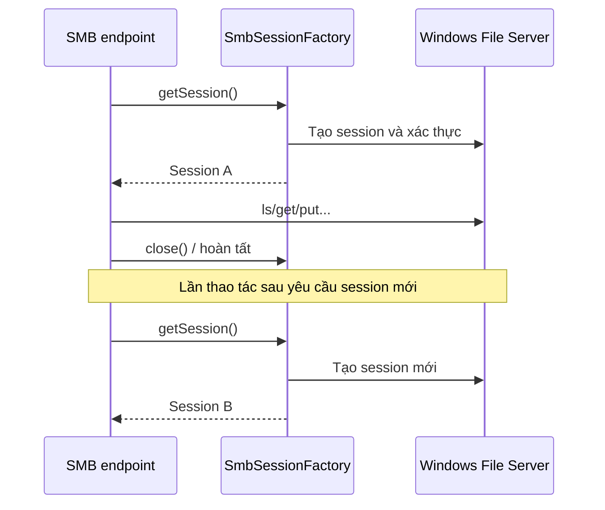
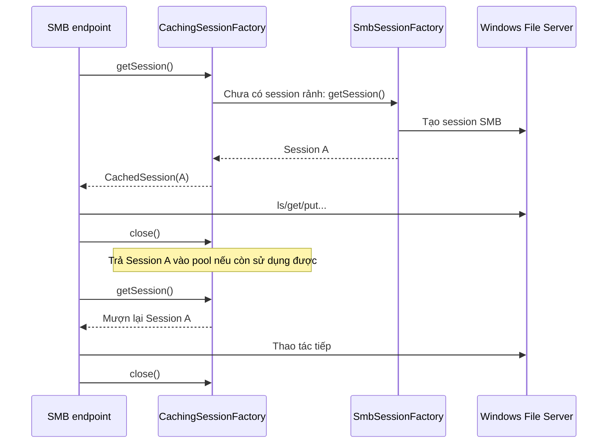
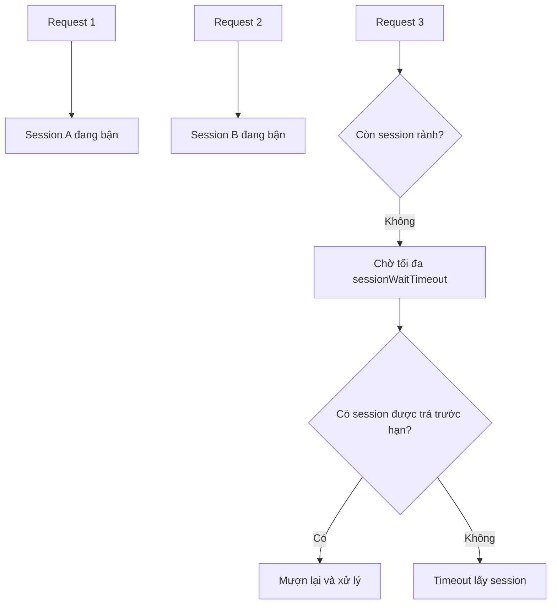
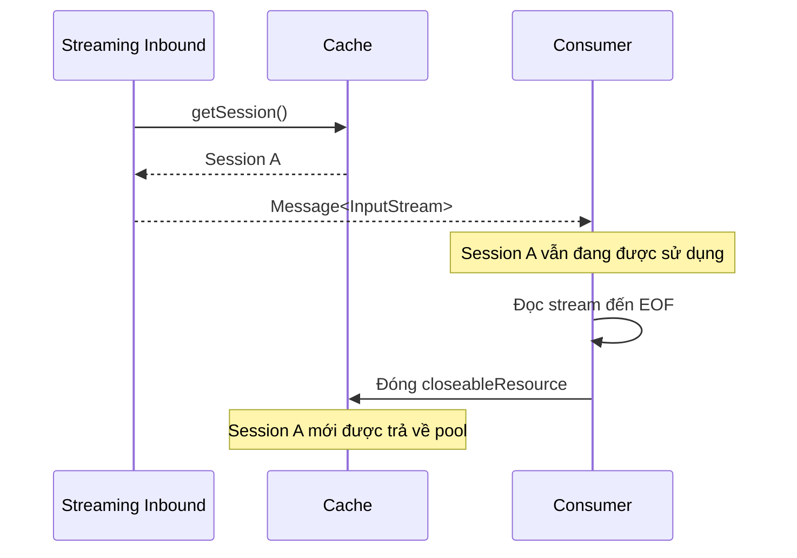

# SMB session factory và cache session

## 1. Vì sao cần quản lý session SMB?

Giả sử một ứng dụng Spring Boot phải đọc tệp báo cáo từ `\\fileserver\partner-share\incoming` mỗi 10 giây và gửi tệp xác nhận sang `\\fileserver\partner-share\outgoing`. Cứ mỗi lần poll hoặc gửi tệp, ứng dụng phải dùng một phiên làm việc với Windows File Server. Nếu tạo và đóng kết nối mới liên tục, thao tác kết nối/xác thực có thể chiếm đáng kể thời gian so với việc liệt kê một thư mục nhỏ.

Trong Spring Integration, `SmbSessionFactory` cung cấp các session SMB cho **inbound adapter**, **outbound adapter** và **outbound gateway**. Mặc định, khi endpoint yêu cầu một session, `SmbSessionFactory` tạo session mới. `CachingSessionFactory` có thể bọc factory này để tái sử dụng các session đã được trả lại, đồng thời hạn chế số session mà ứng dụng sử dụng đồng thời.

Bài thuộc chương **Adapter SMB** của module `SPRING_INTEGRATION_ADAPTERS`. Mục tiêu của module là kết nối hệ thống ngoài thông qua inbound/outbound adapter, gateway, poller và `MessageChannel`; thực hành luồng trao đổi file, SFTP, HTTP, JMS, AMQP, Kafka và database, quản lý hợp đồng message, lỗi và vòng đời kết nối. **Session** ở đây là tài nguyên kết nối dùng riêng cho giao thức SMB; nó khác với một `Message<?>` đang di chuyển trên `MessageChannel`.

Sau bài học, bạn có thể:

- Phân biệt `SmbSessionFactory`, `Session<SmbFile>`, `CachingSessionFactory<SmbFile>` và SMB endpoint.
- Cấu hình host, port, domain, credential, share, SMB dialect và pool size bằng Java.
- Giải thích đúng vòng đời **mượn session → sử dụng → trả session**, cách pool chặn khi hết chỗ và khi nào session thực sự đóng.
- Dùng **chính bean cache** cho inbound/outbound/gateway, thay vì khai báo cache nhưng để endpoint dùng factory gốc.
- Đánh giá `sessionCacheSize`, `sessionWaitTimeout`, `testSession`, `resetCache` và thời điểm tái tạo kết nối.
- Xác định session bị giữ quá lâu do `InputStream`, timeout, retry, sự cố mạng hoặc thay đổi credential.
- Thiết kế các bài thử chứng minh cache hoạt động, giới hạn session có hiệu lực và việc khôi phục không làm thất lạc file.

## 2. Các khái niệm cốt lõi

| Thành phần | Vai trò | Trách nhiệm |
|---|---|---|
| `SmbSessionFactory` | Tạo session SMB mới khi được yêu cầu | Chứa cấu hình host/share, domain, username/password và giới hạn SMB dialect |
| `Session<SmbFile>` | Giao diện thao tác trên tài nguyên SMB | Liệt kê, đọc, ghi, đổi tên hoặc xóa file; đóng sau khi hoàn thành |
| `SmbSession` | Triển khai session SMB của Spring Integration | Dùng thư viện client SMB phía dưới để thao tác với `jcifs.smb.SmbFile` |
| `CachingSessionFactory<SmbFile>` | Bọc một `SessionFactory<SmbFile>` | Cho mượn session và giữ lại session phù hợp để dùng lần sau |
| Inbound/outbound adapter | Chuyển file giữa SMB và luồng message | Mượn session khi cần đồng bộ hoặc gửi tệp |
| Outbound gateway | Gọi lệnh `ls/get/put/mv/rm` và nhận reply | Mượn session để thực thi yêu cầu, tạo phản hồi cho flow |
| Poller | Kích hoạt một inbound source theo lịch | Tạo nhịp hoạt động; không sở hữu pool session |
| `MessageChannel` | Chuyển message giữa các endpoint | Không phải session SMB và không tự quản lý kết nối SMB |

`SmbSessionFactory` triển khai giao diện chung `SessionFactory<jcifs.smb.SmbFile>`. Do đó, nhiều endpoint Spring Integration SMB chấp nhận cả factory gốc lẫn wrapper `CachingSessionFactory<SmbFile>` mà không cần thay đổi hợp đồng message.

Ví dụ một inbound adapter đồng bộ file về local vẫn phát payload `java.io.File`. Việc sử dụng cached session thay đổi cách **kết nối đến server được tái sử dụng**, **không thay payload thành `SmbFile` và không thay ý nghĩa của message**.

### Session khác gì TCP connection?

Một `Session<SmbFile>` là **abstraction** của Spring Integration cho phiên làm việc với một hệ thống remote. Thư viện SMB bên dưới có thể có thêm trạng thái xác thực, transport, cây thư mục/share hoặc cơ chế tái sử dụng riêng. Vì thế không nên suy luận “pool có 5 session” nghĩa là hệ điều hành luôn có đúng 5 TCP socket đang mở ở mọi thời điểm. Hãy dùng số session để kiểm soát nhu cầu của ứng dụng và đo kết nối thực tế ở server khi cần.

## 3. Hai mô hình vòng đời: có cache và không cache

### 3.1. Không có `CachingSessionFactory`



Mô hình này dễ hiểu và có thể phù hợp với công việc chạy rất ít lần. Đổi lại, mỗi lần tạo session mới có thể mang theo chi phí thiết lập kết nối, thương lượng giao thức và xác thực.

### 3.2. Có `CachingSessionFactory`



**Điểm dễ nhầm:** khi mã sử dụng cached session gọi `close()`, đó thường là **trả session về pool** để tái sử dụng. Nó không luôn đồng nghĩa với đóng kết nối vật lý ngay lúc đó. Nếu session đã hỏng, pool được reset hoặc ứng dụng dừng, session sẽ được đóng theo chính sách của factory.

Vòng đời điển hình:

1. Endpoint yêu cầu `Session<SmbFile>` từ `CachingSessionFactory`.
2. Cache tìm session rảnh hợp lệ; nếu không có và chưa vượt giới hạn, nó nhờ `SmbSessionFactory` tạo session mới.
3. Endpoint dùng session để đọc/ghi file hoặc thực hiện một lệnh gateway.
4. Endpoint kết thúc thao tác và gọi `close()` trên session nó mượn.
5. Cache quyết định trả session vào hàng đợi rảnh hay đóng nó nếu bị đánh dấu không tái sử dụng được.
6. Lần yêu cầu sau có thể mượn lại session đó.

**Không giữ một session mượn được thành singleton để sử dụng đồng thời ở nhiều thread.** Hãy để endpoint hoặc mã sử dụng session mượn khi cần và trả trong phạm vi xử lý. Session cache cho phép **tái sử dụng tuần tự** và kiểm soát concurrency; nó không biến một session thành đối tượng thread-safe dùng tùy ý.

## 4. Cấu hình thực hành Spring Boot + Java DSL

Ví dụ dưới đây sử dụng Spring Boot 3.x và Spring Integration 6.5.x tương thích. Các import/cấu trúc được đối chiếu với tài liệu Spring Integration 6.5, nên nếu dự án chạy nhánh khác cần dùng Javadoc đúng phiên bản dependency.

### 4.1. Dependencies

**Gradle:**

```gradle
dependencies {
    implementation 'org.springframework.boot:spring-boot-starter-integration'
    implementation 'org.springframework.integration:spring-integration-smb'
}
```

Spring Boot dependency management sẽ chọn phiên bản các artifact được nó quản lý. Nếu tự quản lý version, phải bảo đảm `spring-integration-smb`, `spring-integration-file` và các thành phần Spring Integration có version tương thích.

### 4.2. Properties

**`application.yml`:**

```yaml
demo:
  smb:
    host: ${SMB_HOST}
    port: ${SMB_PORT:445}
    domain: ${SMB_DOMAIN:}
    username: ${SMB_USERNAME}
    password: ${SMB_PASSWORD}
    share: ${SMB_SHARE:partner-share}
    pool-size: ${SMB_POOL_SIZE:4}
    session-wait-timeout-ms: ${SMB_SESSION_WAIT_TIMEOUT_MS:3000}
```

Để chạy lab, cấp biến môi trường tương ứng. Dùng secret manager hoặc cơ chế cấp secret của nền tảng cho credential ở môi trường thực; **không hard-code password** trong Java, Git hay log.

`SMB_POOL_SIZE=4` là giới hạn **trên một instance ứng dụng**. Nó không phải giới hạn dùng chung tự động cho 5 pod hoặc nhiều process. Nếu chạy 5 pod với cấu hình đó, nhu cầu có thể đạt khoảng 20 session đồng thời trong điều kiện mỗi pod cần tối đa 4 session, chưa tính kết nối bổ sung của client thư viện hoặc các ứng dụng khác.

### 4.3. Tạo factory gốc và factory có cache

**`SmbConnectionsConfig.java`:**

```java
import jcifs.DialectVersion;
import jcifs.smb.SmbFile;

import org.springframework.beans.factory.annotation.Qualifier;
import org.springframework.beans.factory.annotation.Value;
import org.springframework.context.annotation.Bean;
import org.springframework.context.annotation.Configuration;
import org.springframework.integration.annotation.IntegrationComponentScan;
import org.springframework.integration.config.EnableIntegration;
import org.springframework.integration.file.remote.session.CachingSessionFactory;
import org.springframework.integration.file.remote.session.SessionFactory;
import org.springframework.integration.smb.session.SmbSessionFactory;

@Configuration
@EnableIntegration
@IntegrationComponentScan
public class SmbConnectionsConfig {

    @Bean("rawSmbSessionFactory")
    SmbSessionFactory rawSmbSessionFactory(
            @Value("${demo.smb.host}") String host,
            @Value("${demo.smb.port}") int port,
            @Value("${demo.smb.domain}") String domain,
            @Value("${demo.smb.username}") String username,
            @Value("${demo.smb.password}") String password,
            @Value("${demo.smb.share}") String share) {

        SmbSessionFactory factory = new SmbSessionFactory();
        factory.setHost(host);
        factory.setPort(port);
        factory.setDomain(domain);
        factory.setUsername(username);
        factory.setPassword(password);
        factory.setShareAndDir(share);
        factory.setSmbMinVersion(DialectVersion.SMB210);
        factory.setSmbMaxVersion(DialectVersion.SMB311);
        return factory;
    }

    @Bean("cachedSmbSessionFactory")
    CachingSessionFactory<SmbFile> cachedSmbSessionFactory(
            @Qualifier("rawSmbSessionFactory")
            SmbSessionFactory target,
            @Value("${demo.smb.pool-size}") int poolSize,
            @Value("${demo.smb.session-wait-timeout-ms}") long waitMs) {

        if (poolSize < 1 || waitMs < 1) {
            throw new IllegalArgumentException(
                    "SMB pool-size và wait-timeout phải lớn hơn 0");
        }

        CachingSessionFactory<SmbFile> cache =
                new CachingSessionFactory<>(target, poolSize);
        cache.setSessionWaitTimeout(waitMs);

        // Cân nhắc testSession sau khi kiểm tra quyền và tải lên SMB.
        // cache.setTestSession(true);

        return cache;
    }
}
```

Giải thích theo thứ tự khởi tạo:

- `rawSmbSessionFactory` giữ **thông tin tạo session** và phạm vi SMB dialect được thương lượng. Trong ví dụ, host/share được cấp qua cấu hình và tài khoản có quyền tối thiểu.
- `cachedSmbSessionFactory` bọc **đúng factory gốc đó**. Kích thước pool được truyền qua constructor; thời gian chờ được cấu hình theo mili giây.
- Cả hai là bean có thể inject trong Spring. Do cả hai đều thuộc mô hình `SessionFactory<SmbFile>`, dùng `@Qualifier("cachedSmbSessionFactory")` tại endpoint để tránh inject nhầm factory gốc.
- `setTestSession(true)` là tùy chọn kiểm tra session khi mượn từ cache. Với SMB, việc kiểm tra sống có thể phải thực hiện thao tác liệt kê trên server; cần cân nhắc quyền, overhead và điều kiện mạng trước khi bật đại trà.
- Trong Spring Integration 6.5, kiểu generic cụ thể là `jcifs.smb.SmbFile`. Không dùng `java.io.File` làm generic của session factory: `File` là kiểu tệp local trong payload của một số adapter, không phải loại tài nguyên remote SMB.

### 4.4. Inject **factory cache** vào outbound gateway

Một flow kiểm tra đọc chỉ cần `ls -1`:

**`SmbFlowsConfig.java`:**

```java
import jcifs.smb.SmbFile;

import org.springframework.beans.factory.annotation.Qualifier;
import org.springframework.context.annotation.Bean;
import org.springframework.context.annotation.Configuration;
import org.springframework.integration.dsl.IntegrationFlow;
import org.springframework.integration.file.remote.session.SessionFactory;
import org.springframework.integration.smb.dsl.Smb;

@Configuration
public class SmbFlowsConfig {

    @Bean
    IntegrationFlow smbListFlow(
            @Qualifier("cachedSmbSessionFactory")
            SessionFactory<SmbFile> sessionFactory) {

        return IntegrationFlow.from("smbListRequests")
                .handle(Smb.outboundGateway(
                        sessionFactory, "ls", "payload")
                        .options("-1"))
                .get();
    }
}
```

**`SmbFilesGateway.java`:**

```java
import java.util.List;

import org.springframework.integration.annotation.Gateway;
import org.springframework.integration.annotation.MessagingGateway;

@MessagingGateway
public interface SmbFilesGateway {

    @Gateway(requestChannel = "smbListRequests")
    List<String> listNames(String remoteDirectory);
}
```

Trong một service Spring, có thể inject `SmbFilesGateway` rồi gọi:

```java
List<String> names = smbFilesGateway.listNames("incoming");
System.out.println("Số file nhìn thấy: " + names.size());
```

Mỗi lời gọi sẽ tạo request message gửi qua `smbListRequests`. Gateway dùng **cached session** để liệt kê rồi trả `List<String>` cho caller. Hai lần gọi liên tiếp có thể tái sử dụng cùng session nếu còn hợp lệ; nhưng không nên viết test khẳng định luôn phải là cùng socket vì server có thể chủ động đóng session và pool có quyền thay thế session hỏng.

### 4.5. Áp dụng lại factory cache cho outbound adapter

Muốn gửi file lên share, có thể thêm flow sau cùng cấu hình factory cache:

```java
import java.io.File;
import jcifs.smb.SmbFile;
import org.springframework.beans.factory.annotation.Qualifier;
import org.springframework.context.annotation.Bean;
import org.springframework.integration.dsl.IntegrationFlow;
import org.springframework.integration.file.remote.FileExistsMode;
import org.springframework.integration.file.remote.session.SessionFactory;
import org.springframework.integration.smb.dsl.Smb;

@Bean
IntegrationFlow smbSendFlow(
        @Qualifier("cachedSmbSessionFactory")
        SessionFactory<SmbFile> sessionFactory) {

    return IntegrationFlow.from("smbSendFiles")
            .handle(Smb.outboundAdapter(
                    sessionFactory, FileExistsMode.FAIL)
                    .remoteDirectory("outgoing")
                    .autoCreateDirectory(true)
                    .fileNameExpression("payload.name")
                    .useTemporaryFileName(true))
            .get();
}
```

Đây là **đoạn bổ sung** cần đặt bên trong một lớp `@Configuration`, không phải một file Java độc lập ở mức top-level. Input của flow là `File` local đã ghi xong; adapter ghi ra `outgoing` trong share và sử dụng cơ chế tên tạm theo cấu hình. Có thể thêm phương thức `@Gateway(requestChannel = "smbSendFiles") void upload(File file);` vào interface chuyên gửi file.

Điểm cần nhìn là cả `smbListFlow` và `smbSendFlow` đều inject `SessionFactory<SmbFile>` được định danh là `cachedSmbSessionFactory`. Nếu cả hai dùng chung một bean cache, chúng chia sẻ giới hạn session của instance. Với các tài khoản/remote share khác nhau, cần một factory và cache riêng cho từng identity/điểm kết nối phù hợp.

### 4.6. Với inbound adapter được poll theo lịch

Inbound adapter cũng nhận `SessionFactory<SmbFile>`. Có thể cấu hình tương tự:

```java
@Bean
IntegrationFlow smbInboundFlow(
        @Qualifier("cachedSmbSessionFactory")
        SessionFactory<SmbFile> sessionFactory) {

    return IntegrationFlow
            .from(Smb.inboundAdapter(sessionFactory)
                        .remoteDirectory("incoming")
                        .localDirectory(new File("./data/smb-inbox"))
                        .autoCreateLocalDirectory(true)
                        .regexFilter("(?i).*\\.csv$"),
                  endpoint -> endpoint.poller(
                        Pollers.fixedDelay(10_000)
                               .maxMessagesPerPoll(5)))
            .handle(message -> {
                File local = (File) message.getPayload();
                System.out.println("SMB file: " + local.getName());
            })
            .get();
}
```

Trong đoạn này cần import `java.io.File`, `org.springframework.integration.dsl.Pollers` và các lớp dùng cho flow/bean. Poller quyết định **khi nào** hỏi SMB; cache quyết định **lấy session nào** để kết nối. `maxMessagesPerPoll(5)` giới hạn số message một chu kỳ, **không phải** `sessionCacheSize=5`. Số file được tải mỗi lần và số message phát ra còn chịu ảnh hưởng của bộ lọc, dữ liệu local và các tùy chọn đồng bộ.

## 5. Các thuộc tính cache quan trọng

| API / cấu hình | Tác dụng | Cách chọn |
|---|---|---|
| `new CachingSessionFactory<>(target, N)` | Đặt giới hạn số session cache quản lý | Chọn theo số thao tác SMB đồng thời, tài nguyên file server |
| `setSessionWaitTimeout(ms)` | Giới hạn thời gian chờ khi mọi session đang được mượn | Cần ngắn hơn timeout tổng của nghiệp vụ nếu dùng request đồng bộ |
| `setTestSession(true)` | Kiểm tra session khi lấy từ pool trước khi sử dụng lại | Có thể tăng chi phí và yêu cầu thêm quyền; bật theo kết quả thử nghiệm |
| `resetCache()` | Xóa session rảnh khỏi cache; session đang dùng được đóng khi trả lại | Dùng trong quy trình hồi phục hoặc chuyển đổi cấu hình có kiểm soát |
| `setPoolSize(newSize)` | Điều chỉnh giới hạn pool khi chạy | Phải xem mức song song và policy của server |
| `destroy()` | Đóng session nhàn rỗi khi bean bị hủy | Thường do Spring quản lý vòng đời bean |

### 5.1. Nếu hết session thì điều gì xảy ra?

Giả sử `sessionCacheSize=2`, có ba request độc lập:



Nếu hai request đầu đều chiếm session liên tục 8 giây, nhưng request thứ ba chỉ được chờ 3 giây, request thứ ba có thể thất bại vì **không mượn được session**, ngay cả khi DNS, SMB server và password đều đúng.

Lỗi hết pool khác với timeout mạng và lỗi xác thực. Chẩn đoán phải xác định **đang chờ session trong cache** hay đã có session nhưng đang chờ SMB server xử lý.

### 5.2. Chọn kích thước pool theo tải

Không có một giá trị áp dụng cho mọi hệ thống. Hãy bắt đầu từ **mức song song cần thực sự phục vụ**:

| Mô hình | Cân nhắc ban đầu |
|---|---|
| Một inbound poller, xử lý đồng bộ, ít file | Pool nhỏ, ví dụ 1–2, có thể đủ |
| Một inbound và một outbound hoạt động đồng thời | Cần đủ chỗ cho hai thao tác SMB cùng lúc và dự phòng giới hạn phù hợp |
| Nhiều request gateway song song | Pool phải phù hợp số request được phép hoạt động và mức server chịu được |
| Nhiều pod dùng chung share | Tổng tải = nhu cầu tất cả instance; cache không phân phối giới hạn toàn cluster |
| Streaming inbound giữ stream trong handler | Tính thời gian stream giữ session, không chỉ thời gian truy vấn SMB ban đầu |

`sessionCacheSize=4` không khiến mỗi lần poll tạo bốn kết nối; session được tạo theo **nhu cầu mượn thực tế**. Mặt khác, pool quá lớn có thể làm tăng số kết nối, mức tải server và thời gian khôi phục khi server gặp lỗi. Pool quá nhỏ tạo hàng đợi và timeout.

Nếu latency một thao tác SMB tăng bất thường, tăng pool chưa chắc giải quyết vấn đề: nguyên nhân có thể là mạng, server bị nghẽn, xử lý tệp lớn hoặc ứng dụng đang giữ session quá lâu. Đo thời gian thao tác và số request đồng thời trước khi tăng giới hạn.

### 5.3. `setTestSession(true)` có lợi và chi phí gì?

Khi bật tùy chọn này, `CachingSessionFactory` kiểm tra session mượn ra khỏi cache có còn sống hay không. Nếu session đã bị server ngắt, việc loại session cũ và tạo session mới có thể tránh lỗi do tái sử dụng kết nối chết.

**Với SMB**, `SmbSession.isOpen()` có thể kiểm tra bằng cách liệt kê file từ xa, tức phép thử có I/O và cần quyền phù hợp. Tài khoản chỉ được phép ghi mà bị cấm liệt kê có thể khiến kiểm tra này thất bại dù một tác vụ ghi nhất định vẫn có thể chạy được. Vì thế:

1. Xem quyền tài khoản và thử `isOpen/test` trong lab.
2. Đo thêm thời gian mượn session khi bật test.
3. Chọn dùng hay không dùng tùy theo chi phí I/O, khả năng server tự ngắt session và mức sẵn sàng của flow.
4. Dù bật test, vẫn phải xử lý mất kết nối **sau** thời điểm kiểm tra; kết nối có thể hỏng ngay trong thao tác SMB tiếp theo.

Đừng hiểu `testSession(true)` là “tự sửa mọi lỗi kết nối”. Nó chỉ hỗ trợ phát hiện session không còn dùng được khi mượn, không cung cấp retry nghiệp vụ hoặc đảm bảo chính xác một lần.

## 6. Đóng session đúng cách

### 6.1. Endpoint có thể quản lý session, mã tự viết phải quản lý tài nguyên

Đối với inbound adapter đồng bộ file về local hoặc outbound gateway/adapter thực hiện thao tác hữu hạn, endpoint chuẩn thường mượn và đóng/trả session trong quy trình của chính nó. Mã nghiệp vụ phía sau nhận `Message<File>` không cần giữ session để đọc file local đã tải.

Nếu tự viết mã dùng `SessionFactory<SmbFile>` trực tiếp, cần trả session bằng `try-with-resources`:

```java
import jcifs.smb.SmbFile;
import java.io.IOException;
import java.util.Arrays;
import java.util.List;
import org.springframework.integration.file.remote.session.Session;
import org.springframework.integration.file.remote.session.SessionFactory;

public final class SmbDirectoryInspector {

    private final SessionFactory<SmbFile> sessionFactory;

    public SmbDirectoryInspector(SessionFactory<SmbFile> sessionFactory) {
        this.sessionFactory = sessionFactory;
    }

    public List<String> list(String remoteDirectory) throws IOException {
        try (Session<SmbFile> session = sessionFactory.getSession()) {
            String[] names = session.listNames(remoteDirectory);
            return Arrays.asList(names);
        }
    }
}
```

Đoạn này giả định caller inject **cached factory**. Khi ra khỏi khối `try`, `session.close()` chạy kể cả khi phát sinh ngoại lệ thông thường; cache được cơ hội thu hồi slot. Với session mượn từ cache, `close()` thông thường mang nghĩa trả vào pool. Với factory gốc, `close()` sẽ đóng tài nguyên session gốc.

Nếu gặp lỗi khiến session không còn an toàn để tái sử dụng, giao diện `Session` hỗ trợ `dirty()` để đánh dấu session cần loại bỏ trong các triển khai phù hợp. Khi tự quản lý I/O phức tạp, cần xử lý lỗi và đánh dấu trạng thái session theo đúng hợp đồng API; đừng giữ session chết rồi dùng lại chỉ vì nó vẫn nằm trong cache.

### 6.2. Streaming inbound giữ session lâu hơn

Khác với adapter đồng bộ file trước khi phát message, **SMB streaming inbound adapter** có thể phát payload `InputStream`. Khi nhận được stream, dữ liệu vẫn được đọc trực tiếp từ SMB; session phải còn tồn tại cho tới khi đọc xong.



Spring Integration cung cấp tài nguyên cần đóng qua header `IntegrationMessageHeaderAccessor.CLOSEABLE_RESOURCE` (tên header thường là `closeableResource`). Những component chuẩn như `FileSplitter` và `StreamTransformer` có hỗ trợ đóng tài nguyên. Handler tự viết phải đóng tài nguyên **sau khi** tiêu thụ stream xong, kể cả khi lỗi.

Điểm vận hành quan trọng: một pool có 2 session mà 2 consumer giữ 2 stream mở suốt 30 giây có thể khiến request thứ ba chờ hoặc timeout trong thời gian đó. Nếu streaming consumer chuyển việc đọc sang thread khác, phải tổ chức vòng đời stream/session xuyên qua ranh giới thread và xử lý exception thích hợp; không đóng trước khi thread thật sự hoàn tất.

### 6.3. Tại sao không gọi `resetCache()` sau mỗi file?

`resetCache()` dùng để loại các session đang lưu, chứ không phải bước bắt buộc sau mỗi message. Reset mỗi file sẽ phá lợi ích tái sử dụng và tạo thêm chi phí kết nối/xác thực. Tương tự, không nên tạo `new CachingSessionFactory(...)` riêng cho từng request; làm vậy sẽ tạo nhiều pool nhỏ không được quản lý nhất quán.

## 7. Khi session hỏng, mạng đứt hoặc credential thay đổi

### 7.1. Các nhóm lỗi cần phân biệt

| Triệu chứng | Lớp nghi ngờ | Bước xử lý |
|---|---|---|
| Không đến được host hoặc TCP 445 | DNS, mạng, firewall, server | Kiểm tra từ chính container/pod đang chạy |
| Lỗi xác thực khi tạo session mới | Domain, username/password, account | Kiểm tra nguồn secret, policy khóa account, không retry ồ ạt |
| `Access Denied` khi list/put/mv | Share permission, NTFS ACL | So sánh quyền cụ thể với lệnh; không tự tăng quyền lên admin |
| Chờ `getSession()` rồi timeout | Pool hết session rảnh / session không được trả | Kiểm tra concurrency, streaming, timeout và rò rỉ resource |
| Lấy session cache được nhưng lệnh SMB thất bại | Session cũ hết hạn, mạng/server lỗi giữa thao tác | Loại session lỗi, retry có giới hạn, đối chiếu trạng thái file |
| Chỉ pod cũ hoạt động sau rotation | Cấu hình secret và session chưa đổi đồng bộ | Xác minh bean/config, rollout, session cache |
| Tăng `pool-size` nhưng không tăng thông lượng | Server hoặc đường truyền đang nghẽn | Đo thời gian thao tác, tải server, file size và contention |

Lỗi của một flow có thể được bọc thành `MessagingException`. Lưu các trường không nhạy cảm như host alias, tên share, command, batch ID, request ID, độ trễ và nhóm lỗi. Không log raw password, authentication hash hay URL chứa credentials.

### 7.2. Reset pool khi server gặp sự cố

API `CachingSessionFactory.resetCache()` có hành vi:

- **Session đang rảnh:** được đóng khi reset.
- **Session đang được mượn:** khi được trả lại về cache, nó sẽ bị đóng thay vì giữ lại để tái sử dụng.
- **Request tương lai:** có thể tạo session mới qua factory gốc khi cần.

Vì vậy, reset giúp **loại session cũ khỏi pool**, nhưng không bảo đảm xử lý thành công các request đã lỗi hoặc đang chạy. Phải xử lý retry theo kết quả từng file/lệnh. Ví dụ một lệnh `put` bị timeout có thể đã ghi file đến server; gửi lại với `REPLACE` hoặc `APPEND` không an toàn nếu chưa đối chiếu.

Ví dụ cách gọi ở **thành phần điều hành đáng tin cậy**:

```java
import jcifs.smb.SmbFile;
import org.springframework.beans.factory.annotation.Qualifier;
import org.springframework.integration.file.remote.session.CachingSessionFactory;

public class SmbCacheAdminService {

    private final CachingSessionFactory<SmbFile> cache;

    public SmbCacheAdminService(
            @Qualifier("cachedSmbSessionFactory")
            CachingSessionFactory<SmbFile> cache) {
        this.cache = cache;
    }

    public void evictCachedSessions() {
        cache.resetCache();
    }
}
```

Đây là **đoạn minh họa một class**; nếu muốn Spring quản lý class như bean, cần khai báo bean hoặc annotation stereotype thích hợp. Không phơi một REST endpoint reset cache công khai; đặt quyền truy cập/kiểm soát thay đổi rõ ràng.

### 7.3. Khi đổi password, reset cache có đủ không?

**Không.** `SmbSessionFactory` gốc thường được khởi tạo từ properties một lần khi ứng dụng startup. Nếu secret bên ngoài đã đổi nhưng factory gốc vẫn giữ password cũ, `resetCache()` sẽ xóa những session đã mượn/đang rảnh, nhưng **những session mới vẫn có thể dùng credential cũ**.

Một quy trình rotation có kiểm soát:

1. Chuẩn bị secret mới và kế hoạch đổi credential với hệ thống quản lý danh tính.
2. Cập nhật nguồn secret mà ứng dụng thực sự đọc.
3. Làm mới/recreate `SmbSessionFactory` cùng `CachingSessionFactory`, thường bằng rollout/restart có kiểm soát nếu cấu hình không hỗ trợ reload động.
4. Thử `ls` trên thư mục lab để xác thực và kiểm tra quyền với session mới.
5. Khôi phục tác vụ bị lỗi theo trạng thái nghiệp vụ đã ghi nhận; tránh retry hàng loạt không có giới hạn.

Đặc biệt với ứng dụng nhiều pod, cần quản lý thứ tự triển khai để pod cũ và pod mới không cùng xử lý một batch khi chưa có cơ chế sở hữu công việc.

### 7.4. Không nhầm cache với cơ chế chống xử lý trùng

Cache session chỉ giữ lại **tài nguyên kết nối**, không giữ lịch sử file đã nhận. Nó **không** cung cấp:

- khóa `idempotency` cho hóa đơn/đơn hàng;
- xác nhận rằng remote file đã được xử lý nghiệp vụ;
- retry an toàn sau timeout;
- phân phối quyền sở hữu batch giữa nhiều instance;
- persistent metadata store cho bộ lọc inbound.

Nếu inbound adapter poll lại file cũ hoặc outbound adapter gửi lại một batch, phải thiết kế bộ lọc/metadata store và khóa nghiệp vụ riêng. Một `MessageChannel` hoặc session pool không tự biến các bước truyền file và commit database thành một transaction duy nhất.

## 8. Cấu hình và vận hành nhiều instance

Một cache là cấu trúc **nội bộ một ApplicationContext/JVM**, trừ khi có cơ chế phân phối đặc biệt ngoài phạm vi tài liệu. Vì thế:

- **2 instance × pool size 4** cho phép mỗi instance mượn tối đa 4 session từ cache riêng. File server cần chịu được tổng lượng request thực.
- Nếu cả hai instance dùng chung inbound share, chỉ thêm cache không ngăn cả hai cùng tải hoặc xử lý một file. Cần metadata store dùng chung, khóa công việc hoặc chiến lược partition phù hợp.
- Nếu cả hai dùng cùng tài khoản SMB, rotation của account có thể ảnh hưởng cả hai; đừng tạo lại một pod rồi kết luận toàn cluster đã xác thực bằng secret mới.
- Nếu nhiều flow có đặc tính khác nhau nhưng dùng cùng share/account, chọn giữa **một cache chung** (dễ giới hạn tổng mức song song) và **nhiều cache có giới hạn riêng** (giảm ảnh hưởng giữa flow) dựa trên nhu cầu và tải server.
- Với các share/account khác nhau, nên tách factory để tránh rò đường dẫn và quyền, đồng thời cấu hình secret riêng.

### Kiểm soát tải trong thực tế

Một hệ thống có inbound poller chạy mỗi 10 giây không nhất thiết chỉ có một thao tác tại một thời điểm. Nếu poller có executor nhiều thread, inbound streaming giữ session và cùng lúc có gateway truy vấn hoặc outbound upload, các luồng có thể tranh pool.

Thay đổi `fixedDelay`, `maxMessagesPerPoll` và `sessionCacheSize` cần được đánh giá cùng nhau, nhưng **chúng điều khiển ba phần khác nhau**:

| Thuộc tính | Giới hạn điều gì? |
|---|---|
| `fixedDelay(10_000)` | Nhịp bắt đầu lần poll tiếp theo sau khi tác vụ poll hoàn tất |
| `maxMessagesPerPoll(5)` | Số message poller phát tối đa trong một chu kỳ |
| `maxFetchSize` nếu có | Số file từ xa lấy trong một lượt đồng bộ của nguồn |
| `sessionCacheSize=4` | Số session SMB được cache cung cấp đồng thời trong instance |
| `sessionWaitTimeout=3000` | Thời gian chờ khi cần session mà chưa còn slot |

Sửa `sessionCacheSize` không làm tăng tự động số message mỗi chu kỳ poll, và tăng số message cũng không làm server chịu được thêm kết nối.

## 9. Quan sát hiệu năng và trạng thái session

Để biết cache đang giúp ích hay gây nghẽn, hãy quan sát những tín hiệu sau:

| Tín hiệu | Câu hỏi muốn trả lời |
|---|---|
| Số request SMB đồng thời | Nhu cầu thực tế gần hay vượt kích thước pool? |
| Độ trễ lấy session | Có phải thread đang chờ slot cache? |
| Độ trễ lệnh `ls/get/put/mv` | Chậm nằm trong thao tác remote hay trước lúc có session? |
| Số lỗi timeout lấy session | Pool nhỏ, leak session hay handler giữ stream quá lâu? |
| Số kết nối server / session tạo mới | Cache có giảm việc xác thực/kết nối lại không? |
| Số lỗi xác thực và permission | Vấn đề account/policy có tăng sau rotation? |
| Số stream vẫn mở | Có consumer giữ session sau khi message đã được nhận? |
| Kích thước backlog file | Tốc độ xử lý có theo kịp hệ thống nguồn? |

Không phải tất cả tín hiệu trên đều là metric có sẵn trong Spring Integration. Có thể đo ở application layer, Micrometer, log đã làm sạch, thông tin pool qua instrumentation phù hợp và metrics của SMB server. Khi thêm instrumentation, không log tên đăng nhập/password bí mật hoặc nội dung file.

Một phép đo đơn giản trong lab là so sánh nhiều lần `ls` khi dùng factory gốc và khi dùng cache, sau đó xem số session/connection ở server (nếu có quyền xem). Kết quả phụ thuộc latency mạng, kích thước thư mục, số thread và trạng thái server; không hứa một mức tăng tốc cố định.

## 10. Thực hành theo tình huống

Chuẩn bị Windows File Server, NAS hoặc Samba share **chỉ dành cho lab**, tên ví dụ `partner-share`, gồm thư mục `incoming` và `outgoing`. Tài khoản có quyền liệt kê `incoming`, tạo file trong `outgoing`. Ứng dụng đã có cấu hình hai factory và flow `ls` ở phần 4.

### Lab A — Xác minh việc dùng đúng bean cache

1. Khởi động ứng dụng với `SMB_POOL_SIZE=2` và `SMB_SESSION_WAIT_TIMEOUT_MS=3000`.
2. Gọi `listNames("incoming")` vài lần liên tiếp, xác nhận gateway có reply `List<String>`.
3. Kiểm tra wiring của `smbListFlow` và xác minh đối số mang `@Qualifier("cachedSmbSessionFactory")`.
4. Nếu có công cụ xem session phía server, quan sát reuse; đừng chỉ dựa vào số lần xuất hiện của một tên file.

**Kết quả:** hiểu rằng sự tồn tại của bean cache chưa đủ; endpoint phải thực sự được inject bean cache.

### Lab B — Pool hết slot và timeout

1. Trong một bài thử cô lập, mượn `Session<SmbFile>` bằng `getSession()` và giữ hai session chưa đóng trong một khoảng thời gian ngắn, có kiểm soát.
2. Từ request thứ ba, thử mượn tiếp và quan sát chờ tới giới hạn 3000 ms; kỳ vọng có lỗi hết thời gian chờ session.
3. Đóng hai session đầu trong khối `finally` hoặc `try-with-resources`.
4. Mượn session lại và xác minh request có thể tiếp tục.

Đừng làm Lab B bằng cách giữ session của flow thật khi ứng dụng production đang xử lý. Nếu sử dụng code thử nghiệm, đảm bảo đóng session ngay cả khi test thất bại.

**Kết quả:** phân biệt pool timeout và lỗi TCP/SMB authentication.

### Lab C — So sánh có cache/không cache

1. Trong lab, đo thời gian 20 lần gọi `ls` với cấu hình factory gốc và 20 lần với cached factory; chỉ thay cách inject trong môi trường thử nghiệm.
2. Giữ nguyên dữ liệu thư mục, mạng, tài khoản và mức song song.
3. Ghi thời gian trung vị, độ trễ bất thường và số session server quan sát được nếu có.
4. Giải thích vì sao cache có thể cải thiện độ trễ kết nối nhưng không làm `ls` trên thư mục hàng triệu file trở nên nhẹ.

**Kết quả:** dựa trên số đo để chọn cấu hình, không suy từ định nghĩa cache thành một mức tăng tốc mặc định.

### Lab D — Session cũ sau gián đoạn SMB

1. Gọi `ls` thành công để cache có một session đã từng sử dụng.
2. Trong mạng lab, tạm ngắt kết nối SMB hoặc restart server thử nghiệm theo quyền đã cấp.
3. Khôi phục server, gọi `ls` và ghi lỗi hoặc sự kiện tạo session mới.
4. Dùng phương án bật `testSession` hoặc reset cache có kiểm soát, rồi gọi lại.
5. Đối chiếu kết quả và giải thích vì sao vẫn cần retry với backoff khi một lệnh đang chạy gặp lỗi.

**Kết quả:** hiểu giới hạn của session reuse khi server chủ động đóng phiên cũ.

### Lab E — Streaming giữ session và nguy cơ leak

1. Tạo flow streaming inbound trên share lab để đọc một tệp lớn, hoặc mô phỏng một đoạn mã mượn session và giữ tài nguyên I/O.
2. Quan sát session vẫn bị chiếm trong thời gian stream chưa đóng.
3. Hoàn tất việc đọc và đóng `closeableResource` đúng vòng đời; quan sát request khác có thể mượn session.
4. Thử riêng một luồng xử lý ngoại lệ và chắc chắn vẫn đóng tài nguyên.

**Kết quả:** biết nguyên nhân pool cạn có thể nằm ở consumer stream thay vì cấu hình pool quá nhỏ.

### Lab F — Xoay vòng credential

1. Kiểm tra thời điểm ứng dụng đọc `SMB_PASSWORD` và thời điểm tạo `SmbSessionFactory`.
2. Trong lab có tài khoản thử nghiệm được phép rotation, thực hiện đổi mật khẩu và cập nhật secret.
3. Rollout/restart các pod phụ thuộc theo chính sách, thay vì chỉ gọi `resetCache()` rồi giả định factory gốc nhận giá trị mới.
4. Gọi lại `ls` để xác minh session mới có thể đăng nhập và đọc đúng thư mục.
5. Ghi nhận trạng thái các pod, không ghi mật khẩu trong log.

**Kết quả:** giải thích được mối quan hệ giữa credential đã nạp, cache session và vòng đời ApplicationContext.

### Câu hỏi tự kiểm tra

1. `SmbSessionFactory` đã là factory, tại sao phải bọc thêm `CachingSessionFactory`?
2. Vì sao `session.close()` trên cached session có thể chỉ trả phiên vào pool thay vì ngắt ngay kết nối?
3. Pool size 3 có đủ cho hai consumer streaming dài và hai outbound gateway chạy song song không?
4. Tại sao bật `testSession(true)` có thể không phù hợp với tài khoản chỉ được phép ghi?
5. Nếu `resetCache()` đã chạy, vì sao một session mới vẫn có thể bị lỗi password cũ?
6. Vì sao cache session không giải quyết chuyện hai pod nhập lại cùng một hóa đơn?

## 11. Các nhầm lẫn phổ biến

| Nhầm lẫn | Cách hiểu đúng |
|---|---|
| Chỉ cần khai báo bean cache thì mọi SMB endpoint tự dùng cache | Phải inject đúng bean cache vào từng adapter/gateway |
| `SmbSessionFactory` mặc định luôn tái sử dụng session | Theo tài liệu SMB, nó tạo session mới mỗi lần yêu cầu; cache cần wrapper |
| `close()` luôn đóng socket ngay lập tức | Với cached session, `close()` thường trả session về pool nếu còn hợp lệ |
| Pool size 4 nghĩa là luôn có 4 kết nối mở | Session được tạo theo nhu cầu, kết nối vật lý không ánh xạ cố định 1:1 |
| Hết pool nghĩa là SMB server không chạy | Có thể do concurrency, stream giữ session hoặc quên đóng tài nguyên |
| `testSession(true)` không có chi phí | Có thêm phép kiểm tra sống và I/O; với SMB có thể liên quan quyền liệt kê |
| `resetCache()` làm bean đọc lại secret mới | Nó loại session cũ; cần cập nhật factory/config để dùng credential mới |
| Caching giúp file chỉ xử lý một lần | Nó tối ưu kết nối, không phải idempotency của file hoặc database |
| `maxMessagesPerPoll` là số SMB session | Một tham số là giới hạn message của poller, tham số kia là kích thước pool |
| Tăng pool luôn tăng throughput | Có thể làm server nghẽn hơn khi network/I/O đã bão hòa |
| Một cache ở pod A giới hạn session của pod B | Mỗi instance có pool riêng; cần tính tổng nhu cầu nhiều instance |
| File streaming đã phát message thì có thể trả session | Phải đợi stream được tiêu thụ/đóng và resource được giải phóng |

## 12. Tài liệu tham khảo

- [Spring Integration 6.5 — SMB Support](https://docs.spring.io/spring-integration/reference/6.5/smb.html): `SmbSessionFactory`, cache session, Java DSL và streaming inbound.
- [Spring Integration 6.5 — `SmbSessionFactory` Javadoc](https://docs.spring.io/spring-integration/docs/6.5.x/api/org/springframework/integration/smb/session/SmbSessionFactory.html): triển khai `SessionFactory<jcifs.smb.SmbFile>`.
- [Spring Integration 6.5 — `CachingSessionFactory` Javadoc](https://docs.spring.io/spring-integration/docs/6.5.0/api/org/springframework/integration/file/remote/session/CachingSessionFactory.html): constructor, giới hạn pool, `setTestSession`, `resetCache`, `setPoolSize`.
- [Spring Integration 6.5 — `Session` Javadoc](https://docs.spring.io/spring-integration/docs/6.5.0/api/org/springframework/integration/file/remote/session/Session.html): `getSession`, `close`, `dirty`, `test` và vòng đời session chung.
- [Spring Integration 6.5 — SMB Java DSL API](https://docs.spring.io/spring-integration/docs/6.5.0/api/org/springframework/integration/smb/dsl/Smb.html): các factory method chấp nhận `SessionFactory<SmbFile>`.

**Ghi nhớ:** dùng `SmbSessionFactory` để **tạo** SMB session và `CachingSessionFactory` để **tái sử dụng/giới hạn** session. Độ tin cậy của luồng còn phụ thuộc việc đóng đúng vòng đời, timeout, account/secret, xử lý lỗi và idempotency; cache chỉ là một phần của thiết kế kết nối.
