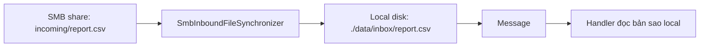
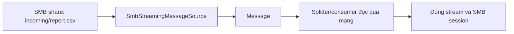
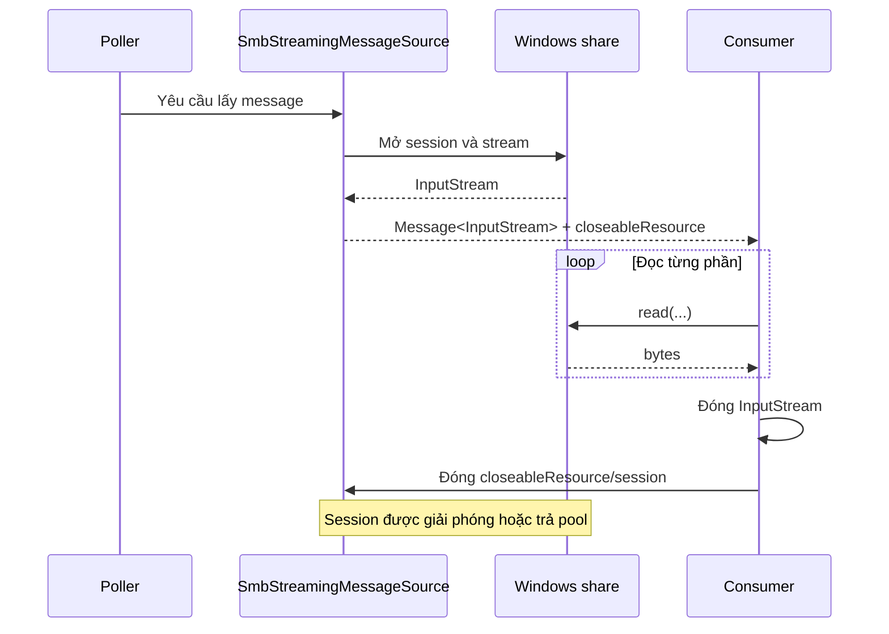
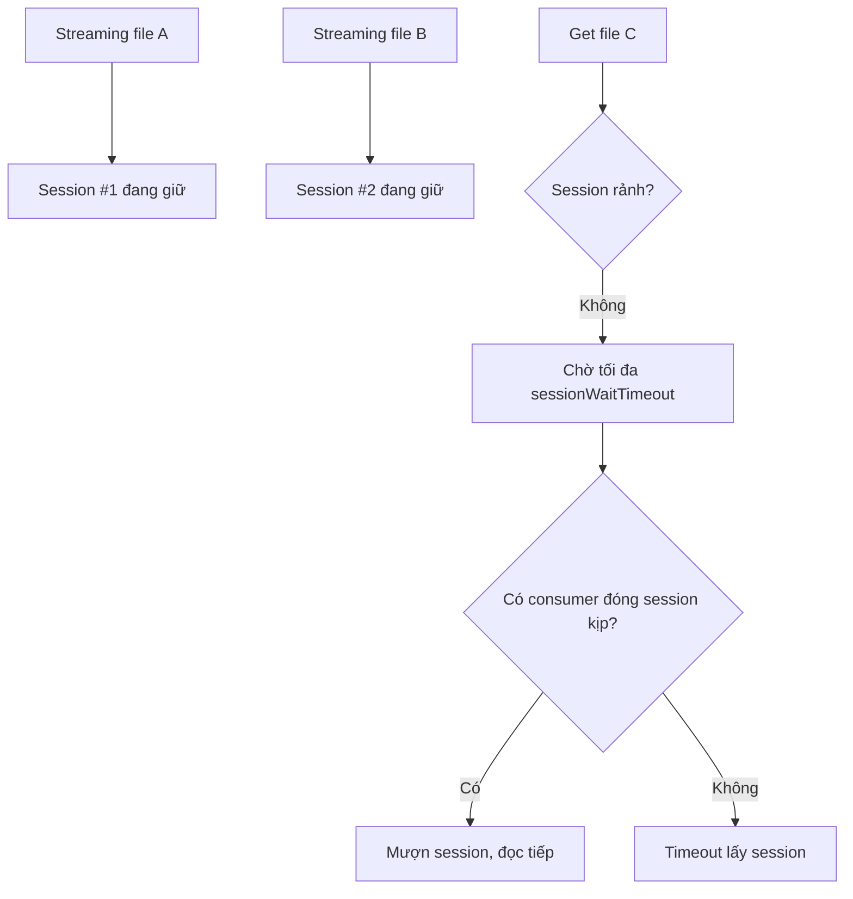
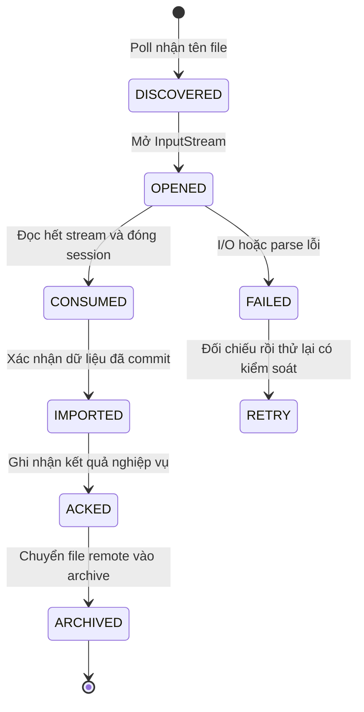

# Streaming file qua SMB trong Spring Integration

## 1. Bài toán và mục tiêu

Một đối tác đặt tệp `orders-20261123.csv` dung lượng 3 GB trong thư mục chia sẻ Windows `\\fs01\exchange\incoming`. Ứng dụng Spring Boot cần đọc từng bản ghi, kiểm tra dữ liệu và đưa chúng vào quy trình nhập đơn hàng. Nếu tải cả tệp về ổ đĩa trước rồi mới xử lý, ứng dụng phải có đủ dung lượng tạm và cần một bước đồng bộ. Nếu đọc toàn bộ tệp thành `String` hoặc `byte[]`, bộ nhớ có thể bị tiêu thụ rất lớn.

**SMB streaming inbound channel adapter** giúp ứng dụng nhận một `Message<InputStream>` và đọc dữ liệu từ SMB khi consumer tiêu thụ stream. Không cần tạo bản sao đầy đủ trên ổ đĩa local trước khi xử lý. Tuy nhiên, phiên làm việc với SMB vẫn phải **mở trong suốt thời gian đọc**; consumer có trách nhiệm đóng tài nguyên đúng lúc, kể cả khi gặp lỗi.

Bài thuộc chương **Adapter SMB** của module `SPRING_INTEGRATION_ADAPTERS`: kết nối hệ thống ngoài bằng inbound/outbound adapter, gateway, poller và `MessageChannel`, xử lý hợp đồng message, lỗi và vòng đời kết nối. Dù mô hình này liên quan đến các remote-file adapter của SFTP/FTP, nó dùng chính các thành phần và kết nối SMB; không suy diễn mọi hành vi giữa SMB và các giao thức HTTP, JMS, AMQP, Kafka hay database là giống nhau.

Sau bài học, bạn có thể:

- Phân biệt tải tệp về local với đọc trực tiếp qua `InputStream`.
- Cấu hình `SmbStreamingMessageSource` hoặc Java DSL `Smb.inboundStreamingAdapter(...)`.
- Hiểu payload, các header `file_remoteFile`, `file_remoteDirectory` và `closeableResource`.
- Xử lý stream bằng `FileSplitter`, `StreamTransformer` hoặc handler tự viết mà không rò session.
- Dùng outbound gateway `get -stream` khi cần đọc một tệp theo yêu cầu.
- Xác định tác động của `maxFetchSize`, poller, metadata filter và session cache.
- Thiết kế retry/idempotency khi đọc lỗi giữa file, giới hạn bộ nhớ và các bài kiểm thử có thể lặp lại.

## 2. Streaming thực sự thay đổi điều gì?

### 2.1. Hai đường đi của một tệp SMB

**Inbound adapter đồng bộ về local:**



**Streaming inbound adapter:**



| Tiêu chí | Đồng bộ về local | Streaming inbound |
|---|---|---|
| Payload | `java.io.File` | `java.io.InputStream` |
| Bản sao đầy đủ trên local | Thường có | Không bắt buộc |
| Bắt đầu xử lý | Sau khi tải tệp local | Khi consumer đọc stream từ remote |
| Kết nối SMB khi xử lý nghiệp vụ | Có thể đã được trả sau khi tải file | Thường vẫn được giữ để đọc nội dung |
| Dễ đọc lại khi mạng mất | Có bản sao nếu file local còn | Phải mở lại nguồn hoặc có checkpoint riêng |
| Áp lực dung lượng ổ đĩa local | Cao hơn nếu file lớn | Thấp hơn khi không tự lưu bản sao |
| Áp lực bộ nhớ | Phụ thuộc handler | Thấp **nếu đọc tăng dần**, có thể rất cao nếu gom cả file |
| Xử lý lỗi giữa file | Có thể xử lý lại bản sao local | Cần quản lý stream/session và trạng thái nhập dở |

“Streaming” **không có nghĩa dữ liệu tự động được xử lý với bộ nhớ hằng số**. Ví dụ `StreamTransformer("UTF-8")` tạo một `String` chứa toàn bộ tệp, nên có thể dùng nhiều RAM. Streaming cho phép tránh tạo bản sao local trước; việc ứng dụng có tiết kiệm bộ nhớ hay không phụ thuộc cách consumer đọc và giữ dữ liệu.

### 2.2. SMB session đi cùng luồng đọc



Sau khi adapter phát message, kết nối không thể bị đóng ngay: stream trong payload còn phụ thuộc kết nối SMB. Nếu consumer quên đóng resource, các session có thể bị giữ lại, khiến pool đầy và những request sau phải chờ hoặc lỗi timeout.

## 3. Những thành phần và hợp đồng message

| Thành phần | Chức năng | Điều cần lưu ý |
|---|---|---|
| `SmbSessionFactory` | Tạo session tới host/share SMB, dùng account và cấu hình giao thức | Cần quyền đọc file và quyền liệt kê thư mục |
| `CachingSessionFactory<SmbFile>` | Có thể tái sử dụng và giới hạn số session | Stream chưa đóng đồng nghĩa session còn được giữ |
| `SmbRemoteFileTemplate` | Đóng gói thao tác SMB dựa trên `SessionFactory` | Được truyền cho streaming message source |
| `SmbStreamingMessageSource` | Chọn file remote và tạo message có `InputStream` | Không tự lưu file xuống local |
| `Smb.inboundStreamingAdapter(template)` | Java DSL spec cho streaming inbound | Dùng `remoteDirectory`, filter, `maxFetchSize` và poller |
| `FileSplitter` | Tách file text thành từng dòng | Có khả năng tự đóng tài nguyên streaming khi đã tiêu thụ |
| `StreamTransformer` | Đọc stream thành `String` hoặc `byte[]` | Dễ dùng cho file nhỏ; dùng RAM theo nội dung |
| `Smb.outboundGateway(..., "get", ...)` | Chủ động tải một file theo request/reply | Dùng `-stream` để nhận stream thay vì `File` |

### 3.1. Payload và các header quan trọng

Khi streaming inbound phát message:

| Trường | Ví dụ | Ý nghĩa |
|---|---|---|
| `payload` | `InputStream` | Luồng byte từ file SMB; đọc một lần theo thứ tự |
| `closeableResource` | Một tài nguyên `Closeable` liên kết session | **Đóng sau khi** đọc xong, kể cả khi lỗi |
| `file_remoteDirectory` | `incoming/partner-a` | Thư mục remote đã chọn |
| `file_remoteFile` | `orders-20261123.csv` | Tên file remote |
| `file_remoteFileInfo` | JSON mô tả remote file | Metadata về tệp; có thể cấu hình trả đối tượng `SmbFileInfo` |
| `file_remoteHostPort` | `fs01:445` | Máy chủ/cổng gắn với thao tác remote |
| `id` / `timestamp` | Metadata Spring message | Theo dõi message, **không phải** khóa batch/idempotency |

Các header có tên chuẩn tương ứng trong `FileHeaders` và `IntegrationMessageHeaderAccessor` của Spring Integration. Ví dụ mã truy cập resource an toàn:

```java
import java.io.Closeable;
import org.springframework.integration.IntegrationMessageHeaderAccessor;
import org.springframework.messaging.Message;

Closeable resource =
    new IntegrationMessageHeaderAccessor(message).getCloseableResource();
```

Khi dùng handler tự viết, cần bảo đảm cả stream lẫn resource được đóng. `closeableResource` tồn tại để điều phối vòng đời session; việc chỉ đánh dấu xử lý message hoàn tất không khiến một handler tùy chỉnh tự động đóng session.

### 3.2. Trạng thái remote không nằm trong tên biến `File`

Trong các snippet Java, `jcifs.smb.SmbFile` là biểu diễn một tài nguyên **remote** cho session; `java.io.File` là đường dẫn file **local**. Payload của streaming adapter là `InputStream`, không phải một trong hai kiểu `File` đó.

Ví dụ:

```text
SMB source: \\fs01\exchange\incoming\orders.csv
Java      : jcifs.smb.SmbFile (được thư viện SMB dùng nội bộ)
Message   : InputStream (dữ liệu đang đọc qua SMB)
Local     : không có ./data/inbox/orders.csv nếu ứng dụng không chủ động tạo
```

## 4. Thiết lập Spring Boot và streaming Java DSL

Ví dụ nhắm đến Spring Integration **6.5.x** và Spring Boot phiên bản tương thích. Dùng BOM/dependency management của dự án để các module Spring Integration có cùng dòng tương thích. API ở dòng Spring Integration 7 có thể dùng thư viện JCIFS khác, do đó cần đối chiếu import `SmbFile` của phiên bản đang chạy.

### 4.1. Dependency

**`build.gradle`:**

```gradle
dependencies {
    implementation 'org.springframework.boot:spring-boot-starter-integration'
    implementation 'org.springframework.integration:spring-integration-smb'
}
```

`spring-integration-smb` dựa trên các thành phần remote-file của Spring Integration. Dùng `spring-integration-file` tương thích (được kéo theo khi phù hợp dependency graph); không tự ghép các version lớn khác nhau.

### 4.2. Cấu hình kết nối và đường dẫn

**`application.yml`:**

```yaml
demo:
  smb:
    host: ${SMB_HOST}
    port: ${SMB_PORT:445}
    domain: ${SMB_DOMAIN:}
    username: ${SMB_USERNAME}
    password: ${SMB_PASSWORD}
    share: ${SMB_SHARE:exchange}
    remote-directory: ${SMB_STREAM_DIR:incoming/partner-a}
```

Trong bài, `share` là `exchange` và `remote-directory` chỉ là đường dẫn **bên trong share**. Không truyền cả `\\host\share\...` vào `remoteDirectory` khi session factory đã có host/share. `SMB_PASSWORD` cần cấp qua secret manager hoặc hệ thống cấu hình bảo mật tương đương; không hard-code vào Git hoặc log.

### 4.3. Session factory và template

**`SmbStreamingConfig.java` — phần kết nối:**

```java
import jcifs.DialectVersion;
import jcifs.smb.SmbFile;

import org.springframework.beans.factory.annotation.Qualifier;
import org.springframework.beans.factory.annotation.Value;
import org.springframework.context.annotation.Bean;
import org.springframework.context.annotation.Configuration;
import org.springframework.integration.config.EnableIntegration;
import org.springframework.integration.file.remote.session.CachingSessionFactory;
import org.springframework.integration.file.remote.session.SessionFactory;
import org.springframework.integration.smb.session.SmbRemoteFileTemplate;
import org.springframework.integration.smb.session.SmbSessionFactory;

@Configuration
@EnableIntegration
public class SmbStreamingConfig {

    @Bean("rawSmbSessionFactory")
    SmbSessionFactory rawSmbSessionFactory(
            @Value("${demo.smb.host}") String host,
            @Value("${demo.smb.port}") int port,
            @Value("${demo.smb.domain}") String domain,
            @Value("${demo.smb.username}") String username,
            @Value("${demo.smb.password}") String password,
            @Value("${demo.smb.share}") String share) {

        SmbSessionFactory factory = new SmbSessionFactory();
        factory.setHost(host);
        factory.setPort(port);
        factory.setDomain(domain);
        factory.setUsername(username);
        factory.setPassword(password);
        factory.setShareAndDir(share);
        factory.setSmbMinVersion(DialectVersion.SMB210);
        factory.setSmbMaxVersion(DialectVersion.SMB311);
        return factory;
    }

    @Bean("cachedSmbSessionFactory")
    CachingSessionFactory<SmbFile> cachedSmbSessionFactory(
            @Qualifier("rawSmbSessionFactory")
            SmbSessionFactory rawFactory) {

        CachingSessionFactory<SmbFile> cache =
                new CachingSessionFactory<>(rawFactory, 4);
        cache.setSessionWaitTimeout(5_000);
        return cache;
    }

    @Bean
    SmbRemoteFileTemplate smbRemoteFileTemplate(
            @Qualifier("cachedSmbSessionFactory")
            SessionFactory<SmbFile> factory) {
        return new SmbRemoteFileTemplate(factory);
    }
}
```

Mã trên tạo **một cache 4 session trên mỗi instance**. Khi 4 stream hoặc thao tác SMB đang giữ 4 session, request thứ năm có thể phải chờ tới `sessionWaitTimeout` để mượn được session. Cache không giới hạn số message hoặc kích thước file; nó chỉ điều phối tài nguyên kết nối SMB.

Với phiên bản 6.5, `Smb.inboundStreamingAdapter(...)` nhận **`RemoteFileTemplate<SmbFile>`**, không trực tiếp nhận `SmbSessionFactory`. Vì vậy cần bean `SmbRemoteFileTemplate` dùng cached factory trước khi dựng streaming flow.

### 4.4. Streaming inbound đọc CSV theo dòng

Thêm các import sau và bean `IntegrationFlow` vào cùng class `@Configuration` hoặc một class cấu hình Spring khác:

```java
import java.nio.charset.StandardCharsets;
import org.springframework.beans.factory.annotation.Value;
import org.springframework.context.annotation.Bean;
import org.springframework.integration.dsl.IntegrationFlow;
import org.springframework.integration.dsl.Pollers;
import org.springframework.integration.file.dsl.Files;
import org.springframework.integration.smb.dsl.Smb;
import org.springframework.integration.smb.session.SmbRemoteFileTemplate;

@Bean
IntegrationFlow smbCsvStreamFlow(
        SmbRemoteFileTemplate template,
        @Value("${demo.smb.remote-directory}") String remoteDir) {

    return IntegrationFlow
            .from(Smb.inboundStreamingAdapter(template)
                    .remoteDirectory(remoteDir)
                    .regexFilter("(?i).*\\.csv$")
                    .maxFetchSize(1),
                e -> e.id("smbCsvStreamingEndpoint")
                      .poller(Pollers.fixedDelay(10_000)
                              .maxMessagesPerPoll(1)))
            .split(Files.splitter()
                    .charset(StandardCharsets.UTF_8))
            .handle(message -> {
                // Payload bây giờ là một dòng text, không còn InputStream.
                // Lab chỉ quan sát; production cần parse và xử lý nghiệp vụ.
                System.out.println("CSV line: " + message.getPayload());
            })
            .get();
}
```

Giải thích từng bước:

1. `Smb.inboundStreamingAdapter(template)` tạo `SmbStreamingMessageSource`. Nó quét thư mục remote và phát `InputStream`.
2. `regexFilter("(?i).*\\.csv$")` chọn tên kết thúc bằng `.csv`. Bản thân tên `.csv` **không đảm bảo** đối tác đã ghi xong.
3. `maxFetchSize(1)` giới hạn việc lấy thêm metadata/file remote vào danh sách đợi ở một lượt. `maxMessagesPerPoll(1)` giới hạn một message nguồn trong mỗi lần poll. Hai giới hạn này khác nhau.
4. `FileSplitter` tiêu thụ stream và phát từng dòng text. Với chế độ iterator mặc định, nó đọc dần chứ không gom toàn bộ file thành `List<String>`.
5. `FileSplitter` là thành phần chuẩn có xử lý đóng tài nguyên nguồn streaming khi file đã được tiêu thụ. Handler nhận từng dòng không cần tự đóng stream nữa.
6. Handler mẫu chỉ in dòng để học kiến trúc; không có commit, retry, chống trùng hoặc xử lý lỗi nghiệp vụ. Thay bằng service parser/validation có kiểm soát nếu dùng thực tế.

**Quan trọng:** `FileSplitter` chia theo **dòng văn bản**, không phải một CSV parser hoàn chỉnh. Theo RFC 4180, một trường CSV được đặt trong dấu ngoặc kép có thể chứa newline, khiến một record kéo dài nhiều dòng. Nếu đầu vào cho phép dạng đó, không được coi một output của `FileSplitter` là một bản ghi CSV hoàn chỉnh; nên dùng thư viện CSV parser đọc trên `Reader` theo đúng định dạng.

### 4.5. Khi file nhỏ: `StreamTransformer`

Nếu file thường chỉ có vài KB đến vài MB và nghiệp vụ muốn một message chứa toàn bộ nội dung:

```java
.transform(new StreamTransformer("UTF-8"))
.handle(message -> {
    String content = (String) message.getPayload();
    // Phân tích cả nội dung file nhỏ.
})
```

Đây là **đoạn thay thế** cho hai bước `.split(...).handle(...)` ở phần 4.4, yêu cầu import `org.springframework.integration.transformer.StreamTransformer`. `StreamTransformer` đọc stream và tự giải phóng session theo hợp đồng của component chuẩn, nhưng nó **tạo cả `String` trong bộ nhớ**. Không chọn cách này chỉ vì “có tên streaming” khi file có thể vài GB.

Với nội dung nhị phân, `StreamTransformer()` không truyền charset và cho kết quả `byte[]`; dung lượng RAM vẫn phụ thuộc toàn file. Nếu cần lưu toàn bộ file để kiểm tra, có thể cân nhắc inbound adapter đồng bộ local hoặc cơ chế spool an toàn tùy yêu cầu.

## 5. Consumer tự viết: đóng stream và session đúng cách

Nếu cần parse CSV có record nhiều dòng, đọc JSON stream, dữ liệu nhị phân hoặc áp dụng checksum tăng dần, có thể xử lý trực tiếp `Message<InputStream>`. Khi đó **trách nhiệm đóng resource thuộc về mã của ứng dụng**.

Ví dụ handler nhận một message streaming:

```java
import java.io.BufferedReader;
import java.io.Closeable;
import java.io.IOException;
import java.io.InputStream;
import java.io.InputStreamReader;
import java.nio.charset.StandardCharsets;

import org.springframework.integration.IntegrationMessageHeaderAccessor;
import org.springframework.messaging.Message;

public final class SmbStreamConsumer {

    public void consume(Message<InputStream> message) throws IOException {
        Closeable sessionResource =
                new IntegrationMessageHeaderAccessor(message)
                        .getCloseableResource();

        // Reader.close() sẽ đóng InputStream;
        // finally đảm bảo session cũng được giải phóng.
        try (BufferedReader reader = new BufferedReader(
                new InputStreamReader(
                        message.getPayload(), StandardCharsets.UTF_8))) {

            String line;
            long lineNumber = 0;
            while ((line = reader.readLine()) != null) {
                lineNumber++;
                // Chỉ minh họa việc đọc tăng dần.
                // Thực tế cần parse đúng định dạng và có cơ chế commit.
                System.out.println(lineNumber + ": " + line);
            }
        } finally {
            if (sessionResource != null) {
                sessionResource.close();
            }
        }
    }
}
```

Chú ý:

- `try-with-resources` đóng `BufferedReader` và `InputStream` dù lúc đọc xảy ra `IOException`.
- Khối `finally` đóng `closeableResource` để session SMB được trả về cache hoặc đóng theo chính sách factory.
- Đừng chỉ gọi `message.getPayload().close()` rồi coi chắc chắn session đã được thu hồi; hãy dùng resource từ header như tài liệu Spring Integration hướng dẫn.
- Đây là đoạn minh họa consumer độc lập. Muốn nối vào flow, hãy cấu hình một handler thích hợp với `Message<InputStream>` và tránh đặt `FileSplitter` trước consumer này vì khi đó payload đã trở thành từng dòng `String`.
- Nếu handler tự tạo task bất đồng bộ để đọc sau, đừng đóng resource khi task chưa dùng xong; đồng thời phải giữ quyền sở hữu stream, timeout và bảo đảm đóng khi task bị hủy.

### 5.1. Tại sao không chuyển thẳng stream vào `QueueChannel`?

`InputStream` là tài nguyên **có trạng thái** và gắn với session đang mở. Nếu message nằm trong queue lâu, session sẽ bị chiếm lâu. Nếu app restart hoặc queue được serialize/persist, bản thân `InputStream` không phải dữ liệu có thể tự khôi phục an toàn bằng cách deserialize.

Với luồng cần hàng đợi bền vững, nên đưa vào queue **metadata/đường dẫn/khóa nghiệp vụ**, rồi mở stream theo yêu cầu ở worker, hoặc spool file trước và đưa đường dẫn bản sao local vào queue. Cần chọn cách giữ trạng thái nguồn, tên batch và idempotency phù hợp; không đưa một tài nguyên đang mở vào broker rồi kỳ vọng có thể đọc lại sau restart.

### 5.2. Không coi stream là object có thể đọc nhiều lần

Một `InputStream` thường tiến từ đầu đến cuối theo các lệnh `read()`. Sau khi bị tiêu thụ/đóng, các handler khác không thể mặc nhiên đọc lại. Ví dụ, gửi cùng message chứa stream tới hai subscriber của `PublishSubscribeChannel` có thể khiến subscriber thứ hai nhận stream đã bị tiêu thụ hoặc đóng.

Nếu nhiều nhánh cần cùng dữ liệu, hãy tách ở tầng thích hợp: parse một lần rồi phát các message chứa giá trị bất biến, lưu tệp tạm để đọc nhiều lần, hoặc mở những stream riêng theo đường dẫn nguồn khi chính sách cho phép. Đừng gọi `mark/reset` nếu stream không hứa hỗ trợ rewind.

## 6. Đọc theo yêu cầu bằng outbound gateway `get -stream`

Streaming inbound adapter được kích hoạt bởi **poller**. Nếu ứng dụng đã biết chính xác tên file và muốn tải khi có một request nghiệp vụ, có thể dùng **SMB outbound gateway** với lệnh `get` kèm option `-stream`.

| Nhu cầu | Thành phần nên dùng |
|---|---|
| Định kỳ quét `incoming/*.csv` | SMB streaming inbound + poller |
| Đọc file cụ thể theo batch ID | SMB outbound gateway `get -stream` |
| Tải file về local để lưu bằng chứng/đọc nhiều lần | Inbound synchronizer hoặc gateway `get` thông thường |
| Chỉ cần danh sách file trước khi quyết định | Outbound gateway `ls/nlst` |

Thêm một flow lấy file theo đường dẫn request:

```java
import jcifs.smb.SmbFile;
import org.springframework.beans.factory.annotation.Qualifier;
import org.springframework.context.annotation.Bean;
import org.springframework.integration.dsl.IntegrationFlow;
import org.springframework.integration.file.remote.session.SessionFactory;
import org.springframework.integration.smb.dsl.Smb;
import org.springframework.integration.transformer.StreamTransformer;

@Bean
IntegrationFlow smbGetStreamFlow(
        @Qualifier("cachedSmbSessionFactory")
        SessionFactory<SmbFile> sessionFactory) {

    return IntegrationFlow.from("smbGetStreamRequests")
            .handle(Smb.outboundGateway(
                    sessionFactory, "get", "payload")
                    .options("-stream"))
            // Ví dụ response là String, phù hợp file text nhỏ.
            // Transformer tiêu thụ stream và đóng session.
            .transform(new StreamTransformer("UTF-8"))
            .get();
}
```

Giả sử tầng Java có interface request/reply:

```java
import org.springframework.integration.annotation.Gateway;
import org.springframework.integration.annotation.MessagingGateway;

@MessagingGateway
public interface SmbReportReader {

    @Gateway(requestChannel = "smbGetStreamRequests")
    String readSmallReport(String remotePath);
}
```

Để interface này hoạt động, cần bật `@IntegrationComponentScan` trên Spring configuration phù hợp. Ví dụ `reader.readSmallReport("incoming/partner-a/sample.csv")` gửi đường dẫn tương đối bên trong share, gateway trả `InputStream` rồi transformer biến thành `String`; caller nhận String sau khi tài nguyên được đóng.

**Giới hạn:** flow này **không phù hợp để đọc file 3 GB** thành một String; nó minh họa cách dùng lệnh `get -stream` và trả kết quả request/reply. Với file lớn, xử lý tăng dần bằng `FileSplitter` hoặc handler chuyên dụng có quản lý vòng đời stream và reply theo đúng hợp đồng nghiệp vụ.

Không nên khai báo `@Gateway InputStream read(...)` rồi chuyển stream thô ra ngoài layer mà không chuyển theo `closeableResource`: caller dễ đóng stream nhưng quên session. Nếu API của ứng dụng bắt buộc cung cấp streaming download, cần một wrapper có thể đóng cả stream/session và quy tắc sở hữu tài nguyên rõ ràng.

## 7. Poller, bộ lọc và phòng xử lý trùng

### 7.1. Streaming adapter không phải event push

SMB streaming inbound không nhận sự kiện đẩy theo thời gian thực từ server. **Poller** yêu cầu source kiểm tra danh sách file theo lịch:

```text
10:00:00  poll -> phát InputStream cho A.csv -> consumer đọc/đóng
10:00:10  poll -> phát InputStream cho B.csv -> consumer đọc/đóng
10:00:20  poll -> không có file phù hợp -> không phát message
```

Với `fixedDelay(10_000)`, lịch còn phụ thuộc thời gian hoàn tất poll/consumer, thread scheduling và kết nối mạng. Đây không phải cam kết mọi 10 giây sẽ có một file.

### 7.2. Bộ lọc remote hoạt động ra sao?

Theo tài liệu Spring Integration 6.5, `SmbStreamingMessageSource` mặc định có cơ chế chống phát trùng bằng `SmbPersistentAcceptOnceFileListFilter` kết hợp `SimpleMetadataStore` **trong bộ nhớ**, bên cạnh điều kiện tên file được cấu hình. Cơ chế đó hỗ trợ tránh nhìn cùng file như file mới trong một phiên chạy, nhưng:

- Metadata store ở memory **không bền qua restart**.
- Một file có thể được đánh dấu đã nhận **trước khi consumer nghiệp vụ hoàn tất**.
- File có thể được gửi lại sau restart hoặc một lần retry riêng.
- Một nhiều-node deployment không tự có lịch sử chung khi mỗi node giữ store riêng.

Nếu cần phối hợp giữa nhiều instance hoặc giữ trạng thái qua restart, dùng bộ lọc accept-once có **metadata store bền vững và dùng chung** phù hợp, cùng khóa idempotency ở tầng nghiệp vụ. Với cluster, tài liệu khuyến nghị `maxFetchSize(1)` kết hợp persistent filter phù hợp để hạn chế một instance nhận hết file trước những instance khác.

`AcceptAllFileListFilter` có thể giúp lab chủ động xử lý lại nhiều lần, nhưng không phù hợp để bật vô điều kiện trong production. Nó có thể cho cùng file được phát liên tục ở mỗi lần poll.

### 7.3. Chưa ghi xong file là nguy cơ lớn

Tên `orders.csv` xuất hiện trên share **không đảm bảo** đối tác đã đóng file. Đọc stream trong lúc file còn được ghi có thể lấy dữ liệu thiếu, gặp I/O error hoặc cho kết quả không nhất quán.

Nên thỏa thuận giao kèo công bố:

1. Đối tác tải lên `orders.csv.part` hoặc `orders.csv.writing`.
2. Sau khi ghi/flush/đóng hoàn tất, đối tác đổi tên thành `orders.csv` trong cùng vùng share.
3. Source chỉ chọn tên `*.csv`.
4. Ứng dụng đối chiếu checksum, record count hoặc manifest nếu hợp đồng yêu cầu.

Nếu không kiểm soát được bên gửi, có thể cân nhắc lọc theo thời gian sửa đổi như `SmbLastModifiedFileListFilter` (từ Spring Integration 6.2) với ngưỡng tuổi được thỏa thuận. Đây là biện pháp giảm rủi ro; thời gian sửa đổi không phải xác nhận tuyệt đối file đã hoàn tất.

## 8. Session cache, tải lớn và giới hạn tài nguyên

### 8.1. Pool bị chiếm cho tới khi đọc xong

Giả sử cache có 2 session và hai consumer streaming đọc file lớn:



Với stream, thời gian giữ session gần với **thời gian đọc + xử lý ở consumer** nếu các bước được thực hiện trong cùng luồng. Một parser rất chậm hoặc service gọi database theo từng dòng có thể giữ session trong vài phút. Không tăng pool vô hạn để che việc consumer giữ resource sai vòng đời.

Chọn pool size dựa trên số stream **đồng thời thực sự cần**, độ trễ mạng, độ lớn file, giới hạn SMB server và tài nguyên JVM. Nếu dùng nhiều pod, mỗi pod có pool riêng nên tổng nhu cầu có thể cao hơn nhiều so với giá trị cấu hình một instance.

### 8.2. Giảm áp lực RAM và CPU

| Mối lo | Giải pháp |
|---|---|
| `StreamTransformer` chứa file lớn trong RAM | Dùng `FileSplitter` hoặc parser streaming thay vì gom thành String |
| Consumer ghi DB từng dòng quá chậm | Dùng batch có giới hạn; đảm bảo idempotency và checkpoint rõ ràng |
| Lượng file đến nhanh hơn khả năng đọc | Giảm số message đồng thời, điều tiết poller, theo dõi backlog |
| Nhiều stream mở nhưng không đóng | Đưa close vào `finally` hoặc dùng component chuẩn tự đóng |
| Mất kết nối giữa file | Retry có giới hạn, mở stream mới, kiểm tra trạng thái đã ghi |
| Dùng queue bền vững cho InputStream | Chỉ đưa batchId/remote path; mở stream ở consumer khi chạy |
| File rất lớn nhưng cần replay | Cân nhắc spool vào local storage có kiểm soát và retention phù hợp |

Với file CSV lớn, `FileSplitter` mặc định đọc từng dòng bằng iterator, nhưng nếu handler phía sau chạy song song/out-of-order, việc lưu trạng thái theo dòng phức tạp hơn. Một stream vẫn được đọc tuần tự; tránh giữ iterator/reader sau khi session nguồn đã đóng.

### 8.3. InputStream không bảo đảm tốc độ đọc hoặc checkpoint

Streaming không tự cung cấp random access, offset resume hay transaction xuyên suốt việc đọc SMB và ghi database. Khi mất mạng giữa file, ứng dụng có thể đã commit một phần bản ghi. Vì vậy cần ghi nhận:

- `batchId` hoặc mã file ổn định;
- kích thước/checksum hoặc version của file;
- số bản ghi đã xử lý/đã commit;
- khóa nghiệp vụ cho từng record hoặc batch;
- trạng thái `NEW/PROCESSING/COMPLETED/FAILED` cùng thời điểm và lỗi.

Nếu chỉ dùng số dòng làm checkpoint, hãy đảm bảo định dạng không có record nhiều dòng, thứ tự file không đổi và một version file được xác định rõ; nếu không, checkpoint dễ lệch sau khi đối tác thay tệp. **Idempotency database** thường đáng tin cậy hơn việc hy vọng một stream không bao giờ phát lại.

## 9. Phân biệt đọc xong, xử lý xong và xóa file

Một pipeline streaming có các mốc:



Sơ đồ chỉ mô tả các mốc nghiệp vụ; trong thực tế một số bản ghi có thể được commit **trong lúc** stream đang được đọc. Không được suy luận rằng `CONSUMED` luôn xảy ra trước mọi commit. Vì vậy trạng thái lỗi cần ghi nhận cả kết quả trung gian.

**Không xóa remote ngay khi adapter mở stream.** Việc đọc thành công, đóng session thành công và ghi database thành công là những điều kiện khác nhau. Spring Integration có thể tích hợp `ExpressionEvaluatingRequestHandlerAdvice` ở handler hậu xử lý hoặc dùng outbound gateway `mv/rm` để quản lý file sau khi nghiệp vụ thật sự thành công. Với kiến trúc có transaction, cần chọn vị trí gọi archive/delete sau khi commit, đồng thời xử lý trường hợp DB đã commit nhưng thao tác SMB thất bại.

Một quy trình an toàn hơn là:

1. Bên gửi công bố file chỉ khi đã hoàn tất.
2. Source chọn file, truyền stream cho consumer.
3. Consumer đọc, validate, nhập dữ liệu với idempotency; bảo đảm đóng stream/session kể cả khi lỗi.
4. Sau khi commit thành công, ghi trạng thái batch và thực hiện move remote sang `archive/` nếu hợp đồng cho phép.
5. Khi retry, đối chiếu trạng thái DB và file trên SMB; không giả định lỗi timeout có nghĩa chưa làm gì.

Nếu cần xác nhận từ đối tác rằng báo cáo đã được nhận hoặc xử lý, hãy dùng ACK nghiệp vụ riêng. Message được chuyển qua `MessageChannel` hay `get -stream` thành công chỉ chứng minh dữ liệu đã đi qua bước tích hợp tương ứng.

## 10. Xử lý lỗi streaming

| Lỗi | Biểu hiện | Hướng xử lý |
|---|---|---|
| Sai host/port, TCP 445 không đến được | Poll/get không mở session được | Kiểm tra DNS, network route, firewall, SMB server |
| Sai credential hoặc thiếu quyền đọc | Authentication/Access Denied | Kiểm tra domain, account, share permission và ACL |
| File chưa hoàn tất | CSV bị cắt hoặc checksum sai | Quy tắc tên tạm/rename, lọc tuổi file hoặc manifest |
| Mất mạng giữa `read()` | IOException, stream bị cắt | Đóng resource, ghi trạng thái trung gian, retry có backoff |
| Quên đóng `closeableResource` | Pool cạn dần, request chờ/timeout | Dùng `finally` hoặc splitter/transformer chuẩn |
| Dùng `StreamTransformer` cho file vài GB | RAM tăng, nguy cơ OOM | Đọc từng dòng hoặc parser theo stream |
| Restart mất metadata accept-once memory | File cũ có thể xuất hiện lại | Persistent metadata store + khóa idempotency nghiệp vụ |
| Exception sau khi đã commit một phần | File được đọc lại nhưng record có thể trùng | Unique key, checkpoint, ghi trạng thái batch |
| Consumer chạy bất đồng bộ và close quá sớm | Stream đóng trước khi worker đọc xong | Giao rõ quyền sở hữu tài nguyên và lúc đóng |
| Consumer giữ stream quá lâu | Session cache bị chiếm, backlog tăng | Giới hạn thời gian đọc và số stream đồng thời |

### 10.1. Phản ứng khi stream đọc lỗi

Khi `IOException` xảy ra trong handler:

1. Đóng `InputStream` và `closeableResource` trong `finally`.
2. Đánh dấu batch/file bị lỗi và ghi log có correlation ID, đường dẫn relative, số record đã xử lý.
3. Phân biệt lỗi transport có thể thử lại với lỗi parse/format phải đưa vào xử lý nghiệp vụ.
4. Đối chiếu những record đã được commit trước khi retry.
5. Retry với giới hạn số lần/backoff; nếu source dùng accept-once filter, xem cách quản lý metadata/rollback để file được phép xử lý lại một cách có kiểm soát.

Không trả thành công chỉ vì khối `finally` đã đóng session. Đóng tài nguyên là yêu cầu kỹ thuật; công nhận batch hoàn tất là quyết định nghiệp vụ.

### 10.2. Header remote dùng để truy vết

Trong handler, nên log metadata **không nhạy cảm** như tên file, remote directory, mã đối tác và `batchId`; tránh log password, nội dung file có dữ liệu cá nhân hoặc URL SMB chứa credential.

```java
String remoteDir = (String) message.getHeaders().get("file_remoteDirectory");
String remoteFile = (String) message.getHeaders().get("file_remoteFile");
// Không ghép các header chưa được validate thành lệnh rm/mv tùy ý.
```

Khi muốn move/delete sau khi nhập thành công, hãy dựng đường dẫn từ nguồn đã xác thực và quy tắc mapping đã kiểm tra. Một tên file đưa vào header không tự cấp quyền truy cập mọi thư mục trên share.

## 11. Thực hành trên SMB share

Chuẩn bị một Windows share/NAS/Samba trong **môi trường lab**, có thư mục `incoming/partner-a` và một account được quyền đọc. App Spring Boot dùng Java DSL ở phần 4. Các bài sau không yêu cầu xóa file thật của đối tác.

### Lab A — Xác nhận payload là `InputStream`

1. Tạo `incoming/partner-a/orders-small.csv` trên share với nội dung:

   ```csv
   order_id,amount,currency
   ORD-101,150000,VND
   ORD-102,85000,VND
   ```

2. Khởi động flow streaming với `maxFetchSize(1)` và `maxMessagesPerPoll(1)`.
3. Quan sát `SmbStreamingMessageSource` phát `Message<InputStream>` trước splitter; xác minh header `file_remoteFile` và `closeableResource` khi debug trong lab.
4. Kiểm tra `FileSplitter` phát các dòng tương ứng mà không tạo file CSV local trong cấu hình mẫu.

**Kết quả:** phân biệt chính xác payload của inbound streaming với inbound đồng bộ `Message<File>`.

### Lab B — Tệp lớn và giới hạn bộ nhớ

1. Sinh file text/CSV có nhiều dòng trong môi trường thử nghiệm (không dùng dữ liệu nhạy cảm).
2. Đọc bằng `FileSplitter` dạng iterator; quan sát mức heap và số dòng.
3. Với file **nhỏ hơn** được phép nằm trọn trong RAM, thử `StreamTransformer("UTF-8")`.
4. Giải thích vì sao cách thứ hai tạo `String` đầy đủ và không nên áp dụng cho file vài GB.

**Kết quả:** hiểu rằng tiết kiệm bộ nhớ phụ thuộc consumer và cách giữ dữ liệu.

### Lab C — Đóng resource trong handler tự viết

1. Thay phần splitter bằng handler gọi `SmbStreamConsumer.consume(message)` trong môi trường lab.
2. Xác minh `InputStream` được đóng và `closeableResource` cũng được đóng khi đọc xong.
3. Tạo lỗi parse có kiểm soát ở giữa file và kiểm tra khối `finally` vẫn chạy.
4. Gọi lại một thao tác `ls` để kiểm chứng pool vẫn cấp session bình thường.

**Kết quả:** tránh leak session dù thao tác đọc thành công hay lỗi.

### Lab D — Chặn đường truyền giữa file

1. Dùng tệp lớn và môi trường mạng thử nghiệm có thể ngắt kết nối.
2. Ngắt mạng trong lúc stream đang được tiêu thụ.
3. Ghi nhận exception, số dòng đã xử lý, trạng thái database và việc session được giải phóng.
4. Kết nối lại; kiểm tra file/version trên share và retry theo mã batch có idempotency.

**Kết quả:** có phương án khôi phục mà không nhân đôi dữ liệu đã commit.

### Lab E — Nhiều consumer tranh session cache

1. Cấu hình cache 2 session trong môi trường thử nghiệm và tạo các tác vụ đọc stream tương đối dài.
2. Quan sát hai session đang được giữ khi consumer chưa đọc xong.
3. Thử một request SMB thứ ba, ghi nhận thời gian chờ hoặc timeout theo cấu hình.
4. Đóng tất cả tài nguyên, thử lại và quan sát pool phục hồi.

**Kết quả:** biết liên hệ thời gian đọc stream với giới hạn pool, thay vì mặc định tăng pool là đủ.

### Lab F — `get -stream` theo yêu cầu

1. Dùng outbound gateway `get` với `options("-stream")` trong flow phần 6.
2. Gọi `readSmallReport("incoming/partner-a/orders-small.csv")`.
3. Xác nhận method trả chuỗi UTF-8 tương ứng nội dung tệp.
4. Thay đường dẫn bằng file không tồn tại trong lab, quan sát lỗi; kiểm tra transformer không giữ session sau khi thất bại.

**Kết quả:** hiểu sự khác nhau giữa **poll tự lấy file** và **gateway đọc file theo request**, dù cả hai đều có thể dùng `InputStream`.

### Câu hỏi tự kiểm tra

1. Vì sao streaming inbound không cần `localDirectory`, nhưng vẫn cần SMB session?
2. Tại sao không gửi một `InputStream` đang mở vào queue bền vững rồi xử lý ngày mai?
3. `FileSplitter` và `StreamTransformer("UTF-8")` khác nhau thế nào về RAM?
4. Nếu handler tự viết quên đóng `closeableResource`, hệ thống có thể biểu hiện gì?
5. `get -stream` và streaming inbound khác nhau ở cơ chế kích hoạt nào?
6. Một file CSV có newline bên trong chuỗi được quote có được xử lý bằng `readLine()` như từng record độc lập không?
7. Vì sao bộ lọc accept-once trong bộ nhớ chưa bảo đảm exactly-once khi restart?
8. Nếu DB commit 60% bản ghi rồi mất mạng, cần điều gì trước khi retry?

## 12. Những nhầm lẫn thường gặp

| Nhầm lẫn | Cách hiểu đúng |
|---|---|
| Streaming inbound tạo một `File` local giống inbound adapter thông thường | Payload là `InputStream`; không tự tạo bản sao đầy đủ ở local |
| Gửi message xong là có thể đóng session | Session phải còn tới khi consumer đọc xong |
| Chỉ cần đóng `InputStream` của handler tùy chỉnh | Phải xử lý `closeableResource` để đóng/trả session đúng cách |
| `StreamTransformer` luôn tiết kiệm RAM | Transformer có thể gom toàn file thành `String`/`byte[]` |
| `FileSplitter` là CSV parser đầy đủ | Nó chia dòng; CSV có trường quote chứa newline cần parser chuẩn |
| `maxFetchSize(1)` đồng nghĩa chỉ có một kết nối SMB trên mọi pod | Giới hạn danh sách lấy của source, không phải giới hạn pool/cluster |
| `AcceptOnce` trong memory bảo đảm exactly-once | Không bền qua restart và không xác nhận commit nghiệp vụ |
| `get -stream` là outbound adapter gửi file tới server | Đó là **lệnh đọc** của outbound gateway và trả InputStream |
| Một stream có thể phát vào nhiều subscriber để ai cũng đọc từ đầu | Stream có trạng thái; cần tạo dữ liệu trung gian hoặc mở stream riêng |
| Xóa file SMB ngay sau khi đọc hết là an toàn | Phải xác minh commit nghiệp vụ và chính sách replay/ACK |
| Dữ liệu đã tải xong nghĩa là DB đã lưu xong | Đây là các mốc riêng, phải quản lý trạng thái và lỗi độc lập |

## 13. Tài liệu tham khảo

- [Spring Integration 6.5 — SMB Support](https://docs.spring.io/spring-integration/reference/6.5/smb.html): streaming inbound, `SmbStreamingMessageSource`, `closeableResource`, metadata header và `get -stream`.
- [Spring Integration 6.5 — `Smb` Java DSL API](https://docs.spring.io/spring-integration/docs/6.5.0/api/org/springframework/integration/smb/dsl/Smb.html): `inboundStreamingAdapter(RemoteFileTemplate<SmbFile>)` và outbound gateway.
- [Spring Integration 6.5 — `SmbStreamingMessageSource` API](https://docs.spring.io/spring-integration/docs/6.5.0/api/org/springframework/integration/smb/inbound/SmbStreamingMessageSource.html): source phát `InputStream` và các thuộc tính filter/remote directory.
- [Spring Integration — File Splitter](https://docs.spring.io/spring-integration/reference/6.5/file/splitter.html): iterator, đọc từng dòng, marker và điều phối tài nguyên streaming.
- [Spring Integration — Stream Transformer](https://docs.spring.io/spring-integration/reference/6.5/transformer.html): chuyển `InputStream` thành `String`/`byte[]` và giới hạn liên quan bộ nhớ.

**Ghi nhớ:** streaming file qua SMB cho phép Spring Integration nhận `InputStream` trực tiếp từ Windows share. Lợi ích lớn nhất xuất hiện khi consumer xử lý dữ liệu tăng dần và đóng đúng `closeableResource`; độ tin cậy còn cần poller, bộ lọc bền vững, idempotency nghiệp vụ, retry an toàn và quản lý session.
