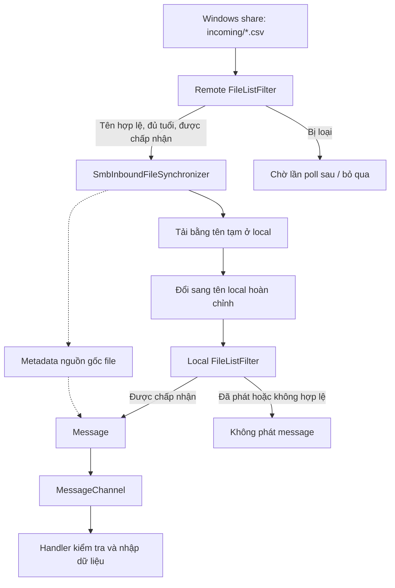
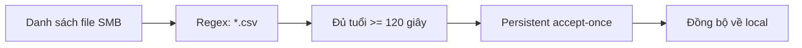
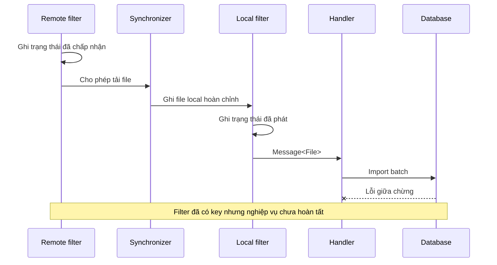
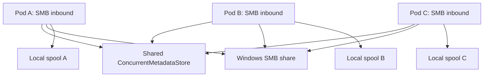

# Filter và metadata cho tệp SMB

## 1. Bài toán: chỉ nhận đúng tệp và biết tệp đến từ đâu

Một đối tác gửi báo cáo vào Windows share `\\fs01\exchange\incoming\partner-a`. Mỗi ngày thư mục có nhiều loại tệp:

```text
incoming/partner-a/
  orders-20261123.csv.part
  orders-20261123.csv
  orders-20261123.csv.complete
  readme.txt
  orders-20261122.csv
```

Ứng dụng Spring Boot cần **chỉ chọn tệp CSV đã được công bố**, tránh tải lặp lại khi poll, biết tệp vừa nhận đến từ server/thư mục nào, và không nhập trùng đơn hàng khi process restart hoặc retry. Sau khi tải, nó phải lưu CSV về local để kiểm tra định dạng rồi ghi dữ liệu vào database. Yêu cầu cuối cùng là không để một tệp đang upload dở bị xử lý nhầm.

Trong Spring Integration SMB, đây là bài toán của **FileListFilter**, **MetadataStore** và **message headers**. Bộ lọc quyết định tệp nào được phép đi tiếp. Metadata store lưu trạng thái được các bộ lọc hoặc bộ đồng bộ file sử dụng. Header mô tả nguồn gốc để các handler phía sau định tuyến, ghi log và đối chiếu. Ba cơ chế này có vai trò khác nhau; không có cơ chế nào tự bảo đảm giao dịch nhập dữ liệu **exactly-once**.

Bài thuộc chương **Adapter SMB** của module `SPRING_INTEGRATION_ADAPTERS`. Module học cách kết nối hệ thống ngoài bằng inbound/outbound adapter, gateway, poller và `MessageChannel`; thực hành luồng file, SFTP, HTTP, JMS, AMQP, Kafka, cơ sở dữ liệu, cùng hợp đồng message, lỗi và vòng đời kết nối. Các nguyên lý lọc dữ liệu và chống trùng có thể tái sử dụng ở những luồng khác, nhưng kiểu tài nguyên và metadata cụ thể ở đây là **SMB file**.

Sau bài này, bạn có thể:

- Phân biệt filter tệp remote trước khi tải với filter tệp local trước khi phát `Message<File>`.
- Dùng `SmbSimplePatternFileListFilter`, `SmbRegexPatternFileListFilter`, `SmbLastModifiedFileListFilter` và bộ lọc có marker.
- Ghép filter theo đúng thứ tự với `ChainFileListFilter`, biết khi nào dùng `CompositeFileListFilter`.
- Dùng `SmbPersistentAcceptOnceFileListFilter` và `FileSystemPersistentAcceptOnceFileListFilter` với `ConcurrentMetadataStore`.
- Phân biệt **metadata chống tải trùng** với **metadata nguồn gốc** đưa vào các header `FileHeaders.REMOTE_*`.
- Giải thích cách phục hồi sau restart, lỗi tải file giữa chừng, cập nhật file cùng tên và nhiều instance.
- Viết Java DSL thực tế rồi kiểm tra hành vi bằng dữ liệu SMB trong môi trường lab.

## 2. Filter nằm ở đâu trong một SMB inbound flow?

Với **SMB inbound channel adapter kiểu đồng bộ về local**, quá trình thường gồm hai lần lọc tệp ở hai phía khác nhau:



Giả sử file đã hoàn tất `orders-007.csv` xuất hiện trên share. Remote filter cho phép tải file về `./data/smb-inbox/orders-007.csv`. Sau khi đồng bộ, local filter quyết định có tạo `Message<File>` gửi cho handler hay không. Handler nhận **đường dẫn local** và các header nguồn tương ứng.

| Tầng | Đối tượng | Thời điểm | Trách nhiệm chính |
|---|---|---|---|
| Remote filter | `jcifs.smb.SmbFile` | Trước lúc đồng bộ hoặc mở stream remote | Chọn tên, tuổi tệp, marker, chống lấy lại file |
| Synchronizer | Remote file → local file | Khi lấy dữ liệu từ SMB | Sao chép nội dung, đổi tên tạm, ghi metadata nguồn |
| Local filter | `java.io.File` | Sau đồng bộ, trước khi phát message | Chọn file local được phát tới consumer |
| Message headers | Metadata kèm `Message` | Khi message được tạo | Cho handler biết tên/thư mục/host remote |
| Nghiệp vụ | Record/batch sau khi parse | Sau khi message đến handler | Validate, commit và chống nhập dữ liệu trùng |

**Điểm quan trọng:** `SmbFile` (remote) khác `File` (local). Không truyền một `FileListFilter<File>` vào điểm cần `FileListFilter<SmbFile>`. Và một `MessageFilter` lọc thông điệp đã được tạo là cơ chế khác với `FileListFilter` lọc ứng viên file trước khi adapter phát thông điệp.

### 2.1. Inbound streaming và gateway khác gì?

- **SMB streaming inbound** phát `Message<InputStream>`; nó lọc file remote, không có bước tạo bản sao local mặc định. Tên/thư mục remote và thông tin file được cung cấp qua header.
- **SMB inbound đồng bộ local** phát `Message<File>`; remote và local filter là hai điểm kiểm soát khác nhau.
- **SMB outbound gateway** với `ls/get/mget` xử lý request và trả reply; filter có thể được áp dụng khi liệt kê/lấy nhiều file. Các lệnh `put/mput` liên quan tới file được gửi lên SMB, cần chiến lược tên và chống trùng phù hợp.

Poller kích hoạt inbound source theo lịch; nó **không** thay nhiệm vụ chọn file hoặc lưu trạng thái của filter.

## 3. Các filter SMB phổ biến

Spring Integration 6.5 dùng các lớp filter trong package `org.springframework.integration.smb.filters`. Các lớp này phù hợp với `jcifs.smb.SmbFile`.

| Filter | Điều kiện cho qua | Tình huống phù hợp |
|---|---|---|
| `SmbSimplePatternFileListFilter` | Tên khớp pattern, ví dụ `*.csv` | Chọn file theo đuôi đơn giản |
| `SmbRegexPatternFileListFilter` | Tên khớp regex, ví dụ `(?i).*\\.csv$` | Ràng buộc linh hoạt về format tên |
| `SmbLastModifiedFileListFilter` | File đã **đủ cũ** theo thời gian sửa đổi | Giảm rủi ro đọc file bên gửi còn ghi |
| `SmbRecentFileListFilter` | File **chưa quá cũ** so với một khoảng tuổi | Chỉ quan tâm dữ liệu mới gần đây |
| `SmbPersistentAcceptOnceFileListFilter` | File chưa được ghi nhận là đã nhận với thông tin sửa đổi tương ứng | Tránh lấy lặp file remote qua các lần quét |
| `SmbSystemMarkerFilePresentFileListFilter` | File phù hợp chỉ đi tiếp khi tồn tại marker đi kèm | Bên gửi dùng `.complete` để xác nhận upload xong |
| `AcceptAllFileListFilter<SmbFile>` | Luôn cho qua | Thử nghiệm muốn quan sát hành vi phát lặp |

Các lớp `SmbLastModifiedFileListFilter` và `SmbRecentFileListFilter` đều có trong Spring Integration 6.5. **Đừng nhầm hai điều kiện ngược nhau:**

- “Last modified age ≥ 120 giây” chọn những tệp đã ổn định đủ lâu.
- “Recent age ≤ 120 giây” chỉ chọn những tệp còn mới, có thể chính là file đang được ghi.

Một quy tắc chỉ dựa trên `lastModified` không khẳng định file đã được ghi hoàn tất, nhất là khi timestamp được giữ nguyên từ máy nguồn hoặc đồng hồ hai hệ thống lệch nhau.

### 3.1. Lọc tên bằng pattern hoặc regex

Với bài toán chỉ nhận file CSV:

```java
new SmbSimplePatternFileListFilter("*.csv");
new SmbRegexPatternFileListFilter("(?i).*\\.csv$");
```

Regex `(?i)` không phân biệt hoa/thường, nên nhận cả `ORDERS.CSV`. Nếu tên chỉ được phép theo định dạng `orders-YYYYMMDD.csv`, có thể dùng:

```java
new SmbRegexPatternFileListFilter("orders-\\d{8}\\.csv");
```

Regex chỉ kiểm tra tên; nó không xác minh file chứa CSV hợp lệ, có đúng checksum, thuộc đối tác nào hoặc đã ghi đủ dữ liệu. Những kiểm tra đó phải được thực hiện khi đọc và xử lý file.

### 3.2. Lọc theo tuổi tệp

`SmbLastModifiedFileListFilter` có constructor nhận tuổi tệp tính theo **giây**, ví dụ:

```java
new SmbLastModifiedFileListFilter(120);
```

Nó chỉ cho qua những file có thời gian sửa đổi đủ xa so với hiện tại (khoảng 2 phút trong ví dụ). Mặc định của bộ lọc này là 60 giây. Hãy chọn ngưỡng dựa trên dung lượng file, cách bên gửi upload và độ lệch đồng hồ, không coi 60 hay 120 giây là giá trị đúng cho mọi hệ thống.

### 3.3. File marker chứng nhận bên gửi đã hoàn tất

Một hợp đồng công bố tốt là:

```text
orders-007.csv          # dữ liệu
orders-007.csv.complete # marker được tạo sau khi file dữ liệu đã đóng
```

`SmbSystemMarkerFilePresentFileListFilter` có thể nhận bộ lọc cho file dữ liệu và hậu tố marker:

```java
import org.springframework.integration.smb.filters.SmbSimplePatternFileListFilter;
import org.springframework.integration.smb.filters.SmbSystemMarkerFilePresentFileListFilter;

var readyFilter = new SmbSystemMarkerFilePresentFileListFilter(
        new SmbSimplePatternFileListFilter("*.csv"), ".complete");
```

Chỉ file `*.csv` có marker tương ứng mới được chọn. Đây là quy ước **do cả hai bên thỏa thuận**; adapter không tự tạo marker và không thể biết marker có đáng tin hay không khi hệ thống nguồn vi phạm hợp đồng.

Marker filter cần xem **danh sách nhiều file** để kiểm tra file đi kèm. Vì thế nó không hỗ trợ kiểu lọc từng file muộn như một số filter accept-once. Khi kết hợp với nhiều filter hoặc streaming, cần chú ý cách duyệt ứng viên và kiểm chứng hành vi trong lab.

## 4. Ghép filter: vì sao thứ tự quan trọng?

Hệ thống thường cần đồng thời ba điều kiện:

1. Tên là `*.csv`.
2. File đã cũ hơn 120 giây.
3. File chưa từng được chấp nhận ở phiên bản hiện tại.

Không thể mặc nhiên ghép ba filter theo cách nào cũng được. `ChainFileListFilter` và `CompositeFileListFilter` có semantics khác nhau:

| Tiêu chí | `ChainFileListFilter` | `CompositeFileListFilter` |
|---|---|---|
| Cách chạy | Kết quả của filter trước trở thành input cho filter sau | Mỗi filter thấy danh sách ứng viên của mình; kết quả cuối phải thỏa tất cả |
| Tác dụng với accept-once | Có thể đặt accept-once **cuối chuỗi** để chưa ghi nhận file chưa đủ điều kiện | Accept-once có thể nhìn thấy file trước khi điều kiện tuổi cho qua |
| Tác dụng với marker | Có thể cần xem xét vì marker filter phải thấy cả file marker | Hữu ích khi một filter chọn file dữ liệu nhưng filter marker cần xem toàn bộ danh sách |
| Phù hợp | Pattern → tuổi → accept-once | Kết hợp filter độc lập cần thấy cùng danh sách đầy đủ |

**Tình huống lỗi điển hình:** trong một `CompositeFileListFilter`, filter accept-once đánh dấu `orders.csv` là “đã thấy” ngay trong lần quét đầu, dù filter tuổi từ chối vì file vừa được ghi. Vài phút sau file đã đủ tuổi, nhưng accept-once không cho nó đi tiếp, gây bỏ sót file. Với `ChainFileListFilter`, đặt **tuổi trước accept-once** giúp tránh việc đánh dấu quá sớm.



### Ví dụ ghép ba điều kiện

```java
import jcifs.smb.SmbFile;
import org.springframework.integration.file.filters.ChainFileListFilter;
import org.springframework.integration.file.filters.FileListFilter;
import org.springframework.integration.metadata.ConcurrentMetadataStore;
import org.springframework.integration.smb.filters.SmbLastModifiedFileListFilter;
import org.springframework.integration.smb.filters.SmbPersistentAcceptOnceFileListFilter;
import org.springframework.integration.smb.filters.SmbRegexPatternFileListFilter;

FileListFilter<SmbFile> buildRemoteFilter(ConcurrentMetadataStore store) {
    ChainFileListFilter<SmbFile> chain = new ChainFileListFilter<>();
    chain.addFilter(new SmbRegexPatternFileListFilter("(?i).*\\.csv$"));
    chain.addFilter(new SmbLastModifiedFileListFilter(120));
    chain.addFilter(new SmbPersistentAcceptOnceFileListFilter(
            store, "smb:partner-a:remote-filter:"));
    return chain;
}
```

Đây là một phương thức minh họa cần đặt trong class cấu hình hoặc component phù hợp. Lưu ý prefix riêng cho remote filter; phần metadata ở các tầng khác sẽ dùng prefix khác.

Khi dùng marker, có thể tạo một chain mà marker filter được chạy trước accept-once, nhưng vì marker filter không hỗ trợ lọc từng file, cần kiểm tra semantics của từng tổ hợp filter trong phiên bản đang dùng. Không áp dụng mù quáng một chain “tên → marker → accept-once” từ một giao thức khác mà bỏ qua đặc điểm marker cần thấy file `.complete`.

## 5. MetadataStore có ba mục đích rất khác nhau

Trong SMB inbound kiểu đồng bộ local, có **ít nhất ba loại trạng thái** thường bị gọi chung là “metadata”, dù trách nhiệm khác nhau:

| Loại | Ai dùng? | Ghi nhận điều gì? | Hệ quả khi mất |
|---|---|---|---|
| **Remote accept-once state** | `SmbPersistentAcceptOnceFileListFilter` | File remote đã được chấp nhận theo khóa và thời gian sửa đổi | File có thể được tải lại sau restart |
| **Local accept-once state** | `FileSystemPersistentAcceptOnceFileListFilter` | File local đã được phát message theo đường dẫn và thời gian sửa đổi | File local cũ có thể được phát lại |
| **Remote origin metadata** | `AbstractInboundFileSynchronizer` | Thông tin host/port/thư mục/tên file nguồn của bản local | Message có thể thiếu thông tin nguồn để tracing |

**MetadataStore không phải database lưu kết quả nghiệp vụ**. Nó không ghi “100 đơn hàng đã commit” hay “bên nhận đã gửi ACK”. Nếu yêu cầu ngăn nhập trùng đơn hàng, ứng dụng phải có khóa batch, unique constraint, trạng thái commit hoặc cơ chế idempotency riêng.

### 5.1. `SimpleMetadataStore` và persistent store

`SimpleMetadataStore` là store **trong bộ nhớ**. Mặc dù lớp filter có tên `PersistentAcceptOnce`, việc có thực sự giữ được trạng thái qua restart phụ thuộc store được truyền vào.

```text
SmbPersistentAcceptOnceFileListFilter
   + SimpleMetadataStore (in-memory)
   = chống trùng trong một vòng đời ứng dụng, KHÔNG bền qua restart
```

Trong production, có thể dùng `ConcurrentMetadataStore` dựa trên kho lưu trữ chia sẻ, ví dụ Redis hoặc JDBC metadata store đã cấu hình tương thích với hệ thống. Cần đánh giá cả lưu trữ bền vững, tính nguyên tử của `putIfAbsent/replace`, chính sách TTL, namespace, backup và quyền truy cập.

Nếu nhiều pod dùng riêng `SimpleMetadataStore`, mỗi pod có thể cùng thấy `orders.csv` là mới và xử lý song song.

### 5.2. Remote accept-once xét tên và thời gian sửa đổi

`SmbPersistentAcceptOnceFileListFilter` dùng `ConcurrentMetadataStore` và prefix:

```java
new SmbPersistentAcceptOnceFileListFilter(
        concurrentStore, "smb:partner-a:remote-filter:");
```

Theo cơ chế persistent remote file filter, trạng thái ghi nhận file cùng metadata sửa đổi. Nếu một tên file chưa thấy, file có thể được chấp nhận. Nếu tên không đổi nhưng thời gian sửa đổi thay đổi, filter có thể coi đó là phiên bản mới và chấp nhận lại.

Điều này tiện khi đối tác cập nhật lại nội dung của file. Tuy nhiên, `lastModified` không phải checksum: timestamp có thể giữ nguyên khi nội dung thay đổi hoặc thay đổi dù nội dung không đổi. Nếu nghiệp vụ cần phân biệt phiên bản chính xác, hãy tính checksum hoặc dùng version/batch ID do bên gửi cung cấp.

**Lưu ý về khóa:** ở nhánh Spring Integration 6.x, thiết lập recursion, tên tương đối và cùng tên file ở nhiều thư mục có thể dẫn đến va chạm metadata nếu không cấu hình phù hợp. Dùng prefix riêng cho mỗi nguồn/đối tác; khi chạy `mget -R` hoặc cấu hình quét nhiều thư mục, kiểm tra cách filter xây khóa từ đường dẫn trong phiên bản thực tế và lập kế hoạch chuyển đổi khi thay đổi cách tạo key.

### 5.3. Local accept-once là tầng độc lập

Sau khi đồng bộ xong, `SmbInboundFileSynchronizingMessageSource` quét file trên local. Có thể đặt local filter như sau:

```java
import org.springframework.integration.file.filters.FileSystemPersistentAcceptOnceFileListFilter;
import org.springframework.integration.metadata.ConcurrentMetadataStore;

new FileSystemPersistentAcceptOnceFileListFilter(
        concurrentStore, "smb:partner-a:local-filter:");
```

Nếu local filter dùng metadata trong bộ nhớ rồi ứng dụng restart, một file local vẫn còn trên ổ đĩa có thể được phát lại. Nếu dùng store bền vững, trạng thái đã phát có thể giữ qua restart; nhưng cần thống nhất chính sách **xử lý lại khi nội dung file local thay đổi**.

Giả sử đối tác sửa `orders.csv` trên server, remote filter chấp nhận và tải bản mới, nhưng local filter không xem file là mới (ví dụ timestamp local không đổi hoặc đã được ghi nhận theo cách khác). Khi đó có thể xảy ra tình huống **remote đã tải lại nhưng handler không nhận message mới**. Hãy kiểm chứng bằng các file cập nhật thực tế và chọn bộ lọc local phù hợp.

### 5.4. Metadata nguồn gốc để tạo message headers

Với inbound đồng bộ local, message source đang quét **File local**. Từ một đường dẫn `./data/smb-inbox/orders.csv` không thể tự suy ra file ban đầu đến từ `fs01` hay `fs02`. Vì vậy synchronizer lưu metadata nguồn khi tải:

```text
remote origin:
  smb://fs01:445/incoming/partner-a#orders-007.csv
      host:port / remote directory # remote file name
```

Đây là **dạng URI minh họa theo tài liệu** để liên kết local file với nguồn. Nó không phải credential URL, không được nhúng username/password. Synchronizer dùng store này để bổ sung các header khi file local được phát.

Trong Java DSL, hai cấu hình phục vụ mục đích này là:

```java
.remoteFileMetadataStore(metadataStore)
.metadataStorePrefix("smb:partner-a:origin:")
```

**Phải dùng prefix riêng với prefix của `SmbPersistentAcceptOnceFileListFilter`** nếu cùng store, vì hai cơ chế có thể dùng cùng local file name làm phần khóa và ghi đè trạng thái của nhau. Một đề xuất minh bạch:

```text
smb:partner-a:remote-filter:...
smb:partner-a:local-filter:...
smb:partner-a:origin:...
```

Khi xóa file local sau xử lý, nên phối hợp dọn metadata nguồn tương ứng. `AbstractInboundFileSynchronizer` có callback `removeRemoteFileMetadata()` để hỗ trợ quy trình này; cách gọi cụ thể cần theo API của phiên bản và vị trí mà bạn quản lý vòng đời file local. Không xóa tất cả key trong store chỉ vì một batch đã hoàn thành.

## 6. Ví dụ Java DSL hoàn chỉnh: tên + tuổi + chống trùng

Ví dụ nhắm tới **Spring Boot 3.x cùng Spring Integration 6.5.x tương thích**. Dùng dependency management của dự án, không tùy tiện trộn major version. API `SmbFile` trong các ví dụ thuộc `jcifs.smb.SmbFile` của nhánh 6.5; nếu nâng major version, kiểm tra lại Javadoc.

### 6.1. Dependency

**`build.gradle`:**

```gradle
dependencies {
    implementation 'org.springframework.boot:spring-boot-starter-integration'
    implementation 'org.springframework.integration:spring-integration-smb'
}
```

### 6.2. Properties

**`application.yml`:**

```yaml
demo:
  smb:
    host: ${SMB_HOST}
    port: ${SMB_PORT:445}
    domain: ${SMB_DOMAIN:}
    username: ${SMB_USERNAME}
    password: ${SMB_PASSWORD}
    share: ${SMB_SHARE:exchange}
    remote-dir: ${SMB_REMOTE_DIR:incoming/partner-a}
    local-dir: ${SMB_LOCAL_DIR:./data/smb-inbox/partner-a}
```

Các biến account/password phải lấy từ môi trường hoặc hệ thống quản lý secret được cấp phép. Không đưa password thật vào Git, URL SMB hay log. `remote-dir` là đường dẫn **bên trong share**, không phải UNC đầy đủ.

### 6.3. Factory, metadata store và flow

**`SmbFilterConfig.java`:**

```java
import java.io.File;
import jcifs.DialectVersion;
import jcifs.smb.SmbFile;

import org.springframework.beans.factory.annotation.Value;
import org.springframework.context.annotation.Bean;
import org.springframework.context.annotation.Configuration;
import org.springframework.integration.config.EnableIntegration;
import org.springframework.integration.dsl.IntegrationFlow;
import org.springframework.integration.dsl.Pollers;
import org.springframework.integration.file.FileHeaders;
import org.springframework.integration.file.filters.ChainFileListFilter;
import org.springframework.integration.file.filters.FileListFilter;
import org.springframework.integration.file.filters.FileSystemPersistentAcceptOnceFileListFilter;
import org.springframework.integration.metadata.ConcurrentMetadataStore;
import org.springframework.integration.metadata.SimpleMetadataStore;
import org.springframework.integration.smb.dsl.Smb;
import org.springframework.integration.smb.filters.SmbLastModifiedFileListFilter;
import org.springframework.integration.smb.filters.SmbPersistentAcceptOnceFileListFilter;
import org.springframework.integration.smb.filters.SmbRegexPatternFileListFilter;
import org.springframework.integration.smb.session.SmbSessionFactory;

@Configuration
@EnableIntegration
public class SmbFilterConfig {

    @Bean
    SmbSessionFactory smbSessionFactory(
            @Value("${demo.smb.host}") String host,
            @Value("${demo.smb.port}") int port,
            @Value("${demo.smb.domain}") String domain,
            @Value("${demo.smb.username}") String username,
            @Value("${demo.smb.password}") String password,
            @Value("${demo.smb.share}") String share) {

        SmbSessionFactory factory = new SmbSessionFactory();
        factory.setHost(host);
        factory.setPort(port);
        factory.setDomain(domain);
        factory.setUsername(username);
        factory.setPassword(password);
        factory.setShareAndDir(share);
        factory.setSmbMinVersion(DialectVersion.SMB210);
        factory.setSmbMaxVersion(DialectVersion.SMB311);
        return factory;
    }

    // Dành riêng cho lab: SimpleMetadataStore mất dữ liệu khi restart.
    // Production: thay bằng ConcurrentMetadataStore bền vững, chia sẻ.
    @Bean
    ConcurrentMetadataStore smbMetadataStore() {
        return new SimpleMetadataStore();
    }

    @Bean
    FileListFilter<SmbFile> smbRemoteFilter(
            ConcurrentMetadataStore smbMetadataStore) {

        ChainFileListFilter<SmbFile> chain = new ChainFileListFilter<>();
        chain.addFilter(new SmbRegexPatternFileListFilter("(?i).*\\.csv$"));
        chain.addFilter(new SmbLastModifiedFileListFilter(120));
        chain.addFilter(new SmbPersistentAcceptOnceFileListFilter(
                smbMetadataStore, "smb:partner-a:remote-filter:"));
        return chain;
    }

    @Bean
    IntegrationFlow smbInboundFlow(
            SmbSessionFactory factory,
            FileListFilter<SmbFile> smbRemoteFilter,
            ConcurrentMetadataStore smbMetadataStore,
            @Value("${demo.smb.remote-dir}") String remoteDir,
            @Value("${demo.smb.local-dir}") String localDir) {

        return IntegrationFlow
                .from(Smb.inboundAdapter(factory)
                        .remoteDirectory(remoteDir)
                        .filter(smbRemoteFilter)
                        .localDirectory(new File(localDir))
                        .autoCreateLocalDirectory(true)
                        .preserveTimestamp(true)
                        .localFilter(
                                new FileSystemPersistentAcceptOnceFileListFilter(
                                        smbMetadataStore,
                                        "smb:partner-a:local-filter:"))
                        .remoteFileMetadataStore(smbMetadataStore)
                        .metadataStorePrefix("smb:partner-a:origin:")
                        .maxFetchSize(5),
                    endpoint -> endpoint
                        .id("smbFilteredInbound")
                        .poller(Pollers.fixedDelay(10_000)
                                .maxMessagesPerPoll(5)))
                .handle(message -> {
                    File file = (File) message.getPayload();
                    Object remoteName =
                            message.getHeaders().get(FileHeaders.REMOTE_FILE);
                    Object remoteDirHeader =
                            message.getHeaders().get(FileHeaders.REMOTE_DIRECTORY);

                    // Chỉ demo đường đi của message.
                    // Production cần validate CSV, idempotency và commit.
                    System.out.println("File local: " + file.getAbsolutePath()
                            + "; remote dir: " + remoteDirHeader
                            + "; remote name: " + remoteName);
                })
                .get();
    }
}
```

Vài điểm cần đọc kỹ:

1. `smbRemoteFilter` gộp ba điều kiện theo thứ tự **regex → đủ tuổi → persistent accept-once**. Vì đã gọi `.filter(...)` nên không cần ghép thêm `.regexFilter(...)` cho cùng tầng remote.
2. `FileSystemPersistentAcceptOnceFileListFilter` là bộ lọc của **file local**; dùng `File` và prefix khác.
3. `.remoteFileMetadataStore(...)` cùng `.metadataStorePrefix(...)` lưu nguồn gốc cho header; nó **không phải** trạng thái chống tải trùng của remote filter.
4. Các thành phần cùng dùng một `SimpleMetadataStore` trong lab để minh họa vai trò của **prefix tách biệt**. Cấu hình này **không chịu được restart hoặc multi-instance**. Trong production, thay store bằng giải pháp bền vững và phối hợp chính sách key/retention.
5. `.maxFetchSize(5)` giới hạn số file được lấy từ SMB trong một lần fetch, còn `.maxMessagesPerPoll(5)` giới hạn số message của poller. Hai tham số không thay nhau.
6. Handler chỉ in đường dẫn và metadata để quan sát. **Đã phát `Message<File>` không có nghĩa CSV đã được nhập thành công.**

### 6.4. Header được đọc thế nào?

Các constant `FileHeaders.REMOTE_FILE` và `FileHeaders.REMOTE_DIRECTORY` giúp mã không phải tự gõ chuỗi `"file_remoteFile"`. Trong code thực, cần xử lý trường hợp header thiếu hoặc có giá trị không mong đợi trước khi sử dụng làm khóa nghiệp vụ/đường dẫn archive.

Có thể lấy thêm `FileHeaders.REMOTE_HOST_PORT` khi endpoint có cung cấp. Khi ghi log, tránh lộ credential hoặc đường dẫn nhạy cảm; chỉ xuất thông tin đủ dùng để truy vết như mã đối tác, batch ID, remote name và correlation ID.

## 7. Metadata của streaming inbound và outbound gateway

Với `SmbStreamingMessageSource`, payload là `InputStream` và nguồn remote đang được đọc trực tiếp. Adapter có thể cung cấp:

| Header | Ý nghĩa |
|---|---|
| `FileHeaders.REMOTE_HOST_PORT` | Host và port của session SMB |
| `FileHeaders.REMOTE_DIRECTORY` | Thư mục remote tại thời điểm lấy file |
| `FileHeaders.REMOTE_FILE` | Tên file remote trong thao tác đơn lẻ |
| `FileHeaders.REMOTE_FILE_INFO` | Thông tin bổ sung của tệp remote |
| `closeableResource` | Tài nguyên liên kết stream/session cần đóng sau khi đọc |

Theo tài liệu SMB, `REMOTE_FILE_INFO` mặc định có thể được biểu diễn dạng **JSON**. Nếu cấu hình `SmbStreamingMessageSource.setFileInfoJson(false)`, header đó chứa đối tượng `SmbFileInfo` thay vì JSON. Không giả định mọi consumer luôn nhận cùng một Java type khi chuyển cấu hình giữa JSON và object.

Ví dụ cách xem metadata trong handler trước khi xử lý:

```java
Object info = message.getHeaders().get(FileHeaders.REMOTE_FILE_INFO);
Object source = message.getHeaders().get(FileHeaders.REMOTE_DIRECTORY);

// info có thể là JSON hoặc SmbFileInfo tùy cấu hình.
// Không ép kiểu trực tiếp trước khi kiểm tra hợp đồng.
```

Đối với streaming, khi handler tự viết đọc `InputStream` thì cần đóng **cả stream và closeableResource**, hoặc dùng các component chuẩn như `FileSplitter`/`StreamTransformer` quản lý tài nguyên theo hợp đồng tương ứng. Thiếu bước đóng session sẽ làm cạn connection pool.

**SMB outbound gateway** có các lệnh đọc như `ls`, `get`, `mget`; chúng trả payload/headers khác nhau tùy lệnh. Ví dụ `ls` có thể trả danh sách `FileInfo`, còn `get` trả file local hoặc `InputStream` nếu dùng `-stream`. Đừng ép một cấu trúc metadata duy nhất cho mọi lệnh; dùng hợp đồng cụ thể của endpoint.

### Khi nhiều thư mục dùng cùng tên file

`incoming/partner-a/report.csv` và `incoming/partner-b/report.csv` là **hai tệp khác nhau**, dù cùng filename. Nếu khóa metadata hoặc local destination được dựng chỉ từ `report.csv`, trạng thái có thể va chạm. Quy tắc tốt là namespace key theo endpoint/partner và đường dẫn nguồn, đồng thời bảo đảm local directory/filename không đụng nhau.

Với các bộ lọc đệ quy của nhánh 6.x, đặc tính `forRecursion` và thay đổi cách xây key có thể ảnh hưởng metadata đã lưu. Hãy kiểm tra migration key khi thay chế độ recursion hoặc nâng major version; đừng xóa toàn bộ store để thử nghiệm trên production.

## 8. Các tình huống thay đổi file và restart

### 8.1. Các kết quả cần phân biệt

| Sự kiện | Remote filter | Local filter | Điều nên kiểm chứng |
|---|---|---|---|
| File mới, tên hợp lệ, đủ tuổi | Có thể chấp nhận | Có thể phát sau khi tải | Handler nhận đúng file local và headers |
| File vừa xuất hiện, chưa đủ tuổi | Từ chối ở filter tuổi | Chưa có file mới để phát | Sau khi đủ tuổi, remote filter cho qua |
| File có đuôi `.part` | Filter tên từ chối | Không chạy | Không tải file đang upload |
| File đã tải và phát một lần | Accept-once thường chặn ở lần poll sau | File cũ không phát tiếp | Metadata store có trạng thái |
| File cùng tên nhưng sửa lại | Có thể chấp nhận do mtime đổi | Phụ thuộc metadata/mtime local | Xử lý lại có chủ đích hoặc tránh bản sửa không mong muốn |
| Restart khi store chỉ ở memory | Trạng thái remote mất | Trạng thái local mất | Có thể phát/tải lại file |
| Restart với store bền vững | Trạng thái đã lưu còn | Trạng thái local còn | Cần quy trình khôi phục file dở và job lỗi |
| Chỉ xóa file local | Remote metadata nguồn có thể còn | File local không còn | Dọn metadata tương ứng, bảo toàn lịch sử nghiệp vụ |
| Nhiều instance dùng chung share | Có thể tranh cùng tên nếu store không chia sẻ | Mỗi instance có local state riêng | Cần coordination/idempotency |

### 8.2. Metadata không nhất thiết đồng nghĩa xử lý thành công

Một thứ tự sự kiện có thể là:



Bộ lọc remote ghi trạng thái khi chấp nhận file để lấy; local filter ghi trạng thái khi phát file local. Cả hai xảy ra **trước khi** ứng dụng biết database đã commit hay chưa. Vì vậy “key tồn tại trong metadata store” không chứng minh nhập dữ liệu thành công.

Với một lỗi tải file thông thường, cơ chế remote persistent filter có thể rollback trạng thái được nhận trước fetch. Nhưng nếu tiến trình tắt đột ngột đúng thời điểm đang tải, key có thể còn tồn tại trong store bền vững, khiến file không tự được lấy lại. Trong tình huống đó, cần cơ chế đối chiếu key/file/batch và quy trình sửa trạng thái dưới quyền kiểm soát.

### 8.3. Chọn chiến lược reprocessing

Với batch nghiệp vụ, lưu một bản ghi trạng thái riêng:

```text
partnerId | batchId     | checksum | state       | attempts
PARTNER_A | ORD-20261123 | SHA-256  | IMPORTED    | 1
PARTNER_A | ORD-20261124 | SHA-256  | FAILED      | 2
```

Trạng thái có thể gồm `NEW`, `PROCESSING`, `IMPORTED`, `FAILED`, `ARCHIVED`. Mỗi trạng thái phải do luồng nghiệp vụ xác nhận theo hợp đồng:

- `IMPORTED` chỉ sau commit dữ liệu.
- `ARCHIVED` chỉ khi thao tác chuyển file nguồn thành công hoặc đã đối chiếu nguồn/đích.
- Retry một batch thất bại dùng khóa nghiệp vụ/unique constraint để tránh ghi trùng record.
- Nếu file cùng tên nhưng checksum khác, cần chính sách nhận “bản sửa” chứ không mặc nhiên coi là cùng batch cũ.

Với ứng dụng có yêu cầu audit, lưu thêm đường dẫn nguồn, kích thước, thời điểm sửa đổi, nội dung checksum và trạng thái ACK. Filter vẫn hữu ích để giảm tải nhưng không thể thay bảng nghiệp vụ.

## 9. Chạy nhiều instance và lưu metadata bền vững

Một `SimpleMetadataStore` chỉ sống trong JVM. Nếu triển khai ba pod cùng quét một share, mỗi pod có thể tự cho phép cùng file. Một `ConcurrentMetadataStore` dùng chung và hỗ trợ các thao tác nguyên tử giúp phối hợp tốt hơn.



Những điều cần thiết kế:

1. **Store chung** cho những instance đang phối hợp, với cùng namespace/key strategy. Kiểm tra backend bảo đảm atomic compare-and-set phù hợp.
2. **Prefix rõ ràng** theo môi trường, đối tác, loại metadata và adapter. Không để staging và production dùng cùng prefix.
3. **Giới hạn fetch**: trong cluster, tài liệu khuyến nghị `maxFetchSize(1)` kết hợp persistent filter để một pod không lấy quá nhiều file cùng lúc.
4. **Local spool riêng hoặc shared storage** có chiến lược rõ ràng. Store metadata chung không tự làm file local xuất hiện ở mọi pod.
5. **Idempotency database** để xử lý trường hợp trùng do crash/retry/cạnh tranh mà filter không ngăn hết.
6. **Sao lưu/retention/khôi phục** metadata: đừng đặt TTL quá ngắn khiến file còn trên SMB bị xem là mới mỗi lần key hết hạn.

**Cẩn trọng khi đổi prefix hoặc bật recursion:** hệ thống có thể không còn tìm được key cũ, khiến nhiều file được nhận lại. Cần lập kế hoạch migrate metadata hoặc kiểm soát một lượt quét lại có idempotency.

## 10. Vận hành và quan sát

### 10.1. Những metric/log hữu ích

| Thông tin | Mục đích |
|---|---|
| Số file SMB được liệt kê | Theo dõi backlog và khối lượng nguồn |
| Số file bị loại theo regex | Phát hiện đối tác gửi sai tên hoặc sai hợp đồng |
| Số file bị loại vì còn mới | Kiểm tra độ trễ công bố và filter tuổi |
| Số file bị chặn vì đã thấy | Kiểm tra trạng thái accept-once |
| Số file đã tải về local | Phân biệt chọn file và đồng bộ thành công |
| Số message được phát | Theo dõi local filter và tốc độ consumer |
| Số batch đã commit/failed | Theo dõi kết quả nghiệp vụ thật |
| Số retry và file có metadata nghi mắc kẹt | Phát hiện crash hoặc mất trạng thái |
| Độ trễ SMB và số session đang dùng | Phát hiện nghẽn mạng hoặc pool |
| File local còn lưu quá hạn | Kiểm soát dung lượng và chính sách retention |

Không phải mọi filter đều cung cấp metric phân loại lỗi sẵn. Có thể đặt instrumentation trong adapter, handler, callback discard phù hợp và log đã làm sạch. Tránh log password, URL SMB chứa credentials hoặc toàn bộ nội dung file nhạy cảm.

### 10.2. Chẩn đoán theo triệu chứng

| Triệu chứng | Nguyên nhân cần xét | Hướng xử lý |
|---|---|---|
| File đã có trên share nhưng không được tải | Tên không khớp, chưa đủ tuổi, accept-once đã có key | Xem filter nào từ chối, mtime và metadata store |
| File local tồn tại nhưng handler không nhận | Local accept-once đã ghi nhận hoặc file tạm chưa đổi tên | Kiểm tra local filter và suffix `.writing` |
| Restart xong file cũ được nhập lại | Metadata store memory, mất state hoặc TTL | Dùng store bền vững và idempotency |
| Tệp cùng tên ở thư mục khác bị bỏ sót | Trùng key/prefix hoặc local filename | Tách namespace và local directory |
| Tệp đã đổi nội dung nhưng không phát lại | Mtime/key local không đổi, filter local giữ trạng thái | Kiểm tra timestamp, checksum, chính sách cập nhật |
| Store đầy, nhiều key không dùng | Không có retention/cleanup | Đặt retention theo hợp đồng dữ liệu và kế hoạch migrate |
| Không có header tên remote | Metadata nguồn không được lưu/đã xóa | Kiểm tra `remoteFileMetadataStore` và prefix |
| File đang upload dở vẫn được nhận | Regex cho qua quá sớm, chưa có marker, age không phù hợp | Dùng quy ước rename/marker và kiểm tra readiness |
| Hai pod cùng xử lý một file | Dùng store riêng hoặc không có khóa nghiệp vụ | Shared store, phối hợp sở hữu batch, unique key |
| Tải lỗi nhưng không retry | Remote key còn sau crash | Đối chiếu trạng thái, gỡ key đúng mục tiêu theo quy trình |

## 11. Bài thực hành trên Windows share/Samba

Chuẩn bị một share **chỉ dùng cho lab**:

```text
\\fs01\exchange\incoming\partner-a
```

Ứng dụng chạy với cấu hình Java DSL ở phần 6. Tạo thư mục local `./data/smb-inbox/partner-a` mà tiến trình có thể ghi. Không dùng file thật của đối tác để thử xóa metadata hoặc xoay trạng thái.

### Lab A — Chỉ lọc file CSV đã đủ tuổi

1. Đưa `orders-a.csv`, `orders-a.csv.part` và `readme.txt` vào share.
2. Đảm bảo `orders-a.csv` có thời gian sửa đổi gần hiện tại, còn hai file kia có tên không phù hợp.
3. Chạy poller và quan sát chưa có CSV được tải khi file chưa đủ 120 giây.
4. Sau khi file đủ tuổi, kiểm tra file được tải và handler nhận đúng `Message<File>`.
5. Ghi lại sự khác nhau giữa điều kiện tên và điều kiện tuổi.

**Kết quả mong đợi:** tên `*.part`/`*.txt` bị loại; CSV chỉ được chọn sau thời gian phù hợp. Tuổi file không thay thế giao kèo công bố từ bên gửi.

### Lab B — Vì sao dùng `ChainFileListFilter`?

1. Dùng dữ liệu ở Lab A với `SmbLastModifiedFileListFilter(120)` và accept-once.
2. Theo dõi thời điểm CSV được ghi metadata remote khi dùng chain “regex → tuổi → accept-once”.
3. Thử thay chain bằng composite **chỉ trong môi trường lab**, reset store thử nghiệm và so sánh hành vi.
4. Giải thích vì sao accept-once nhìn file quá sớm có thể làm bỏ sót file vừa đạt điều kiện tuổi.

**Kết quả mong đợi:** hiểu việc **thứ tự filter và tập ứng viên mà filter nhận được** ảnh hưởng tới kết quả.

### Lab C — Phân biệt ba metadata prefix

1. Chạy một lượt tải `orders-a.csv`.
2. Xem các key theo ba prefix `remote-filter`, `local-filter` và `origin` trong metadata store lab (qua debug được cho phép).
3. Đối chiếu message header `FileHeaders.REMOTE_FILE` và `FileHeaders.REMOTE_DIRECTORY`.
4. Xóa file local bằng quy trình lab và xem metadata nguồn có còn không; chỉ dọn key tương ứng theo hướng dẫn đã xác minh.

**Kết quả mong đợi:** phân biệt “file đã được chọn”, “file local đã phát” và “file local có nguồn ở đâu”.

### Lab D — Restart và thay metadata store

1. Với `SimpleMetadataStore`, xử lý một file rồi restart ứng dụng trong lab.
2. Quan sát ảnh hưởng tới remote/local filter và khả năng phát lại.
3. Thay bằng một backend `ConcurrentMetadataStore` bền vững mà môi trường thử nghiệm có sẵn.
4. Chạy lại cùng bài thử và so trạng thái sau restart.
5. Kiểm tra unique key ở tầng database nếu cùng batch được phát lại.

**Kết quả mong đợi:** “persistent filter” chỉ bền qua restart khi **store** thật sự bền vững.

### Lab E — File cùng tên ở hai thư mục

1. Tạo `incoming/partner-a/report.csv` và `incoming/partner-b/report.csv` với dữ liệu khác nhau.
2. Nếu tạo hai inbound flow, cấu hình prefix và local directory riêng cho mỗi đối tác.
3. Quan sát cả hai file được nhận đúng, không ghi đè file local hay dùng chung metadata key không phù hợp.
4. Thử thay một cấu hình sai ở lab để nhận diện va chạm trước khi đưa lên production.

**Kết quả mong đợi:** biết xác định identity của một file bằng **nguồn/đường dẫn/batch**, không chỉ filename.

### Lab F — Lỗi đồng bộ và phục hồi có kiểm soát

1. Đặt file CSV hợp lệ, đủ tuổi trên share lab.
2. Mô phỏng mất kết nối SMB hoặc lỗi ghi local trong khi đồng bộ.
3. Kiểm tra file local có bị bỏ lại ở trạng thái tạm và trạng thái metadata remote ra sao.
4. Khôi phục hệ thống, đối chiếu batch ID và file trước khi yêu cầu retry.
5. Nếu cần xóa một key metadata kẹt, thực hiện theo quy trình khôi phục có log và chỉ với **key của file thử nghiệm**.

**Kết quả mong đợi:** phân biệt rollback của lần tải lỗi thông thường với trường hợp crash khiến state cần sửa thủ công.

### Câu hỏi tự kiểm tra

1. Tại sao filter `SmbFile` không thể dùng thay cho local filter `File`?
2. Vì sao `ChainFileListFilter` nên đặt filter tuổi trước accept-once?
3. Nếu dùng `SimpleMetadataStore` trong một `PersistentAcceptOnceFileListFilter`, điều gì xảy ra sau restart?
4. `metadataStorePrefix("...origin...")` phục vụ mục đích gì?
5. Vì sao cùng một file có thể được tải lại nếu remote `lastModified` thay đổi?
6. `REMOTE_FILE_INFO` ở streaming thường có dạng gì? Khi nào nó là `SmbFileInfo`?
7. Vì sao `maxFetchSize(1)` hữu ích khi nhiều instance cùng quét share?
8. Nếu database đã commit nhưng SMB archive thất bại, filter metadata có giải quyết được chuyện retry không?

## 12. Những nhầm lẫn thường gặp

| Nhầm lẫn | Cách hiểu đúng |
|---|---|
| Regex `*.csv` bảo đảm file đã sẵn sàng | Regex chỉ xét tên; cần giao kèo rename/marker/tuổi file |
| `SmbLastModifiedFileListFilter` chọn file mới nhất | Nó chọn file đã đủ cũ; `SmbRecentFileListFilter` mới hướng tới file còn gần hiện tại |
| `CompositeFileListFilter` và `ChainFileListFilter` luôn tương đương | Cách đưa danh sách ứng viên cho từng filter khác nhau; accept-once có state nên thứ tự rất quan trọng |
| Tên `PersistentAcceptOnce` tự bảo đảm state qua restart | Phụ thuộc `MetadataStore` được truyền vào; `SimpleMetadataStore` là memory |
| Bộ lọc remote và bộ lọc local là một | Chúng chạy ở hai thời điểm, với hai kiểu file và trạng thái riêng |
| `remoteFileMetadataStore` chính là bộ lọc chống trùng | Nó giữ **nguồn gốc remote** để gắn header cho local file |
| Metadata store có key nghĩa là đã import thành công | Filter có thể ghi state trước khi transaction database hoàn tất |
| File cùng tên ở mọi share là một file | Phải xét đối tác, share, remote directory và quy tắc tạo key |
| File đã phát một lần thì chắc chắn không bao giờ phát lại | Restart, TTL, đổi mtime, sửa filter hoặc replay có thể khiến phát lại |
| `REMOTE_FILE_INFO` lúc nào cũng là `SmbFileInfo` | Trong streaming, mặc định có thể là JSON; cấu hình `fileInfoJson(false)` đổi kiểu |
| Bộ lọc metadata tự ngăn hai pod cùng import một batch | Cần backend chia sẻ có thao tác nguyên tử và idempotency nghiệp vụ |
| Xóa local file là đủ dọn metadata | Metadata nguồn có thể còn; phải có chính sách cleanup đồng bộ |

## 13. Tài liệu tham khảo

- [Spring Integration 6.5 — SMB Support](https://docs.spring.io/spring-integration/reference/6.5/smb.html): inbound/streaming, remote file headers, metadata nguồn và filters SMB.
- [Spring Integration 6.5 — Remote Persistent File List Filters](https://docs.spring.io/spring-integration/reference/6.5/file/remote-persistent-flf.html): lưu trạng thái, rollback khi fetch lỗi, restart và cluster.
- [SmbPersistentAcceptOnceFileListFilter API](https://docs.spring.io/spring-integration/docs/6.5.0/api/org/springframework/integration/smb/filters/SmbPersistentAcceptOnceFileListFilter.html): constructor `ConcurrentMetadataStore` và prefix.
- [SmbLastModifiedFileListFilter API](https://docs.spring.io/spring-integration/docs/6.5.0/api/org/springframework/integration/smb/filters/SmbLastModifiedFileListFilter.html): lọc tuổi file theo giây.
- [RemoteFileInboundChannelAdapterSpec API](https://docs.spring.io/spring-integration/docs/6.5.0/api/org/springframework/integration/file/dsl/RemoteFileInboundChannelAdapterSpec.html): `filter`, `localFilter`, `remoteFileMetadataStore`, `metadataStorePrefix` và `maxFetchSize`.
- [ChainFileListFilter API](https://docs.spring.io/spring-integration/docs/6.5.0/api/org/springframework/integration/file/filters/ChainFileListFilter.html): chuyển kết quả của filter trước sang filter sau.

**Ghi nhớ:** với SMB inbound, filter tệp remote giúp chọn file nào được nhận, filter local quyết định file nào phát message, còn metadata nguồn giữ liên hệ giữa bản local và Windows share. Muốn luồng đáng tin cậy phải cấu hình đúng thứ tự filter, store và prefix, đồng thời kết hợp idempotency nghiệp vụ, xử lý lỗi và vòng đời file.
