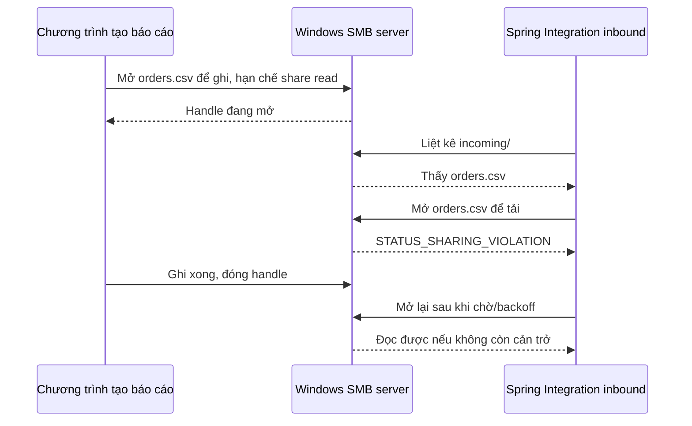
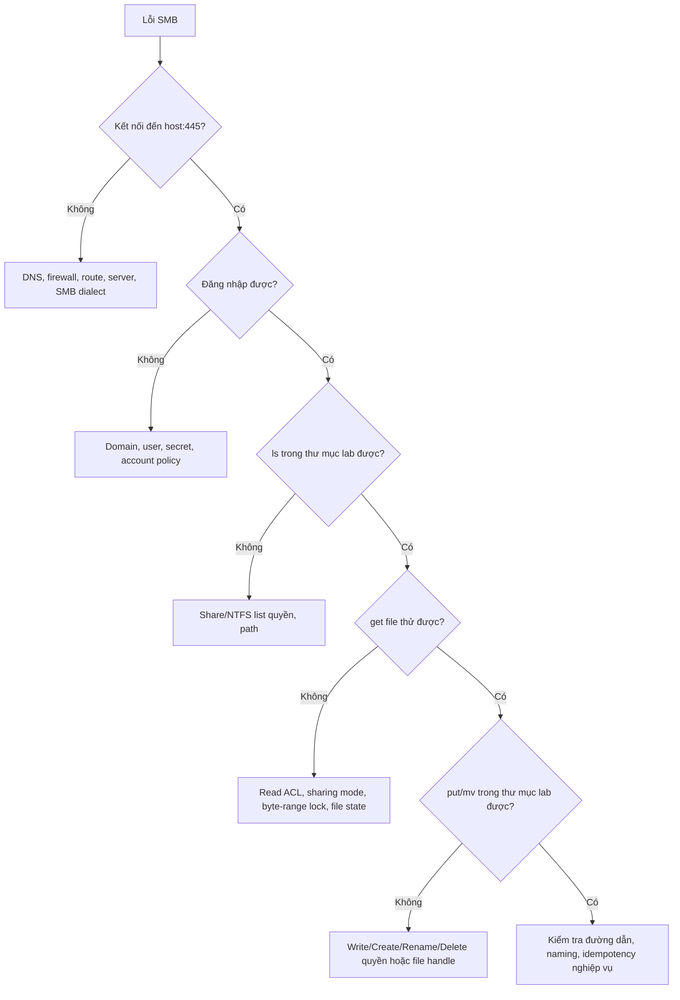
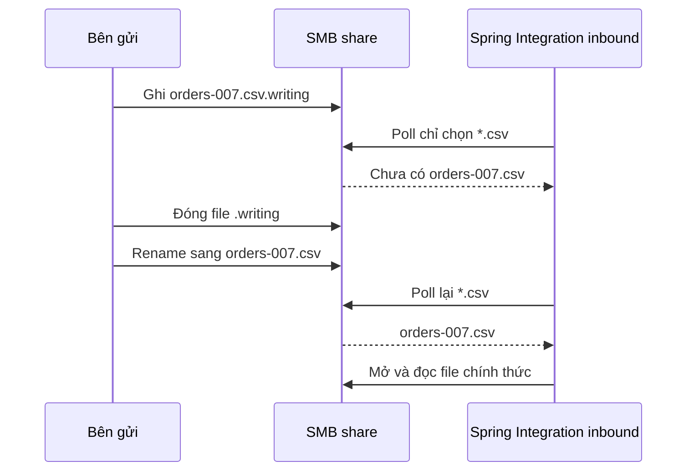
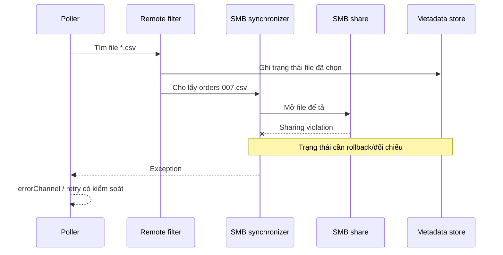
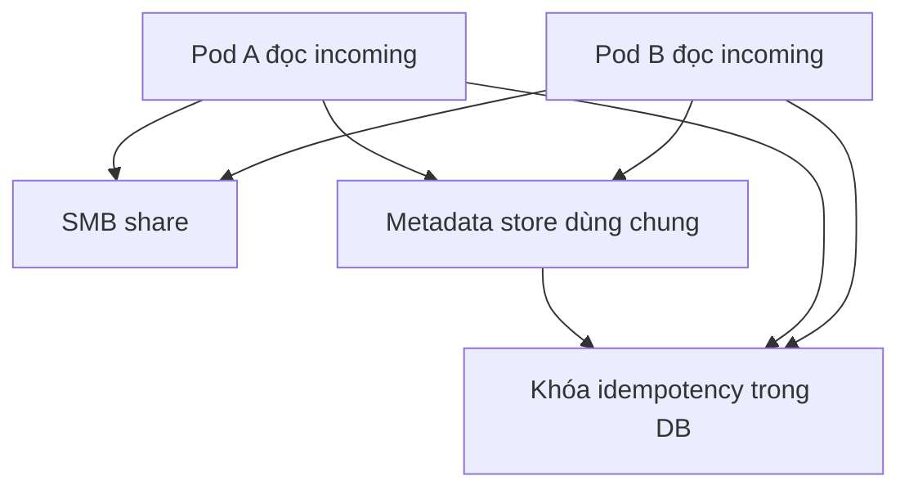

# Xử lý lock và lỗi quyền truy cập trong Spring Integration SMB

## 1. Bài toán và mục tiêu

Ứng dụng Spring Boot lấy báo cáo từ thư mục chia sẻ Windows `\\fs01\exchange\incoming`, nhập dữ liệu vào database và chuyển file đã xử lý sang `archive`. Một ngày, ứng dụng ghi nhận các tình huống:

- `orders-007.csv` nhìn thấy khi liệt kê, nhưng mở để đọc báo `STATUS_SHARING_VIOLATION`.
- Đọc `orders-008.csv` được, nhưng đổi tên sang thư mục `archive` trả `Access Denied`.
- Đã gửi `ack-009.csv.writing` lên share, nhưng thao tác đổi tên thành `ack-009.csv` thất bại.
- Cùng một batch bị hai instance cùng xử lý sau khi một instance timeout.

Những lỗi này không đồng nghĩa. Một file có thể **đang được tiến trình khác mở**, bị **khóa trên một khoảng byte**, bị **từ chối vì quyền**, hoặc đơn giản là **đường dẫn sai**. Bên cạnh đó, khóa điều phối nghiệp vụ giữa hai instance khác với lock thực sự trên Windows File Server.

Trong Spring Integration SMB, inbound/outbound adapter và outbound gateway sử dụng `SmbSessionFactory` cùng các thành phần remote-file để truy cập share. Nhiệm vụ của ứng dụng là phân loại lỗi đúng, không phá dữ liệu, hạn chế retry vô ích và quản lý trạng thái file xuyên suốt quá trình truyền/nhập dữ liệu.

Bài thuộc chương **Adapter SMB** của module `SPRING_INTEGRATION_ADAPTERS`: kết nối hệ thống ngoài bằng inbound/outbound adapter, gateway, poller, `MessageChannel`, xử lý hợp đồng message, lỗi và vòng đời kết nối. Những nguyên tắc kiểm soát cạnh tranh và phân loại lỗi cũng quan trọng với file, SFTP, HTTP, JMS, AMQP, Kafka và cơ sở dữ liệu, nhưng **cơ chế lock và quyền truy cập SMB có đặc điểm riêng**.

### Sau bài học, bạn có thể

1. Phân biệt sharing-mode conflict, byte-range lock, oplock/lease, ACL, credential và khóa nghiệp vụ.
2. Nhận diện các nhóm lỗi SMB thường gặp: `STATUS_SHARING_VIOLATION`, `STATUS_FILE_LOCK_CONFLICT`, `STATUS_ACCESS_DENIED`, `STATUS_OBJECT_NAME_NOT_FOUND`, lỗi mạng hoặc xác thực.
3. Tổ chức giao kèo công bố file bằng tên tạm rồi rename, hoặc marker và bộ lọc tuổi file.
4. Cấu hình Spring Integration SMB inbound, outbound, gateway cùng đường xử lý lỗi qua `errorChannel`.
5. Thiết kế retry có giới hạn, backoff, kiểm tra idempotency và khôi phục sau timeout không chắc kết quả.
6. Kiểm tra open handle/phiên SMB ở server bằng công cụ quản trị **chỉ đọc**, không cưỡng ép đóng file của hệ thống khác.
7. Thực hành kiểm tra quyền share/NTFS, file đang mở, quá trình upload dở và cạnh tranh nhiều worker.

## 2. Bốn cơ chế thường bị gọi chung là “lock”

| Cơ chế | Ai quyết định? | Ý nghĩa | Có phải quyền truy cập? |
|---|---|---|---|
| **Sharing mode / sharing violation** | Ứng dụng mở file và SMB/file server thực thi | Một handle đang mở không cho phép thao tác đọc/ghi/xóa hoặc mở mới theo mode xung đột | **Không**; có thể xảy ra dù account có ACL hợp lệ |
| **Byte-range lock** | Tiến trình yêu cầu khóa một vùng dữ liệu; server thực thi | Chặn thao tác xung đột trên một khoảng byte | **Không**; thường gặp ở ứng dụng cập nhật file kiểu random access |
| **SMB oplock/lease** | Client và server phối hợp tối ưu cache, nhất quán dữ liệu | Cho phép cache trong điều kiện nhất định, có cơ chế break khi truy cập cạnh tranh | Không phải quyền sở hữu nghiệp vụ hay chứng nhận file hoàn tất |
| **Khóa điều phối ứng dụng** | Application, database, `LockRegistry` hoặc metadata store | Quyết định node/batch nào được xử lý | Không tự khóa file trên SMB server |

Một **open handle** trên Windows có thể ngăn `mv` hoặc `rm` vì ứng dụng mở trước đó không chia sẻ quyền delete. Một byte-range lock có thể gây lỗi cho thao tác đọc/ghi ở vùng bị khóa. Một lease/oplock có thể kéo theo việc server yêu cầu client điều chỉnh trạng thái cache; nó **không** cho ứng dụng quyền xóa hay nhập file một lần duy nhất.

### 2.1. Ví dụ xung đột sharing mode

Giả sử một chương trình trên Windows đang mở `orders.csv` để ghi và không cho phép các handle khác đọc:



**Liệt kê thấy tên không bảo đảm mở được file.** Kể cả khi mở đọc được, điều đó chưa chứng minh file đã ghi hoàn tất: một số ứng dụng cho phép đọc đồng thời với ghi. Vì vậy nên dùng một **giao kèo công bố file** thay vì dò xem file đang lock hay không.

### 2.2. Sharing mode và byte-range lock khác nhau

Windows/SMB có cơ chế mở file với access mode và share mode (ví dụ cho phép các tiến trình khác đọc, ghi hay xóa/rename). Khi một request mở file mới không tương thích với một handle hiện có, server có thể trả `STATUS_SHARING_VIOLATION`.

Byte-range lock là khóa một vùng byte cụ thể. Khi thao tác `READ/WRITE/LOCK` xung đột, có thể gặp `STATUS_FILE_LOCK_CONFLICT` hoặc `STATUS_LOCK_NOT_GRANTED`. Không nên giải thích mọi lỗi lock thành “có một người đang mở Excel”: chương trình sao lưu, antivirus, dịch vụ đồng bộ hoặc một tiến trình ứng dụng khác cũng có thể giữ handle hoặc lock.

### 2.3. Lock của Spring không thay thế lock SMB

Trong hệ thống nhiều instance, một `LockRegistry` (hoặc khóa batch ở database) có thể ngăn hai node Spring cùng xử lý một mã lô. Nhưng nó **không buộc** chương trình Excel, ứng dụng Windows, NAS hoặc người dùng khác tôn trọng khóa đó. Ngược lại, một file SMB không bị sharing violation cũng không bảo đảm hai pod không cùng nhập dữ liệu vào database.

Do đó, phải kiểm soát **hai phạm vi độc lập**:

- **Remote file readiness:** file đã được phía gửi công bố đúng hợp đồng và không có thao tác bất tương thích đang cản trở.
- **Business ownership/idempotency:** chỉ một quy trình được phép commit một batch, và retry không tạo thêm dữ liệu trùng.

## 3. Phân biệt lỗi lock, quyền, đăng nhập và kết nối

Khi client SMB gặp lỗi, exception của thư viện bên dưới có thể bị bọc trong `MessagingException` hoặc lỗi adapter/gateway. Cần đọc **root cause và mã trạng thái được server trả về nếu có**, thay vì chỉ nhìn đoạn chữ đầu của log.

| Mã/triệu chứng ví dụ | Ý nghĩa thường gặp | Có nên retry ngay? |
|---|---|---|
| `STATUS_SHARING_VIOLATION` | Mở file/mode chia sẻ xung đột với handle đang có | Có thể retry **có hạn mức**, sau backoff; tốt nhất đợi file được công bố |
| `STATUS_FILE_LOCK_CONFLICT`, `STATUS_LOCK_NOT_GRANTED` | Yêu cầu đọc/ghi/khóa vùng byte gặp lock | Có thể thử lại có kiểm soát nếu tiến trình giữ lock sẽ sớm giải phóng |
| `STATUS_ACCESS_DENIED` | Server từ chối thao tác; có thể do quyền, thuộc tính file, chính sách hoặc điều kiện truy cập khác | Không retry mù; kiểm tra account, share/NTFS ACL và thao tác cụ thể |
| `STATUS_LOGON_FAILURE` hoặc lỗi xác thực | Username/password/domain hoặc chính sách account | Không thử liên tục; nguy cơ khóa tài khoản |
| `STATUS_OBJECT_NAME_NOT_FOUND`/`STATUS_OBJECT_PATH_NOT_FOUND` | Không có file hoặc path tại vị trí được hỏi | Kiểm tra share, directory và quy trình rename/move trước |
| `STATUS_OBJECT_NAME_COLLISION` hoặc file đã tồn tại | Tên đích trùng hoặc mode không cho ghi thay | Đối chiếu batch/đường đích, không tự đổi thành `REPLACE` |
| `STATUS_DISK_FULL` | Không còn dung lượng phía server | Cảnh báo và xử lý hạ tầng, không retry nhanh |
| Network timeout/connection reset | Mạng hoặc server không phản hồi đúng hạn | Retry giới hạn và **đối chiếu kết quả** vì lệnh có thể đã hoàn thành |
| Timeout chờ session cache | Các session đang bận, stream chưa đóng hoặc pool quá nhỏ | Kiểm tra pool/resource; không phải do ACL |

Mã lỗi thực tế có thể khác theo SMB server, phiên bản giao thức, thư viện client và thao tác. Ví dụ quyền không đủ hoặc file bị giữ bởi ứng dụng khác đôi khi xuất hiện dưới exception tổng quát; **không xây classifier chỉ dựa trên so khớp chuỗi “access denied”**.

### 3.1. Một phép thử có thứ tự



`ls` thành công là bằng chứng cho quyền **liệt kê tại path đã thử**, không phải chứng cứ rằng account có quyền mở mọi file hay xóa/đổi tên chúng.

## 4. Quyền truy cập: share permission, NTFS ACL và file state

Giả sử tài khoản dịch vụ là `CORP\svc_smb_integration`, session factory kết nối host `fs01`, share `exchange`. Với Windows File Server, các kiểm tra quyền truy cập qua mạng thường dựa trên **share permission** và **ACL trên NTFS** (cùng các chính sách khác). Tài khoản có thể được xác thực thành công mà vẫn không có quyền tạo file hoặc đổi tên.

| Thao tác Spring Integration | Cần kiểm tra ở phía server | Vì sao vẫn có thể lỗi dù `ls` được? |
|---|---|---|
| Inbound `ls` | List directory, traverse theo ACL | Chỉ kiểm tra thư mục, chưa mở nội dung |
| Inbound download / gateway `get` | Read data của file remote | File có thể bị từ chối đọc hoặc bị share-mode conflict |
| Outbound `put` | Create/Write ở thư mục đích, quyền ghi lên file tồn tại nếu replace | Share/NTFS có thể chỉ cấp Read; file đích có quyền riêng |
| Ghi bằng tên tạm rồi rename | Create/Write và quyền rename/delete phù hợp | Ghi `.writing` thành công nhưng rename cuối bị từ chối |
| Gateway `mv` | Quyền trên nguồn, đích và parent directory tùy thao tác | Rename có thể bị cản do handle không cho phép delete |
| Gateway `rm` | Quyền delete hoặc quyền thích hợp của parent theo ACL | Có thể đọc file nhưng không được xóa |
| `autoCreateDirectory(true)` | Quyền tạo thư mục mới | Ghi vào thư mục có sẵn và tạo thư mục mới là hai quyền khác nhau |

Quyền “Modify” hoặc “Full Control” có tác động lớn hơn “Read”; không tăng quyền tất cả service account để né lỗi. Nên cấp tài khoản riêng theo nhiệm vụ hoặc phân quyền thư mục `incoming/outgoing/archive`. Nếu server là Samba/NAS, mô hình ACL/mapping có thể khác; vẫn phải kiểm tra kết quả trên server thực tế.

### 4.1. Khi file bị mở, rename có thể thất bại

Windows sử dụng các **share mode** được chọn khi mở handle. Một handle chưa cho phép thao tác delete có thể khiến rename/delete từ client khác thất bại, dù client đó có quyền sửa file. Điều này thường thấy khi đối tác đang ghi, một tiến trình backup hoặc một chương trình văn phòng giữ file mở.

Đừng tự động biến mọi lỗi rename thành “thiếu NTFS permission”. Hãy kiểm tra cả ACL **và** open handles, xem server trả mã gì và thao tác xảy ra tại thời điểm nào.

### 4.2. Lỗi local cũng có thể bị hiểu nhầm thành lỗi SMB

Inbound adapter đồng bộ file từ SMB về `./data/smb-inbox`. Nếu local disk đầy, process Java không có quyền tạo file, hoặc file local đang bị phần mềm khác mở, việc đồng bộ cũng có thể thất bại. Cần nhìn rõ **lỗi xảy ra khi đọc remote hay ghi local**:

```text
SMB share (remote)
  -> đọc bằng SmbSessionFactory
     -> localDirectory của ứng dụng
        -> local FileListFilter
           -> Message<File>
```

Trên Linux/container, đường dẫn local là không gian filesystem của process/container, không phải đường UNC. Không yêu cầu administrator cấp NTFS quyền cho account SMB khi chính bản local trong container đang bị read-only.

## 5. Phòng lỗi từ đầu: hợp đồng công bố file

Một phương án tốt hơn “poll liên tục và hy vọng file không lock” là thống nhất cách công bố tệp với đối tác:

1. Bên gửi tạo `orders-007.csv.writing` trong share.
2. Ghi hết nội dung, flush, đóng handle.
3. Trong cùng thư mục, đổi tên thành `orders-007.csv`.
4. SMB inbound chỉ lọc `*.csv`; không đụng `*.writing`.
5. Bên nhận validate kích thước, checksum hoặc manifest khi hợp đồng yêu cầu.



Rename trong cùng thư mục và share thường là cách công bố hữu ích, nhưng phụ thuộc quyền, trạng thái open handles và khả năng server; **không giả định đổi tên trên hai share khác nhau là atomic**. Nếu rename thất bại, file tạm có thể nằm lại và cần xử lý vận hành.

### 5.1. Marker “đã sẵn sàng”

Nếu bên gửi không thể dùng tên tạm, có thể thỏa thuận một file đánh dấu:

```text
orders-007.csv
orders-007.csv.complete
```

Bên gửi chỉ tạo `.complete` sau khi đã đóng file nguồn. Bên nhận chọn CSV có marker phù hợp. Đây là **hợp đồng giữa hai hệ thống**; marker tạo quá sớm cũng không bảo đảm nội dung đã hoàn tất.

### 5.2. Lọc theo tuổi file

Spring Integration 6.2+ hỗ trợ `SmbLastModifiedFileListFilter`. Ví dụ lọc file cũ hơn 120 giây có thể giảm rủi ro đọc khi bên gửi đang ghi:

```java
new SmbLastModifiedFileListFilter(120);
```

Tuy nhiên, thời gian sửa đổi không phải lock detector hoặc xác nhận atomic. File có thể tiếp tục được ghi mà timestamp không phản ánh đúng, hoặc đồng hồ server/client lệch nhau. Nên ưu tiên tên tạm/rename hoặc marker và dùng tuổi file như lớp bảo vệ bổ sung.

### 5.3. Chờ file sẵn sàng không có nghĩa giành lock

Một ứng dụng có thể đợi file có kích thước ổn định qua hai lần poll. Cách này chỉ là heuristic: bên gửi có thể tạm ngừng ghi trong khoảng chờ rồi tiếp tục. Không dùng nó làm bảo đảm nhất quán tuyệt đối, nhất là với báo cáo lớn hoặc mạng chập chờn.

## 6. Cấu hình Spring Integration SMB để quan sát lỗi

Ví dụ sử dụng Spring Boot 3.x và nhánh Spring Integration 6.x tương thích; đoạn code được trình bày theo API của Spring Integration 6.5. Dependency version do BOM/dependency management của dự án quản lý.

### 6.1. Dependencies và properties

**Gradle:**

```gradle
dependencies {
    implementation 'org.springframework.boot:spring-boot-starter-integration'
    implementation 'org.springframework.integration:spring-integration-smb'
}
```

**`application.yml`:**

```yaml
demo:
  smb:
    host: ${SMB_HOST}
    port: ${SMB_PORT:445}
    domain: ${SMB_DOMAIN:}
    username: ${SMB_USERNAME}
    password: ${SMB_PASSWORD}
    share: ${SMB_SHARE:exchange}
    remote-incoming: ${SMB_REMOTE_INCOMING:incoming}
    remote-outgoing: ${SMB_REMOTE_OUTGOING:outgoing}
    local-inbox: ${SMB_LOCAL_INBOX:./data/smb-inbox}
```

Không ghi mật khẩu thật vào Git, log hoặc URL SMB; cấp secret qua cơ chế bảo mật của môi trường. `incoming/outgoing` là thư mục con **bên trong share**, không phải UNC đầy đủ.

### 6.2. Session factory và luồng inbound

**`SmbLockHandlingConfig.java`:**

```java
import java.io.File;
import jcifs.DialectVersion;

import org.springframework.beans.factory.annotation.Value;
import org.springframework.context.annotation.Bean;
import org.springframework.context.annotation.Configuration;
import org.springframework.integration.config.EnableIntegration;
import org.springframework.integration.dsl.IntegrationFlow;
import org.springframework.integration.dsl.Pollers;
import org.springframework.integration.smb.dsl.Smb;
import org.springframework.integration.smb.session.SmbSessionFactory;

@Configuration
@EnableIntegration
public class SmbLockHandlingConfig {

    @Bean
    SmbSessionFactory smbSessionFactory(
            @Value("${demo.smb.host}") String host,
            @Value("${demo.smb.port}") int port,
            @Value("${demo.smb.domain}") String domain,
            @Value("${demo.smb.username}") String username,
            @Value("${demo.smb.password}") String password,
            @Value("${demo.smb.share}") String share) {

        SmbSessionFactory factory = new SmbSessionFactory();
        factory.setHost(host);
        factory.setPort(port);
        factory.setDomain(domain);
        factory.setUsername(username);
        factory.setPassword(password);
        factory.setShareAndDir(share);
        factory.setSmbMinVersion(DialectVersion.SMB210);
        factory.setSmbMaxVersion(DialectVersion.SMB311);
        return factory;
    }

    @Bean
    IntegrationFlow smbInboundFlow(
            SmbSessionFactory factory,
            @Value("${demo.smb.remote-incoming}") String remoteDir,
            @Value("${demo.smb.local-inbox}") String localDir) {

        return IntegrationFlow
                .from(Smb.inboundAdapter(factory)
                        .remoteDirectory(remoteDir)
                        .localDirectory(new File(localDir))
                        .autoCreateLocalDirectory(true)
                        .preserveTimestamp(true)
                        .regexFilter("(?i).*\\.csv$"),
                    e -> e.id("smbInboundWithErrorChannel")
                          .poller(Pollers.fixedDelay(10_000)
                                  .maxMessagesPerPoll(1)
                                  .errorChannel("smbErrors")))
                .handle(message -> {
                    File file = (File) message.getPayload();
                    // Demo: không commit nghiệp vụ hoặc xóa file ở đây.
                    System.out.println("Đã tải về: " + file.getName());
                })
                .get();
    }

    @Bean
    IntegrationFlow smbErrorFlow() {
        return IntegrationFlow.from("smbErrors")
                .handle(message -> {
                    Throwable error = (Throwable) message.getPayload();
                    System.err.println(
                            "Lỗi tại poller/flow SMB: "
                                    + error.getClass().getSimpleName());
                    // Production: phân loại root cause, cảnh báo và ghi trạng thái
                    // một cách an toàn, không chỉ in log.
                })
                .get();
    }
}
```

Giải thích:

1. `SmbSessionFactory` có thông tin host, account và share; lỗi auth thường xuất hiện khi endpoint thực sự mở session, không nhất thiết tại lúc Spring tạo bean.
2. `regexFilter("(?i).*\\.csv$")` chỉ nhận tên chính thức `.csv`, tránh file tạm `.writing`. Nó không tự kiểm tra sharing mode.
3. `Pollers.fixedDelay(10_000)` quyết định nhịp poll; `maxMessagesPerPoll(1)` chỉ giới hạn số message mỗi lượt, không loại bỏ lock phía SMB.
4. `.errorChannel("smbErrors")` cấu hình đường nhận `ErrorMessage` khi poller gặp lỗi. Đây là cơ chế Spring Integration cho lỗi ở tác vụ poll; không phải một “câu lệnh mở khóa”.
5. Với các luồng đồng bộ gọi qua `DirectChannel` hoặc messaging gateway, exception từ handler có thể quay về thread gọi trực tiếp, thay vì được tự động gửi vào cùng error channel như scheduled poller.
6. Flow lỗi mẫu chỉ in tên lớp exception. Trong production cần ghi root cause đã làm sạch, error type, mã batch và thống kê; không làm lộ password/file nội dung nhạy cảm.

**Giới hạn:** trong ví dụ, handler chưa làm nghiệp vụ thật. Một file bị lock khi đồng bộ có thể khiến poller phát lỗi trước khi có `Message<File>`. Do đó gắn retry advice **chỉ ở handler phía sau** có thể không retry được giai đoạn mở/tải file SMB. Cần chọn vị trí xử lý lỗi phù hợp với điểm phát sinh lỗi.

### 6.3. Outbound: gửi bằng tên tạm, kiểm soát file trùng

Đoạn bổ sung sau có thể đặt trong một lớp `@Configuration`. Nó gửi `File` local lên share, không tự giải quyết lỗi quyền/lock nhưng giúp tránh công bố tên chính thức khi file còn đang truyền:

```java
import org.springframework.integration.file.remote.FileExistsMode;

@Bean
IntegrationFlow smbOutboundFlow(
        SmbSessionFactory factory,
        @Value("${demo.smb.remote-outgoing}") String remoteDir) {

    return IntegrationFlow.from("toSmbChannel")
            .handle(Smb.outboundAdapter(factory, FileExistsMode.FAIL)
                    .remoteDirectory(remoteDir)
                    .autoCreateDirectory(true)
                    .fileNameExpression("payload.name")
                    .useTemporaryFileName(true))
            .get();
}
```

Các bước dự kiến: tạo file tạm ở đích, truyền nội dung, đổi thành tên chính thức. Nếu tài khoản thiếu quyền rename, đích đã tồn tại, hoặc một handle khác ngăn rename, lời gọi gửi có thể thất bại và để lại file tạm cần kiểm tra. `FileExistsMode.FAIL` ngăn ghi đè một tên đã có; **file trùng tên và file bị lock là hai nguyên nhân khác nhau**.

Nếu ứng dụng cần biết kết quả sau khi đổi tên hoặc xóa file, dùng **SMB outbound gateway** với `mv`/`rm`. Chỉ thực hiện `mv` sang `archive` sau khi đã xác minh nghiệp vụ thành công, và ghi nhận riêng kết quả của tác vụ SMB.

## 7. Phân loại và retry đúng cách

### 7.1. Quy tắc retry theo lỗi

| Nhóm lỗi | Hành động mặc định hợp lý |
|---|---|
| Sharing violation/lock conflict tạm thời | Chờ có giới hạn, retry với backoff và jitter; tránh gây tải và không cố đóng handle của bên khác |
| Mất mạng/timeout | Có thể retry, nhưng **đối chiếu trạng thái remote trước khi ghi lại, xóa hoặc rename** |
| Sai password, domain, account bị khóa | Dừng retry đăng nhập, cảnh báo người vận hành; kiểm tra secret/policy |
| Access denied vì ACL | Không retry liên tục; yêu cầu xử lý quyền đúng thư mục và thao tác |
| File chưa tồn tại | Kiểm tra path, quy tắc publish/rename và trạng thái batch |
| File đã tồn tại, `FileExistsMode.FAIL` | Đối chiếu batch ID/checksum và lần gửi trước; không tự chuyển sang REPLACE |
| Hết dung lượng disk hoặc session pool cạn | Cảnh báo hạ tầng/giảm concurrency; giải phóng resource và giới hạn thử lại |

Không nên **retry vô hạn với interval 0**. Đặc biệt lỗi lock đang được giữ bởi chương trình khác có thể kéo dài; một vòng retry liên tục vừa gây tải file server vừa làm nghẽn thread/poller.

Một chính sách ví dụ đối với lock transient: **tối đa 4 lần thử**, sau 1 s, 2 s, 4 s (có jitter) rồi đưa batch sang `DEFERRED` để được chọn lại trong lịch retry có kiểm soát. Đây là ví dụ, không phải quy định cứng; thời gian/attempts tùy SLA và khả năng bên gửi đóng file.

### 7.2. Retry trong Spring Integration

Spring Integration có `RequestHandlerRetryAdvice` để retry **handler** và hỗ trợ recovery callback khi hết số lần thử. Cơ chế đó hữu ích khi handler thực hiện thao tác SMB outbound hoặc gọi gateway, nhưng cần nhớ:

- Advice bọc đúng endpoint mới can thiệp vào exception của endpoint đó; gắn nó vào handler xử lý CSV **sau** inbound không bao trùm lỗi phát sinh từ inbound source khi mở file.
- Có thể phải kiểm tra chuỗi cause vì lỗi SMB thường bị bọc trong `MessagingException`.
- Retry phải giới hạn theo loại exception. Không retry tất cả `RuntimeException` như nhau.
- Các thao tác có hiệu ứng bên ngoài (`put/mv/rm`) không được coi là idempotent chỉ vì có retry advice.
- Nếu dùng poller và task executor, chính sách lỗi còn phụ thuộc cấu hình scheduler/error channel.

Nếu backend đã cung cấp một lịch retry và trạng thái batch ở database, có thể để poller lấy lại **công việc chờ** sau khi hết backoff thay vì giữ một worker thread ngủ rất lâu. Đây cũng là nơi kiểm soát quota và tránh tình trạng retry nhiều pod cùng lúc.

### 7.3. Timeout là trạng thái “chưa chắc chắn”

Giả sử `mv("incoming/orders-007.csv", "archive/orders-007.csv")` đã được server xử lý, nhưng client mất kết nối trước khi nhận reply. Lỗi timeout phía client **không chứng minh** rename chưa hoàn thành.

Khi retry:

1. Kiểm tra nguồn còn không và đích có tồn tại không (bằng lệnh chỉ đọc khi được phép).
2. So khớp `batchId`, tên file, kích thước hoặc checksum theo hợp đồng.
3. Nếu đích đã đúng, ghi nhận trạng thái move thành công thay vì di chuyển lại.
4. Nếu kết quả vẫn không rõ, đưa vào quy trình đối soát thủ công/automatic có kiểm soát.
5. Chỉ xóa hoặc ghi đè sau khi biết chắc file nào là tài nguyên cần thay đổi.

Với `put`, mất mạng sau khi server đã nhận file có thể tạo một tệp hoàn chỉnh hoặc một file tạm chưa rename. Nếu cứ retry bằng `APPEND` hoặc `REPLACE`, dữ liệu có thể bị trùng hoặc thay nhầm một file đã được đối tác đọc.

## 8. Lỗi mở file và trạng thái metadata của inbound

Spring Integration dùng remote filter và có thể dùng metadata store để giảm tải lại file giữa các lần poll. Nhưng **metadata chống tải trùng không phải lock SMB** và **không chứng minh database đã commit**.

Một chuỗi sự kiện lỗi:



Với một số remote persistent filter, cơ chế đồng bộ có thể rollback trạng thái chấp nhận khi fetch thất bại theo con đường lỗi thông thường. Nhưng khi **process bị kill** đúng lúc file đang tải, metadata bền vững có thể còn key hoặc file local tạm có thể còn tồn tại. Không dựa vào một lời hứa “retry sẽ luôn tự nhận lại file” trong mọi tình huống.

Khôi phục đúng cần đối chiếu:

| Đối tượng | Câu hỏi |
|---|---|
| Remote file | Tên chính thức đã xuất hiện? File còn đang thay đổi? Có người giữ handle? |
| Local file | Có bản hoàn chỉnh hay chỉ có `.writing`/file dở? Có quyền ghi local? |
| Metadata store | File đã được filter đánh dấu thế nào? Có key mắc kẹt sau crash? |
| Business database | Batch đã commit một phần hay toàn bộ? Unique key có ngăn ghi trùng? |
| Archive/ACK | Đã `mv`/gửi ACK thật chưa? Lỗi xảy ra trước hay sau server nhận lệnh? |

Không xóa hàng loạt key metadata chỉ vì một tệp có sharing violation. Nếu phải điều chỉnh key, chỉ tác động đến đúng file/batch sau khi đã xác minh trạng thái nghiệp vụ.

## 9. Nhiều instance: chống xử lý cùng file và giới hạn lock

Nếu có hai pod cùng poll `incoming/`, cả hai có thể nhìn thấy `orders-007.csv`:



Để giảm nguy cơ:

1. Dùng metadata store bền vững/chia sẻ hỗ trợ phép cập nhật nguyên tử cho remote persistent file filter.
2. Có thể giới hạn `maxFetchSize(1)` với inbound adapter trong cluster để các instance không gom quá nhiều file cùng một lượt.
3. Đảm bảo **unique key nghiệp vụ** (ví dụ `partnerId + batchId`) và trạng thái nhập bền vững; dù hai node cùng tải, chỉ một kết quả nhập được commit.
4. Khi cần, dùng distributed lock hoặc cơ chế claim batch tại database. Khóa này điều phối **ứng dụng của mình**, không thay thế share-mode lock trên Windows server.
5. Giữ mỗi file/batch một quy ước tên bất biến; tách `incoming/processing/archive/quarantine` nếu được hạ tầng và đối tác cho phép.
6. Nếu dùng streaming inbound, đóng `InputStream` và header `closeableResource` sau khi đọc xong; nếu giữ stream quá lâu, session cache có thể cạn và phát lỗi timeout khác với file lock.

**Không tự động “claim file” chỉ bằng rename khi chưa kiểm chứng quyền/semantics server.** Rename có thể thất bại vì file đang mở, ACL hoặc tên đích tồn tại. Ngoài ra, thao tác move và commit dữ liệu vào database không phải một transaction phân tán mặc định.

## 10. Chẩn đoán handle đang mở ở Windows File Server

Khi có `STATUS_SHARING_VIOLATION` kéo dài, nên phối hợp quản trị viên server kiểm tra ai đang mở file, thay vì thử xóa/đổi tên liên tục. Trên Windows Server, PowerShell module `SmbShare` cung cấp lệnh **chỉ đọc** `Get-SmbOpenFile`:

```powershell
# Chạy trên Windows File Server với quyền quản trị/quan sát phù hợp.
Get-SmbOpenFile |
    Where-Object { $_.ShareRelativePath -like '*orders-007.csv*' } |
    Select-Object FileId, SessionId, ClientComputerName, ClientUserName,
                  ShareRelativePath, Path, Locks
```

Các trường thường có:

| Field | Ý nghĩa |
|---|---|
| `FileId`, `SessionId` | ID handle và phiên SMB phía server |
| `ClientComputerName` | Máy client đang mở file |
| `ClientUserName` | Danh tính phía client đã mở handle |
| `ShareRelativePath` hoặc `Path` | Vị trí tài nguyên đang mở |
| `Locks` | Số byte-range locks theo thông tin server cung cấp, **không phải** mọi loại sharing mode conflict |

Nếu không có quyền chạy lệnh, gửi cho quản trị viên **tên share, tên file, thời điểm lỗi và correlation ID** để họ tra cứu. Đừng yêu cầu mọi lập trình viên được cấp quyền quản trị file server.

Ngoài PowerShell, người quản trị có thể xem **Computer Management → Shared Folders → Open Files** hoặc công cụ tương ứng cho Samba/NAS. Đây là phép chẩn đoán trạng thái phía server, cần đối chiếu với log client và thời điểm lỗi.

**Cảnh báo vận hành:** tính năng “Close Open File” hoặc lệnh cưỡng ép đóng handle của Windows Server có thể làm mất dữ liệu đang ghi hoặc khiến ứng dụng khác lỗi. Không sử dụng chúng như một phương pháp retry tự động; chỉ quản trị viên được ủy quyền mới cân nhắc sau khi biết rõ chủ sở hữu và tác động.

### 10.1. Nếu server là Samba/NAS

Với Samba, người quản trị có thể dùng các công cụ như `smbstatus` hoặc giao diện NAS để xem session/file đang mở. Cần kiểm tra tài liệu của nền tảng thực tế và quyền hệ thống; không giả định mọi NAS trả cùng tên trường hoặc đầy đủ thông tin byte-range lock như Windows.

## 11. Ghi log, cảnh báo và bảo vệ secret

Một event lỗi hữu ích:

```text
event=smb_operation_failed
operation=get
partnerId=PARTNER_A
batchId=ORD-20261123-007
remoteDirectory=incoming
remoteFile=orders-007.csv
category=SHARING_VIOLATION
attempt=2
elapsedMs=1470
action=DEFERRED_RETRY
```

Đây là **định dạng log minh họa**, không phải output cố định của Spring Integration. Khi ghi log thực tế:

- Giữ lỗi gốc và nhóm lỗi sau khi làm sạch, host alias, share, đường dẫn tương đối, loại lệnh, batch ID và thời gian.
- Không log password, URL chứa credential, thông tin xác thực NTLM/Kerberos hoặc nội dung tệp nhạy cảm.
- Phân biệt biểu đồ `AUTHENTICATION_FAILURE`, `ACCESS_DENIED`, `SHARING_VIOLATION`, `NETWORK_TIMEOUT`, `LOCAL_IO` và `SESSION_POOL_EXHAUSTED`.
- Có cảnh báo nếu một file bị lock quá SLA, backlog tăng, quá nhiều lần retry hoặc account bị từ chối.
- Khi một nhóm lỗi cần con người can thiệp (ACL, account, file server đầy), tạo sự kiện vận hành để theo dõi thay vì cho poller thử lại vô hạn.

## 12. Thực hành trên Windows share hoặc Samba lab

Chuẩn bị share thử nghiệm `\\fs01\exchange-lab` có `incoming/`, `outgoing/` và `archive/`. Có một tài khoản được phép đọc `incoming`, ghi vào `outgoing` và các quyền archive cần thiết. **Không thực hành khóa/xóa cưỡng bức trên file sản xuất**.

### Lab A — Lỗi file đang mở khi bên gửi chưa công bố

1. Trong lab, tạo một file `orders-001.csv.writing` và để tiến trình bên gửi giữ handle mở khi đang ghi.
2. Xác minh inbound `*.csv` **không chọn** tên tạm.
3. Cho bên gửi đóng handle và rename thành `orders-001.csv`.
4. Chạy poller, xác minh file được tải và handler nhận `Message<File>`.
5. Thử một trường hợp chương trình nguồn mở file với share mode xung đột (nếu lab có công cụ hỗ trợ) để quan sát khác biệt với lỗi tên file chưa sẵn sàng.

**Kết quả:** quy ước tên tạm/rename đáng tin cậy hơn việc coi “liệt kê thấy tên” là file đã có thể đọc.

### Lab B — Read được nhưng write bị Access Denied

1. Cấp cho account thử nghiệm quyền read/list trên `incoming` nhưng không cấp quyền tạo file tại `outgoing`.
2. Chạy inbound `get` hoặc `ls` để xác minh đường đọc thành công.
3. Gửi file thử qua outbound adapter vào `outgoing`; quan sát lỗi bị từ chối.
4. Quản trị viên kiểm tra share permission và NTFS ACL, cấp đúng quyền cho **thư mục lab**.
5. Thử lại, sau đó đối chiếu với hành vi rename file tạm.

**Kết quả:** biết vì sao cùng account/credential có thể đọc được nhưng không ghi/rename được; không nhầm với lỗi password.

### Lab C — Rename bị cản do handle đang mở

1. Trong môi trường thử nghiệm, tạo `outgoing/ack-003.csv`.
2. Cho một chương trình Windows mở tệp với mode không chia sẻ delete.
3. Dùng một lệnh `mv` thử nghiệm đổi tên sang `archive/ack-003.csv`.
4. Ghi nhận exception/status và chạy `Get-SmbOpenFile` **chỉ để xem** handle (nếu có quyền).
5. Đóng tệp bằng **chương trình đang sở hữu handle** rồi thử lại một cách có kiểm soát.

**Kết quả:** phân biệt rename bị cản do file đang mở với thiếu quyền NTFS. Không dùng cưỡng ép đóng open file trên server.

### Lab D — Phân biệt retry có thể hồi phục và lỗi cấu hình

1. Với file thử đang bị khóa, thử chính sách retry có giới hạn (ví dụ 4 lần, backoff).
2. So với trường hợp cố tình cấu hình sai thư mục và trường hợp tài khoản lab thiếu quyền.
3. Ghi nhận số lần thử, loại lỗi và hành động cuối cùng.
4. Xác minh không có vòng retry vô tận và không tự động nâng quyền.

**Kết quả:** các lỗi lock có thể tạm thời; lỗi path/ACL/auth cần điều tra và sửa cấu hình, không phải chỉ tăng thời gian retry.

### Lab E — Timeout sau khi server có thể đã thực hiện lệnh

1. Dùng file thử `incoming/orders-005.csv`, chuẩn bị thư mục `archive`.
2. Trong mạng lab, mô phỏng mất kết nối khi gửi yêu cầu `mv` hoặc `put`.
3. Sau khi kết nối lại, kiểm tra **cả nguồn lẫn đích** trước khi retry.
4. Đối chiếu batch ID/checksum nếu có và ghi trạng thái theo kết quả thực tế.
5. Không thử lại bằng `APPEND` trên file CSV có nội dung nghiệp vụ.

**Kết quả:** lỗi timeout phía client không đủ để khẳng định file chưa được truyền/chuyển trên server.

### Lab F — Nhiều worker cùng thấy một file

1. Chạy hai instance thử nghiệm cùng quét `incoming/` (không dùng dữ liệu thật).
2. Quan sát rủi ro cả hai cùng tải/xử lý khi dùng metadata store trong bộ nhớ.
3. Thêm metadata store dùng chung hỗ trợ cập nhật nguyên tử; giới hạn fetch và ghi unique key nghiệp vụ trong database lab.
4. Cho một instance lỗi sau khi một số record đã được commit; kiểm chứng instance còn lại không ghi trùng.

**Kết quả:** bộ lọc/khóa ứng dụng hỗ trợ điều phối batch, nhưng không thể giải phóng lock của chương trình khác trên Windows File Server.

### Câu hỏi tự kiểm tra

1. Vì sao `ls` thấy file nhưng `get` vẫn có thể báo sharing violation?
2. Khác biệt giữa `STATUS_SHARING_VIOLATION` và `STATUS_ACCESS_DENIED` là gì?
3. Vì sao một tệp đọc được vẫn có thể không rename/xóa được?
4. Tại sao `LockRegistry` không giúp đóng handle do Excel giữ?
5. Ghi tệp với tên `.writing` rồi rename giải quyết rủi ro nào?
6. Nếu `mv` timeout, cần đối chiếu điều gì trước khi retry?
7. Vì sao `maxMessagesPerPoll(1)` không ngăn hai pod cùng xử lý một file?
8. Khi bật retry handler phía sau inbound, có chắc nó bắt được lỗi xảy ra trong bước tải remote không?

## 13. Những nhầm lẫn thường gặp

| Nhầm lẫn | Cách hiểu đúng |
|---|---|
| Sharing violation nghĩa là sai mật khẩu | Đây thường là xung đột với handle/mode chia sẻ, không đồng nghĩa lỗi xác thực |
| Access Denied luôn là file lock | Có thể là ACL, policy hoặc điều kiện mở file; phải đối chiếu root cause và thao tác |
| `ls` thấy file nghĩa là file đã ghi xong | File có thể đang được ghi hoặc bị mở hạn chế chia sẻ |
| `FileExistsMode.FAIL` là một cơ chế file lock | Nó quyết định cách xử lý tên file đích đã tồn tại, không giành SMB lock |
| `SmbLastModifiedFileListFilter` bảo đảm file không bị mở | Chỉ kiểm tra tuổi file, không kiểm tra open handle |
| Có quyền đọc nghĩa là có quyền rename/delete | Phải xét riêng ACL và share mode của handle đang mở |
| Đóng session cache sẽ giải phóng mọi lock của các ứng dụng khác | Chỉ liên quan tài nguyên phiên của chính client đó |
| Metadata accept-once giống distributed lock của cả file server | Nó theo dõi các file mà ứng dụng đã thấy, không điều khiển client Windows khác |
| Retry mọi lỗi SMB đủ nhiều lần sẽ thành công | Lỗi ACL/auth/path cần sửa nguyên nhân; retry ồ ạt có thể gây khóa account |
| Timeout nghĩa là server chắc chắn chưa thực hiện lệnh | Phải kiểm tra trạng thái nguồn/đích, nhất là `put/mv/rm` |
| Có thể tự động cưỡng ép đóng handle mà không gây hại | Có nguy cơ mất dữ liệu hoặc khiến ứng dụng khác lỗi |
| `errorChannel` tự động sửa lỗi SMB | Nó nhận `ErrorMessage` và cho phép xử lý, không tự sửa ACL/lock |
| Import dữ liệu thành công có nghĩa file đã archive | DB commit và SMB move là hai kết quả độc lập |

## 14. Tài liệu tham khảo

- [Spring Integration 6.5 — SMB Support](https://docs.spring.io/spring-integration/reference/6.5/smb.html): adapter, gateway, session, remote filter và vòng đời kết nối SMB.
- [Spring Integration — Provided Advice Classes](https://docs.spring.io/spring-integration/reference/handler-advice/classes.html): `RequestHandlerRetryAdvice`, backoff, recovery và phạm vi tác động của advice.
- [Spring Integration 6.5 — PollerSpec API](https://docs.spring.io/spring-integration/docs/6.5.0/api/org/springframework/integration/dsl/PollerSpec.html): `errorChannel`, `maxMessagesPerPoll`, `errorHandler`.
- [Microsoft — SMB2 CREATE Request](https://learn.microsoft.com/en-us/openspecs/windows_protocols/ms-smb2/8c61e928-9242-44ed-96a0-98d1032d0d39): chia sẻ file và mã lỗi open như `STATUS_SHARING_VIOLATION`.
- [Microsoft — SMB2 LOCK Request](https://learn.microsoft.com/en-us/openspecs/windows_protocols/ms-smb2/a2f8b1cc-ebe0-4378-9da9-4e25de5c628f): byte-range lock và các mã lỗi lock.
- [Microsoft — Creating and Opening Files](https://learn.microsoft.com/en-us/windows/desktop/FileIO/creating-and-opening-files): desired access và share modes khi mở handle.
- [Microsoft — Get-SmbOpenFile](https://learn.microsoft.com/en-us/powershell/module/smbshare/get-smbopenfile?view=windowsserver2025-ps): công cụ quản trị xem các file đang mở trên SMB server.

**Ghi nhớ:** lock của Windows/SMB, quyền trên share/NTFS và khóa điều phối nghiệp vụ là ba tầng khác nhau. Một luồng Spring Integration đáng tin cậy cần **chỉ nhận file đã được công bố, phân loại đúng lỗi, quản lý session/resource, retry có giới hạn, đối chiếu sau timeout và dùng idempotency ở tầng nghiệp vụ**. Không cố cưỡng ép đóng handle hoặc ghi đè file khi chưa hiểu trạng thái thật của dữ liệu.
