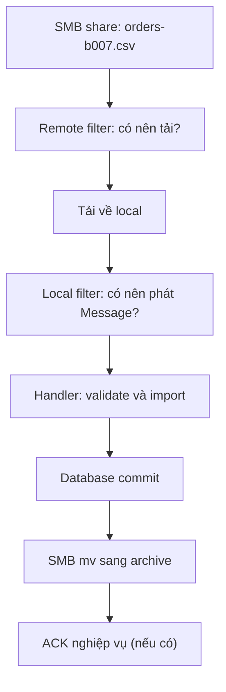
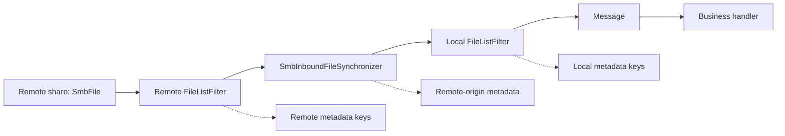
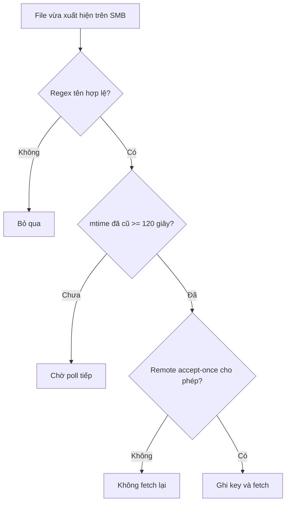
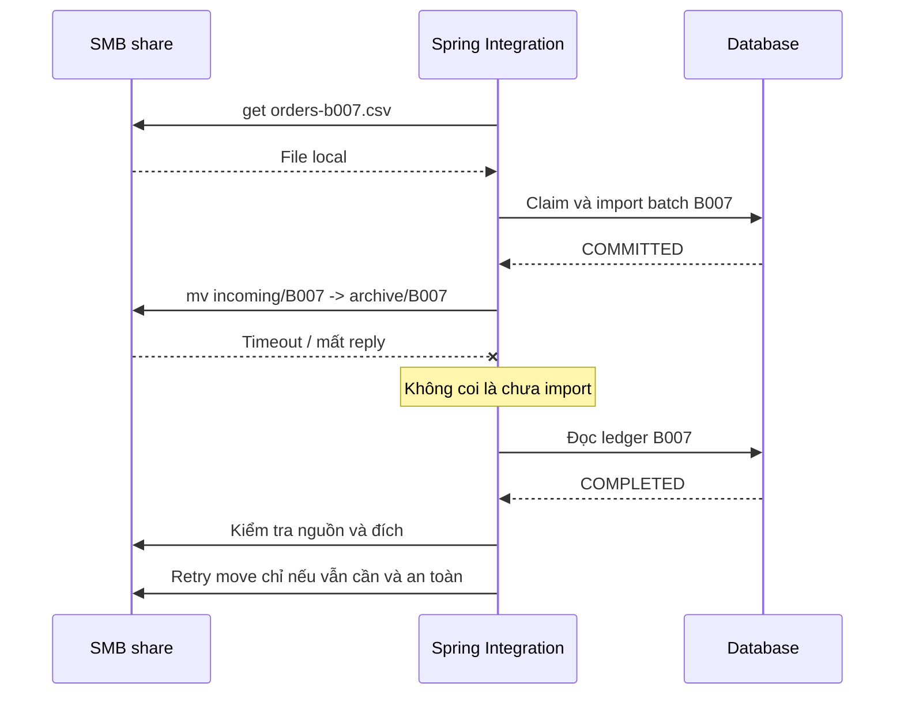
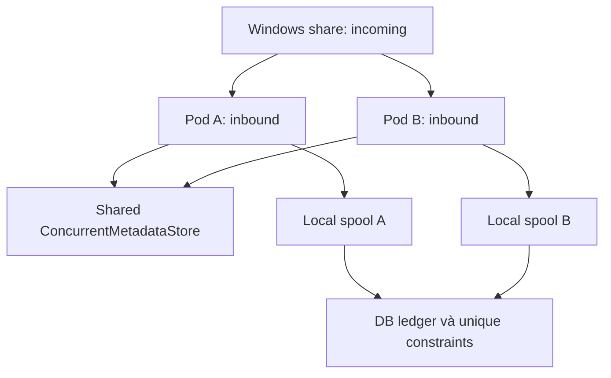
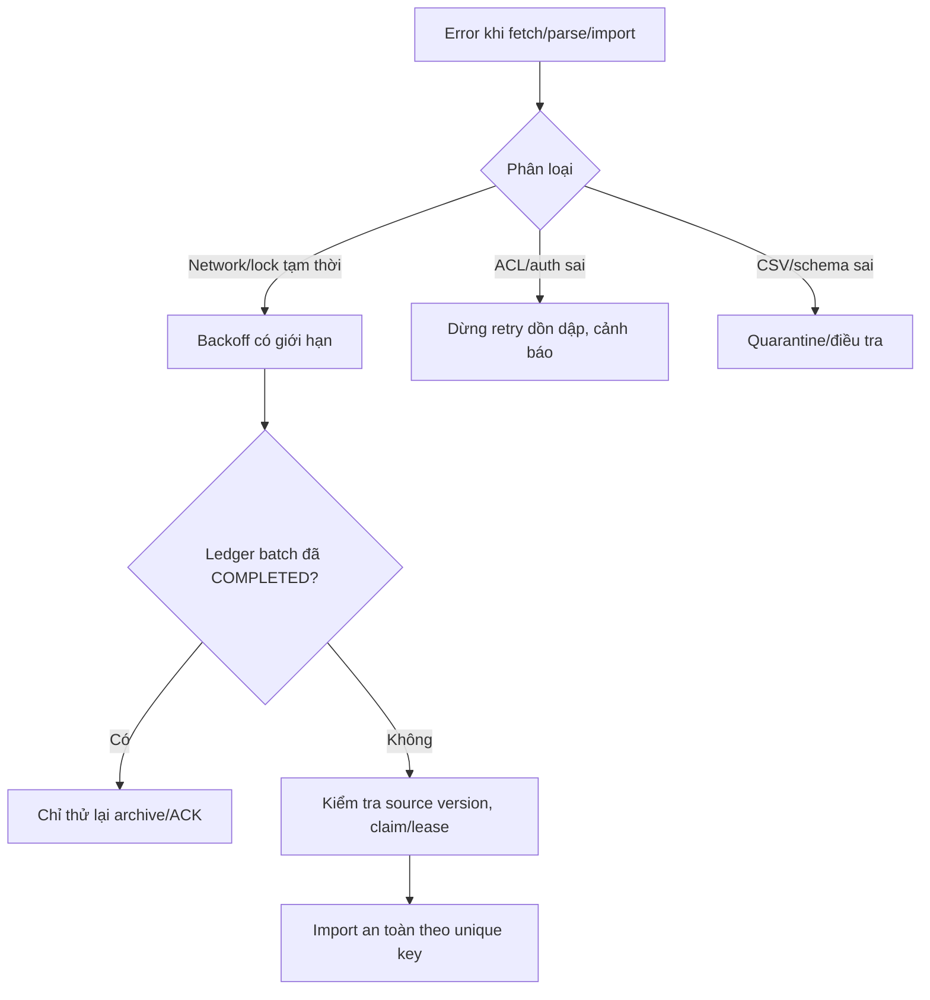

# Đảm bảo idempotency khi quét share SMB

## 1. Tại sao một tệp có thể được xử lý nhiều lần?

Giả sử ứng dụng Spring Boot cứ 10 giây quét `\\fs01\exchange\incoming\partner-a` để nhập báo cáo đơn hàng. Một file tên `orders-20261123-b007.csv` được tải về local và nhập vào database. Sau đó ứng dụng restart, mất kết nối giữa lúc tải hoặc có thêm pod khác cùng quét share. Nếu không có cơ chế kiểm soát, **cùng một lô đơn hàng có thể được đọc, phát message và ghi dữ liệu nhiều lần**.

Với Spring Integration SMB, một lần poll không phải một giao dịch bao trùm cả Windows File Server, ổ đĩa local và database. Cần phân biệt các thời điểm: **phát hiện file**, **tải file**, **phát `Message<File>`**, **commit dữ liệu**, **archive hoặc gửi ACK**. Mỗi bước có thể hoàn thành trong khi bước sau thất bại.

Bài thuộc chương **Adapter SMB** của module `SPRING_INTEGRATION_ADAPTERS`: sử dụng inbound/outbound adapter, gateway, poller và `MessageChannel` để nối các hệ thống ngoài; quản lý hợp đồng message, lỗi và vòng đời kết nối. Những nguyên tắc xử lý trùng cũng áp dụng cho file, SFTP, HTTP, JMS, AMQP, Kafka hoặc cơ sở dữ liệu, nhưng không thể thay thế chi tiết giao thức SMB và đặc tính lưu trữ file.

**Mục tiêu:** thiết kế một luồng SMB có khả năng **chịu được việc phát lại (at-least-once ở tầng xử lý) nhưng không tạo tác dụng nghiệp vụ trùng**, thay vì chỉ dựa vào việc filter bỏ qua tên file đã nhìn thấy.

Sau bài học, bạn có thể:

- Phân biệt chống **tải trùng**, chống **phát message trùng** và chống **commit nghiệp vụ trùng**.
- Hiểu `SmbPersistentAcceptOnceFileListFilter`, `FileSystemPersistentAcceptOnceFileListFilter` và `ConcurrentMetadataStore`.
- Cấu hình Java DSL cho remote/local filters, metadata nguồn, poller và giới hạn fetch.
- Chọn khóa idempotency theo đối tác/batch/version/checksum, không dựa vào message ID thay đổi qua mỗi lần chạy.
- Xử lý restart, crash, lỗi tải, partial commit, file cùng tên đã sửa và nhiều instance cùng poll.
- Thiết kế quy trình recovery, archive và ACK sao cho retry an toàn.
- Thực hành kiểm chứng các đường lỗi, kể cả những trường hợp filter **không** tự phục hồi.

## 2. Idempotency là gì trong bài toán SMB?

Một phép xử lý `f` là **idempotent** nếu chạy lại với cùng đầu vào có cùng **kết quả nghiệp vụ mong muốn** như khi chạy một lần:

```text
process(batch-007)
process(batch-007)  // có thể chạy lại, không tăng số đơn hàng đã ghi
                    // và không gửi hóa đơn trùng ngoài ý muốn
```

Idempotency **không có nghĩa** ứng dụng không bao giờ nhận lại file. Thực tế, sau timeout hoặc crash, hệ thống thường cần xử lý lại để biết kết quả cuối cùng.

| Mục tiêu | Ví dụ | Cơ chế chính |
|---|---|---|
| **Chống tải trùng** | Không copy cùng phiên bản `orders.csv` từ share mỗi chu kỳ | Remote persistent file list filter |
| **Chống phát message trùng** | Không phát lại cùng file local trong một vòng poll | Local accept-once file list filter |
| **Chống import trùng** | Một đơn hàng không được INSERT lần hai khi batch phát lại | Unique key, trạng thái batch, transaction |
| **Chống side effect trùng** | Không gửi cùng xác nhận thanh toán/HTTP notification hai lần | Idempotency key ở đích hoặc outbox/dedup |
| **Điều phối nhiều instance** | Hai pod không cùng claim một batch chưa xử lý | Shared atomic metadata/DB claim/lock |

Các filter giúp giảm tải và bớt trùng ở tầng vận chuyển. **Điểm bảo vệ cuối cùng cho dữ liệu là nơi phát sinh side effect**, ví dụ database có unique constraint hoặc hệ thống ngoài hỗ trợ idempotency key.

### 2.1. Không có transaction chung tự động



Giả sử DB đã commit ở bước F nhưng mạng lỗi ở bước G. File vẫn ở `incoming`, ứng dụng có thể thấy lại sau khi metadata hết hạn hoặc người vận hành cho phép reprocess. **Không được import thêm một lần nữa chỉ vì file vẫn ở share nguồn**. Đây là lý do trạng thái nghiệp vụ không thể thay bằng một cờ `seen=true` trong remote filter.

## 3. Hai lớp FileListFilter trên SMB inbound adapter

Với inbound adapter **đồng bộ file về local**, có hai vị trí lọc:



| Vị trí | Kiểu file | Quyết định | Điểm mù |
|---|---|---|---|
| **Remote filter** | `jcifs.smb.SmbFile` | File nào từ SMB được chấp nhận để fetch | Không biết database đã import thành công |
| **Synchronizer** | Remote → local | Tải/đổi tên tạm và ghi metadata nguồn | Tải thành công không đồng nghĩa handler đã hoàn tất |
| **Local filter** | `java.io.File` | File local nào tạo ra một message | Một message đã phát không chứng minh commit |
| **Business ledger** | `batchId` và record | Batch/version nào đã commit, có cần retry | Không thay thế kiểm tra file đã công bố hoàn chỉnh |

File streaming khác: `SmbStreamingMessageSource` phát `Message<InputStream>` trực tiếp từ SMB, không có local spool/filter mặc định. Tuy vậy, nó vẫn có **remote persistent accept-once filter** và vẫn cần idempotency nghiệp vụ. Khi xử lý stream, phải đóng `closeableResource` để trả session SMB; giữ session không đóng có thể gây timeout các lần poll sau.

### 3.1. Vì sao hai bộ lọc không thể thay cho nhau?

Giả sử bản local `orders-b007.csv` đã tải xong. Remote filter đánh dấu file đã được fetch. Nhưng một lần poll khác của source local có thể phát lại file đó nếu local filter chưa có key hoặc bị reset. Ngược lại, local filter có thể đã đánh dấu phát message trong lúc handler fail, khiến lần poll sau **không tự phát lại**.

Mỗi tầng có trạng thái riêng, cần prefix riêng nếu dùng chung metadata store. Không thể lấy sự tồn tại của key remote để suy ra key local, càng không thể suy ra một record đã được commit.

## 4. `SmbPersistentAcceptOnceFileListFilter` hoạt động thế nào?

Đây là lớp lọc SMB thuộc `org.springframework.integration.smb.filters` trong Spring Integration 6.x. Constructor nhận một `ConcurrentMetadataStore` và `prefix`:

```java
new SmbPersistentAcceptOnceFileListFilter(
        metadataStore, "prod:partner-a:remote:");
```

Theo cơ chế remote persistent file filter của Spring Integration 6.5, nó theo dõi **file identity theo cách xây key của filter và thời điểm sửa đổi remote**. Nếu file chưa được nhận, filter cho qua; nếu đã lưu cùng modified time, nó có thể từ chối; khi modified time thay đổi, file có thể được coi là phiên bản mới.

| Trạng thái | Kết quả có thể xảy ra |
|---|---|
| File mới, key chưa tồn tại | Được chấp nhận để tải |
| File cùng key, mtime không đổi | Bị bỏ qua |
| File cùng tên nhưng mtime mới | Có thể được chấp nhận lại |
| Metadata store bị xóa/reset | File có thể được coi là mới |
| Đổi prefix hoặc cách xây key | Các key cũ có thể không còn được nhận diện |

**Cảnh báo:** modified time không phải checksum. Bên gửi có thể thay nội dung nhưng bảo toàn timestamp, hoặc chạm timestamp mà không đổi nội dung. Nếu nghiệp vụ yêu cầu xác định một **phiên bản dữ liệu**, phải thỏa thuận version/batch ID và dùng checksum khi cần.

### 4.1. Khi nào trạng thái được ghi?

Từ Spring Integration 5.2, remote filter hỗ trợ đánh dấu gần thời điểm **bắt đầu fetch**, và có thể **rollback key khi fetch thất bại** theo đường lỗi thông thường. Nếu nguồn mất điện hoặc process bị kill khi đang fetch, key có thể vẫn tồn tại trong store bền vững sau restart và **file không được tự lấy lại**. Đây là sự khác nhau giữa một exception được xử lý và một catastrophic crash.

```mermaid
sequenceDiagram
    participant P as Poller
    participant F as Remote filter
    participant S as Synchronizer
    participant DB as MetadataStore
    participant SMB as SMB server
    P->>F: Chọn file candidate
    F->>DB: Ghi accept-once key trước fetch
    F->>S: Cho tải orders-b007.csv
    S->>SMB: Tải dữ liệu
    alt Tải thành công
        SMB-->>S: Đã nhận đủ nội dung
        S-->>P: Local file sẵn sàng
    else Tải lỗi được bắt
        SMB--xS: I/O exception
        S->>F: Rollback key khi filter hỗ trợ
    else Process crash
        Note over F,DB: Key có thể còn; cần reconciliation
    end
```

Không dùng mệnh đề “bộ lọc luôn tự rollback” cho mọi trạng thái. Trong Spring Integration 6.x, khả năng lọc theo từng file phụ thuộc `supportsSingleFileFiltering()`; khi ghép các filter, **tất cả filter con** phải hỗ trợ mới duy trì được hành vi single-file như tài liệu mô tả. Một marker filter cần xem cả danh sách có thể thay đổi semantics.

### 4.2. Chọn key và prefix

Ví dụ hai đối tác có cùng tên:

```text
incoming/partner-a/report.csv
incoming/partner-b/report.csv
```

Nếu cả hai dùng chung filter và chỉ xây key từ filename, trạng thái có thể bị va chạm. Cách giảm rủi ro:

1. Dùng **prefix riêng theo môi trường/đối tác/endpoint**, ví dụ `prod:pA:remote:` và `prod:pB:remote:`.
2. Khi đọc đệ quy từ nhiều thư mục, cân nhắc `setForRecursion(true)` trên persistent remote filter để đưa **đường dẫn đầy đủ** vào key theo cơ chế Spring Integration 6.x.
3. Không thay `forRecursion` hoặc prefix ở production mà không có kế hoạch migrate metadata: key cũ có thể không còn khớp, dẫn tới quét lại hàng loạt.
4. Tách metadata chống trùng khỏi trạng thái **COMPLETED** của batch nghiệp vụ.

Theo tài liệu 6.5, `forRecursion=true` còn bật hành vi luôn chấp nhận directory khi duyệt đệ quy. Tùy chọn này không tự bảo đảm unique key trên database và không thay thế việc giới hạn đúng remote path.

## 5. Chọn đúng MetadataStore

`ConcurrentMetadataStore` có những phép cập nhật nguyên tử như `putIfAbsent(key, value)` và `replace(key, oldValue, newValue)`. Chính các phép này cho phép nhiều luồng hoặc instance phối hợp hơn so với một Map không có ngữ nghĩa atomic.

| Store | Đặc điểm | Giới hạn |
|---|---|---|
| `SimpleMetadataStore` | Trong memory, phù hợp lab hoặc một vòng đời ứng dụng | Mất trạng thái sau restart, không chia sẻ giữa nhiều pod |
| `JdbcMetadataStore` | Lưu xuống database, hỗ trợ `ConcurrentMetadataStore` và cập nhật atomic qua transaction | Phải cài schema, quản lý kết nối, transaction, retention |
| `RedisMetadataStore` | Store ngoài process, có thể chia sẻ qua nhiều instance trong cấu hình phù hợp | Kiểm tra compatibility phiên bản; Spring Integration 6.5 nêu hạn chế thao tác atomic `replace` với Redis Cluster do `WATCH` |
| Store khác hỗ trợ contract | Có thể dùng nếu có `ConcurrentMetadataStore` phù hợp | Phải chứng minh độ bền, tính atomic, phân quyền và recovery |

**Quan trọng:** tên “persistent filter” không có nghĩa **store mặc định bền qua restart**. Spring Integration cung cấp nhiều remote file filter mặc định dựa trên `SimpleMetadataStore` trong bộ nhớ. Muốn bền vững, phải cấp backend tương ứng một cách tường minh và cấu hình key/prefix nhất quán.

### 5.1. Tách các namespace metadata

Một inbound file synchronizer có thể cần ba nhóm key:

```text
prod:smb:partner-a:remote:...   # file từ xa đã được chấp nhận để tải
prod:smb:partner-a:local:...    # file local đã được phát Message<File>
prod:smb:partner-a:origin:...   # local file này đến từ host/path/file nào
```

Nhóm thứ ba là **remote-origin metadata**. Vì handler nhận `java.io.File` local nên synchronizer cần ghi nguồn gốc để sau đó cung cấp các header như `FileHeaders.REMOTE_FILE` và `FileHeaders.REMOTE_DIRECTORY`.

**Không dùng chung prefix** giữa remote accept-once, local accept-once và origin metadata. Nếu key trùng, một thành phần có thể ghi đè giá trị của thành phần khác. Nên có namespace riêng cho environment, partner, data source và mục đích.

### 5.2. Khi nào dùng JDBC metadata store?

Nếu ứng dụng chạy nhiều pod hoặc cần phục hồi sau restart, một tùy chọn là `JdbcMetadataStore`. Nó thuộc module `spring-integration-jdbc`, yêu cầu `DataSource`, bảng metadata đúng schema và transaction management phù hợp. Ví dụ *thay thế bean lab*:

```gradle
dependencies {
    implementation 'org.springframework.integration:spring-integration-jdbc'
}
```

```java
import javax.sql.DataSource;
import org.springframework.context.annotation.Bean;
import org.springframework.integration.jdbc.metadata.JdbcMetadataStore;
import org.springframework.integration.metadata.ConcurrentMetadataStore;

@Bean("smbScanMetadataStore")
ConcurrentMetadataStore smbScanMetadataStore(DataSource dataSource) {
    return new JdbcMetadataStore(dataSource);
}
```

Ví dụ này chỉ đúng sau khi database có schema `INT_METADATA_STORE` (hoặc tên tương ứng khi đổi prefix) theo SQL scripts của Spring Integration, có transaction manager thích hợp và quyền đọc/ghi. Nếu dự án dùng schema/region tùy chỉnh, hãy cấu hình đúng và kiểm chứng trên môi trường tương ứng.

**Không suy luận rằng** chỉ cần dùng chung database thì một giao dịch DB import và trạng thái SMB filter **tự động** trở thành một distributed transaction. Dù cùng `DataSource`, ranh giới transaction, thời điểm cập nhật metadata và xử lý exception cần được kiểm tra cụ thể.

## 6. Java DSL: quét SMB với filter và metadata

Ví dụ dùng Spring Boot 3.x + Spring Integration 6.5.x tương thích (cần chọn version qua dependency management/BOM phù hợp). Với dòng 6.5, remote file type là `jcifs.smb.SmbFile`; không dùng `java.io.File` làm generic của remote filter.

### 6.1. Dependencies và cấu hình ngoài

**`build.gradle`:**

```gradle
dependencies {
    implementation 'org.springframework.boot:spring-boot-starter-integration'
    implementation 'org.springframework.integration:spring-integration-smb'
}
```

**`application.yml`:**

```yaml
demo:
  smb:
    host: ${SMB_HOST}
    port: ${SMB_PORT:445}
    domain: ${SMB_DOMAIN:}
    username: ${SMB_USERNAME}
    password: ${SMB_PASSWORD}
    share: ${SMB_SHARE:exchange}
    remote-directory: ${SMB_REMOTE_DIRECTORY:incoming/partner-a}
    local-directory: ${SMB_LOCAL_DIRECTORY:./data/smb-inbox/partner-a}
```

Password phải được cấp bằng cơ chế secret phù hợp; không ghi mật khẩu vào Git hay log. `remote-directory` là **đường dẫn bên trong share**, không phải UNC đầy đủ.

### 6.2. Bean factory, filter và flow

**`SmbIdempotentScanConfig.java`:**

```java
import java.io.File;
import jcifs.DialectVersion;
import jcifs.smb.SmbFile;

import org.springframework.beans.factory.annotation.Qualifier;
import org.springframework.beans.factory.annotation.Value;
import org.springframework.context.annotation.Bean;
import org.springframework.context.annotation.Configuration;
import org.springframework.integration.config.EnableIntegration;
import org.springframework.integration.dsl.IntegrationFlow;
import org.springframework.integration.dsl.Pollers;
import org.springframework.integration.file.filters.ChainFileListFilter;
import org.springframework.integration.file.filters.FileListFilter;
import org.springframework.integration.file.filters.FileSystemPersistentAcceptOnceFileListFilter;
import org.springframework.integration.metadata.ConcurrentMetadataStore;
import org.springframework.integration.metadata.SimpleMetadataStore;
import org.springframework.integration.smb.dsl.Smb;
import org.springframework.integration.smb.filters.SmbLastModifiedFileListFilter;
import org.springframework.integration.smb.filters.SmbPersistentAcceptOnceFileListFilter;
import org.springframework.integration.smb.filters.SmbRegexPatternFileListFilter;
import org.springframework.integration.smb.session.SmbSessionFactory;

@Configuration
@EnableIntegration
public class SmbIdempotentScanConfig {

    @Bean
    SmbSessionFactory smbSessionFactory(
            @Value("${demo.smb.host}") String host,
            @Value("${demo.smb.port}") int port,
            @Value("${demo.smb.domain}") String domain,
            @Value("${demo.smb.username}") String username,
            @Value("${demo.smb.password}") String password,
            @Value("${demo.smb.share}") String share) {

        SmbSessionFactory f = new SmbSessionFactory();
        f.setHost(host);
        f.setPort(port);
        f.setDomain(domain);
        f.setUsername(username);
        f.setPassword(password);
        f.setShareAndDir(share);
        f.setSmbMinVersion(DialectVersion.SMB210);
        f.setSmbMaxVersion(DialectVersion.SMB311);
        return f;
    }

    // LAB: thay bằng JdbcMetadataStore/Store dùng chung ở production.
    @Bean("smbScanMetadataStore")
    ConcurrentMetadataStore smbScanMetadataStore() {
        return new SimpleMetadataStore();
    }

    @Bean("smbScanRemoteFilter")
    FileListFilter<SmbFile> smbScanRemoteFilter(
            @Qualifier("smbScanMetadataStore")
            ConcurrentMetadataStore store) {

        ChainFileListFilter<SmbFile> chain = new ChainFileListFilter<>();
        chain.addFilter(new SmbRegexPatternFileListFilter(
                "(?i)orders-\\d{8}-b\\d{3}\\.csv"));
        chain.addFilter(new SmbLastModifiedFileListFilter(120));
        chain.addFilter(new SmbPersistentAcceptOnceFileListFilter(
                store, "prod:smb:partner-a:remote:"));
        return chain;
    }

    @Bean
    IntegrationFlow smbIdempotentInboundFlow(
            SmbSessionFactory sessionFactory,
            @Qualifier("smbScanRemoteFilter")
            FileListFilter<SmbFile> remoteFilter,
            @Qualifier("smbScanMetadataStore")
            ConcurrentMetadataStore store,
            @Value("${demo.smb.remote-directory}") String remoteDir,
            @Value("${demo.smb.local-directory}") String localDir,
            SmbImportService importer) {

        return IntegrationFlow
                .from(Smb.inboundAdapter(sessionFactory)
                        .remoteDirectory(remoteDir)
                        .localDirectory(new File(localDir))
                        .autoCreateLocalDirectory(true)
                        .preserveTimestamp(true)
                        .filter(remoteFilter)
                        .localFilter(
                                new FileSystemPersistentAcceptOnceFileListFilter(
                                        store, "prod:smb:partner-a:local:"))
                        .remoteFileMetadataStore(store)
                        .metadataStorePrefix("prod:smb:partner-a:origin:")
                        .maxFetchSize(1),
                    e -> e.id("smbIdempotentInbound")
                          .poller(Pollers.fixedDelay(10_000)
                                  .maxMessagesPerPoll(1)))
                .handle(message -> {
                    File localFile = (File) message.getPayload();
                    importer.importBatchIfNeeded(localFile, message.getHeaders());
                })
                .get();
    }
}
```

`SmbImportService` trong ví dụ là **service nghiệp vụ do dự án triển khai** (phần 7 mô tả hợp đồng), không phải class có sẵn của Spring Integration. Để code khởi động, cần cung cấp bean của service đó cùng cơ chế lưu trạng thái/transaction mà ứng dụng lựa chọn. Phần cấu hình filter và flow là ví dụ API; chưa có build/test trong bài này.

### 6.3. Vì sao thứ tự filter là vấn đề thực tế?

Ta muốn **tên hợp lệ → file đủ tuổi → accept-once**. Nếu đặt accept-once trước filter tuổi hoặc dùng tổ hợp composite không phù hợp, file mới ghi có thể bị đánh dấu đã thấy **trước khi đủ tuổi**; sau 120 giây, filter tuổi chấp nhận nhưng accept-once lại từ chối, khiến ứng dụng bỏ sót file.



`ChainFileListFilter` đưa danh sách đã lọc của bước trước sang bước tiếp theo. `CompositeFileListFilter` có cách trình bày danh sách ứng viên khác; với các filter **có trạng thái** như accept-once, không mặc nhiên coi hai cách ghép tương đương.

**Không nhầm `maxFetchSize(1)` với `maxMessagesPerPoll(1)`.** Cái thứ nhất giới hạn số remote files được fetch một lần; cái thứ hai giới hạn số message được poller phát. Trong nhiều instance, fetch nhỏ giúp tránh một node nắm hết candidate nhưng không tự tạo exactly-once nghiệp vụ.

### 6.4. Lưu ý về local filter

`FileSystemPersistentAcceptOnceFileListFilter` theo dõi file **trên local disk**. Nếu local file cùng tên được cập nhật nhưng mtime vẫn không thay đổi như cách filter kỳ vọng, nó có thể không phát lại message tương ứng. `preserveTimestamp(true)` cũng ảnh hưởng đến mtime của file local. Đặt test cho cả hai trường hợp “remote sửa lại tên cũ” và “local file đã tồn tại”.

Nếu cùng lúc nhiều instance có local storage tách biệt, shared store chỉ đồng bộ được **metadata**, không tự đồng bộ bản sao local. Không để hai pod đụng một file local chung trên volume chia sẻ khi chưa kiểm chứng locking, atomic file rename và quyền sở hữu.

## 7. Idempotency nghiệp vụ: chỗ filter không thể làm thay

### 7.1. Chọn khóa batch và kiểm tra nội dung

Giả sử tên file là `orders-20261123-b007.csv`. Ta có thể tách:

```text
partnerId = PARTNER_A
businessDate = 2026-11-23
batchId = ORDERS-20261123-B007
checksum = SHA-256(file bytes)
```

Chọn khóa `(partnerId, batchId)` cho **batch identity**; lưu checksum như thuộc tính của version. Khi gặp lại cùng khóa:

| Trạng thái DB | Checksum | Cách ứng xử |
|---|---|---|
| `COMPLETED` | Trùng checksum | Không import lần nữa; tiếp tục archive/ACK nếu còn thiếu |
| `COMPLETED` | Khác checksum | **Xung đột version**; không âm thầm coi là duplicate hoặc ghi đè |
| `PROCESSING` còn lease hợp lệ | Bất kỳ | Node khác không được claim/commit cùng lúc |
| `PROCESSING` quá hạn | Cần đối chiếu | Recovery kiểm tra owner/transaction trước khi claim lại |
| `FAILED_RETRYABLE` | Cùng checksum | Retry có kiểm soát, kết hợp unique keys |
| Chưa có batch | Mới | Claim batch theo phép insert/update atomic |

Không dùng `MessageHeaders.ID` hoặc timestamp message làm khóa idempotency: mỗi lần poll/retry có thể tạo message ID khác nhau. Không lấy duy nhất filename nếu hai đối tác hoặc hai thư mục có thể tạo cùng tên.

### 7.2. Database ledger và ràng buộc duy nhất

Ví dụ schema minh họa cho PostgreSQL:

```sql
CREATE TABLE import_batches (
    partner_id       VARCHAR(64)  NOT NULL,
    batch_id         VARCHAR(128) NOT NULL,
    content_sha256   CHAR(64)     NOT NULL,
    state            VARCHAR(32)  NOT NULL,
    claim_owner      VARCHAR(128),
    claim_expires_at TIMESTAMPTZ,
    updated_at       TIMESTAMPTZ NOT NULL DEFAULT now(),
    PRIMARY KEY (partner_id, batch_id)
);

CREATE TABLE imported_orders (
    partner_id VARCHAR(64) NOT NULL,
    order_id   VARCHAR(128) NOT NULL,
    batch_id   VARCHAR(128) NOT NULL,
    amount     NUMERIC(18, 2) NOT NULL,
    PRIMARY KEY (partner_id, order_id)
);
```

Đây là **lược đồ minh họa**, cần điều chỉnh theo quy tắc nghiệp vụ: nếu một `order_id` được phép xuất hiện ở nhiều version, không áp dụng mù quáng unique key trên `(partner_id, order_id)`; hãy xác định đúng identity của record hoặc sự kiện.

Một cách claim sơ bộ bằng unique key:

```sql
INSERT INTO import_batches
    (partner_id, batch_id, content_sha256, state, claim_owner, claim_expires_at)
VALUES
    (:partnerId, :batchId, :sha256, 'PROCESSING',
     :workerId, :leaseDeadline)
ON CONFLICT (partner_id, batch_id) DO NOTHING;
```

**Quan trọng:** khi INSERT trả 0 rows, **không** suy rằng batch đã xử lý xong. Nó có thể đang `PROCESSING`, `FAILED` hoặc `COMPLETED`. Phải đọc state và checksum dưới cơ chế khóa/transaction phù hợp, sau đó quyết định skip, chờ, retry hoặc báo xung đột. Claim khi lease đã hết hạn cũng phải dùng cập nhật có điều kiện để hai worker không cùng giành quyền.

### 7.3. Pseudocode nhập dữ liệu có kiểm soát

```java
// PSEUDOCODE NGHIỆP VỤ - không phải Spring Integration API có sẵn.
void importBatchIfNeeded(File localFile, MessageHeaders headers) {
    BatchKey key = identifyTrustedBatch(localFile, headers);
    String sha256 = checksum(localFile);

    // claimBatchAtomically() dùng unique key và compare-and-set/transaction.
    Claim claim = batchRepository.claimBatchAtomically(key, sha256, workerId);
    if (claim.isCompletedWithSameChecksum()) {
        resumeArchiveOrAckIfNeeded(key);
        return;
    }
    if (!claim.isOwnedBy(workerId)) {
        // Batch đang do node khác xử lý hoặc dữ liệu bị xung đột.
        returnOrRaiseAccordingToPolicy(claim);
        return;
    }

    // Transaction của database cần bao phủ ghi record và trạng thái COMPLETED.
    // Có thể dùng staging/batch insert cho file lớn.
    importAndMarkCompletedInOneDatabaseTransaction(key, sha256, localFile);

    // Tác vụ SMB mv hoặc ACK nằm ngoài DB transaction.
    // Nếu lỗi, đánh dấu PENDING_ARCHIVE để retry riêng, KHÔNG import lại.
    archiveOrScheduleRetry(key);
}
```

Đoạn này mô tả kiến trúc, **chưa phải code compile độc lập**: `BatchKey`, `Claim`, `batchRepository`, `workerId` và các method là thành phần dự án cần xây dựng. Để tránh lỗi “self-invocation” của `@Transactional`, đặt nghiệp vụ giao dịch trong service/bean mà Spring thực sự áp dụng transaction proxy hoặc dùng `TransactionTemplate`. Với file lớn, dùng staging table và commit theo chiến lược có idempotency ở mỗi checkpoint.

Nếu dữ liệu đã ghi DB thành công nhưng gửi API ngoài thất bại, transaction DB không hoàn tác được tác dụng ở hệ thống ngoài. Có thể dùng **transactional outbox** và idempotency key tại đích thay vì gọi side effect không kiểm soát trong cùng đoạn mã xử lý file.

## 8. Những thời điểm crash và kế hoạch khôi phục

| Crash hoặc lỗi tại mốc | Remote metadata | Local file/message | Database | Hành động khôi phục |
|---|---|---|---|---|
| Trước khi remote filter chấp nhận | Chưa có key mới | Chưa có file | Chưa claim | Poll lại bình thường |
| Sau ghi key, trước khi tải xong | **Có thể còn key kẹt** khi crash | Có thể có file tạm | Chưa import | Đối chiếu remote/local, chỉ gỡ key mục tiêu sau kiểm tra |
| Tải xong, trước khi phát message | Key remote có thể tồn tại | Có file local | Chưa import | Kiểm tra local filter và spool; phát lại có kiểm soát |
| Đã phát message, handler exception | Key remote/local đã ghi | File local còn | Chưa commit hoặc commit một phần | Recovery theo ledger/unique key; không xóa metadata bừa |
| Commit DB xong, trước archive | Filter coi đã thấy | Local file có thể còn | `COMPLETED` | **Không import lại**; retry riêng archive/ACK |
| `mv` remote timeout | Nguồn/đích có thể đã đổi | Không đủ kết luận | `COMPLETED` | Kiểm tra cả `incoming` và `archive` rồi cập nhật trạng thái |
| Metadata store mất dữ liệu | Các key mất | File local còn/đã xóa | DB vẫn có ledger | Chấp nhận re-scan nhưng skip/verify batch ở DB |
| Account hết hạn, không đọc được SMB | Filter không cứu được auth | Chưa có message mới | Batch vẫn ở trạng thái cũ | Sửa credential, tránh retry dồn dập, resume có kiểm soát |

### 8.1. Case study: commit xong nhưng chưa archive



Không áp dụng quy tắc “nếu file vẫn ở incoming thì nhập lại” vì có thể DB đã hoàn tất nhưng bước archive chưa thành công.

### 8.2. Nếu file đã sửa lại dưới cùng tên

Đối tác thay `orders-b007.csv` bằng nội dung khác nhưng giữ tên:

- Remote filter có thể phát hiện mtime đổi và tải lại.
- Local filter cần kiểm tra trạng thái file local và mtime; nếu không, bản mới có thể không được phát.
- Ledger có thể thấy cùng `(partnerId, batchId)` nhưng checksum khác. Đây là **sự kiện sửa batch hoặc xung đột**, không tự động là duplicate an toàn để bỏ qua.
- Hai bên cần quy tắc rõ: gửi batch ID mới, version tăng dần, file correction/void hoặc đưa vào hàng đợi điều tra.

Không cho một batch đã `COMPLETED` bị sửa âm thầm chỉ vì filter chấp nhận một version mới.

## 9. Nhiều pod quét cùng share



Để tránh trường hợp hai pod cùng “claim” một file:

1. Thay `SimpleMetadataStore` bằng **store bền vững được chia sẻ** có thao tác atomic phù hợp; tất cả pod dùng cùng namespace/key policy.
2. Cấu hình remote persistent accept-once filter đúng với đường dẫn remote và `maxFetchSize(1)` để không một node lấy nhiều file cùng lúc.
3. Nếu nhiều thư mục có tên trùng, dùng prefix riêng hoặc `forRecursion` phù hợp; kiểm tra migration key trước khi thay đổi.
4. Quy định local spool **riêng từng pod** hoặc một shared filesystem có chiến lược locking và atomic rename rõ ràng. Metadata store chung không chia sẻ file local.
5. Dùng DB ledger/unique key để xử lý được trùng ngay cả khi hai instance cùng vượt qua tầng file filter.
6. Thiết kế recovery cho node chết giữa lúc đang xử lý: claim owner/lease có hạn, watchdog xác minh trạng thái trước khi giao lại batch.
7. Nếu dùng `JdbcMetadataStore`, bảo đảm schema, transaction và cấu hình DB thống nhất trên các pod.

**Phân biệt:** `SmbPersistentAcceptOnceFileListFilter` là cơ chế idempotency ở tầng **chọn file**, không phải distributed lock vĩnh viễn cho toàn bộ công việc import. Bất kỳ hai pod nào cũng phải chuẩn bị cho tình huống filter state không khớp ledger hoặc tải lại file sau sự cố.

## 10. Poller, file readiness và retry

### 10.1. File đã xuất hiện không có nghĩa đã ghi xong

Nếu đối tác upload trực tiếp vào `orders-b007.csv`, một poller có thể chọn file trong lúc nó đang được ghi. Khi tải dở, file có thể bị thiếu dòng hoặc gặp sharing violation. Hai bên nên dùng **hợp đồng công bố**:

```text
orders-20261123-b007.csv.writing  // đang ghi
    -> đóng handle, flush
orders-20261123-b007.csv          // tên chính thức sau rename
```

Inbound filter chỉ nhận `*.csv` chính thức. Nếu không thể thay bên gửi, có thể dùng `SmbLastModifiedFileListFilter(120)` hoặc marker file xác nhận upload hoàn tất, nhưng bộ lọc tuổi chỉ giảm rủi ro, không chứng minh chắc chắn dữ liệu đã hoàn thành.

### 10.2. Lọc theo tuổi trước accept-once

Ví dụ chain trong phần 6 đặt `SmbLastModifiedFileListFilter(120)` trước persistent accept-once. Điều đó giúp file mới chưa đủ tuổi **không bị ghi nhận “đã thấy” quá sớm**. Khi ghép marker filter, phải kiểm tra kiểu single-file/list filtering và cách marker xuất hiện để không vô tình đánh dấu các file chưa sẵn sàng.

### 10.3. Retry không được tạo side effect mới

Một sơ đồ xử lý lỗi:



Không dùng `FileExistsMode.APPEND` như một chiến lược retry chung cho CSV; gửi lại có thể nối trùng dữ liệu. Không retry liên tục lỗi password vì có thể khóa tài khoản domain. Với thao tác `mv/put/rm` bị timeout, **kiểm tra trạng thái remote** trước khi thử lại vì server có thể đã thực thi lệnh.

### 10.4. Lỗi downstream khác lỗi fetch

Remote persistent filter có cơ chế rollback khi fetch lỗi theo đường thường, nhưng **không tự rollback** vì handler nhập database bị exception sau khi file đã tải. Nếu handler đã fail, phải dùng ledger và chính sách reprocess:

- Có thể reprocess từ file local còn nguyên, không nhất thiết tải lại SMB.
- Có thể reset **đúng key remote/local** nếu cần nguồn phát lại, sau khi xác nhận phiên bản và trạng thái batch.
- Không reset toàn bộ metadata store chỉ để xử lý một batch kẹt; điều đó có thể làm quét lại tất cả file.
- Nếu dữ liệu đã commit nhưng ACK thất bại, retry ACK riêng thay vì re-import.

## 11. Vận hành: kiểm soát metadata và log

### 11.1. Trạng thái nên quan sát

| Metric / log | Lý do cần |
|---|---|
| Số file ứng viên trên share và backlog | Phát hiện bên gửi tăng tải, file cũ còn tồn |
| Số file bị loại vì regex/tuổi | Biết vì sao file chưa xuất hiện ở handler |
| Số file đã được remote filter accept | Theo dõi fetch và độ trễ |
| Số file local được phát message | Phát hiện kẹt local filter |
| Số batch `PROCESSING/COMPLETED/FAILED` | Kết quả nghiệp vụ thực |
| Số batch có `PROCESSING` quá lease | Recovery sau worker chết |
| Số lần re-fetch/reprocess một batch | Theo dõi replay không mong muốn |
| Số checksum mismatch trên cùng batch key | Phát hiện file sửa lại không theo version |
| Thời gian từ publish đến commit, archive, ACK | Kiểm tra SLA end-to-end |
| Số session SMB đang bận và lỗi pool | Phát hiện streaming leak/chờ session |

Không phải metric nào cũng có sẵn trong Spring Integration; có thể cần instrumentation ở filter, service nghiệp vụ, database và SMB server. Log host alias, share, remote directory và `batchId` đã làm sạch; **không** log password, nội dung file nhạy cảm hoặc URI SMB chứa secret.

### 11.2. Quy trình gỡ một metadata key bị kẹt

Chỉ người vận hành có quyền mới nên can thiệp store:

1. Xác định chính xác `partnerId`, remote path, batch ID và version/mtime/checksum.
2. Đối chiếu remote file, file local, trạng thái ledger và archive/ACK.
3. Xác nhận batch **chưa hoàn tất** hoặc chỉ cần retry một bước cụ thể.
4. Xác định key và namespace **đúng một file** từ cách xây key của phiên bản Spring Integration đang dùng.
5. Thực hiện thay đổi có audit, tránh xóa key của phiên bản/batch khác; đảm bảo không còn worker đang claim batch đó.
6. Cho poller thử lại có kiểm soát và theo dõi kết quả end-to-end.

Việc xóa key không tự xóa file local hay hoàn tác database. Ngược lại, xóa file local không tự xóa remote accept-once key. Đây là lý do cần một runbook mô tả **ba trạng thái riêng**.

## 12. Bài tập thực hành trên SMB share lab

Chuẩn bị Windows File Server/Samba/NAS share **chỉ dành cho lab**:

```text
\\fs01\exchange-lab\incoming\partner-a\
  orders-20261123-b001.csv
  orders-20261123-b002.csv.writing
```

Ứng dụng có Java DSL phần 6, directory local riêng và một database lab với bảng trạng thái batch/unique constraints. Mỗi bài thử cần lưu lại remote files, metadata keys, local files và trạng thái DB. Không chỉnh/xóa metadata thật ở production.

### Lab A — Một file, nhiều chu kỳ poll

1. Tạo `orders-20261123-b001.csv` theo naming convention và cho file đủ tuổi 120 giây trong lab.
2. Khởi động ứng dụng; xác minh remote filter chấp nhận file và adapter tải về local.
3. Để poller chạy thêm nhiều chu kỳ; quan sát không có lượt tải/phát mới cho cùng phiên bản file theo cấu hình hiện tại.
4. Xem key remote/local có namespace khác nhau; kiểm tra ledger chuyển sang `COMPLETED` nếu importer giả lập đã commit.

**Kết quả mong đợi:** filter giảm tải trùng trong một phiên chạy, ledger chống import lại khi message được phát lại.

### Lab B — Restart với SimpleMetadataStore

1. Hoàn tất Lab A và giữ nguyên remote file.
2. Restart ứng dụng đang dùng `SimpleMetadataStore`.
3. Quan sát việc mất trạng thái remote/local trong memory có thể dẫn tới fetch/phát lại.
4. Xác minh unique key/ledger giúp batch `COMPLETED` không bị import lần hai.

**Kết quả mong đợi:** không nhầm “persistent filter” với “state bền vững” khi underlying store là memory.

### Lab C — Shared JDBC MetadataStore

1. Trong lab có DB hỗ trợ, tạo bảng metadata store theo script đúng phiên bản.
2. Thay bean store lab bằng `JdbcMetadataStore` và bật transaction/config phù hợp.
3. Chạy lại một batch; restart app và xác minh metadata vẫn tồn tại.
4. Kiểm tra trạng thái ledger riêng, không dùng key filter làm bằng chứng `COMPLETED`.

**Kết quả mong đợi:** có persistent file-selection state qua restart nhưng vẫn cần idempotency nghiệp vụ.

### Lab D — Mất mạng và key kẹt

1. Cho inbound bắt đầu tải một file tương đối lớn trong mạng lab.
2. Thử lỗi mạng có exception bình thường; ghi nhận liệu filter rollback key và file có được fetch lại hay không.
3. Ở một thử nghiệm **cô lập**, mô phỏng crash giữa fetch; quan sát key remote hoặc file tạm còn tồn tại.
4. Khôi phục theo runbook phần 11, chỉ tác động key và batch thử nghiệm.

**Kết quả mong đợi:** phân biệt rollback trên exception thường với trạng thái không chắc chắn sau crash.

### Lab E — DB commit xong, SMB archive lỗi

1. Import một batch thành công và ghi `COMPLETED` vào DB lab.
2. Mô phỏng lỗi kết nối khi gọi `mv` sang `archive`.
3. Cho flow retry; kiểm tra nó đọc trạng thái `COMPLETED` và **không INSERT thêm đơn hàng**.
4. Xác minh đường nguồn/đích và chỉ hoàn tất archive/ACK khi trạng thái remote đã được đối chiếu.

**Kết quả mong đợi:** nhận thấy commit và archive là hai mốc riêng, retry cần tiếp tục đúng bước.

### Lab F — Hai pod cùng quét share

1. Chạy hai instance thử nghiệm với metadata store memory riêng.
2. Đặt một batch mới và quan sát khả năng cả hai nhìn thấy cùng ứng viên.
3. Dùng shared store phù hợp, đặt `maxFetchSize(1)` và chạy lại với một batch khác.
4. Cố ý mô phỏng failover giữa lúc xử lý; DB unique key phải ngăn commit trùng ngay cả khi file phát lại.

**Kết quả mong đợi:** metadata shared giảm tranh file; khóa nghiệp vụ vẫn là tuyến phòng vệ cuối cùng.

### Lab G — Cùng tên nhưng nội dung/mtime đổi

1. Cho `orders-20261123-b001.csv` được xử lý xong với checksum A.
2. Thay nội dung file **trong lab** nhưng giữ tên, làm thay đổi mtime; quan sát remote filter có thể cho fetch lại.
3. Xác minh importer phát hiện cùng batch ID nhưng checksum B khác và đưa vào quy trình correction/conflict.
4. Thử trường hợp nội dung đổi mà timestamp được bảo toàn để thấy giới hạn của filter dựa trên mtime.

**Kết quả mong đợi:** biết tại sao cần version/checksum và hợp đồng sửa dữ liệu.

### Câu hỏi tự kiểm tra

1. Ba tầng remote filter, local filter và database ledger chống trùng ở ba thời điểm nào?
2. Vì sao `SimpleMetadataStore` không đủ để hai pod phối hợp hoặc restart không phát lại?
3. Khi nào remote accept-once key được ghi? Khi crash có luôn rollback không?
4. `maxFetchSize(1)` có bảo đảm một batch chỉ commit một lần không? Vì sao?
5. Vì sao không lấy Spring message ID làm idempotency key?
6. Nếu một batch `COMPLETED` nhưng archive lỗi, bước nào được phép retry?
7. Nếu cùng `batchId` nhưng checksum khác, nên skip, overwrite hay cảnh báo?
8. `forRecursion=true` ảnh hưởng key metadata như thế nào?
9. Tại sao `ChainFileListFilter` thường đặt age filter trước accept-once?
10. Nếu local file đã tải nhưng handler fail, metadata remote có tự reset không?

## 13. Những nhầm lẫn phổ biến

| Nhầm lẫn | Cách hiểu đúng |
|---|---|
| “Không tải trùng” nghĩa là “không import trùng” | Remote filter chỉ làm việc ở tầng file; cần DB ledger/unique constraint |
| `PersistentAcceptOnce` luôn bền qua restart | Bền hay không phụ thuộc `MetadataStore` được dùng |
| Một process crash sẽ tự rollback metadata | Có thể để lại key kẹt, phải đối chiếu và recovery |
| Filter nhận cùng tên nghĩa là cùng nội dung | Mtime có thể đổi hoặc không phản ánh thay đổi bytes; kiểm tra version/checksum |
| Metadata store dùng chung là distributed transaction với SMB | Không có giao dịch tự động bao trùm file server và DB |
| Local filter biết batch đã commit | Nó theo dõi file local đã được phát, không theo dõi nghiệp vụ |
| `MessageHeaders.ID` là idempotency key tốt | ID message có thể thay đổi qua retry/restart |
| Cùng tên ở hai thư mục luôn có cùng key an toàn | Cần prefix/đường dẫn/`forRecursion` phù hợp |
| `maxMessagesPerPoll(1)` khóa toàn cluster | Chỉ giới hạn message một lần poll ở endpoint đó |
| `maxFetchSize(1)` bảo đảm exactly-once | Chỉ giới hạn remote fetch ở một lượt, không ngăn replay/duplicate commit |
| DB INSERT conflict đồng nghĩa batch `COMPLETED` | Có thể đang `PROCESSING`, `FAILED` hoặc checksum xung đột |
| Sau DB commit, lỗi SMB archive phải import lại | Retry archive/ACK, không re-import batch đã `COMPLETED` |
| Xóa mọi metadata key sẽ “chữa” file mắc kẹt | Có thể khiến toàn bộ backlog được quét lại và tạo replay lớn |
| Streaming không cần đóng session vì đã có metadata filter | InputStream vẫn giữ SMB session đến khi tài nguyên đóng đúng cách |
| Bật `REPLACE` cho output là retry an toàn | Có thể thay file mà đối tác đã xử lý; đối chiếu tình trạng trước |

## 14. Tài liệu tham khảo

- [Spring Integration 6.5 — SMB Support](https://docs.spring.io/spring-integration/reference/6.5/smb.html): inbound, streaming, filters, remote-file metadata và Java DSL.
- [Spring Integration 6.5 — Remote Persistent File List Filters](https://docs.spring.io/spring-integration/reference/6.5/file/remote-persistent-flf.html): thời điểm ghi key, rollback fetch, catastrophic crash và `forRecursion`.
- [Spring Integration 6.5 — JDBC Metadata Store](https://docs.spring.io/spring-integration/reference/6.5/jdbc/metadata-store.html): `JdbcMetadataStore`, schema, transaction và cơ chế cập nhật atomic.
- [Spring Integration 6.5 — Redis Support](https://docs.spring.io/spring-integration/reference/6.5/redis.html): Redis metadata, thao tác atomic và lưu ý về Redis Cluster.
- [SmbPersistentAcceptOnceFileListFilter API 6.5](https://docs.spring.io/spring-integration/docs/6.5.0/api/org/springframework/integration/smb/filters/SmbPersistentAcceptOnceFileListFilter.html): constructor `ConcurrentMetadataStore`, `prefix` và cơ chế check mtime.
- [RemoteFileInboundChannelAdapterSpec API 6.5](https://docs.spring.io/spring-integration/docs/6.5.0/api/org/springframework/integration/file/dsl/RemoteFileInboundChannelAdapterSpec.html): `filter`, `localFilter`, `remoteFileMetadataStore`, `metadataStorePrefix` và `maxFetchSize`.
- [Spring Integration — Metadata Store](https://docs.spring.io/spring-integration/reference/6.5/meta-data-store.html): hợp đồng store, atomic update và idempotent receiver pattern.

**Ghi nhớ:** idempotency khi quét SMB share không phải một tùy chọn duy nhất của adapter. **Remote persistent filter** tránh lấy lại file không đổi, **local filter** tránh phát message lặp, **metadata bền vững** hỗ trợ restart/cluster, còn **ledger/transaction/unique key nghiệp vụ** mới quyết định việc nhập dữ liệu có được thực hiện nhiều lần hay không. Thiết kế đúng phải cho phép replay có kiểm soát và tiếp tục đúng bước sau khi lỗi, không giả định một lượt poll đồng nghĩa một lần commit hoàn chỉnh.
