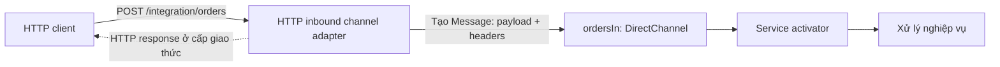

# HTTP inbound channel adapter nhận request

## 1. Vị trí của HTTP inbound channel adapter trong Spring Integration

Trong module **SPRING_INTEGRATION_ADAPTERS**, các adapter và gateway kết nối luồng `Message` của Spring Integration với hệ thống bên ngoài như file, SFTP, HTTP, JMS, AMQP, Kafka và cơ sở dữ liệu. Với HTTP, **inbound channel adapter** đóng vai trò là điểm nhận yêu cầu từ HTTP client, chuyển phần dữ liệu cần xử lý thành `Message<?>` và gửi message vào một `MessageChannel`.

Đây là mô hình **một chiều**: client gửi request để kích hoạt luồng nội bộ, còn ứng dụng không xây dựng một message phản hồi nghiệp vụ để gửi ngược về client. HTTP vẫn phải có response ở cấp giao thức (mã trạng thái và các header thích hợp), nhưng response đó không phải là kết quả nghiệp vụ lấy từ một reply channel. Khi cần trả JSON chứa kết quả tạo đơn hàng, tra cứu trạng thái hoặc lỗi nghiệp vụ theo một hợp đồng request–response, hãy cân nhắc **HTTP inbound gateway**.

Sau bài này, bạn có thể:

- Giải thích cách request HTTP đi qua inbound endpoint, trở thành Spring `Message` rồi đi vào channel.
- Cấu hình endpoint nhận `POST` theo đường dẫn và `Content-Type` cụ thể bằng Java DSL.
- Phân biệt việc nhận request thành công với việc xử lý nghiệp vụ hoàn tất, nhất là khi chuyển sang channel bất đồng bộ.
- Xác định điểm cần kiểm soát mapping, chuyển đổi payload, lỗi, bảo mật và vòng đời endpoint.

## 2. Luồng dữ liệu và hợp đồng message



Quá trình nhận request có năm bước chính:

1. Client gửi request tới URL mà Spring MVC ánh xạ cho adapter. Điều kiện ánh xạ có thể bao gồm HTTP method, đường dẫn và media type.
2. HTTP endpoint kiểm tra mapping, dùng các HTTP message converter thích hợp để đọc body theo kiểu payload đã cấu hình.
3. Adapter tạo một Spring Integration `Message<?>`, với **payload** thường là dữ liệu body đã chuyển đổi và **headers** là metadata của request được framework ánh xạ theo cấu hình.
4. Adapter gửi message tới input channel; subscriber như service activator, transformer hoặc router tiếp tục xử lý.
5. HTTP endpoint hoàn thành response theo cơ chế và cấu hình của inbound adapter. Vì adapter một chiều, không có bước đợi một *reply message* nghiệp vụ.

`Message` của Spring Integration không đồng nghĩa với toàn bộ đối tượng `HttpServletRequest`. Một body JSON có thể trở thành `String`, DTO hoặc kiểu khác tùy `requestPayloadType` và message converter. Các HTTP header được ánh xạ có chọn lọc; không nên giả định mọi header nhạy cảm đều được đưa vào message. Thông tin định danh, correlation ID và nguồn gọi cần có quy ước rõ ràng trước khi truyền qua nhiều channel hoặc hệ thống ngoài.

> **Lưu ý:** HTTP inbound channel adapter được kích hoạt khi request tới; nó không cần poller để *nhận* request. Poller chỉ xuất hiện khi các thành phần tiếp theo cần đọc từ một `PollableChannel`, chẳng hạn `QueueChannel`.

## 3. Tạo một endpoint nhận POST

Ví dụ dưới đây dùng Spring Boot có Spring MVC và Spring Integration. Nếu dự án dùng Spring Boot dependency management, các dependency Maven cơ bản là:

```xml
<dependencies>
    <dependency>
        <groupId>org.springframework.boot</groupId>
        <artifactId>spring-boot-starter-web</artifactId>
    </dependency>
    <dependency>
        <groupId>org.springframework.boot</groupId>
        <artifactId>spring-boot-starter-integration</artifactId>
    </dependency>
    <dependency>
        <groupId>org.springframework.integration</groupId>
        <artifactId>spring-integration-http</artifactId>
    </dependency>
</dependencies>
```

### 3.1. Định nghĩa inbound adapter và channel

```java
import org.springframework.context.annotation.Bean;
import org.springframework.context.annotation.Configuration;
import org.springframework.http.HttpMethod;
import org.springframework.http.MediaType;
import org.springframework.integration.annotation.EnableIntegration;
import org.springframework.integration.channel.DirectChannel;
import org.springframework.integration.dsl.IntegrationFlow;
import org.springframework.integration.http.dsl.Http;
import org.springframework.messaging.MessageChannel;

@Configuration
@EnableIntegration
public class HttpInboundConfiguration {

    @Bean
    public MessageChannel ordersIn() {
        return new DirectChannel();
    }

    @Bean
    public IntegrationFlow orderHttpInboundFlow() {
        return IntegrationFlow
            .from(Http.inboundChannelAdapter("/integration/orders")
                .requestMapping(mapping -> mapping
                    .methods(HttpMethod.POST)
                    .consumes(MediaType.APPLICATION_JSON_VALUE))
                .requestPayloadType(String.class))
            .channel("ordersIn")
            .get();
    }
}
```

Trong cấu hình này:

| Thành phần | Vai trò |
|---|---|
| `Http.inboundChannelAdapter("/integration/orders")` | Công bố điểm nhận request HTTP trong ứng dụng web. |
| `methods(HttpMethod.POST)` | Chỉ ánh xạ phương thức `POST` cho endpoint trên. |
| `consumes(MediaType.APPLICATION_JSON_VALUE)` | Chỉ ánh xạ request có kiểu nội dung JSON phù hợp. |
| `requestPayloadType(String.class)` | Yêu cầu converter đọc body thành chuỗi; **chưa tự kiểm tra cú pháp JSON**. |
| `ordersIn` (`DirectChannel`) | Chuyển message trực tiếp tới handler được subscribe; thông thường handler chạy trên luồng gọi hiện tại. |
| `.channel("ordersIn")` | Nối output của inbound adapter với channel có tên tương ứng. |

Lựa chọn `String` giúp minh họa ranh giới HTTP–message mà không phụ thuộc DTO. Trong ứng dụng thật, có thể chọn `requestPayloadType(OrderRequest.class)` khi message converter hỗ trợ ánh xạ JSON sang DTO; khi đó cần bổ sung validation và quy tắc xử lý body sai cấu trúc. `consumes(application/json)` chỉ kiểm tra kiểu nội dung được khai báo, không đủ để khẳng định body hợp lệ.

### 3.2. Nhận message bằng service activator

```java
import org.springframework.integration.annotation.ServiceActivator;
import org.springframework.messaging.Message;
import org.springframework.stereotype.Service;

@Service
public class OrderMessageHandler {

    @ServiceActivator(inputChannel = "ordersIn")
    public void receive(Message<String> message) {
        String jsonBody = message.getPayload();
        if (jsonBody == null || jsonBody.isBlank()) {
            throw new IllegalArgumentException("Request body must not be blank");
        }

        // Bước nghiệp vụ thực tế: parse JSON, validate, kiểm tra idempotency,
        // sau đó lưu bền vững hoặc chuyển vào broker có xác nhận.
        // Không ghi toàn bộ body/authorization header vào log sản xuất.
    }
}
```

`@ServiceActivator(inputChannel = "ordersIn")` đăng ký phương thức làm consumer của channel. Method nhận `Message<String>` nên có thể đọc cả payload và metadata header nếu cần. Vì `DirectChannel` chuyển giao đồng bộ, thời gian chạy handler ảnh hưởng trực tiếp tới thời gian trả HTTP response; exception chưa được xử lý trong handler cũng có thể lan về phía HTTP endpoint.

Mã ví dụ tập trung vào cách nối adapter, channel và handler. Phần comment phải được thay bằng xử lý thật trước khi dùng trong sản xuất: parse/validate schema, xác thực nguồn gọi, lưu dữ liệu hoặc publish sự kiện có bảo đảm. Việc handler không ném exception trong ví dụ chưa chứng minh đơn hàng đã được lưu.

### 3.3. Gửi request để quan sát

Với ứng dụng chạy ở `localhost:8080` và không cấu hình thêm servlet context path:

```bash
curl -i -X POST 'http://localhost:8080/integration/orders' \
  -H 'Content-Type: application/json' \
  -d '{"orderId":"ORD-1001","amount":125000}'
```

Kỳ vọng là request phù hợp mapping sẽ đi vào `ordersIn` và kích hoạt `OrderMessageHandler.receive`. HTTP response của inbound adapter dùng để ghi nhận việc tiếp nhận ở cấp giao thức; status code cụ thể phụ thuộc cấu hình endpoint và quá trình xử lý, vì vậy hãy quan sát response thực tế thay vì coi một mã thành công là cam kết lưu đơn hàng thành công.

Thử thay `POST` bằng `GET`, hoặc đặt `Content-Type: text/plain`: request có thể không khớp mapping và bị từ chối ở tầng HTTP. Thử gửi body là chuỗi không phải JSON nhưng vẫn khai báo `application/json`: vì ví dụ đọc `String`, dữ liệu vẫn có thể đến handler; ứng dụng phải tự parse và xác thực cú pháp nếu hợp đồng yêu cầu JSON hợp lệ.

## 4. Chọn inbound adapter hay inbound gateway?

| Tiêu chí | HTTP inbound channel adapter | HTTP inbound gateway |
|---|---|---|
| Hướng tích hợp | HTTP request → message nội bộ | HTTP request → message nội bộ → reply message → HTTP response |
| Phản hồi nghiệp vụ | Không nhận reply message để xây response nghiệp vụ | Có thể chờ reply và ánh xạ payload/header/status thành response |
| Tình huống phù hợp | Nhận tín hiệu, webhook một chiều, đẩy công việc vào luồng xử lý | API cần trả dữ liệu, ID tạo mới, kết quả truy vấn hoặc lỗi theo hợp đồng API |
| Rủi ro hiểu sai | HTTP 2xx không nhất thiết đồng nghĩa nghiệp vụ downstream đã xong | Cần quản lý reply channel và thời hạn chờ phản hồi |

Ví dụ: webhook thông báo thay đổi trạng thái vận chuyển có thể được nhận bằng inbound adapter nếu hợp đồng chỉ cần acknowledgment. Endpoint `POST /orders` phải trả `{"orderId":"...","status":"CREATED"}` theo kết quả lưu cơ sở dữ liệu thì inbound gateway thường là lựa chọn rõ ràng hơn.

**Không nhầm với outbound adapter:** outbound HTTP là chiều từ hệ thống Spring Integration đi gọi HTTP service bên ngoài. Chữ *inbound/outbound* mô tả hướng message đi qua ranh giới hệ thống, không phải HTTP method `GET` hay `POST`.

## 5. Channel quyết định thời điểm xử lý

Từ một inbound HTTP adapter, việc dùng channel nào ảnh hưởng đến latency, tính ổn định và ý nghĩa của HTTP acknowledgment:

| Channel sau adapter | Hành vi chính | Hệ quả cần xét |
|---|---|---|
| `DirectChannel` | Handler nhận message ngay trong luồng gửi, mặc định đồng bộ. | Request chờ handler hoàn thành; lỗi đồng bộ có thể được phát hiện tại HTTP boundary. |
| `ExecutorChannel` | Giao việc cho executor để subscriber chạy trên luồng khác. | HTTP endpoint có thể hoàn tất trước khi nghiệp vụ xong; cần quản lý hàng đợi executor, từ chối tải và lỗi bất đồng bộ. |
| `QueueChannel` | Giữ message trong hàng đợi để một consumer có poller đọc sau. | Cần cấu hình poller cho phía đọc; hàng đợi trong bộ nhớ không tự bảo đảm bền vững sau restart. |

Một thiết kế thực tế khi tải cao là **nhận request → validate tối thiểu → ghi inbox/outbox hoặc publish vào broker bền vững → acknowledgment → worker xử lý tiếp**. Cần định nghĩa rõ “đã nhận” là đã kiểm tra hợp lệ, đã ghi bền vững hay đã hoàn tất nghiệp vụ. Chỉ chuyển sang executor hoặc queue trong bộ nhớ có thể làm response nhanh hơn nhưng không tạo ra bảo đảm giao hàng bền vững.

Không có mối quan hệ tự động một–một giữa HTTP request và một transaction chạy xuyên suốt các adapter. Khi gửi message sang Kafka, JMS, AMQP hoặc ghi database, hãy thiết kế acknowledgment, retry, transaction/outbox và idempotency theo cơ chế của từng thành phần.

## 6. Xử lý lỗi và an toàn ở ranh giới HTTP

| Tình huống | Điểm phát hiện / hướng xử lý |
|---|---|
| URL hoặc method không khớp | Kiểm tra path, servlet context path và `requestMapping`; thường là lỗi 404/405 do tầng web quyết định. |
| `Content-Type` không được chấp nhận | Kiểm tra `consumes`; tình huống này thường dẫn tới HTTP 415. |
| Body rỗng, JSON sai hoặc thiếu field | Dùng converter/validator và quy tắc lỗi đầu vào; với payload `String`, phải chủ động parse và validate. |
| Handler đồng bộ ném exception | Xác định nơi exception được bắt và ánh xạ sang HTTP status; không mặc định mọi lỗi nghiệp vụ đều biến thành 4xx. |
| Lỗi xuất hiện sau khi giao việc bất đồng bộ | Ghi log có correlation ID, giám sát error flow, retry/dead-letter; HTTP response cũ không thể được sửa để phản ánh lỗi muộn. |
| Client gửi trùng khi retry | Dùng idempotency key hoặc định danh sự kiện với ràng buộc duy nhất để tránh xử lý trùng. |

Ngoài ra, endpoint inbound nên được bảo vệ ở các lớp phù hợp:

- **Authentication và authorization:** áp dụng Spring Security, API gateway hoặc xác thực chữ ký webhook trước khi tin request. Chỉ có URL hợp lệ không có nghĩa client được phép gọi.
- **Giới hạn tài nguyên:** kiểm soát kích thước body, tốc độ request, timeout, số lượng worker và độ sâu queue để tránh quá tải.
- **Hợp đồng dữ liệu:** chọn rõ kiểu payload, `Content-Type`, schema, trường bắt buộc, version và cách xử lý input không hợp lệ.
- **Dữ liệu nhạy cảm:** chỉ chuyển tiếp những header cần thiết; không log token, cookie, mật khẩu hay toàn bộ nội dung cá nhân.
- **Quan sát luồng:** ghi correlation/request ID, thời gian tiếp nhận, thời gian xử lý và kết quả lưu/publish để phân biệt HTTP success với business success.

Với luồng đồng bộ, exception từ `DirectChannel` có thể quay về endpoint đang xử lý request; cơ chế chuyển thành HTTP status phụ thuộc cấu hình xử lý exception của ứng dụng. Với luồng bất đồng bộ, cần error channel, xử lý lỗi ở consumer và cơ chế retry riêng. Đừng giả định chỉ cần tạo global `errorChannel` là mọi exception HTTP và lỗi downstream tự được trả về client dưới dạng JSON.

## 7. Vòng đời, vận hành và kiểm thử

Inbound adapter là một endpoint nằm trong Spring application context: khi context khởi động, cấu hình HTTP mapping được đăng ký để tiếp nhận request; khi ứng dụng dừng hoặc endpoint không hoạt động, client không còn một điểm nhận hợp lệ qua mapping đó. Việc deploy nhiều instance phía sau load balancer không tự giải quyết bài toán request trùng, thứ tự xử lý hoặc tính bền vững của message.

Khi kiểm thử, nên bao phủ tối thiểu các trường hợp sau:

1. **Luồng hợp lệ:** `POST` đúng path/media type gửi một message có payload dự kiến đến consumer.
2. **Mapping:** method khác, path sai hoặc media type không hỗ trợ bị xử lý ở tầng HTTP phù hợp.
3. **Hợp đồng body:** body rỗng, sai JSON, thiếu trường bắt buộc được từ chối theo quy tắc xác định.
4. **Lỗi nghiệp vụ:** xác minh khác biệt giữa lỗi đồng bộ và lỗi xảy ra sau khi response đã trả.
5. **Độ tin cậy:** retry cùng sự kiện không tạo tác dụng phụ trùng; kiểm tra hành vi khi queue/broker hoặc database lỗi.
6. **Bảo mật và quan sát:** request thiếu xác thực bị chặn, trace/correlation ID được theo dõi và log không làm lộ dữ liệu nhạy cảm.

Nếu request không vào handler, hãy lần theo thứ tự: web starter và servlet mapping → path/method/content type → adapter đã đăng ký → tên channel → subscriber hoặc poller của channel → exception tại converter/handler. Cách truy vết này giúp xác định lỗi thuộc HTTP boundary, hợp đồng message hay bước xử lý downstream.

## 8. Ghi nhớ

HTTP inbound channel adapter **đưa request vào Spring Integration dưới dạng message một chiều**. `requestMapping` quyết định request nào được nhận, `requestPayloadType` cùng converter quyết định body trở thành kiểu dữ liệu nào, `MessageChannel` quyết định cách bàn giao cho consumer, và cơ chế xử lý lỗi/acknowledgment quyết định client quan sát được điều gì. Chọn inbound gateway khi hợp đồng yêu cầu trả nội dung nghiệp vụ; chọn kênh và phương án lưu bền vững phù hợp nếu cần tiếp nhận tải lớn, retry và xử lý an toàn qua nhiều hệ thống.
