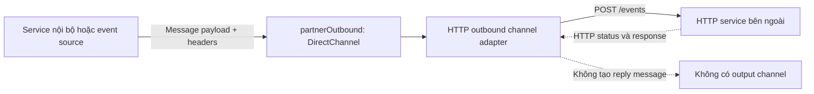
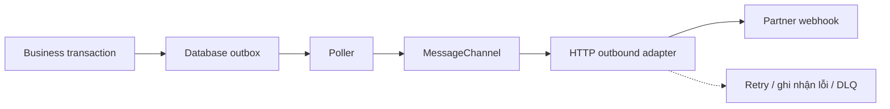

# HTTP outbound channel adapter gửi one-way request

## 1. HTTP outbound channel adapter dùng để làm gì?

Trong **SPRING_INTEGRATION_ADAPTERS**, Spring Integration cung cấp các inbound/outbound adapter, gateway, poller và `MessageChannel` để nối luồng message nội bộ với hệ thống bên ngoài. Tùy nhu cầu, ứng dụng có thể trao đổi dữ liệu qua file, SFTP, HTTP, JMS, AMQP, Kafka hoặc cơ sở dữ liệu; mỗi kết nối đều cần xác định chiều truyền, hợp đồng message, lỗi và vòng đời xử lý.

**HTTP outbound channel adapter** là một endpoint *một chiều* đưa message **từ Spring Integration ra HTTP service bên ngoài**. Khi nhận message từ input channel, nó tạo HTTP request theo URL, HTTP method, headers và payload được cấu hình, thực hiện lời gọi rồi kết thúc xử lý mà **không phát sinh reply message** chứa kết quả HTTP cho luồng phía sau.

Điểm cần phân biệt:

- **One-way ở cấp Spring Integration**: adapter không đưa response body vào một output/reply channel.
- **HTTP vẫn là giao thức request–response**: máy khách HTTP vẫn phải trao đổi và nhận response ở cấp giao thức. Lời gọi outbound thông thường phải chờ phần trao đổi HTTP hoàn tất hoặc thất bại.
- **Không có reply message không có nghĩa là bỏ qua lỗi**: kết nối lỗi, timeout hoặc HTTP error status vẫn có thể gây exception tùy HTTP client và error handler.

Bài học tập trung vào việc **gửi one-way request**, không dùng HTTP outbound gateway để đọc dữ liệu phản hồi nghiệp vụ.

Sau bài này, bạn sẽ biết cách cấu hình adapter, phát message vào channel, điều khiển HTTP method và content type, đánh giá tính đồng bộ/bất đồng bộ, xử lý lỗi và kiểm thử tích hợp.

## 2. Luồng message từ ứng dụng tới HTTP service



Dòng chảy điển hình:

1. Một bước nghiệp vụ hoặc message producer tạo `Message<?>` và gửi vào channel, ví dụ `partnerOutbound`.
2. HTTP outbound adapter là message handler đang subscribe channel đó.
3. Adapter xác định URL đích, HTTP method, request body và HTTP headers cần đưa ra ngoài.
4. HTTP client thực hiện kết nối, gửi request và nhận status/header/body HTTP theo giao thức.
5. Adapter hoàn thành xử lý message nếu không phát sinh lỗi; **response payload không được phát tiếp thành Spring Integration reply message**.

Ví dụ tình huống: sau khi có đơn hàng mới, hệ thống gửi sự kiện tới webhook của đối tác. Nếu luồng chỉ cần chuyển thông báo, không cần dùng nội dung phản hồi để quyết định bước tiếp theo, HTTP outbound channel adapter là lựa chọn phù hợp.

> **Điều kiện nghiệp vụ cần làm rõ:** đối tác trả HTTP 200 hoặc 202 chỉ chứng minh điều tương ứng với hợp đồng HTTP của họ; không tự bảo đảm sự kiện đã được xử lý cuối cùng trong cơ sở dữ liệu đối tác.

## 3. Hợp đồng message và ánh xạ ra HTTP

Một message nội bộ mang hai phần: `payload` và `headers`. Adapter chuyển chúng thành HTTP request theo cấu hình:

| Thành phần trong Spring Integration | Ý nghĩa khi gửi HTTP |
|---|---|
| `Message.getPayload()` | Thường trở thành HTTP request body, được serialize bởi message converter phù hợp. |
| `MessageHeaders.CONTENT_TYPE` | Chỉ định media type của nội dung, ví dụ `application/json`, khi được ánh xạ sang HTTP. |
| URL cấu hình của adapter | Xác định HTTP server và tài nguyên đích. |
| `httpMethod(HttpMethod.POST)` | Chỉ định phương thức HTTP dùng để gửi. |
| Header nghiệp vụ như `eventId` | Hữu ích cho xử lý nội bộ; **không nên giả định tự động trở thành HTTP header**. |
| HTTP status và response body của đối tác | Có ý nghĩa với HTTP client/error handler; adapter không cung cấp reply message từ response body. |

Hợp đồng tích hợp nên mô tả tối thiểu: đích nhận, method, content type, schema JSON, header bắt buộc, xác thực, timeout, chính sách retry, mã HTTP được xem là thành công, và cơ chế xử lý sự kiện trùng.

Không dùng JSON thủ công bằng phép nối chuỗi từ dữ liệu người dùng: cách đó có thể tạo body sai định dạng. Ưu tiên một DTO/record và để JSON message converter serialize theo schema đã thống nhất.

## 4. Cấu hình HTTP outbound channel adapter với Java DSL

Ví dụ sau dùng ứng dụng **Spring Boot + Spring Integration HTTP + Spring MVC/Jackson**, Java 17 trở lên, và một webhook giả lập ở `http://localhost:8081/events`. URL này dùng để thực hành; triển khai thực tế nên dùng HTTPS và cấu hình ngoài mã nguồn.

### 4.1. Dependency Maven

Với dự án Spring Boot có quản lý phiên bản dependency:

```xml
<dependencies>
    <dependency>
        <groupId>org.springframework.boot</groupId>
        <artifactId>spring-boot-starter-integration</artifactId>
    </dependency>
    <dependency>
        <groupId>org.springframework.integration</groupId>
        <artifactId>spring-integration-http</artifactId>
    </dependency>
    <dependency>
        <groupId>org.springframework.boot</groupId>
        <artifactId>spring-boot-starter-web</artifactId>
    </dependency>
</dependencies>
```

`spring-integration-http` cung cấp endpoint và DSL cho tích hợp HTTP; `spring-boot-starter-web` mang các thành phần web/Jackson thông dụng của ví dụ. Nếu ứng dụng hiện có dependency tương đương, không cần khai báo trùng.

### 4.2. Cấu hình endpoint outbound

```java
import org.springframework.beans.factory.annotation.Value;
import org.springframework.context.annotation.Bean;
import org.springframework.context.annotation.Configuration;
import org.springframework.http.HttpMethod;
import org.springframework.integration.annotation.EnableIntegration;
import org.springframework.integration.channel.DirectChannel;
import org.springframework.integration.dsl.IntegrationFlow;
import org.springframework.integration.http.dsl.Http;
import org.springframework.messaging.MessageChannel;

@Configuration
@EnableIntegration
public class PartnerWebhookConfiguration {

    @Bean
    public MessageChannel partnerOutbound() {
        return new DirectChannel();
    }

    @Bean
    public IntegrationFlow partnerWebhookFlow(
            @Value("${partner.webhook.url}") String webhookUrl) {

        return IntegrationFlow.from("partnerOutbound")
            .handle(Http.outboundChannelAdapter(webhookUrl)
                .httpMethod(HttpMethod.POST))
            .get();
    }
}
```

Khai báo cấu hình URL trong `application.yml`:

```yaml
partner:
  webhook:
    url: "http://localhost:8081/events"
```

Ý nghĩa:

- `partnerOutbound` là input channel của luồng gửi HTTP; dùng `DirectChannel` để minh họa cơ chế đồng bộ.
- `IntegrationFlow.from("partnerOutbound")` nhận message do các producer gửi vào channel này.
- `Http.outboundChannelAdapter(webhookUrl)` tạo HTTP outbound adapter thực thi request tới webhook.
- `httpMethod(HttpMethod.POST)` chỉ định gửi POST, thích hợp với thông báo tạo mới/sự kiện theo hợp đồng của đối tác.
- Không có output channel hay `expectedResponseType`: mục tiêu là gửi message một chiều, không cần dùng response body trong luồng.

### 4.3. Gửi sự kiện vào channel

```java
import org.springframework.beans.factory.annotation.Qualifier;
import org.springframework.http.MediaType;
import org.springframework.messaging.Message;
import org.springframework.messaging.MessageChannel;
import org.springframework.messaging.MessageHeaders;
import org.springframework.messaging.support.MessageBuilder;
import org.springframework.stereotype.Service;

@Service
public class PartnerEventSender {

    private final MessageChannel partnerOutbound;

    public PartnerEventSender(
            @Qualifier("partnerOutbound") MessageChannel partnerOutbound) {
        this.partnerOutbound = partnerOutbound;
    }

    public void sendOrderCreated(String eventId, String orderId) {
        Message<OrderCreatedEvent> message = MessageBuilder
            .withPayload(new OrderCreatedEvent(eventId, orderId))
            .setHeader(
                MessageHeaders.CONTENT_TYPE,
                MediaType.APPLICATION_JSON_VALUE)
            .build();

        boolean accepted = partnerOutbound.send(message);

        if (!accepted) {
            throw new IllegalStateException(
                "No handler accepted the outbound event");
        }
    }

    public record OrderCreatedEvent(String eventId, String orderId) {}
}
```

Khi nghiệp vụ phát sinh đơn mới, mã phía gọi có thể thực thi:

```java
partnerEventSender.sendOrderCreated("evt-1001", "ORD-1001");
```

Với JSON converter phù hợp trên classpath, payload `OrderCreatedEvent` được chuyển thành JSON cho HTTP request. Bản tin dự kiến ở phía đối tác có dạng:

```http
POST /events HTTP/1.1
Host: localhost:8081
Content-Type: application/json

{"eventId":"evt-1001","orderId":"ORD-1001"}
```

Các header cấp giao thức khác như `Content-Length` hoặc `Accept` phụ thuộc HTTP client. Thứ tự trường JSON và cách trình bày body cũng có thể khác; kiểm tra giá trị theo schema thay vì so sánh byte một cách cứng nhắc.

**Lưu ý về `send`:** `MessageChannel.send(message)` báo trạng thái bàn giao message vào channel. Với `DirectChannel` và HTTP handler đồng bộ, lời gọi thường chỉ hoàn thành sau khi HTTP exchange thành công theo HTTP client; lỗi có thể ném exception trước khi trả về. Ngay cả khi `send` trả `true`, điều đó không xác nhận đối tác đã hoàn tất xử lý nghiệp vụ.

## 5. Phân biệt one-way adapter và outbound gateway

| Câu hỏi | HTTP outbound channel adapter | HTTP outbound gateway |
|---|---|---|
| Gửi HTTP request từ message nội bộ? | Có | Có |
| Tạo reply message từ HTTP response? | **Không** | **Có**, theo cấu hình reply và response type |
| Có cần thực hiện trao đổi HTTP và quan tâm đến lỗi? | Có | Có |
| Sử dụng response body để định tuyến/biến đổi tiếp? | Không | Có thể |
| Trường hợp điển hình | Gửi webhook, push thông báo hoặc event một chiều | Gọi API để lấy giá, tra cứu khách hàng, nhận ID/trạng thái xử lý |

Ví dụ: gửi thông báo "đơn hàng đã tạo" rồi hoàn thành luồng là trường hợp outbound adapter. Nếu HTTP service trả một mã vận đơn mà ứng dụng phải đọc để cập nhật đơn hàng, hãy dùng outbound gateway để có reply message, thay vì cố lấy kết quả nghiệp vụ từ outbound adapter.

So với **HTTP inbound channel adapter**, hướng kết nối đảo chiều: inbound nhận request bên ngoài thành message nội bộ; outbound lấy message nội bộ để gọi dịch vụ bên ngoài. HTTP method như GET/POST không quyết định thuật ngữ inbound hay outbound.

## 6. Đồng bộ, bất đồng bộ và poller

**One-way không đồng nghĩa non-blocking.** Trong ví dụ, `DirectChannel` giao message cho HTTP handler ngay trên luồng gửi. Nếu đối tác phản hồi chậm, lời gọi `sendOrderCreated` cũng có thể chậm; nếu timeout, exception có thể đi ngược về producer.

| Cách kết nối trước adapter | Hành vi | Điều phải kiểm soát |
|---|---|---|
| `DirectChannel` | Message handler gọi HTTP đồng bộ trên luồng gửi. | Connect/read timeout, số lượng request đồng thời, exception tại nơi gọi. |
| `ExecutorChannel` | Handler chạy trên luồng do executor quản lý. | Giới hạn thread/queue, cách phát hiện lỗi muộn, backpressure. |
| `QueueChannel` + poller | Producer đưa message vào queue; poller đọc rồi gửi HTTP. | Lịch poll, khả năng lưu bền vững, retry, lỗi khi tiến trình restart. |

Adapter outbound vốn **không bắt buộc có poller** khi nhận message từ `SubscribableChannel` như `DirectChannel`. Poller cần thiết khi phần trước là `PollableChannel`, hoặc khi một nguồn được quét định kỳ để tạo message.

Đối với tải lớn, một mô hình bền vững hơn có thể là:



Trong mô hình đó, transaction nghiệp vụ và bản ghi outbox có thể được lưu cùng giao dịch, worker mới đọc và gửi HTTP; nhờ vậy có điểm phục hồi sau crash. Tuy nhiên, retry có thể gửi lại sự kiện nên vẫn cần idempotency tại bên nhận.

## 7. HTTP response, lỗi và chính sách retry

Ngay cả khi không có reply message, outbound adapter vẫn sử dụng HTTP client. Hành vi lỗi cụ thể phụ thuộc client được cấu hình và response error handler.

| Quan sát | Diễn giải và hướng xử lý |
|---|---|
| HTTP 2xx | HTTP exchange đạt kết quả thành công theo hợp đồng và HTTP client; không tự chứng minh nghiệp vụ của đối tác đã hoàn tất. |
| HTTP 400/422 | Thường là lỗi schema/dữ liệu; kiểm tra payload và hợp đồng, không retry vô hạn cùng dữ liệu sai. |
| HTTP 401/403 | Xem lại xác thực, quyền truy cập, token và đồng hồ ký chữ ký webhook. |
| HTTP 429 | Đối tác giới hạn tốc độ; tuân theo chính sách throttling/`Retry-After` nếu có. |
| HTTP 5xx | Đối tác có lỗi; cân nhắc retry có giới hạn, exponential backoff và jitter. |
| Connection timeout/read timeout | Chưa chắc đối tác có/không xử lý request; retry có nguy cơ trùng tác dụng. |
| Lỗi DNS/TLS/connection refused | Xác minh mạng, hostname, chứng chỉ, service health; báo lỗi có quan sát được. |

`RestTemplate` với error handler mặc định thường ném exception cho HTTP 4xx/5xx; ứng dụng có thể tùy chỉnh HTTP client và cách xử lý status. Vì vậy, **không viết logic giả định tất cả non-2xx đều trả về một reply message**, cũng không mặc định mọi lỗi là retryable.

Những nguyên tắc thực tiễn:

1. **Timeout hữu hạn:** cấu hình connect timeout và response/read timeout trên HTTP client được adapter sử dụng; không để request bị treo vô hạn.
2. **Retry có chọn lọc:** áp dụng cho lỗi tạm thời; dùng giới hạn số lần, backoff và jitter; phân biệt lỗi schema với lỗi hệ thống.
3. **Idempotency:** gán `eventId` duy nhất cho mỗi sự kiện và truyền theo hợp đồng, thường trong JSON payload hoặc HTTP header idempotency mà cả hai bên thống nhất. Bên nhận cần nhớ ID đã xử lý để tránh tác dụng phụ trùng.
4. **Ghi nhận thất bại:** lưu trạng thái gửi, nguyên nhân lỗi và số lần retry; nếu vượt ngưỡng thì đưa vào dead-letter/outbox lỗi để điều tra hoặc phát lại có kiểm soát.
5. **Phân biệt trạng thái:** `SENT`, `ACKNOWLEDGED` và `APPLIED` (nếu có callback) là các mốc khác nhau. Không khẳng định đã hoàn tất nghiệp vụ chỉ từ việc adapter chạy xong.

Với `DirectChannel`, exception từ HTTP handler có thể truyền về nơi gửi message. Nếu chuyển sang `ExecutorChannel` hoặc poller, lỗi xảy ra trên luồng worker; cần error flow, logging, metrics và retry ở đó. Không trông đợi request đã trả về trước đó có thể được sửa lại theo lỗi xuất hiện muộn.

## 8. Bảo mật và vận hành

Khi gọi HTTP service bên ngoài:

- **TLS và xác thực:** sử dụng HTTPS; cấu hình Bearer token, mTLS hoặc chữ ký webhook theo hợp đồng. Secret lấy từ secret manager hoặc cấu hình bảo mật, không hardcode trong Markdown, URL hoặc log.
- **Giới hạn dữ liệu:** không gửi vượt quá các trường đối tác cần; xác minh schema, kích thước body và phân loại dữ liệu nhạy cảm trước khi phát message.
- **Header mapping:** các integration header như `correlationId` hoặc `eventId` không tự nhiên trở thành header HTTP. Nếu đối tác yêu cầu `X-Correlation-ID` hoặc `Idempotency-Key`, cấu hình ánh xạ header rõ ràng và kiểm chứng bằng mock server.
- **Tài nguyên:** cấu hình connection pool, timeout, giới hạn concurrency và queue capacity theo tải dự kiến; kiểm tra DNS, proxy, certificate và khả năng phục hồi sau restart.
- **Theo dõi:** đo số lần gửi, latency, nhóm HTTP status, timeout, retry và lỗi cuối; log correlation/event ID nhưng tránh token và payload nhạy cảm.

Adapter là một Spring Integration endpoint được quản lý trong application context. Khi ứng dụng khởi động, flow/channel/handler được đăng ký; endpoint outbound chỉ thực sự **gửi** khi có message đến. Việc đối tác đang online hay chưa là trạng thái bên ngoài, không được bảo đảm chỉ vì Spring application context đã khởi động thành công.

## 9. Thực hành kiểm thử theo hợp đồng

Dùng mock HTTP server tại `http://localhost:8081/events`, khởi động ứng dụng Spring Integration và gọi:

```java
partnerEventSender.sendOrderCreated("evt-1001", "ORD-1001");
```

Kiểm tra mock server nhận **một** HTTP POST với content type JSON và body chứa đúng `eventId`, `orderId`. Khi trả response 200 kèm body `{"accepted":true}`, xác minh luồng một chiều không tạo reply message cho một bước transform/router tiếp theo.

Nên kiểm tra thêm các tình huống sau:

| Trường hợp | Điều cần quan sát |
|---|---|
| Partner trả 200/202/204 | HTTP exchange hoàn thành; message không được biến thành reply message. |
| Partner trả 400 | Exception/error flow theo HTTP client; không retry vô điều kiện. |
| Partner trả 500 | Chính sách retry/ghi nhận lỗi hoạt động đúng cấu hình. |
| Đối tác không phản hồi | Timeout hữu hạn; worker hoặc request không chờ mãi. |
| Gửi hai lần cùng `eventId` | Bên nhận chống trùng theo hợp đồng hoặc producer chủ động tránh gửi lặp. |
| Dịch vụ bị chậm khi dùng `DirectChannel` | Độ trễ kéo dài tới caller; khi đổi sang executor/poller thì lỗi và acknowledgment đổi ngữ nghĩa. |
| Header bắt buộc bị thiếu | Phát hiện qua mock server để sửa header mapper hoặc bước enrich header. |

Nếu không quan sát được HTTP request, kiểm tra theo thứ tự: producer đã gửi message → đúng tên `MessageChannel` → có subscriber outbound adapter → URL/method/serializer → DNS/TLS/proxy/timeout → log lỗi của HTTP client. Nếu đối tác nhận được request nhưng body/header sai, tập trung vào `request payload type`, converter và HTTP header mapping trước khi thay đổi channel.

## 10. Tổng kết

HTTP outbound channel adapter chuyển message nội bộ thành HTTP request để gọi dịch vụ ngoài theo cơ chế **một chiều của Spring Integration**: adapter không tạo reply message từ response body. Tuy vậy, HTTP exchange vẫn phải được thực hiện và lỗi có thể ảnh hưởng tới luồng gửi, nhất là khi dùng `DirectChannel`. Thiết kế tích hợp đáng tin cậy cần có hợp đồng JSON/header rõ ràng, timeout, retry có giới hạn, idempotency, khả năng lưu bền vững và theo dõi kết quả. Khi nghiệp vụ cần đọc phản hồi HTTP để xử lý bước tiếp theo, sử dụng HTTP outbound gateway.
