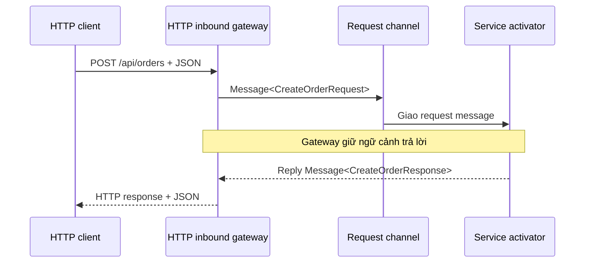
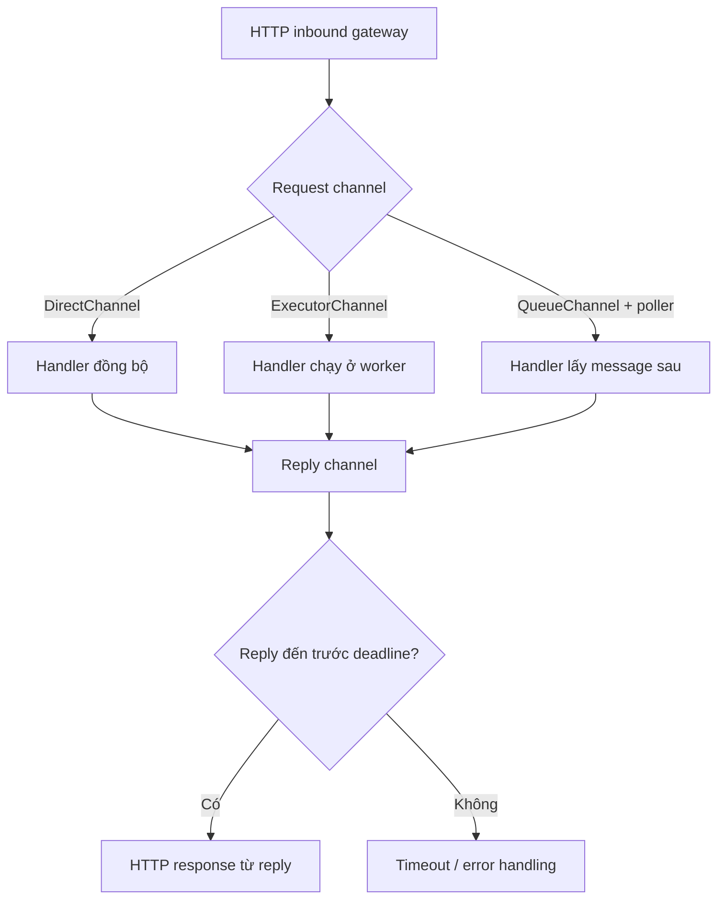

# HTTP inbound gateway nhận request-reply

## 1. Mục tiêu và vị trí trong module Adapter HTTP

Trong module **SPRING_INTEGRATION_ADAPTERS**, Spring Integration kết nối luồng xử lý nội bộ với các hệ thống bên ngoài thông qua inbound/outbound adapter, gateway, poller và `MessageChannel`. Những kết nối đó có thể sử dụng file, SFTP, HTTP, JMS, AMQP, Kafka hoặc cơ sở dữ liệu. Riêng HTTP, nhiều API cần **nhận request, thực hiện một luồng nghiệp vụ và trả response được tạo từ kết quả xử lý**.

**HTTP inbound gateway** giải quyết tình huống *request–reply* này:

1. Nhận HTTP request tại một endpoint của ứng dụng.
2. Chuyển request thành Spring Integration `Message<?>` rồi gửi vào request channel.
3. Đợi một **reply message** từ luồng xử lý nội bộ.
4. Chuyển payload/headers của reply thành HTTP response cho client.

Ví dụ: ứng dụng nhận `POST /api/orders`, kiểm tra đơn hàng và trả JSON gồm mã tiếp nhận, trạng thái hoặc dữ liệu nghiệp vụ. Nếu chỉ cần nhận thông báo một chiều mà không trả nội dung nghiệp vụ, **HTTP inbound channel adapter** phù hợp hơn; nếu ứng dụng chủ động gọi HTTP API bên ngoài thì đó là **HTTP outbound endpoint**.

Sau bài học, bạn có thể cấu hình inbound gateway với Java DSL, hiểu request channel và reply channel, gửi JSON request–reply qua service activator, xác định timeout, xử lý lỗi và kiểm thử hợp đồng HTTP.

## 2. Luồng request–reply qua các message channel



Ở mức nội bộ, gateway thường mang theo thông tin trả lời trong message headers, đặc biệt là `replyChannel` (và có thể có `errorChannel` tùy cấu hình). Service activator hoặc thành phần downstream tạo kết quả để gửi về kênh trả lời đó. Với flow đơn giản, Spring Integration quản lý việc chuyển reply về gateway; bạn không cần tự tạo một HTTP controller hoặc tự gọi HTTP response writer.

Có thể biểu diễn đường đi như sau:

```text
HTTP request
  -> HttpRequestHandlingMessagingGateway
  -> requestChannel: orderRequests
  -> ServiceActivator / business handler
  -> replyChannel (thường được gateway cấp tạm)
  -> HttpRequestHandlingMessagingGateway
  -> HTTP response
```

| Thành phần | Trách nhiệm |
|---|---|
| HTTP request mapping | Chọn những path, method, media type được endpoint tiếp nhận. |
| Request payload converter | Đọc HTTP body thành kiểu Java phù hợp trước khi tạo message. |
| Request channel | Đưa request message tới handler, transformer, router hoặc flow khác. |
| Service activator | Thực hiện nghiệp vụ và trả payload hay `Message<?>`. |
| Reply channel | Nhận kết quả từ downstream để gateway lấy làm response. |
| HTTP reply converter/header mapper | Chuyển reply payload, status và HTTP headers theo cấu hình sang response cho client. |

**Phân biệt hai loại header:** các message header nội bộ như `replyChannel` có chức năng điều phối Spring Integration; không được hiểu là HTTP header để trả ra ngoài. Khi cần HTTP status và response headers, hãy cấu hình cơ chế reply mapping thích hợp thay vì đưa toàn bộ message headers vào HTTP.

## 3. Ví dụ hoàn chỉnh: POST JSON và trả JSON

Ví dụ sử dụng **Spring Boot, Spring MVC, Spring Integration HTTP và Java 17+**. API nhận mã sản phẩm và số lượng, sau đó trả một mã tiếp nhận minh họa. Trọng tâm là hợp đồng request–reply; mã ví dụ chưa ghi cơ sở dữ liệu, chưa áp dụng quy tắc nghiệp vụ đầy đủ.

### 3.1. Dependencies

Với một dự án Maven đã dùng Spring Boot dependency management:

```xml
<dependencies>
    <dependency>
        <groupId>org.springframework.boot</groupId>
        <artifactId>spring-boot-starter-web</artifactId>
    </dependency>
    <dependency>
        <groupId>org.springframework.boot</groupId>
        <artifactId>spring-boot-starter-integration</artifactId>
    </dependency>
    <dependency>
        <groupId>org.springframework.integration</groupId>
        <artifactId>spring-integration-http</artifactId>
    </dependency>
</dependencies>
```

`spring-boot-starter-web` cung cấp cơ sở Spring MVC và Jackson thường dùng để chuyển JSON; `spring-integration-http` cung cấp HTTP inbound/outbound endpoint và Java DSL tương ứng. Spring Boot sẽ quản lý các phiên bản tương thích khi sử dụng BOM/starter đúng cách.

### 3.2. DTO làm hợp đồng trao đổi

Tạo một file `OrderDtos.java`:

```java
package example.http;

public final class OrderDtos {
    private OrderDtos() {}

    public record CreateOrderRequest(String sku, int quantity) {}

    public record CreateOrderResponse(String requestId, String status) {}
}
```

Với JSON converter phù hợp, body `{"sku":"BOOK-1","quantity":2}` được ánh xạ thành `CreateOrderRequest`. Trường `sku` và `quantity` vẫn cần validation: JSON parse thành công **không có nghĩa dữ liệu hợp lệ về nghiệp vụ**.

### 3.3. Cấu hình HTTP inbound gateway bằng Java DSL

Tạo `OrderHttpConfiguration.java`:

```java
package example.http;

import org.springframework.context.annotation.Bean;
import org.springframework.context.annotation.Configuration;
import org.springframework.http.HttpMethod;
import org.springframework.http.MediaType;
import org.springframework.integration.annotation.EnableIntegration;
import org.springframework.integration.channel.DirectChannel;
import org.springframework.integration.dsl.IntegrationFlow;
import org.springframework.integration.http.dsl.Http;
import org.springframework.messaging.MessageChannel;

@Configuration
@EnableIntegration
public class OrderHttpConfiguration {

    @Bean
    public MessageChannel orderRequests() {
        return new DirectChannel();
    }

    @Bean
    public IntegrationFlow orderHttpInboundFlow() {
        return IntegrationFlow
            .from(Http.inboundGateway("/api/orders")
                .requestMapping(mapping -> mapping
                    .methods(HttpMethod.POST)
                    .consumes(MediaType.APPLICATION_JSON_VALUE)
                    .produces(MediaType.APPLICATION_JSON_VALUE))
                .requestPayloadType(
                    OrderDtos.CreateOrderRequest.class)
                .replyTimeout(5_000))
            .channel("orderRequests")
            .get();
    }
}
```

Giải thích cấu hình:

- `Http.inboundGateway("/api/orders")` đăng ký endpoint HTTP inbound thuộc mô hình request–reply.
- `requestMapping(...methods(POST))` chỉ cho phép `POST` đối với mapping này; `consumes` và `produces` xác định media type đầu vào/đầu ra hỗ trợ.
- `requestPayloadType(CreateOrderRequest.class)` yêu cầu HTTP converter chuyển body thành DTO trước khi message được đưa vào flow.
- `replyTimeout(5_000)` đặt thời gian đợi reply message là 5 giây trong cơ chế chờ nhận reply của gateway. Đây **không phải cơ chế chủ động ngắt một handler đang chạy đồng bộ**.
- `.channel("orderRequests")` chuyển request message tới channel đã khai báo.
- `DirectChannel` giúp ví dụ đơn giản: request message được xử lý trên luồng gọi hiện tại, handler có thể trả kết quả trực tiếp.

Giá trị timeout minh họa; thực tế phải chọn theo thời gian đáp ứng mà API cam kết, phân biệt thời gian gửi request vào channel và thời gian đợi reply. Cấu hình này không thay thế servlet/server timeout, timeout của reverse proxy hoặc deadline phía client.

### 3.4. Service activator trả kết quả nghiệp vụ

Tạo `OrderHandler.java` trong cùng vùng package được Spring Boot quét component:

```java
package example.http;

import java.util.UUID;
import org.springframework.integration.annotation.ServiceActivator;
import org.springframework.stereotype.Service;

@Service
public class OrderHandler {

    @ServiceActivator(inputChannel = "orderRequests")
    public OrderDtos.CreateOrderResponse create(
            OrderDtos.CreateOrderRequest request) {

        if (request.sku() == null || request.sku().isBlank()
                || request.quantity() <= 0) {
            throw new IllegalArgumentException(
                "sku must be present and quantity must be positive");
        }

        // Chỉ minh họa request-reply: chưa lưu đơn hàng vào database.
        return new OrderDtos.CreateOrderResponse(
            "DEMO-" + UUID.randomUUID(), "VALIDATED");
    }
}
```

Khi `OrderHandler.create` trả `CreateOrderResponse`, Spring Integration tạo reply message và chuyển kết quả tới gateway. Gateway sau đó serialize payload thành HTTP JSON response theo converter thích hợp.

Trong ví dụ này, kết quả `VALIDATED` có nghĩa là kiểm tra tối thiểu đã qua; **không nên báo trạng thái `CREATED` hay HTTP 201 khi thực tế chưa lưu được tài nguyên**. Để xây một API tạo đơn hàng thật, thay phần minh họa bằng dịch vụ lưu DB với transaction, validation và xử lý idempotency.

### 3.5. Gọi API bằng curl

Khi ứng dụng chạy tại `localhost:8080` và không có servlet context path bổ sung:

```bash
curl -i -X POST 'http://localhost:8080/api/orders' \
  -H 'Content-Type: application/json' \
  -H 'Accept: application/json' \
  -d '{"sku":"BOOK-1","quantity":2}'
```

Một response thành công điển hình:

```http
HTTP/1.1 200 OK
Content-Type: application/json

{"requestId":"DEMO-...","status":"VALIDATED"}
```

Giá trị `requestId` thay đổi mỗi lần vì ví dụ dùng `UUID.randomUUID()`. HTTP status và response headers chính xác phụ thuộc cấu hình gateway và HTTP converter; ví dụ này dùng phản hồi thành công thông thường.

Thử gửi `quantity = 0`: handler sẽ ném `IllegalArgumentException`, nhưng **không được giả định exception đó tự biến thành HTTP 400 kèm JSON error chuẩn**. Cần thiết kế error flow hoặc exception mapping rõ ràng (phần 7).

## 4. Cơ chế tạo reply message và xử lý HTTP status

Service activator có thể trả một trong hai dạng phổ biến:

1. **Trả payload** (DTO, `String` hoặc một đối tượng có thể serialize). Framework tạo reply message phù hợp và gửi về reply channel mà gateway đang đợi.
2. **Trả `Message<?>`** để chủ động đặt thêm message headers, ví dụ mã HTTP status hoặc một correlation header được phép đưa ra response.

Ví dụ, **sau khi đã thực sự tạo và lưu tài nguyên**, handler có thể xây reply với status 201:

```java
import org.springframework.http.HttpStatus;
import org.springframework.messaging.Message;
import org.springframework.messaging.support.MessageBuilder;

// Đặt bên trong handler sau bước lưu dữ liệu thành công:
Message<OrderDtos.CreateOrderResponse> reply =
    MessageBuilder
        .withPayload(new OrderDtos.CreateOrderResponse(
            savedOrderId, "CREATED"))
        .setHeader("http_statusCode", HttpStatus.CREATED)
        .build();

return reply;
```

Đây là một đoạn minh họa để thay đổi **kiểu trả về của handler thành `Message<CreateOrderResponse>`** khi áp dụng vào mã thực tế; biến `savedOrderId` phải lấy từ kết quả lưu thật. Với HTTP inbound gateway, header reply `http_statusCode` được sử dụng để xác định response status. Khi trả một header nghiệp vụ ra HTTP, hãy cấu hình reply header mapping theo hợp đồng và kiểm chứng bằng kiểm thử HTTP.

Một số lỗi thường gặp:

- Handler có chữ ký `void` hoặc trả `null`: không có reply payload để gateway xây response nghiệp vụ; gateway có thể đợi đến timeout hoặc xử lý theo thiết lập no-reply.
- Dùng transformer/router nhưng downstream không trả message: request bị treo chờ reply hoặc timeout.
- Bỏ mất metadata `replyChannel` trên một nhánh tự tạo message: reply không quay lại gateway. Nên để endpoint/framework định tuyến reply hoặc bảo toàn thông tin cần thiết.
- Đưa `Message<?>` trực tiếp làm response body thay vì payload: client nhận cấu trúc không mong muốn; cần kiểm tra extraction và conversion.

**Gateway không tự ghi đơn hàng hoặc tạo JSON error**; mọi ngữ nghĩa kết quả đến từ logic nghiệp vụ, reply headers và cấu hình converter.

## 5. Request timeout, reply timeout và luồng bất đồng bộ

HTTP inbound gateway có hai khoảng chờ cần phân biệt:

| Tham số | Phạm vi | Trường hợp ảnh hưởng rõ nhất |
|---|---|---|
| `requestTimeout` | Thời gian chờ khi gửi request message vào request channel có khả năng chặn. | `QueueChannel` có giới hạn dung lượng đã đầy hoặc một channel gửi có blocking. |
| `replyTimeout` | Thời gian chờ reply message từ reply channel. | Handler chạy bất đồng bộ, poller chưa đọc message hoặc downstream không phát reply. |
| Servlet/proxy/client timeout | Giới hạn kết nối HTTP và thời gian client chịu chờ. | Client ngắt kết nối, reverse proxy đóng request trước khi flow hoàn thành. |

Với `DirectChannel`, handler thường chạy đồng bộ ngay trong lệnh gửi message. Nếu handler gọi DB hoặc HTTP service quá lâu, `replyTimeout` **không bảo đảm sẽ cắt ngang** việc thực thi đồng bộ đã bắt đầu. Cần quản lý timeout ở từng tác vụ blocking và tại tầng HTTP.

Với `ExecutorChannel` hoặc `QueueChannel` có consumer dùng poller, tác vụ xử lý có thể tiếp tục ở luồng khác, nhưng **HTTP inbound gateway vẫn phải đợi reply để trả response nghiệp vụ**. Nếu reply về quá muộn, client có thể đã nhận lỗi timeout hoặc đóng kết nối; kết quả muộn không thể biến thành response của request đã kết thúc.



Khi nghiệp vụ kéo dài hàng phút, trả kết quả ngay qua cùng một request–reply gateway thường kém phù hợp. Cân nhắc một API nhận job có bảo đảm lưu bền vững và trả `202 Accepted` kèm job ID, sau đó client gọi API truy vấn kết quả hoặc nhận callback. Trường hợp đó cần định nghĩa chính xác thời điểm có thể xác nhận `ACCEPTED` để tránh mất việc sau khi HTTP trả thành công.

## 6. So sánh các endpoint HTTP của Spring Integration

| Endpoint | Chiều message | Reply message cho nghiệp vụ? | Ví dụ |
|---|---|---|---|
| **HTTP inbound channel adapter** | HTTP request → Spring Integration | Không | Webhook thông báo một chiều. |
| **HTTP inbound gateway** | HTTP request → Spring Integration → HTTP response | **Có** | API POST tạo tài nguyên hoặc GET tra cứu dữ liệu. |
| **HTTP outbound channel adapter** | Spring Integration → HTTP request | Không đưa response body vào luồng reply | Gửi webhook sang đối tác. |
| **HTTP outbound gateway** | Spring Integration → HTTP request → reply message | **Có** | Gọi API tỷ giá rồi dùng kết quả ở bước tiếp theo. |

Cả inbound adapter lẫn inbound gateway đều trả HTTP response ở **cấp giao thức**. Điểm khác biệt của gateway là **có thể lấy kết quả từ reply message để tạo response nghiệp vụ**. Tương tự, outbound adapter vẫn thực hiện trao đổi HTTP và xử lý lỗi của HTTP client, dù không phát reply message cho flow.

Một flow inbound gateway có thể gọi outbound gateway ở downstream, nhưng cần tính tổng timeout, xác thực, lỗi trung gian và ngữ nghĩa transaction ở cả hai ranh giới.

## 7. Phản hồi lỗi và hợp đồng API

Để client xử lý API ổn định, cần quy ước rõ status, content type và cấu trúc error body. Dưới đây là ví dụ chính sách, **không phải mapping được tự động sinh từ đoạn Java DSL ở trên**:

| Tình huống | HTTP status thường chọn | Yêu cầu thiết kế |
|---|---|---|
| Request hợp lệ, trả kết quả | 200 OK | Serialize DTO phản hồi phù hợp `Accept`. |
| Tài nguyên mới đã được tạo và lưu | 201 Created | Có thể kèm `Location` và ID thật. |
| Công việc được nhận bền vững để xử lý sau | 202 Accepted | Trả job ID/trạng thái và cách tra cứu. |
| Body sai JSON, thiếu trường hoặc vi phạm validation | 400 Bad Request | Chuyển lỗi thành error response có mã lỗi/chi tiết an toàn. |
| Thiếu xác thực hoặc không có quyền | 401/403 | Spring Security hoặc gateway bảo vệ API. |
| Yêu cầu xung đột/idempotency conflict | 409 Conflict | Mô tả trạng thái trùng hoặc xung đột theo hợp đồng. |
| Lỗi hệ thống/DB/broker không khôi phục ngay | 5xx | Gắn correlation ID, giấu thông tin triển khai và ghi nhận lỗi. |
| Downstream không trả reply trong giới hạn | 504 Gateway Timeout, nếu API quy định | Cấu hình timeout-status/error flow tương ứng; không mặc định framework luôn trả 504. |

Khi JSON không parse được, lỗi có thể được phát hiện trước khi tới `orderRequests`. Khi handler ném exception, cách chuyển exception thành HTTP status/body phụ thuộc cấu hình exception resolver, error channel và gateway. Spring Integration có cơ chế error flow và HTTP status từ header `http_statusCode`, nhưng một `IllegalArgumentException` đơn thuần không tự bảo đảm là HTTP 400.

Một error body thống nhất có thể có cấu trúc:

```json
{
  "code": "INVALID_ORDER",
  "message": "quantity must be positive",
  "requestId": "req-12345"
}
```

Không trả stack trace, SQL hoặc thông tin token cho client. Nên đo các lỗi ở ranh giới HTTP, tại channel và tại handler riêng biệt để xác định đúng nơi thất bại.

## 8. Message headers, bảo mật và tính nhất quán

**Header mapping.** Một HTTP request có các header như `Content-Type`, `Accept`, `Authorization` và `X-Request-ID`. Chỉ những header được cho phép/ánh xạ mới cần xuất hiện trong integration message; không giả định mọi HTTP header được đưa qua mọi channel và reply. Khi muốn truyền correlation ID từ inbound sang outbound Kafka/JMS/HTTP, hãy dùng hợp đồng rõ ràng, giữ thông tin cần thiết và tránh chuyển tiếp cookie/token vô tình.

**Xác thực/ủy quyền.** Dùng Spring Security hoặc API gateway cho authentication, authorization, CORS (nếu cần), request size, rate limit và bảo vệ dữ liệu. Với webhook inbound có chữ ký, phải kiểm tra signature, timestamp và replay protection trước khi tin nội dung.

**Validation.** Kiểm tra schema, số lượng, độ dài, enum và ràng buộc nghiệp vụ. Có thể bổ sung Jakarta Bean Validation cùng `spring-boot-starter-validation` và cơ chế invocation phù hợp, nhưng cần kiểm thử xem lỗi mapping/validation phát sinh ở tầng HTTP hay service handler để trả đúng 4xx.

**Idempotency.** Retry sau timeout có thể tạo hai HTTP request trong khi request đầu tiên đã ghi dữ liệu. Dùng `Idempotency-Key`, business key hoặc event ID với ràng buộc duy nhất. Với một API tạo đơn hàng, kiểm tra key phải được gắn với transaction/lưu trạng thái theo quy tắc xác định; chỉ so sánh bộ nhớ của một instance không đủ khi triển khai nhiều instance.

**Transaction và side effect.** Reply thành công chỉ nên được phát sau mốc cam kết hợp đồng, chẳng hạn DB transaction đã commit hoặc job đã được ghi bền vững. Khi một flow kết nối thêm JMS, AMQP, Kafka hoặc SFTP, không suy ra có một transaction chung chạy qua toàn bộ adapter; hãy thiết kế outbox, compensating action hoặc quy tắc retry phù hợp.

**Quan sát.** Gắn correlation/request ID vào log và metrics; theo dõi latency từ HTTP boundary, thời gian ở channel, thời gian service xử lý, tỉ lệ timeout và loại reply status. Không log toàn bộ PII, body nhạy cảm hoặc `Authorization` token.

## 9. Kiểm thử và truy vết lỗi

Một bộ kiểm thử tối thiểu cho gateway nên bao gồm:

1. **Happy path:** `POST` JSON hợp lệ vào `/api/orders` trả `200` và body có đúng `requestId`, `status`.
2. **Mapping:** `GET` hoặc sai path bị xử lý theo mapping HTTP; `Content-Type` không được hỗ trợ không đến handler.
3. **JSON/converter:** body sai cú pháp JSON được từ chối ở ranh giới đọc request.
4. **Validation:** `sku` rỗng hoặc `quantity` không hợp lệ được ánh xạ sang lỗi 4xx theo hợp đồng mà ứng dụng định nghĩa.
5. **Handler lỗi:** mô phỏng DB/broker lỗi và kiểm tra status/body phù hợp, không lộ exception nội bộ.
6. **Reply timeout:** cố ý tạo downstream bất đồng bộ chậm, kiểm tra timeout-status và việc xử lý late reply.
7. **Idempotency:** gửi lại cùng key và so sánh số lần tạo side effect.
8. **Header/security:** thiếu xác thực bị chặn; correlation ID được ghi nhận đúng và không lộ sensitive headers.
9. **Tải đồng thời:** kiểm thử độ trễ, số request, pool/queue capacity và giới hạn trên reverse proxy.

Nếu HTTP request không tới handler, hãy kiểm tra: dependency web/HTTP integration → mapping path/method/`consumes`/`produces` → JSON converter → tên `orderRequests` → subscriber `@ServiceActivator`. Nếu handler chạy nhưng client không có response, kiểm tra kiểu trả về của handler, việc gửi reply tới `replyChannel`, thời gian đợi reply và reply converter. Nếu status/body không đúng, kiểm tra mapping header `http_statusCode`, `Content-Type` và error flow đã cấu hình.

Một ứng dụng đã khởi động thành công chỉ cho biết mapping, channel và bean được đăng ký; điều đó chưa chứng minh các bước downstream xử lý đúng hoặc reply tới trước deadline. Kiểm thử HTTP từ phía client là cách kiểm chứng đầy đủ hợp đồng request–reply.

## 10. Những điều cần ghi nhớ

- **HTTP inbound gateway** biến HTTP request thành `Message<?>`, đợi **reply message** rồi chuyển reply thành HTTP response.
- **Request channel** chuyển giao yêu cầu vào luồng xử lý; **reply channel** mang kết quả trở về. Handler cần trả payload hoặc message phù hợp để giao ước request–reply hoàn tất.
- `requestPayloadType` và HTTP converters quyết định kiểu dữ liệu; mapping media type không thay thế validation.
- `replyTimeout` quan trọng khi downstream bất đồng bộ, nhưng không cưỡng bức dừng một handler đang block trong cùng luồng `DirectChannel`.
- HTTP status, error body, authentication, idempotency và mốc cam kết dữ liệu cần được thiết kế tường minh.
- Chọn **inbound adapter** cho mô hình nhận một chiều; chọn **inbound gateway** khi response phụ thuộc kết quả nghiệp vụ của luồng Spring Integration.

Tài liệu tham khảo chính thức:

- [Spring Integration — Configuring HTTP Endpoints with Java](https://docs.spring.io/spring-integration/reference/http/java-config.html)
- [Spring Integration — Timeout Handling for HTTP](https://docs.spring.io/spring-integration/reference/http/timeout.html)
- [Spring Integration — HTTP Namespace Support](https://docs.spring.io/spring-integration/reference/http/namespace.html)
