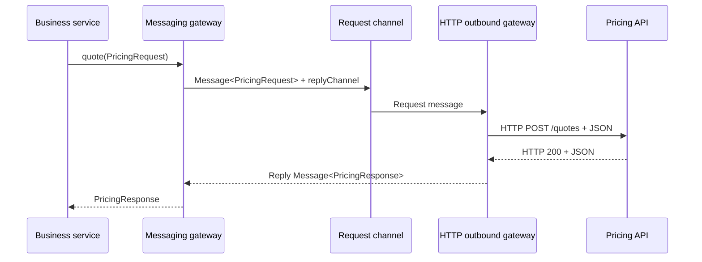
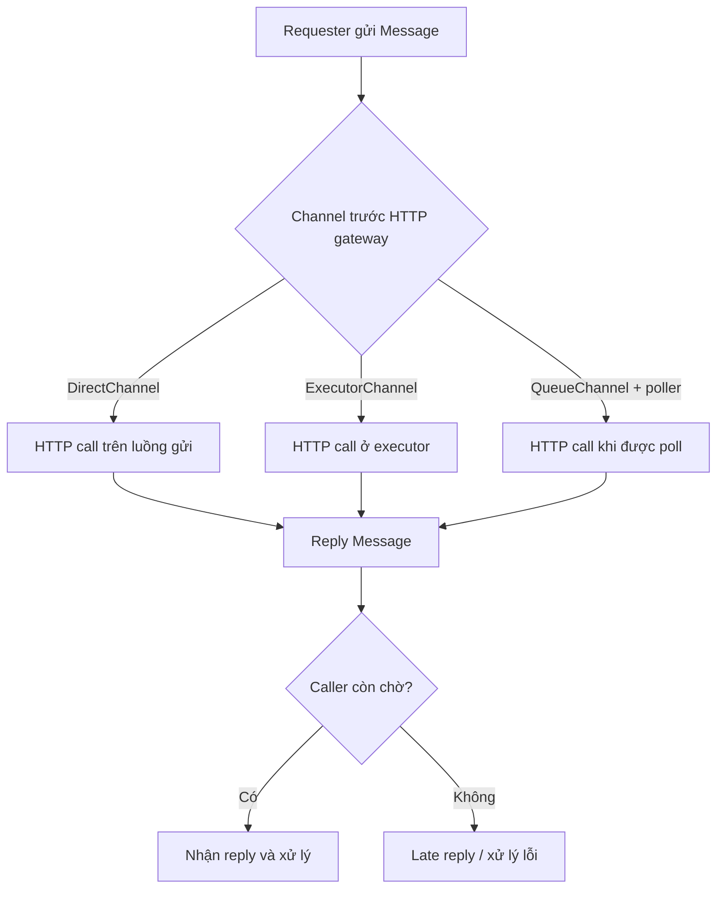

# HTTP outbound gateway gọi dịch vụ và nhận reply

## 1. HTTP outbound gateway nằm ở đâu trong luồng tích hợp?

Trong module **SPRING_INTEGRATION_ADAPTERS**, Spring Integration sử dụng `MessageChannel`, adapter, gateway và poller để trao đổi message với các hệ thống bên ngoài. Tùy giao thức và yêu cầu nghiệp vụ, một flow có thể làm việc với file, SFTP, HTTP, JMS, AMQP, Kafka hoặc cơ sở dữ liệu. Khi tích hợp qua HTTP, có những bước cần **gửi request tới dịch vụ bên ngoài, nhận dữ liệu phản hồi và tiếp tục xử lý dữ liệu đó trong flow**.

**HTTP outbound gateway** thực hiện mô hình *request–reply* này:

1. Nhận một Spring Integration `Message<?>` từ request channel.
2. Biến payload và những header phù hợp thành HTTP request.
3. Gọi URL của dịch vụ bên ngoài theo HTTP method đã cấu hình.
4. Đọc HTTP response và chuyển dữ liệu phản hồi thành **reply message**.
5. Gửi reply message trở lại kênh trả lời của flow để caller, transformer, router hoặc handler tiếp theo sử dụng.

Ví dụ, dịch vụ đặt hàng cần gọi API báo giá để lấy `totalAmount` và `currency` trước khi xác nhận đơn. Kết quả HTTP phải trở thành một message được xử lý tiếp; vì thế gateway phù hợp hơn HTTP outbound channel adapter một chiều.

Sau bài học, bạn sẽ có thể cấu hình HTTP outbound gateway bằng Java DSL, nhận kết quả JSON thành DTO, hiểu cơ chế reply channel, xử lý HTTP error/timeout, phân biệt polling với lời gọi request–reply và kiểm thử hợp đồng tích hợp.

## 2. Đường đi của request và reply



Có **hai tầng request–reply** cần phân biệt:

- **Tầng HTTP:** HTTP client của outbound gateway gửi request và nhận HTTP response từ dịch vụ đích.
- **Tầng Spring Integration:** outbound gateway tạo một reply message từ HTTP response và chuyển tới reply channel của message ban đầu.

Một message có thể mang header nội bộ `replyChannel`; thông tin này giúp Spring Integration định tuyến reply về đúng thành phần đang chờ. `replyChannel` **không phải HTTP header gửi cho dịch vụ ngoài**.

| Thành phần | Nhiệm vụ |
|---|---|
| Input/request channel | Nhận message từ producer và chuyển tới outbound gateway. |
| URL và HTTP method | Xác định tài nguyên và kiểu thao tác với dịch vụ ngoài. |
| HTTP header mapping | Chọn metadata được ánh xạ thành request headers và response headers tương ứng. |
| HTTP message converter | Chuyển payload Java sang HTTP body và response body về kiểu Java mong muốn. |
| `expectedResponseType` | Khai báo kiểu dữ liệu mong đợi ở payload của reply. |
| Reply channel | Chuyển message chứa kết quả quay lại requester hoặc bước xử lý tiếp theo. |
| HTTP client và error handler | Chi phối kết nối, timeout, cách diễn giải status và ngoại lệ. |

Mô hình này có thể nằm hoàn toàn trong một ứng dụng xử lý sự kiện. Chữ *outbound* mô tả chiều gọi **từ ứng dụng ra dịch vụ ngoài**, không phụ thuộc phương thức GET, POST hay PUT.

## 3. Khi nào dùng outbound gateway?

| Nhu cầu | Endpoint phù hợp | Lý do |
|---|---|---|
| Gửi webhook cho đối tác, không dùng response body trong flow | HTTP outbound channel adapter | Gửi one-way message, không tạo reply message nghiệp vụ. |
| Gọi Pricing API và lấy báo giá để tính đơn hàng | **HTTP outbound gateway** | HTTP response trở thành reply payload để xử lý tiếp. |
| Client bên ngoài gọi API của chính ứng dụng và cần kết quả | HTTP inbound gateway | Request đi từ HTTP vào Spring Integration, reply đi về client. |
| Client gửi notification vào ứng dụng không cần nội dung phản hồi nghiệp vụ | HTTP inbound channel adapter | Nhận thông báo một chiều. |

**HTTP outbound channel adapter** vẫn nhận HTTP response ở cấp giao thức và có thể ném lỗi nếu HTTP request thất bại. Sự khác biệt là nó không đưa response body thành một Spring Integration reply message. **HTTP outbound gateway** phù hợp khi phản hồi là đầu vào nghiệp vụ của bước tiếp theo.

Một outbound gateway cũng có thể được đặt phía sau HTTP inbound gateway:

```text
External client
   -> HTTP inbound gateway
   -> Request channel
   -> HTTP outbound gateway -> Remote HTTP API
   <- Reply message từ remote API
   <- Reply của inbound gateway
   <- HTTP response cho external client
```

Kiểu kết nối này cần quản lý tổng latency và giới hạn timeout ở cả hai ranh giới; một timeout của remote service không nên khiến HTTP client bên ngoài chờ vô thời hạn.

## 4. Ví dụ hoàn chỉnh: gọi Pricing API và nhận DTO

Ví dụ dùng **Spring Boot, Spring Integration HTTP, Jackson và Java 17 trở lên**. Một dịch vụ nội bộ yêu cầu báo giá bằng HTTP POST tới `http://localhost:8081/api/quotes`, sau đó nhận `PricingResponse` làm kết quả trả về của Java interface.

Đây là URL mock phục vụ học tập. Khi dùng trong sản xuất, cấu hình URL ở ngoài mã nguồn và sử dụng HTTPS.

### 4.1. Dependencies Maven

Nếu dự án được quản lý phiên bản bằng Spring Boot:

```xml
<dependencies>
    <dependency>
        <groupId>org.springframework.boot</groupId>
        <artifactId>spring-boot-starter-integration</artifactId>
    </dependency>
    <dependency>
        <groupId>org.springframework.integration</groupId>
        <artifactId>spring-integration-http</artifactId>
    </dependency>
    <dependency>
        <groupId>org.springframework.boot</groupId>
        <artifactId>spring-boot-starter-web</artifactId>
    </dependency>
</dependencies>
```

`spring-integration-http` cung cấp HTTP outbound endpoint. `spring-boot-starter-web` cung cấp các thành phần HTTP và thư viện JSON thường dùng trong ví dụ. Ứng dụng chỉ gọi outbound API không bắt buộc phải công bố HTTP controller nội bộ.

### 4.2. Định nghĩa hợp đồng request và response

Tạo hai file Java trong cùng package `example.pricing`:

```java
// PricingRequest.java
package example.pricing;

public record PricingRequest(String productCode, int quantity) {}
```

```java
// PricingResponse.java
package example.pricing;

public record PricingResponse(
    String quoteId,
    String currency,
    long totalAmount) {}
```

Một API trả lời có thể chấp nhận:

```http
POST /api/quotes HTTP/1.1
Content-Type: application/json

{"productCode":"BOOK-1","quantity":2}
```

và trả:

```http
HTTP/1.1 200 OK
Content-Type: application/json

{"quoteId":"Q-1001","currency":"VND","totalAmount":240000}
```

Các giá trị ở đây là minh họa; trên thực tế, contract phải mô tả currency, đơn vị tiền, kiểu số, mã lỗi, làm tròn, tính hợp lệ và version của API. Với số tiền có phần thập phân, sử dụng `BigDecimal` và quy định đơn vị thay vì mặc định dùng số dấu phẩy động.

### 4.3. Tạo Java interface gọi flow request–reply

Spring Integration hỗ trợ **messaging gateway** để service gọi flow bằng Java method và nhận kết quả. Tạo `PricingClient.java`:

```java
package example.pricing;

import org.springframework.integration.annotation.MessagingGateway;

@MessagingGateway(defaultRequestChannel = "pricingRequests")
public interface PricingClient {
    PricingResponse requestQuote(PricingRequest request);
}
```

Khi code gọi `requestQuote(request)`, framework gửi một request message tới channel `pricingRequests` và chờ reply để trả `PricingResponse`. Interface này là gateway **trong ứng dụng**, còn HTTP outbound gateway sẽ là handler ở cuối flow gọi API ngoài. Chúng phối hợp để caller thấy một phương thức Java thông thường.

### 4.4. Cấu hình IntegrationFlow và HTTP outbound gateway

Tạo `PricingIntegrationConfiguration.java`:

```java
package example.pricing;

import org.springframework.beans.factory.annotation.Value;
import org.springframework.context.annotation.Bean;
import org.springframework.context.annotation.Configuration;
import org.springframework.http.HttpMethod;
import org.springframework.http.MediaType;
import org.springframework.integration.annotation.EnableIntegration;
import org.springframework.integration.annotation.IntegrationComponentScan;
import org.springframework.integration.dsl.IntegrationFlow;
import org.springframework.integration.http.dsl.Http;
import org.springframework.messaging.MessageHeaders;

@Configuration
@EnableIntegration
@IntegrationComponentScan
public class PricingIntegrationConfiguration {

    @Bean
    public IntegrationFlow pricingHttpFlow(
            @Value("${pricing.remote.url}") String remoteUrl) {

        return IntegrationFlow.from("pricingRequests")
            .enrichHeaders(headers -> headers.header(
                MessageHeaders.CONTENT_TYPE,
                MediaType.APPLICATION_JSON_VALUE))
            .handle(Http.outboundGateway(remoteUrl)
                .httpMethod(HttpMethod.POST)
                .expectedResponseType(PricingResponse.class))
            .get();
    }
}
```

Trong `application.yml`:

```yaml
pricing:
  remote:
    url: "http://localhost:8081/api/quotes"
```

Cách hoạt động của cấu hình:

1. `@IntegrationComponentScan` tìm và đăng ký proxy cho interface `@MessagingGateway` trong package được quét.
2. `IntegrationFlow.from("pricingRequests")` tạo điểm vào flow từ channel cùng tên; Spring Integration có thể tự tạo channel phù hợp nếu bean tên này chưa tồn tại.
3. `enrichHeaders(...)` gắn `contentType=application/json` vào message để hỗ trợ converter chọn dạng HTTP body JSON.
4. `Http.outboundGateway(remoteUrl)` cấu hình handler thực hiện HTTP request và tạo reply message.
5. `httpMethod(POST)` chọn POST cho hợp đồng báo giá.
6. `expectedResponseType(PricingResponse.class)` yêu cầu đọc response payload thành DTO khi converter phù hợp có mặt.
7. `.get()` kết thúc định nghĩa flow; reply của HTTP outbound gateway được định tuyến về reply channel gắn với message xuất phát từ `PricingClient`.

Trong cấu hình đơn giản này, channel mặc định dạng subscribable và lời gọi thường chạy đồng bộ trên luồng caller. Nếu không có JSON converter tương thích, converter không đọc được response hoặc response có schema khác DTO, lời gọi sẽ thất bại; `expectedResponseType` không phải cơ chế validate contract đầy đủ.

### 4.5. Sử dụng kết quả trong business service

Tạo `CheckoutService.java`:

```java
package example.pricing;

import org.springframework.stereotype.Service;

@Service
public class CheckoutService {

    private final PricingClient pricingClient;

    public CheckoutService(PricingClient pricingClient) {
        this.pricingClient = pricingClient;
    }

    public PricingResponse calculateQuote(
            String productCode, int quantity) {

        if (productCode == null || productCode.isBlank()
                || quantity <= 0) {
            throw new IllegalArgumentException(
                "productCode and quantity are invalid");
        }

        PricingResponse response = pricingClient.requestQuote(
            new PricingRequest(productCode, quantity));

        if (response == null || response.totalAmount() < 0) {
            throw new IllegalStateException(
                "Remote Pricing API returned an invalid quote");
        }

        return response;
    }
}
```

Một lời gọi minh họa:

```java
PricingResponse quote =
    checkoutService.calculateQuote("BOOK-1", 2);

System.out.println(quote.quoteId());
System.out.println(quote.totalAmount());
```

Nếu mock API trả body đã minh họa, các giá trị có thể là `Q-1001` và `240000`. Việc xác nhận dữ liệu trả về đúng nghiệp vụ (chữ ký, currency, tính phí, hiệu lực báo giá) cần được thiết kế riêng.

**Điểm cốt lõi:** Java method chỉ nhận được `PricingResponse` vì HTTP outbound gateway **trả reply message** cho messaging gateway. Nếu thay handler bằng `Http.outboundChannelAdapter(...)`, luồng sẽ không có reply payload như hợp đồng của method.

## 5. Kênh reply và xử lý tiếp trong IntegrationFlow

Không nhất thiết phải dùng Java interface `PricingClient`. Trong một flow thuần message, HTTP outbound gateway cũng có thể nối các bước xử lý sau nó:

```java
@Bean
public IntegrationFlow enrichOrderWithQuoteFlow() {
    return IntegrationFlow.from("quoteEnrichmentRequests")
        .handle(Http.outboundGateway(
                "http://localhost:8081/api/quotes")
            .httpMethod(HttpMethod.POST)
            .expectedResponseType(PricingResponse.class))
        .handle(PricingResponse.class, (quote, headers) -> {
            // Ví dụ: xử lý kết quả, định tuyến hoặc trả tiếp reply.
            return quote;
        })
        .get();
}
```

Đoạn mã trên là một **flow minh họa khác**, cần đặt trong class `@Configuration` có import phù hợp, và giả định request message đầu vào đã có content type/body phù hợp với API. Handler sau HTTP gateway nhận `PricingResponse`; ví dụ đơn giản trả lại quote để giữ reply cho requester. Trong ứng dụng thật, bước tiếp theo có thể kiểm tra `currency`, so sánh hạn mức hoặc kết hợp quote với dữ liệu đơn hàng, nhưng phải thiết kế rõ metadata/correlation khi biến đổi payload.

Nếu một flow muốn giữ nguyên cả order và quote, đừng chỉ thay order payload bằng `PricingResponse` rồi kỳ vọng dữ liệu gốc vẫn còn. Có thể dùng cơ chế enrich, claim-check hoặc correlation header phù hợp với hợp đồng message. Những lựa chọn này càng quan trọng khi qua JMS/Kafka hoặc các kênh bất đồng bộ.

### 5.1. Reply có thể chứa những gì?

| Thành phần | Nguồn thông tin | Điều cần ghi nhớ |
|---|---|---|
| Reply payload | HTTP response body được converter đọc. | Kiểu phụ thuộc `expectedResponseType` và response thực tế. |
| Reply headers | Thông tin từ HTTP response theo header mapper/config. | Không mặc định có tất cả response headers. |
| HTTP status | Kết quả trao đổi từ HTTP client/endpoint. | Status lỗi thường đi theo exception/error flow theo client cấu hình. |
| Correlation/reply channel | Metadata của message trong Spring Integration. | Cần bảo toàn khi tạo message/flow tùy cách định tuyến reply. |

Nếu API trả `204 No Content`, kết quả có thể không có body để biến thành `PricingResponse`. Cần định nghĩa rõ ý nghĩa của empty response và kiểm thử behavior của HTTP handler, thay vì giả định mọi response thành công đều có DTO.

## 6. HTTP request mapping: URL, method, header và converter

HTTP outbound gateway làm việc với endpoint ngoài; nó không dùng `requestMapping` như HTTP inbound gateway. Đích request được xác định bằng URL template và biến URL (khi có), HTTP method, query params, headers và body.

| Hạng mục | Quyết định thiết kế |
|---|---|
| URL cố định/biến đổi | URL lấy từ cấu hình cho một dịch vụ; nếu cần path variable, truyền giá trị có kiểm soát qua URI template. |
| HTTP method | GET dùng lấy dữ liệu; POST/PUT/PATCH tùy hợp đồng và tác dụng phụ; không suy ra idempotency chỉ từ tên method. |
| `Content-Type` | Mô tả định dạng body gửi đi, ví dụ `application/json`. |
| `Accept` | Nêu định dạng response mong muốn nếu dịch vụ hỗ trợ content negotiation. |
| Authentication | Bearer token, OAuth2, mTLS hoặc chữ ký tùy hợp đồng; không hardcode secrets. |
| Response type | `String.class`, DTO, collection type hoặc cấu trúc khác nếu converter hỗ trợ. |
| Header mapper | Chỉ xuất các message headers được phép thành HTTP headers; tránh chuyển nội bộ hoặc dữ liệu nhạy cảm ngoài ý muốn. |

Đối với các URL biến đổi theo payload, hãy dùng template/URI builder của HTTP endpoint hoặc client phù hợp thay vì nối chuỗi URL thô. Giá trị như `productCode` phải được mã hóa và kiểm tra theo hợp đồng. Không cho phép người gọi kiểm soát nguyên URL đích khi có nguy cơ SSRF; có thể áp dụng danh sách host cho phép.

### 6.1. Trường hợp response có cấu trúc khác nhau

- **JSON object → DTO:** chọn `expectedResponseType(MyDto.class)` nếu DTO phù hợp với converter.
- **JSON nguyên bản:** chọn `String.class` khi bạn cần chủ động parse/validate sau đó.
- **Danh sách JSON:** cần biểu diễn đúng kiểu phần tử để tránh mất thông tin generic hoặc chuyển thành danh sách map không như mong đợi.
- **Binary/file:** cần xem xét converter, memory và streaming; tránh đọc file lớn vào RAM nếu hệ thống yêu cầu tải lớn.
- **204/empty body:** xác định rõ output contract, no-reply behavior và lỗi nghiệp vụ; không ép thành DTO một cách mù quáng.

Quan sát cả `Content-Type` response từ server. Response body hợp lệ về cú pháp JSON vẫn có thể sai semantic contract (thiếu field, null, loại tiền không hỗ trợ).

## 7. Timeout: request–reply không đồng nghĩa xử lý nhanh

Có các loại thời gian chờ khác nhau:

| Khoảng chờ | Nằm ở đâu? | Ý nghĩa |
|---|---|---|
| Connect timeout | HTTP client kết nối dịch vụ ngoài. | Giới hạn thời gian thiết lập kết nối. |
| Read/response timeout | HTTP client chờ dữ liệu từ server. | Giới hạn việc chờ response từ dịch vụ ngoài. |
| Reply timeout của messaging gateway | Bên gọi Spring Integration đợi reply message. | Quan trọng khi request qua channel bất đồng bộ và reply có thể tới muộn. |
| Deadline của HTTP inbound/proxy (nếu có) | Ranh giới phía client bên ngoài. | Giới hạn tổng thời gian client có thể chờ. |

Với `DirectChannel` mặc định, HTTP outbound handler thường thực hiện HTTP call trên **luồng gửi message**. Một `replyTimeout` ở tầng messaging gateway không tự động cắt ngang việc HTTP client đang block trong handler đồng bộ. Cần cấu hình timeout trực tiếp cho HTTP client (`RestTemplate`/client request factory tùy phiên bản), và phải kiểm tra deadline tổng thể.

**Ví dụ ngân sách thời gian:** giả sử API của ứng dụng phải trả response trong 3 giây, nhưng remote HTTP call có read timeout 10 giây. Một reply timeout ở gateway không đủ bảo đảm endpoint bên ngoài đáp ứng deadline 3 giây. Thời hạn chờ remote, retry, số bước gọi tuần tự và thời gian xử lý nội bộ phải phù hợp với SLO của endpoint.

Nếu đưa outbound HTTP gateway sau `ExecutorChannel` hoặc `QueueChannel` có poller, HTTP call có thể chạy ở worker khác. Caller cần tiếp tục đợi reply nếu muốn lấy kết quả; khi reply đến sau deadline, caller có thể không còn chờ. Phải giám sát late reply và tác dụng phụ có thể đã xảy ra tại remote service.



**Poller không cần thiết để outbound gateway gọi HTTP từ `DirectChannel`.** Nó chỉ cần cho những nguồn `PollableChannel` hoặc cơ chế kéo dữ liệu theo lịch. Outbound gateway được kích hoạt khi có message cần gửi đi.

## 8. HTTP status, lỗi và retry

Đừng đồng nhất mọi HTTP response với một reply message nghiệp vụ thành công. HTTP client có response error handler, và HTTP outbound gateway cần chính sách lỗi phù hợp với hợp đồng dịch vụ.

| Kết quả | Cách diễn giải và xử lý |
|---|---|
| HTTP 200 kèm JSON hợp lệ | Convert response về DTO; vẫn kiểm tra tính đầy đủ và hợp lệ của dữ liệu. |
| HTTP 201/202 | Xem hợp đồng: remote đã tạo tài nguyên hay chỉ nhận job? Body có thể khác. |
| HTTP 204 | Không có body; cân nhắc cách biểu diễn không có kết quả theo contract. |
| HTTP 400/422 | Thường là lỗi input/schema; xem lại payload, tránh retry vô hạn. |
| HTTP 401/403 | Lỗi xác thực/quyền; kiểm tra token, scope, đồng hồ hoặc mTLS. |
| HTTP 404 | Có thể không tồn tại tài nguyên, version sai hoặc endpoint sai; xử lý theo hợp đồng. |
| HTTP 409 | Xung đột phiên bản hoặc idempotency; cần xác định nghĩa nghiệp vụ. |
| HTTP 429 | Tôn trọng giới hạn tốc độ và `Retry-After` nếu có. |
| HTTP 5xx | Lỗi remote tạm thời hoặc lâu dài; cân nhắc retry giới hạn, backoff và circuit breaker. |
| Timeout/mất kết nối | Kết quả không xác định; remote có thể đã thực hiện side effect trước khi mất response. |

Với `RestTemplate` có error handler mặc định, phản hồi 4xx/5xx thường làm HTTP client ném ngoại lệ. Ngoại lệ có thể được bọc qua tầng Spring Integration thành một messaging exception; đừng phụ thuộc vào một kiểu exception duy nhất khi chưa kiểm chứng phiên bản và cấu hình client.

Khi lỗi xảy ra, hãy phân biệt:

1. **Lỗi trước khi gửi:** converter không serialize được payload, URL không hợp lệ, header bắt buộc thiếu.
2. **Lỗi trong trao đổi:** DNS/TLS, connect timeout, read timeout, remote 4xx/5xx.
3. **Lỗi sau khi nhận response:** converter không deserialize được JSON hoặc handler downstream không chấp nhận dữ liệu.

Retry nên dựa vào loại lỗi, số lần tối đa, backoff và jitter. Nếu `POST` hoặc thao tác có tác dụng phụ đã thành công ở phía đối tác nhưng response bị mất, retry có thể thực hiện hai lần. Hãy phối hợp **idempotency key** và khả năng truy vấn trạng thái từ xa; không suy ra một lời gọi thất bại trên phía client là remote chưa xử lý.

Trong một flow đồng bộ, exception thường lan về caller. Với executor/poller, lỗi trên worker cần cơ chế `errorChannel`, retry advice, dead-letter hoặc lưu trạng thái gửi tùy thiết kế. Cấu hình một global `errorChannel` không tự động cung cấp HTTP error body theo hợp đồng nếu caller là một HTTP inbound endpoint.

## 9. Bảo mật, headers và transaction

Một HTTP outbound gateway có thể đi từ vùng xử lý nội bộ ra ngoài mạng; cần kiểm soát rõ ranh giới tin cậy.

- **HTTPS và xác thực:** quản lý TLS trust, OAuth2/Bearer token, mTLS hoặc chữ ký API phù hợp. Lấy secret từ secret manager hoặc môi trường an toàn; không đưa token vào source code, log hoặc URL query.
- **Header mapping:** whitelist các header HTTP thực sự cần như `Authorization`, `Content-Type`, `Accept`, correlation ID; tránh chuyển `replyChannel`, nội bộ security context hay cookie ngoài ý muốn.
- **Validation:** kiểm tra dữ liệu trước khi gọi và kiểm tra reply sau khi nhận. Remote API không phải nguồn dữ liệu luôn đáng tin.
- **SSRF và egress:** dùng danh sách host/đích cho phép, chặn IP nội bộ nhạy cảm và giới hạn redirect nếu URL có thành phần động.
- **Tài nguyên:** cấu hình connection pool, timeout, giới hạn concurrency, giới hạn body và backpressure để tránh quá tải khi đối tác chậm.
- **Quan sát:** đo latency, số request, tỉ lệ 2xx/4xx/5xx, timeout, retry, độ trễ từ message tới reply, sử dụng correlation ID và trace context không chứa PII.
- **Vòng đời:** outbound gateway là endpoint trong Spring application context; HTTP request chỉ được tạo khi handler nhận message. Ứng dụng khởi động thành công không bảo đảm remote service đang khả dụng.

Nếu flow vừa ghi DB vừa gọi HTTP, **không có transaction phân tán tự động** chỉ nhờ ghép Spring Integration endpoint. Một DB rollback không hủy HTTP request đã được đối tác xử lý. Khi cần bảo đảm giao sự kiện, cân nhắc transactional outbox và cơ chế retry/idempotency ở bên nhận. Khi cần phản hồi đồng bộ để tính toán, hãy xác định hành vi fallback và trạng thái nghiệp vụ khi remote không khả dụng.

## 10. Kiểm thử với HTTP mock server

Có thể kiểm thử HTTP outbound gateway bằng WireMock, MockWebServer hoặc một stub HTTP server. Khởi tạo stub tại `http://localhost:8081/api/quotes`:

- Khi nhận `POST` với JSON `{"productCode":"BOOK-1","quantity":2}`, trả `200`, `Content-Type: application/json` và body `{"quoteId":"Q-1001","currency":"VND","totalAmount":240000}`.
- Gọi `pricingClient.requestQuote(new PricingRequest("BOOK-1", 2))`.
- Xác nhận Spring Integration tạo **một** request đúng method/path/body; caller nhận `PricingResponse` đúng trường.

Nên bao phủ thêm:

| Kịch bản | Điều cần xác minh |
|---|---|
| 200 với JSON DTO hợp lệ | Payload reply có kiểu `PricingResponse` và giá trị chính xác. |
| 200 với field thiếu hoặc kiểu dữ liệu sai | Validation/conversion được phát hiện và xử lý đúng. |
| 204 No Content | Không hiểu nhầm thiếu body thành DTO hợp lệ. |
| 400/401/404 | Lỗi được phân loại đúng, không retry mọi lỗi. |
| 429 có `Retry-After` | Retry có giới hạn và tuân chính sách đối tác. |
| 500 hoặc đóng kết nối | Error flow hoặc retry được kích hoạt theo cấu hình. |
| Response bị delay | HTTP client timeout hữu hạn, caller không bị chặn mãi. |
| Gửi lại request có tác dụng phụ | Kiểm tra idempotency để tránh side effect lặp. |
| Header bảo mật/correlation | Header được ánh xạ chính xác và secret không xuất hiện trong log. |
| Flow qua executor/poller | Reply tới đúng requester, xử lý late reply và lỗi worker. |

Nếu flow không gửi HTTP request, truy vết: producer/`PricingClient` → tên `pricingRequests` → outbound gateway → URL và method → request serializer → DNS/TLS/connection. Nếu remote nhận request nhưng caller không có DTO, kiểm tra status/body/content type, `expectedResponseType`, converter, reply channel và timeout. Nếu kết quả đúng nhưng quá chậm, đo riêng thời gian remote HTTP và thời gian chờ trong channel.

## 11. Ghi nhớ

**HTTP outbound gateway gọi dịch vụ bên ngoài và biến HTTP response thành Spring Integration reply message.** Điều đó cho phép một Java messaging gateway nhận kết quả như giá trị trả về, hoặc cho phép bước handler/transformer/router tiếp tục xử lý dữ liệu phản hồi ngay trong flow.

Điểm quan trọng nhất khi triển khai là xác định rõ hợp đồng JSON/HTTP headers, response type, reply routing, timeout thực tế ở HTTP client, cách phân loại lỗi và chính sách retry/idempotency. Một outbound gateway không tự tạo độ tin cậy giao dịch xuyên qua HTTP, JMS, Kafka hoặc database; các bảo đảm đó phải được thiết kế theo từng hệ thống và mốc cam kết nghiệp vụ.

Tài liệu tham khảo:

- [Spring Integration — HTTP Support](https://docs.spring.io/spring-integration/reference/http.html)
- [Spring Integration — Java DSL](https://docs.spring.io/spring-integration/reference/dsl.html)
- [Spring Integration — Messaging Gateways](https://docs.spring.io/spring-integration/reference/gateway.html)
