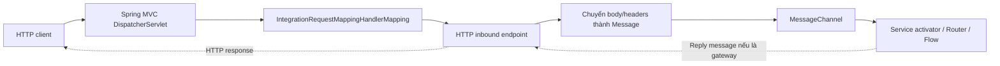

# HttpRequestHandlingEndpoint và ánh xạ method

## 1. Vì sao HTTP endpoint cần ánh xạ method?

Trong module **SPRING_INTEGRATION_ADAPTERS**, Spring Integration dùng inbound/outbound adapter, gateway, poller và `MessageChannel` để kết nối luồng message với các hệ thống bên ngoài như file, SFTP, HTTP, JMS, AMQP, Kafka và cơ sở dữ liệu. Ở chiều HTTP inbound, một request từ client phải được **chọn đúng endpoint** trước khi có thể trở thành `Message<?>` và đi vào luồng tích hợp.

Ví dụ, cùng đường dẫn `/api/messages` có thể phục vụ hai thao tác:

- `GET /api/messages`: truy vấn dữ liệu, trả kết quả.
- `POST /api/messages`: tiếp nhận một message mới, tạo kết quả.

Nếu chỉ kiểm tra URL mà bỏ qua HTTP method, ứng dụng có thể xử lý nhầm thao tác. Spring Integration cho phép ánh xạ request theo **path + HTTP method + các điều kiện khác**, tương tự cơ chế `@RequestMapping` của Spring MVC.

Tên trong tiêu đề **HttpRequestHandlingEndpoint** được dùng theo nghĩa chung là *endpoint xử lý HTTP request*. Trong API Spring Integration, lớp nền trừu tượng có tên chính xác là **`HttpRequestHandlingEndpointSupport`**, với các triển khai như **`HttpRequestHandlingMessagingGateway`** và **`HttpRequestHandlingController`**. Cấu hình Java DSL `Http.inboundGateway(...)` hoặc `Http.inboundChannelAdapter(...)` giúp bạn định nghĩa endpoint mà không cần thao tác trực tiếp với toàn bộ các lớp nền.

Sau bài này, bạn sẽ:

1. Nhận diện nơi request được ánh xạ trước khi đi vào `MessageChannel`.
2. Cấu hình `GET`, `POST` và điều kiện `consumes`/`produces` bằng Java DSL.
3. Hiểu đối tượng `RequestMapping` và cách khai báo method bằng Java configuration.
4. Phân biệt **lọc request tại HTTP boundary** với **router message bên trong flow**.
5. Chẩn đoán lỗi 404, 405, 415, 406, lỗi body và xung đột mapping.

## 2. Các lớp tham gia xử lý HTTP inbound



Quá trình xử lý có hai giai đoạn rõ ràng:

**Giai đoạn 1 – HTTP request mapping:** Spring MVC dùng `IntegrationRequestMappingHandlerMapping` để chọn endpoint phù hợp dựa trên đường dẫn, method, request parameters, headers và media type. Nếu không thỏa điều kiện, request thường bị xử lý ở tầng web và **không đi vào channel**.

**Giai đoạn 2 – message processing:** endpoint đọc request, dùng `HttpMessageConverter` khi cần, tạo Spring Integration `Message<?>` và gửi đến request channel. Gateway có thể chờ reply message để tạo HTTP response; inbound channel adapter chỉ tiếp nhận một chiều.

| Thành phần | Vai trò |
|---|---|
| `HttpRequestHandlingEndpointSupport` | Lớp nền cho các inbound HTTP endpoint; chứa cấu hình request mapping và những đặc tính xử lý HTTP request. |
| `HttpRequestHandlingMessagingGateway` | Endpoint nhận HTTP request để gửi vào hệ thống message; có chế độ request–reply hoặc send-only theo cấu hình. |
| `HttpRequestHandlingController` | Triển khai giao diện Spring MVC `Controller`, hỗ trợ mô hình controller/view trong những cấu hình phù hợp. |
| `RequestMapping` của Spring Integration | Mô tả path, HTTP methods, parameters, headers, `consumes` và `produces` cho HTTP endpoint. |
| `IntegrationRequestMappingHandlerMapping` | Kết nối các mapping của Spring Integration với cơ chế chọn handler của Spring MVC. |
| `Http.inboundGateway(...)` | Java DSL tạo endpoint inbound request–reply. |
| `Http.inboundChannelAdapter(...)` | Java DSL tạo endpoint inbound send-only, không sử dụng reply message nghiệp vụ. |

Chú ý: `org.springframework.integration.http.inbound.RequestMapping` **khác** annotation `org.springframework.web.bind.annotation.RequestMapping`. Cả hai đều diễn tả điều kiện ánh xạ HTTP, nhưng chúng là các API khác nhau. Đối tượng cấu hình của Spring Integration được chuyển thành thông tin mapping mà Spring MVC hiểu.

## 3. Điều kiện ánh xạ method và request

Khi khai báo request mapping, có thể kết hợp:

| Điều kiện | Ví dụ | Mục đích |
|---|---|---|
| Path | `/api/messages` hoặc `/api/messages/{id}` | Chọn tài nguyên HTTP. |
| Method | `GET`, `POST`, `PUT`, `DELETE` | Chọn thao tác có thể gọi vào endpoint. |
| `consumes` | `application/json` | Yêu cầu request body được gửi với media type tương thích. |
| `produces` | `application/json` | Chỉ ánh xạ endpoint khi có thể cung cấp representation mà client chấp nhận. |
| `params` | `mode=sync` | Ràng buộc sự hiện diện/giá trị query parameter. |
| `headers` | `X-Client-Type=partner` | Ràng buộc giá trị request header ở mức matching. |

Ví dụ ý tưởng: endpoint `POST /api/events` có `consumes=application/json` chỉ được chọn khi path, method và media type của request thỏa điều kiện. Nếu request là `GET` hoặc gửi `Content-Type: text/plain`, nó có thể bị chặn trước bước chuyển body thành `Message<?>`.

**Hai điều kiện dễ nhầm:**

- `consumes` kiểm tra media type của **request body**, gắn với `Content-Type`. Nó không tự chứng minh JSON bên trong đúng schema.
- `produces` mô tả representation mà endpoint có thể **trả về**, đối chiếu với `Accept` của client. Nó không tự chuyển một payload Java thành JSON nếu thiếu converter.

Theo tài liệu API của `HttpRequestHandlingEndpointSupport`, nếu sử dụng `RequestMapping` mặc định mà chưa giới hạn HTTP methods, **GET và POST được hỗ trợ theo mặc định**. Để hợp đồng API rõ ràng, hãy khai báo `methods(...)` một cách tường minh thay vì phụ thuộc vào mặc định.

## 4. Ví dụ Java DSL: cùng path, khác HTTP method

Ví dụ dùng Java 17+, Spring Boot có Spring MVC và Spring Integration HTTP. Ta tạo hai inbound gateway dùng chung path `/integration/echo` nhưng ánh xạ method khác nhau:

- `GET`: trả thông tin kiểm tra endpoint.
- `POST`: nhận chuỗi văn bản và trả kết quả đã tiếp nhận.

### 4.1. Dependencies Maven

Khi dự án dùng Spring Boot dependency management:

```xml
<dependencies>
    <dependency>
        <groupId>org.springframework.boot</groupId>
        <artifactId>spring-boot-starter-web</artifactId>
    </dependency>
    <dependency>
        <groupId>org.springframework.boot</groupId>
        <artifactId>spring-boot-starter-integration</artifactId>
    </dependency>
    <dependency>
        <groupId>org.springframework.integration</groupId>
        <artifactId>spring-integration-http</artifactId>
    </dependency>
</dependencies>
```

`spring-integration-http` cung cấp HTTP endpoint. `spring-boot-starter-web` cung cấp Spring MVC và những HTTP message converter phổ biến. Ví dụ này chọn `text/plain` để tập trung vào cách ánh xạ method mà không phụ thuộc DTO/JSON.

### 4.2. Khai báo các IntegrationFlow

```java
package example.http;

import org.springframework.context.annotation.Bean;
import org.springframework.context.annotation.Configuration;
import org.springframework.http.HttpMethod;
import org.springframework.http.MediaType;
import org.springframework.integration.annotation.EnableIntegration;
import org.springframework.integration.dsl.IntegrationFlow;
import org.springframework.integration.http.dsl.Http;

@Configuration
@EnableIntegration
public class EchoHttpFlows {

    @Bean
    public IntegrationFlow echoGetFlow() {
        return IntegrationFlow
            .from(Http.inboundGateway("/integration/echo")
                .requestMapping(mapping -> mapping
                    .methods(HttpMethod.GET)
                    .produces(MediaType.TEXT_PLAIN_VALUE)))
            .handle((payload, headers) -> "Echo endpoint is ready")
            .get();
    }

    @Bean
    public IntegrationFlow echoPostFlow() {
        return IntegrationFlow
            .from(Http.inboundGateway("/integration/echo")
                .requestMapping(mapping -> mapping
                    .methods(HttpMethod.POST)
                    .consumes(MediaType.TEXT_PLAIN_VALUE)
                    .produces(MediaType.TEXT_PLAIN_VALUE))
                .requestPayloadType(String.class))
            .handle(String.class, (payload, headers) ->
                "Received: " + payload)
            .get();
    }
}
```

Ở đây, hai HTTP endpoint có cùng path nhưng **không trùng method**. Khi Spring MVC nhận `GET /integration/echo`, mapping GET được chọn; khi nhận `POST /integration/echo` với `Content-Type: text/plain`, mapping POST được chọn.

Flow GET **không dùng request body**: theo hành vi mặc định của endpoint, payload của GET thường dựa trên request parameter map; handler minh họa bỏ qua payload và trả một thông báo cố định. Flow POST đặt `requestPayloadType(String.class)` để chuyển HTTP body thành `String`.

`Http.inboundGateway` ở cả hai flow yêu cầu trả reply message. Hàm `handle(...)` tạo reply payload dạng `String`, rồi HTTP inbound gateway chuyển nó thành response `text/plain`. Nếu dùng `Http.inboundChannelAdapter` thì handler downstream không trả reply message qua endpoint như trên; trường hợp đó phù hợp khi chỉ cần acknowledgment.

**Phân biệt:** `.requestMapping(mapping -> mapping.methods(HttpMethod.POST))` là **phương thức HTTP được nhận từ client**; nó không liên quan đến `.httpMethod(HttpMethod.POST)` của HTTP **outbound** endpoint, vốn chọn phương thức khi ứng dụng chủ động gọi một HTTP service ngoài.

### 4.3. Kiểm tra với curl

Khởi động ứng dụng ở `localhost:8080`, không có servlet context path bổ sung:

```bash
curl -i -X GET \
  -H 'Accept: text/plain' \
  'http://localhost:8080/integration/echo'
```

Body phản hồi dự kiến:

```text
Echo endpoint is ready
```

Gửi POST:

```bash
curl -i -X POST \
  -H 'Content-Type: text/plain' \
  -H 'Accept: text/plain' \
  --data 'hello integration' \
  'http://localhost:8080/integration/echo'
```

Body phản hồi dự kiến:

```text
Received: hello integration
```

Thử các yêu cầu không khớp:

```bash
# Method không được định nghĩa riêng cho path này:
curl -i -X DELETE 'http://localhost:8080/integration/echo'

# Method POST đúng, nhưng media type body không khớp consumes:
curl -i -X POST \
  -H 'Content-Type: application/json' \
  -d '{"message":"hello"}' \
  'http://localhost:8080/integration/echo'

# Method POST đúng, nhưng client không chấp nhận text/plain:
curl -i -X POST \
  -H 'Content-Type: text/plain' \
  -H 'Accept: application/json' \
  --data 'hello' \
  'http://localhost:8080/integration/echo'
```

Tùy cấu hình Spring MVC và các endpoint khác trong ứng dụng, các tình huống này thường lần lượt dẫn tới `405 Method Not Allowed`, `415 Unsupported Media Type` và `406 Not Acceptable`. Hãy kiểm tra response thực tế; ứng dụng có security filter hoặc global exception handler có thể trả status khác trước khi request tới mapping của Spring Integration.

## 5. Ánh xạ method bằng Java configuration cấp thấp

Java DSL che bớt các chi tiết, nhưng đôi khi cần thao tác trực tiếp với `RequestMapping` và `HttpRequestHandlingMessagingGateway`, chẳng hạn khi xem một hệ thống có cấu hình Java cũ hoặc cần điều khiển endpoint bằng bean.

Ví dụ cấu hình một HTTP inbound gateway riêng, chỉ nhận `POST /integration/raw`:

```java
package example.http;

import org.springframework.context.annotation.Bean;
import org.springframework.context.annotation.Configuration;
import org.springframework.http.HttpMethod;
import org.springframework.http.MediaType;
import org.springframework.integration.annotation.EnableIntegration;
import org.springframework.integration.channel.DirectChannel;
import org.springframework.integration.http.inbound.HttpRequestHandlingMessagingGateway;
import org.springframework.integration.http.inbound.RequestMapping;
import org.springframework.messaging.MessageChannel;

@Configuration
@EnableIntegration
public class RawHttpEndpointConfiguration {

    @Bean
    public MessageChannel rawRequests() {
        return new DirectChannel();
    }

    @Bean
    public HttpRequestHandlingMessagingGateway rawInboundGateway() {
        RequestMapping mapping = new RequestMapping();
        mapping.setPathPatterns("/integration/raw");
        mapping.setMethods(HttpMethod.POST);
        mapping.setConsumes(MediaType.TEXT_PLAIN_VALUE);
        mapping.setProduces(MediaType.TEXT_PLAIN_VALUE);

        HttpRequestHandlingMessagingGateway gateway =
            new HttpRequestHandlingMessagingGateway(true);
        gateway.setRequestMapping(mapping);
        gateway.setRequestPayloadType(String.class);
        gateway.setRequestChannelName("rawRequests");
        return gateway;
    }
}
```

Kèm handler nhận message ở channel tương ứng, chẳng hạn một Spring bean:

```java
package example.http;

import java.util.Locale;
import org.springframework.integration.annotation.ServiceActivator;
import org.springframework.stereotype.Service;

@Service
public class RawRequestHandler {

    @ServiceActivator(inputChannel = "rawRequests")
    public String receive(String body) {
        return "RAW: " + body.toUpperCase(Locale.ROOT);
    }
}
```

Tham số `true` trong constructor `HttpRequestHandlingMessagingGateway(true)` chọn chế độ request–reply. Bản thân `RequestMapping` chỉ quy định request nào được endpoint tiếp nhận; việc đọc body thành `String` là trách nhiệm của `requestPayloadType` và converter, còn reply được tạo bởi service activator.

Có thể đọc code này theo bảng đối chiếu:

| Java configuration | Java DSL tương đương về ý tưởng |
|---|---|
| `new RequestMapping()` | `.requestMapping(mapping -> ...)` |
| `mapping.setPathPatterns("/integration/raw")` | `Http.inboundGateway("/integration/raw")` |
| `mapping.setMethods(HttpMethod.POST)` | `.methods(HttpMethod.POST)` |
| `mapping.setConsumes("text/plain")` | `.consumes(MediaType.TEXT_PLAIN_VALUE)` |
| `mapping.setProduces("text/plain")` | `.produces(MediaType.TEXT_PLAIN_VALUE)` |
| `gateway.setRequestPayloadType(String.class)` | `.requestPayloadType(String.class)` |
| `gateway.setRequestChannelName("rawRequests")` | `.channel("rawRequests")` trong flow |

Ví dụ cấp thấp và ví dụ Java DSL dùng **hai path khác nhau**. Khi chạy trong cùng một ứng dụng, không tạo hai endpoint trùng mọi điều kiện ánh xạ vì Spring MVC có thể báo xung đột mapping.

## 6. Method mapping khác gì router theo HTTP method?

Đây là hai giai đoạn có mục đích khác nhau.

**Chọn endpoint ở tầng HTTP:**

```text
POST /api/events + application/json
    -> Spring MVC so path/method/consumes/produces
    -> chọn HTTP inbound gateway
    -> tạo Spring Integration Message
```

Nếu method không được endpoint cho phép, request thường bị từ chối trước khi tạo message.

**Định tuyến sau khi đã tạo message:**

```text
Request được endpoint chấp nhận
    -> Message(payload, headers)
    -> router theo headers.http_requestMethod
    -> channel cho từng nhánh GET / POST / DELETE
```

Tài liệu Spring Integration mô tả khả năng định tuyến dựa trên header `http_requestMethod` khi một inbound endpoint tiếp nhận nhiều method. Cách này hữu ích khi nhiều thao tác có phần tiền xử lý chung hoặc cần routing động **sau khi đã qua HTTP boundary**.

Tuy vậy, **router không thay thế method restriction trên endpoint**. Nếu endpoint chỉ được phép nhận GET và POST, đừng mở toàn bộ method chỉ để router nội bộ quyết định; hãy đặt điều kiện `methods(GET, POST)` ngay tại mapping. Sau đó router mới xử lý khác biệt theo message header nếu cần.

| Vấn đề | HTTP request mapping | Message router |
|---|---|---|
| Chạy ở đâu? | Spring MVC / inbound endpoint, trước channel. | Trong Spring Integration flow, sau khi có message. |
| Dựa trên dữ liệu nào? | Path, HTTP method, query params, HTTP headers, media types. | Message payload, headers, biểu thức hoặc nghiệp vụ. |
| Khi không khớp? | Xử lý theo HTTP mapping/error resolver. | Tùy default channel, discard/error flow và router config. |
| Dùng cho? | Công bố contract và giới hạn request được nhận. | Rẽ nhánh xử lý message đã được chấp nhận. |

Có thể dùng cả hai: mapping giới hạn `GET, POST`, rồi router phân biệt `headers.http_requestMethod` khi thật sự cần một endpoint chung. Nếu hai thao tác khác nhau rõ rệt, hai inbound gateway có mapping riêng thường dễ đọc và kiểm thử hơn.

## 7. Method, path variable, query parameter và body

Một số sai lầm thường gặp bắt nguồn từ việc xem mọi request như một JSON body giống nhau:

- **GET:** thường dùng query string hoặc path variable. Theo cấu hình endpoint mặc định được tài liệu API mô tả, GET có thể tạo payload từ `parameterMap`. Khi cần `/items/{id}`, có thể dùng `#pathVariables.id` trong payload/header expression được hỗ trợ.
- **POST:** thường mang body; `requestPayloadType` và HTTP message converters quyết định body thành `String`, DTO hay kiểu khác. `consumes(application/json)` không tự xác thực trường dữ liệu.
- **PUT/PATCH:** thao tác cập nhật theo hợp đồng; cần kiểm soát body converter, trạng thái tài nguyên và quyền thao tác.
- **DELETE:** có thể dựa trên path variable; không nên mặc định sẽ có body.
- **HEAD/OPTIONS:** Spring MVC có những hành vi hỗ trợ hoặc xử lý tự động liên quan GET, CORS và cơ chế HTTP. Khi kiểm thử danh sách method, hãy xét hành vi framework thực tế thay vì cho rằng chỉ những method tự khai báo mới có thể tạo response ở mọi tình huống.

Ví dụ ràng buộc thêm query parameter/header trong request mapping:

```java
Http.inboundGateway("/integration/imports")
    .requestMapping(mapping -> mapping
        .methods(HttpMethod.POST)
        .params("mode=sync")
        .headers("X-Source=partner")
        .consumes(MediaType.APPLICATION_JSON_VALUE)
        .produces(MediaType.APPLICATION_JSON_VALUE))
    .requestPayloadType(String.class)
```

Đây là **một đoạn cấu hình inbound gateway** để gắn vào `IntegrationFlow.from(...)`, không phải một `IntegrationFlow` hoàn chỉnh. Nó chỉ chọn những request có `mode=sync`, header `X-Source: partner` và media type phù hợp. Với nhu cầu phân quyền theo đối tác, vẫn phải xác thực danh tính/thẩm quyền; header tự khai báo như `X-Source` không phải cơ chế authentication.

Khi hai mapping dùng cùng path và method nhưng ràng buộc khác nhau (ví dụ `consumes`), Spring MVC có thể chọn mapping phù hợp hơn theo điều kiện. Nhưng nếu hai mapping trùng toàn bộ hoặc không đủ phân biệt, có nguy cơ **ambiguous mapping** ngay khi đăng ký hoặc khi dispatch request.

## 8. Phân biệt HTTP error với lỗi trong message flow

Lỗi có thể xảy ra ở những vị trí khác nhau:

| Triệu chứng | Điểm kiểm tra | Giải thích |
|---|---|---|
| 404 Not Found | Path, context path, servlet mapping, endpoint đã đăng ký | Có thể không có handler phù hợp với URL. |
| 405 Method Not Allowed | `methods(...)` và các handler cùng path | URL có mapping nhưng method không được chấp nhận. |
| 415 Unsupported Media Type | `consumes(...)` và `Content-Type` | Body request khai báo media type không được mapping chấp nhận. |
| 406 Not Acceptable | `produces(...)` và `Accept` | Mapping không đáp ứng representation client yêu cầu. |
| 400 Bad Request / lỗi conversion | Body JSON, DTO, `HttpMessageConverter`, validation | Request có thể đã khớp mapping nhưng dữ liệu không chuyển đổi được. |
| 401/403 | Filter/Spring Security/API gateway | Xác thực hoặc phân quyền có thể chặn trước endpoint. |
| 5xx/timeout | Service activator, reply channel, downstream DB/Kafka/JMS/HTTP | Request có thể đã vào channel nhưng nghiệp vụ lỗi hoặc không trả reply đúng hạn. |

Các mã status trên là **hành vi điển hình**, không phải cam kết tuyệt đối khi có custom exception resolver, filter hoặc API gateway.

Hãy nhớ thứ tự kiểm tra:

1. **Request có tới ứng dụng không?** Kiểm tra web server, reverse proxy, servlet context path và network.
2. **Spring MVC có chọn endpoint không?** Kiểm tra path, method, params, headers, `consumes` và `produces`.
3. **Converter có tạo được payload không?** Xem `Content-Type`, kiểu Java và JSON schema.
4. **Message có tới channel/handler không?** Kiểm tra tên channel, subscriber, router và poller nếu có `PollableChannel`.
5. **Có reply đúng hợp đồng không?** Nếu dùng inbound gateway, kiểm tra return type, reply channel, timeout, response converter và HTTP status.

Đừng khắc phục HTTP 405 bằng cách mở hết các method khi API chỉ hỗ trợ POST; cần xác định client gọi sai method hay mapping đang khai báo thiếu. Tương tự, HTTP 415 không được giải quyết bằng cách bỏ mọi điều kiện media type nếu hợp đồng chỉ cho phép JSON.

## 9. Bảo mật, vận hành và kiểm thử

Việc ánh xạ method làm rõ phạm vi API nhưng **không phải** cơ chế kiểm soát quyền truy cập. Endpoint `DELETE /api/items/{id}` có khai báo method đúng vẫn cần authentication và authorization để xác định ai được xóa tài nguyên.

Một số nguyên tắc vận hành:

- **Ràng buộc method cụ thể:** chỉ công bố những method API thực sự hỗ trợ; không phụ thuộc mặc định GET/POST.
- **Ràng buộc media type:** khai báo `consumes`/`produces` phù hợp; xác thực schema và dữ liệu nghiệp vụ ở bước riêng.
- **Kiểm soát kích thước và tốc độ:** giới hạn body, rate limit và số request đồng thời, nhất là với các method thay đổi dữ liệu.
- **CORS/OPTIONS:** cấu hình CORS phù hợp nếu client là trình duyệt; preflight request có thể được xử lý trước luồng nghiệp vụ.
- **Bảo vệ dữ liệu nhạy cảm:** ánh xạ HTTP headers có kiểm soát; không phát tán cookie/authorization token ra message headers hoặc log khi không cần thiết.
- **Idempotency:** client có thể retry POST/PUT/DELETE sau timeout; cần xác định behavior trùng request theo nghiệp vụ và khả năng lưu bền vững.
- **Quan sát lỗi:** theo dõi số request theo method/path/status, latency tại HTTP boundary và thời gian xử lý trong channel/downstream.
- **Vòng đời endpoint:** HTTP mapping được đăng ký khi Spring application context khởi động và các bean được cấu hình; một endpoint sẵn sàng nhận request không đảm bảo handler, database hay broker downstream đang hoạt động.

Bộ kiểm thử tối thiểu cho ví dụ `/integration/echo` nên bao gồm: GET đúng path; POST text/plain đúng body; POST sai content type; request có Accept không phù hợp; method không được phép; request thiếu xác thực nếu có security; hai mapping cùng path không xung đột; và trường hợp handler ném exception hoặc không trả reply.

Khi mở rộng thành flow gửi dữ liệu sang JMS, AMQP, Kafka hoặc cơ sở dữ liệu, hợp đồng message, retry, idempotency và transaction của các thành phần đó được kiểm soát riêng. Chọn đúng HTTP method chỉ giải quyết bước tiếp nhận tại ranh giới web.

## 10. Tóm tắt kiến thức

**`HttpRequestHandlingEndpointSupport`** là lớp nền của những HTTP inbound endpoint trong Spring Integration. Cơ chế `IntegrationRequestMappingHandlerMapping` cho phép Spring MVC chọn endpoint theo path, HTTP method và các điều kiện request trước khi tạo Spring Integration message.

Với Java DSL, cách cấu hình phổ biến là:

```java
Http.inboundGateway("/api/resource")
    .requestMapping(mapping -> mapping
        .methods(HttpMethod.POST)
        .consumes(MediaType.APPLICATION_JSON_VALUE)
        .produces(MediaType.APPLICATION_JSON_VALUE))
    .requestPayloadType(String.class)
```

Khi API cần response nghiệp vụ từ reply message, dùng **inbound gateway**; khi chỉ tiếp nhận one-way, dùng **inbound channel adapter**. Có thể route tiếp theo header HTTP method bên trong flow, nhưng việc giới hạn method, path và media type nên được xác định ngay từ request mapping.

### Tài liệu tham khảo chính thức

- [Spring Integration — Configuring HTTP Endpoints with Java](https://docs.spring.io/spring-integration/reference/http/java-config.html)
- [Spring Integration — HTTP Namespace Support: Request Mapping](https://docs.spring.io/spring-integration/reference/http/namespace.html)
- [Spring Integration — HTTP Header Mappings](https://docs.spring.io/spring-integration/reference/http/header-mapping.html)
- [Spring Integration — Java API: HttpRequestHandlingEndpointSupport](https://docs.spring.io/spring-integration/api/org/springframework/integration/http/inbound/HttpRequestHandlingEndpointSupport.html)
- [Spring Integration — Java API: RequestMapping](https://docs.spring.io/spring-integration/api/org/springframework/integration/http/inbound/RequestMapping.html)
