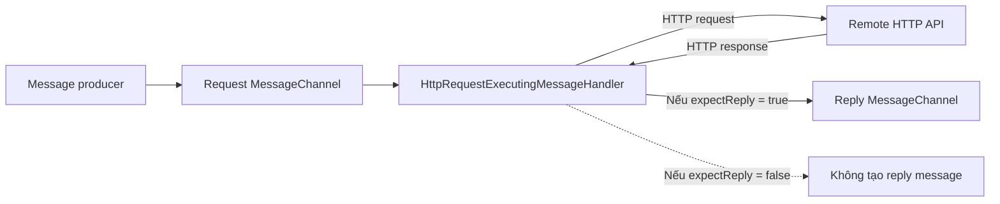
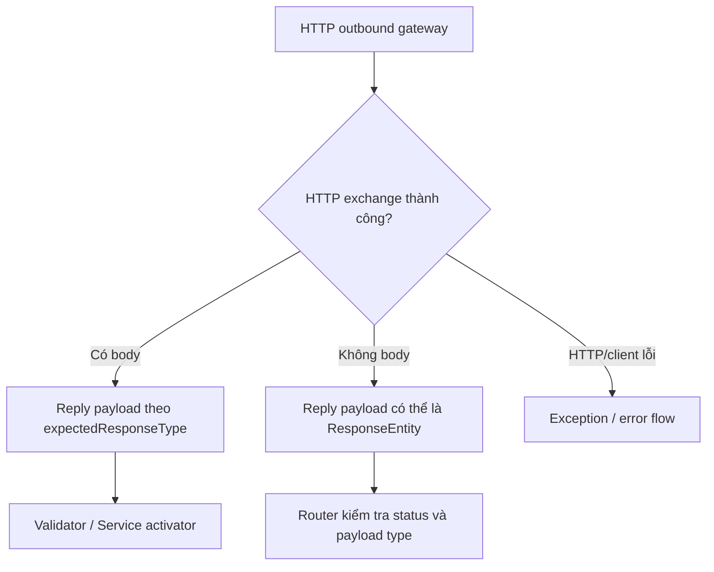

# HttpMessageHandler và HttpRequestExecutingMessageHandler

## 1. Hai tên gọi liên quan với nhau như thế nào?

Trong **SPRING_INTEGRATION_ADAPTERS**, message được trao đổi giữa các `MessageChannel` và endpoint để kết nối hệ thống bên ngoài qua file, SFTP, HTTP, JMS, AMQP, Kafka hoặc cơ sở dữ liệu. Với HTTP outbound, một handler nhận `Message<?>` từ channel, biến payload/header thành HTTP request và gọi dịch vụ ở ngoài ứng dụng.

Có ba tên rất dễ nhầm:

| Tên | Bản chất | Vai trò |
|---|---|---|
| `org.springframework.messaging.MessageHandler` | Interface chung của Spring Messaging | Nhận một `Message<?>` để thực thi một thao tác. Nó không quy định thao tác đó phải dùng HTTP. |
| `org.springframework.integration.http.dsl.HttpMessageHandlerSpec` | **Builder cấu hình** trong Spring Integration Java DSL | Cấu hình HTTP outbound adapter/gateway, chẳng hạn URL, method, response type, header mapping. |
| `org.springframework.integration.http.outbound.HttpRequestExecutingMessageHandler` | **Handler HTTP cụ thể** | Thực sự thực hiện HTTP request qua HTTP client; tùy chế độ có thể sinh reply message từ HTTP response. |

Tên **“HttpMessageHandler”** trong đề bài có thể hiểu là cách gọi ngắn của *message handler gửi HTTP*. Trong Spring Integration HTTP outbound, cần dùng **`HttpMessageHandlerSpec`** khi nói đến lớp DSL và **`HttpRequestExecutingMessageHandler`** khi nói đến lớp handler thực thi. Không nên tự import một lớp `HttpMessageHandler` từ package HTTP outbound nếu API của phiên bản đang dùng không công bố lớp đó.

Handler thực thi kế thừa chuỗi lớp trừu tượng như sau:

```text
org.springframework.messaging.MessageHandler
                  ▲ implements
                  │
AbstractReplyProducingMessageHandler
                  ▲
                  │
AbstractHttpRequestExecutingMessageHandler
                  ▲
                  │
HttpRequestExecutingMessageHandler
```

Sơ đồ rút gọn biểu diễn *quan hệ kế thừa và triển khai interface*, không liệt kê mọi lớp trung gian. `AbstractHttpRequestExecutingMessageHandler` chứa các cấu hình HTTP outbound dùng chung; `HttpRequestExecutingMessageHandler` là phần triển khai trao đổi HTTP thực tế.

### Kết quả mong đợi

Sau bài này, bạn có thể:

1. Giải thích vị trí `MessageHandler`, `HttpMessageHandlerSpec` và `HttpRequestExecutingMessageHandler`.
2. Cấu hình HTTP outbound gateway bằng Java DSL và bằng bean `@ServiceActivator`.
3. Phân biệt handler gửi **one-way** với handler **request–reply** dù đều dùng HTTP.
4. Hiểu các điểm cấu hình payload, URL, method, converters, headers và HTTP response.
5. Thiết kế timeout, retry, xử lý lỗi và kiểm thử hợp đồng message với dịch vụ ngoài.

## 2. Vòng đời của một message qua HTTP outbound handler



Đường đi theo thứ tự:

1. Producer, ví dụ service activator hoặc một Java messaging gateway, phát một Spring Integration `Message<?>`.
2. Channel chuyển message cho `HttpRequestExecutingMessageHandler` đã đăng ký làm subscriber.
3. Handler tính URL, chọn HTTP method, ánh xạ request headers và chuẩn bị body từ payload bằng converter.
4. HTTP client gửi request, nhận status, headers và body hoặc phát sinh lỗi kết nối/timeout.
5. Với **`expectReply=true`**, handler tạo reply message và gửi tới reply channel. Với **`expectReply=false`**, handler kết thúc như một outbound channel adapter một chiều.

`expectReply` điều khiển **Spring Integration reply message**, không thay đổi bản chất HTTP: cả hai chế độ vẫn có HTTP request và HTTP response ở tầng giao thức. One-way cũng không mặc định có nghĩa gửi request theo cách bất đồng bộ.

### Ai chịu trách nhiệm cho phần nào?

| Thành phần | Điều quyết định |
|---|---|
| `DirectChannel`, `ExecutorChannel`, `QueueChannel` | Cách handler nhận message; đồng bộ, chuyển qua executor hoặc đợi poller. |
| `HttpRequestExecutingMessageHandler` | Lấy message, chuẩn bị HTTP request, dùng HTTP client trao đổi với dịch vụ ngoài và tùy chọn trả reply. |
| `HttpMessageConverter` | Chuyển `String`/DTO/byte[] thành request body và đọc response body sang kiểu Java tương ứng. |
| `HeaderMapper<HttpHeaders>` | Chọn và chuyển đổi metadata giữa message headers và HTTP headers. |
| Reply channel | Nơi kết quả được gửi về nếu endpoint ở chế độ gateway. |
| Error flow | Nơi xử lý lỗi theo thiết kế; lỗi trên luồng đồng bộ có thể truyền ngược về caller. |

HTTP outbound handler không cần poller để nhận message từ `DirectChannel`. Poller chỉ cần khi nguồn gửi đến handler là `PollableChannel` hoặc khi logic phía trước lấy dữ liệu theo lịch.

## 3. Java DSL: builder tạo handler như thế nào?

Spring Integration Java DSL cung cấp hai phương thức thường gặp:

```java
Http.outboundChannelAdapter("https://partner.example/api/events")
Http.outboundGateway("https://partner.example/api/quotes")
```

Cả hai đều trả về một **`HttpMessageHandlerSpec`** để khai báo cấu hình. Khi build flow, DSL dùng spec để tạo/thiết lập **`HttpRequestExecutingMessageHandler`** phù hợp:

| Java DSL factory | Chế độ của handler | Reply message |
|---|---|---|
| `Http.outboundChannelAdapter(uri)` | `expectReply=false` | Không phát reply message về flow. |
| `Http.outboundGateway(uri)` | `expectReply=true` | Tạo reply message từ HTTP response để xử lý tiếp. |

Chế độ gateway là mặc định của handler khi tạo trực tiếp, trừ khi đặt lại `setExpectReply(false)`.

**Lưu ý:** cấu hình `expectedResponseType` có ý nghĩa chủ yếu với chế độ gateway vì nó quy định cách đọc reply body. Với outbound channel adapter, reply body không được chuyển thành một message nghiệp vụ cho downstream.

## 4. Thực hành request–reply bằng Java DSL

Ta xây dựng một ví dụ có thể ghép vào ứng dụng Spring Boot với Spring Integration. Một phương thức Java nhận mã sản phẩm, gọi Pricing API bằng HTTP POST với body `text/plain` và nhận một chuỗi báo giá.

Chọn `text/plain` giúp tập trung vào cách handler hoạt động. Khi dùng JSON trong thực tế, thay bằng DTO và dùng JSON converter phù hợp.

### 4.1. Dependencies

Với Maven và Spring Boot dependency management:

```xml
<dependencies>
    <dependency>
        <groupId>org.springframework.boot</groupId>
        <artifactId>spring-boot-starter-integration</artifactId>
    </dependency>
    <dependency>
        <groupId>org.springframework.integration</groupId>
        <artifactId>spring-integration-http</artifactId>
    </dependency>
    <dependency>
        <groupId>org.springframework.boot</groupId>
        <artifactId>spring-boot-starter-web</artifactId>
    </dependency>
</dependencies>
```

`spring-integration-http` cung cấp các endpoint và HTTP DSL. `spring-boot-starter-web` là một cách thuận tiện để có Spring Web và các message converters, nhưng ứng dụng chỉ gọi HTTP outbound **không bắt buộc phải công bố servlet endpoint**.

### 4.2. Tạo interface gọi message flow

File `PricingClient.java`:

```java
package example.http;

import org.springframework.integration.annotation.MessagingGateway;

@MessagingGateway(defaultRequestChannel = "pricingRequests")
public interface PricingClient {

    String requestQuote(String sku);
}
```

`@MessagingGateway` tạo một proxy để chuyển tham số thành message gửi tới channel `pricingRequests`. Vì phương thức trả `String`, caller chờ reply message rồi nhận reply payload.

### 4.3. Định nghĩa HTTP outbound flow

File `PricingOutboundConfiguration.java`:

```java
package example.http;

import org.springframework.beans.factory.annotation.Value;
import org.springframework.context.annotation.Bean;
import org.springframework.context.annotation.Configuration;
import org.springframework.http.HttpMethod;
import org.springframework.http.MediaType;
import org.springframework.integration.annotation.EnableIntegration;
import org.springframework.integration.annotation.IntegrationComponentScan;
import org.springframework.integration.dsl.IntegrationFlow;
import org.springframework.integration.http.dsl.Http;
import org.springframework.messaging.MessageHeaders;

@Configuration
@EnableIntegration
@IntegrationComponentScan
public class PricingOutboundConfiguration {

    @Bean
    public IntegrationFlow pricingHttpFlow(
            @Value("${partner.pricing.url}") String pricingUrl) {

        return IntegrationFlow.from("pricingRequests")
            .enrichHeaders(headers -> headers.header(
                MessageHeaders.CONTENT_TYPE,
                MediaType.TEXT_PLAIN_VALUE))
            .handle(Http.outboundGateway(pricingUrl)
                .httpMethod(HttpMethod.POST)
                .expectedResponseType(String.class))
            .get();
    }
}
```

Với cấu hình trong `application.yml`:

```yaml
partner:
  pricing:
    url: "http://localhost:8081/api/quotes"
```

Những dòng quan trọng:

- `IntegrationFlow.from("pricingRequests")` lắng nghe channel mà `PricingClient` gửi request vào.
- `enrichHeaders(...)` gắn `contentType=text/plain` để HTTP client/converter chuẩn bị body thích hợp.
- `Http.outboundGateway(pricingUrl)` tạo `HttpMessageHandlerSpec` cho chế độ request–reply.
- `httpMethod(HttpMethod.POST)` đặt phương thức HTTP được gửi tới đối tác.
- `expectedResponseType(String.class)` chọn kiểu reply payload khi response có body phù hợp.
- `.handle(...)` đăng ký handler vào flow. Trong quá trình khởi tạo, cấu hình spec trở thành HTTP handler thực tế.

Ví dụ service gọi gateway:

```java
package example.http;

import org.springframework.stereotype.Service;

@Service
public class CheckoutService {

    private final PricingClient pricingClient;

    public CheckoutService(PricingClient pricingClient) {
        this.pricingClient = pricingClient;
    }

    public String quote(String sku) {
        if (sku == null || sku.isBlank()) {
            throw new IllegalArgumentException("sku is required");
        }
        return pricingClient.requestQuote(sku);
    }
}
```

Giả sử mock HTTP server chấp nhận `POST /api/quotes` với body `BOOK-1` và trả:

```http
HTTP/1.1 200 OK
Content-Type: text/plain

QUOTE-1001:240000-VND
```

Khi gọi:

```java
String quote = checkoutService.quote("BOOK-1");
```

giá trị `quote` dự kiến là `"QUOTE-1001:240000-VND"`. Đây là *response body do mock API cung cấp*, sau khi được handler chuyển thành reply payload; handler không tự tính giá.

### 4.4. Vì sao method không nhận reply sẽ gặp lỗi?

Nếu giữ nguyên `PricingClient.requestQuote` nhưng thay:

```java
.handle(Http.outboundChannelAdapter(pricingUrl)
    .httpMethod(HttpMethod.POST))
```

handler gửi HTTP nhưng **không tạo reply message**. Caller sử dụng messaging gateway có kiểu trả về `String` không còn kết quả nghiệp vụ để nhận; tùy timeout và error flow, caller có thể chờ tới hạn hoặc gặp lỗi. Chỉ dùng outbound channel adapter nếu hợp đồng flow không cần nội dung response.

## 5. Cấu hình trực tiếp HttpRequestExecutingMessageHandler

Java DSL được khuyến nghị để mô tả flow gọn. Tuy nhiên, bạn sẽ gặp cấu hình bean cấp thấp trong các ứng dụng dùng `@ServiceActivator` hoặc khi cần tùy chỉnh handler.

Ví dụ dưới đây là **một lựa chọn độc lập** với flow DSL vừa trình bày, dùng channel `rawQuoteRequests` riêng để tránh hai handler cạnh tranh trên một channel.

```java
package example.http;

import org.springframework.beans.factory.annotation.Value;
import org.springframework.context.annotation.Bean;
import org.springframework.context.annotation.Configuration;
import org.springframework.http.HttpMethod;
import org.springframework.integration.annotation.EnableIntegration;
import org.springframework.integration.annotation.ServiceActivator;
import org.springframework.integration.http.outbound.HttpRequestExecutingMessageHandler;

@Configuration
@EnableIntegration
public class RawHttpHandlerConfiguration {

    @Bean
    @ServiceActivator(inputChannel = "rawQuoteRequests")
    public HttpRequestExecutingMessageHandler rawHttpGateway(
            @Value("${partner.pricing.url}") String pricingUrl) {

        HttpRequestExecutingMessageHandler handler =
            new HttpRequestExecutingMessageHandler(pricingUrl);

        handler.setHttpMethod(HttpMethod.POST);
        handler.setExpectedResponseType(String.class);
        handler.setExpectReply(true);

        return handler;
    }
}
```

Ở đây:

1. Spring Integration gọi handler khi có message tại `rawQuoteRequests`.
2. `HttpRequestExecutingMessageHandler` dùng URL và HTTP method được cấu hình để gửi request.
3. Vì `setExpectReply(true)`, HTTP response có body phù hợp được chuyển thành reply message.
4. Reply được đưa về reply channel của request message nếu caller đã cung cấp, hoặc output channel được cấu hình theo flow.

Để minh họa chế độ **one-way** trên handler trực tiếp, thay `setExpectReply(true)` bằng `setExpectReply(false)`, đăng ký handler vào một input channel dành cho sự kiện không cần reply, và bỏ kỳ vọng trả kết quả ở caller.

Điều này cho thấy **outbound adapter và outbound gateway có thể chia sẻ cùng loại handler thực thi**, khác ở cấu hình `expectReply` và hợp đồng reply của flow.

## 6. Các thuộc tính quan trọng của HTTP handler

`AbstractHttpRequestExecutingMessageHandler` chứa nhiều thiết lập dùng chung cho hai chế độ:

| Cấu hình | Ý nghĩa | Lỗi thường gặp |
|---|---|---|
| URL/URI expression | Đích gọi HTTP, có thể thay đổi theo message. | URI sai, thiếu biến path, mở URL tùy ý từ payload không tin cậy. |
| `httpMethod` | Method gửi ra ngoài; mặc định là POST theo API lớp nền. | Dùng GET trong khi API yêu cầu POST hoặc ngược lại. |
| `expectedResponseType` | Kiểu đích để converter đọc response có body. | Mong DTO nhưng response trả media type/schema khác. |
| `extractPayload` | Mặc định lấy payload message làm HTTP request body. | Không hiểu vì sao cả message hay payload được serialize. |
| `extractResponseBody` | Với gateway, mặc định lấy body từ `ResponseEntity` làm reply payload nếu có. | Downstream kỳ vọng cả status/headers nhưng chỉ nhận body. |
| `headerMapper` | Ánh xạ message headers ↔ HTTP headers. | Lộ header nhạy cảm hoặc thiếu header bắt buộc. |
| URI variables | Thay biến trong URL template bằng giá trị lấy từ message. | Path chứa ký tự không được mã hóa, dữ liệu ngoài ý muốn. |
| `transferCookies` | Có thể đưa cookie từ response vào reply headers theo cấu hình. | Dùng cookie stateful mà chưa xem xét tính bảo mật, quyền riêng tư. |
| `expectReply` | Xác định handler có phát Spring Integration reply message. | Caller cần giá trị nhưng handler đang ở chế độ one-way. |

Ví dụ về biến URI:

```java
.handle(Http.outboundGateway("https://api.example.com/items/{id}")
    .httpMethod(HttpMethod.GET)
    .uriVariable("id", "payload")
    .expectedResponseType(String.class))
```

Đoạn mã trên chỉ minh họa phần `.handle(...)` trong một `IntegrationFlow`. Với một message có payload là ID sản phẩm, handler lấy payload để thay biến `{id}` theo URI template. Cần sử dụng encoding và validation thích hợp; không ghép chuỗi URL từ input chưa kiểm soát.

### Header mapping và correlation

Metadata Spring Integration như `replyChannel`, `errorChannel` hoặc correlation ID không đồng nghĩa với HTTP headers. Chỉ truyền những HTTP headers cần thiết như `Authorization`, `Content-Type`, `Accept`, `X-Request-ID` và idempotency key theo hợp đồng.

Nếu tích hợp cùng JMS/Kafka, hãy thống nhất quy tắc correlation khi một message được đưa qua broker: các header nội bộ chứa tham chiếu channel sống trong bộ nhớ không thể tự chuyển thành một hợp đồng liên hệ request–reply xuyên hệ thống.

## 7. Xử lý response: body, status và tình huống không có body

Với **`expectReply=true`**:

- Nếu HTTP response có body và `expectedResponseType` phù hợp với converter, reply payload thường là body đã chuyển thành kiểu Java mong đợi.
- Khi `extractResponseBody=false`, reply payload có thể là toàn bộ `ResponseEntity`, cho phép downstream kiểm tra status/header/body trong một đối tượng.
- Nếu response **không có body**, handler có thể trả `ResponseEntity` làm payload bất kể `expectedResponseType` và `extractResponseBody`; do đó không được giả định `204 No Content` luôn trả `String` hoặc DTO.
- Khi có reply message, HTTP status được biểu diễn qua header như `http_statusCode` theo cơ chế của Spring Integration; một số response headers được ánh xạ tùy cấu hình.

Ví dụ về routing dựa trên response:



Trong ứng dụng thật, cần kiểm thử các status `200`, `201`, `202`, `204` và các API có response tùy ngữ cảnh như `304`. Các response không có body đòi hỏi hợp đồng rõ ràng; một Java messaging gateway trả `MyDto` có thể không phù hợp nếu dịch vụ đôi lúc trả `204`.

**Không coi tất cả 4xx/5xx là reply nghiệp vụ bình thường.** HTTP client và status/error handler có thể ném exception trước khi tạo reply. Chỉ xử lý status lỗi như dữ liệu khi ứng dụng chủ động định nghĩa và cấu hình cách diễn giải chúng.

## 8. RestTemplate, RestClient và cấu hình theo phiên bản

`HttpRequestExecutingMessageHandler` triển khai trao đổi HTTP thông qua thành phần HTTP client của Spring. Có khác biệt theo phiên bản:

| Phiên bản Spring Integration | Điểm cần biết |
|---|---|
| Các nhánh 5.x/6.x | Tài liệu và cấu hình điển hình dựa trên `RestTemplate`; `HttpMessageConverter` xử lý body. |
| Từ 7.1 | Hỗ trợ `RestClient` cho HTTP outbound; cấu hình dựa trên `RestTemplate` bắt đầu bị deprecate để chuẩn bị loại bỏ ở phiên bản tương lai. |
| Từ 7.2 | Có thêm cấu hình status/error handler cho `RestClient`, qua API `defaultStatusHandler(...)`. |

Vì module không cố định phiên bản Spring Integration, **không sao chép tùy chọn thuộc 7.1/7.2 vào dự án 6.x** mà không kiểm tra dependency. Hai factory DSL cơ bản `Http.outboundGateway(...)` và `Http.outboundChannelAdapter(...)` cùng lớp `HttpRequestExecutingMessageHandler` giúp học khái niệm xuyên các phiên bản; API tùy chỉnh HTTP client cần đối chiếu đúng Javadoc của dự án.

### Timeout phải đặt ở HTTP client

Giả sử `PricingClient.requestQuote` chạy qua `DirectChannel`. HTTP call thường chạy ngay trong luồng caller. Một timeout ở **messaging gateway** không bảo đảm ngắt được lệnh HTTP đang block; cần cấu hình connect timeout và read/response timeout ở **HTTP client/request factory** được handler sử dụng.

Ví dụ ý tưởng cho cấu hình kiểu `RestTemplate` ở những phiên bản hỗ trợ `setRequestFactory(...)`:

```java
import org.springframework.http.client.SimpleClientHttpRequestFactory;

SimpleClientHttpRequestFactory factory =
    new SimpleClientHttpRequestFactory();
factory.setConnectTimeout(2_000);
factory.setReadTimeout(5_000);

// Gắn vào HttpRequestExecutingMessageHandler được quản lý:
handler.setRequestFactory(factory);
```

Đây là đoạn cấu hình bổ sung trong phương thức tạo handler, không phải một chương trình độc lập; `handler` là biến được tạo ở ví dụ trước. Với các phiên bản sử dụng `RestClient`, cần cấu hình client/request factory theo API tương ứng và kiểm tra thực tế timeout.

Nếu đưa handler sau `ExecutorChannel` hoặc `QueueChannel` + poller, HTTP exchange có thể chạy ngoài luồng producer. Khi đó caller yêu cầu reply vẫn có deadline riêng và lỗi bất đồng bộ cần được quan sát ở worker; việc chuyển sang channel bất đồng bộ không làm HTTP client tự trở thành non-blocking.

## 9. Lỗi, retry và bảo đảm nghiệp vụ

Các lỗi có thể xảy ra ở ba giai đoạn:

| Giai đoạn | Ví dụ | Hướng xử lý |
|---|---|---|
| Trước HTTP exchange | URI không hợp lệ, converter không serialize được DTO, thiếu header. | Validate message/URI, kiểm soát mapper và schema trước khi gửi. |
| Trong HTTP exchange | DNS/TLS, connect/read timeout, 429, 500. | Phân loại transient vs permanent, timeout, retry/backoff có giới hạn. |
| Sau khi nhận HTTP response | JSON sai schema, không convert được reply, downstream reject payload. | Kiểm tra converter/`expectedResponseType` và thực hiện validation nghiệp vụ. |

Một chính sách thường gặp:

1. **4xx do dữ liệu sai**: trả lỗi nghiệp vụ/đưa vào quy trình sửa dữ liệu, tránh retry vô hạn.
2. **401/403**: kiểm tra authentication, authorization, token/mTLS; không retry mù quáng với cùng thông tin sai.
3. **429/5xx**: cân nhắc retry giới hạn, exponential backoff và jitter; tuân thủ `Retry-After` nếu đối tác công bố.
4. **Timeout hoặc mất kết nối**: không biết chắc remote đã xử lý request hay chưa. Khi thao tác có side effect, dùng idempotency key và cơ chế tra cứu trạng thái để tránh thực hiện hai lần.
5. **Retry thất bại hết số lần**: ghi nhận lỗi vào outbox/dead-letter hoặc nơi theo dõi có thể khôi phục, kèm correlation/event ID.

Với `DirectChannel`, ngoại lệ từ HTTP handler thường đi ngược về caller. Với executor hoặc poller, lỗi phát sinh ở worker nên cần error flow, retry advice và metrics phù hợp. Không giả định một `errorChannel` mặc định sẽ chuyển exception thành JSON HTTP response nếu caller ban đầu đến từ inbound gateway.

**Transaction:** một transaction database nội bộ không tự rollback request HTTP đã gửi cho dịch vụ khác. Khi tích hợp thêm JMS, AMQP, Kafka hoặc database, phải xác định mốc commit, idempotency và cơ chế bù trừ/outbox theo từng hệ thống.

### Bảo mật và tài nguyên

- Dùng **HTTPS**, quản lý chứng chỉ, OAuth2/Bearer hoặc mTLS theo hợp đồng; secret lấy từ cấu hình bảo mật, không hardcode.
- Giới hạn đích gọi để chống SSRF khi URI được xây từ message hoặc input ngoài.
- Chỉ ánh xạ headers cần thiết; không vô tình gửi `replyChannel`, cookie hoặc token nội bộ.
- Đặt connect/read timeout, giới hạn connection pool, body size và concurrency khi remote chậm.
- Theo dõi latency, HTTP status, số lần retry, số request thành công/thất bại; log correlation ID nhưng tránh payload nhạy cảm.
- Phân biệt `HTTP 2xx` với kết quả nghiệp vụ: response 202 thường mới chỉ xác nhận remote đã tiếp nhận công việc.

## 10. Kiểm thử bằng mock HTTP server

Có thể dùng WireMock, MockWebServer hoặc stub HTTP server tại `localhost:8081`. Với flow ở phần 4, stub trả `200`, `Content-Type: text/plain` và body `QUOTE-1001:240000-VND` cho request `POST /api/quotes` chứa `BOOK-1`.

Bảng kiểm thử trọng tâm:

| Kịch bản | Điều cần xác minh |
|---|---|
| `200` có body text | `PricingClient.requestQuote("BOOK-1")` nhận đúng `String`. |
| Request sai method hoặc Content-Type | Mock server phát hiện hợp đồng request không khớp; sửa handler/spec thay vì sửa tùy tiện ở đối tác. |
| `204 No Content` | Reply payload/cách routing phù hợp với `ResponseEntity`; không ép thành `String`. |
| Response JSON trong khi `expectedResponseType(String.class)` | Kiểm tra converter và contract; nếu dùng DTO, cấu hình response type đúng. |
| `400` hoặc `401` | Lỗi được phân loại, không retry vô điều kiện. |
| `429`, `500` | Retry/backoff theo chính sách, có giới hạn. |
| Read timeout | HTTP call kết thúc hữu hạn; caller/error flow được thông báo theo thiết kế. |
| Remote xử lý nhưng response bị mất | Retry có thể gọi trùng; kiểm thử idempotency. |
| `expectReply=false` | Outbound adapter gửi request nhưng không phát Spring Integration reply message. |
| `extractResponseBody=false` | Reply payload là `ResponseEntity` khi theo cấu hình, giúp kiểm tra body/status. |
| Channel bất đồng bộ | Reply vẫn đến đúng requester trước deadline, lỗi ở worker có nơi theo dõi. |

Khi không thấy HTTP request ở mock server, truy theo thứ tự: producer → request channel → subscriber/`@ServiceActivator` → URI, method, converter → DNS/TLS/timeout. Khi HTTP request thành công nhưng caller không nhận reply, kiểm tra `expectReply`, `expectedResponseType`, reply channel, converter và body rỗng. Khi lỗi chỉ xuất hiện sau handler, kiểm tra downstream validation và routing.

## 11. Ghi nhớ

**`HttpMessageHandlerSpec` là cách cấu hình HTTP outbound trong Java DSL; `HttpRequestExecutingMessageHandler` là handler thực thi HTTP request.** Lớp thực thi có thể hoạt động như **outbound channel adapter** (`expectReply=false`) hoặc **outbound gateway** (`expectReply=true`), tùy hợp đồng message của flow.

Khi handler trả reply, HTTP response được chuyển thành Spring Integration message, với body và metadata tùy `expectedResponseType`, converter và cấu hình extraction/header mapping. HTTP outbound không tự đem lại khả năng retry an toàn hay transaction phân tán; timeout, error flow, idempotency và bảo mật cần được thiết kế riêng theo HTTP client và hệ thống đối tác.

### Tài liệu tham khảo chính thức

- [Spring Integration — HTTP Outbound Components](https://docs.spring.io/spring-integration/reference/http/outbound.html)
- [Spring Integration — Configuring HTTP Endpoints with Java](https://docs.spring.io/spring-integration/reference/http/java-config.html)
- [Spring Integration API — HttpRequestExecutingMessageHandler](https://docs.spring.io/spring-integration/api/org/springframework/integration/http/outbound/HttpRequestExecutingMessageHandler.html)
- [Spring Integration API — AbstractHttpRequestExecutingMessageHandler](https://docs.spring.io/spring-integration/api/org/springframework/integration/http/outbound/AbstractHttpRequestExecutingMessageHandler.html)
- [Spring Integration API — HttpMessageHandlerSpec](https://docs.spring.io/spring-integration/api/org/springframework/integration/http/dsl/HttpMessageHandlerSpec.html)
